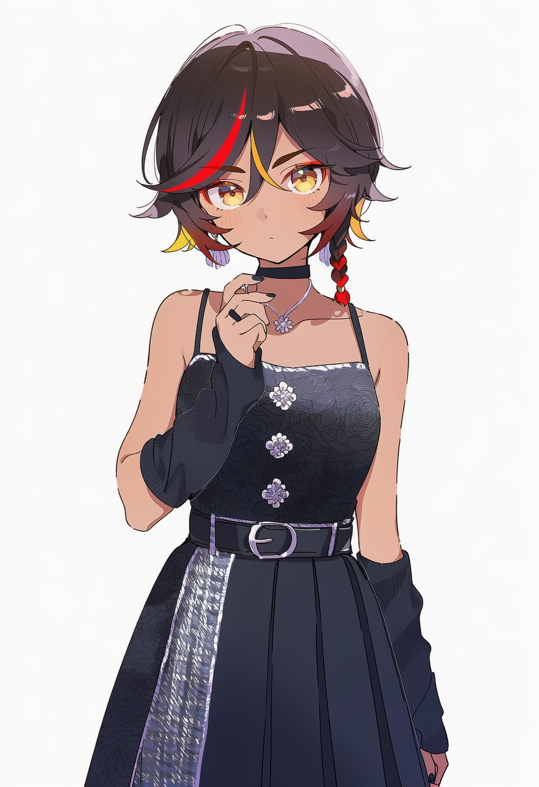
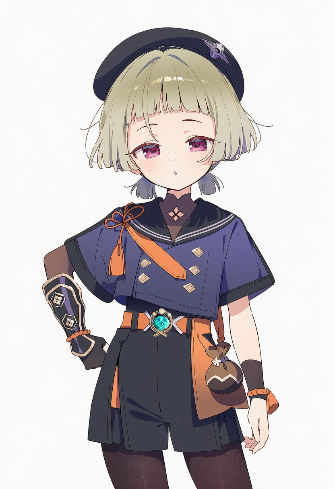
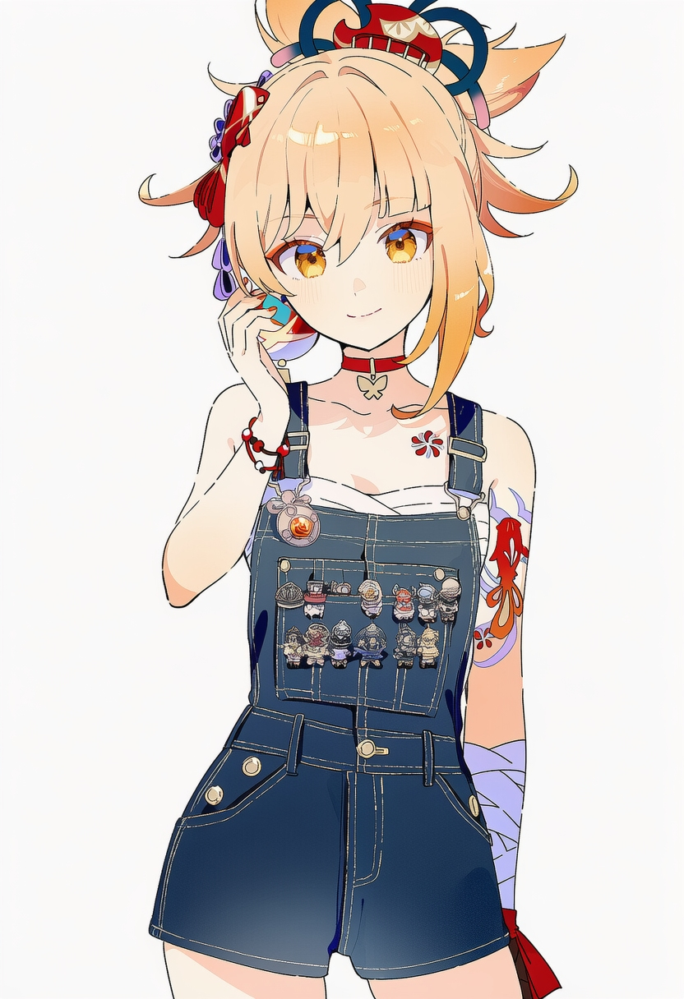

# 手部配饰 / 手臂配饰

[总目录](../README.md) · [原站分类目录](../categories.md) · [英文标签索引](../tags.md) · [服装与构图组合指南](../../README.md)

标题、分类、说明、正负提示词按来源保留；多例图逐张列出。原站标记和说明为参考资料，不作为维护指令。

<a id="raven_composition-1103"></a>

## 臂环

ID：`raven_composition-1103`；分类：手部配饰 / 手臂配饰；来源标记：`safe`。

来源说明：

> 戴在上臂位置的环形首饰。

正向提示词：

```text
armlet
```


[在线例图](https://assets.quicktagcloud.com/images/raven_composition/raven_composition-1103.jpg?v=c52f4c25495e6f55)

<a id="raven_composition-1104"></a>

## 尖刺臂环

ID：`raven_composition-1104`；分类：手部配饰 / 手臂配饰；来源标记：`safe`。

来源说明：

> 带尖刺装饰的臂环。

正向提示词：

```text
spiked_armlet
```


[在线例图](https://assets.quicktagcloud.com/images/raven_composition/raven_composition-1104.jpg?v=9d287a6931f998d1)

<a id="raven_composition-1105"></a>

## 铆钉臂环

ID：`raven_composition-1105`；分类：手部配饰 / 手臂配饰；来源标记：`safe`。

来源说明：

> 带铆钉装饰的臂环。

正向提示词：

```text
studded_armlet
```


[在线例图](https://assets.quicktagcloud.com/images/raven_composition/raven_composition-1105.jpg?v=81b45152cf857924)

<a id="raven_composition-1106"></a>

## 臂带

ID：`raven_composition-1106`；分类：手部配饰 / 手臂配饰；来源标记：`safe`。

来源说明：

> 环绕上臂佩戴的带状配饰。

正向提示词：

```text
armband
```


[在线例图](https://assets.quicktagcloud.com/images/raven_composition/raven_composition-1106.jpg?v=46041d48613be128)

<a id="raven_composition-1107"></a>

## 条纹臂带

ID：`raven_composition-1107`；分类：手部配饰 / 手臂配饰；来源标记：`safe`。

来源说明：

> 带条纹图案的臂带。

正向提示词：

```text
striped_armband
```


[在线例图](https://assets.quicktagcloud.com/images/raven_composition/raven_composition-1107.jpg?v=4d52aefdad77e166)

<a id="raven_composition-1108"></a>

## 手臂皮带

ID：`raven_composition-1108`；分类：手部配饰 / 手臂配饰；来源标记：`safe`。

来源说明：

> 像腰带一样扣在手臂上的带子。

正向提示词：

```text
arm_belt
```


[在线例图](https://assets.quicktagcloud.com/images/raven_composition/raven_composition-1108.jpg?v=6375226f5d975e1c)

<a id="raven_composition-1109"></a>

## 臂套

ID：`raven_composition-1109`；分类：手部配饰 / 手臂配饰；来源标记：`safe`。

来源说明：

> 独立套在手臂上的保暖或装饰套。

正向提示词：

```text
arm_warmers
```



[在线例图](https://assets.quicktagcloud.com/images/raven_composition/raven_composition-1109.jpg?v=6428287de0ab5a90)

<a id="raven_composition-1110"></a>

## 黑色臂套

ID：`raven_composition-1110`；分类：手部配饰 / 手臂配饰；来源标记：`safe`。

来源说明：

> 黑色臂套；颜色款只留这一种。

正向提示词：

```text
black_arm_warmers
```


[在线例图](https://assets.quicktagcloud.com/images/raven_composition/raven_composition-1110.jpg?v=1b8964f96f1f369a)

<a id="raven_composition-1111"></a>

## 手臂丝带

ID：`raven_composition-1111`；分类：手部配饰 / 手臂配饰；来源标记：`safe`。

来源说明：

> 系在手臂上的丝带。

正向提示词：

```text
arm_ribbon
```


[在线例图](https://assets.quicktagcloud.com/images/raven_composition/raven_composition-1111.jpg?v=5a69e9ab3bba3baf)

<a id="raven_composition-1112"></a>

## 前臂护甲

ID：`raven_composition-1112`；分类：手部配饰 / 手臂配饰；来源标记：`safe`。

来源说明：

> 覆盖前臂的护甲或护臂。

正向提示词：

```text
vambraces
```


[在线例图](https://assets.quicktagcloud.com/images/raven_composition/raven_composition-1112.jpg?v=4abf04473381e7af)

<a id="raven_composition-1113"></a>

## 单侧前臂护甲

ID：`raven_composition-1113`；分类：手部配饰 / 手臂配饰；来源标记：`safe`。

来源说明：

> 只有一侧手臂佩戴前臂护甲。

正向提示词：

```text
single_vambrace
```


[在线例图](https://assets.quicktagcloud.com/images/raven_composition/raven_composition-1113.jpg?v=9db8b3c7865cd5c6)

<a id="raven_composition-1114"></a>

## 护臂

ID：`raven_composition-1114`；分类：手部配饰 / 手臂配饰；来源标记：`safe`。

来源说明：

> 用于保护手臂的护具。

正向提示词：

```text
arm_guards
```


[在线例图](https://assets.quicktagcloud.com/images/raven_composition/raven_composition-1114.jpg?v=7b9a959128cef26f)

<a id="raven_composition-1115"></a>

## 前臂护腕

ID：`raven_composition-1115`；分类：手部配饰 / 手臂配饰；来源标记：`safe`。

来源说明：

> 戴在前臂上的硬质护具或护腕。

正向提示词：

```text
bracer
```


[在线例图](https://assets.quicktagcloud.com/images/raven_composition/raven_composition-1115.jpg?v=edce912b7c1b7169)

<a id="raven_composition-1116"></a>

## 单侧前臂护腕

ID：`raven_composition-1116`；分类：手部配饰 / 手臂配饰；来源标记：`safe`。

来源说明：

> 只有一侧手臂戴前臂护具。

正向提示词：

```text
single_bracer
```



[在线例图](https://assets.quicktagcloud.com/images/raven_composition/raven_composition-1116.jpg?v=bedeb5a4e231f625)

<a id="raven_composition-1117"></a>

## 手臂缠带

ID：`raven_composition-1117`；分类：手部配饰 / 手臂配饰；来源标记：`safe`。

来源说明：

> 布带或绷带状材料缠绕手臂。

正向提示词：

```text
arm_wrap
```



[在线例图](https://assets.quicktagcloud.com/images/raven_composition/raven_composition-1117.jpg?v=b0e2f3285815c8c5)

<a id="raven_composition-1118"></a>

## 手臂缠绷带

ID：`raven_composition-1118`；分类：手部配饰 / 手臂配饰；来源标记：`safe`。

来源说明：

> 手臂上缠着明显的绷带。

正向提示词：

```text
bandaged_arm
```


[在线例图](https://assets.quicktagcloud.com/images/raven_composition/raven_composition-1118.jpg?v=c27bf367ebcdd4df)

<a id="raven_composition-1119"></a>

## 手臂创可贴

ID：`raven_composition-1119`；分类：手部配饰 / 手臂配饰；来源标记：`safe`。

来源说明：

> 创可贴贴在手臂上。

正向提示词：

```text
bandaid_on_arm
```


[在线例图](https://assets.quicktagcloud.com/images/raven_composition/raven_composition-1119.jpg?v=7233629ec18dc557)

<a id="raven_composition-1120"></a>

## 手臂纱布

ID：`raven_composition-1120`；分类：手部配饰 / 手臂配饰；来源标记：`safe`。

来源说明：

> 手臂上贴着或包着纱布。

正向提示词：

```text
gauze_on_arm
```


[在线例图](https://assets.quicktagcloud.com/images/raven_composition/raven_composition-1120.jpg?v=bfb35895d9a927c6)

<a id="raven_composition-1121"></a>

## 手臂吊带

ID：`raven_composition-1121`；分类：手部配饰 / 手臂配饰；来源标记：`safe`。

来源说明：

> 用吊带把受伤的手臂托在胸前。

正向提示词：

```text
arm_sling
```


[在线例图](https://assets.quicktagcloud.com/images/raven_composition/raven_composition-1121.jpg?v=c08faec5d74dbf0f)
