# 面部表情 / 情绪/基础表情

[总目录](../README.md) · [原站分类目录](../categories.md) · [英文标签索引](../tags.md) · [服装与构图组合指南](../../README.md)

标题、分类、说明、正负提示词按来源保留；多例图逐张列出。原站标记和说明为参考资料，不作为维护指令。

<a id="raven_composition-1141"></a>

## 生气

ID：`raven_composition-1141`；分类：面部表情 / 情绪/基础表情；来源标记：`safe`。

来源说明：

> 明显愤怒的表情。

正向提示词：

```text
angry
```

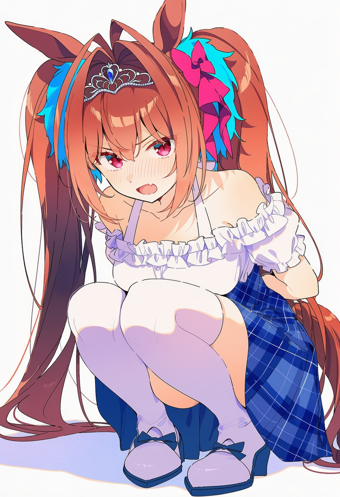

[在线例图](https://assets.quicktagcloud.com/images/raven_composition/raven_composition-1141.jpg?v=fc827773e865edc7)

<a id="raven_composition-1142"></a>

## 烦躁

ID：`raven_composition-1142`；分类：面部表情 / 情绪/基础表情；来源标记：`safe`。

来源说明：

> 不耐烦、被惹恼的表情。

正向提示词：

```text
annoyed
```

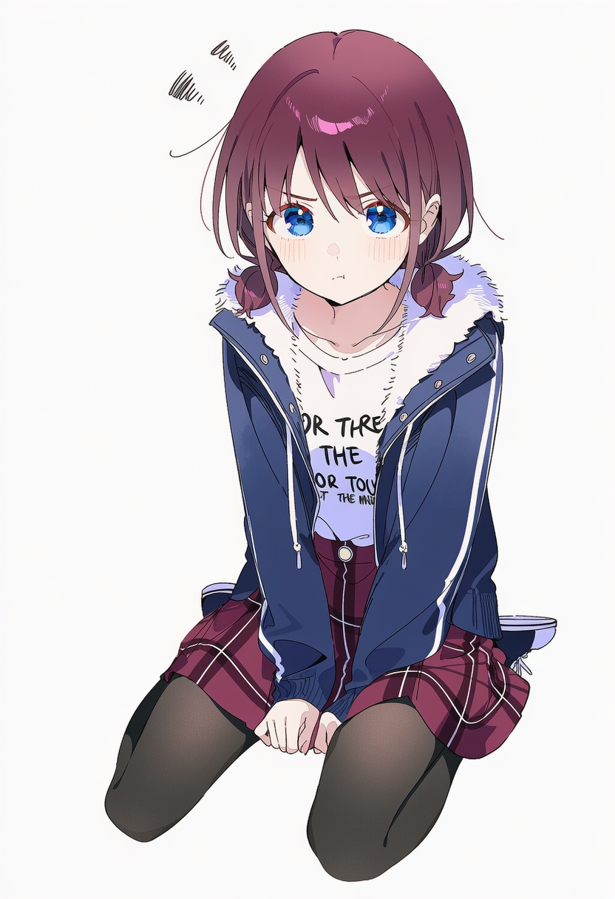

[在线例图](https://assets.quicktagcloud.com/images/raven_composition/raven_composition-1142.jpg?v=a4cdcd74cb1083e2)

<a id="raven_composition-1143"></a>

## 脸红

ID：`raven_composition-1143`；分类：面部表情 / 情绪/基础表情；来源标记：`safe`。

来源说明：

> 脸颊出现明显红晕。

正向提示词：

```text
blush
```


[在线例图](https://assets.quicktagcloud.com/images/raven_composition/raven_composition-1143.jpg?v=6e9855185dd42f21)

<a id="raven_composition-1144"></a>

## 贴纸式腮红

ID：`raven_composition-1144`；分类：面部表情 / 情绪/基础表情；来源标记：`safe`。

来源说明：

> 用漫画贴纸形状表现脸红。

正向提示词：

```text
blush_stickers
```

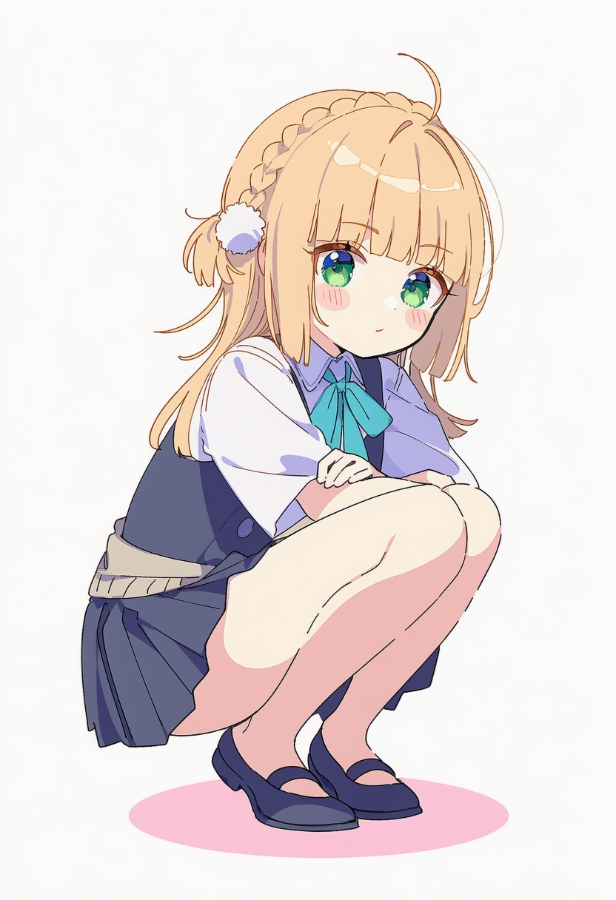

[在线例图](https://assets.quicktagcloud.com/images/raven_composition/raven_composition-1144.jpg?v=97edf6e27dd44053)

<a id="raven_composition-1145"></a>

## 尴尬 / 害羞

ID：`raven_composition-1145`；分类：面部表情 / 情绪/基础表情；来源标记：`safe`。

来源说明：

> 因害羞或尴尬而不自在。

正向提示词：

```text
embarrassed
```

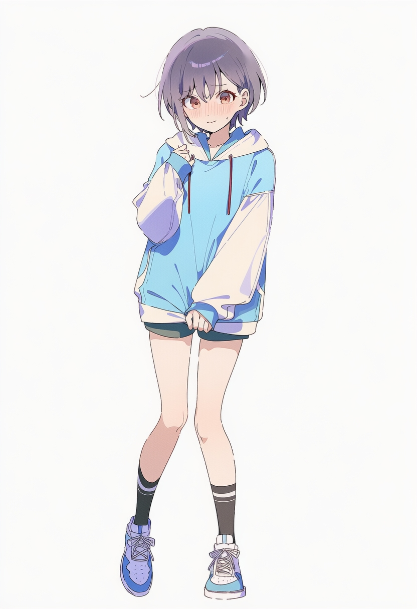

[在线例图](https://assets.quicktagcloud.com/images/raven_composition/raven_composition-1145.jpg?v=aea6e25158b28eac)

<a id="raven_composition-1146"></a>

## 满脸通红

ID：`raven_composition-1146`；分类：面部表情 / 情绪/基础表情；来源标记：`safe`。

来源说明：

> 整张脸大面积泛红。

正向提示词：

```text
full-face_blush
```

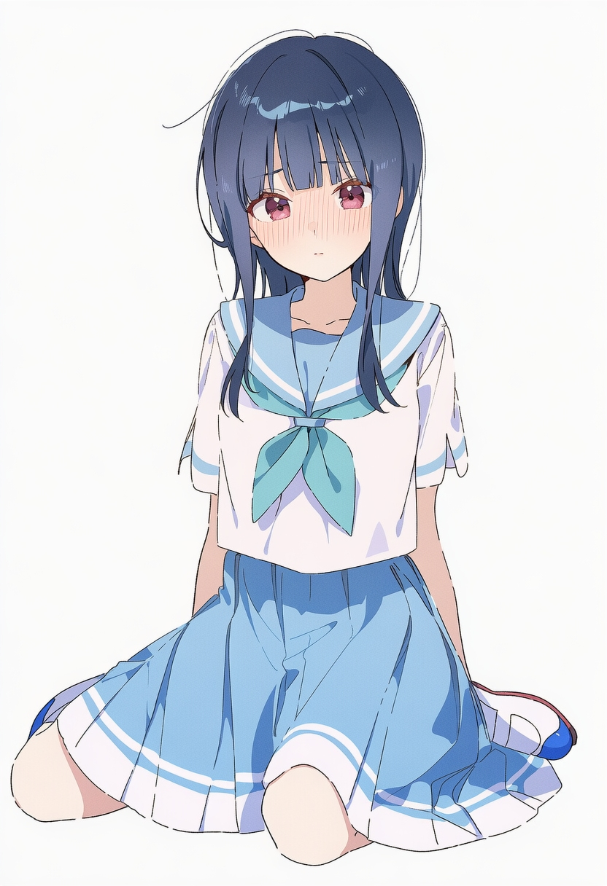

[在线例图](https://assets.quicktagcloud.com/images/raven_composition/raven_composition-1146.jpg?v=bcf493f6e2cc0487)

<a id="raven_composition-1147"></a>

## 鼻尖泛红

ID：`raven_composition-1147`；分类：面部表情 / 情绪/基础表情；来源标记：`safe`。

来源说明：

> 鼻子附近出现红晕。

正向提示词：

```text
nose_blush
```

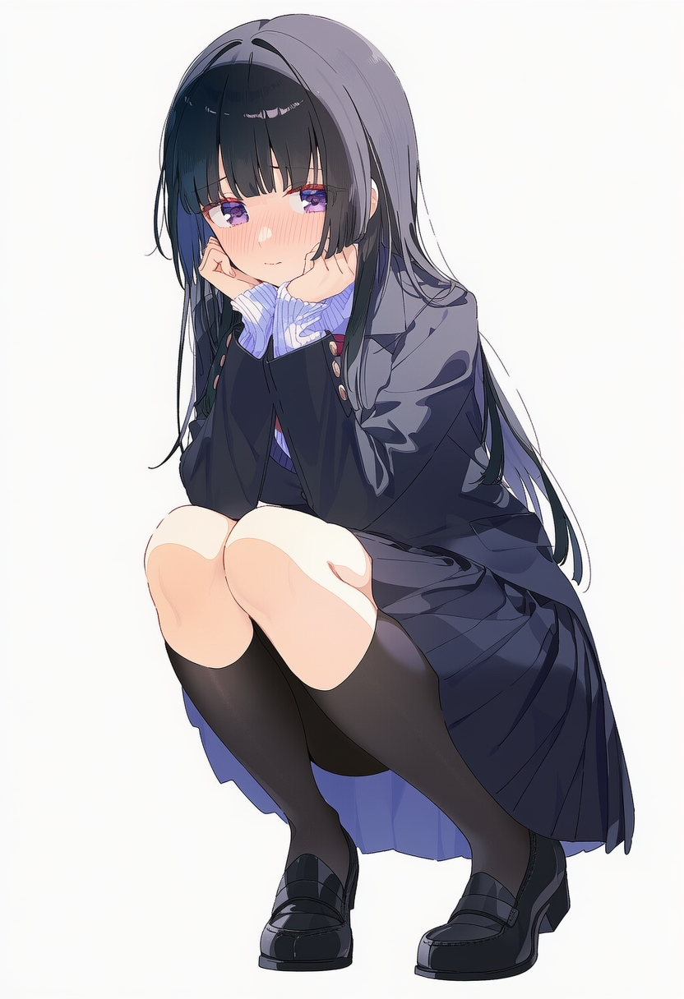

[在线例图](https://assets.quicktagcloud.com/images/raven_composition/raven_composition-1147.jpg?v=f311e21cb44a6050)

<a id="raven_composition-1148"></a>

## 无聊

ID：`raven_composition-1148`；分类：面部表情 / 情绪/基础表情；来源标记：`safe`。

来源说明：

> 提不起兴趣、百无聊赖。

正向提示词：

```text
bored
```

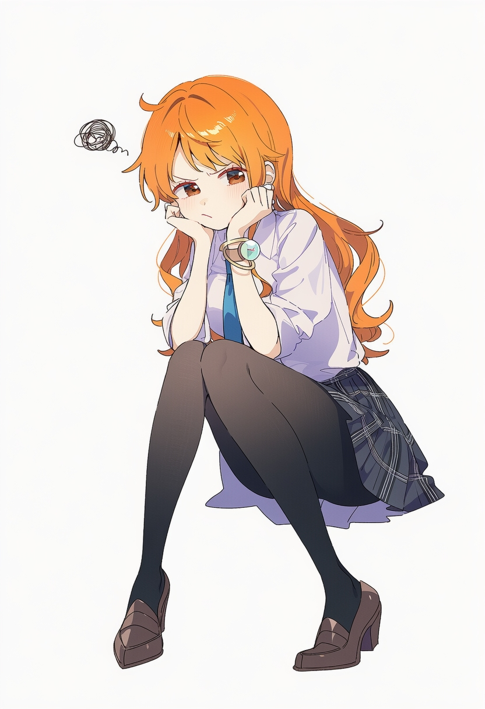

[在线例图](https://assets.quicktagcloud.com/images/raven_composition/raven_composition-1148.jpg?v=51476e3f3b03b69a)

<a id="raven_composition-1149"></a>

## 自信

ID：`raven_composition-1149`；分类：面部表情 / 情绪/基础表情；来源标记：`safe`。

来源说明：

> 神态自信、有把握。

正向提示词：

```text
confident
```

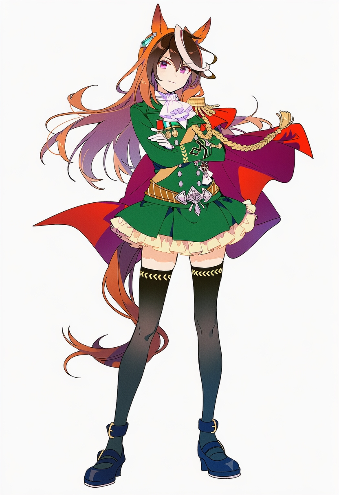

[在线例图](https://assets.quicktagcloud.com/images/raven_composition/raven_composition-1149.jpg?v=1b2999832e5ce4a6)

<a id="raven_composition-1150"></a>

## 困惑

ID：`raven_composition-1150`；分类：面部表情 / 情绪/基础表情；来源标记：`safe`。

来源说明：

> 不明白状况的疑惑表情。

正向提示词：

```text
confused
```

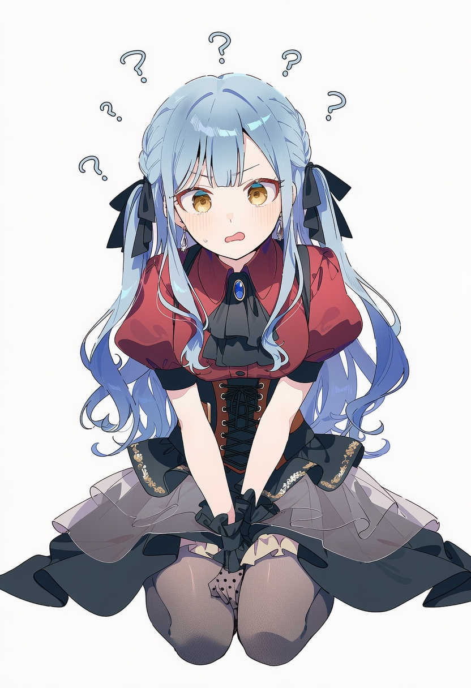

[在线例图](https://assets.quicktagcloud.com/images/raven_composition/raven_composition-1150.jpg?v=56ba1c5d50fcd39a)

<a id="raven_composition-1151"></a>

## 疯狂

ID：`raven_composition-1151`；分类：面部表情 / 情绪/基础表情；来源标记：`safe`。

来源说明：

> 精神亢奋或失控的疯狂表情。

正向提示词：

```text
crazy
```

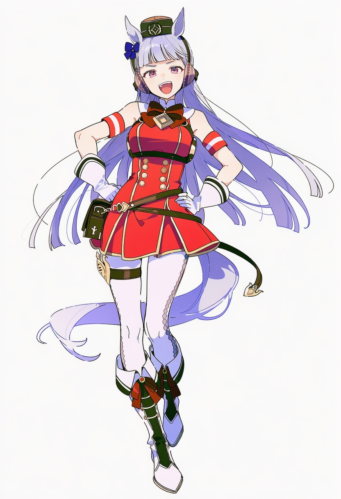

[在线例图](https://assets.quicktagcloud.com/images/raven_composition/raven_composition-1151.jpg?v=a085172ee60aa32d)

<a id="raven_composition-1152"></a>

## 绝望

ID：`raven_composition-1152`；分类：面部表情 / 情绪/基础表情；来源标记：`safe`。

来源说明：

> 明显失去希望的表情。

正向提示词：

```text
despair
```

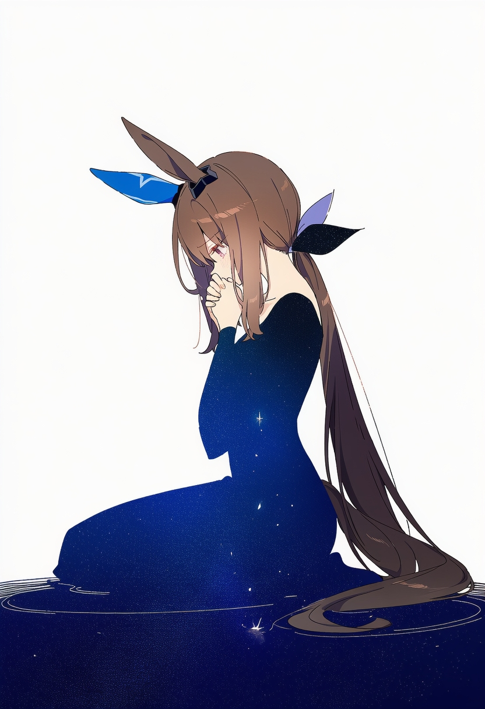

[在线例图](https://assets.quicktagcloud.com/images/raven_composition/raven_composition-1152.jpg?v=5b2524993e670799)

<a id="raven_composition-1153"></a>

## 坚定

ID：`raven_composition-1153`；分类：面部表情 / 情绪/基础表情；来源标记：`safe`。

来源说明：

> 下定决心、意志坚定。

正向提示词：

```text
determined
```

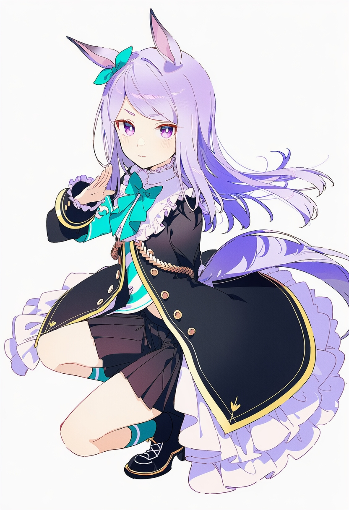

[在线例图](https://assets.quicktagcloud.com/images/raven_composition/raven_composition-1153.jpg?v=b25a980475b85416)

<a id="raven_composition-1154"></a>

## 失望

ID：`raven_composition-1154`；分类：面部表情 / 情绪/基础表情；来源标记：`safe`。

来源说明：

> 期待落空后的失望神情。

正向提示词：

```text
disappointed
```

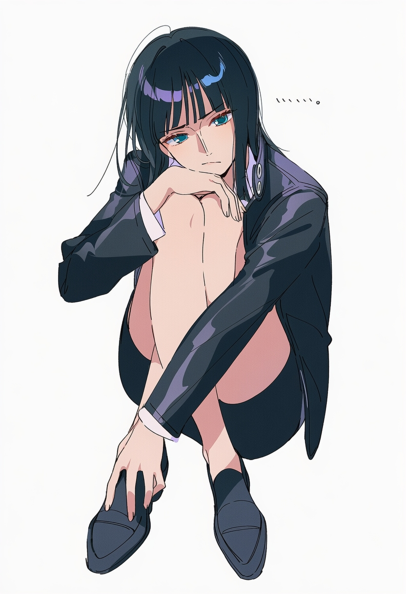

[在线例图](https://assets.quicktagcloud.com/images/raven_composition/raven_composition-1154.jpg?v=128c5db751b29b69)

<a id="raven_composition-1155"></a>

## 轻蔑

ID：`raven_composition-1155`；分类：面部表情 / 情绪/基础表情；来源标记：`safe`。

来源说明：

> 带鄙视和看不起的神情。

正向提示词：

```text
disdain
```


[在线例图](https://assets.quicktagcloud.com/images/raven_composition/raven_composition-1155.jpg?v=a728e66cba6a7a1b)

<a id="raven_composition-1156"></a>

## 嫌恶

ID：`raven_composition-1156`；分类：面部表情 / 情绪/基础表情；来源标记：`safe`。

来源说明：

> 明显厌恶或反胃的表情。

正向提示词：

```text
disgust
```

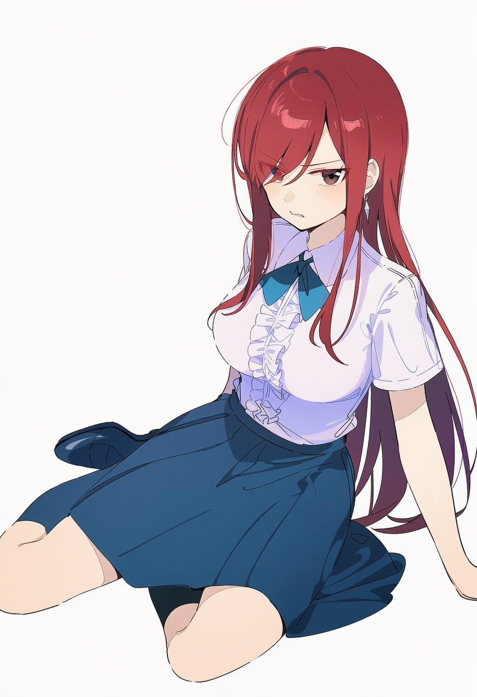

[在线例图](https://assets.quicktagcloud.com/images/raven_composition/raven_composition-1156.jpg?v=ac2dfe4e17f954f3)

<a id="raven_composition-1157"></a>

## 痛苦焦虑

ID：`raven_composition-1157`；分类：面部表情 / 情绪/基础表情；来源标记：`safe`。

来源说明：

> 陷入痛苦或焦虑的神情。

正向提示词：

```text
distress
```

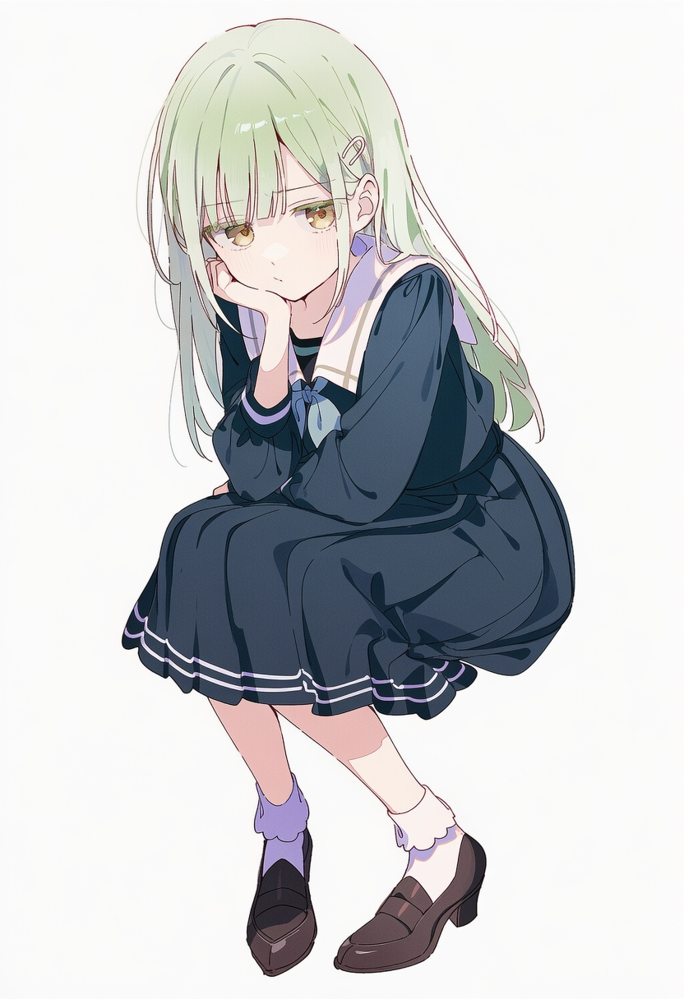

[在线例图](https://assets.quicktagcloud.com/images/raven_composition/raven_composition-1157.jpg?v=96b8ce9f8399affc)

<a id="raven_composition-1158"></a>

## 醉态

ID：`raven_composition-1158`；分类：面部表情 / 情绪/基础表情；来源标记：`safe`。

来源说明：

> 醉酒后迷糊或失控的表情。

正向提示词：

```text
drunk
```

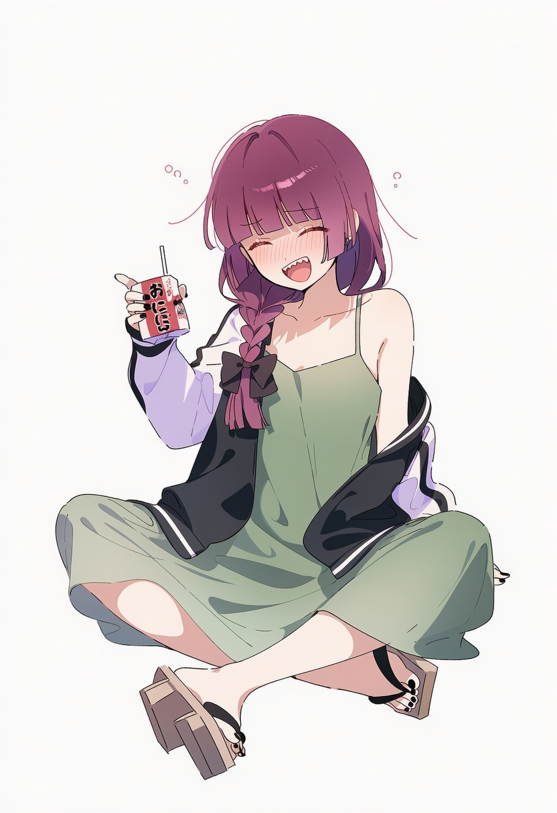

[在线例图](https://assets.quicktagcloud.com/images/raven_composition/raven_composition-1158.jpg?v=abdfe31d6e42c3e1)

<a id="raven_composition-1159"></a>

## 兴奋

ID：`raven_composition-1159`；分类：面部表情 / 情绪/基础表情；来源标记：`safe`。

来源说明：

> 情绪高涨、非常激动。

正向提示词：

```text
excited
```

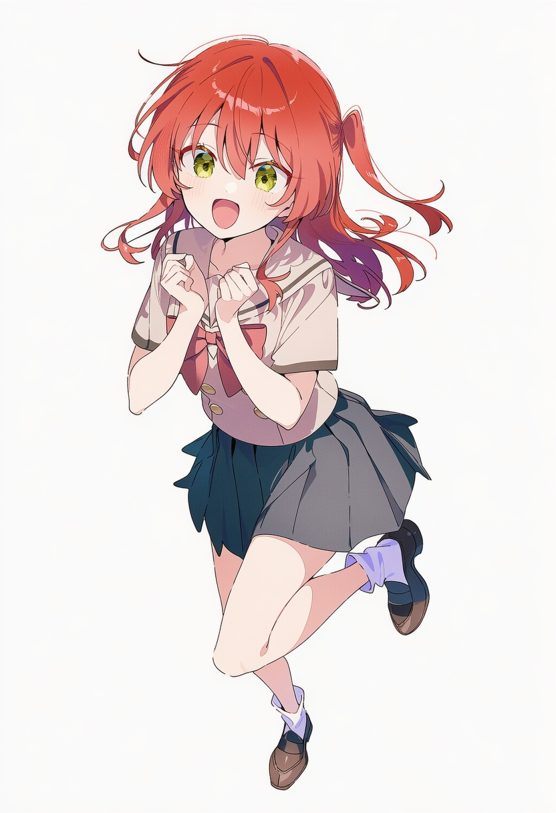

[在线例图](https://assets.quicktagcloud.com/images/raven_composition/raven_composition-1159.jpg?v=7eb9c70a15e76ab2)

<a id="raven_composition-1160"></a>

## 精疲力尽

ID：`raven_composition-1160`；分类：面部表情 / 情绪/基础表情；来源标记：`safe`。

来源说明：

> 疲惫到几乎没有精神。

正向提示词：

```text
exhausted
```

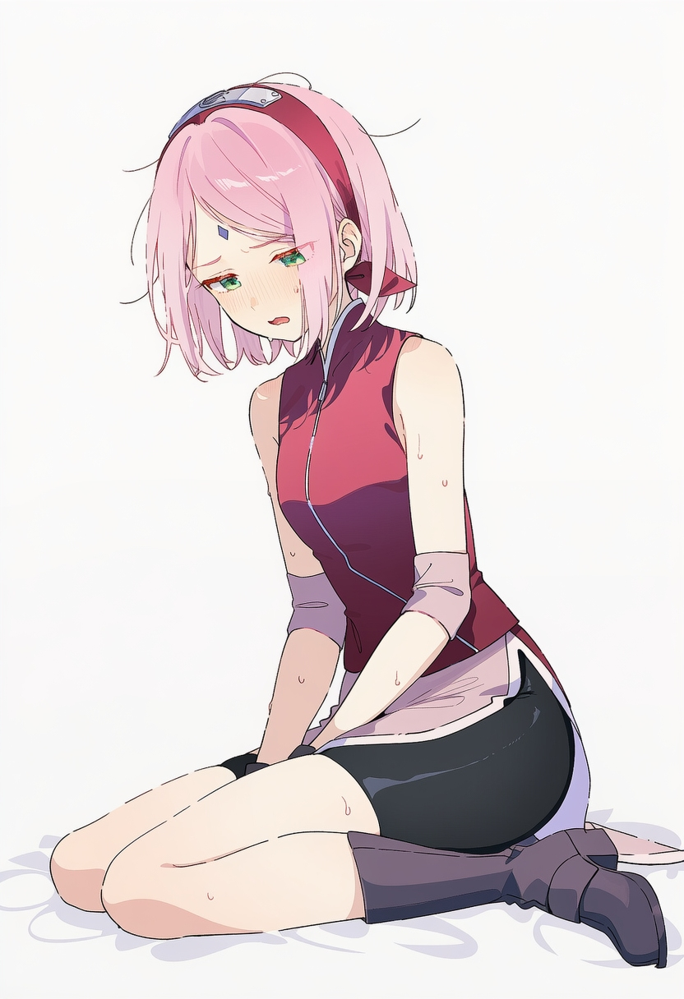

[在线例图](https://assets.quicktagcloud.com/images/raven_composition/raven_composition-1160.jpg?v=836176ebd60263d0)

<a id="raven_composition-1161"></a>

## 无表情

ID：`raven_composition-1161`；分类：面部表情 / 情绪/基础表情；来源标记：`safe`。

来源说明：

> 脸上几乎没有明显情绪。

正向提示词：

```text
expressionless
```

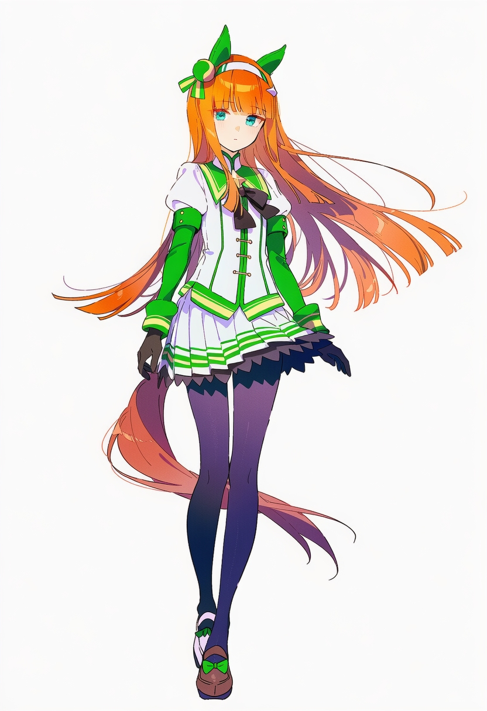

[在线例图](https://assets.quicktagcloud.com/images/raven_composition/raven_composition-1161.jpg?v=fb56f2b63d61880f)

<a id="raven_composition-1162"></a>

## 慌乱脸红

ID：`raven_composition-1162`；分类：面部表情 / 情绪/基础表情；来源标记：`safe`。

来源说明：

> 紧张慌乱、手足无措。

正向提示词：

```text
flustered
```


[在线例图](https://assets.quicktagcloud.com/images/raven_composition/raven_composition-1162.jpg?v=6c575b3e1d4251ca)

<a id="raven_composition-1163"></a>

## 挫败烦闷

ID：`raven_composition-1163`；分类：面部表情 / 情绪/基础表情；来源标记：`safe`。

来源说明：

> 受挫后烦躁不甘。

正向提示词：

```text
frustrated
```

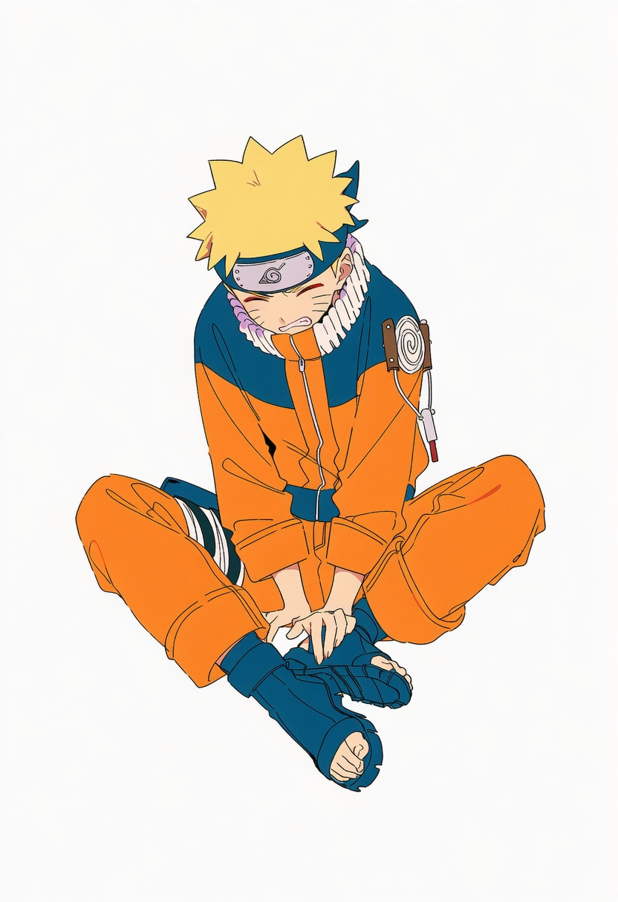

[在线例图](https://assets.quicktagcloud.com/images/raven_composition/raven_composition-1163.jpg?v=183f0b1d1180f886)

<a id="raven_composition-1164"></a>

## 皱眉

ID：`raven_composition-1164`；分类：面部表情 / 情绪/基础表情；来源标记：`safe`。

来源说明：

> 眉头紧锁。

正向提示词：

```text
furrowed_brow
```

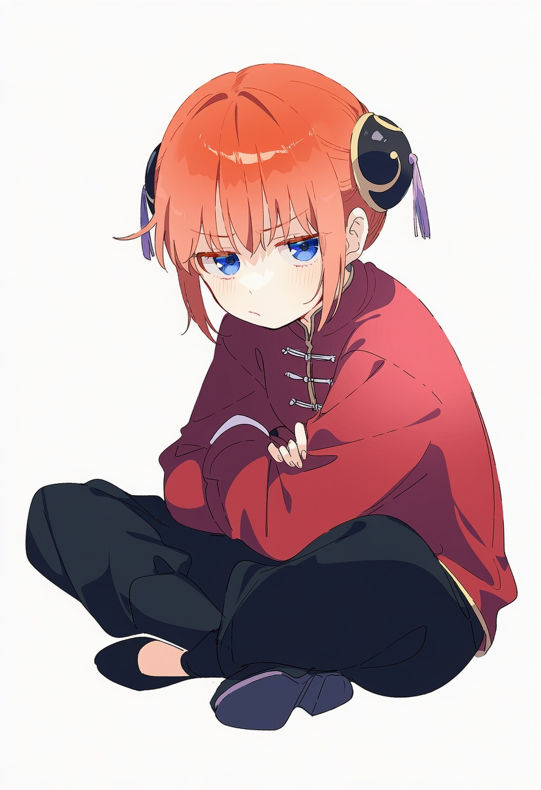

[在线例图](https://assets.quicktagcloud.com/images/raven_composition/raven_composition-1164.jpg?v=45ff23ae3baa5b66)

<a id="raven_composition-1165"></a>

## 愧疚

ID：`raven_composition-1165`；分类：面部表情 / 情绪/基础表情；来源标记：`safe`。

来源说明：

> 做错事后的心虚愧疚。

正向提示词：

```text
guilt
```

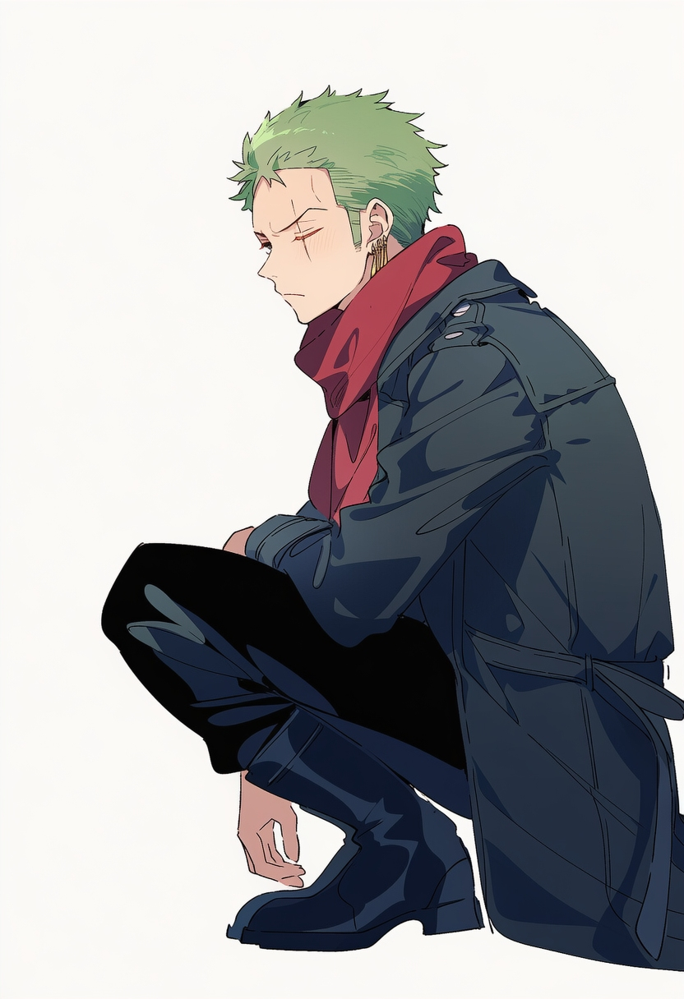

[在线例图](https://assets.quicktagcloud.com/images/raven_composition/raven_composition-1165.jpg?v=59399574baf47f11)

<a id="raven_composition-1166"></a>

## 开心

ID：`raven_composition-1166`；分类：面部表情 / 情绪/基础表情；来源标记：`safe`。

来源说明：

> 明显愉快、开心的表情。

正向提示词：

```text
happy
```


[在线例图](https://assets.quicktagcloud.com/images/raven_composition/raven_composition-1166.jpg?v=98dc4f08192d265a)

<a id="raven_composition-1167"></a>

## 孤独

ID：`raven_composition-1167`；分类：面部表情 / 情绪/基础表情；来源标记：`safe`。

来源说明：

> 显得孤单、落寞。

正向提示词：

```text
lonely
```

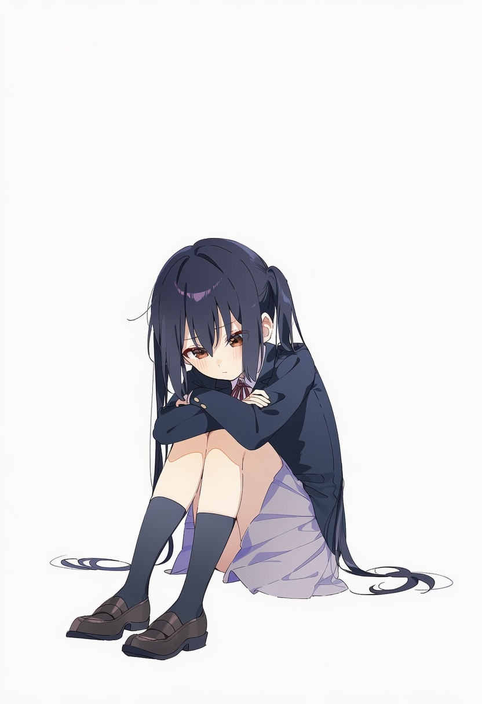

[在线例图](https://assets.quicktagcloud.com/images/raven_composition/raven_composition-1167.jpg?v=00c1d77a5709200c)

<a id="raven_composition-1168"></a>

## 紧张

ID：`raven_composition-1168`；分类：面部表情 / 情绪/基础表情；来源标记：`safe`。

来源说明：

> 紧张不安的表情。

正向提示词：

```text
nervous
```

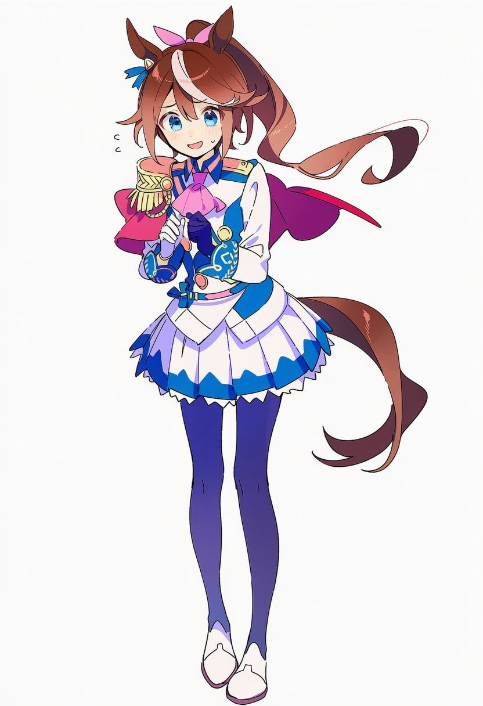

[在线例图](https://assets.quicktagcloud.com/images/raven_composition/raven_composition-1168.jpg?v=0d6d8fe91bb1f574)

<a id="raven_composition-1169"></a>

## 沉思

ID：`raven_composition-1169`；分类：面部表情 / 情绪/基础表情；来源标记：`safe`。

来源说明：

> 安静思考、若有所思。

正向提示词：

```text
pensive
```

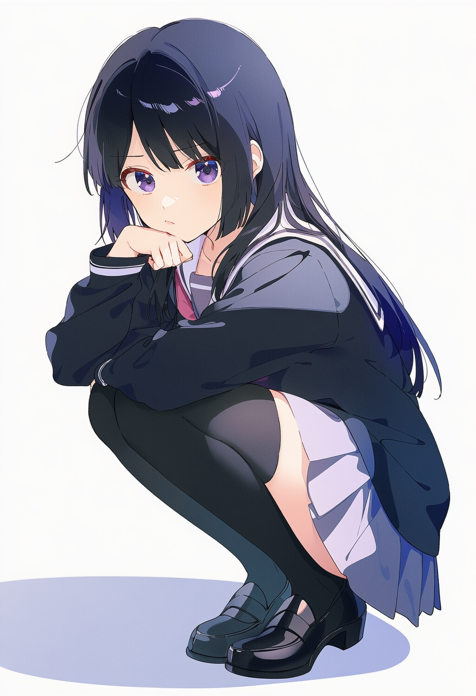

[在线例图](https://assets.quicktagcloud.com/images/raven_composition/raven_composition-1169.jpg?v=8261137b774dfa14)

<a id="raven_composition-1170"></a>

## 悲伤

ID：`raven_composition-1170`；分类：面部表情 / 情绪/基础表情；来源标记：`safe`。

来源说明：

> 明显难过的表情。

正向提示词：

```text
sad
```


[在线例图](https://assets.quicktagcloud.com/images/raven_composition/raven_composition-1170.jpg?v=d4f225ff948cae7e)

<a id="raven_composition-1171"></a>

## 消沉

ID：`raven_composition-1171`；分类：面部表情 / 情绪/基础表情；来源标记：`safe`。

来源说明：

> 情绪低落、很丧。

正向提示词：

```text
depressed
```

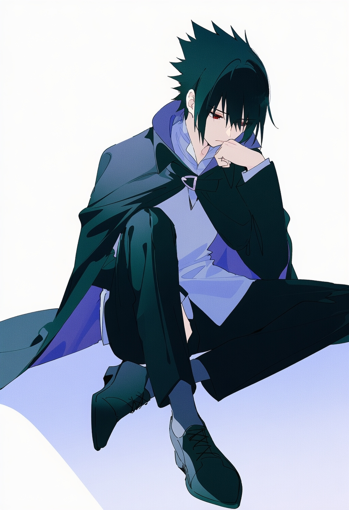

[在线例图](https://assets.quicktagcloud.com/images/raven_composition/raven_composition-1171.jpg?v=13ca1186566d3c3b)

<a id="raven_composition-1172"></a>

## 阴沉

ID：`raven_composition-1172`；分类：面部表情 / 情绪/基础表情；来源标记：`safe`。

来源说明：

> 阴郁低沉、气压很低。

正向提示词：

```text
gloom_(expression)
```

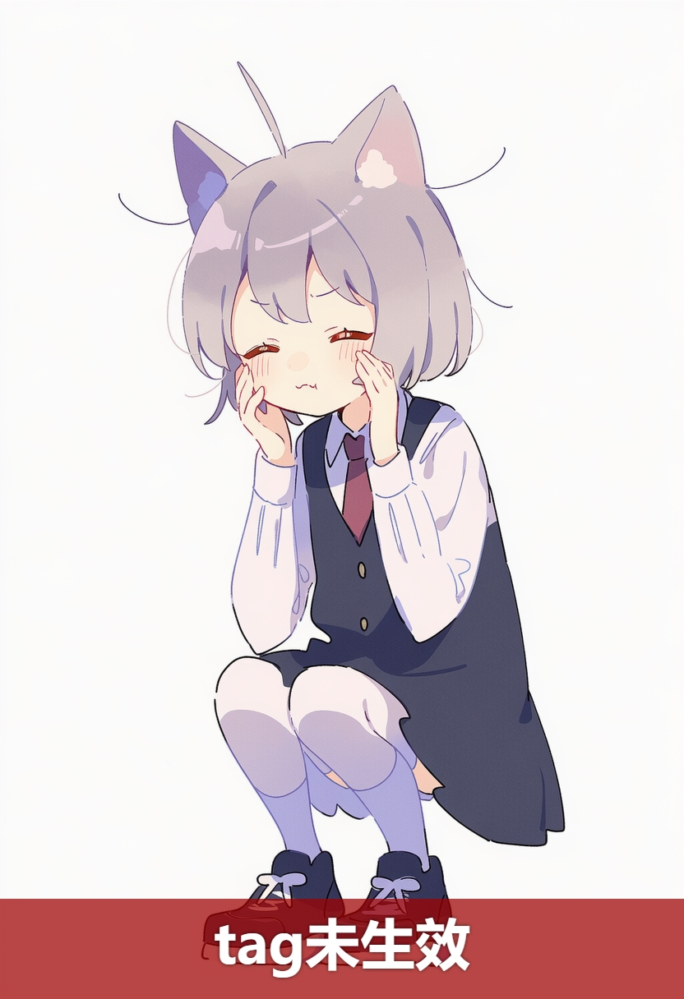

[在线例图](https://assets.quicktagcloud.com/images/raven_composition/raven_composition-1172.jpg?v=26a13a1dda61c155)

<a id="raven_composition-1173"></a>

## 害怕

ID：`raven_composition-1173`；分类：面部表情 / 情绪/基础表情；来源标记：`safe`。

来源说明：

> 受到惊吓、感到恐惧。

正向提示词：

```text
scared
```

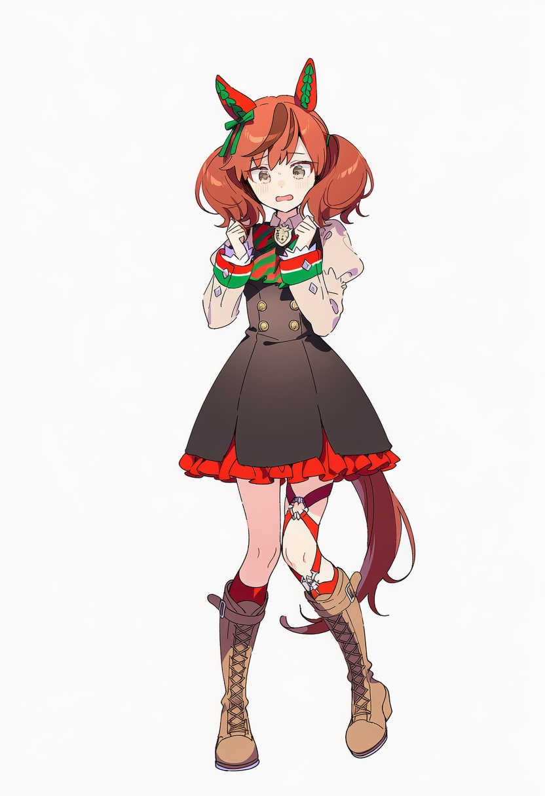

[在线例图](https://assets.quicktagcloud.com/images/raven_composition/raven_composition-1173.jpg?v=79b56b912f457e48)

<a id="raven_composition-1174"></a>

## 惊慌

ID：`raven_composition-1174`；分类：面部表情 / 情绪/基础表情；来源标记：`safe`。

来源说明：

> 慌张到快失去冷静。

正向提示词：

```text
panicking
```

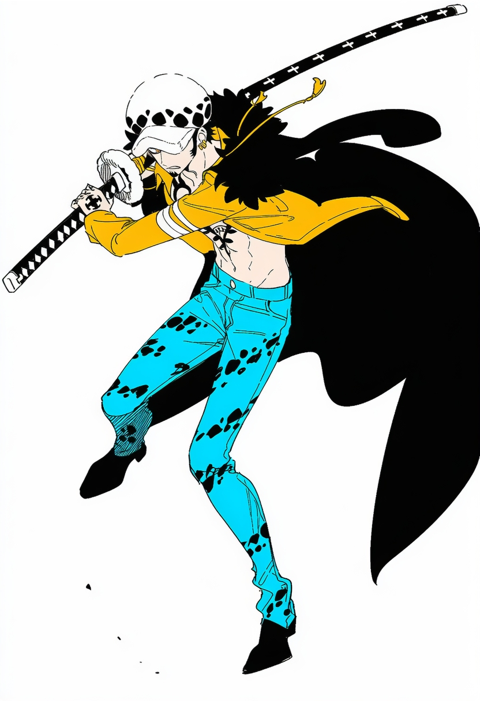

[在线例图](https://assets.quicktagcloud.com/images/raven_composition/raven_composition-1174.jpg?v=47bef58738017ad0)

<a id="raven_composition-1175"></a>

## 担心

ID：`raven_composition-1175`；分类：面部表情 / 情绪/基础表情；来源标记：`safe`。

来源说明：

> 忧虑、不放心的神情。

正向提示词：

```text
worried
```

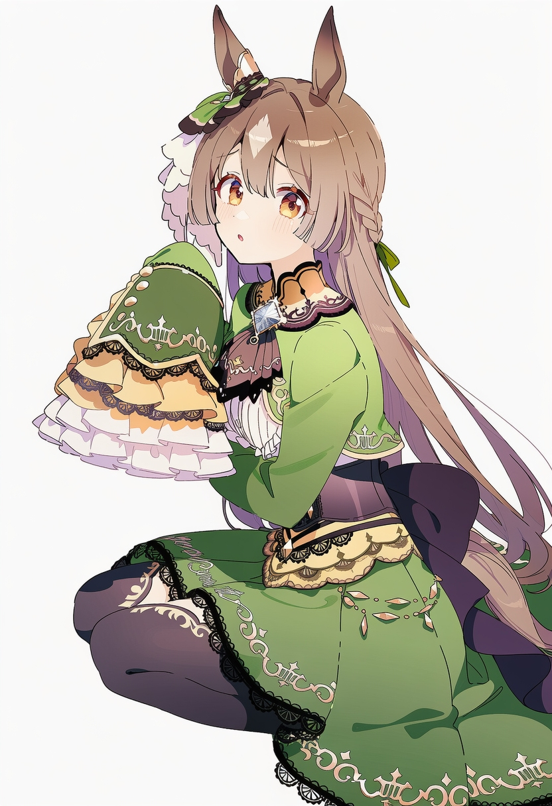

[在线例图](https://assets.quicktagcloud.com/images/raven_composition/raven_composition-1175.jpg?v=f7ff2bc09cc1fdd9)

<a id="raven_composition-1176"></a>

## 严肃

ID：`raven_composition-1176`；分类：面部表情 / 情绪/基础表情；来源标记：`safe`。

来源说明：

> 认真严肃、不带笑意。

正向提示词：

```text
serious
```

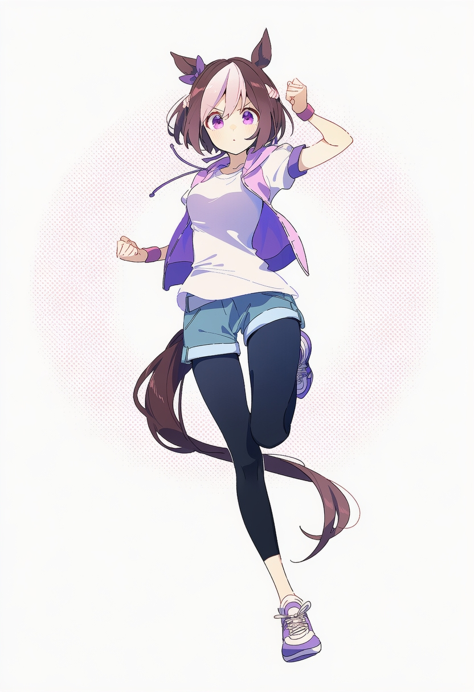

[在线例图](https://assets.quicktagcloud.com/images/raven_composition/raven_composition-1176.jpg?v=2231e9486b585c7b)

<a id="raven_composition-1177"></a>

## 害羞

ID：`raven_composition-1177`；分类：面部表情 / 情绪/基础表情；来源标记：`safe`。

来源说明：

> 羞涩、拘谨的表情。

正向提示词：

```text
shy
```

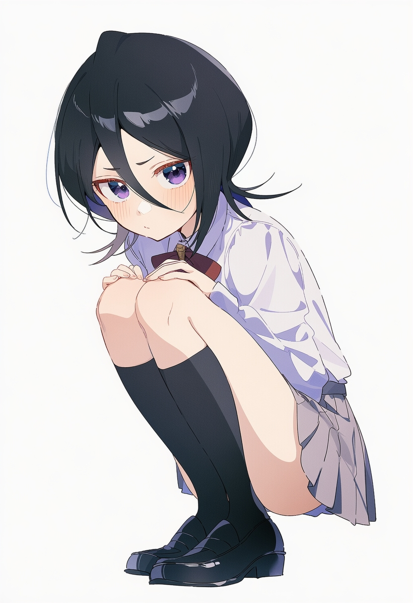

[在线例图](https://assets.quicktagcloud.com/images/raven_composition/raven_composition-1177.jpg?v=60867265a6478cd4)

<a id="raven_composition-1178"></a>

## 怀疑

ID：`raven_composition-1178`；分类：面部表情 / 情绪/基础表情；来源标记：`safe`。

来源说明：

> 半信半疑、不太相信。

正向提示词：

```text
skeptical
```

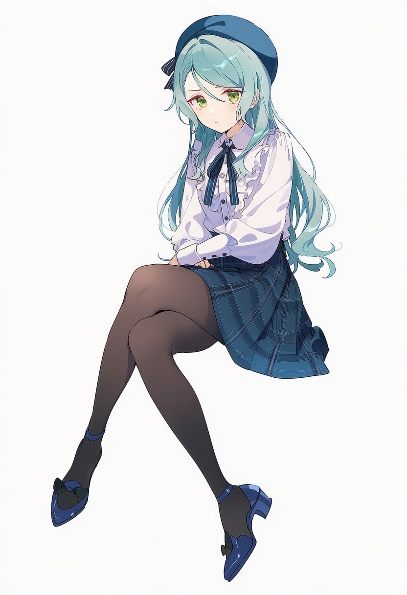

[在线例图](https://assets.quicktagcloud.com/images/raven_composition/raven_composition-1178.jpg?v=15916d97a89db70b)

<a id="raven_composition-1179"></a>

## 困倦

ID：`raven_composition-1179`；分类：面部表情 / 情绪/基础表情；来源标记：`safe`。

来源说明：

> 昏昏欲睡的表情。

正向提示词：

```text
sleepy
```

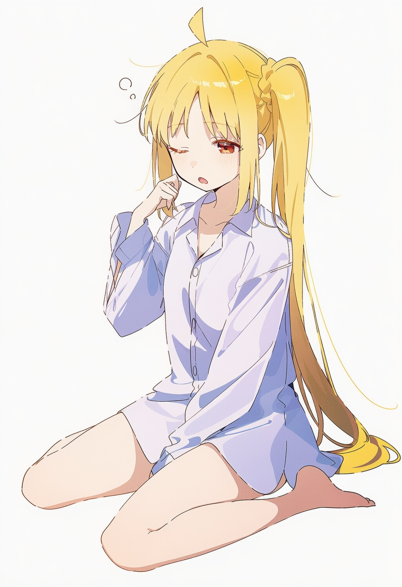

[在线例图](https://assets.quicktagcloud.com/images/raven_composition/raven_composition-1179.jpg?v=5d84fe7b67410ac9)

<a id="raven_composition-1180"></a>

## 闹别扭

ID：`raven_composition-1180`；分类：面部表情 / 情绪/基础表情；来源标记：`safe`。

来源说明：

> 赌气、闷闷不乐。

正向提示词：

```text
sulking
```

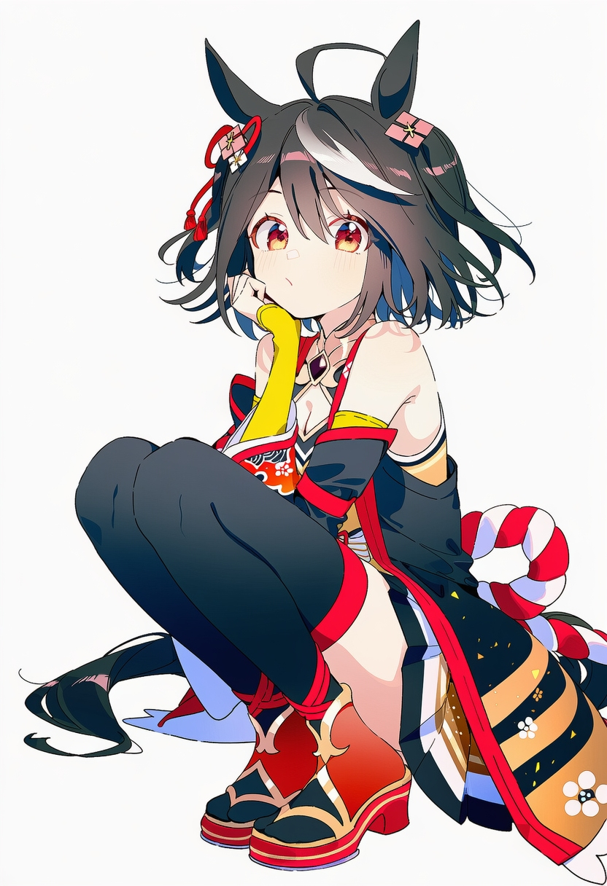

[在线例图](https://assets.quicktagcloud.com/images/raven_composition/raven_composition-1180.jpg?v=4a295db5f24ede99)

<a id="raven_composition-1181"></a>

## 惊讶

ID：`raven_composition-1181`；分类：面部表情 / 情绪/基础表情；来源标记：`safe`。

来源说明：

> 突然吃惊的表情。

正向提示词：

```text
surprised
```


[在线例图](https://assets.quicktagcloud.com/images/raven_composition/raven_composition-1181.jpg?v=d514aee73fab3cd0)

<a id="raven_composition-1182"></a>

## 思考

ID：`raven_composition-1182`；分类：面部表情 / 情绪/基础表情；来源标记：`safe`。

来源说明：

> 正在思考问题的神情。

正向提示词：

```text
thinking
```

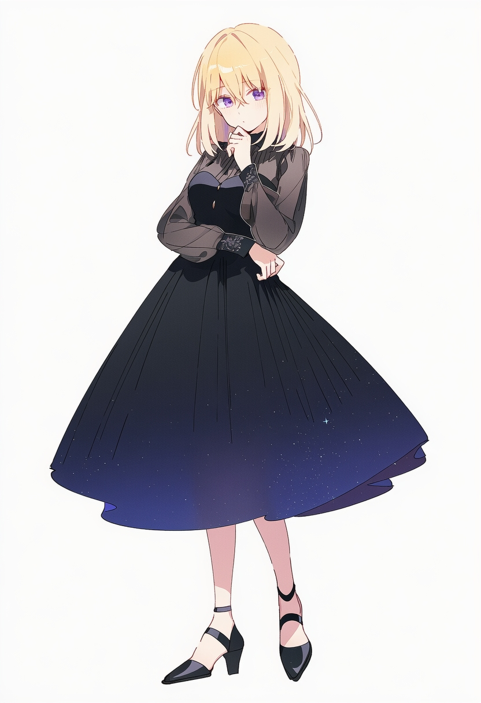

[在线例图](https://assets.quicktagcloud.com/images/raven_composition/raven_composition-1182.jpg?v=54aa4468501f3997)

<a id="raven_composition-1183"></a>

## 无语

ID：`raven_composition-1183`；分类：面部表情 / 情绪/基础表情；来源标记：`safe`。

来源说明：

> 完全没觉得好笑的冷淡表情。

正向提示词：

```text
unamused
```

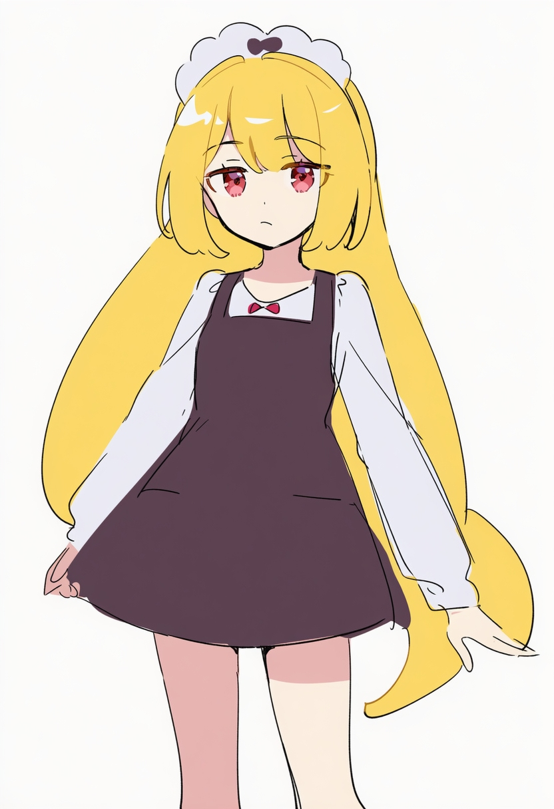

[在线例图](https://assets.quicktagcloud.com/images/raven_composition/raven_composition-1183.jpg?v=253fb6993e04acd3)

<a id="raven_composition-1184"></a>

## 阴影脸

ID：`raven_composition-1184`；分类：面部表情 / 情绪/基础表情；来源标记：`safe`。

来源说明：

> 脸被阴影压暗，表现低气压。

正向提示词：

```text
shaded_face
```

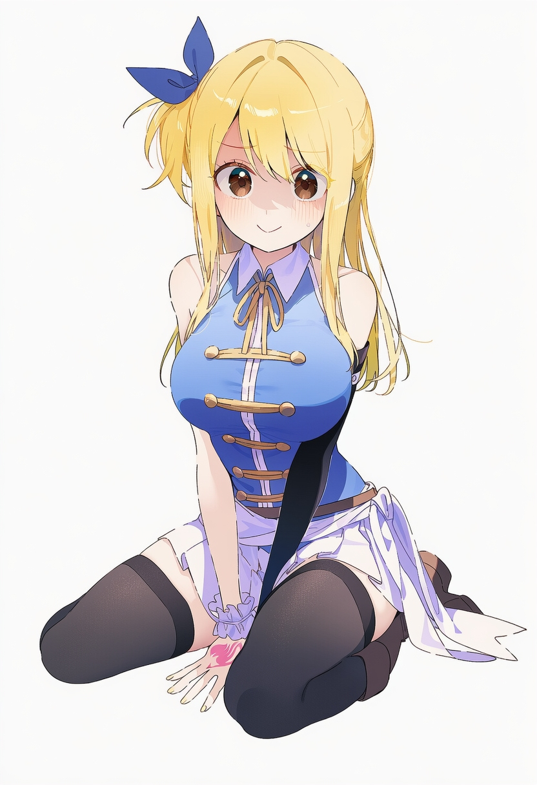

[在线例图](https://assets.quicktagcloud.com/images/raven_composition/raven_composition-1184.jpg?v=ba9ce5c4321d982e)

<a id="raven_composition-1185"></a>

## 尖叫

ID：`raven_composition-1185`；分类：面部表情 / 情绪/基础表情；来源标记：`safe`。

来源说明：

> 张口大叫、强烈惊恐或激动。

正向提示词：

```text
screaming
```

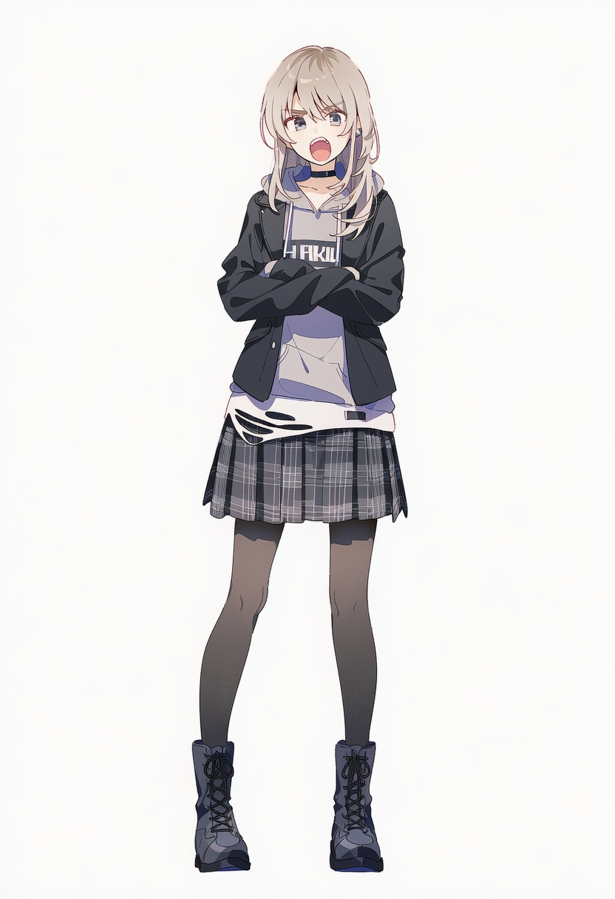

[在线例图](https://assets.quicktagcloud.com/images/raven_composition/raven_composition-1185.jpg?v=8ab6a5eb2ea56e09)

<a id="raven_composition-1186"></a>

## 抽泣

ID：`raven_composition-1186`；分类：面部表情 / 情绪/基础表情；来源标记：`safe`。

来源说明：

> 哭得很厉害、不断抽泣。

正向提示词：

```text
sobbing
```

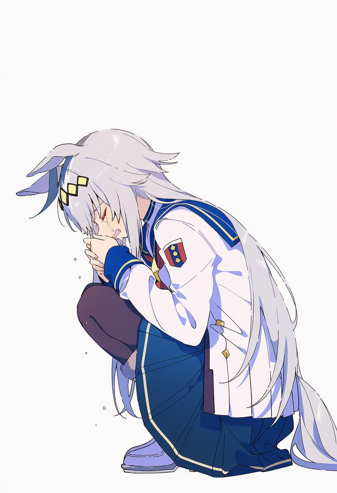

[在线例图](https://assets.quicktagcloud.com/images/raven_composition/raven_composition-1186.jpg?v=83d52d8c2db63ef2)

<a id="raven_composition-1187"></a>

## 流泪

ID：`raven_composition-1187`；分类：面部表情 / 情绪/基础表情；来源标记：`safe`。

来源说明：

> 眼睛流出泪水。

正向提示词：

```text
tears
```

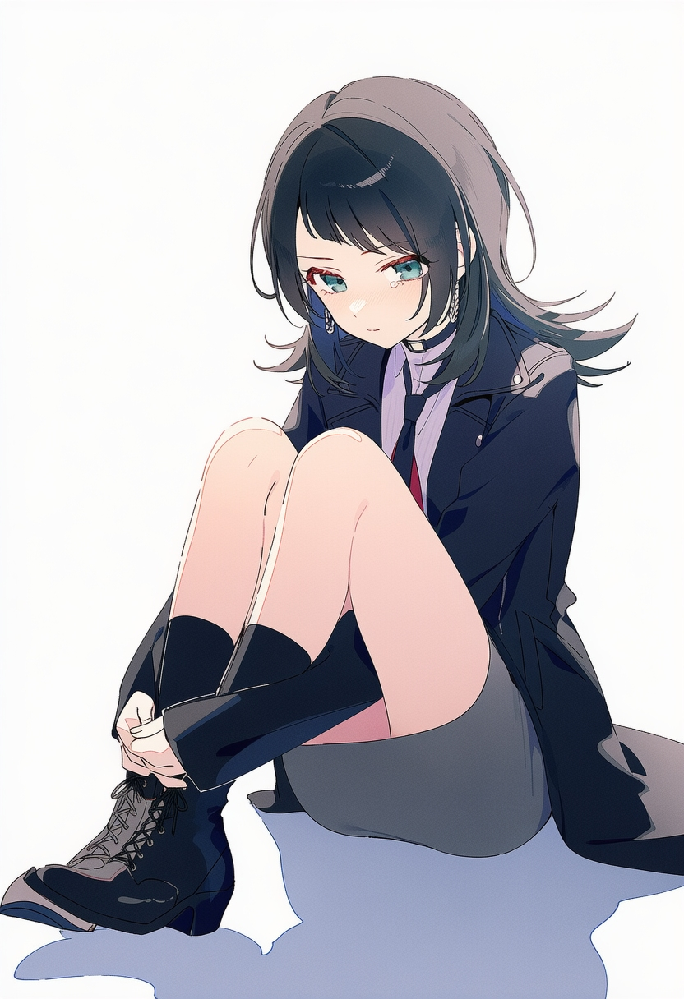

[在线例图](https://assets.quicktagcloud.com/images/raven_composition/raven_composition-1187.jpg?v=9622738a3d8f3206)

<a id="raven_composition-1188"></a>

## 眼含泪光

ID：`raven_composition-1188`；分类：面部表情 / 情绪/基础表情；来源标记：`safe`。

来源说明：

> 眼里蓄着泪、快要哭出来。

正向提示词：

```text
tearing_up
```

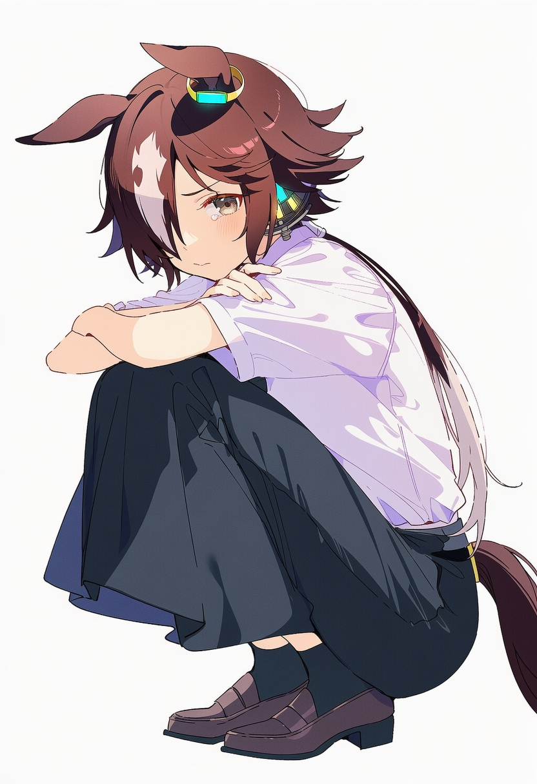

[在线例图](https://assets.quicktagcloud.com/images/raven_composition/raven_composition-1188.jpg?v=5e79a2302518d514)

<a id="raven_composition-1189"></a>

## 鼻血

ID：`raven_composition-1189`；分类：面部表情 / 情绪/基础表情；来源标记：`safe`。

来源说明：

> 因激动等原因出现鼻血。

正向提示词：

```text
nosebleed
```


[在线例图](https://assets.quicktagcloud.com/images/raven_composition/raven_composition-1189.jpg?v=a75f1c4fe95c7ff3)

<a id="raven_composition-1190"></a>

## 叹气

ID：`raven_composition-1190`；分类：面部表情 / 情绪/基础表情；来源标记：`safe`。

来源说明：

> 无奈或疲惫地叹气。

正向提示词：

```text
sigh
```

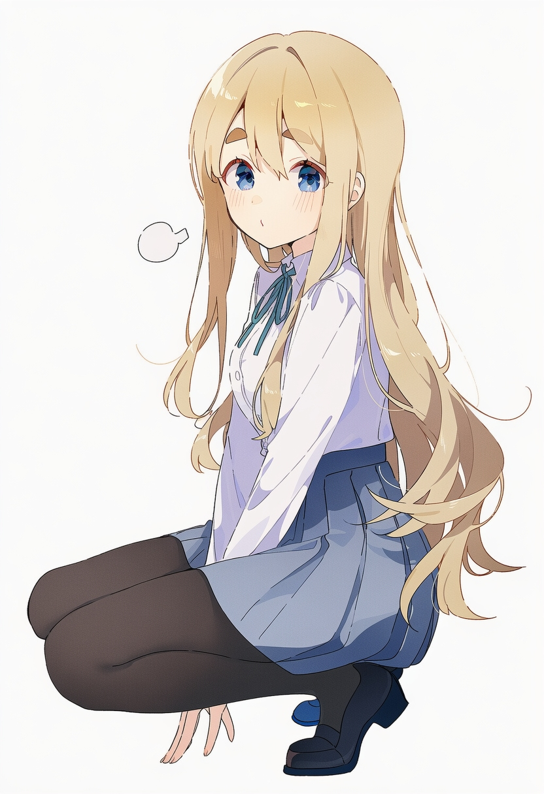

[在线例图](https://assets.quicktagcloud.com/images/raven_composition/raven_composition-1190.jpg?v=9668b1b09e521af1)

<a id="raven_composition-1191"></a>

## 怒筋

ID：`raven_composition-1191`；分类：面部表情 / 情绪/基础表情；来源标记：`safe`。

来源说明：

> 漫画式爆青筋愤怒符号。

正向提示词：

```text
anger_vein
```

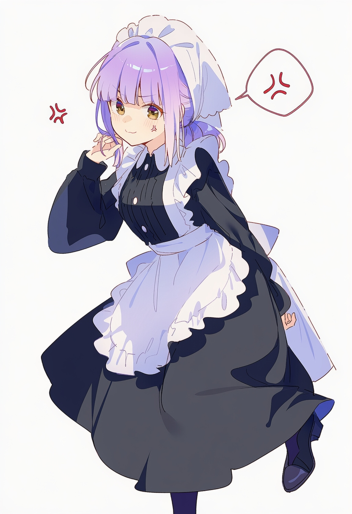

[在线例图](https://assets.quicktagcloud.com/images/raven_composition/raven_composition-1191.jpg?v=d727abe91dceb5b7)

<a id="raven_composition-1192"></a>

## 汗滴

ID：`raven_composition-1192`；分类：面部表情 / 情绪/基础表情；来源标记：`safe`。

来源说明：

> 漫画式大汗滴，表示尴尬或无语。

正向提示词：

```text
sweatdrop
```


[在线例图](https://assets.quicktagcloud.com/images/raven_composition/raven_composition-1192.jpg?v=2a9c319d7d67f979)

<a id="raven_composition-1193"></a>

## 小汗滴

ID：`raven_composition-1193`；分类：面部表情 / 情绪/基础表情；来源标记：`safe`。

来源说明：

> 较小的漫画汗滴。

正向提示词：

```text
small_sweatdrop
```


[在线例图](https://assets.quicktagcloud.com/images/raven_composition/raven_composition-1193.jpg?v=e0dc248d5ac7490c)

<a id="raven_composition-1194"></a>

## 搞笑汗滴

ID：`raven_composition-1194`；分类：面部表情 / 情绪/基础表情；来源标记：`safe`。

来源说明：

> 夸张漫画汗滴，强调尴尬或吐槽。

正向提示词：

```text
comedic_sweatdrop
```

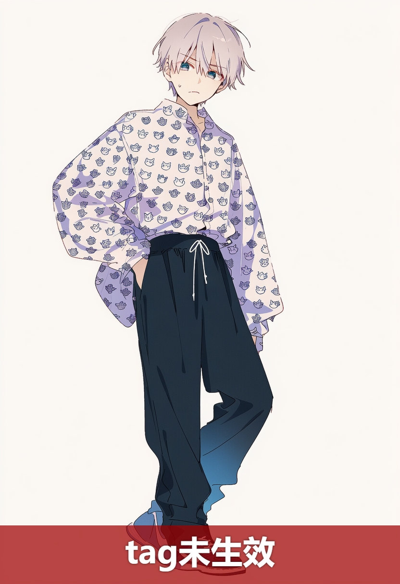

[在线例图](https://assets.quicktagcloud.com/images/raven_composition/raven_composition-1194.jpg?v=981cdf69417088f7)

<a id="raven_composition-1195"></a>

## 飞散汗滴

ID：`raven_composition-1195`；分类：面部表情 / 情绪/基础表情；来源标记：`safe`。

来源说明：

> 多颗汗滴向外飞散的夸张表现。

正向提示词：

```text
flying_sweatdrops
```

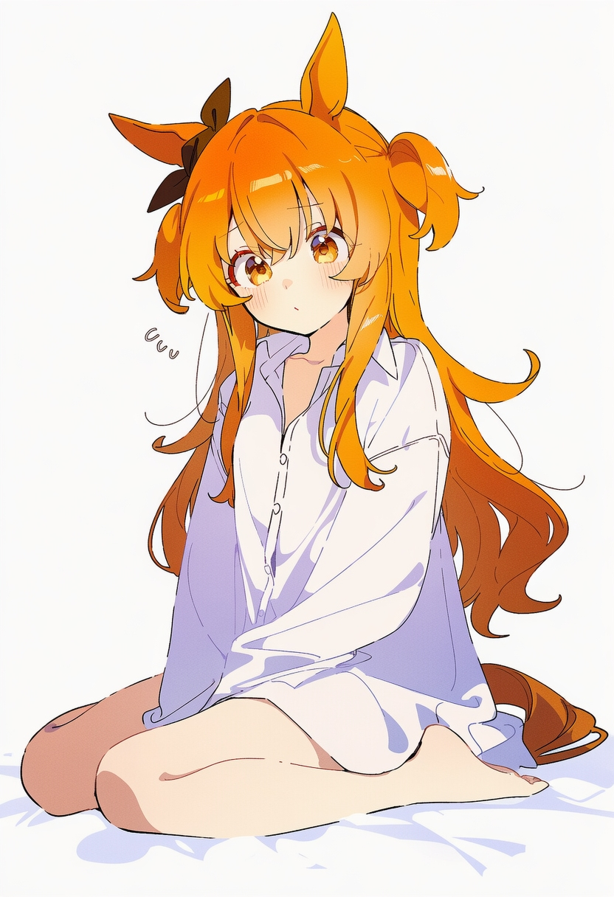

[在线例图](https://assets.quicktagcloud.com/images/raven_composition/raven_composition-1195.jpg?v=c944c67f6c04016b)

<a id="raven_composition-1196"></a>

## 出汗

ID：`raven_composition-1196`；分类：面部表情 / 情绪/基础表情；来源标记：`safe`。

来源说明：

> 脸部或身体明显冒汗。

正向提示词：

```text
sweat
```


[在线例图](https://assets.quicktagcloud.com/images/raven_composition/raven_composition-1196.jpg?v=9b3974d7a709b966)

<a id="raven_composition-1197"></a>

## 鼻涕

ID：`raven_composition-1197`；分类：面部表情 / 情绪/基础表情；来源标记：`safe`。

来源说明：

> 鼻子流出鼻涕，常用于哭泣或搞笑。

正向提示词：

```text
snot
```

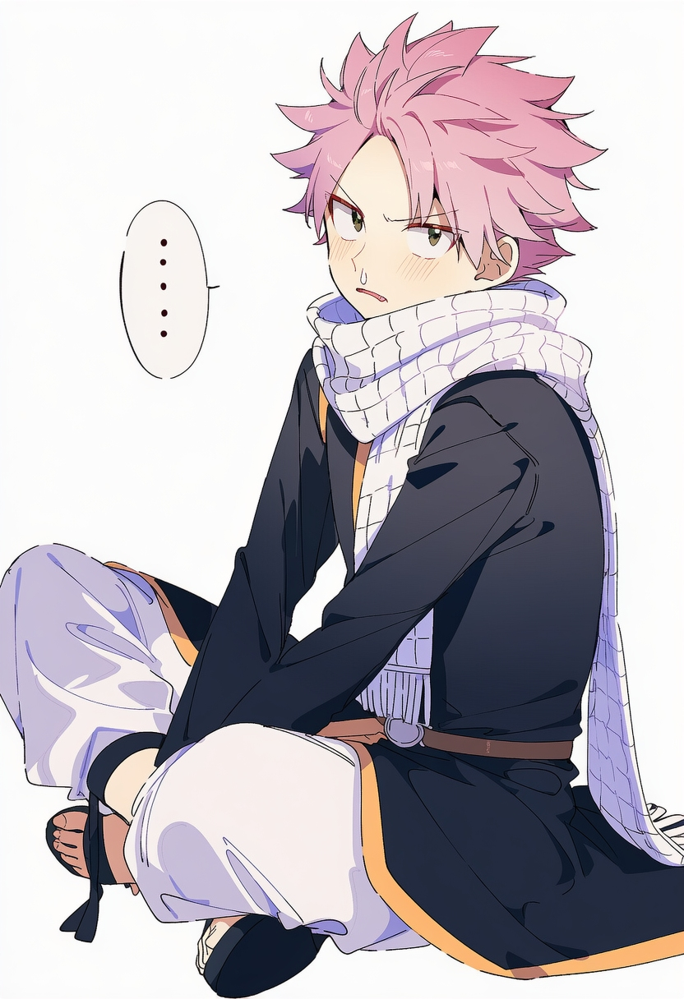

[在线例图](https://assets.quicktagcloud.com/images/raven_composition/raven_composition-1197.jpg?v=0ef671e867bae2d9)
