# 面部表情 / 笑容/得意/特殊表情

[总目录](../README.md) · [原站分类目录](../categories.md) · [英文标签索引](../tags.md) · [服装与构图组合指南](../../README.md)

标题、分类、说明、正负提示词按来源保留；多例图逐张列出。原站标记和说明为参考资料，不作为维护指令。

<a id="raven_composition-1198"></a>

## 微笑 / 笑容

ID：`raven_composition-1198`；分类：面部表情 / 笑容/得意/特殊表情；来源标记：`safe`。

来源说明：

> 嘴角上扬的普通笑容。

正向提示词：

```text
smile
```

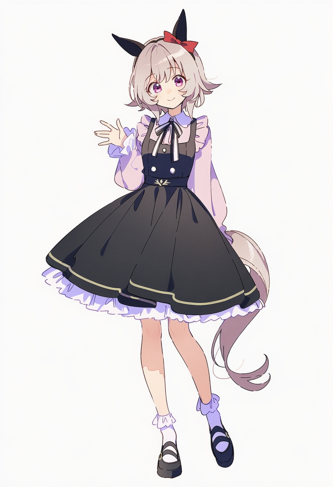

[在线例图](https://assets.quicktagcloud.com/images/raven_composition/raven_composition-1198.jpg?v=81cef5b5dc527512)

<a id="raven_composition-1199"></a>

## 浅笑

ID：`raven_composition-1199`；分类：面部表情 / 笑容/得意/特殊表情；来源标记：`safe`。

来源说明：

> 幅度很轻的柔和微笑。

正向提示词：

```text
light_smile
```

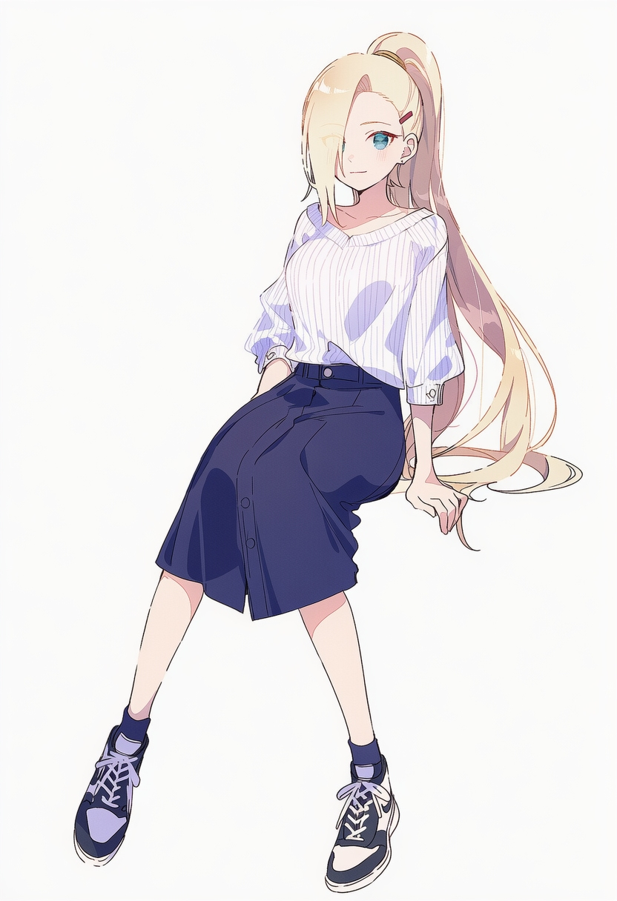

[在线例图](https://assets.quicktagcloud.com/images/raven_composition/raven_composition-1199.jpg?v=c6ee1dbb416a23f4)

<a id="raven_composition-1200"></a>

## 露齿笑

ID：`raven_composition-1200`；分类：面部表情 / 笑容/得意/特殊表情；来源标记：`safe`。

来源说明：

> 张嘴或露齿的明显笑容。

正向提示词：

```text
grin
```

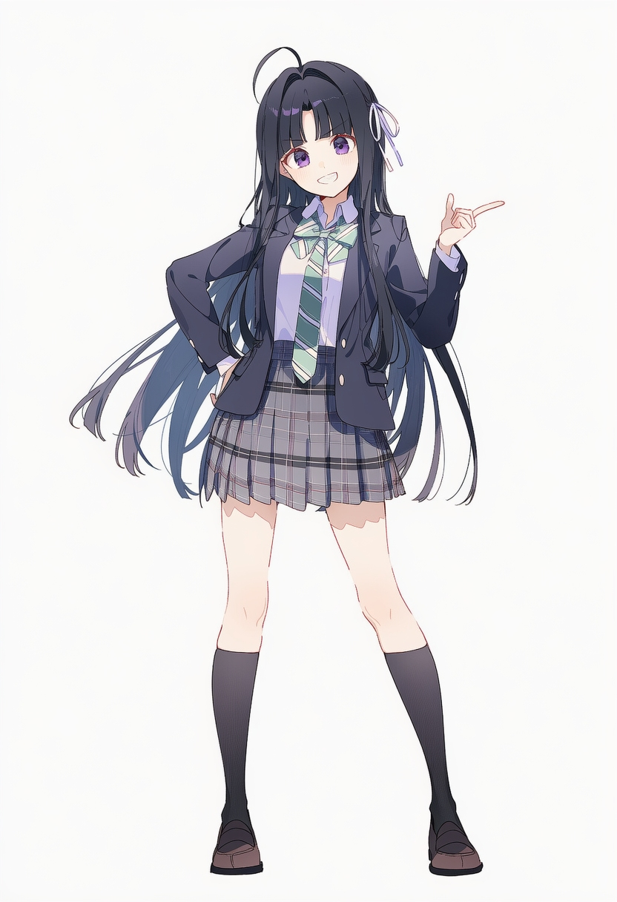

[在线例图](https://assets.quicktagcloud.com/images/raven_composition/raven_composition-1200.jpg?v=22a4fede0d320d0f)

<a id="raven_composition-1201"></a>

## 邪恶微笑

ID：`raven_composition-1201`；分类：面部表情 / 笑容/得意/特殊表情；来源标记：`safe`。

来源说明：

> 带恶意或阴谋感的笑容。

正向提示词：

```text
evil_smile
```

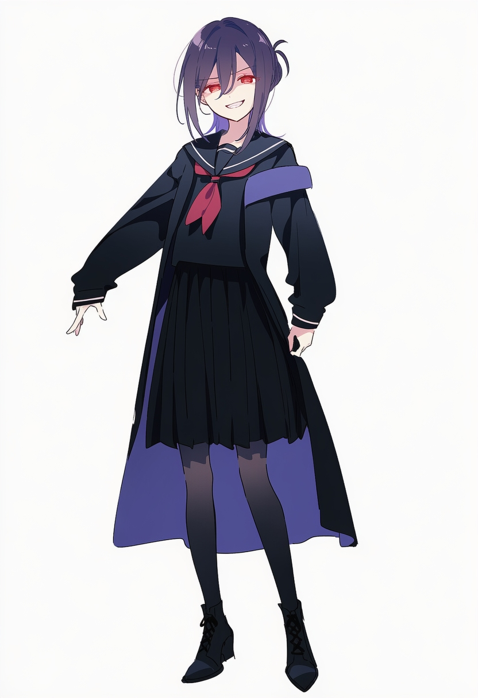

[在线例图](https://assets.quicktagcloud.com/images/raven_composition/raven_composition-1201.jpg?v=b023b510af4c66e0)

<a id="raven_composition-1202"></a>

## 邪恶露齿笑

ID：`raven_composition-1202`；分类：面部表情 / 笑容/得意/特殊表情；来源标记：`safe`。

来源说明：

> 露齿、带恶意的夸张笑容。

正向提示词：

```text
evil_grin
```

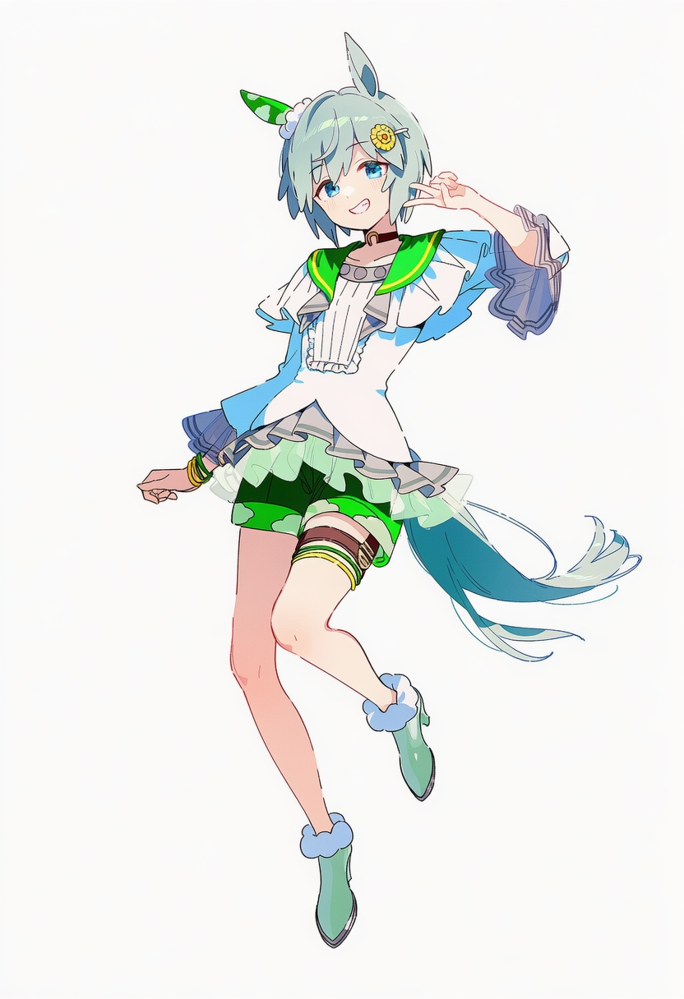

[在线例图](https://assets.quicktagcloud.com/images/raven_composition/raven_composition-1202.jpg?v=adc65ec65d9359ba)

<a id="raven_composition-1203"></a>

## 疯狂笑容

ID：`raven_composition-1203`；分类：面部表情 / 笑容/得意/特殊表情；来源标记：`safe`。

来源说明：

> 精神亢奋或失控的笑容。

正向提示词：

```text
crazy_smile
```

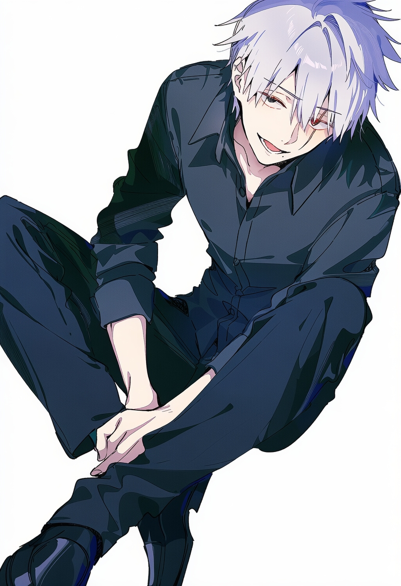

[在线例图](https://assets.quicktagcloud.com/images/raven_composition/raven_composition-1203.jpg?v=7d8e7f4dc4df4686)

<a id="raven_composition-1204"></a>

## 强颜欢笑

ID：`raven_composition-1204`；分类：面部表情 / 笑容/得意/特殊表情；来源标记：`safe`。

来源说明：

> 明显勉强挤出来的笑容。

正向提示词：

```text
forced_smile
```

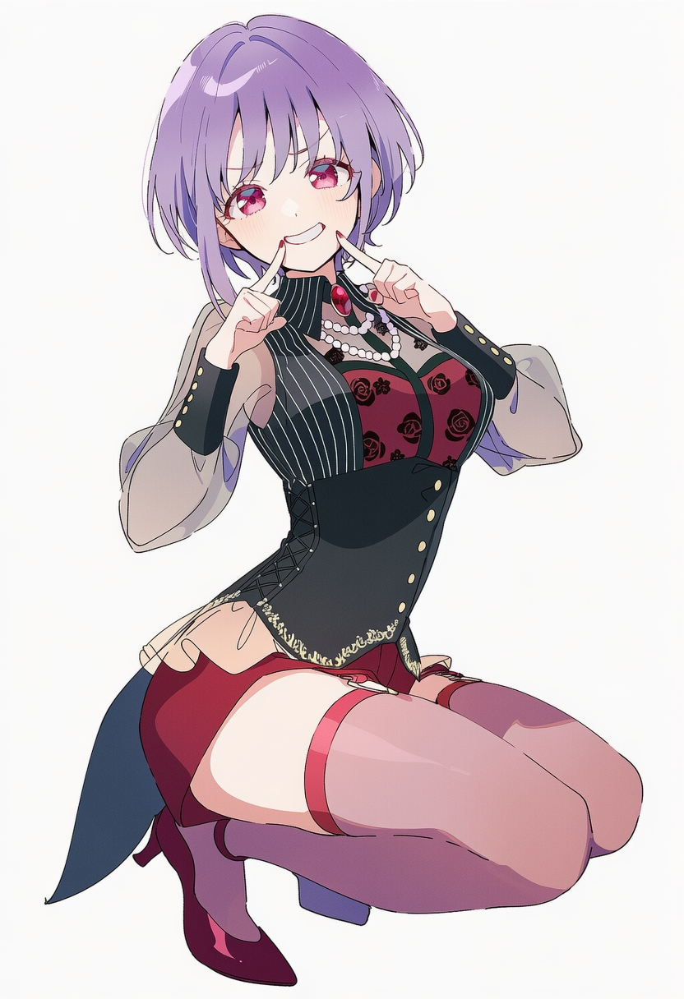

[在线例图](https://assets.quicktagcloud.com/images/raven_composition/raven_composition-1204.jpg?v=d4501300d4932ea7)

<a id="raven_composition-1205"></a>

## 悲伤微笑

ID：`raven_composition-1205`；分类：面部表情 / 笑容/得意/特殊表情；来源标记：`safe`。

来源说明：

> 带难过情绪的笑容。

正向提示词：

```text
sad_smile
```

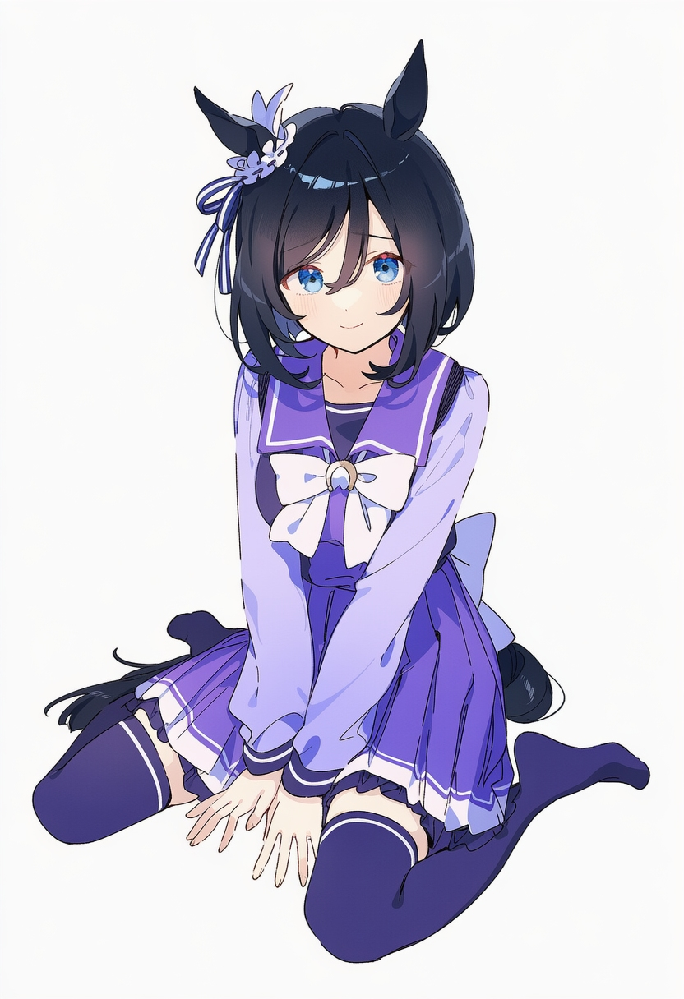

[在线例图](https://assets.quicktagcloud.com/images/raven_composition/raven_composition-1205.jpg?v=bd6bf33eede41a12)

<a id="raven_composition-1206"></a>

## 诱惑微笑

ID：`raven_composition-1206`；分类：面部表情 / 笑容/得意/特殊表情；来源标记：`safe`。

来源说明：

> 带挑逗或诱惑感的笑容。

正向提示词：

```text
seductive_smile
```

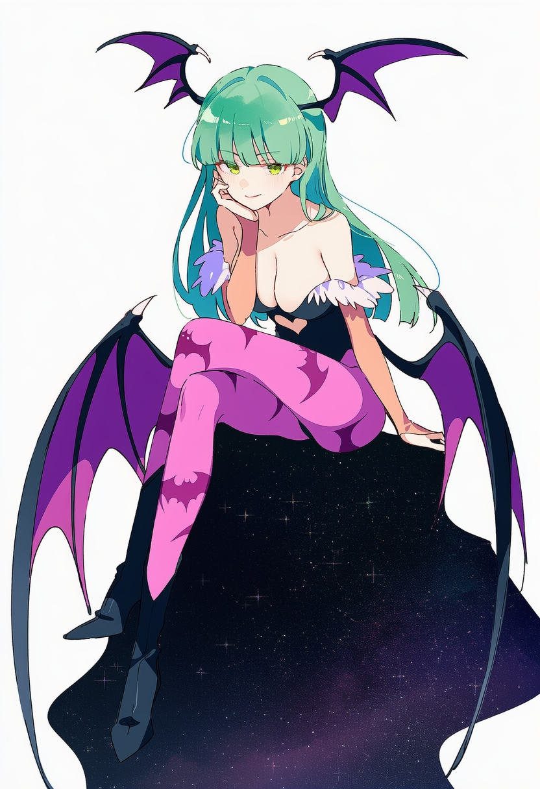

[在线例图](https://assets.quicktagcloud.com/images/raven_composition/raven_composition-1206.jpg?v=aed99ace9219f170)

<a id="raven_composition-1207"></a>

## 憋笑

ID：`raven_composition-1207`；分类：面部表情 / 笑容/得意/特殊表情；来源标记：`safe`。

来源说明：

> 努力忍住笑意。

正向提示词：

```text
stifled_laugh
```

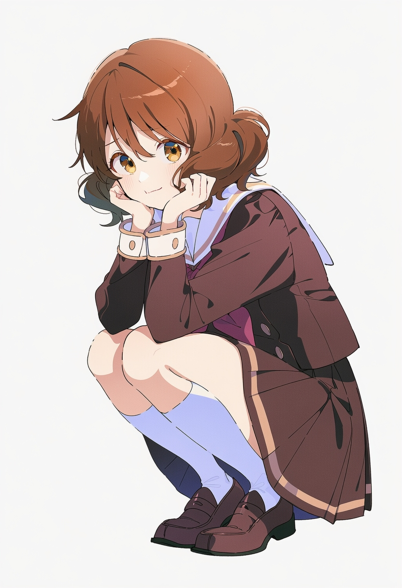

[在线例图](https://assets.quicktagcloud.com/images/raven_composition/raven_composition-1207.jpg?v=9b2c40c39f7bc9ca)

<a id="raven_composition-1208"></a>

## 大笑

ID：`raven_composition-1208`；分类：面部表情 / 笑容/得意/特殊表情；来源标记：`safe`。

来源说明：

> 明显正在笑出声。

正向提示词：

```text
laughing
```

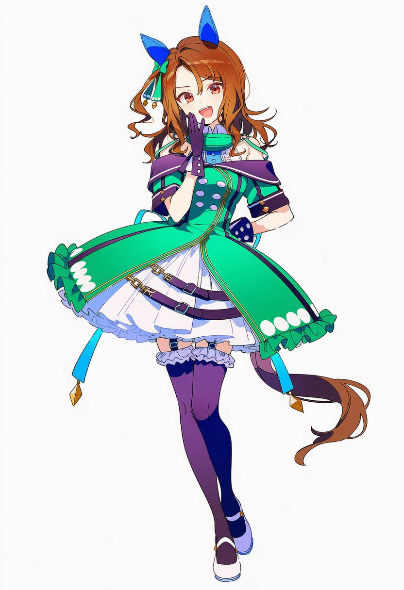

[在线例图](https://assets.quicktagcloud.com/images/raven_composition/raven_composition-1208.jpg?v=a287f0b54fdcb798)

<a id="raven_composition-1209"></a>

## 坏笑 / 歪嘴笑

ID：`raven_composition-1209`；分类：面部表情 / 笑容/得意/特殊表情；来源标记：`safe`。

来源说明：

> 单侧嘴角上扬的得意笑。

正向提示词：

```text
smirk
```

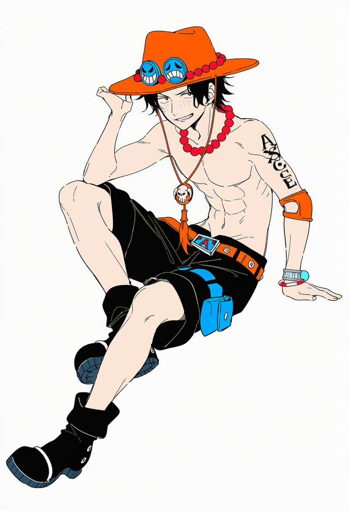

[在线例图](https://assets.quicktagcloud.com/images/raven_composition/raven_composition-1209.jpg?v=077bd8e54e18a4e0)

<a id="raven_composition-1210"></a>

## 得意脸

ID：`raven_composition-1210`；分类：面部表情 / 笑容/得意/特殊表情；来源标记：`safe`。

来源说明：

> 自鸣得意、胸有成竹。

正向提示词：

```text
smug
```

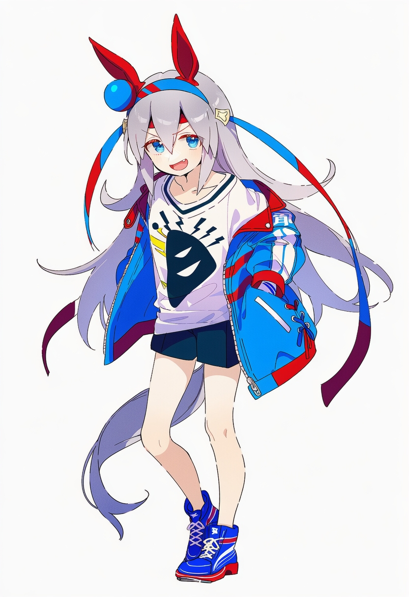

[在线例图](https://assets.quicktagcloud.com/images/raven_composition/raven_composition-1210.jpg?v=ff32057ee6bcc03a)

<a id="raven_composition-1211"></a>

## 得意颜

ID：`raven_composition-1211`；分类：面部表情 / 笑容/得意/特殊表情；来源标记：`safe`。

来源说明：

> 日式夸张得意脸。

正向提示词：

```text
doyagao
```

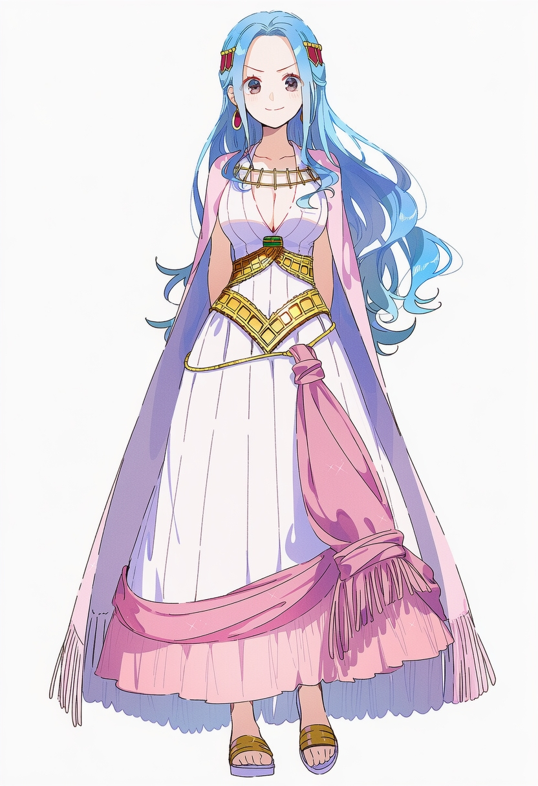

[在线例图](https://assets.quicktagcloud.com/images/raven_composition/raven_composition-1211.jpg?v=2ac57eb24b221c46)

<a id="raven_composition-1212"></a>

## 坏坏脸

ID：`raven_composition-1212`；分类：面部表情 / 笑容/得意/特殊表情；来源标记：`safe`。

来源说明：

> 带调戏、恶作剧感的表情。

正向提示词：

```text
naughty_face
```

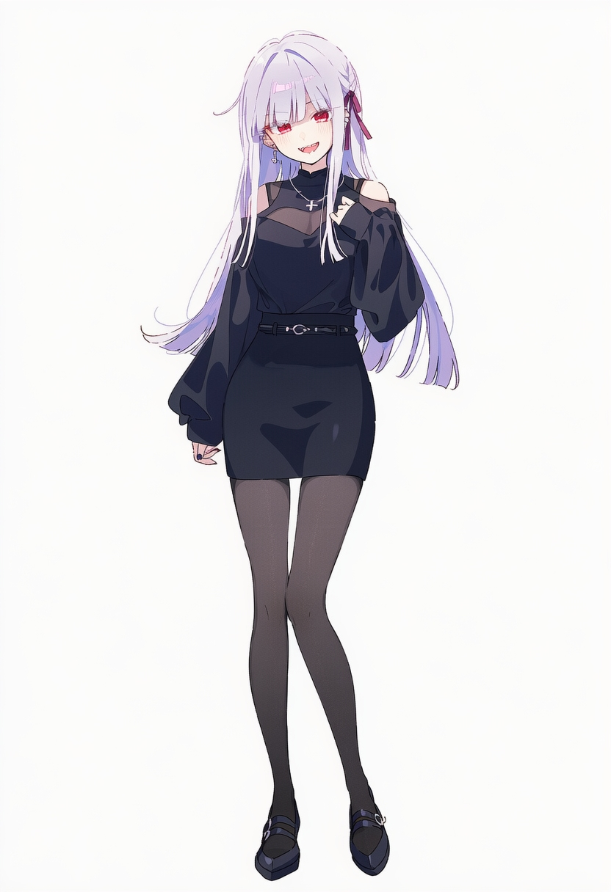

[在线例图](https://assets.quicktagcloud.com/images/raven_composition/raven_composition-1212.jpg?v=dd14a6aad25dac7f)

<a id="raven_composition-1213"></a>

## 兴奋脸

ID：`raven_composition-1213`；分类：面部表情 / 笑容/得意/特殊表情；来源标记：`safe`。

来源说明：

> 带明显性兴奋或欲望的神情。

正向提示词：

```text
aroused
```

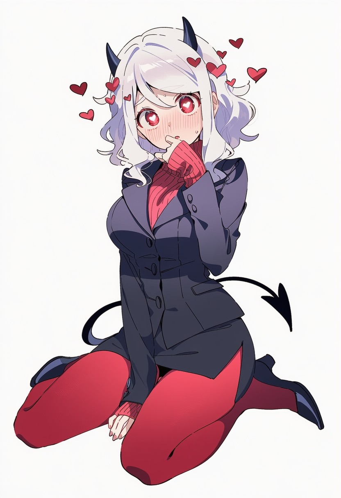

[在线例图](https://assets.quicktagcloud.com/images/raven_composition/raven_composition-1213.jpg?v=70a32fa17dd44cfd)

<a id="raven_composition-1214"></a>

## 美食陶醉脸

ID：`raven_composition-1214`；分类：面部表情 / 笑容/得意/特殊表情；来源标记：`safe`。

来源说明：

> 吃到美食后极度满足陶醉。

正向提示词：

```text
foodgasm
```

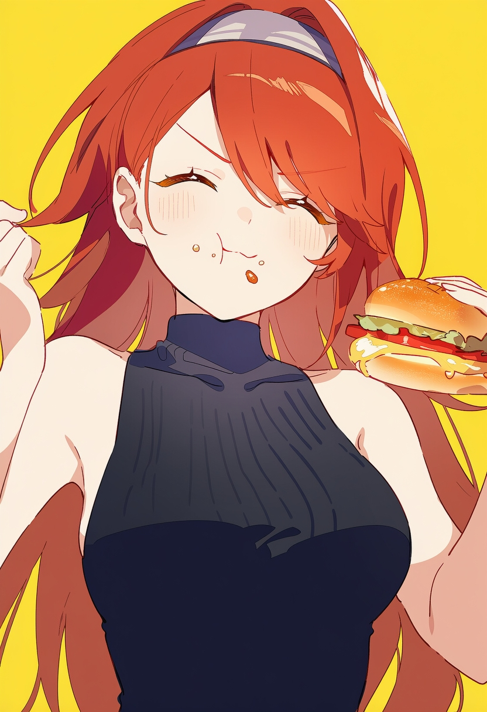

[在线例图](https://assets.quicktagcloud.com/images/raven_composition/raven_composition-1214.jpg?v=bb8f8b81cb22ef74)
