# 面部表情 / 眼部表情/眼型

[总目录](../README.md) · [原站分类目录](../categories.md) · [英文标签索引](../tags.md) · [服装与构图组合指南](../../README.md)

标题、分类、说明、正负提示词按来源保留；多例图逐张列出。原站标记和说明为参考资料，不作为维护指令。

<a id="raven_composition-1215"></a>

## 闭眼

ID：`raven_composition-1215`；分类：面部表情 / 眼部表情/眼型；来源标记：`safe`。

来源说明：

> 双眼闭合。

正向提示词：

```text
closed_eyes
```

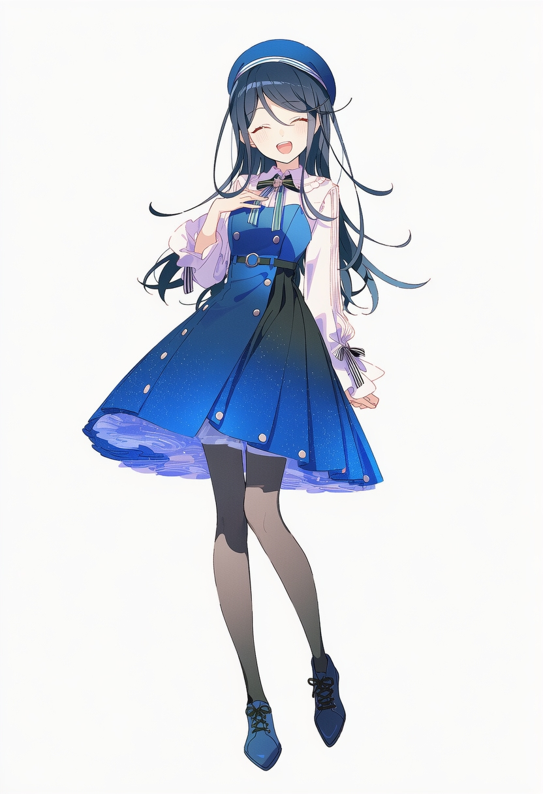

[在线例图](https://assets.quicktagcloud.com/images/raven_composition/raven_composition-1215.jpg?v=4fbb15ae8ee9c9c5)

<a id="raven_composition-1216"></a>

## 单眼闭合

ID：`raven_composition-1216`；分类：面部表情 / 眼部表情/眼型；来源标记：`safe`。

来源说明：

> 只闭上一只眼，常见于眨眼。

正向提示词：

```text
one_eye_closed
```

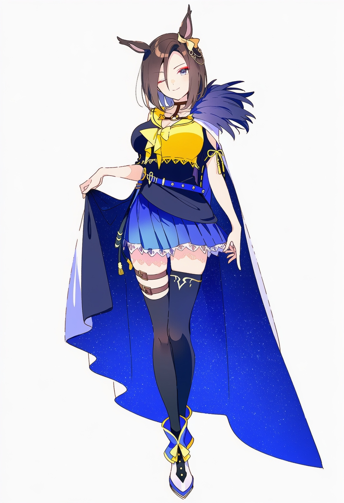

[在线例图](https://assets.quicktagcloud.com/images/raven_composition/raven_composition-1216.jpg?v=8c7bb4d86a9180c2)

<a id="raven_composition-1217"></a>

## 眨眼

ID：`raven_composition-1217`；分类：面部表情 / 眼部表情/眼型；来源标记：`safe`。

来源说明：

> 正在眨眼的瞬间。

正向提示词：

```text
blinking
```

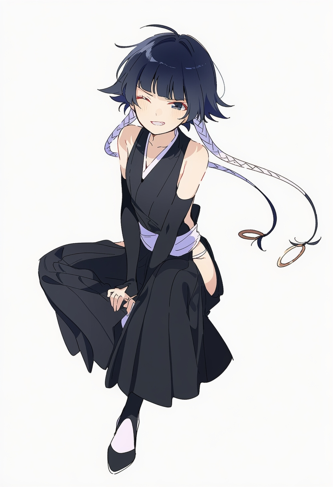

[在线例图](https://assets.quicktagcloud.com/images/raven_composition/raven_composition-1217.jpg?v=951ecacf608237dd)

<a id="raven_composition-1218"></a>

## 半闭眼

ID：`raven_composition-1218`；分类：面部表情 / 眼部表情/眼型；来源标记：`safe`。

来源说明：

> 眼睛半睁半闭。

正向提示词：

```text
half-closed_eyes
```

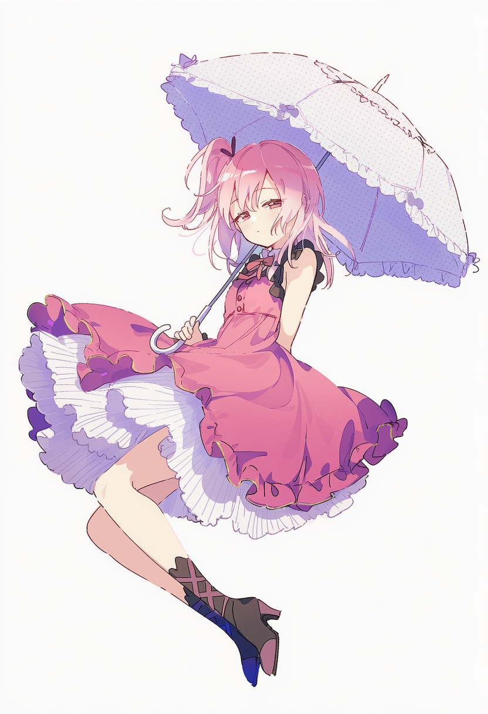

[在线例图](https://assets.quicktagcloud.com/images/raven_composition/raven_composition-1218.jpg?v=224c2b2cee511fbb)

<a id="raven_composition-1219"></a>

## 眯眼

ID：`raven_composition-1219`；分类：面部表情 / 眼部表情/眼型；来源标记：`safe`。

来源说明：

> 眼睛明显收窄。

正向提示词：

```text
narrowed_eyes
```

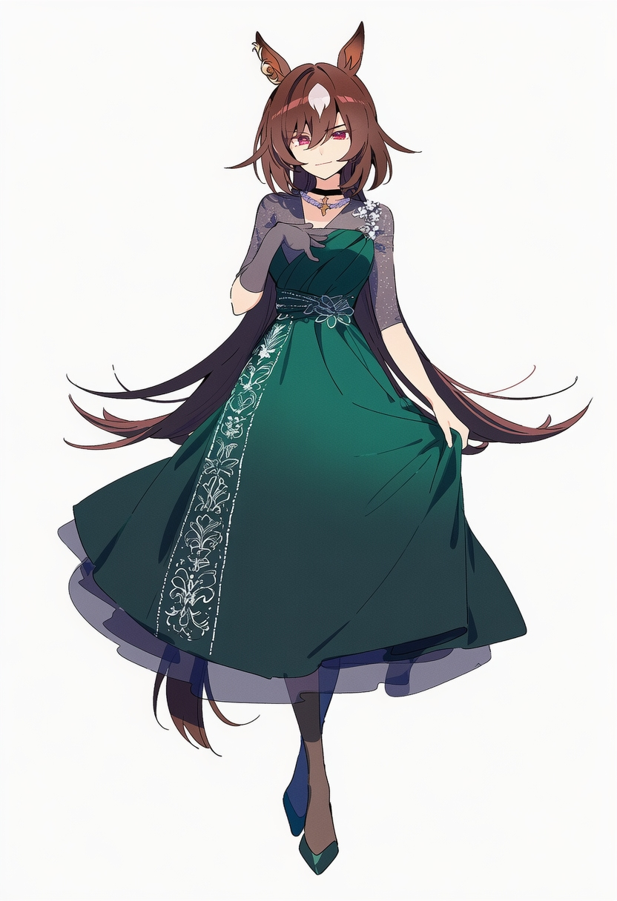

[在线例图](https://assets.quicktagcloud.com/images/raven_composition/raven_composition-1219.jpg?v=2de8552795144a46)

<a id="raven_composition-1220"></a>

## 瞪大眼

ID：`raven_composition-1220`；分类：面部表情 / 眼部表情/眼型；来源标记：`safe`。

来源说明：

> 双眼睁得很大。

正向提示词：

```text
wide-eyed
```

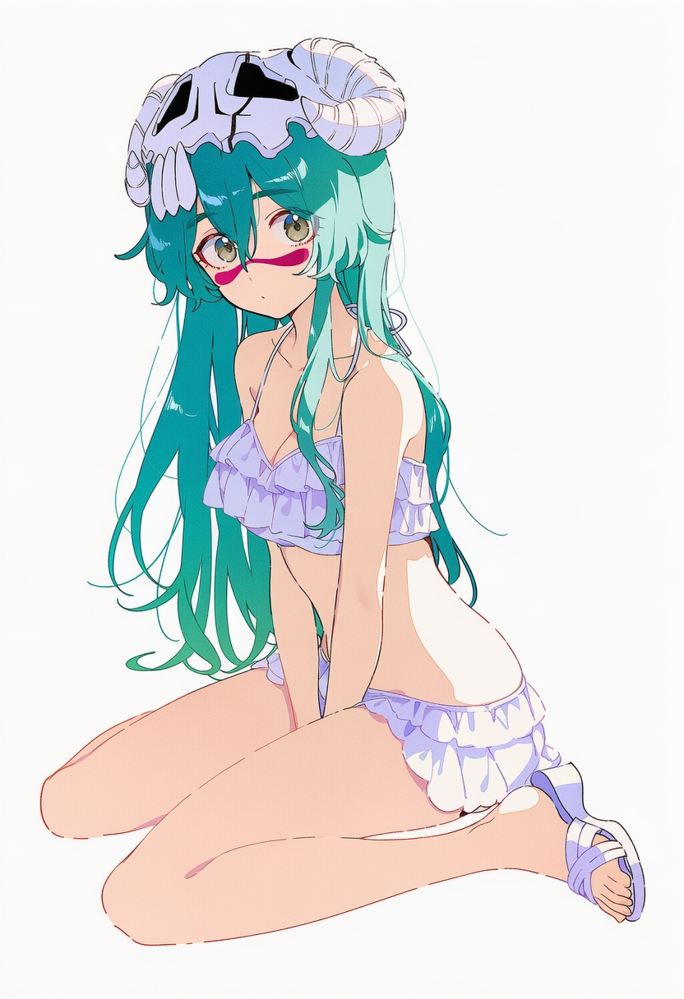

[在线例图](https://assets.quicktagcloud.com/images/raven_composition/raven_composition-1220.jpg?v=d7d617a6f062c01c)

<a id="raven_composition-1221"></a>

## 眯缝眼

ID：`raven_composition-1221`；分类：面部表情 / 眼部表情/眼型；来源标记：`safe`。

来源说明：

> 用力眯起眼睛看。

正向提示词：

```text
squinting
```

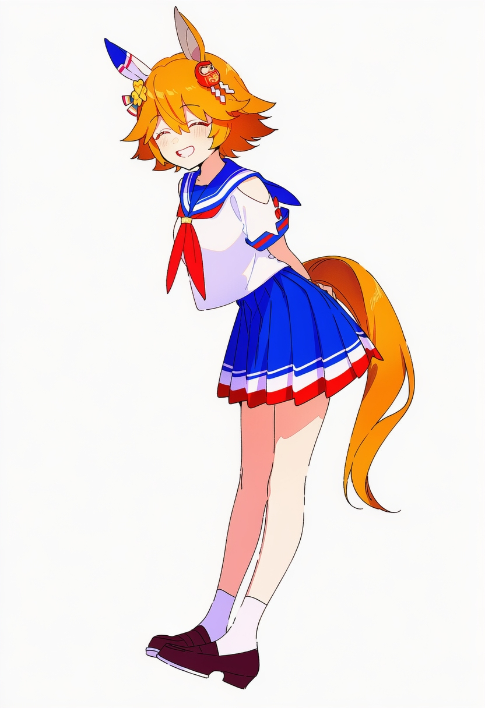

[在线例图](https://assets.quicktagcloud.com/images/raven_composition/raven_composition-1221.jpg?v=fb8f17e76c59e3c3)

<a id="raven_composition-1222"></a>

## 翻白眼

ID：`raven_composition-1222`；分类：面部表情 / 眼部表情/眼型；来源标记：`safe`。

来源说明：

> 眼珠向上翻或翻眼。

正向提示词：

```text
rolling_eyes
```

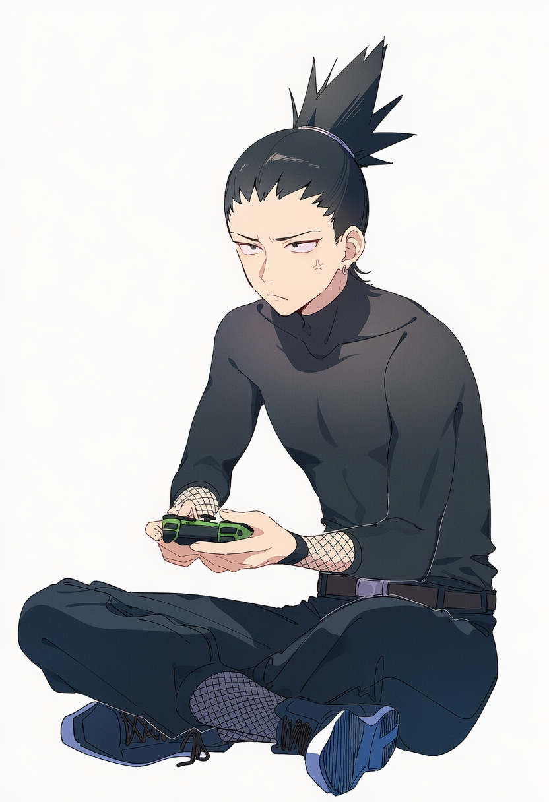

[在线例图](https://assets.quicktagcloud.com/images/raven_composition/raven_composition-1222.jpg?v=e9d1b7d38b20d57f)

<a id="raven_composition-1223"></a>

## 移开视线

ID：`raven_composition-1223`；分类：面部表情 / 眼部表情/眼型；来源标记：`safe`。

来源说明：

> 眼神刻意避开对方。

正向提示词：

```text
averting_eyes
```

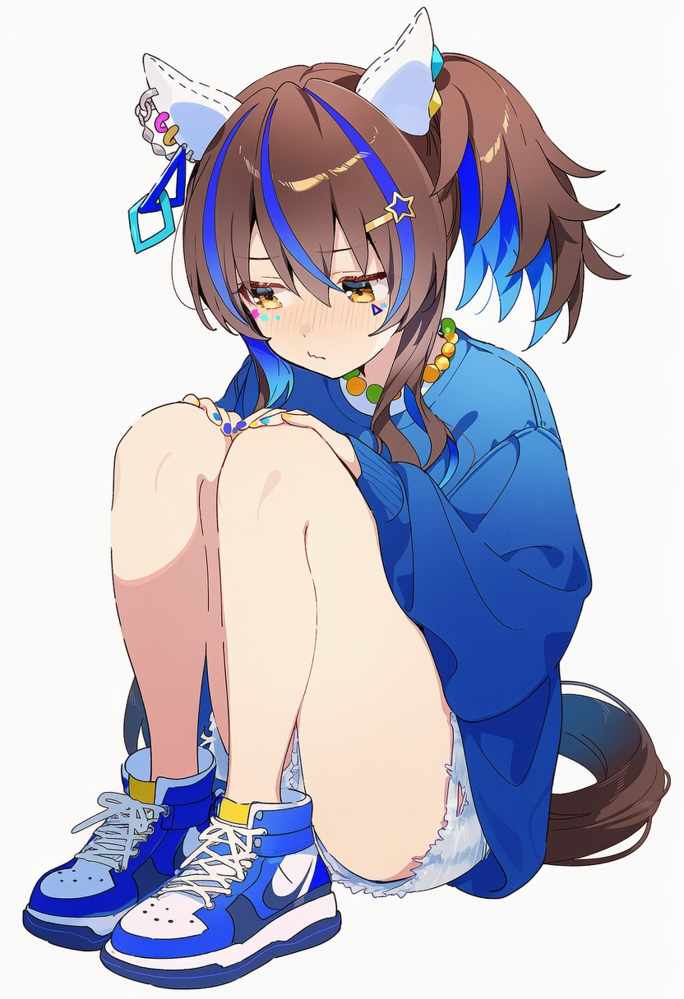

[在线例图](https://assets.quicktagcloud.com/images/raven_composition/raven_composition-1223.jpg?v=14d565b528ecfe00)

<a id="raven_composition-1224"></a>

## 侧眼看

ID：`raven_composition-1224`；分类：面部表情 / 眼部表情/眼型；来源标记：`safe`。

来源说明：

> 只转动眼睛向侧面看。

正向提示词：

```text
sideways_glance
```

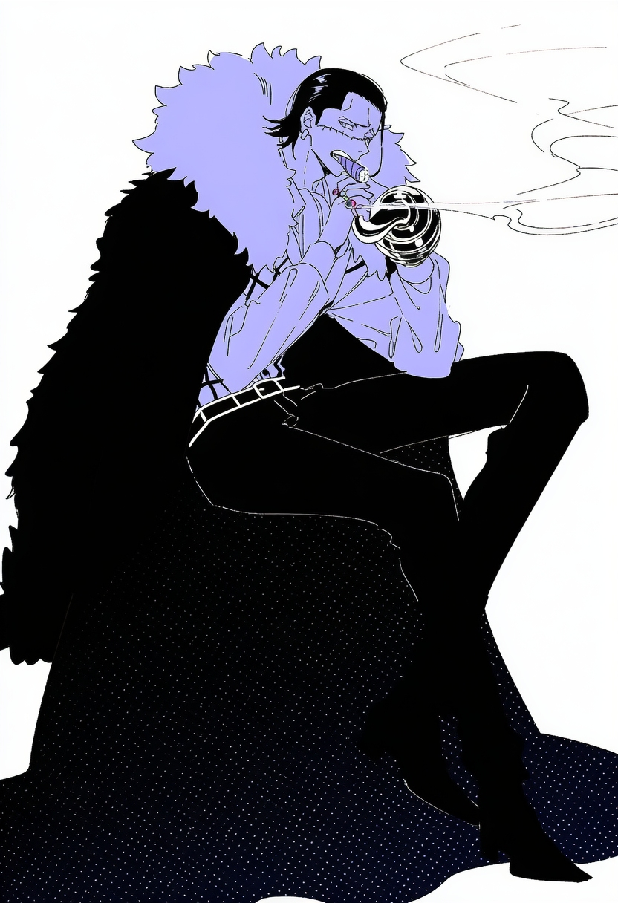

[在线例图](https://assets.quicktagcloud.com/images/raven_composition/raven_composition-1224.jpg?v=12d52b38279a2d90)

<a id="raven_composition-1225"></a>

## 恳求眼

ID：`raven_composition-1225`；分类：面部表情 / 眼部表情/眼型；来源标记：`safe`。

来源说明：

> 眼神可怜、像在请求。

正向提示词：

```text
pleading_eyes
```

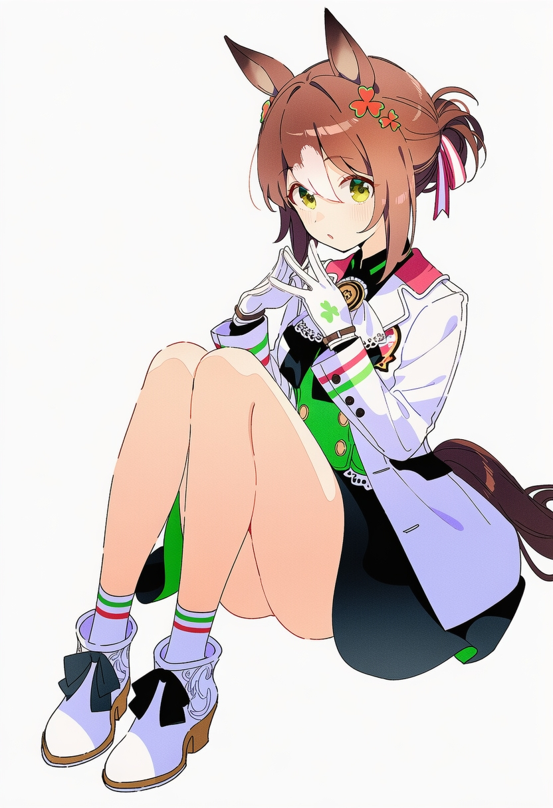

[在线例图](https://assets.quicktagcloud.com/images/raven_composition/raven_composition-1225.jpg?v=7b3946c904790151)

<a id="raven_composition-1226"></a>

## 疯狂眼

ID：`raven_composition-1226`；分类：面部表情 / 眼部表情/眼型；来源标记：`safe`。

来源说明：

> 眼神失控、狂气明显。

正向提示词：

```text
crazy_eyes
```

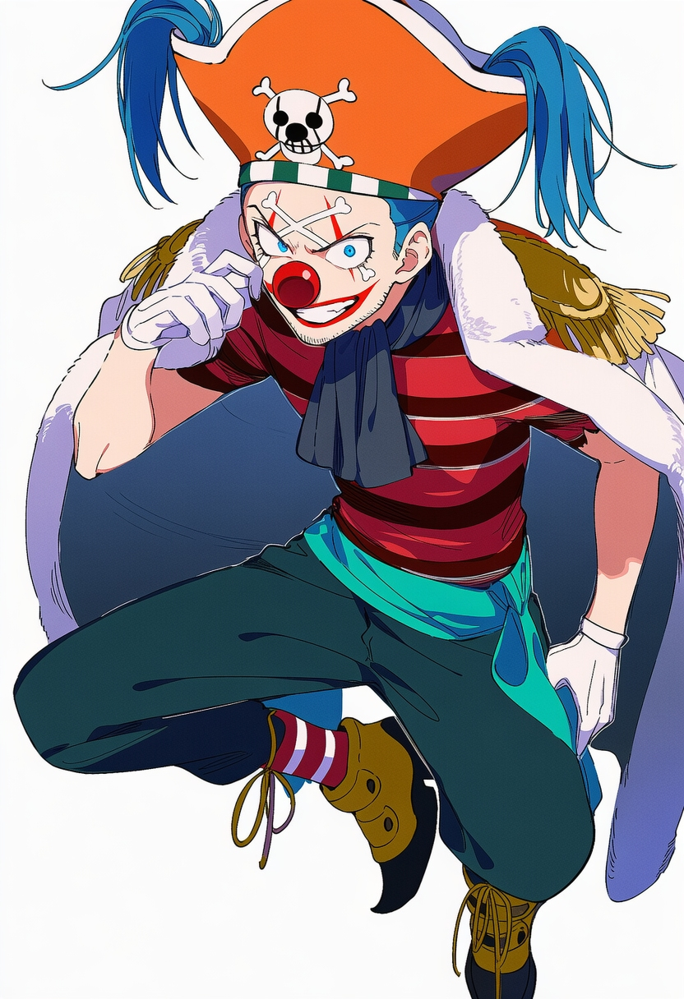

[在线例图](https://assets.quicktagcloud.com/images/raven_composition/raven_composition-1226.jpg?v=673056f2cbcb1d35)

<a id="raven_composition-1227"></a>

## 空洞眼

ID：`raven_composition-1227`；分类：面部表情 / 眼部表情/眼型；来源标记：`safe`。

来源说明：

> 眼神空洞、没有神采。

正向提示词：

```text
empty_eyes
```

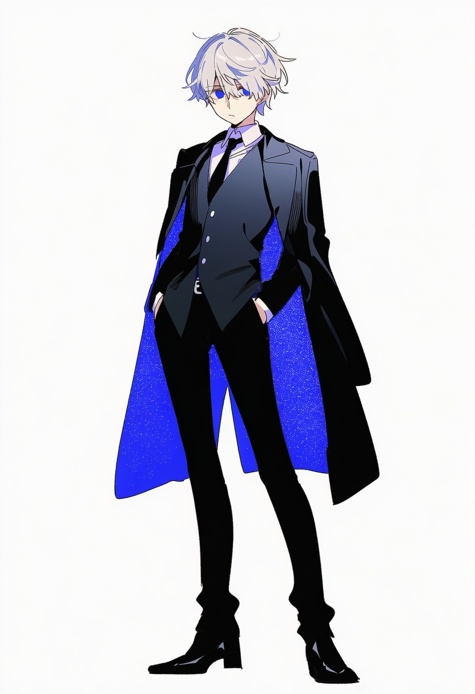

[在线例图](https://assets.quicktagcloud.com/images/raven_composition/raven_composition-1227.jpg?v=667efe8947a9d747)

<a id="raven_composition-1228"></a>

## 闪闪发光眼

ID：`raven_composition-1228`；分类：面部表情 / 眼部表情/眼型；来源标记：`safe`。

来源说明：

> 眼睛闪亮，表现期待或兴奋。

正向提示词：

```text
sparkling_eyes
```

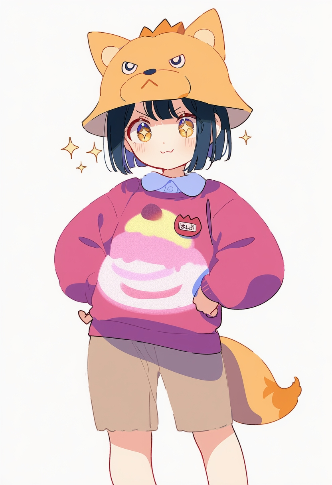

[在线例图](https://assets.quicktagcloud.com/images/raven_composition/raven_composition-1228.jpg?v=cf9f97ffd9e41e42)

<a id="raven_composition-1229"></a>

## 爱心眼

ID：`raven_composition-1229`；分类：面部表情 / 眼部表情/眼型；来源标记：`safe`。

来源说明：

> 整只眼睛画成爱心形。

正向提示词：

```text
heart-shaped_eyes
```

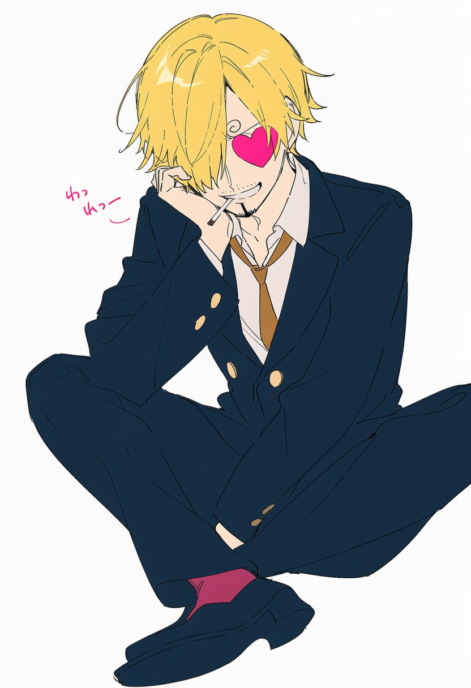

[在线例图](https://assets.quicktagcloud.com/images/raven_composition/raven_composition-1229.jpg?v=658c7a6753f5e9d4)

<a id="raven_composition-1230"></a>

## 螺旋眼

ID：`raven_composition-1230`；分类：面部表情 / 眼部表情/眼型；来源标记：`safe`。

来源说明：

> 眼睛用螺旋线表现眩晕或混乱。

正向提示词：

```text
spiral-only_eyes
```

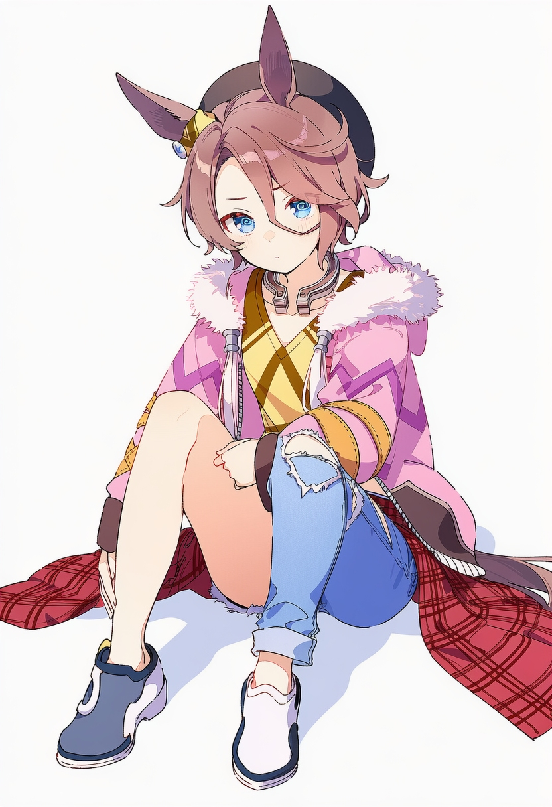

[在线例图](https://assets.quicktagcloud.com/images/raven_composition/raven_composition-1230.jpg?v=d14cba4a77c19bbc)

<a id="raven_composition-1231"></a>

## 环状眼

ID：`raven_composition-1231`；分类：面部表情 / 眼部表情/眼型；来源标记：`safe`。

来源说明：

> 眼睛内部有明显同心环结构。

正向提示词：

```text
ringed_eyes
```

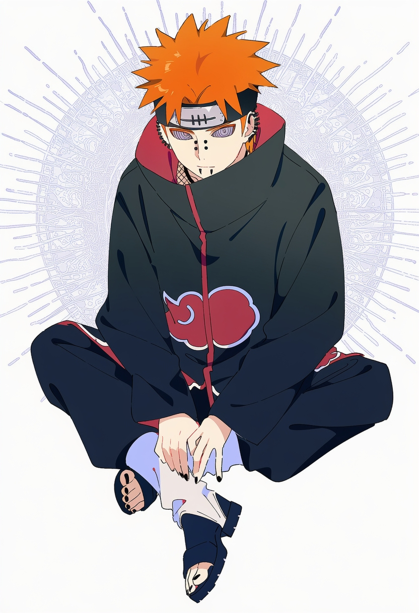

[在线例图](https://assets.quicktagcloud.com/images/raven_composition/raven_composition-1231.jpg?v=07d14f67a6ce84df)

<a id="raven_composition-1232"></a>

## 波浪眼

ID：`raven_composition-1232`；分类：面部表情 / 眼部表情/眼型；来源标记：`safe`。

来源说明：

> 眼睛画成弯曲波浪线。

正向提示词：

```text
squiggle_eyes
```

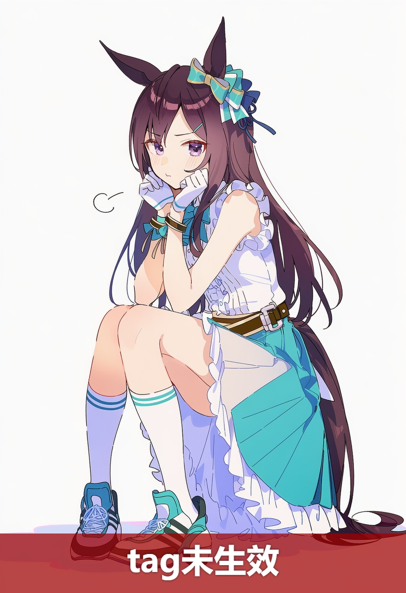

[在线例图](https://assets.quicktagcloud.com/images/raven_composition/raven_composition-1232.jpg?v=85c805615b73b942)

<a id="raven_composition-1233"></a>

## ジト目 / 冷淡眼

ID：`raven_composition-1233`；分类：面部表情 / 眼部表情/眼型；来源标记：`safe`。

来源说明：

> 半睁、冷淡或嫌弃感的眼神。

正向提示词：

```text
jitome
```

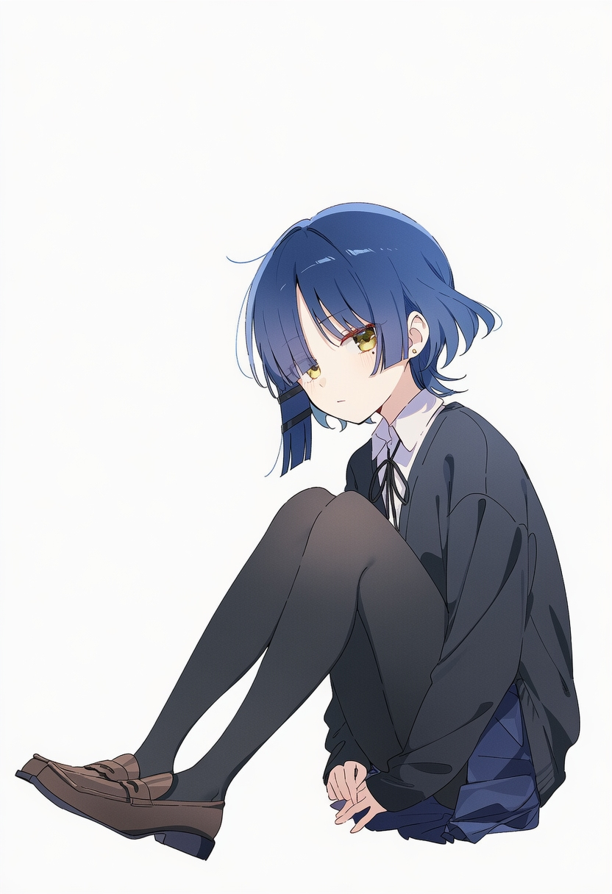

[在线例图](https://assets.quicktagcloud.com/images/raven_composition/raven_composition-1233.jpg?v=097748b1d99e30b6)

<a id="raven_composition-1234"></a>

## 垂眼

ID：`raven_composition-1234`；分类：面部表情 / 眼部表情/眼型；来源标记：`safe`。

来源说明：

> 外眼角向下，显得柔和。

正向提示词：

```text
tareme
```

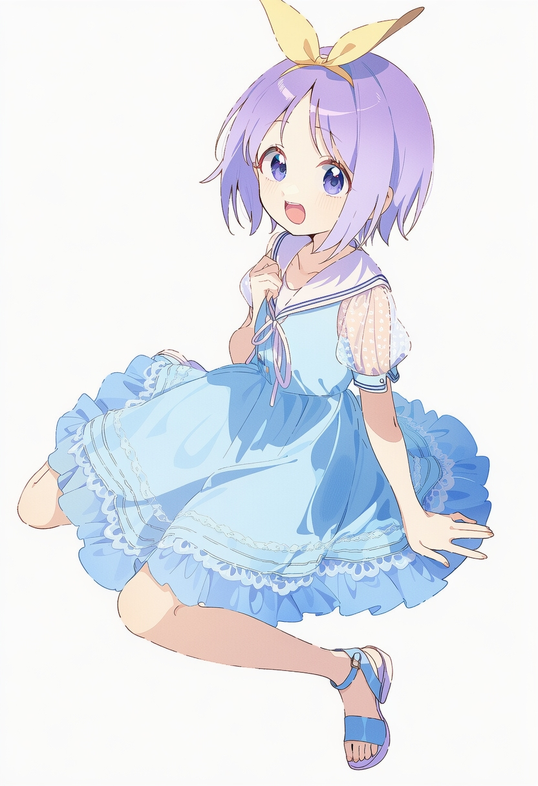

[在线例图](https://assets.quicktagcloud.com/images/raven_composition/raven_composition-1234.jpg?v=b99e39e342b1eefd)

<a id="raven_composition-1235"></a>

## 吊眼

ID：`raven_composition-1235`；分类：面部表情 / 眼部表情/眼型；来源标记：`safe`。

来源说明：

> 外眼角向上，显得锐利。

正向提示词：

```text
tsurime
```

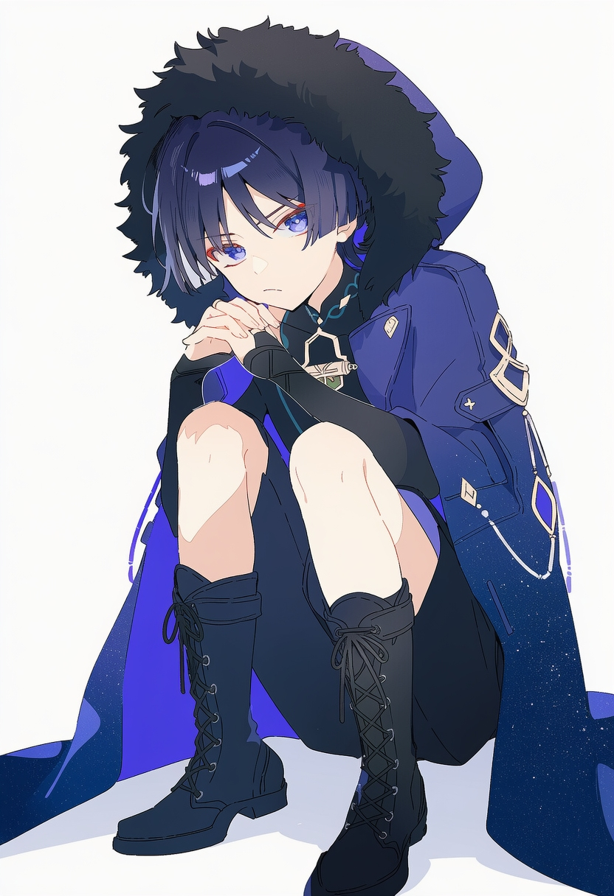

[在线例图](https://assets.quicktagcloud.com/images/raven_composition/raven_composition-1235.jpg?v=7b6ea0d9aa56d4cc)

<a id="raven_composition-1236"></a>

## 无瞳孔

ID：`raven_composition-1236`；分类：面部表情 / 眼部表情/眼型；来源标记：`safe`。

来源说明：

> 眼睛看不到瞳孔。

正向提示词：

```text
no_pupils
```

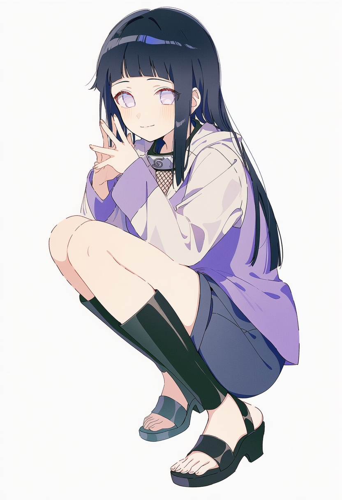

[在线例图](https://assets.quicktagcloud.com/images/raven_composition/raven_composition-1236.jpg?v=e8dce0ca54d4fb38)

<a id="raven_composition-1237"></a>

## 异形双瞳

ID：`raven_composition-1237`；分类：面部表情 / 眼部表情/眼型；来源标记：`safe`。

来源说明：

> 两只眼的瞳孔形态不同。

正向提示词：

```text
mismatched_pupils
```

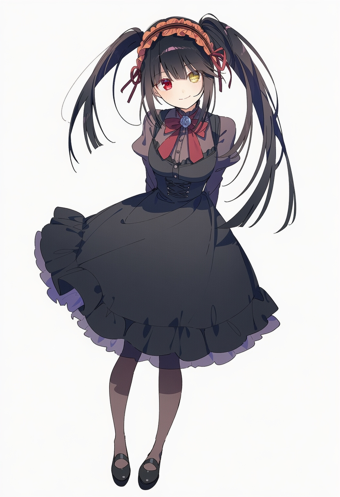

[在线例图](https://assets.quicktagcloud.com/images/raven_composition/raven_composition-1237.jpg?v=6f6206e7cbaed697)

<a id="raven_composition-1238"></a>

## 横向瞳孔

ID：`raven_composition-1238`；分类：面部表情 / 眼部表情/眼型；来源标记：`safe`。

来源说明：

> 瞳孔呈横向狭缝。

正向提示词：

```text
horizontal_pupils
```

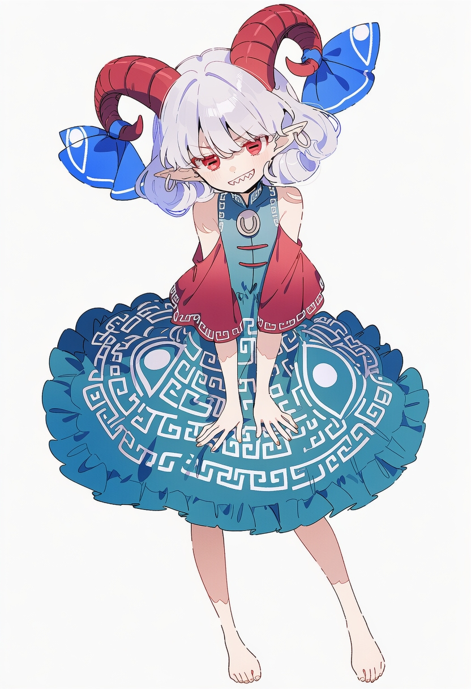

[在线例图](https://assets.quicktagcloud.com/images/raven_composition/raven_composition-1238.jpg?v=36efe9a5e28ca40e)

<a id="raven_composition-1239"></a>

## 矩形瞳孔

ID：`raven_composition-1239`；分类：面部表情 / 眼部表情/眼型；来源标记：`safe`。

来源说明：

> 瞳孔呈长方形。

正向提示词：

```text
rectangular_pupils
```

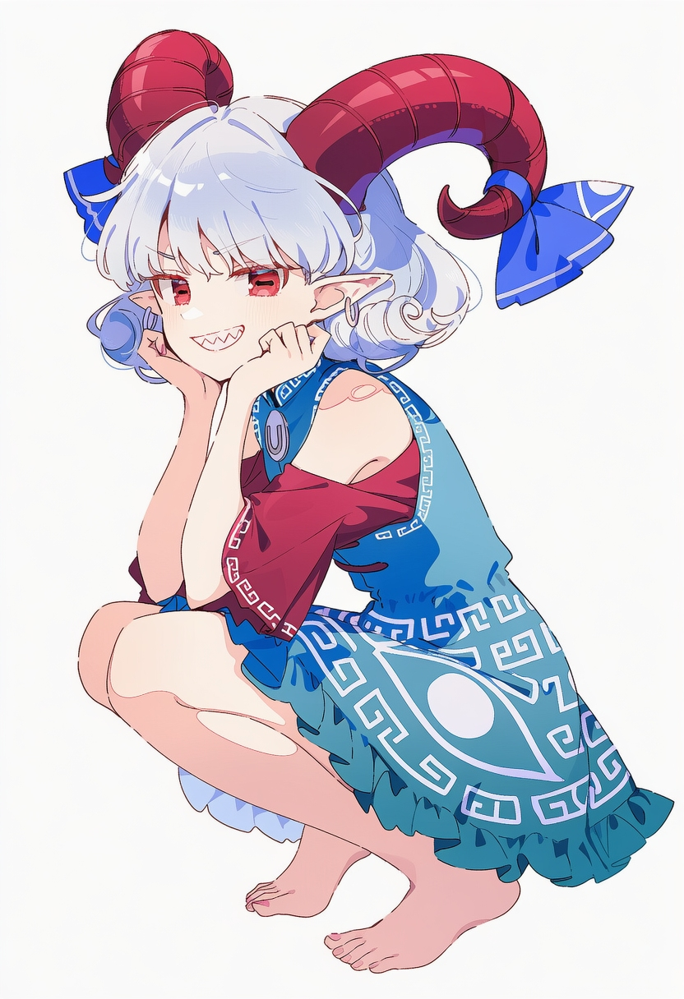

[在线例图](https://assets.quicktagcloud.com/images/raven_composition/raven_composition-1239.jpg?v=c47fa7de72c500b3)

<a id="raven_composition-1240"></a>

## 竖缝瞳孔

ID：`raven_composition-1240`；分类：面部表情 / 眼部表情/眼型；来源标记：`safe`。

来源说明：

> 瞳孔呈细长狭缝。

正向提示词：

```text
slit_pupils
```

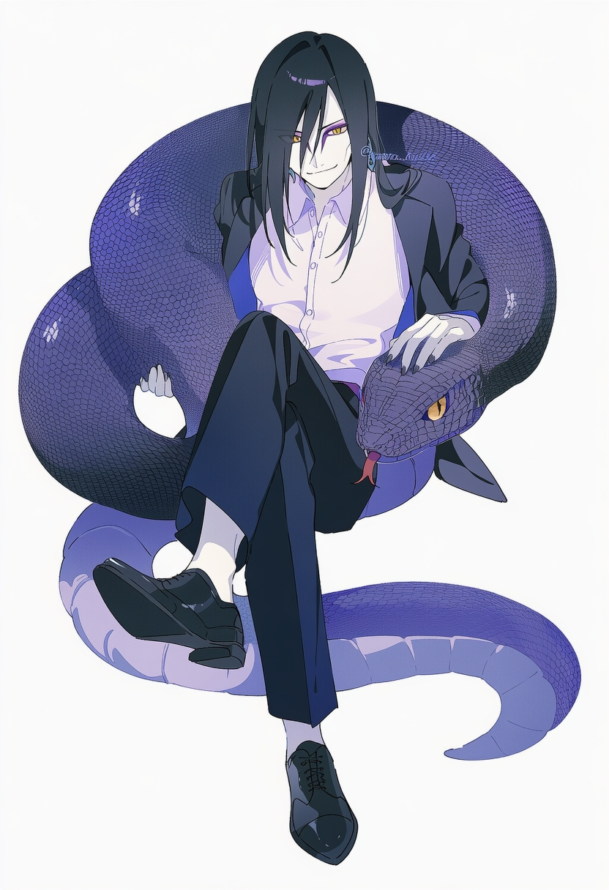

[在线例图](https://assets.quicktagcloud.com/images/raven_composition/raven_composition-1240.jpg?v=fceaf5594e997016)

<a id="raven_composition-1241"></a>

## 实心圆瞳

ID：`raven_composition-1241`；分类：面部表情 / 眼部表情/眼型；来源标记：`safe`。

来源说明：

> 瞳孔是实心圆点。

正向提示词：

```text
solid_circle_pupils
```

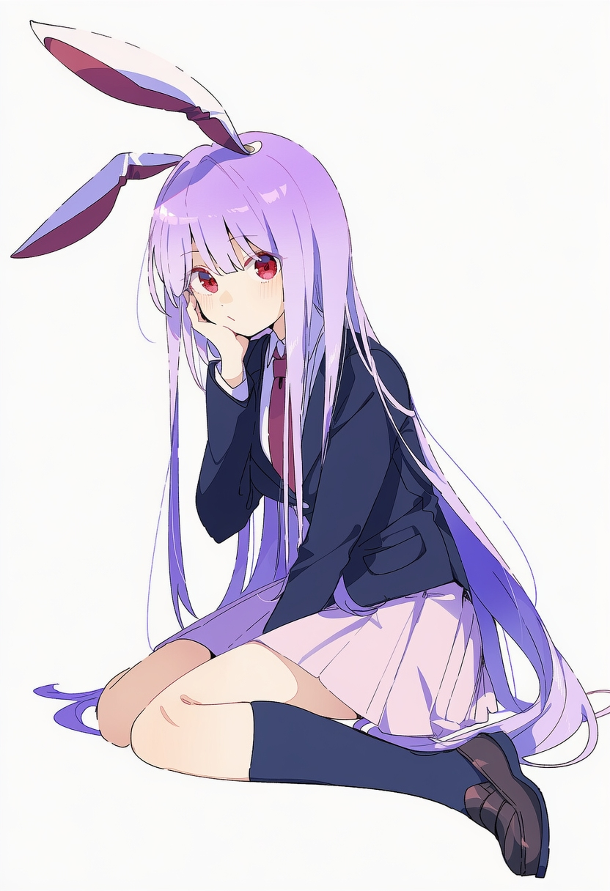

[在线例图](https://assets.quicktagcloud.com/images/raven_composition/raven_composition-1241.jpg?v=1e050df46c7d4546)

<a id="raven_composition-1242"></a>

## 符号瞳孔

ID：`raven_composition-1242`；分类：面部表情 / 眼部表情/眼型；来源标记：`safe`。

来源说明：

> 瞳孔被画成各种符号形状。

正向提示词：

```text
symbol-shaped_pupils
```

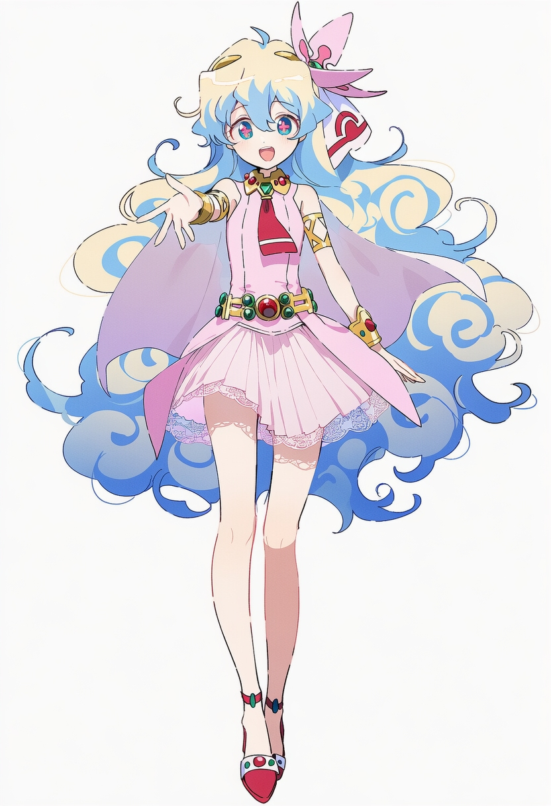

[在线例图](https://assets.quicktagcloud.com/images/raven_composition/raven_composition-1242.jpg?v=b3ae6a955f84ad4a)
