# 面部表情 / 特殊瞳孔

[总目录](../README.md) · [原站分类目录](../categories.md) · [英文标签索引](../tags.md) · [服装与构图组合指南](../../README.md)

标题、分类、说明、正负提示词按来源保留；多例图逐张列出。原站标记和说明为参考资料，不作为维护指令。

<a id="raven_composition-1243"></a>

## 爱心瞳孔

ID：`raven_composition-1243`；分类：面部表情 / 特殊瞳孔；来源标记：`safe`。

来源说明：

> 瞳孔呈爱心形。

正向提示词：

```text
heart-shaped_pupils
```

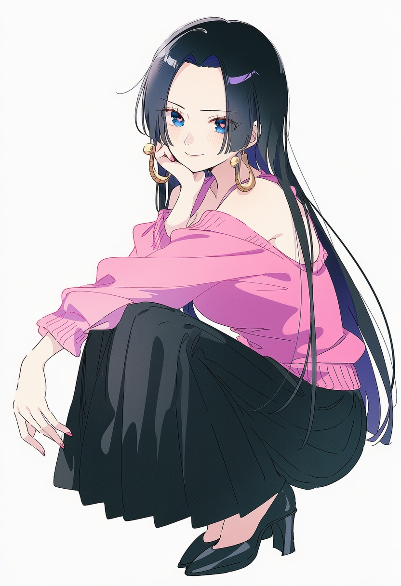

[在线例图](https://assets.quicktagcloud.com/images/raven_composition/raven_composition-1243.jpg?v=97367dbcaf6247fd)

<a id="raven_composition-1244"></a>

## 星形瞳孔

ID：`raven_composition-1244`；分类：面部表情 / 特殊瞳孔；来源标记：`safe`。

来源说明：

> 瞳孔呈星星形。

正向提示词：

```text
star-shaped_pupils
```

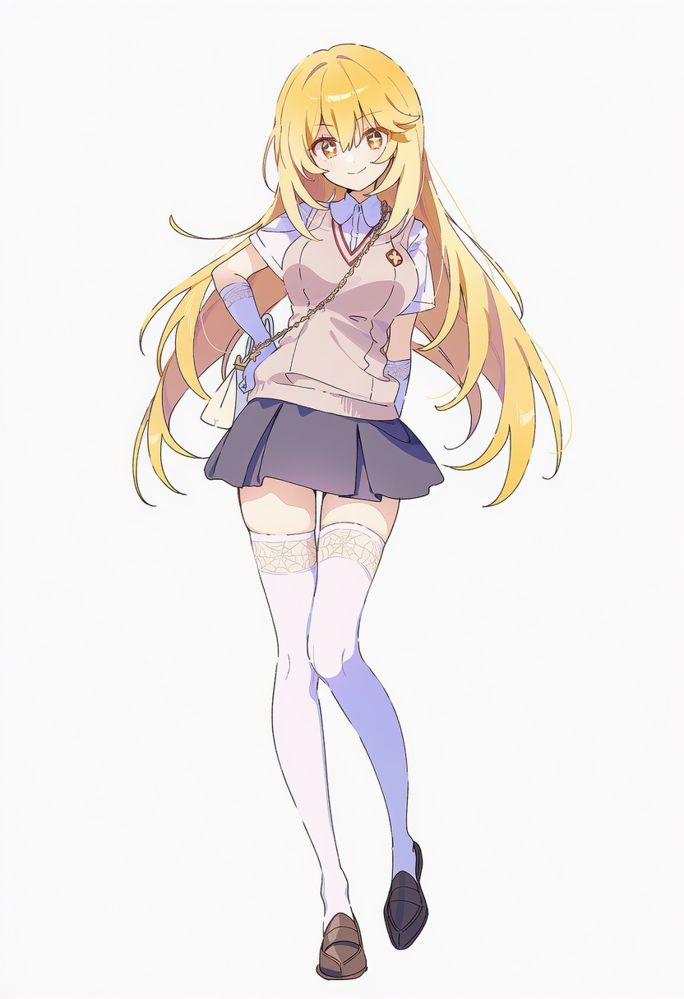

[在线例图](https://assets.quicktagcloud.com/images/raven_composition/raven_composition-1244.jpg?v=45e71fba524e8d77)

<a id="raven_composition-1245"></a>

## 十字瞳孔

ID：`raven_composition-1245`；分类：面部表情 / 特殊瞳孔；来源标记：`safe`。

来源说明：

> 瞳孔呈十字形。

正向提示词：

```text
cross-shaped_pupils
```

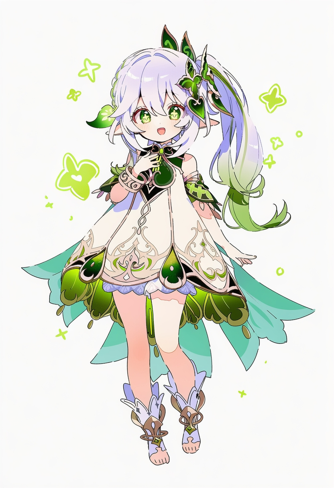

[在线例图](https://assets.quicktagcloud.com/images/raven_composition/raven_composition-1245.jpg?v=aa8a748883beb129)

<a id="raven_composition-1246"></a>

## X形瞳孔

ID：`raven_composition-1246`；分类：面部表情 / 特殊瞳孔；来源标记：`safe`。

来源说明：

> 瞳孔呈 X 形。

正向提示词：

```text
x-shaped_pupils
```

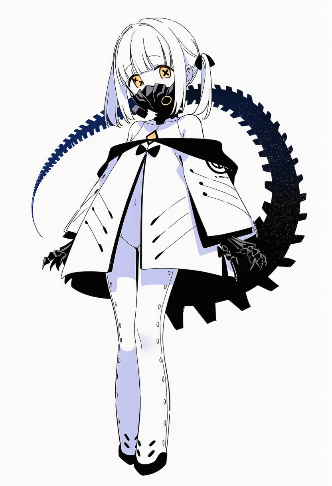

[在线例图](https://assets.quicktagcloud.com/images/raven_composition/raven_composition-1246.jpg?v=6aa65954834de164)

<a id="raven_composition-1247"></a>

## 菱形瞳孔

ID：`raven_composition-1247`；分类：面部表情 / 特殊瞳孔；来源标记：`safe`。

来源说明：

> 瞳孔呈菱形。

正向提示词：

```text
diamond-shaped_pupils
```

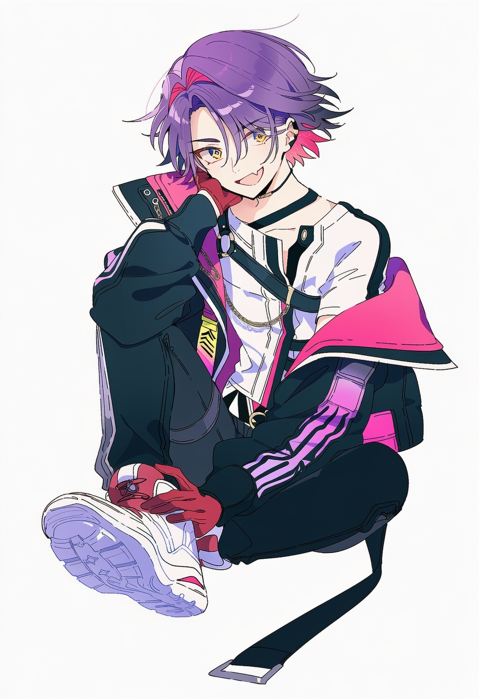

[在线例图](https://assets.quicktagcloud.com/images/raven_composition/raven_composition-1247.jpg?v=d3f7d6f04bb488a8)

<a id="raven_composition-1248"></a>

## 花形瞳孔

ID：`raven_composition-1248`；分类：面部表情 / 特殊瞳孔；来源标记：`safe`。

来源说明：

> 瞳孔呈花朵形。

正向提示词：

```text
flower-shaped_pupils
```

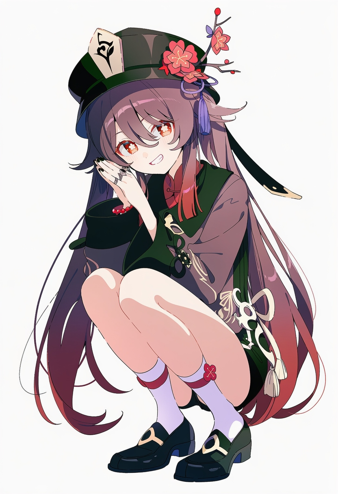

[在线例图](https://assets.quicktagcloud.com/images/raven_composition/raven_composition-1248.jpg?v=fcb897da95a7b652)

<a id="raven_composition-1249"></a>

## 蝴蝶瞳孔

ID：`raven_composition-1249`；分类：面部表情 / 特殊瞳孔；来源标记：`safe`。

来源说明：

> 瞳孔呈蝴蝶形。

正向提示词：

```text
butterfly-shaped_pupils
```

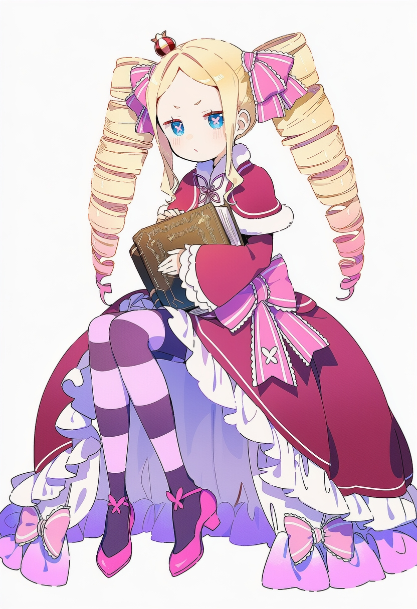

[在线例图](https://assets.quicktagcloud.com/images/raven_composition/raven_composition-1249.jpg?v=211a5e25c269dd22)

<a id="raven_composition-1250"></a>

## 鱼形瞳孔

ID：`raven_composition-1250`；分类：面部表情 / 特殊瞳孔；来源标记：`safe`。

来源说明：

> 瞳孔呈鱼形。

正向提示词：

```text
fish-shaped_pupils
```

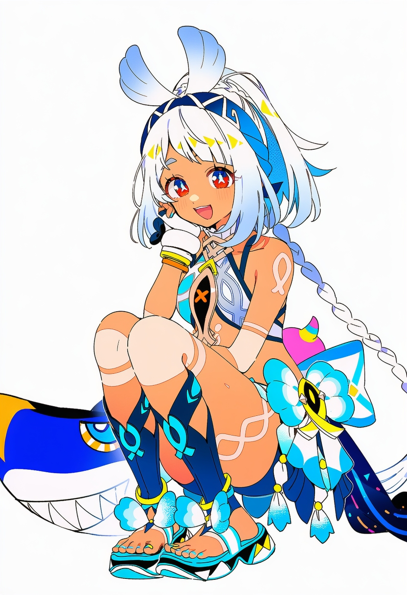

[在线例图](https://assets.quicktagcloud.com/images/raven_composition/raven_composition-1250.jpg?v=eb2ba1b44f81b14b)

<a id="raven_composition-1251"></a>

## 兔子瞳孔

ID：`raven_composition-1251`；分类：面部表情 / 特殊瞳孔；来源标记：`safe`。

来源说明：

> 瞳孔呈兔子形。

正向提示词：

```text
rabbit-shaped_pupils
```

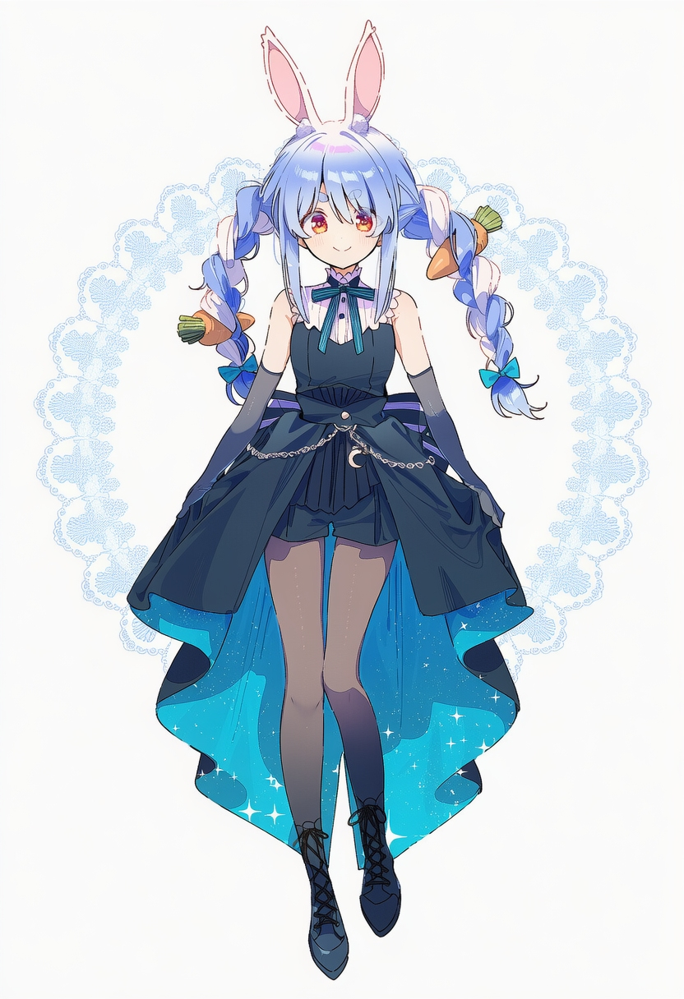

[在线例图](https://assets.quicktagcloud.com/images/raven_composition/raven_composition-1251.jpg?v=3dd1a2343030780a)

<a id="raven_composition-1252"></a>

## 爪印瞳孔

ID：`raven_composition-1252`；分类：面部表情 / 特殊瞳孔；来源标记：`safe`。

来源说明：

> 瞳孔呈动物爪印形。

正向提示词：

```text
paw-shaped_pupils
```

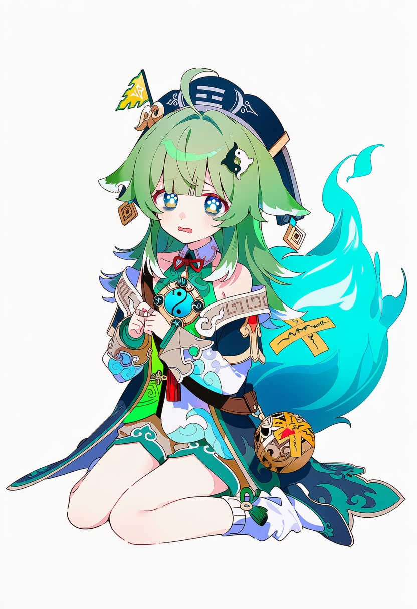

[在线例图](https://assets.quicktagcloud.com/images/raven_composition/raven_composition-1252.jpg?v=5c334b60fb33ed8c)

<a id="raven_composition-1253"></a>

## 电源符号瞳孔

ID：`raven_composition-1253`；分类：面部表情 / 特殊瞳孔；来源标记：`safe`。

来源说明：

> 瞳孔呈电源开关符号。

正向提示词：

```text
power_symbol-shaped_pupils
```

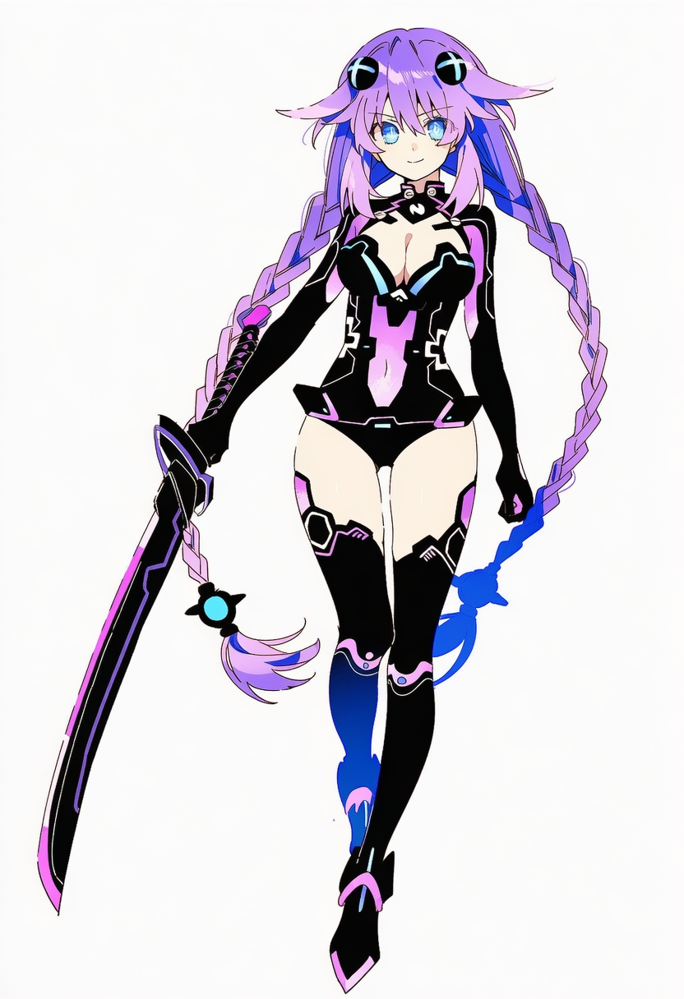

[在线例图](https://assets.quicktagcloud.com/images/raven_composition/raven_composition-1253.jpg?v=26027c2210f5821a)

<a id="raven_composition-1254"></a>

## 三角瞳孔

ID：`raven_composition-1254`；分类：面部表情 / 特殊瞳孔；来源标记：`safe`。

来源说明：

> 瞳孔呈三角形。

正向提示词：

```text
triangle-shaped_pupils
```

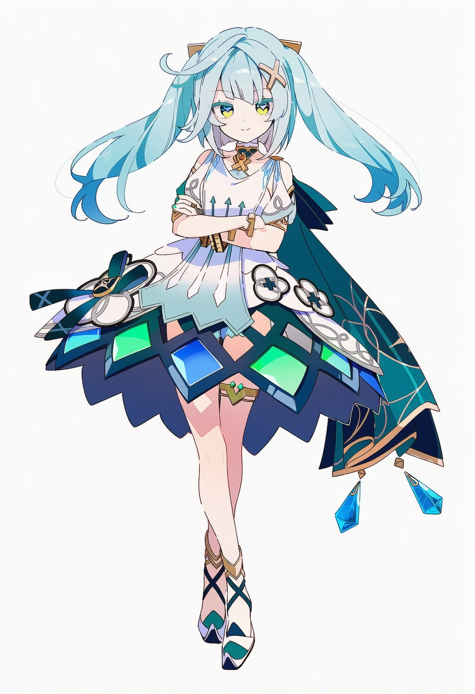

[在线例图](https://assets.quicktagcloud.com/images/raven_composition/raven_composition-1254.jpg?v=43e5470b258bda92)

<a id="raven_composition-1255"></a>

## 准星瞳孔

ID：`raven_composition-1255`；分类：面部表情 / 特殊瞳孔；来源标记：`safe`。

来源说明：

> 瞳孔像瞄准镜准星。

正向提示词：

```text
crosshair_pupils
```

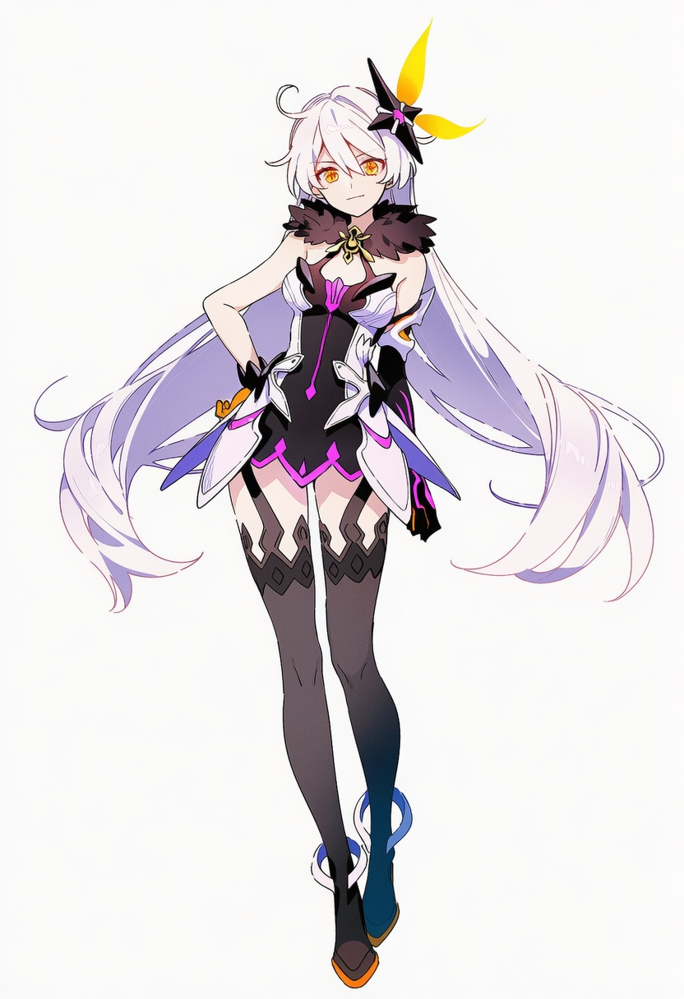

[在线例图](https://assets.quicktagcloud.com/images/raven_composition/raven_composition-1255.jpg?v=078a93b472143efe)

<a id="raven_composition-1256"></a>

## 时钟眼

ID：`raven_composition-1256`；分类：面部表情 / 特殊瞳孔；来源标记：`safe`。

来源说明：

> 眼睛或瞳孔带时钟表盘结构。

正向提示词：

```text
clock_eyes
```

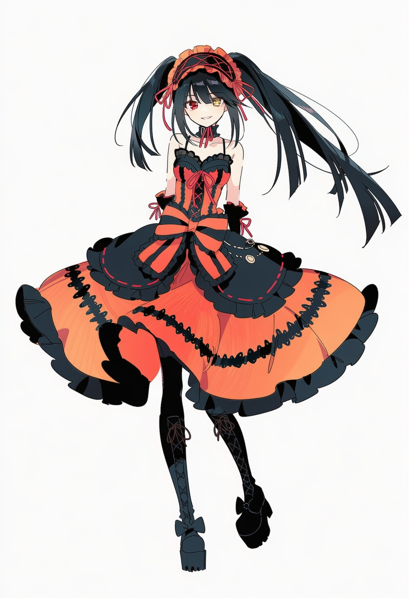

[在线例图](https://assets.quicktagcloud.com/images/raven_composition/raven_composition-1256.jpg?v=512648d69fc2a128)
