# 面部表情 / 眉眼/嘴部细节

[总目录](../README.md) · [原站分类目录](../categories.md) · [英文标签索引](../tags.md) · [服装与构图组合指南](../../README.md)

标题、分类、说明、正负提示词按来源保留；多例图逐张列出。原站标记和说明为参考资料，不作为维护指令。

<a id="raven_composition-1257"></a>

## 咬紧牙关

ID：`raven_composition-1257`；分类：面部表情 / 眉眼/嘴部细节；来源标记：`safe`。

来源说明：

> 牙齿紧紧咬住。

正向提示词：

```text
clenched_teeth
```

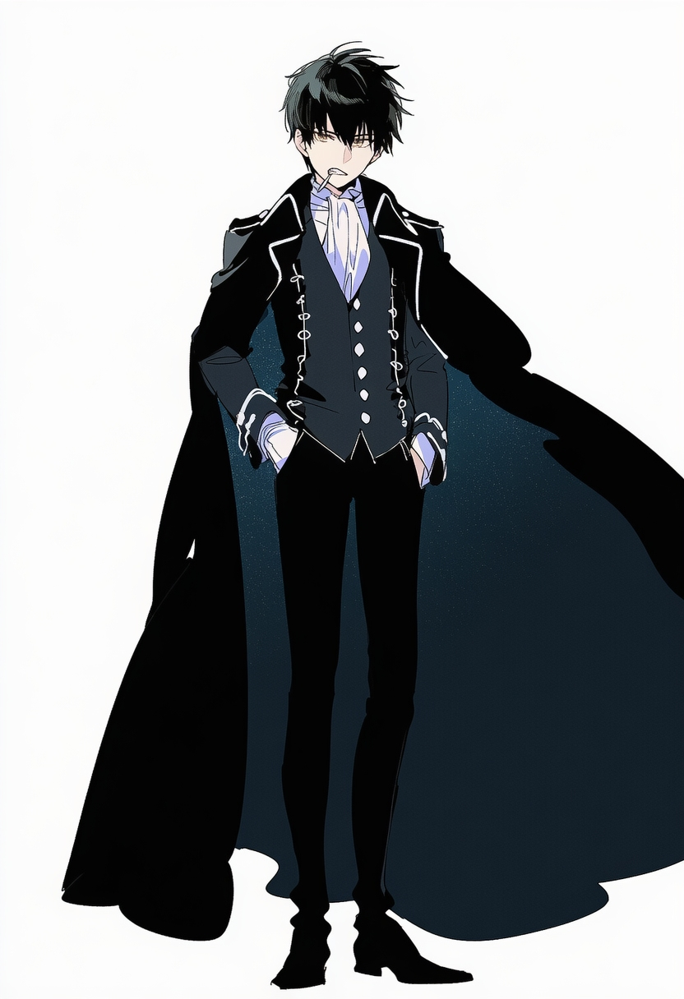

[在线例图](https://assets.quicktagcloud.com/images/raven_composition/raven_composition-1257.jpg?v=0605cdb1ab01a3b1)

<a id="raven_composition-1258"></a>

## 张嘴

ID：`raven_composition-1258`；分类：面部表情 / 眉眼/嘴部细节；来源标记：`safe`。

来源说明：

> 嘴巴明显张开。

正向提示词：

```text
open_mouth
```

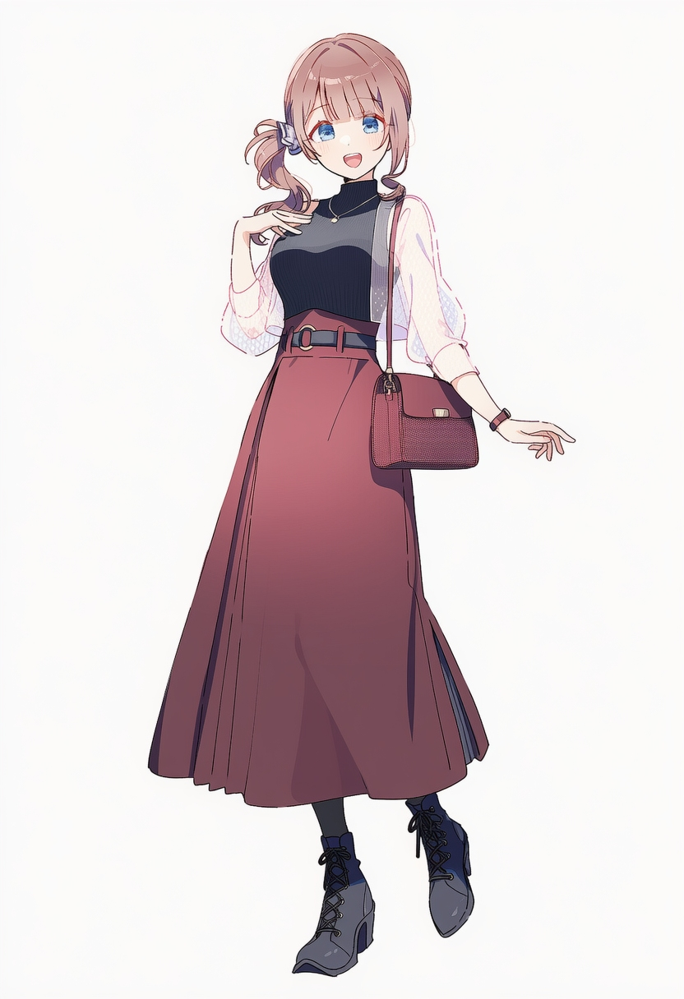

[在线例图](https://assets.quicktagcloud.com/images/raven_composition/raven_composition-1258.jpg?v=8f36c9e95db77981)

<a id="raven_composition-1259"></a>

## 闭嘴

ID：`raven_composition-1259`；分类：面部表情 / 眉眼/嘴部细节；来源标记：`safe`。

来源说明：

> 嘴巴闭合。

正向提示词：

```text
closed_mouth
```

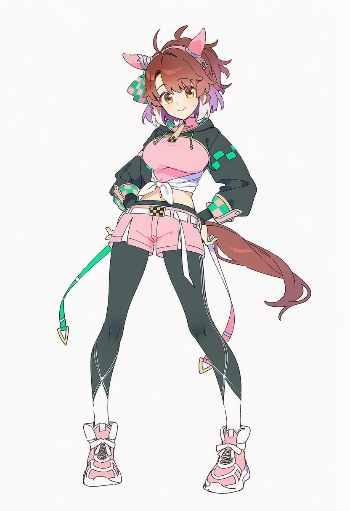

[在线例图](https://assets.quicktagcloud.com/images/raven_composition/raven_composition-1259.jpg?v=f4072fcbba89c6b6)

<a id="raven_composition-1260"></a>

## 微张嘴唇

ID：`raven_composition-1260`；分类：面部表情 / 眉眼/嘴部细节；来源标记：`safe`。

来源说明：

> 嘴唇轻微分开。

正向提示词：

```text
parted_lips
```

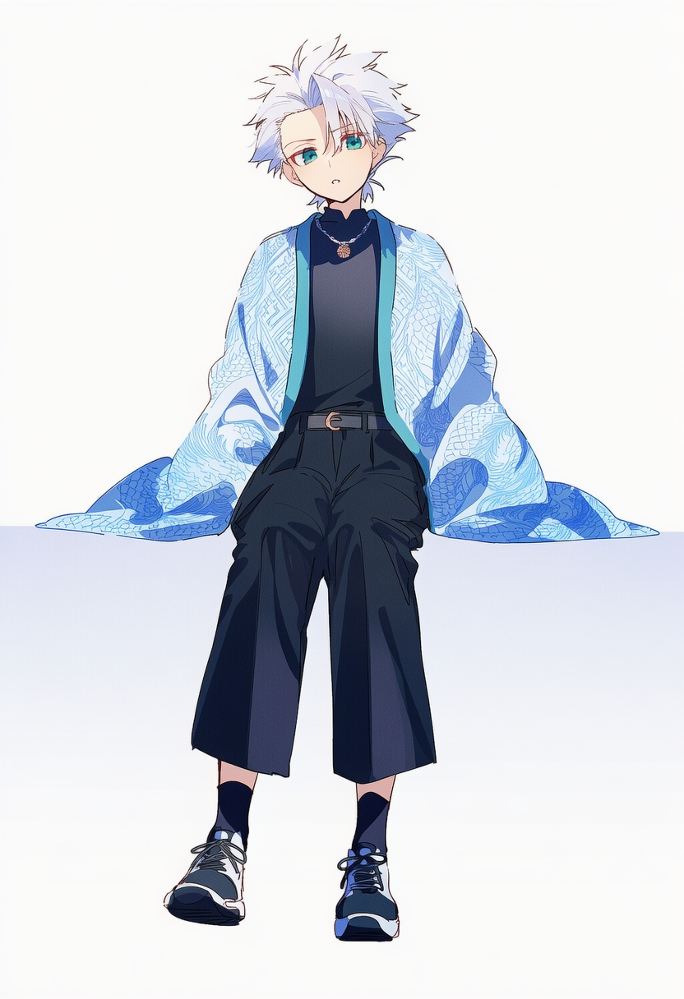

[在线例图](https://assets.quicktagcloud.com/images/raven_composition/raven_composition-1260.jpg?v=960cd4fab87a01bc)

<a id="raven_composition-1261"></a>

## 嘟嘴

ID：`raven_composition-1261`；分类：面部表情 / 眉眼/嘴部细节；来源标记：`safe`。

来源说明：

> 嘴唇向前撅起。

正向提示词：

```text
pout
```

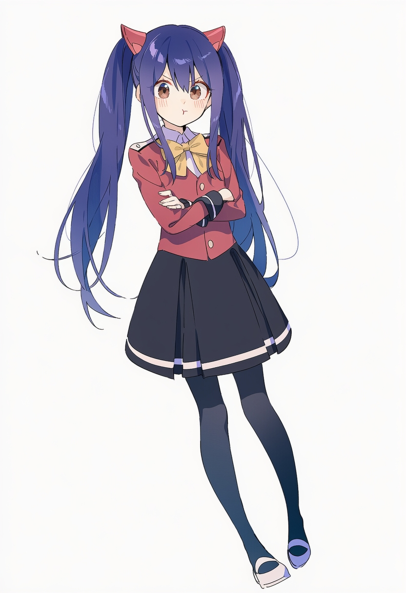

[在线例图](https://assets.quicktagcloud.com/images/raven_composition/raven_composition-1261.jpg?v=7a977ea1a3fe4530)

<a id="raven_composition-1262"></a>

## 鼓脸颊

ID：`raven_composition-1262`；分类：面部表情 / 眉眼/嘴部细节；来源标记：`safe`。

来源说明：

> 双颊鼓起，常用于生气或撒娇。

正向提示词：

```text
puffy_cheeks
```

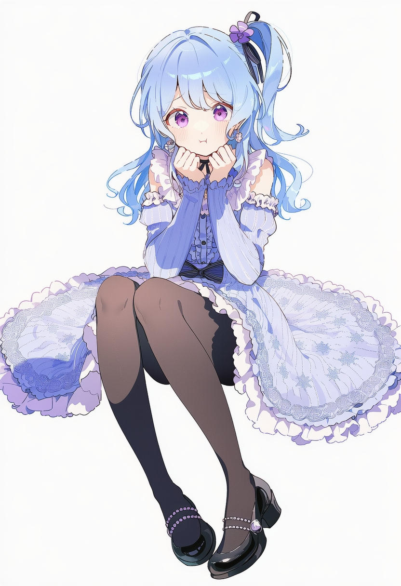

[在线例图](https://assets.quicktagcloud.com/images/raven_composition/raven_composition-1262.jpg?v=51d4856a397ed314)

<a id="raven_composition-1263"></a>

## 单挑眉

ID：`raven_composition-1263`；分类：面部表情 / 眉眼/嘴部细节；来源标记：`safe`。

来源说明：

> 只抬起一侧眉毛。

正向提示词：

```text
raised_eyebrow
```

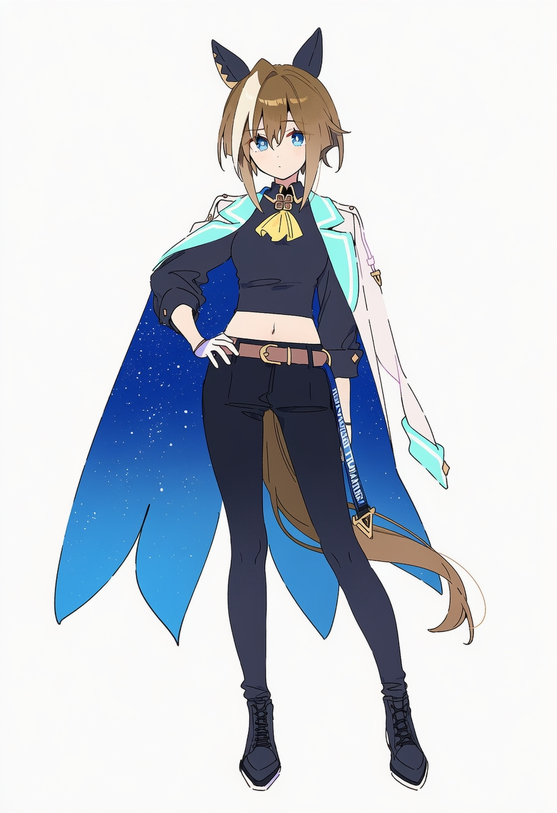

[在线例图](https://assets.quicktagcloud.com/images/raven_composition/raven_composition-1263.jpg?v=9258f1ec527a9bd8)

<a id="raven_composition-1264"></a>

## 挑眉

ID：`raven_composition-1264`；分类：面部表情 / 眉眼/嘴部细节；来源标记：`safe`。

来源说明：

> 双眉抬高。

正向提示词：

```text
raised_eyebrows
```

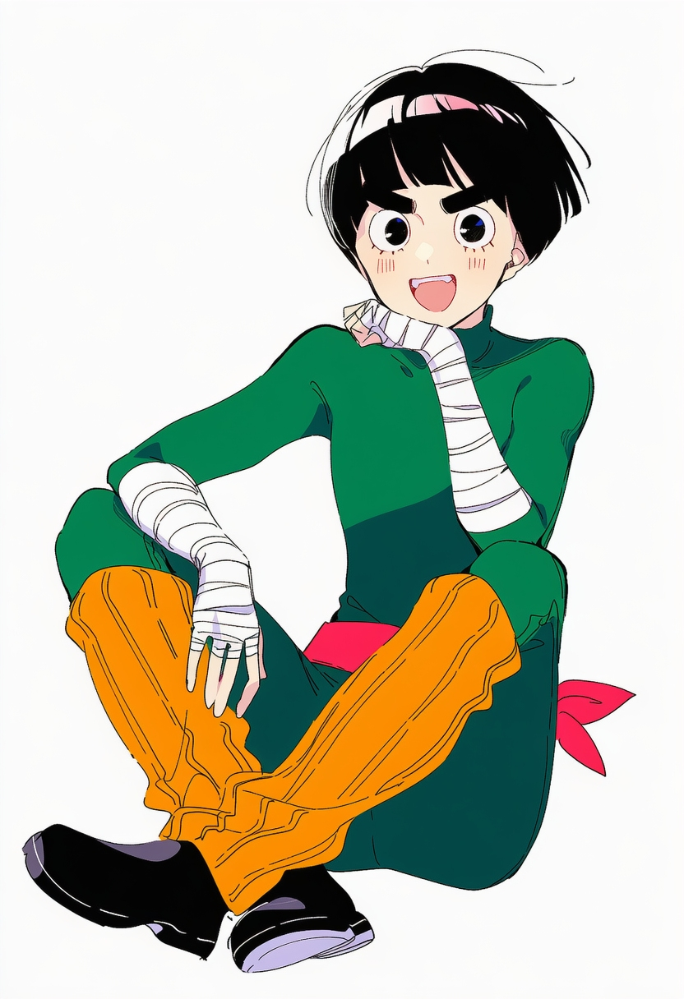

[在线例图](https://assets.quicktagcloud.com/images/raven_composition/raven_composition-1264.jpg?v=d48eaf50a75a0e19)

<a id="raven_composition-1265"></a>

## 眉心上扬

ID：`raven_composition-1265`；分类：面部表情 / 眉眼/嘴部细节；来源标记：`safe`。

来源说明：

> 眉毛内侧抬起，常显得委屈。

正向提示词：

```text
raised_inner_eyebrows
```

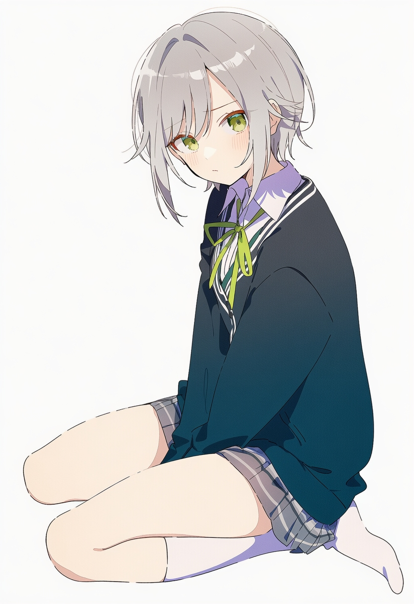

[在线例图](https://assets.quicktagcloud.com/images/raven_composition/raven_composition-1265.jpg?v=6698db5f7cb06440)

<a id="raven_composition-1266"></a>

## V形眉

ID：`raven_composition-1266`；分类：面部表情 / 眉眼/嘴部细节；来源标记：`safe`。

来源说明：

> 眉毛压成明显 V 字形。

正向提示词：

```text
v-shaped_eyebrows
```

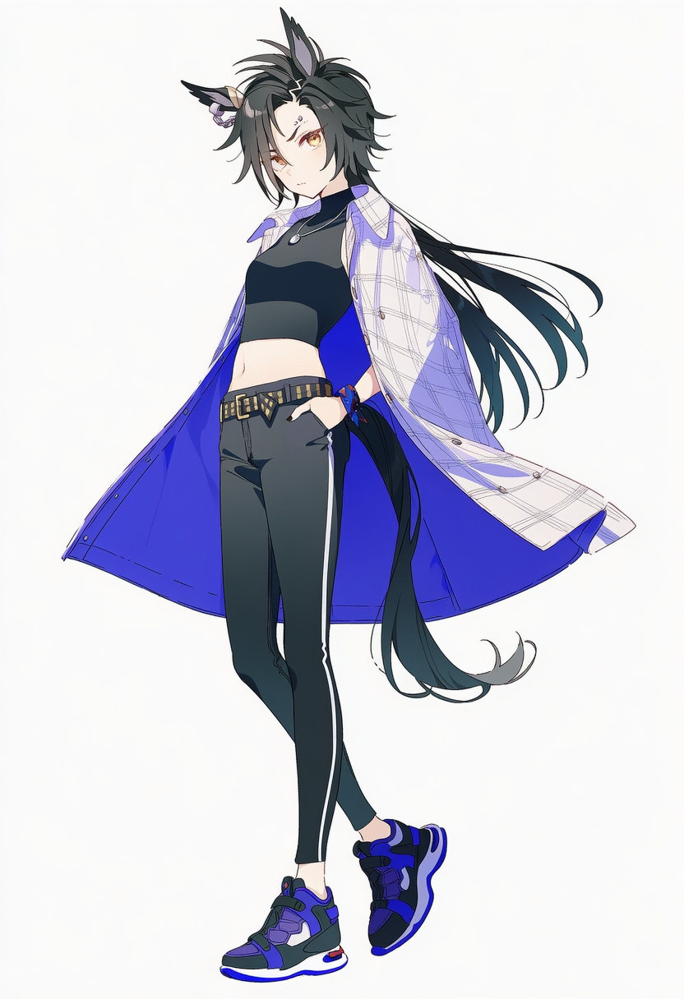

[在线例图](https://assets.quicktagcloud.com/images/raven_composition/raven_composition-1266.jpg?v=2a06ae1930695ee4)

<a id="raven_composition-1267"></a>

## 波浪嘴

ID：`raven_composition-1267`；分类：面部表情 / 眉眼/嘴部细节；来源标记：`safe`。

来源说明：

> 嘴巴画成波浪线。

正向提示词：

```text
wavy_mouth
```

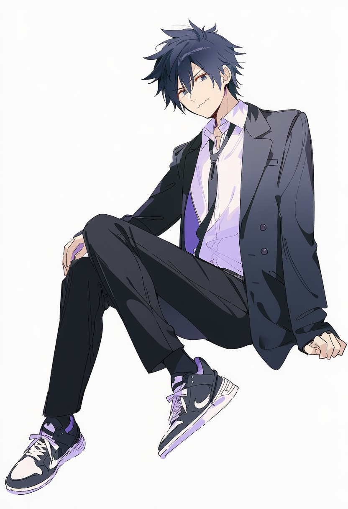

[在线例图](https://assets.quicktagcloud.com/images/raven_composition/raven_composition-1267.jpg?v=415e803cdea4108f)

<a id="raven_composition-1268"></a>

## 三角嘴

ID：`raven_composition-1268`；分类：面部表情 / 眉眼/嘴部细节；来源标记：`safe`。

来源说明：

> 嘴巴呈三角形。

正向提示词：

```text
triangle_mouth
```

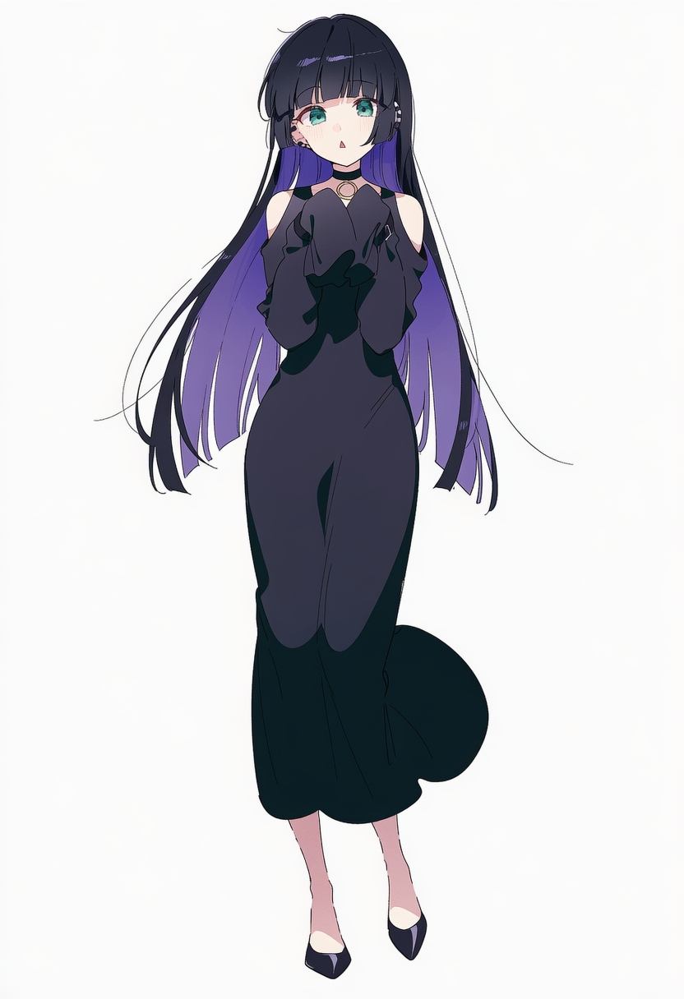

[在线例图](https://assets.quicktagcloud.com/images/raven_composition/raven_composition-1268.jpg?v=200bae2a3beb460c)

<a id="raven_composition-1269"></a>

## 侧歪嘴

ID：`raven_composition-1269`；分类：面部表情 / 眉眼/嘴部细节；来源标记：`safe`。

来源说明：

> 嘴巴明显偏向一侧。

正向提示词：

```text
sideways_mouth
```

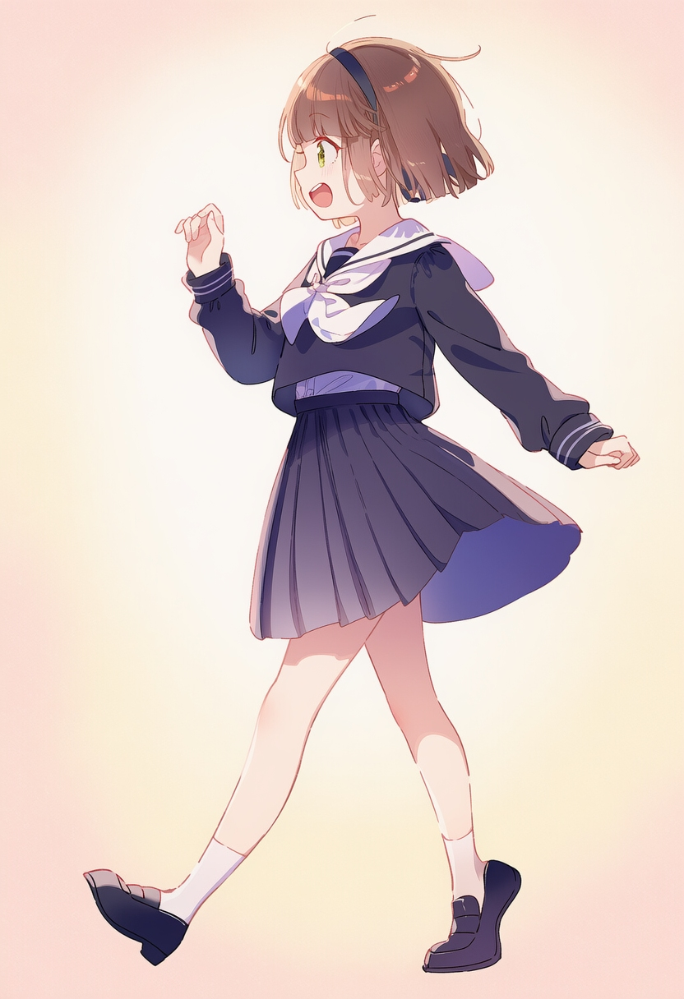

[在线例图](https://assets.quicktagcloud.com/images/raven_composition/raven_composition-1269.jpg?v=dad7ded08ac95dd4)

<a id="raven_composition-1270"></a>

## 分叉嘴

ID：`raven_composition-1270`；分类：面部表情 / 眉眼/嘴部细节；来源标记：`safe`。

来源说明：

> 嘴线中间分叉或呈 W 状。

正向提示词：

```text
split_mouth
```

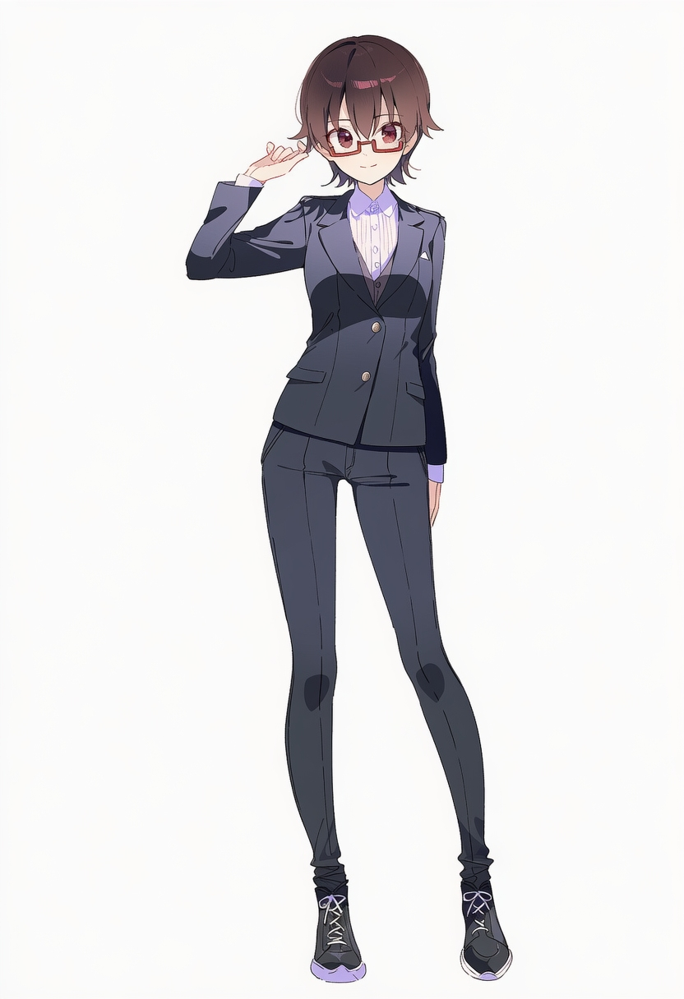

[在线例图](https://assets.quicktagcloud.com/images/raven_composition/raven_composition-1270.jpg?v=0ffa56ef6bc79e78)

<a id="raven_composition-1271"></a>

## 点状嘴

ID：`raven_composition-1271`；分类：面部表情 / 眉眼/嘴部细节；来源标记：`safe`。

来源说明：

> 嘴巴简化成一个小点。

正向提示词：

```text
dot_mouth
```

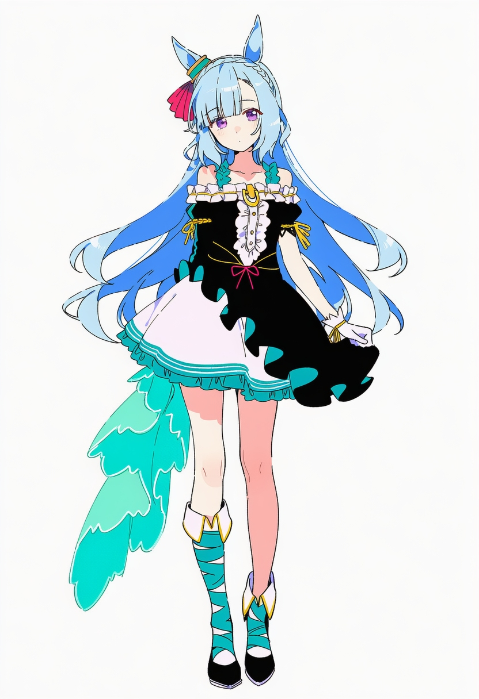

[在线例图](https://assets.quicktagcloud.com/images/raven_composition/raven_composition-1271.jpg?v=cc10494713e2c225)

<a id="raven_composition-1272"></a>

## 栗子嘴

ID：`raven_composition-1272`；分类：面部表情 / 眉眼/嘴部细节；来源标记：`safe`。

来源说明：

> 嘴型像栗子般鼓起。

正向提示词：

```text
chestnut_mouth
```

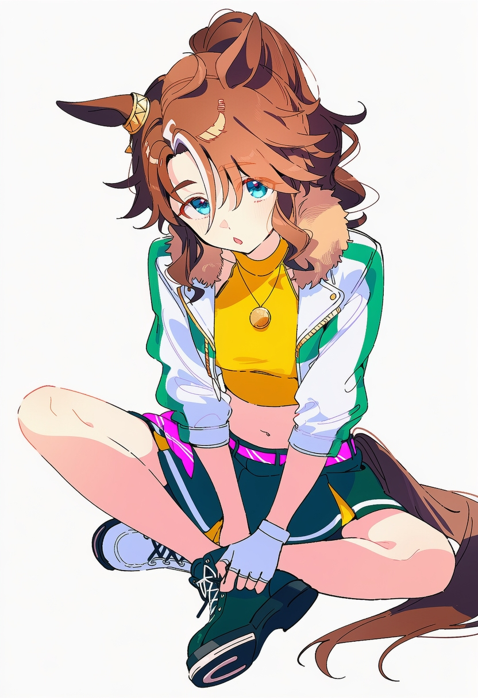

[在线例图](https://assets.quicktagcloud.com/images/raven_composition/raven_composition-1272.jpg?v=6aea6e3756dbfe27)

<a id="raven_composition-1273"></a>

## 矩形嘴

ID：`raven_composition-1273`；分类：面部表情 / 眉眼/嘴部细节；来源标记：`safe`。

来源说明：

> 张开的嘴呈长方形。

正向提示词：

```text
rectangular_mouth
```

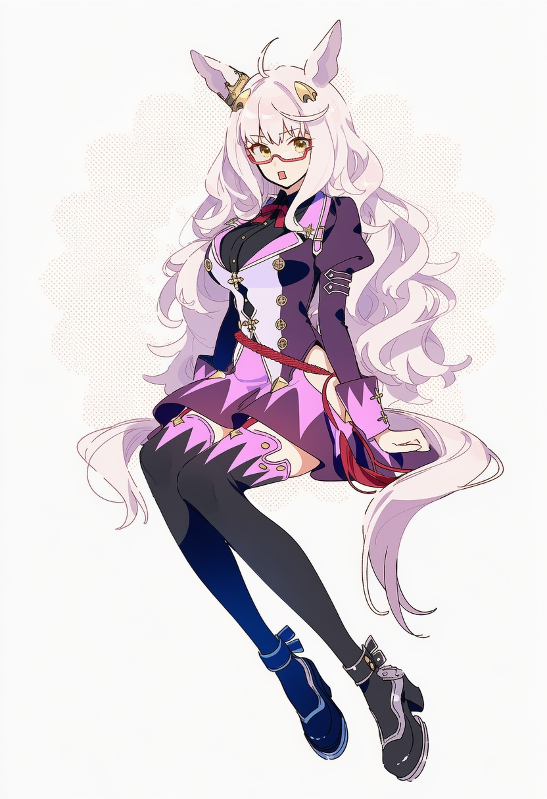

[在线例图](https://assets.quicktagcloud.com/images/raven_composition/raven_composition-1273.jpg?v=ffc24e9c6beea272)

<a id="raven_composition-1274"></a>

## 缝合嘴

ID：`raven_composition-1274`；分类：面部表情 / 眉眼/嘴部细节；来源标记：`safe`。

来源说明：

> 嘴部带缝线或缝合效果。

正向提示词：

```text
stitched_mouth
```

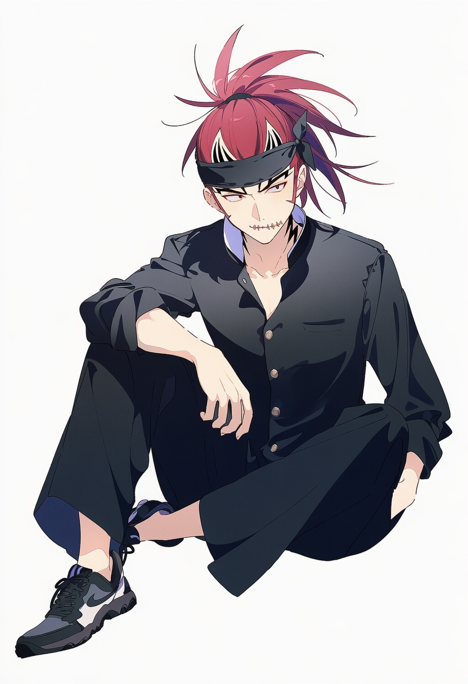

[在线例图](https://assets.quicktagcloud.com/images/raven_composition/raven_composition-1274.jpg?v=a2313821547f61f3)

<a id="raven_composition-1275"></a>

## 发光嘴

ID：`raven_composition-1275`；分类：面部表情 / 眉眼/嘴部细节；来源标记：`safe`。

来源说明：

> 口腔内部明显发光。

正向提示词：

```text
glowing_mouth
```

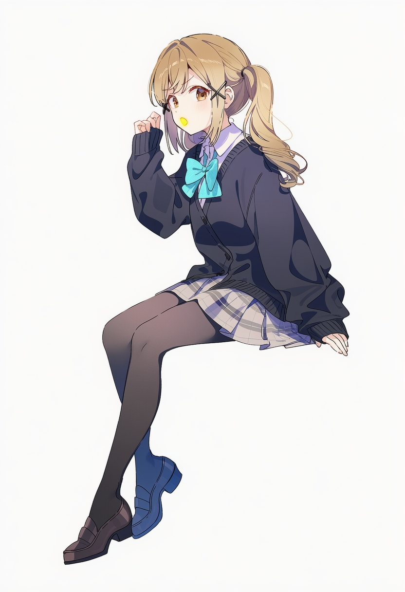

[在线例图](https://assets.quicktagcloud.com/images/raven_composition/raven_composition-1275.jpg?v=42079e0a9ff5ea86)

<a id="raven_composition-1276"></a>

## 嘴边口水

ID：`raven_composition-1276`；分类：面部表情 / 眉眼/嘴部细节；来源标记：`safe`。

来源说明：

> 口水从嘴角流下。

正向提示词：

```text
mouth_drool
```

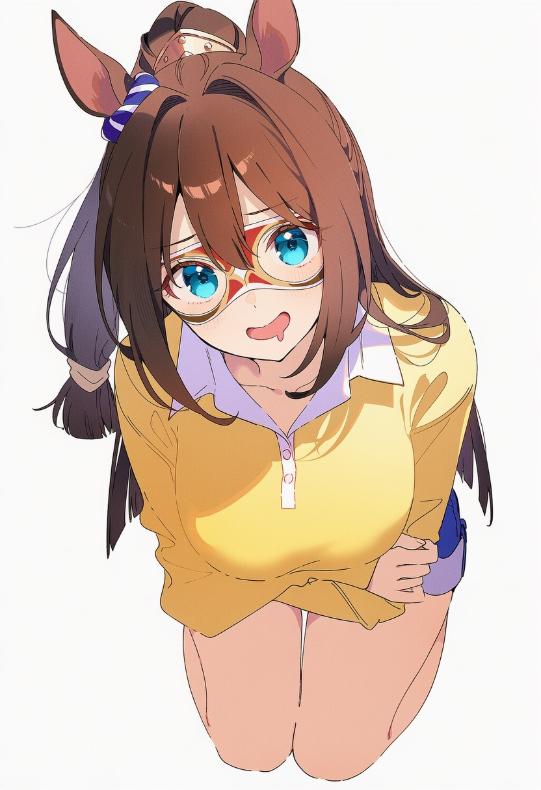

[在线例图](https://assets.quicktagcloud.com/images/raven_composition/raven_composition-1276.jpg?v=ddad251377c93498)

<a id="raven_composition-1277"></a>

## 吐舌

ID：`raven_composition-1277`；分类：面部表情 / 眉眼/嘴部细节；来源标记：`safe`。

来源说明：

> 舌头伸出嘴外。

正向提示词：

```text
tongue_out
```

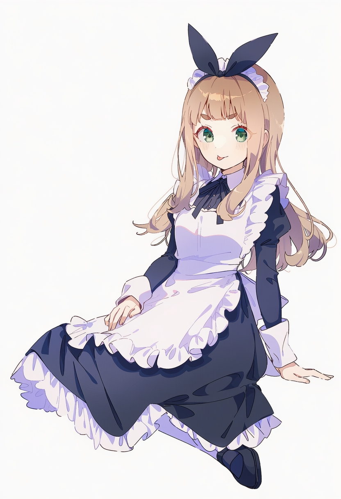

[在线例图](https://assets.quicktagcloud.com/images/raven_composition/raven_composition-1277.jpg?v=d21d417a2c4699b2)

<a id="raven_composition-1278"></a>

## 露虎牙

ID：`raven_composition-1278`；分类：面部表情 / 眉眼/嘴部细节；来源标记：`safe`。

来源说明：

> 露出一颗明显尖牙。

正向提示词：

```text
fang
```

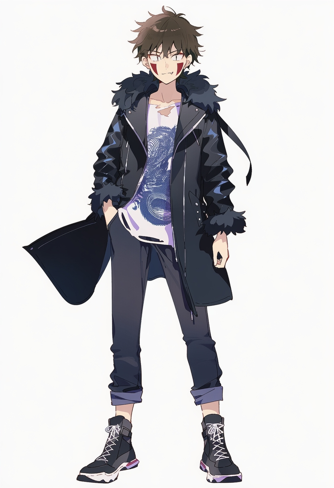

[在线例图](https://assets.quicktagcloud.com/images/raven_composition/raven_composition-1278.jpg?v=cfd9b7e121abda0b)

<a id="raven_composition-1279"></a>

## 露牙

ID：`raven_composition-1279`；分类：面部表情 / 眉眼/嘴部细节；来源标记：`safe`。

来源说明：

> 嘴里能明显看到牙齿。

正向提示词：

```text
teeth
```

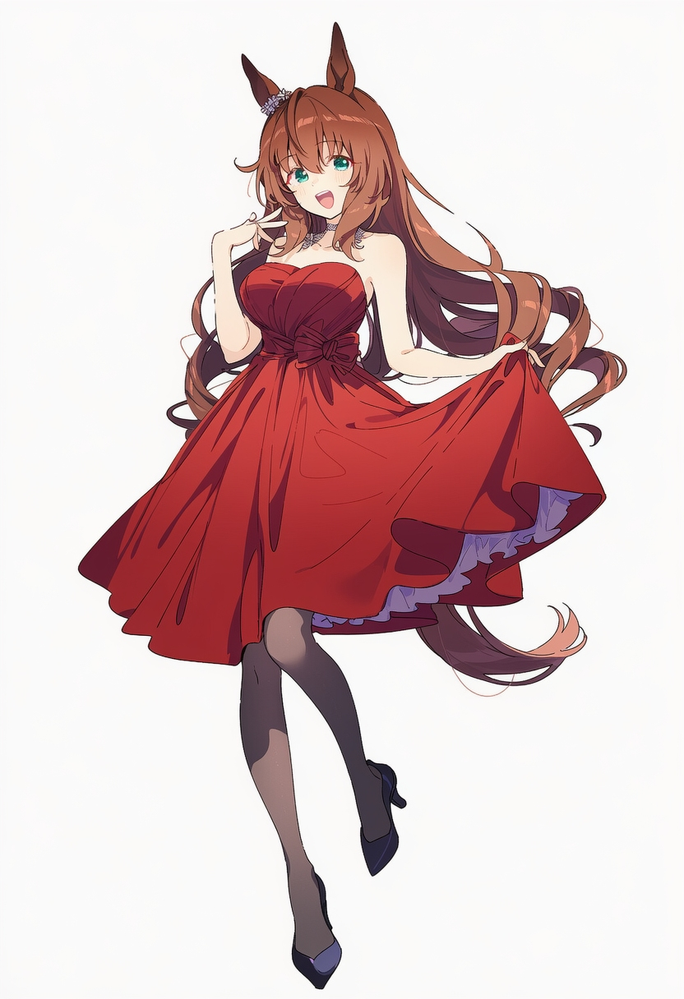

[在线例图](https://assets.quicktagcloud.com/images/raven_composition/raven_composition-1279.jpg?v=31b8022cb45c45bb)

<a id="raven_composition-1280"></a>

## 流口水

ID：`raven_composition-1280`；分类：面部表情 / 眉眼/嘴部细节；来源标记：`safe`。

来源说明：

> 明显有口水流出。

正向提示词：

```text
drooling
```

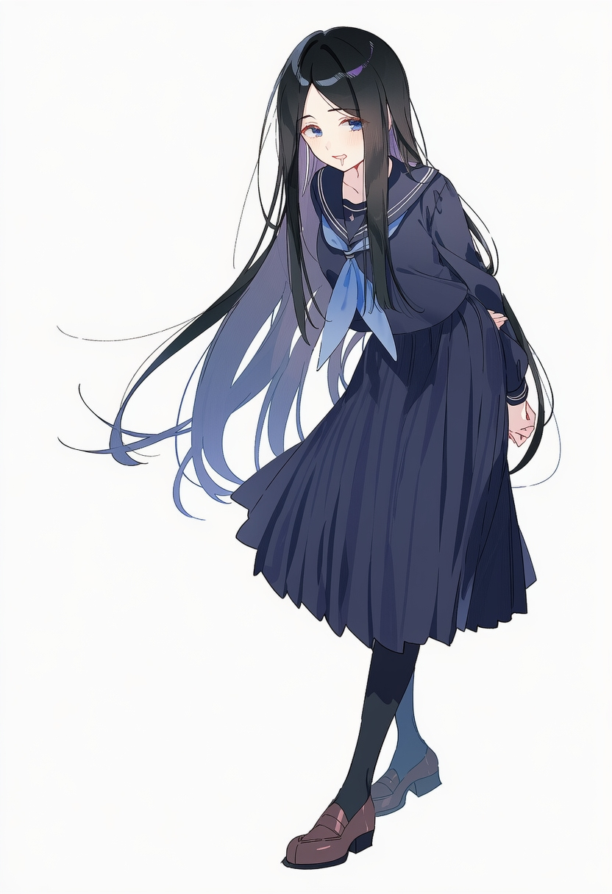

[在线例图](https://assets.quicktagcloud.com/images/raven_composition/raven_composition-1280.jpg?v=a6588c18a06e96f0)

<a id="raven_composition-1281"></a>

## 撅唇

ID：`raven_composition-1281`；分类：面部表情 / 眉眼/嘴部细节；来源标记：`safe`。

来源说明：

> 嘴唇收紧向前突出。

正向提示词：

```text
puckered_lips
```

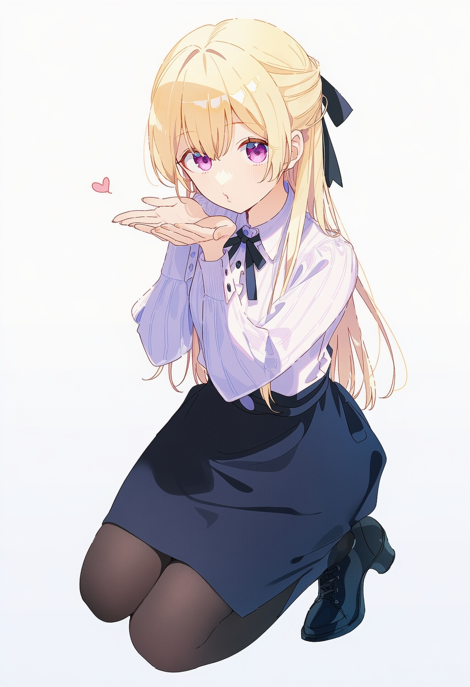

[在线例图](https://assets.quicktagcloud.com/images/raven_composition/raven_composition-1281.jpg?v=77b378827414a269)

<a id="raven_composition-1282"></a>

## 虎牙外露

ID：`raven_composition-1282`；分类：面部表情 / 眉眼/嘴部细节；来源标记：`safe`。

来源说明：

> 闭嘴时仍有尖牙露在外面。

正向提示词：

```text
fang_out
```

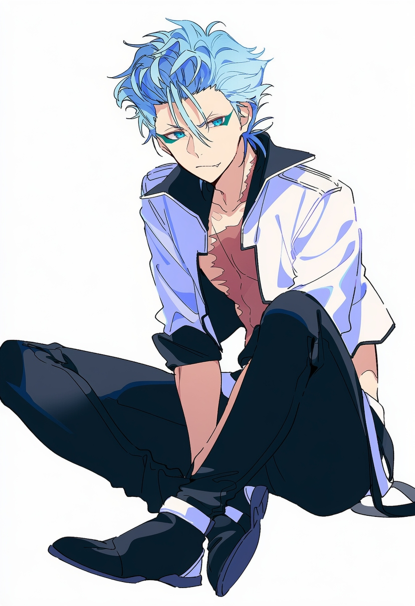

[在线例图](https://assets.quicktagcloud.com/images/raven_composition/raven_composition-1282.jpg?v=41039e0075b2b96d)

<a id="raven_composition-1283"></a>

## 只露上排牙

ID：`raven_composition-1283`；分类：面部表情 / 眉眼/嘴部细节；来源标记：`safe`。

来源说明：

> 只显示上排牙齿。

正向提示词：

```text
upper_teeth_only
```

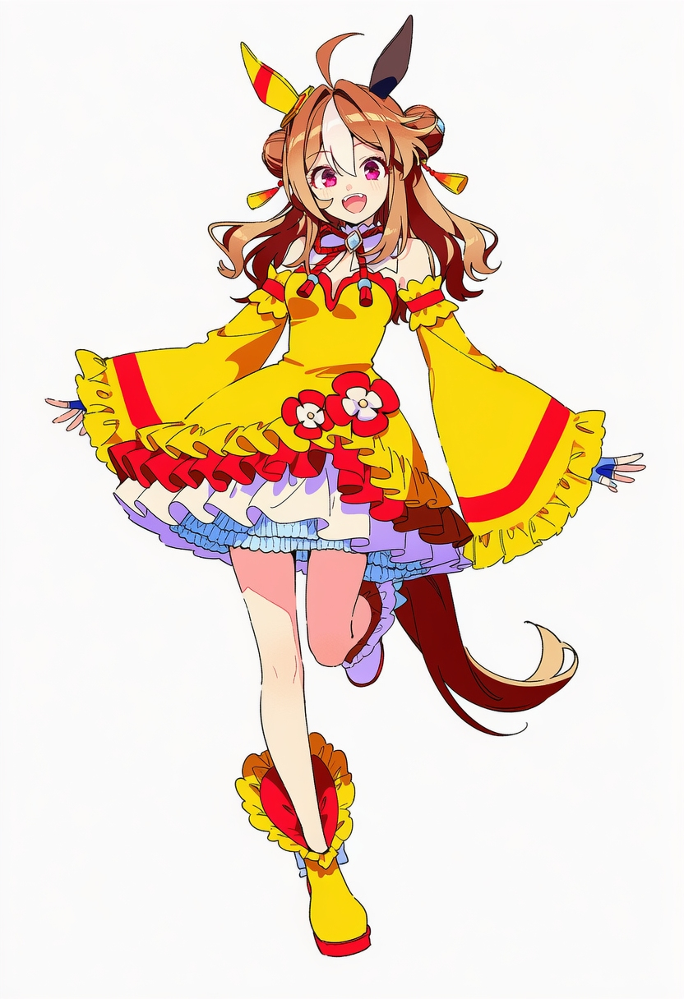

[在线例图](https://assets.quicktagcloud.com/images/raven_composition/raven_composition-1283.jpg?v=21826c983e1ffa4b)

<a id="raven_composition-1284"></a>

## 皮肤色虎牙

ID：`raven_composition-1284`；分类：面部表情 / 眉眼/嘴部细节；来源标记：`safe`。

来源说明：

> 用肤色三角缺口表现虎牙。

正向提示词：

```text
skin_fang
```

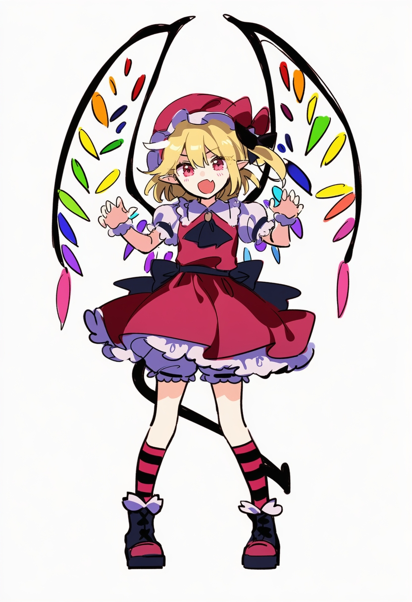

[在线例图](https://assets.quicktagcloud.com/images/raven_composition/raven_composition-1284.jpg?v=4030679b8aba68d9)

<a id="raven_composition-1285"></a>

## 尖牙齿

ID：`raven_composition-1285`；分类：面部表情 / 眉眼/嘴部细节；来源标记：`safe`。

来源说明：

> 露出多颗明显尖锐牙齿。

正向提示词：

```text
sharp_teeth
```

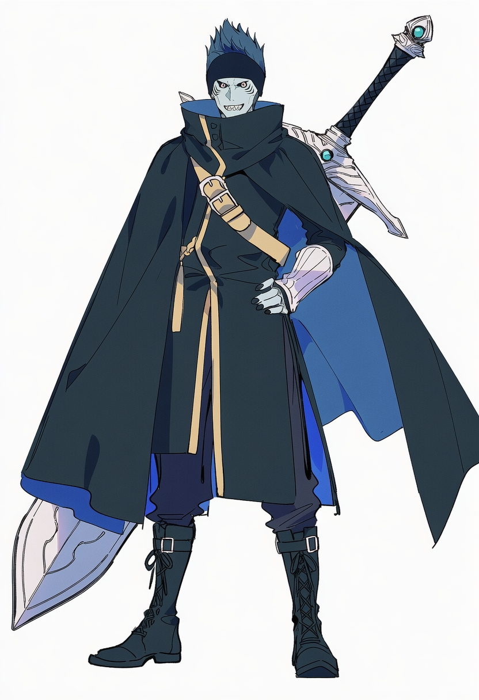

[在线例图](https://assets.quicktagcloud.com/images/raven_composition/raven_composition-1285.jpg?v=9553eda7b857af36)
