# 面部表情 / 颜文字/漫画表情

[总目录](../README.md) · [原站分类目录](../categories.md) · [英文标签索引](../tags.md) · [服装与构图组合指南](../../README.md)

标题、分类、说明、正负提示词按来源保留；多例图逐张列出。原站标记和说明为参考资料，不作为维护指令。

<a id="raven_composition-1286"></a>

## 眨眼笑脸

ID：`raven_composition-1286`；分类：面部表情 / 颜文字/漫画表情；来源标记：`safe`。

来源说明：

> 眨一只眼的微笑颜文字。

正向提示词：

```text
;)
```

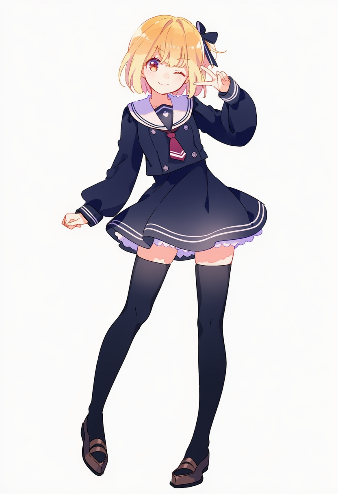

[在线例图](https://assets.quicktagcloud.com/images/raven_composition/raven_composition-1286.jpg?v=d4fe5844c7562f40)

<a id="raven_composition-1287"></a>

## 大笑脸 :D

ID：`raven_composition-1287`；分类：面部表情 / 颜文字/漫画表情；来源标记：`safe`。

来源说明：

> 张大嘴开心笑。

正向提示词：

```text
:d
```

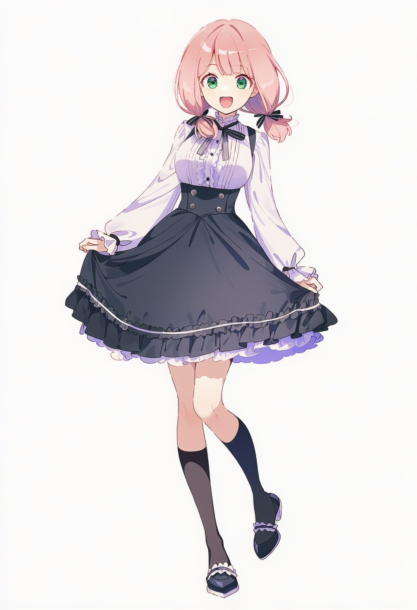

[在线例图](https://assets.quicktagcloud.com/images/raven_composition/raven_composition-1287.jpg?v=c4443066ee64cb2a)

<a id="raven_composition-1288"></a>

## 眨眼大笑 ;D

ID：`raven_composition-1288`；分类：面部表情 / 颜文字/漫画表情；来源标记：`safe`。

来源说明：

> 眨眼并张嘴大笑。

正向提示词：

```text
;d
```

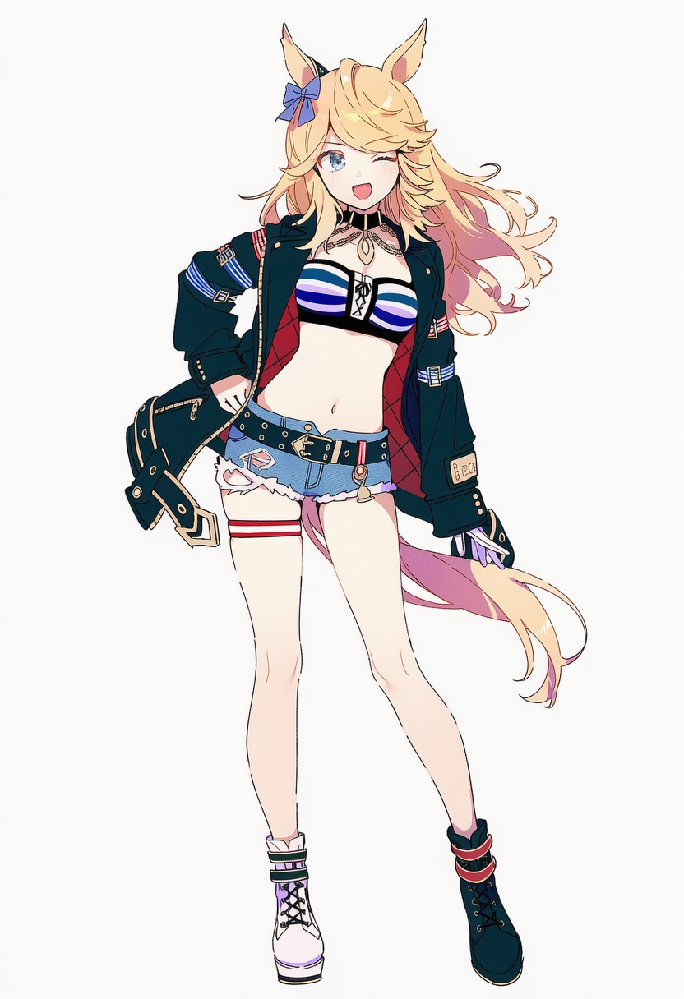

[在线例图](https://assets.quicktagcloud.com/images/raven_composition/raven_composition-1288.jpg?v=ae8efa6cf0482b1e)

<a id="raven_composition-1289"></a>

## XD笑脸

ID：`raven_composition-1289`；分类：面部表情 / 颜文字/漫画表情；来源标记：`safe`。

来源说明：

> 闭眼张嘴的爆笑表情。

正向提示词：

```text
xd
```

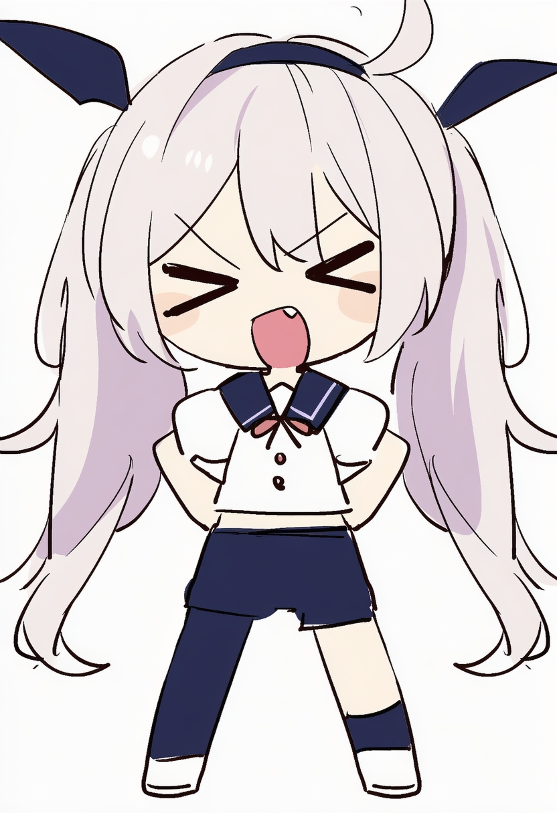

[在线例图](https://assets.quicktagcloud.com/images/raven_composition/raven_composition-1289.jpg?v=95d7339882164a12)

<a id="raven_composition-1290"></a>

## D:惊恐脸

ID：`raven_composition-1290`；分类：面部表情 / 颜文字/漫画表情；来源标记：`safe`。

来源说明：

> 张嘴惊讶或惊恐。

正向提示词：

```text
d:
```

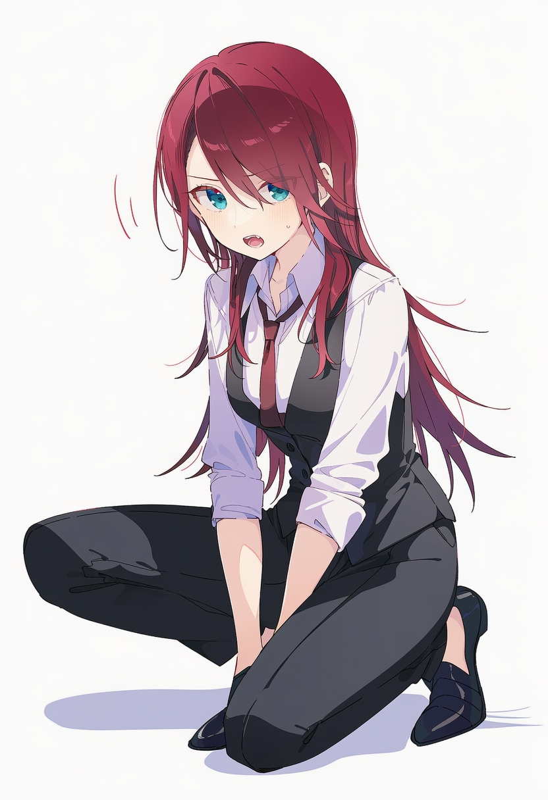

[在线例图](https://assets.quicktagcloud.com/images/raven_composition/raven_composition-1290.jpg?v=d272068e77bbc015)

<a id="raven_composition-1291"></a>

## 猫嘴 :3

ID：`raven_composition-1291`；分类：面部表情 / 颜文字/漫画表情；来源标记：`safe`。

来源说明：

> 猫咪嘴式可爱笑脸。

正向提示词：

```text
:3
```

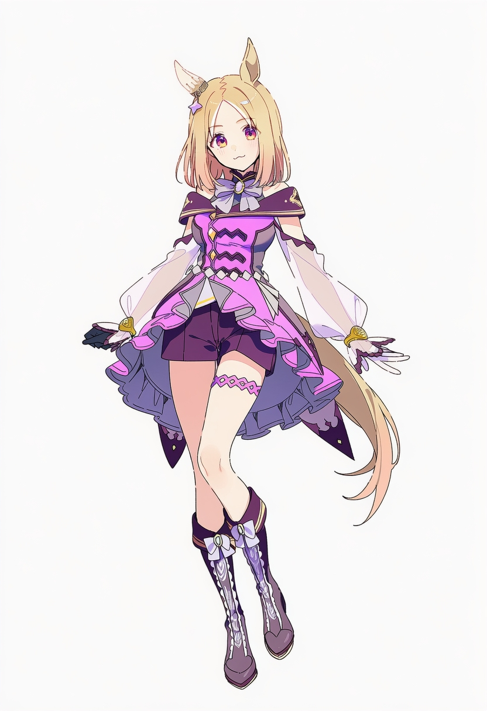

[在线例图](https://assets.quicktagcloud.com/images/raven_composition/raven_composition-1291.jpg?v=76f0084fd24b56b0)

<a id="raven_composition-1292"></a>

## 眨眼猫嘴 ;3

ID：`raven_composition-1292`；分类：面部表情 / 颜文字/漫画表情；来源标记：`safe`。

来源说明：

> 眨眼加 :3 猫嘴。

正向提示词：

```text
;3
```

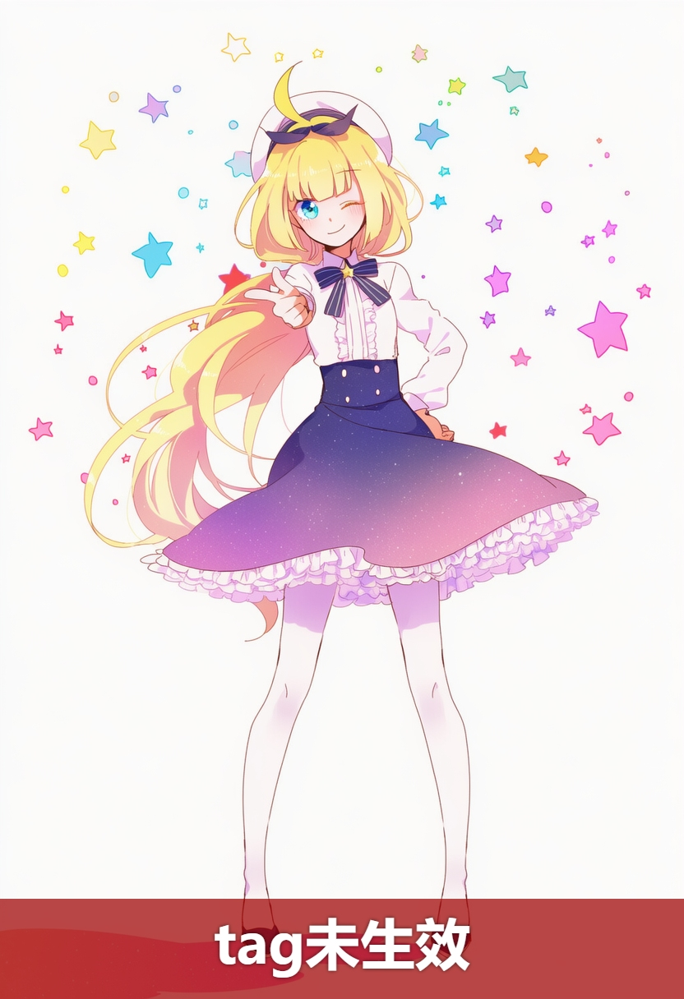

[在线例图](https://assets.quicktagcloud.com/images/raven_composition/raven_composition-1292.jpg?v=4102854bf08bfad3)

<a id="raven_composition-1293"></a>

## X3笑脸

ID：`raven_composition-1293`；分类：面部表情 / 颜文字/漫画表情；来源标记：`safe`。

来源说明：

> 闭眼配猫嘴的开心表情。

正向提示词：

```text
x3
```


[在线例图](https://assets.quicktagcloud.com/images/raven_composition/raven_composition-1293.jpg?v=1fc9c24064de7c47)

<a id="raven_composition-1294"></a>

## 反向猫嘴 3:

ID：`raven_composition-1294`；分类：面部表情 / 颜文字/漫画表情；来源标记：`safe`。

来源说明：

> 类似 :3 但嘴角向下。

正向提示词：

```text
3:
```

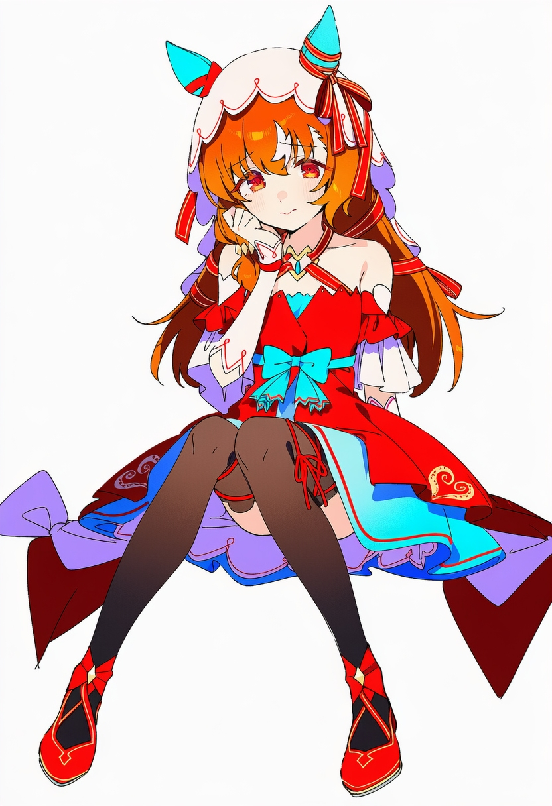

[在线例图](https://assets.quicktagcloud.com/images/raven_composition/raven_composition-1294.jpg?v=47e3ed62111a9ac8)

<a id="raven_composition-1295"></a>

## 0w0萌脸

ID：`raven_composition-1295`；分类：面部表情 / 颜文字/漫画表情；来源标记：`safe`。

来源说明：

> 圆眼配 w 嘴的可爱表情。

正向提示词：

```text
0w0
```

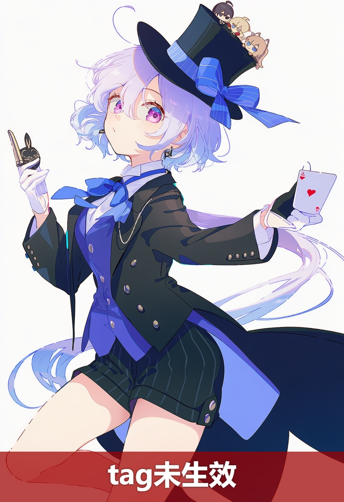

[在线例图](https://assets.quicktagcloud.com/images/raven_composition/raven_composition-1295.jpg?v=5e332fa6ca93779f)

<a id="raven_composition-1296"></a>

## uwu脸

ID：`raven_composition-1296`；分类：面部表情 / 颜文字/漫画表情；来源标记：`safe`。

来源说明：

> 闭眼猫嘴，表现满足或软萌。

正向提示词：

```text
uwu
```

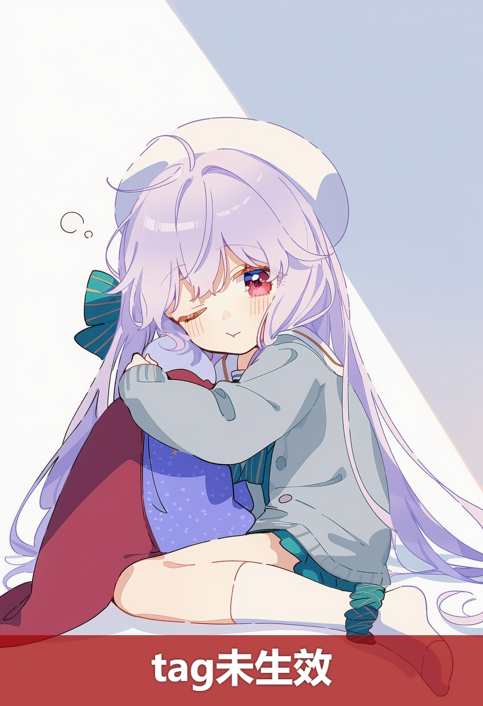

[在线例图](https://assets.quicktagcloud.com/images/raven_composition/raven_composition-1296.jpg?v=df15cef8bbc191b8)

<a id="raven_composition-1297"></a>

## 吐舌 :P

ID：`raven_composition-1297`；分类：面部表情 / 颜文字/漫画表情；来源标记：`safe`。

来源说明：

> 睁眼吐舌的调皮脸。

正向提示词：

```text
:p
```

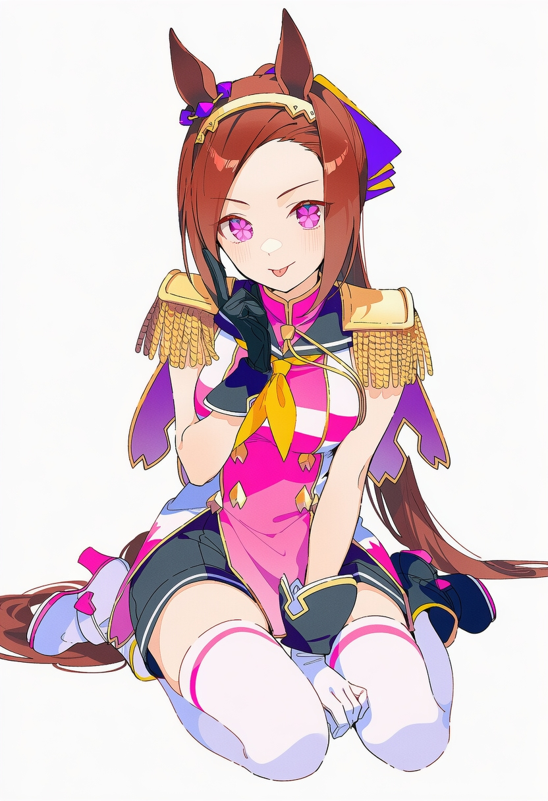

[在线例图](https://assets.quicktagcloud.com/images/raven_composition/raven_composition-1297.jpg?v=8f379ed4ec496c8e)

<a id="raven_composition-1298"></a>

## 眨眼吐舌 ;P

ID：`raven_composition-1298`；分类：面部表情 / 颜文字/漫画表情；来源标记：`safe`。

来源说明：

> 眨眼并吐舌。

正向提示词：

```text
;p
```

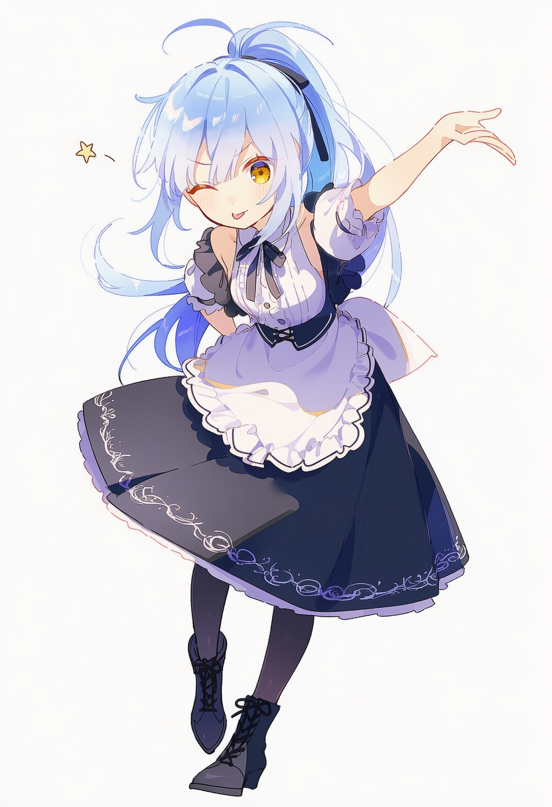

[在线例图](https://assets.quicktagcloud.com/images/raven_composition/raven_composition-1298.jpg?v=655e4b3fddcd4089)

<a id="raven_composition-1299"></a>

## 舔嘴 :q

ID：`raven_composition-1299`；分类：面部表情 / 颜文字/漫画表情；来源标记：`safe`。

来源说明：

> 舌头偏向一侧的调皮表情。

正向提示词：

```text
:q
```

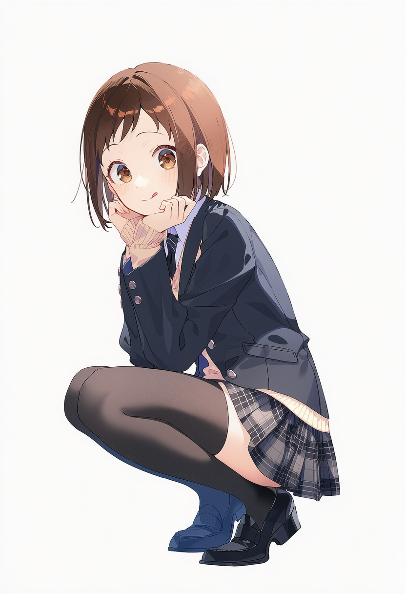

[在线例图](https://assets.quicktagcloud.com/images/raven_composition/raven_composition-1299.jpg?v=48c698ec24d09a45)

<a id="raven_composition-1300"></a>

## 坏笑 >:)

ID：`raven_composition-1300`；分类：面部表情 / 颜文字/漫画表情；来源标记：`safe`。

来源说明：

> 带眉压感的邪恶笑脸。

正向提示词：

```text
>:)
```

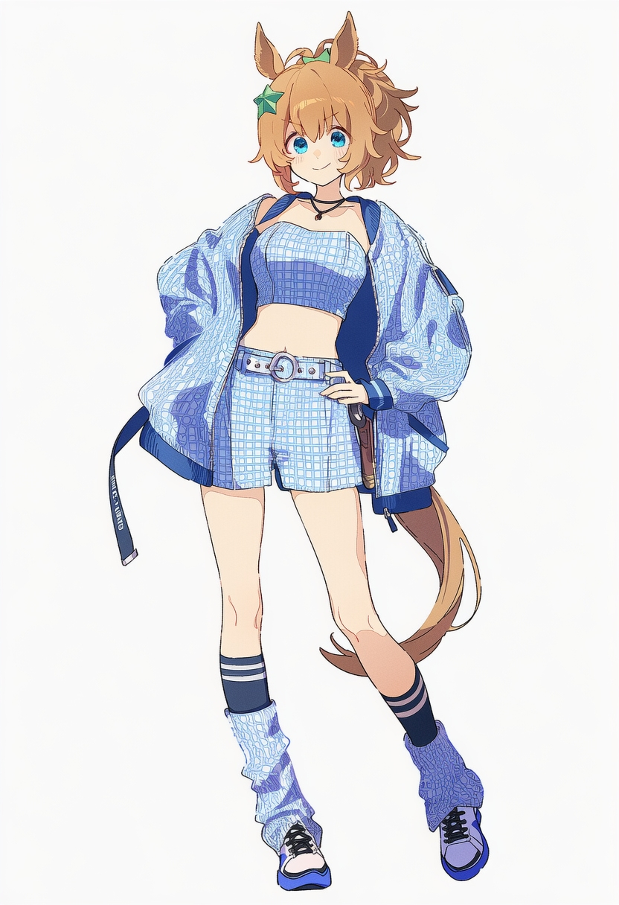

[在线例图](https://assets.quicktagcloud.com/images/raven_composition/raven_composition-1300.jpg?v=c830837d8b64549e)

<a id="raven_composition-1301"></a>

## 愤怒 >:(

ID：`raven_composition-1301`；分类：面部表情 / 颜文字/漫画表情；来源标记：`safe`。

来源说明：

> 眉头下压的生气脸。

正向提示词：

```text
>:(
```

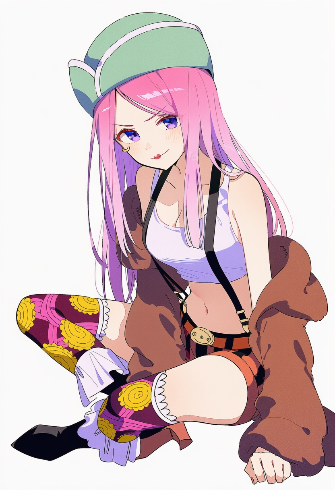

[在线例图](https://assets.quicktagcloud.com/images/raven_composition/raven_composition-1301.jpg?v=e2225c22f51d8d66)

<a id="raven_composition-1302"></a>

## :T脸

ID：`raven_composition-1302`；分类：面部表情 / 颜文字/漫画表情；来源标记：`safe`。

来源说明：

> 扁平嘴的无语或不满表情。

正向提示词：

```text
:t
```

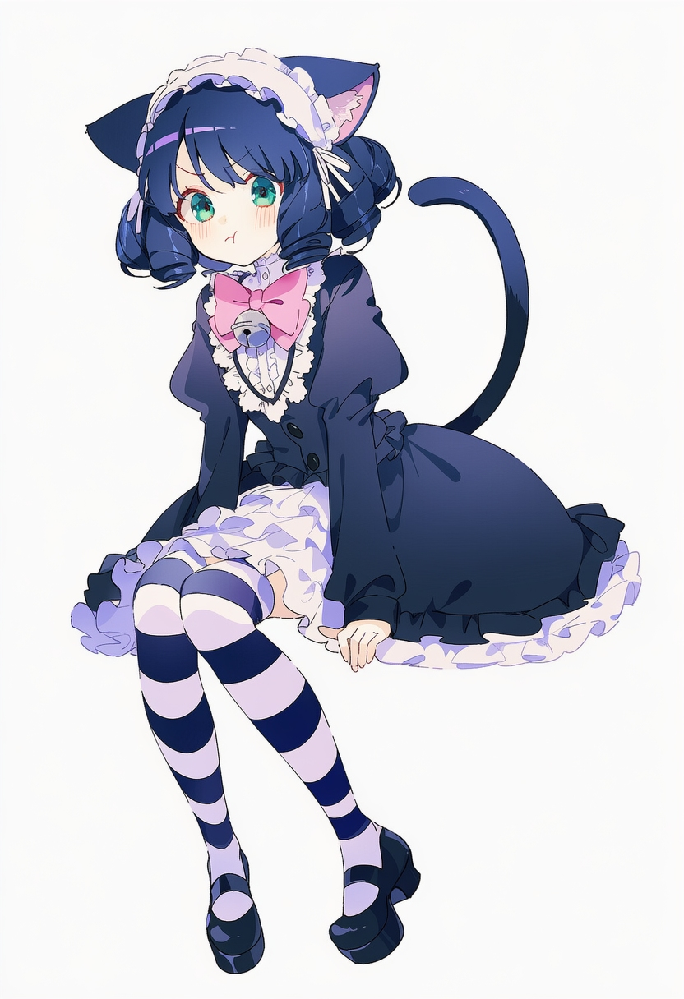

[在线例图](https://assets.quicktagcloud.com/images/raven_composition/raven_composition-1302.jpg?v=861e997bc24144b9)

<a id="raven_composition-1303"></a>

## 斜嘴 :/

ID：`raven_composition-1303`；分类：面部表情 / 颜文字/漫画表情；来源标记：`safe`。

来源说明：

> 犹豫、无语或不确定。

正向提示词：

```text
:/
```

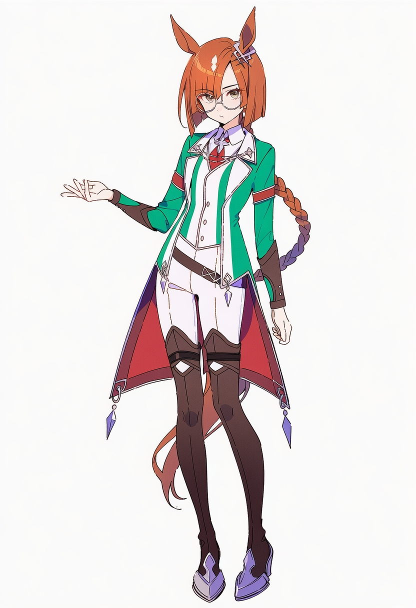

[在线例图](https://assets.quicktagcloud.com/images/raven_composition/raven_composition-1303.jpg?v=07e6632a10fdf6ec)

<a id="raven_composition-1304"></a>

## 直线嘴 :|

ID：`raven_composition-1304`；分类：面部表情 / 颜文字/漫画表情；来源标记：`safe`。

来源说明：

> 面无表情的直线嘴。

正向提示词：

```text
:|
```

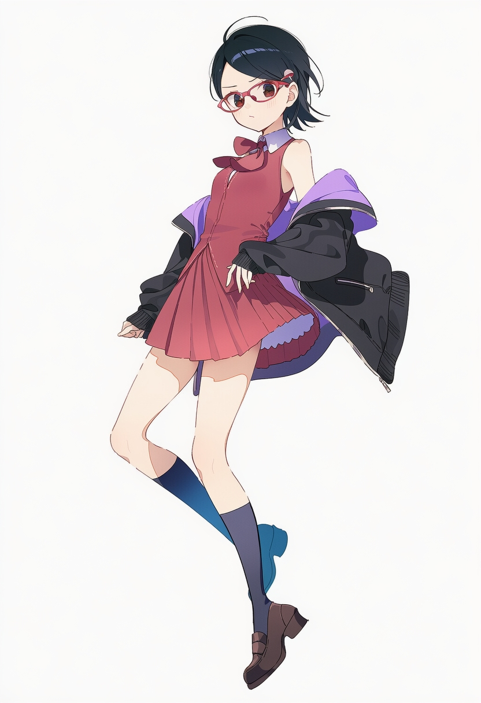

[在线例图](https://assets.quicktagcloud.com/images/raven_composition/raven_composition-1304.jpg?v=b69c005799639243)

<a id="raven_composition-1305"></a>

## 难过 :c

ID：`raven_composition-1305`；分类：面部表情 / 颜文字/漫画表情；来源标记：`safe`。

来源说明：

> 嘴角向下的难过脸。

正向提示词：

```text
:c
```

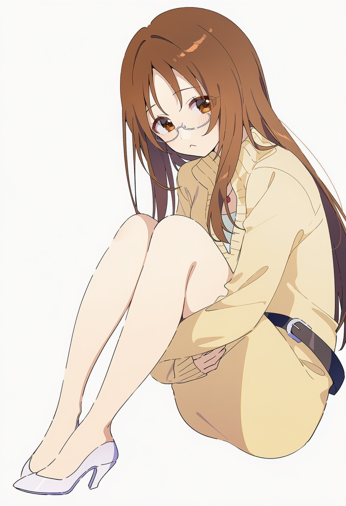

[在线例图](https://assets.quicktagcloud.com/images/raven_composition/raven_composition-1305.jpg?v=69c7bc11a246179b)

<a id="raven_composition-1306"></a>

## 反向 c:

ID：`raven_composition-1306`；分类：面部表情 / 颜文字/漫画表情；来源标记：`safe`。

来源说明：

> 反向弧形嘴的简化笑脸。

正向提示词：

```text
c:
```

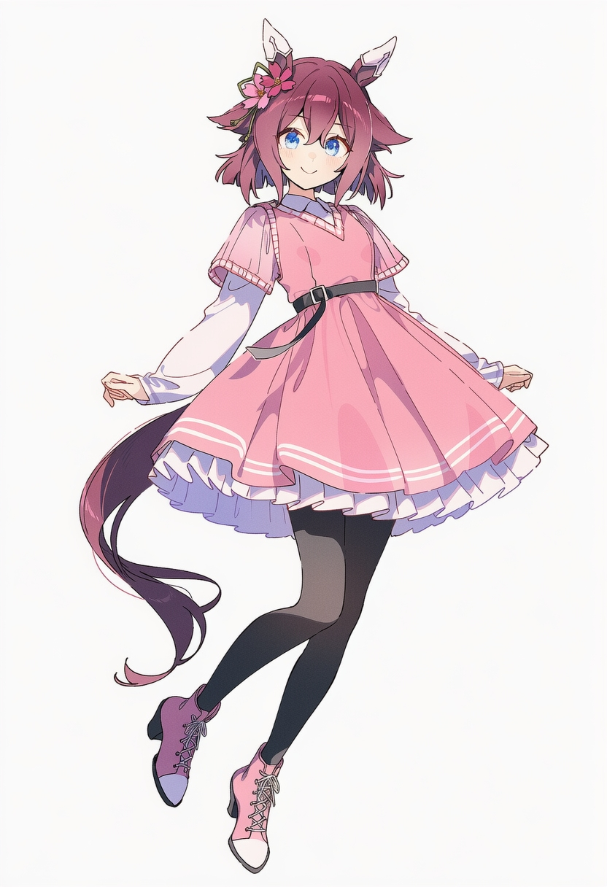

[在线例图](https://assets.quicktagcloud.com/images/raven_composition/raven_composition-1306.jpg?v=f4ecee1e3bddfafb)

<a id="raven_composition-1307"></a>

## 委屈 :<

ID：`raven_composition-1307`；分类：面部表情 / 颜文字/漫画表情；来源标记：`safe`。

来源说明：

> 嘴角向下的委屈脸。

正向提示词：

```text
:<
```

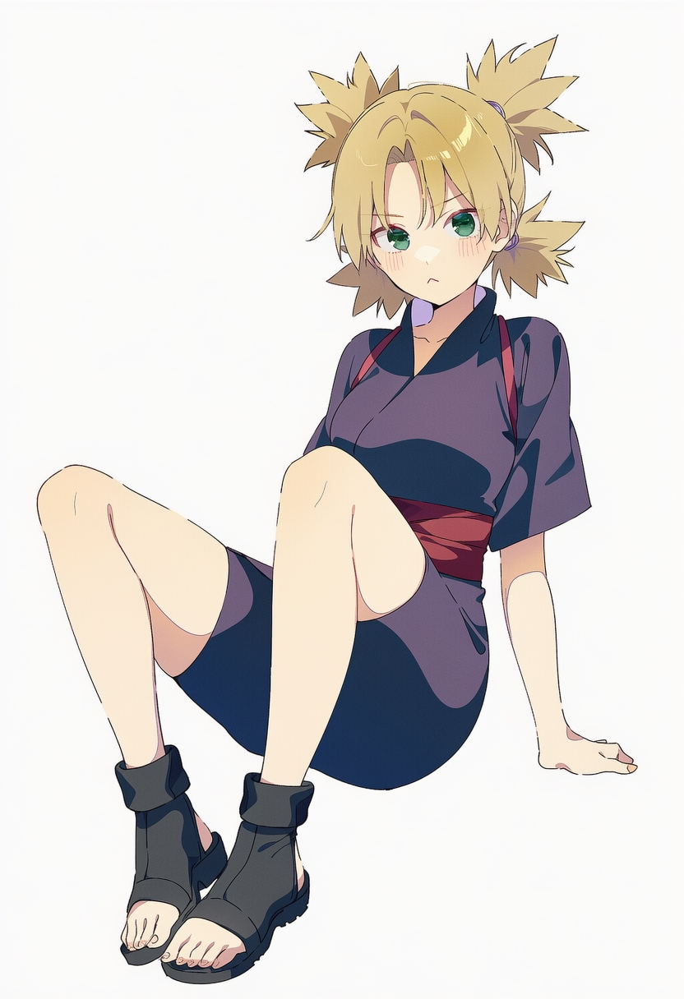

[在线例图](https://assets.quicktagcloud.com/images/raven_composition/raven_composition-1307.jpg?v=5941214cf134df10)

<a id="raven_composition-1308"></a>

## 小得意 :>

ID：`raven_composition-1308`；分类：面部表情 / 颜文字/漫画表情；来源标记：`safe`。

来源说明：

> 尖嘴式轻笑或得意脸。

正向提示词：

```text
:>
```

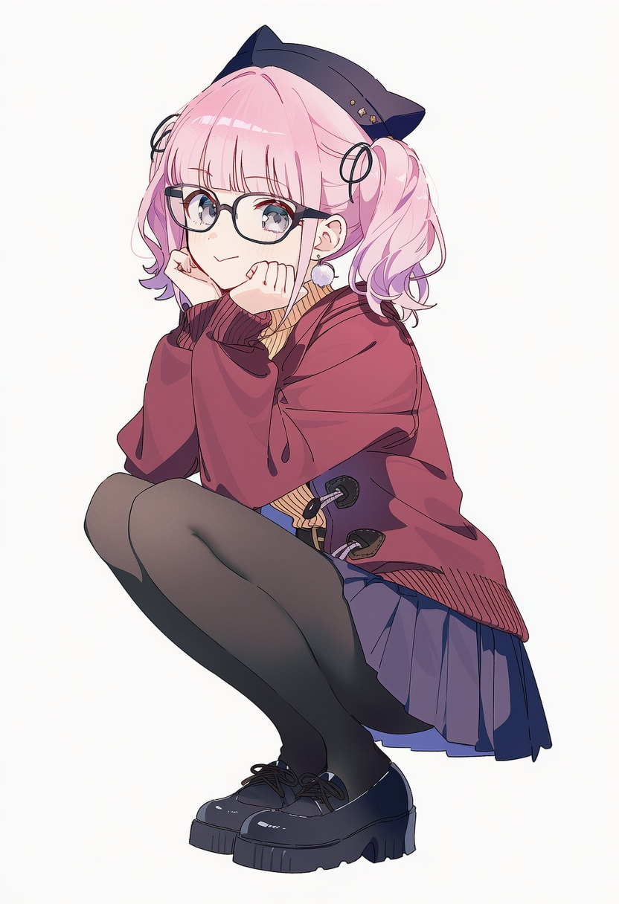

[在线例图](https://assets.quicktagcloud.com/images/raven_composition/raven_composition-1308.jpg?v=093a6ac388665cdb)

<a id="raven_composition-1309"></a>

## 惊讶 :o

ID：`raven_composition-1309`；分类：面部表情 / 颜文字/漫画表情；来源标记：`safe`。

来源说明：

> 圆嘴惊讶脸。

正向提示词：

```text
:o
```

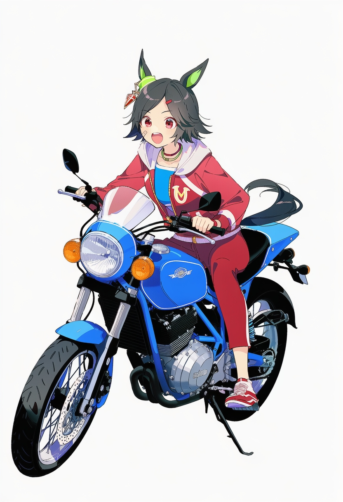

[在线例图](https://assets.quicktagcloud.com/images/raven_composition/raven_composition-1309.jpg?v=b114e880ebb60d0c)

<a id="raven_composition-1310"></a>

## 眨眼圆嘴 ;o

ID：`raven_composition-1310`；分类：面部表情 / 颜文字/漫画表情；来源标记：`safe`。

来源说明：

> 眨眼配圆形嘴。

正向提示词：

```text
;o
```

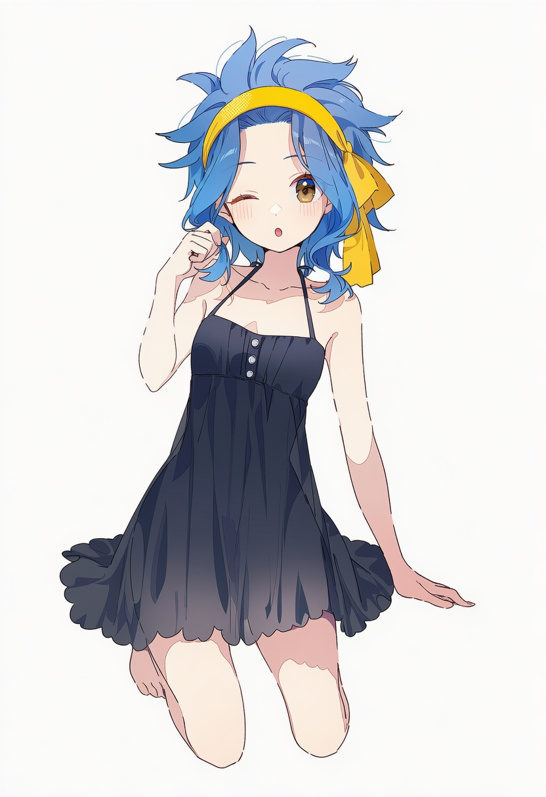

[在线例图](https://assets.quicktagcloud.com/images/raven_composition/raven_composition-1310.jpg?v=bc2b0705d1d619a1)

<a id="raven_composition-1311"></a>

## o3o嘟嘴

ID：`raven_composition-1311`；分类：面部表情 / 颜文字/漫画表情；来源标记：`safe`。

来源说明：

> 圆眼配 3 字嘟嘴。

正向提示词：

```text
o3o
```

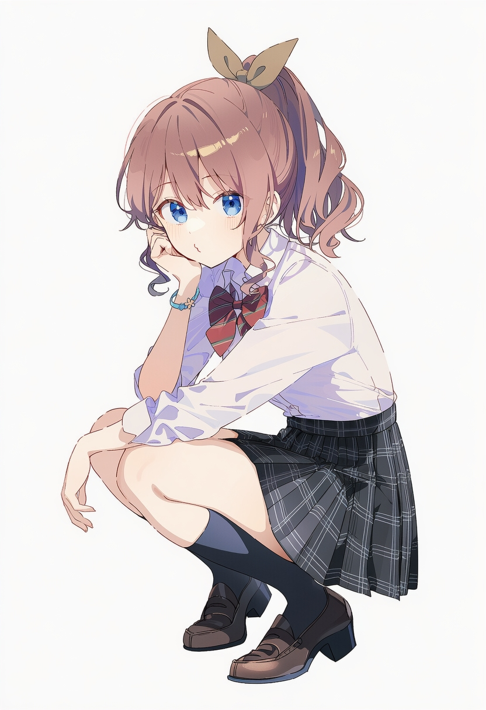

[在线例图](https://assets.quicktagcloud.com/images/raven_composition/raven_composition-1311.jpg?v=06b630e6979a369f)

<a id="raven_composition-1312"></a>

## >3<撒娇脸

ID：`raven_composition-1312`；分类：面部表情 / 颜文字/漫画表情；来源标记：`safe`。

来源说明：

> 挤眼配 3 字嘴的夸张可爱脸。

正向提示词：

```text
>3<
```

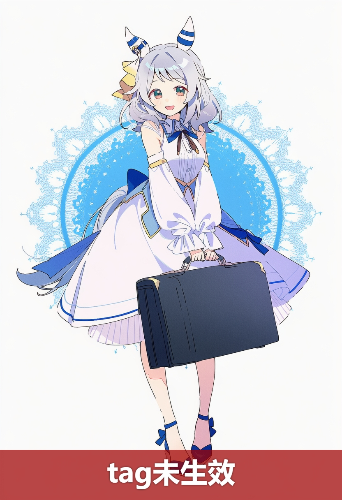

[在线例图](https://assets.quicktagcloud.com/images/raven_composition/raven_composition-1312.jpg?v=339415b0dc104116)

<a id="raven_composition-1313"></a>

## O_O呆脸

ID：`raven_composition-1313`；分类：面部表情 / 颜文字/漫画表情；来源标记：`safe`。

来源说明：

> 双眼圆睁的呆滞或震惊脸。

正向提示词：

```text
o_o
```

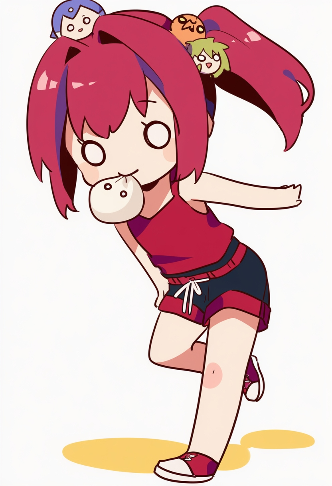

[在线例图](https://assets.quicktagcloud.com/images/raven_composition/raven_composition-1313.jpg?v=392acb5560aa3da8)

<a id="raven_composition-1314"></a>

## 0_0震惊脸

ID：`raven_composition-1314`；分类：面部表情 / 颜文字/漫画表情；来源标记：`safe`。

来源说明：

> 大圆眼直视的震惊表情。

正向提示词：

```text
0_0
```

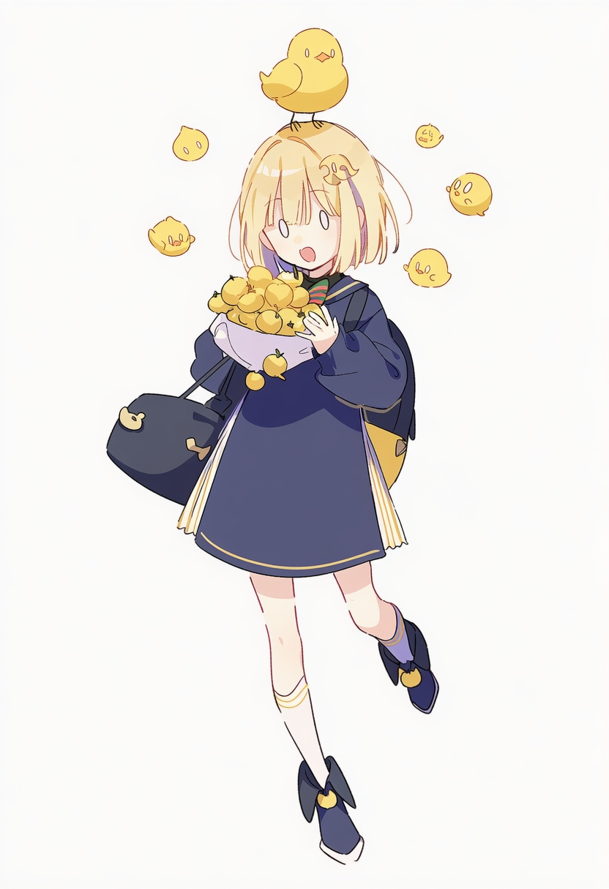

[在线例图](https://assets.quicktagcloud.com/images/raven_composition/raven_composition-1314.jpg?v=eb036db82a4a3f0a)

<a id="raven_composition-1315"></a>

## ._.无语脸

ID：`raven_composition-1315`；分类：面部表情 / 颜文字/漫画表情；来源标记：`safe`。

来源说明：

> 小眼配平嘴的尴尬无语脸。

正向提示词：

```text
._.
```

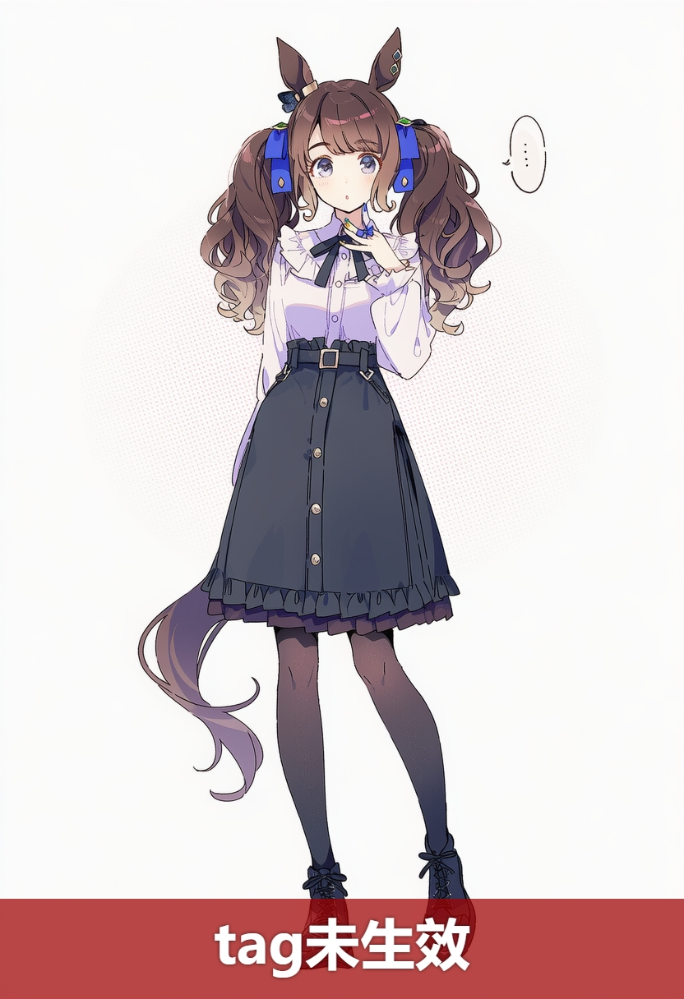

[在线例图](https://assets.quicktagcloud.com/images/raven_composition/raven_composition-1315.jpg?v=c39fd87d7b2e54d0)

<a id="raven_composition-1316"></a>

## ^_^笑眼

ID：`raven_composition-1316`；分类：面部表情 / 颜文字/漫画表情；来源标记：`safe`。

来源说明：

> 弯弯闭眼的开心笑脸。

正向提示词：

```text
^_^
```

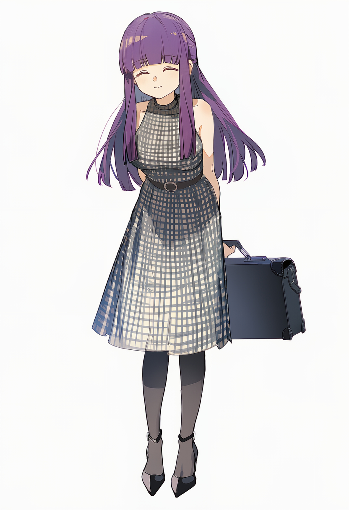

[在线例图](https://assets.quicktagcloud.com/images/raven_composition/raven_composition-1316.jpg?v=a62197778b932f0c)

<a id="raven_composition-1317"></a>

## ^q^陶醉脸

ID：`raven_composition-1317`；分类：面部表情 / 颜文字/漫画表情；来源标记：`safe`。

来源说明：

> 笑眼配流口水式嘴型。

正向提示词：

```text
^q^
```

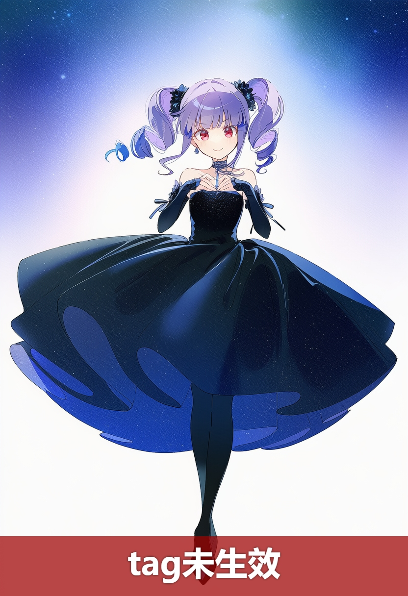

[在线例图](https://assets.quicktagcloud.com/images/raven_composition/raven_composition-1317.jpg?v=a11c24d6caccf097)

<a id="raven_composition-1318"></a>

## >_<挤眼

ID：`raven_composition-1318`；分类：面部表情 / 颜文字/漫画表情；来源标记：`safe`。

来源说明：

> 双眼用力闭紧的表情。

正向提示词：

```text
>_<
```

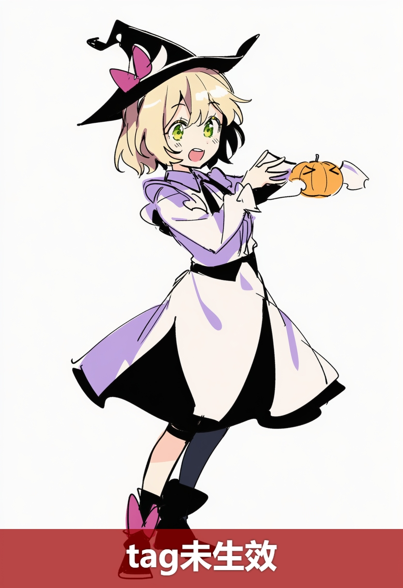

[在线例图](https://assets.quicktagcloud.com/images/raven_composition/raven_composition-1318.jpg?v=227184a006f0b940)

<a id="raven_composition-1319"></a>

## >o<大叫脸

ID：`raven_composition-1319`；分类：面部表情 / 颜文字/漫画表情；来源标记：`safe`。

来源说明：

> 挤眼并张圆嘴大叫。

正向提示词：

```text
>o<
```

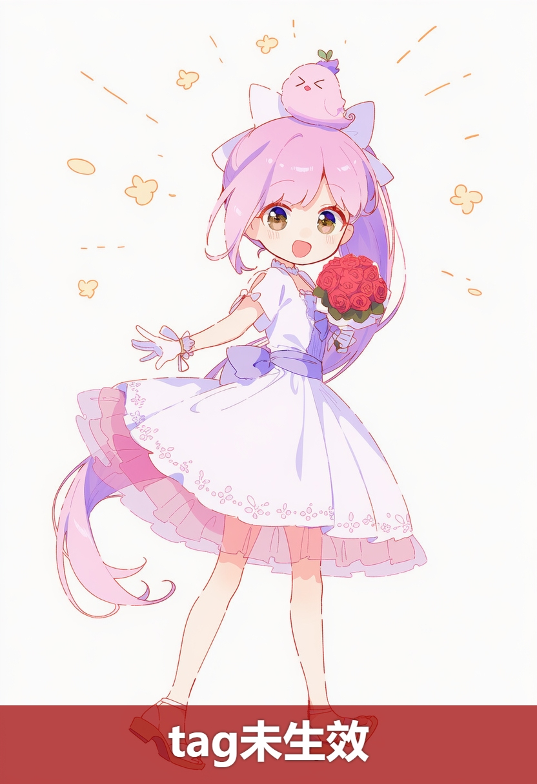

[在线例图](https://assets.quicktagcloud.com/images/raven_composition/raven_composition-1319.jpg?v=42dcca55c4767295)

<a id="raven_composition-1320"></a>

## @_@眩晕眼

ID：`raven_composition-1320`；分类：面部表情 / 颜文字/漫画表情；来源标记：`safe`。

来源说明：

> 螺旋眼式眩晕或混乱。

正向提示词：

```text
@_@
```

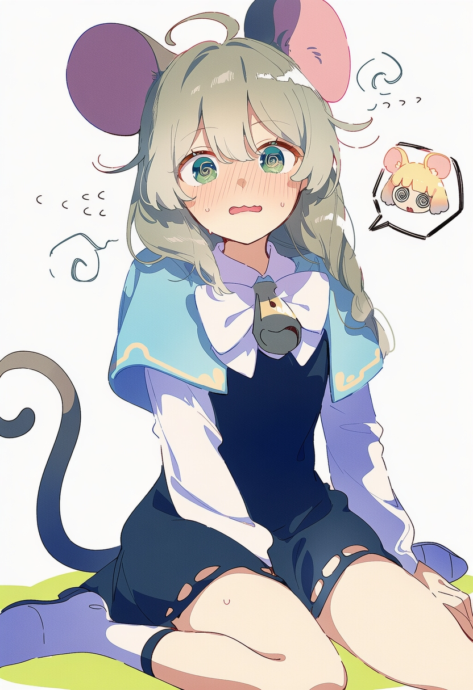

[在线例图](https://assets.quicktagcloud.com/images/raven_composition/raven_composition-1320.jpg?v=fa1b412d2726ef89)

<a id="raven_composition-1321"></a>

## +_+闪亮眼

ID：`raven_composition-1321`；分类：面部表情 / 颜文字/漫画表情；来源标记：`safe`。

来源说明：

> 十字亮眼的兴奋表情。

正向提示词：

```text
+_+
```

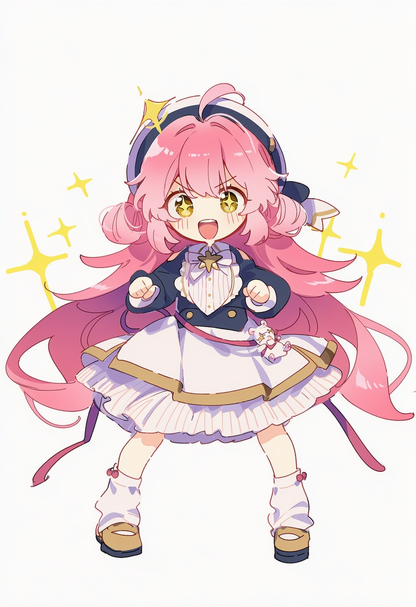

[在线例图](https://assets.quicktagcloud.com/images/raven_composition/raven_composition-1321.jpg?v=44e8809fc5424c89)

<a id="raven_composition-1322"></a>

## =_=死鱼眼

ID：`raven_composition-1322`；分类：面部表情 / 颜文字/漫画表情；来源标记：`safe`。

来源说明：

> 半闭平直眼的无语表情。

正向提示词：

```text
=_=
```

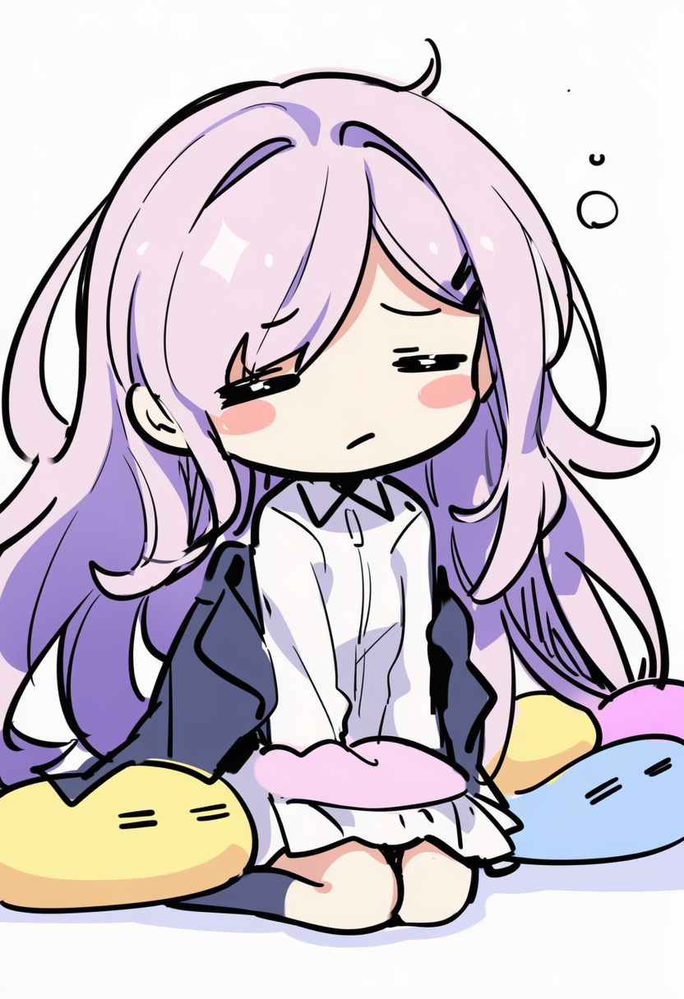

[在线例图](https://assets.quicktagcloud.com/images/raven_composition/raven_composition-1322.jpg?v=f2b3ee6ab9b70be4)

<a id="raven_composition-1323"></a>

## T_T哭脸

ID：`raven_composition-1323`；分类：面部表情 / 颜文字/漫画表情；来源标记：`safe`。

来源说明：

> 双眼流泪的颜文字。

正向提示词：

```text
t_t
```

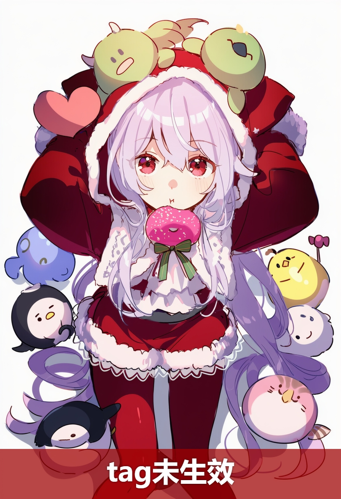

[在线例图](https://assets.quicktagcloud.com/images/raven_composition/raven_composition-1323.jpg?v=983b9ea9d827c386)

<a id="raven_composition-1324"></a>

## X_X昏倒眼

ID：`raven_composition-1324`；分类：面部表情 / 颜文字/漫画表情；来源标记：`safe`。

来源说明：

> 双眼 X 形，表示晕倒或死亡感。

正向提示词：

```text
x_x
```

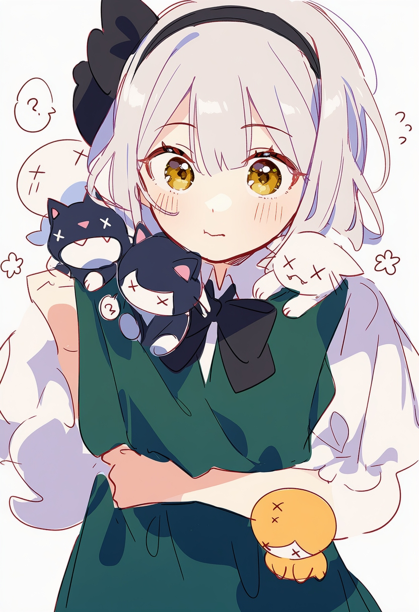

[在线例图](https://assets.quicktagcloud.com/images/raven_composition/raven_composition-1324.jpg?v=16663c74fbc6d83a)

<a id="raven_composition-1325"></a>

## u_u闭眼脸

ID：`raven_composition-1325`；分类：面部表情 / 颜文字/漫画表情；来源标记：`safe`。

来源说明：

> 向下弯的闭眼，安静或满足。

正向提示词：

```text
u_u
```

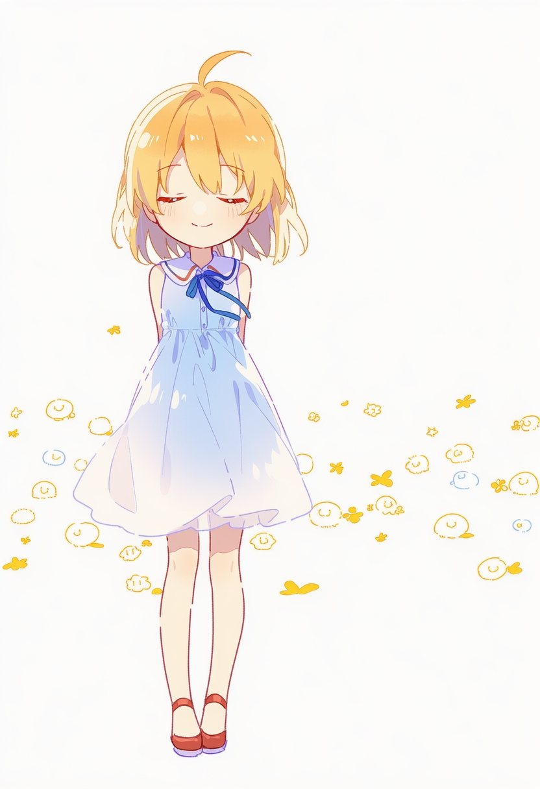

[在线例图](https://assets.quicktagcloud.com/images/raven_composition/raven_composition-1325.jpg?v=ccd2ef049c363a4e)

<a id="raven_composition-1326"></a>

## 尖峰惊吓脸

ID：`raven_composition-1326`；分类：面部表情 / 颜文字/漫画表情；来源标记：`safe`。

来源说明：

> 用尖峰状符号表现惊讶或紧张。

正向提示词：

```text
^^^
```

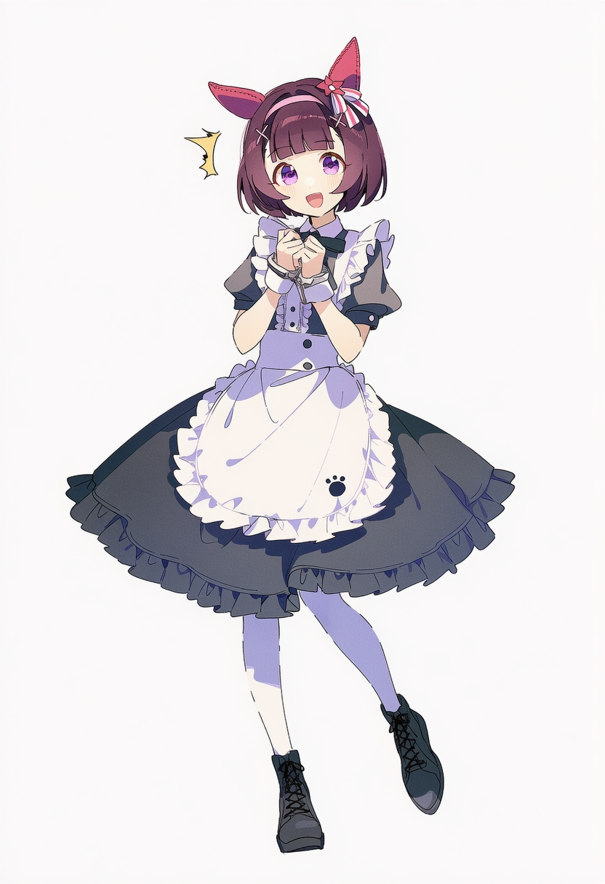

[在线例图](https://assets.quicktagcloud.com/images/raven_composition/raven_composition-1326.jpg?v=9dd2b93ae2eac60c)
