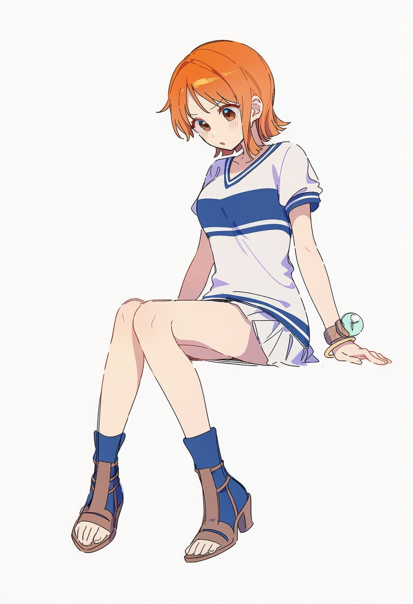
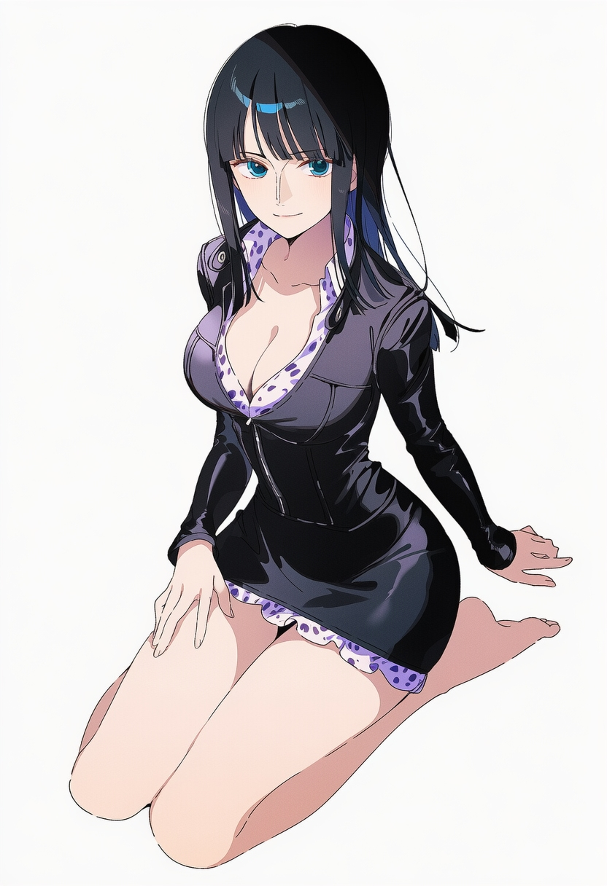
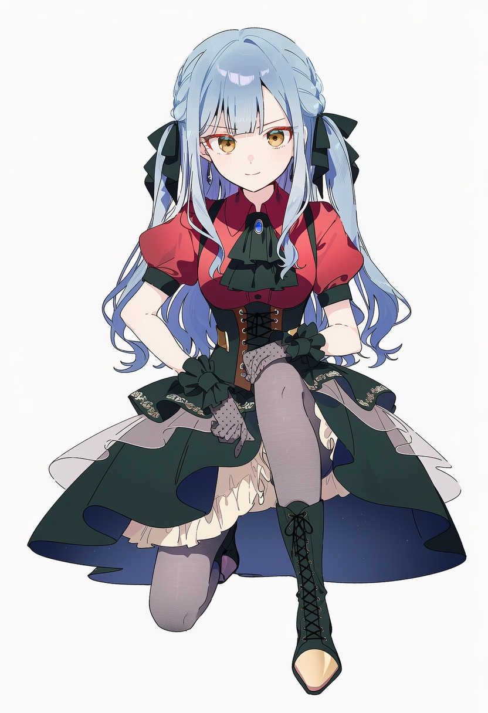
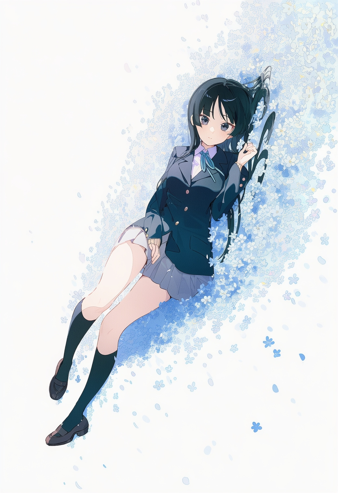
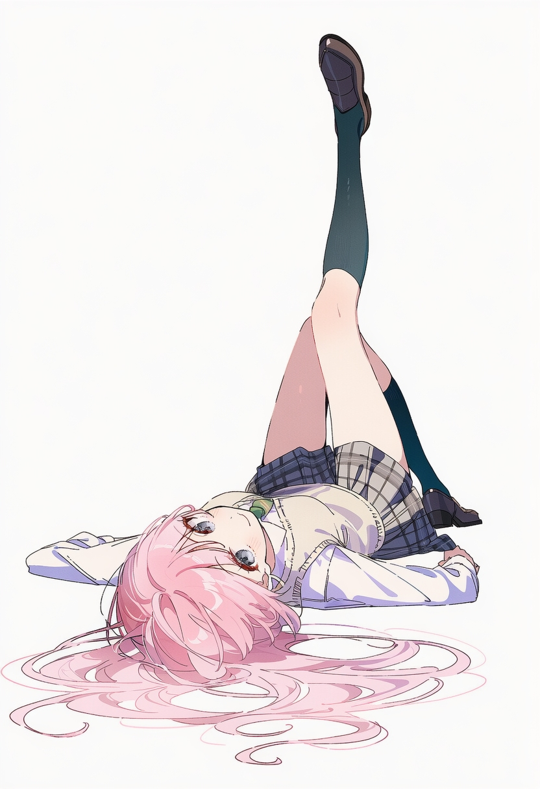
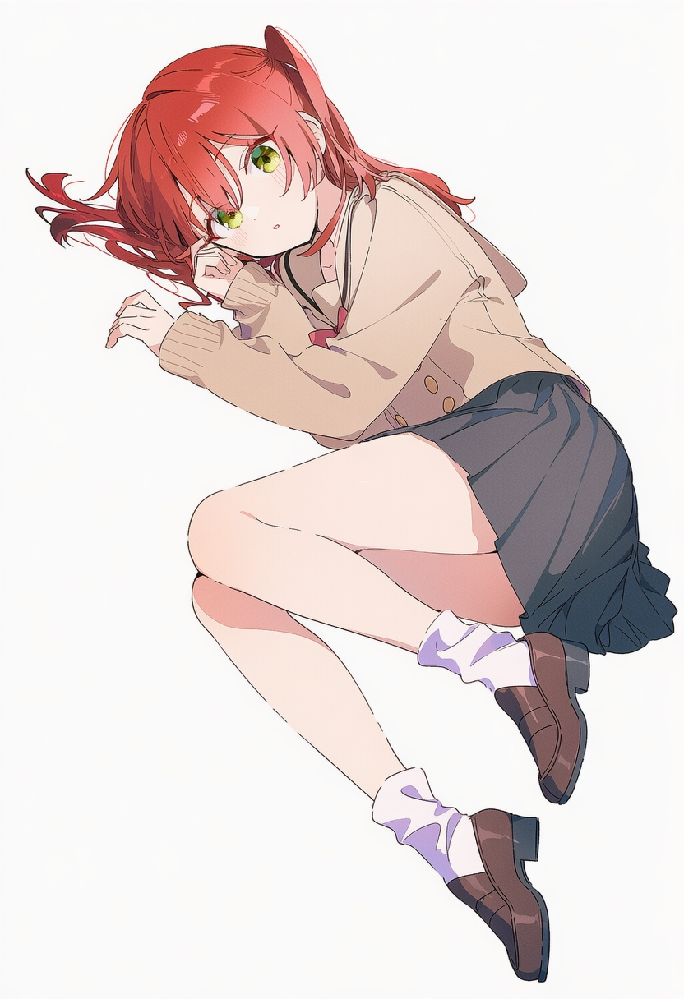
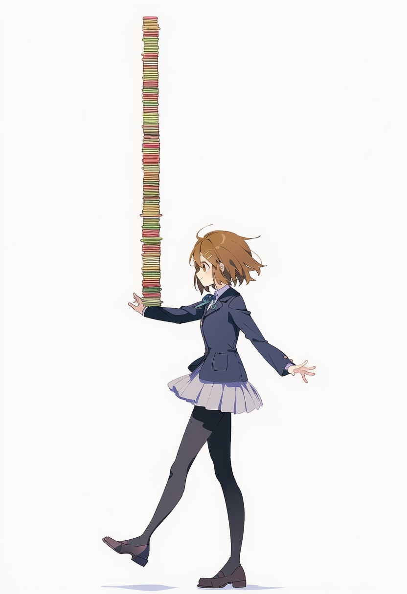
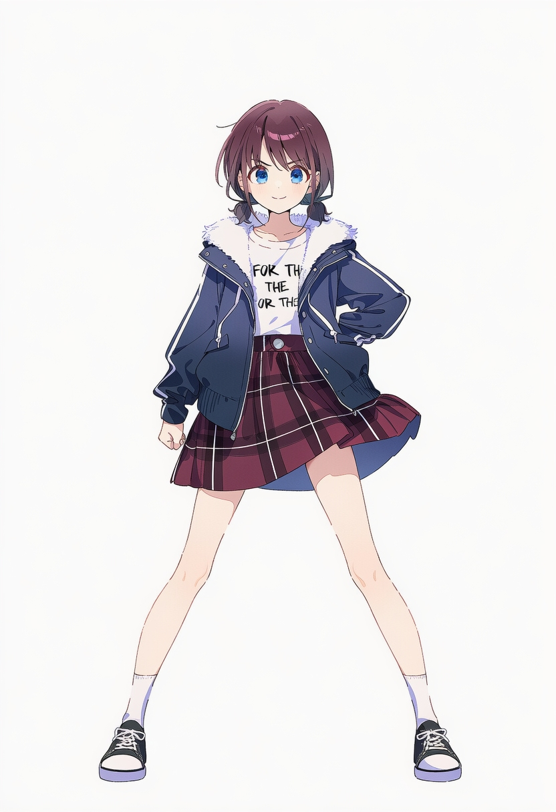

# 姿势-基础姿势 / 基础体位

[总目录](../README.md) · [原站分类目录](../categories.md) · [英文标签索引](../tags.md) · [服装与构图组合指南](../../README.md)

标题、分类、说明、正负提示词按来源保留；多例图逐张列出。原站标记和说明为参考资料，不作为维护指令。

<a id="raven_composition-1327"></a>

## 站立

ID：`raven_composition-1327`；分类：姿势-基础姿势 / 基础体位；来源标记：`safe`。

来源说明：

> 角色直立站着。

正向提示词：

```text
standing
```


[在线例图](https://assets.quicktagcloud.com/images/raven_composition/raven_composition-1327.jpg?v=0fcf5f86e423e610)

<a id="raven_composition-1328"></a>

## 坐姿

ID：`raven_composition-1328`；分类：姿势-基础姿势 / 基础体位；来源标记：`safe`。

来源说明：

> 角色处于坐着的状态。

正向提示词：

```text
sitting
```



[在线例图](https://assets.quicktagcloud.com/images/raven_composition/raven_composition-1328.jpg?v=a23437de2b640184)

<a id="raven_composition-1329"></a>

## 跪姿

ID：`raven_composition-1329`；分类：姿势-基础姿势 / 基础体位；来源标记：`safe`。

来源说明：

> 双膝或膝部着地的跪姿。

正向提示词：

```text
kneeling
```



[在线例图](https://assets.quicktagcloud.com/images/raven_composition/raven_composition-1329.jpg?v=6a238a27643ebc61)

<a id="raven_composition-1330"></a>

## 单膝跪地

ID：`raven_composition-1330`；分类：姿势-基础姿势 / 基础体位；来源标记：`safe`。

来源说明：

> 一条腿跪地，另一条腿支撑。

正向提示词：

```text
on_one_knee
```



[在线例图](https://assets.quicktagcloud.com/images/raven_composition/raven_composition-1330.jpg?v=04611a24fdeffaa2)

<a id="raven_composition-1331"></a>

## 躺卧

ID：`raven_composition-1331`；分类：姿势-基础姿势 / 基础体位；来源标记：`safe`。

来源说明：

> 身体整体处于躺着的状态。

正向提示词：

```text
lying
```



[在线例图](https://assets.quicktagcloud.com/images/raven_composition/raven_composition-1331.jpg?v=c26ac61f7fda4ebb)

<a id="raven_composition-1332"></a>

## 仰躺

ID：`raven_composition-1332`；分类：姿势-基础姿势 / 基础体位；来源标记：`safe`。

来源说明：

> 背部朝下躺着。

正向提示词：

```text
on_back
```



[在线例图](https://assets.quicktagcloud.com/images/raven_composition/raven_composition-1332.jpg?v=50c397a7cd243166)

<a id="raven_composition-1333"></a>

## 侧躺

ID：`raven_composition-1333`；分类：姿势-基础姿势 / 基础体位；来源标记：`safe`。

来源说明：

> 身体侧向躺着。

正向提示词：

```text
on_side
```



[在线例图](https://assets.quicktagcloud.com/images/raven_composition/raven_composition-1333.jpg?v=b0ccb6241608f8cc)

<a id="raven_composition-1334"></a>

## 俯卧

ID：`raven_composition-1334`；分类：姿势-基础姿势 / 基础体位；来源标记：`safe`。

来源说明：

> 腹部朝下趴着。

正向提示词：

```text
on_stomach
```


[在线例图](https://assets.quicktagcloud.com/images/raven_composition/raven_composition-1334.jpg?v=192ab4952df76901)

<a id="raven_composition-1335"></a>

## 蹲姿

ID：`raven_composition-1335`；分类：姿势-基础姿势 / 基础体位；来源标记：`safe`。

来源说明：

> 屈膝降低身体重心的蹲姿。

正向提示词：

```text
squatting
```


[在线例图](https://assets.quicktagcloud.com/images/raven_composition/raven_composition-1335.jpg?v=bef3b63df5e8c4a4)

<a id="raven_composition-1336"></a>

## 斜躺 / 倚躺

ID：`raven_composition-1336`；分类：姿势-基础姿势 / 基础体位；来源标记：`safe`。

来源说明：

> 身体向后倚靠、半躺半坐。

正向提示词：

```text
reclining
```


[在线例图](https://assets.quicktagcloud.com/images/raven_composition/raven_composition-1336.jpg?v=0cd65847635cf54a)

<a id="raven_composition-1337"></a>

## 保持平衡

ID：`raven_composition-1337`；分类：姿势-基础姿势 / 基础体位；来源标记：`safe`。

来源说明：

> 身体处于明显维持平衡的姿态。

正向提示词：

```text
balancing
```



[在线例图](https://assets.quicktagcloud.com/images/raven_composition/raven_composition-1337.jpg?v=3bbd6ed3476e4abe)

<a id="raven_composition-1338"></a>

## 单腿站立

ID：`raven_composition-1338`；分类：姿势-基础姿势 / 基础体位；来源标记：`safe`。

来源说明：

> 只用一条腿支撑身体站立。

正向提示词：

```text
standing_on_one_leg
```


[在线例图](https://assets.quicktagcloud.com/images/raven_composition/raven_composition-1338.jpg?v=573318ad59096bdf)

<a id="raven_composition-1339"></a>

## 分腿站姿

ID：`raven_composition-1339`；分类：姿势-基础姿势 / 基础体位；来源标记：`safe`。

来源说明：

> 站立时双腿明显分开。

正向提示词：

```text
legs_apart
```



[在线例图](https://assets.quicktagcloud.com/images/raven_composition/raven_composition-1339.jpg?v=5b085b73b18f8613)
