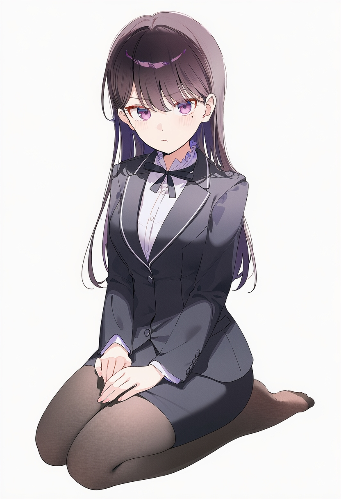
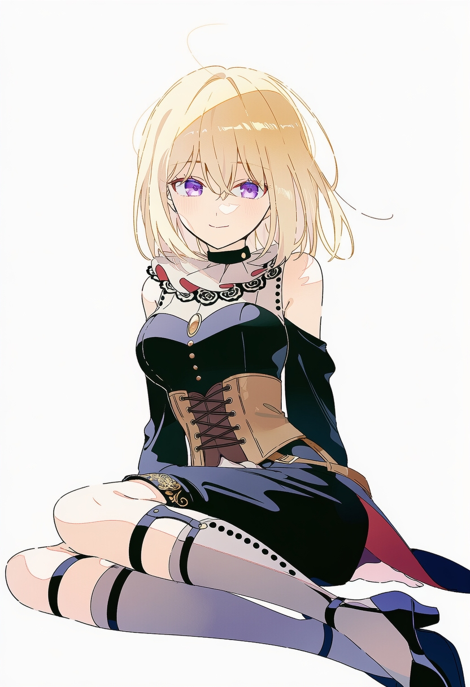
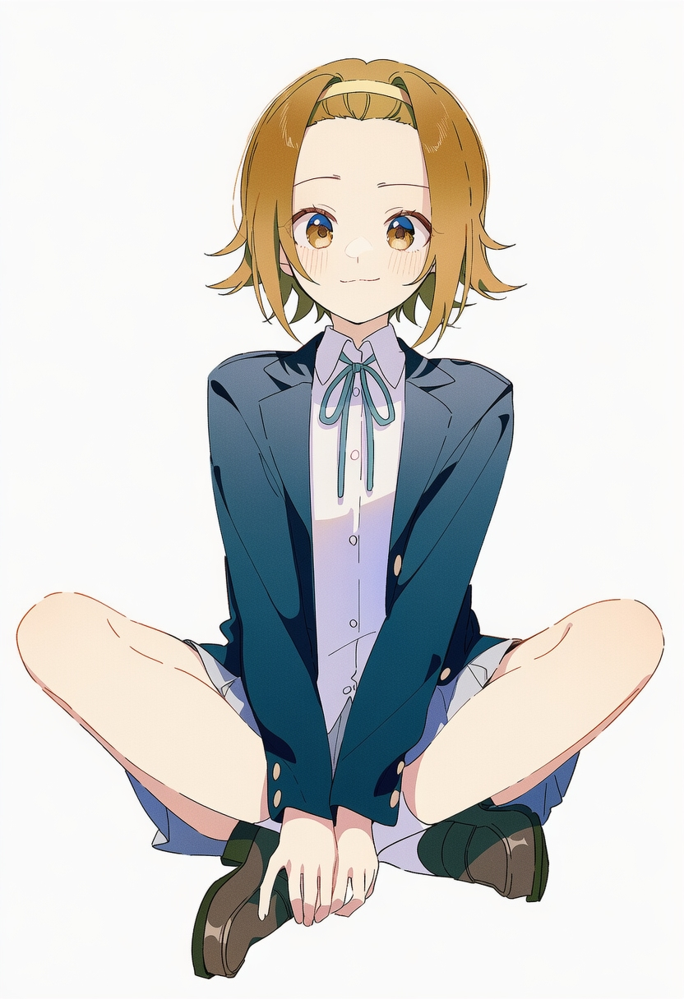
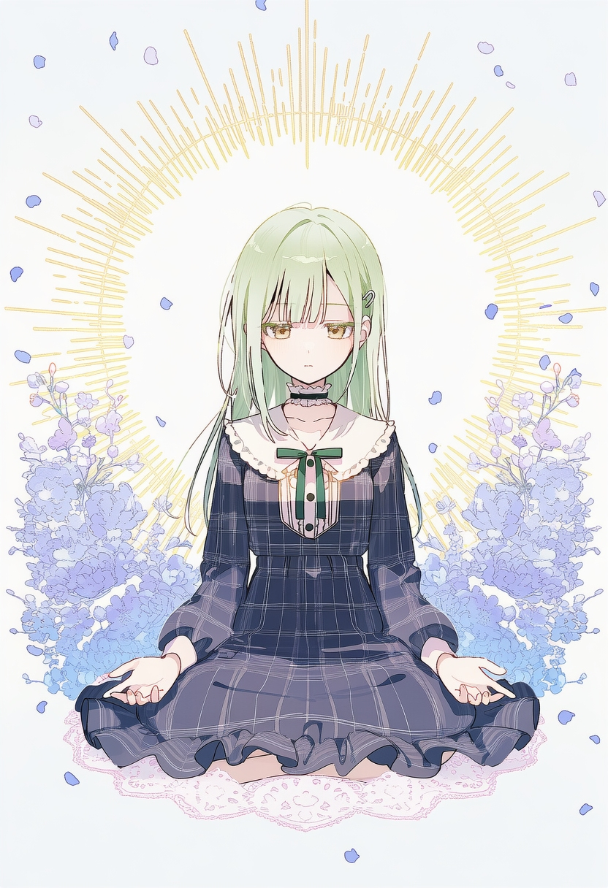
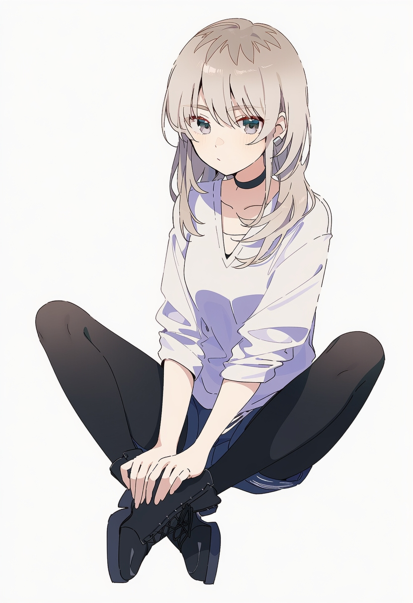
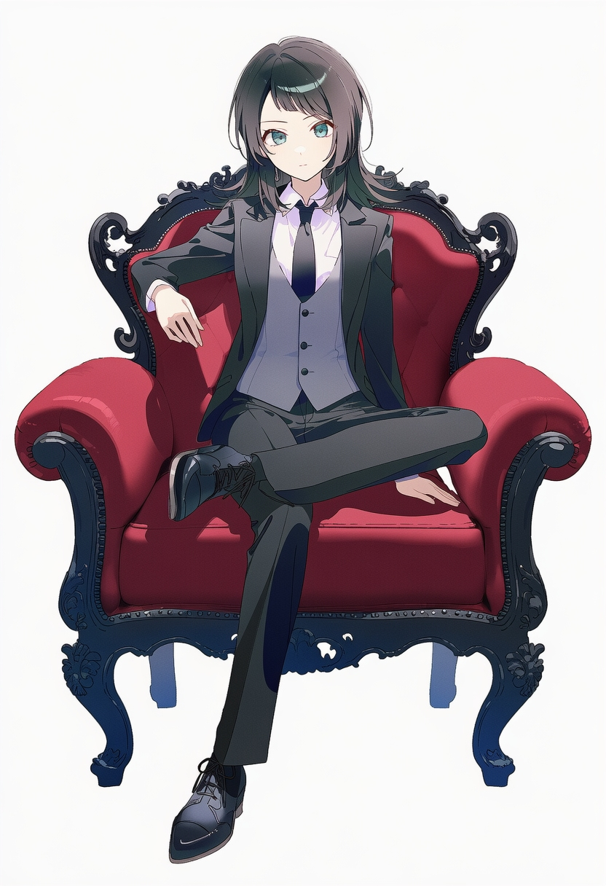
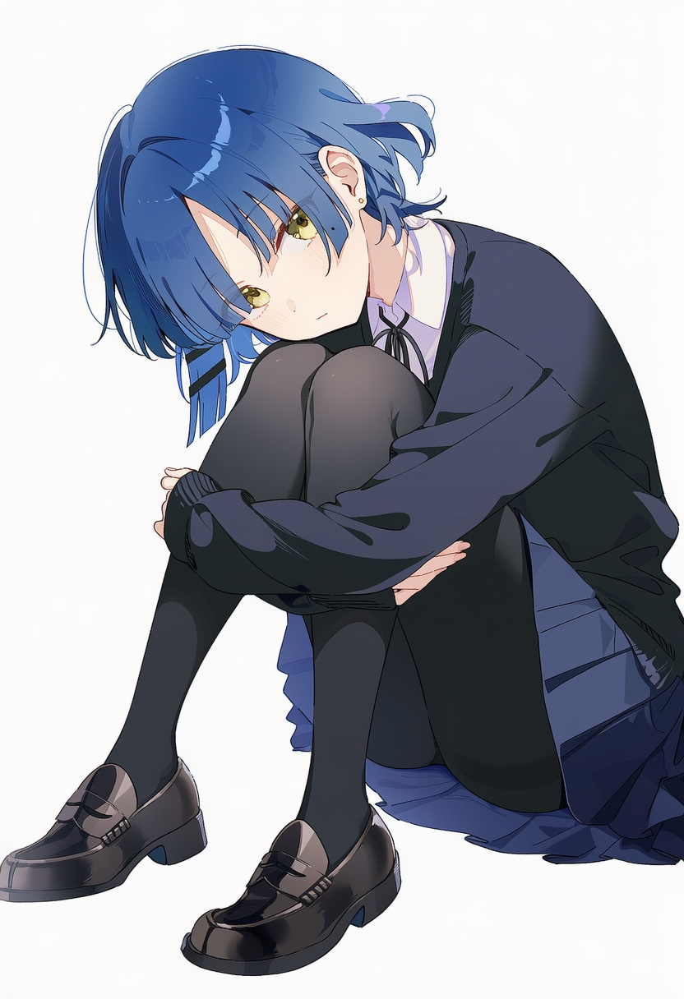
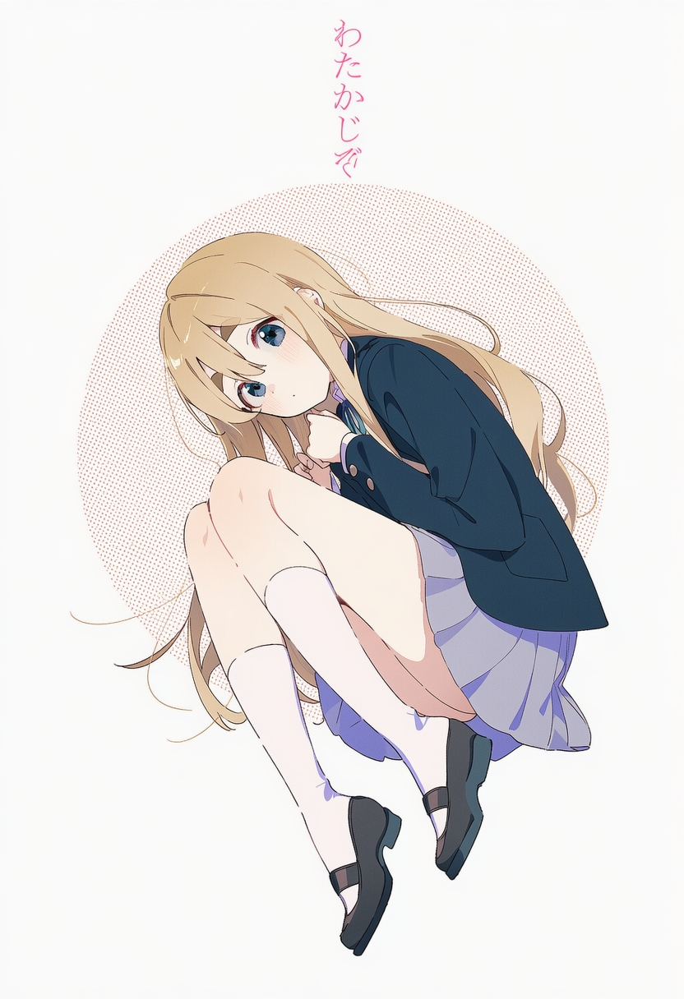
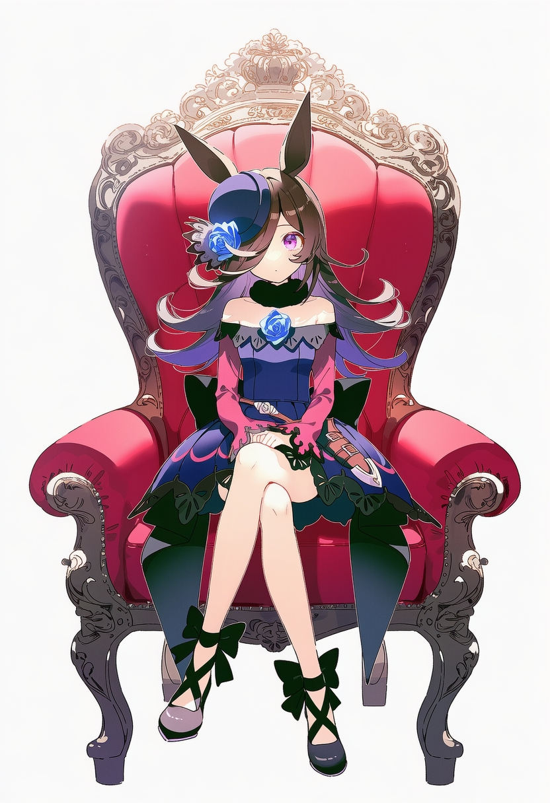

# 姿势-基础姿势 / 坐姿/蜷缩

[总目录](../README.md) · [原站分类目录](../categories.md) · [英文标签索引](../tags.md) · [服装与构图组合指南](../../README.md)

标题、分类、说明、正负提示词按来源保留；多例图逐张列出。原站标记和说明为参考资料，不作为维护指令。

<a id="raven_composition-1340"></a>

## 正座

ID：`raven_composition-1340`；分类：姿势-基础姿势 / 坐姿/蜷缩；来源标记：`safe`。

来源说明：

> 日式正座，跪坐在脚跟上。

正向提示词：

```text
seiza
```



[在线例图](https://assets.quicktagcloud.com/images/raven_composition/raven_composition-1340.jpg?v=e4353ced431f9447)

<a id="raven_composition-1341"></a>

## 鸭子坐 / W坐

ID：`raven_composition-1341`；分类：姿势-基础姿势 / 坐姿/蜷缩；来源标记：`safe`。

来源说明：

> 双腿分别折向身体两侧的坐姿。

正向提示词：

```text
wariza
```


[在线例图](https://assets.quicktagcloud.com/images/raven_composition/raven_composition-1341.jpg?v=a3c380d025c3c260)

<a id="raven_composition-1342"></a>

## 横座

ID：`raven_composition-1342`；分类：姿势-基础姿势 / 坐姿/蜷缩；来源标记：`safe`。

来源说明：

> 双腿并拢折向身体一侧。

正向提示词：

```text
yokozuwari
```



[在线例图](https://assets.quicktagcloud.com/images/raven_composition/raven_composition-1342.jpg?v=7387c46a3a5e4578)

<a id="raven_composition-1343"></a>

## 盘腿坐 / 胡坐

ID：`raven_composition-1343`；分类：姿势-基础姿势 / 坐姿/蜷缩；来源标记：`safe`。

来源说明：

> 双腿交叉盘坐。

正向提示词：

```text
indian_style
```



[在线例图](https://assets.quicktagcloud.com/images/raven_composition/raven_composition-1343.jpg?v=9fe21d1dba04192c)

<a id="raven_composition-1344"></a>

## 莲花坐

ID：`raven_composition-1344`；分类：姿势-基础姿势 / 坐姿/蜷缩；来源标记：`safe`。

来源说明：

> 双腿盘起、双脚置于对侧大腿附近。

正向提示词：

```text
lotus_position
```



[在线例图](https://assets.quicktagcloud.com/images/raven_composition/raven_composition-1344.jpg?v=d802af5519192c1e)

<a id="raven_composition-1345"></a>

## 蝴蝶坐

ID：`raven_composition-1345`；分类：姿势-基础姿势 / 坐姿/蜷缩；来源标记：`safe`。

来源说明：

> 屈膝向两侧打开，双脚靠近。

正向提示词：

```text
butterfly_sitting
```



[在线例图](https://assets.quicktagcloud.com/images/raven_composition/raven_composition-1345.jpg?v=a3deb207a038b39b)

<a id="raven_composition-1346"></a>

## 4字坐姿

ID：`raven_composition-1346`；分类：姿势-基础姿势 / 坐姿/蜷缩；来源标记：`safe`。

来源说明：

> 一只脚踝搭在另一条腿上形成4字。

正向提示词：

```text
figure_four_sitting
```



[在线例图](https://assets.quicktagcloud.com/images/raven_composition/raven_composition-1346.jpg?v=3b7912eab4aeaedf)

<a id="raven_composition-1347"></a>

## 抱膝坐

ID：`raven_composition-1347`；分类：姿势-基础姿势 / 坐姿/蜷缩；来源标记：`safe`。

来源说明：

> 坐着抱住自己的双腿或膝盖。

正向提示词：

```text
hugging_own_legs
```



[在线例图](https://assets.quicktagcloud.com/images/raven_composition/raven_composition-1347.jpg?v=ec7dfc2d81717e22)

<a id="raven_composition-1348"></a>

## 胎儿姿势

ID：`raven_composition-1348`；分类：姿势-基础姿势 / 坐姿/蜷缩；来源标记：`safe`。

来源说明：

> 身体蜷缩，膝盖靠近胸部。

正向提示词：

```text
fetal_position
```



[在线例图](https://assets.quicktagcloud.com/images/raven_composition/raven_composition-1348.jpg?v=618a50cd163f69e9)

<a id="raven_composition-1349"></a>

## 交叉双腿

ID：`raven_composition-1349`；分类：姿势-基础姿势 / 坐姿/蜷缩；来源标记：`safe`。

来源说明：

> 双腿交叉或翘腿的姿态。

正向提示词：

```text
crossed_legs
```



[在线例图](https://assets.quicktagcloud.com/images/raven_composition/raven_composition-1349.jpg?v=b3f2ebdeb99f34c0)
