# 姿势-基础姿势 / 全身姿态/支撑

[总目录](../README.md) · [原站分类目录](../categories.md) · [英文标签索引](../tags.md) · [服装与构图组合指南](../../README.md)

标题、分类、说明、正负提示词按来源保留；多例图逐张列出。原站标记和说明为参考资料，不作为维护指令。

<a id="raven_composition-1350"></a>

## 四肢着地

ID：`raven_composition-1350`；分类：姿势-基础姿势 / 全身姿态/支撑；来源标记：`safe`。

来源说明：

> 双手和双膝等四点支撑身体。

正向提示词：

```text
all_fours
```

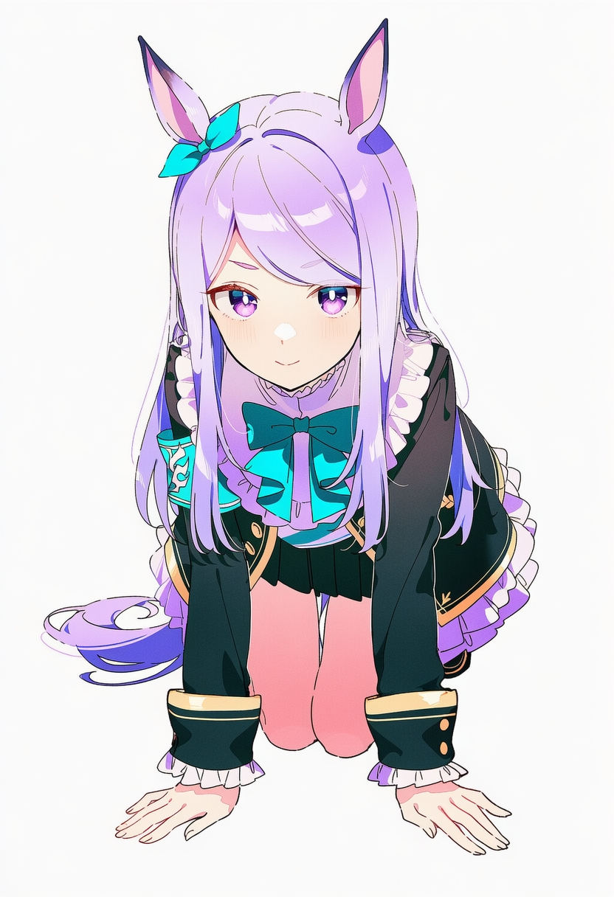

[在线例图](https://assets.quicktagcloud.com/images/raven_composition/raven_composition-1350.jpg?v=4e55165c0753443f)

<a id="raven_composition-1351"></a>

## 上身趴低臀部抬高

ID：`raven_composition-1351`；分类：姿势-基础姿势 / 全身姿态/支撑；来源标记：`safe`。

来源说明：

> 前半身压低、臀部明显抬高。

正向提示词：

```text
top-down_bottom-up
```

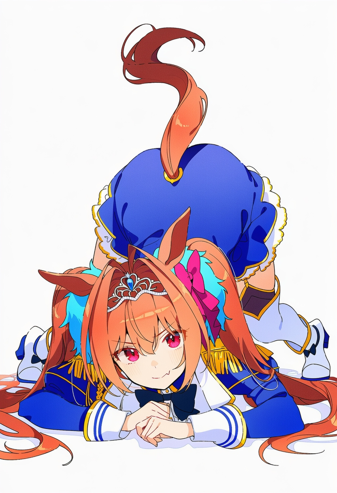

[在线例图](https://assets.quicktagcloud.com/images/raven_composition/raven_composition-1351.jpg?v=5d2eb0604f7777e9)

<a id="raven_composition-1352"></a>

## 伏地 / 跪伏

ID：`raven_composition-1352`；分类：姿势-基础姿势 / 全身姿态/支撑；来源标记：`safe`。

来源说明：

> 跪地并将上身俯伏到地面。

正向提示词：

```text
prostration
```

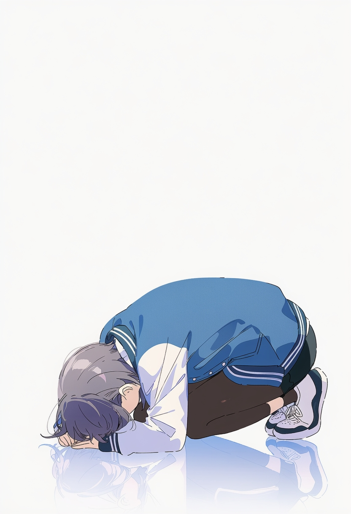

[在线例图](https://assets.quicktagcloud.com/images/raven_composition/raven_composition-1352.jpg?v=cd753868bcc44ecd)

<a id="raven_composition-1353"></a>

## 胸部支撑倒立

ID：`raven_composition-1353`；分类：姿势-基础姿势 / 全身姿态/支撑；来源标记：`safe`。

来源说明：

> 胸部着地支撑，双腿向上翻起。

正向提示词：

```text
chest_stand
```


[在线例图](https://assets.quicktagcloud.com/images/raven_composition/raven_composition-1353.jpg?v=fd819b92815804f7)

<a id="raven_composition-1354"></a>

## 畏缩蜷缩

ID：`raven_composition-1354`；分类：姿势-基础姿势 / 全身姿态/支撑；来源标记：`safe`。

来源说明：

> 因害怕而缩起身体、降低姿态。

正向提示词：

```text
cowering
```

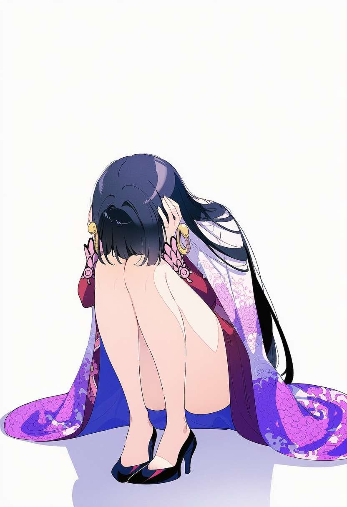

[在线例图](https://assets.quicktagcloud.com/images/raven_composition/raven_composition-1354.jpg?v=1d95989055e724d8)

<a id="raven_composition-1355"></a>

## 十字受刑姿势

ID：`raven_composition-1355`；分类：姿势-基础姿势 / 全身姿态/支撑；来源标记：`safe`。

来源说明：

> 身体展开并呈类似十字架固定姿态。

正向提示词：

```text
crucifixion
```

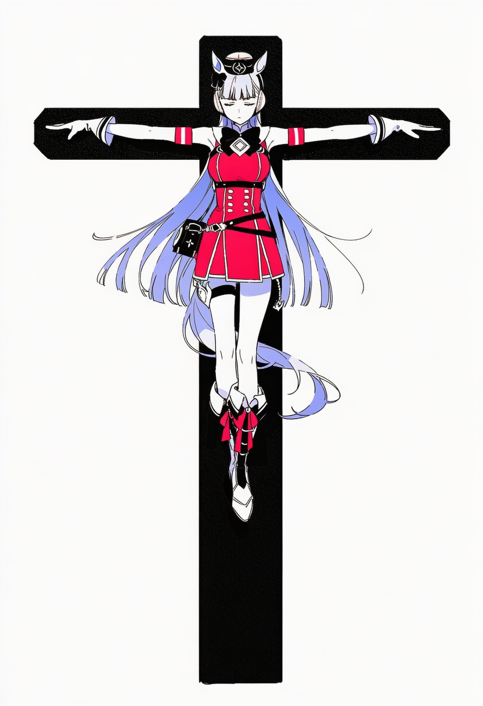

[在线例图](https://assets.quicktagcloud.com/images/raven_composition/raven_composition-1355.jpg?v=b52b3fce699c1910)

<a id="raven_composition-1356"></a>

## 脸着地

ID：`raven_composition-1356`；分类：姿势-基础姿势 / 全身姿态/支撑；来源标记：`safe`。

来源说明：

> 身体向前倒下，脸部贴地。

正向提示词：

```text
faceplant
```

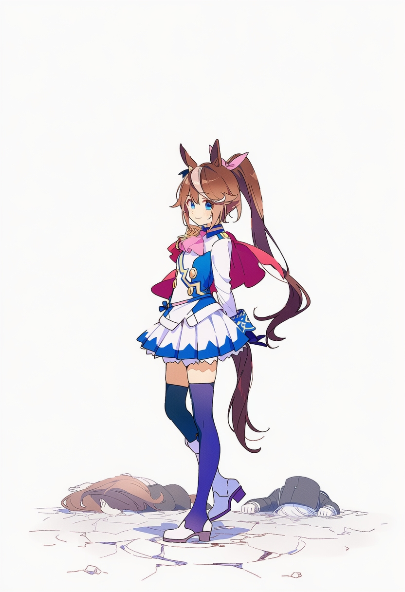

[在线例图](https://assets.quicktagcloud.com/images/raven_composition/raven_composition-1356.jpg?v=2de9108d8bbfee4f)

<a id="raven_composition-1357"></a>

## 战斗架势

ID：`raven_composition-1357`；分类：姿势-基础姿势 / 全身姿态/支撑；来源标记：`safe`。

来源说明：

> 摆出准备攻击或防御的战斗姿势。

正向提示词：

```text
fighting_stance
```

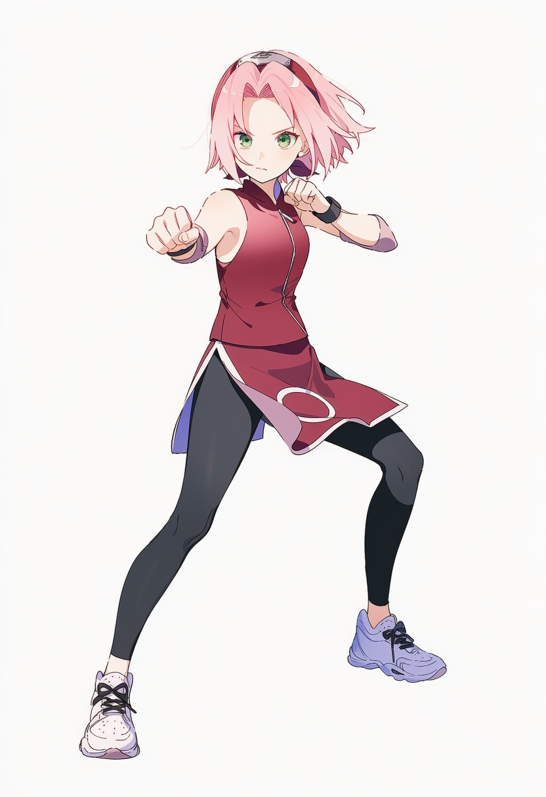

[在线例图](https://assets.quicktagcloud.com/images/raven_composition/raven_composition-1357.jpg?v=30130ee3f8c4a71d)

<a id="raven_composition-1358"></a>

## 拔刀术架势

ID：`raven_composition-1358`；分类：姿势-基础姿势 / 全身姿态/支撑；来源标记：`safe`。

来源说明：

> 手靠近刀柄，摆出准备拔刀的姿势。

正向提示词：

```text
battoujutsu_stance
```

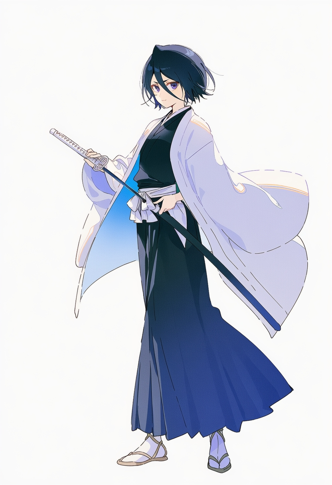

[在线例图](https://assets.quicktagcloud.com/images/raven_composition/raven_composition-1358.jpg?v=7a953faddb841a7d)

<a id="raven_composition-1359"></a>

## 伸展身体

ID：`raven_composition-1359`；分类：姿势-基础姿势 / 全身姿态/支撑；来源标记：`safe`。

来源说明：

> 伸展身体或拉伸肌肉的姿态。

正向提示词：

```text
stretching
```

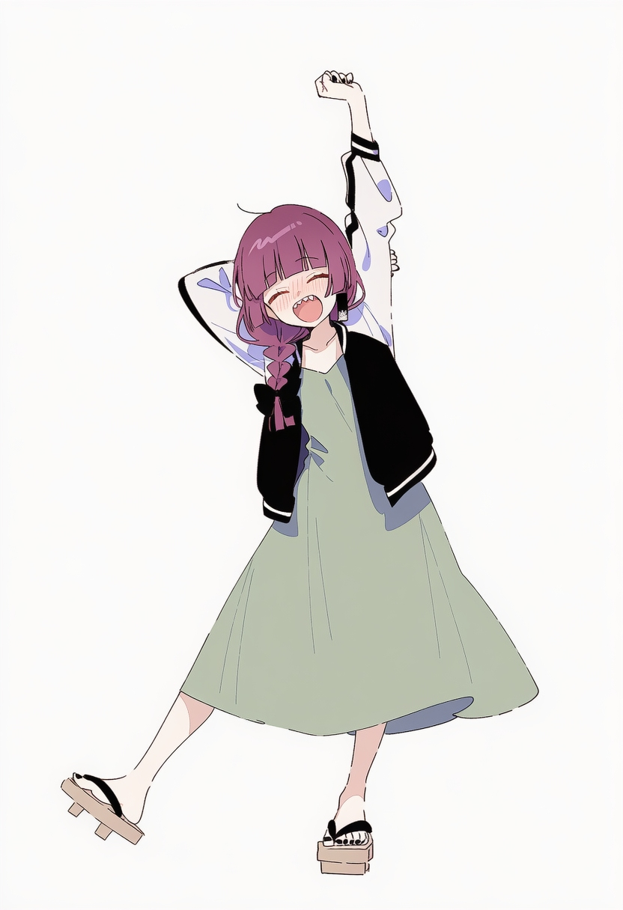

[在线例图](https://assets.quicktagcloud.com/images/raven_composition/raven_composition-1359.jpg?v=5f4387f8a52ba43c)

<a id="raven_composition-1360"></a>

## 超级英雄落地

ID：`raven_composition-1360`；分类：姿势-基础姿势 / 全身姿态/支撑；来源标记：`safe`。

来源说明：

> 低身单膝或手撑地的英雄式落地姿势。

正向提示词：

```text
superhero_landing
```

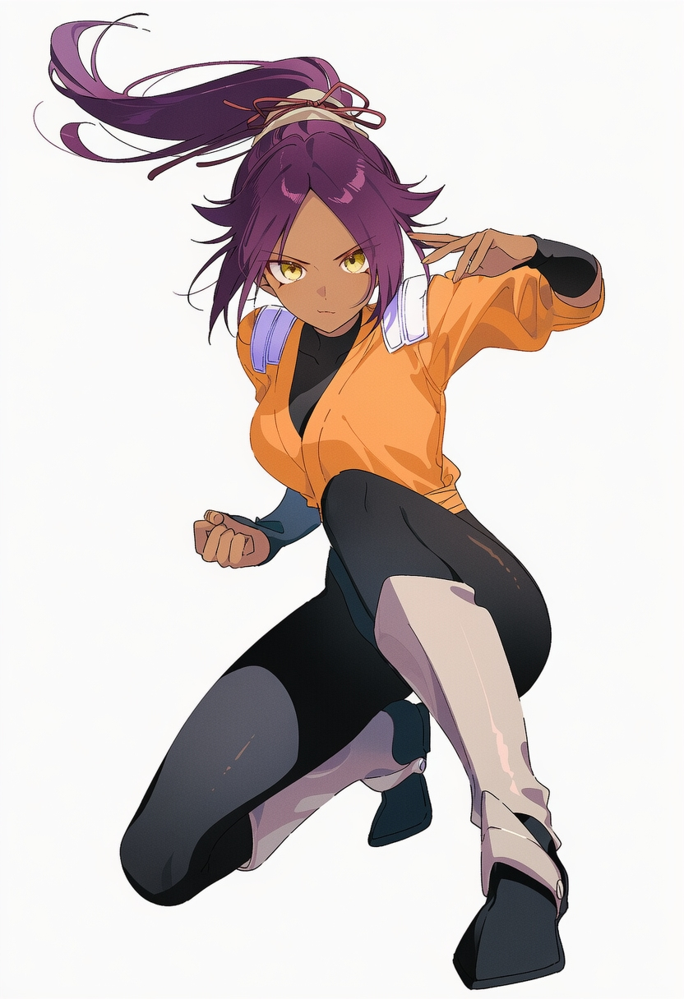

[在线例图](https://assets.quicktagcloud.com/images/raven_composition/raven_composition-1360.jpg?v=44d50ebdd2b3c99f)

<a id="raven_composition-1361"></a>

## 倒置姿态

ID：`raven_composition-1361`；分类：姿势-基础姿势 / 全身姿态/支撑；来源标记：`safe`。

来源说明：

> 整个身体上下颠倒。

正向提示词：

```text
upside-down
```

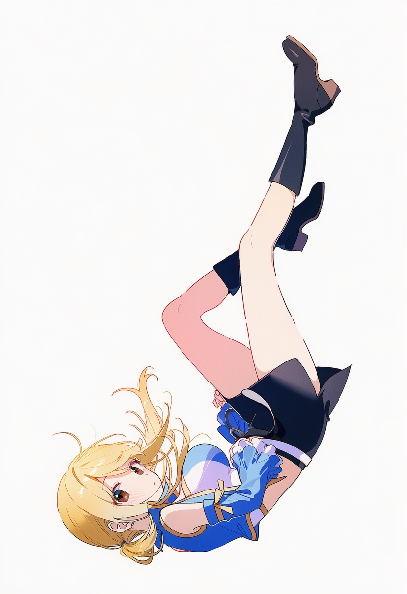

[在线例图](https://assets.quicktagcloud.com/images/raven_composition/raven_composition-1361.jpg?v=335bb96518cde130)

<a id="raven_composition-1362"></a>

## 手倒立

ID：`raven_composition-1362`；分类：姿势-基础姿势 / 全身姿态/支撑；来源标记：`safe`。

来源说明：

> 用双手或手臂支撑身体倒立。

正向提示词：

```text
handstand
```

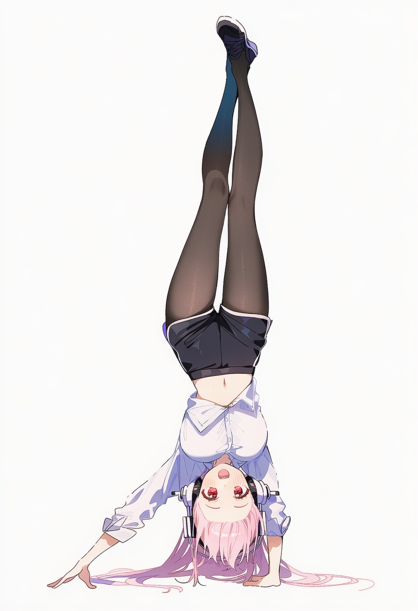

[在线例图](https://assets.quicktagcloud.com/images/raven_composition/raven_composition-1362.jpg?v=cb384a8bf0452eab)

<a id="raven_composition-1363"></a>

## 瑜伽姿势

ID：`raven_composition-1363`；分类：姿势-基础姿势 / 全身姿态/支撑；来源标记：`safe`。

来源说明：

> 摆出明显的瑜伽体式。

正向提示词：

```text
yoga
```

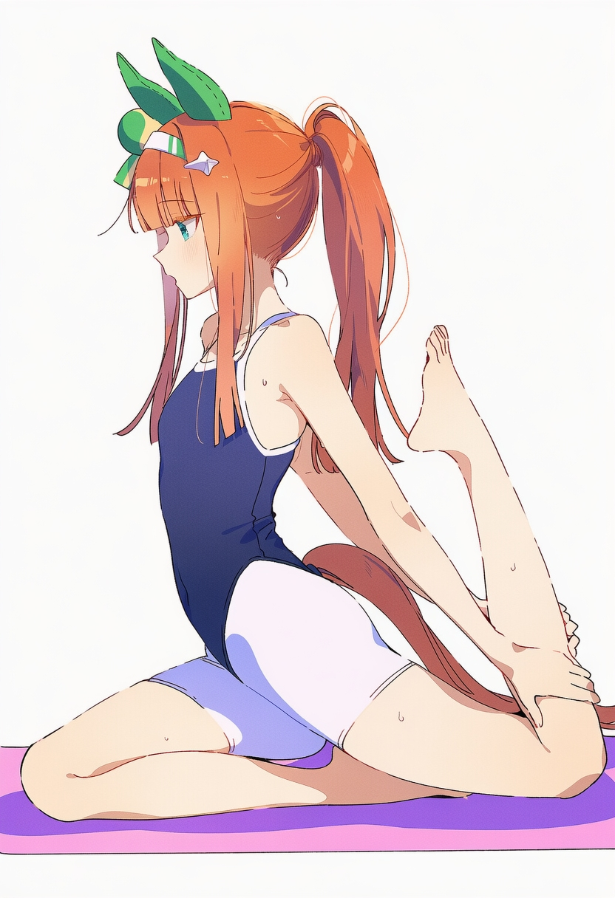

[在线例图](https://assets.quicktagcloud.com/images/raven_composition/raven_composition-1363.jpg?v=b3f828875be3f811)

<a id="raven_composition-1364"></a>

## 手臂支撑身体

ID：`raven_composition-1364`；分类：姿势-基础姿势 / 全身姿态/支撑；来源标记：`safe`。

来源说明：

> 用手臂或手支撑自身重量。

正向提示词：

```text
arm_support
```

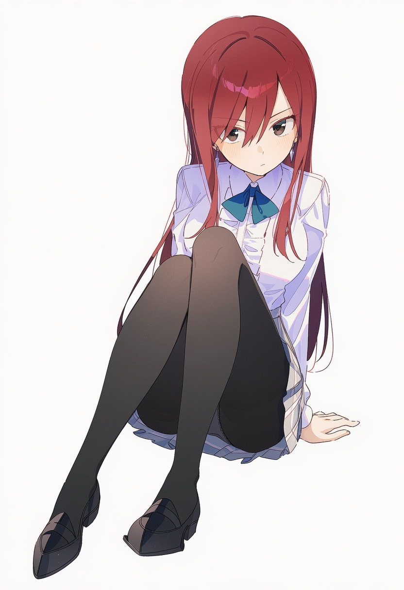

[在线例图](https://assets.quicktagcloud.com/images/raven_composition/raven_composition-1364.jpg?v=d12ef84d4bf4236b)

<a id="raven_composition-1365"></a>

## 托头 / 枕头姿势

ID：`raven_composition-1365`；分类：姿势-基础姿势 / 全身姿态/支撑；来源标记：`safe`。

来源说明：

> 头部由手、手臂或物体支撑。

正向提示词：

```text
head_rest
```

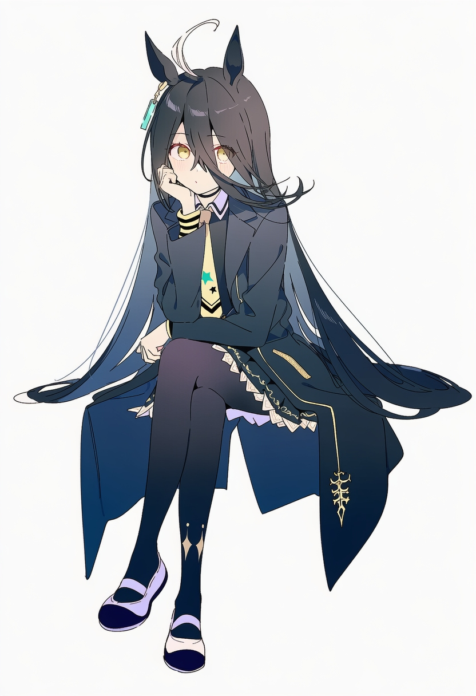

[在线例图](https://assets.quicktagcloud.com/images/raven_composition/raven_composition-1365.jpg?v=e6408c5358d0ec23)

<a id="raven_composition-1366"></a>

## 对立式站姿

ID：`raven_composition-1366`；分类：姿势-基础姿势 / 全身姿态/支撑；来源标记：`safe`。

来源说明：

> 重心偏向一条腿，髋肩形成自然反向倾斜。

正向提示词：

```text
contrapposto
```

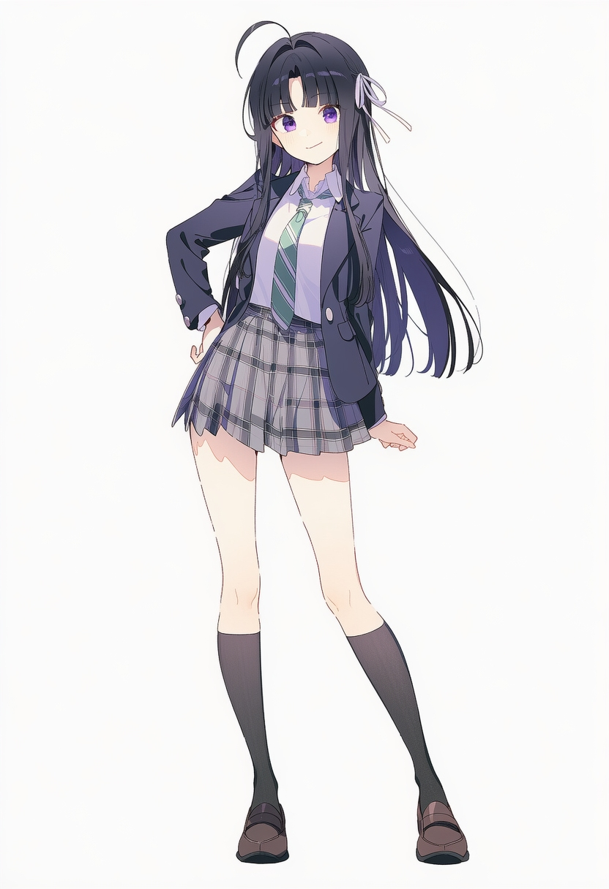

[在线例图](https://assets.quicktagcloud.com/images/raven_composition/raven_composition-1366.jpg?v=54fd1a8964696769)

<a id="raven_composition-1367"></a>

## 摆姿势

ID：`raven_composition-1367`；分类：姿势-基础姿势 / 全身姿态/支撑；来源标记：`safe`。

来源说明：

> 有意识地摆出供拍摄或展示的姿势。

正向提示词：

```text
posing
```

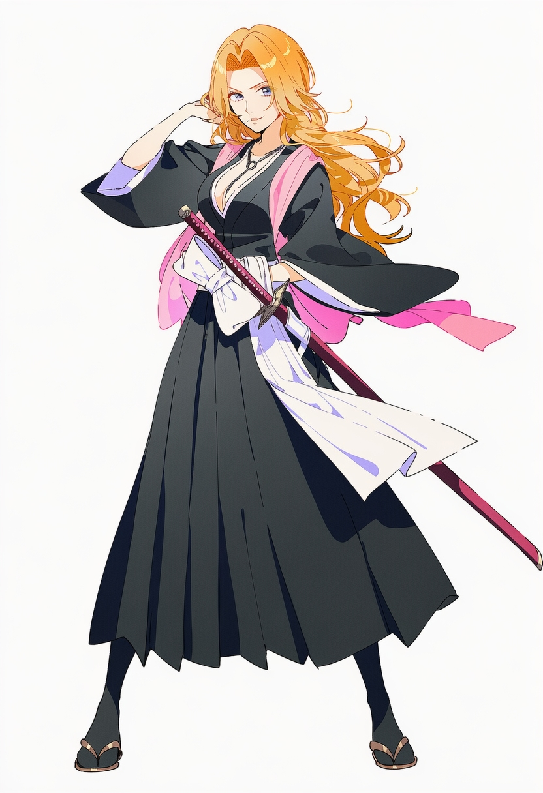

[在线例图](https://assets.quicktagcloud.com/images/raven_composition/raven_composition-1367.jpg?v=39a1a475f006dbf2)
