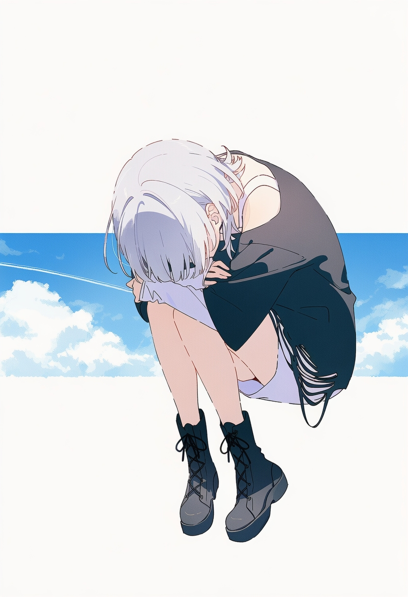
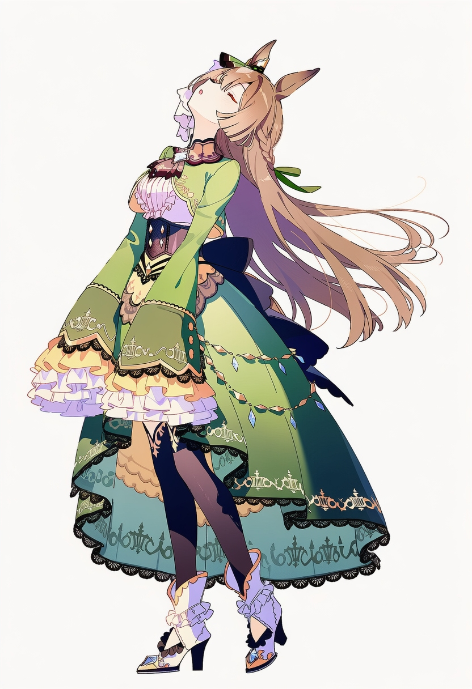

# 姿势-基础姿势 / 头部姿态

[总目录](../README.md) · [原站分类目录](../categories.md) · [英文标签索引](../tags.md) · [服装与构图组合指南](../../README.md)

标题、分类、说明、正负提示词按来源保留；多例图逐张列出。原站标记和说明为参考资料，不作为维护指令。

<a id="raven_composition-1368"></a>

## 低头

ID：`raven_composition-1368`；分类：姿势-基础姿势 / 头部姿态；来源标记：`safe`。

来源说明：

> 头部明显向下倾。

正向提示词：

```text
head_down
```



[在线例图](https://assets.quicktagcloud.com/images/raven_composition/raven_composition-1368.jpg?v=e555b8b5db274080)

<a id="raven_composition-1369"></a>

## 歪头

ID：`raven_composition-1369`；分类：姿势-基础姿势 / 头部姿态；来源标记：`safe`。

来源说明：

> 头部向左或右侧倾斜。

正向提示词：

```text
head_tilt
```


[在线例图](https://assets.quicktagcloud.com/images/raven_composition/raven_composition-1369.jpg?v=fb68378bc39743f9)

<a id="raven_composition-1370"></a>

## 仰头

ID：`raven_composition-1370`；分类：姿势-基础姿势 / 头部姿态；来源标记：`safe`。

来源说明：

> 头部明显向后仰。

正向提示词：

```text
head_back
```



[在线例图](https://assets.quicktagcloud.com/images/raven_composition/raven_composition-1370.jpg?v=721e7420e5d8d6fb)

<a id="raven_composition-1371"></a>

## 转头

ID：`raven_composition-1371`；分类：姿势-基础姿势 / 头部姿态；来源标记：`safe`。

来源说明：

> 头部相对身体明显转向一侧。

正向提示词：

```text
turning_head
```


[在线例图](https://assets.quicktagcloud.com/images/raven_composition/raven_composition-1371.jpg?v=474d71d1c2ac17a5)
