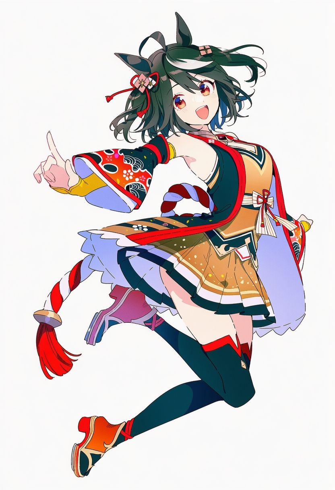
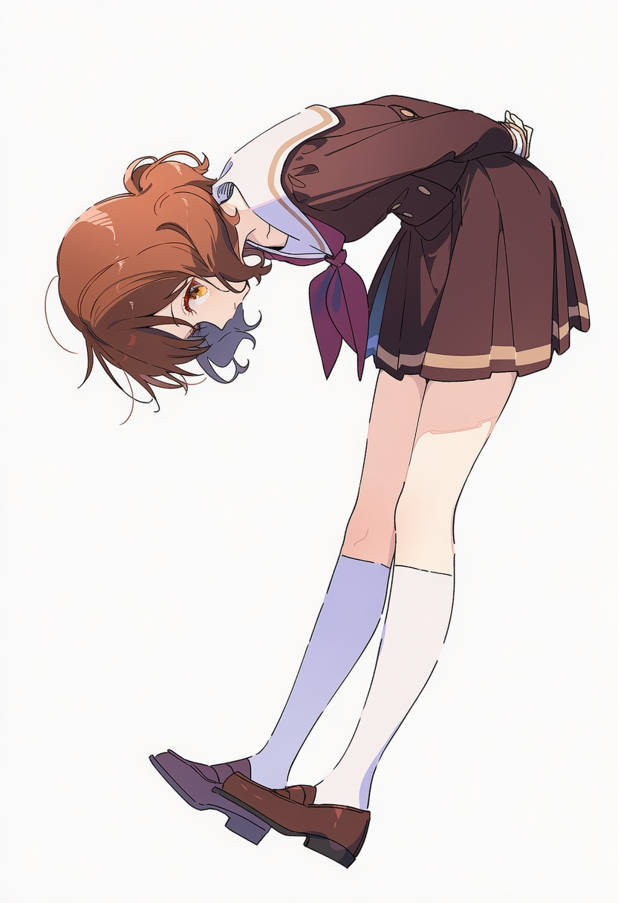
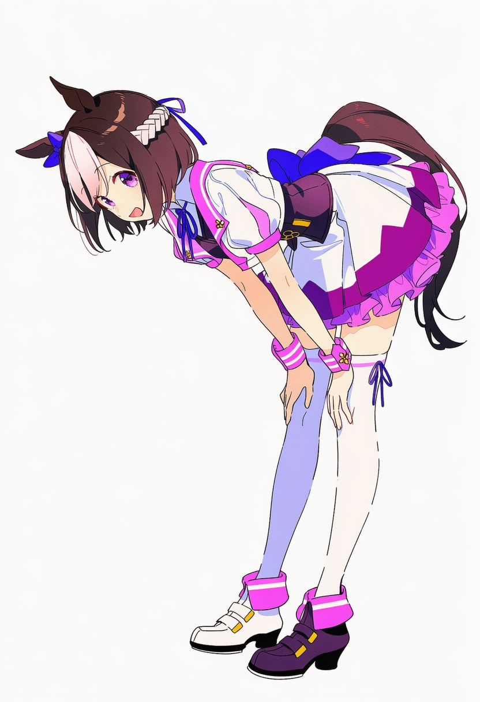
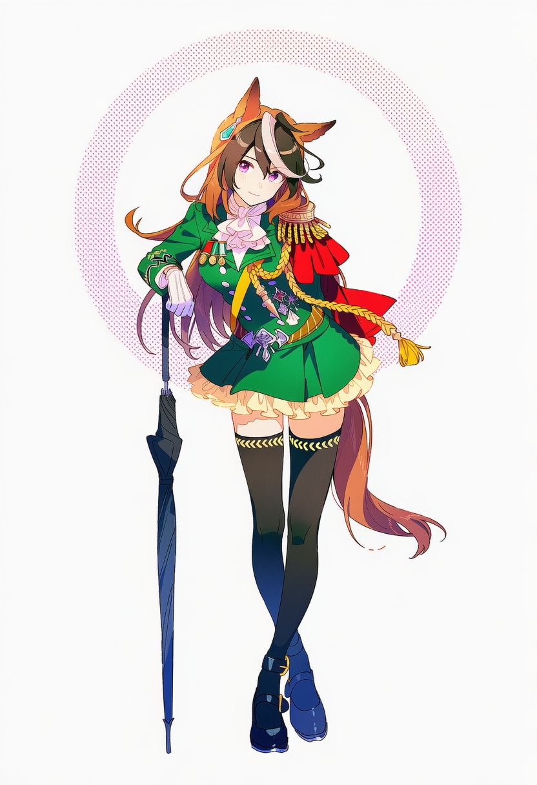
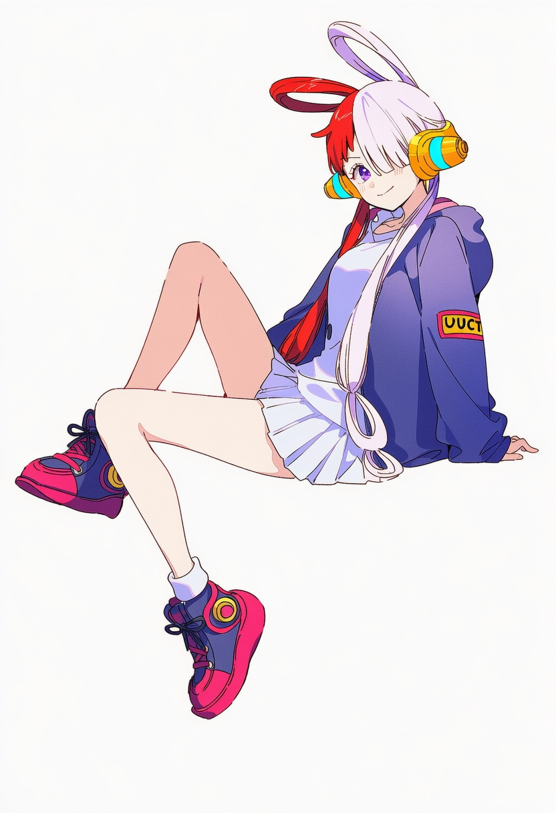
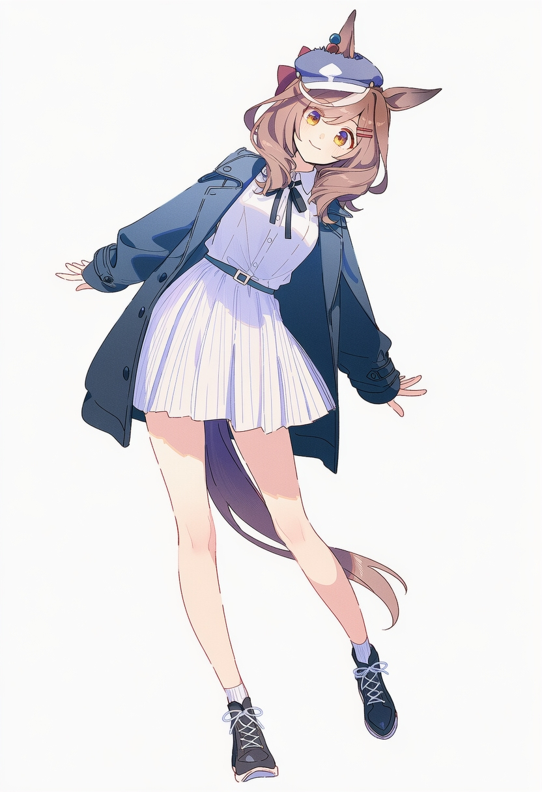
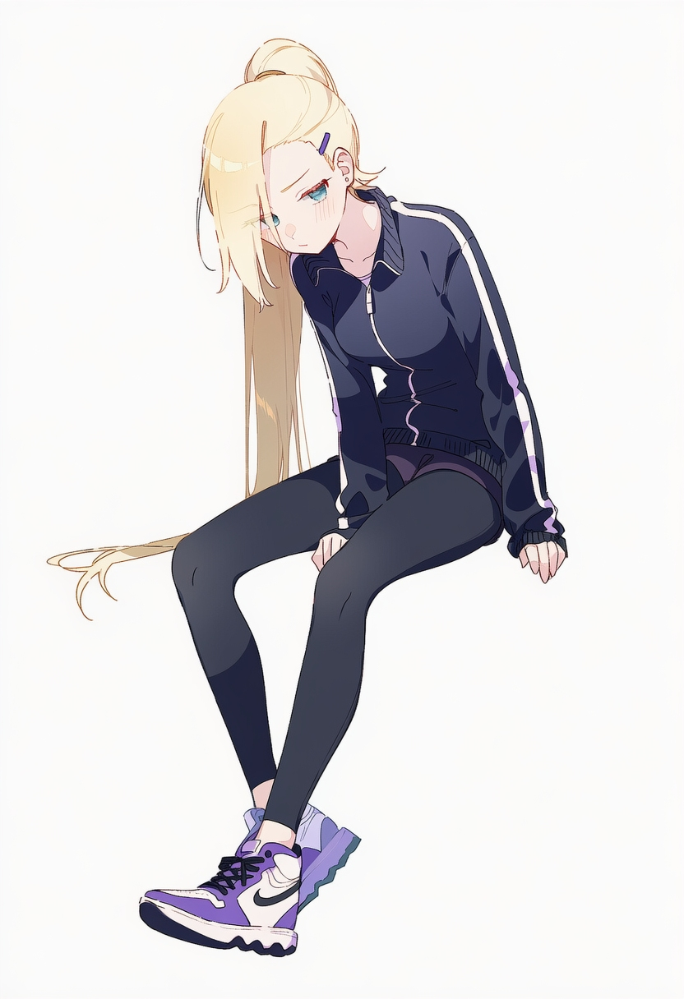
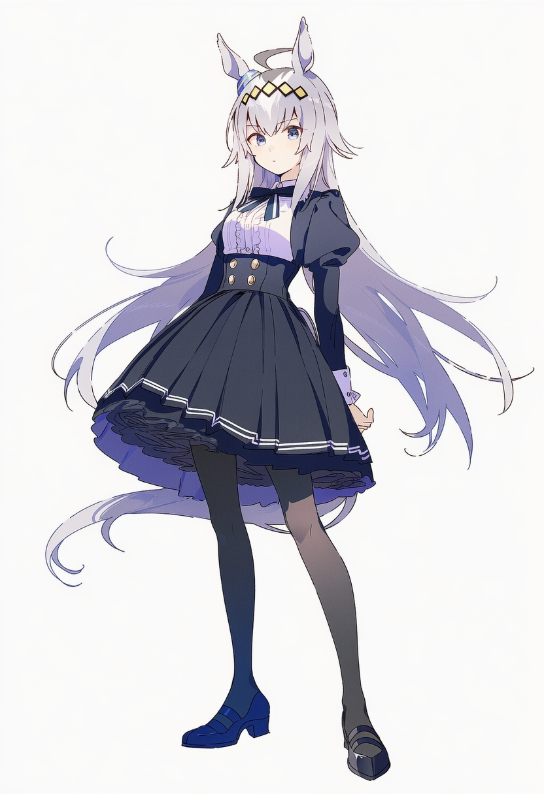
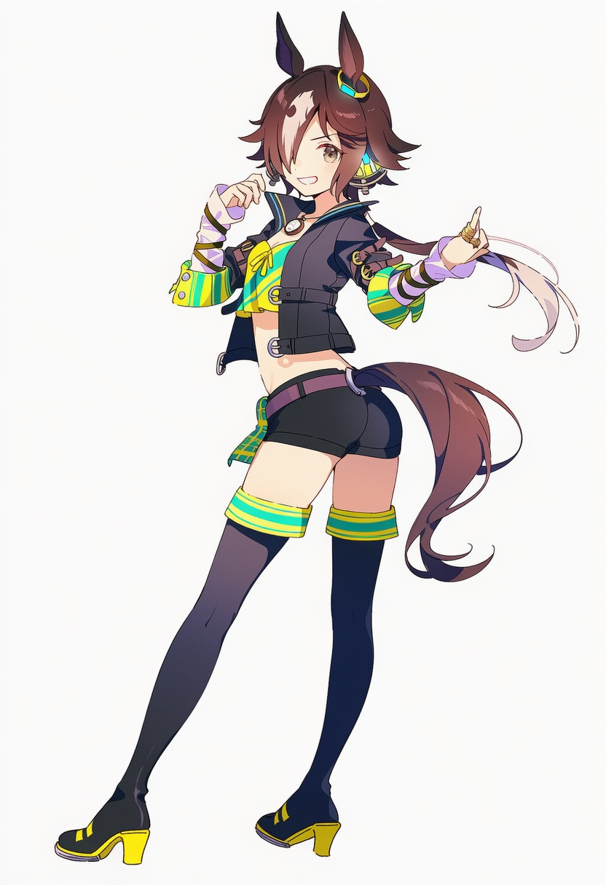

# 姿势-基础姿势 / 躯干/倾斜

[总目录](../README.md) · [原站分类目录](../categories.md) · [英文标签索引](../tags.md) · [服装与构图组合指南](../../README.md)

标题、分类、说明、正负提示词按来源保留；多例图逐张列出。原站标记和说明为参考资料，不作为维护指令。

<a id="raven_composition-1372"></a>

## 弓背 / 腰向前挺

ID：`raven_composition-1372`；分类：姿势-基础姿势 / 躯干/倾斜；来源标记：`safe`。

来源说明：

> 脊柱中段向前推出，身体形成弧线。

正向提示词：

```text
arched_back
```



[在线例图](https://assets.quicktagcloud.com/images/raven_composition/raven_composition-1372.jpg?v=c7cf23059b93b39f)

<a id="raven_composition-1373"></a>

## 背部后弯

ID：`raven_composition-1373`；分类：姿势-基础姿势 / 躯干/倾斜；来源标记：`safe`。

来源说明：

> 脊柱中段向后弯曲。

正向提示词：

```text
bent_back
```



[在线例图](https://assets.quicktagcloud.com/images/raven_composition/raven_composition-1373.jpg?v=5aa59ee4aede62ce)

<a id="raven_composition-1374"></a>

## 弯腰

ID：`raven_composition-1374`；分类：姿势-基础姿势 / 躯干/倾斜；来源标记：`safe`。

来源说明：

> 上半身明显向前弯下。

正向提示词：

```text
bent_over
```



[在线例图](https://assets.quicktagcloud.com/images/raven_composition/raven_composition-1374.jpg?v=6748a3f815a455fb)

<a id="raven_composition-1375"></a>

## 倾身

ID：`raven_composition-1375`；分类：姿势-基础姿势 / 躯干/倾斜；来源标记：`safe`。

来源说明：

> 身体整体明显倾斜。

正向提示词：

```text
leaning
```



[在线例图](https://assets.quicktagcloud.com/images/raven_composition/raven_composition-1375.jpg?v=6dfab1d9a30146b4)

<a id="raven_composition-1376"></a>

## 身体后倾

ID：`raven_composition-1376`；分类：姿势-基础姿势 / 躯干/倾斜；来源标记：`safe`。

来源说明：

> 上半身向后倾斜。

正向提示词：

```text
leaning_back
```



[在线例图](https://assets.quicktagcloud.com/images/raven_composition/raven_composition-1376.jpg?v=b57a1c6119b37137)

<a id="raven_composition-1377"></a>

## 身体前倾

ID：`raven_composition-1377`；分类：姿势-基础姿势 / 躯干/倾斜；来源标记：`safe`。

来源说明：

> 上半身向前倾斜。

正向提示词：

```text
leaning_forward
```


[在线例图](https://assets.quicktagcloud.com/images/raven_composition/raven_composition-1377.jpg?v=76b07defff72644e)

<a id="raven_composition-1378"></a>

## 身体侧倾

ID：`raven_composition-1378`；分类：姿势-基础姿势 / 躯干/倾斜；来源标记：`safe`。

来源说明：

> 上半身明显向一侧倾斜。

正向提示词：

```text
leaning_to_the_side
```



[在线例图](https://assets.quicktagcloud.com/images/raven_composition/raven_composition-1378.jpg?v=10a378be67e72ef5)

<a id="raven_composition-1379"></a>

## 懒散驼背

ID：`raven_composition-1379`；分类：姿势-基础姿势 / 躯干/倾斜；来源标记：`safe`。

来源说明：

> 身体松垮、肩背下沉的姿态。

正向提示词：

```text
slouching
```



[在线例图](https://assets.quicktagcloud.com/images/raven_composition/raven_composition-1379.jpg?v=99013a2f5a1058b1)

<a id="raven_composition-1380"></a>

## 挺胯后仰

ID：`raven_composition-1380`；分类：姿势-基础姿势 / 躯干/倾斜；来源标记：`safe`。

来源说明：

> 骨盆前移、上身后仰形成S形姿态。

正向提示词：

```text
sway_back
```



[在线例图](https://assets.quicktagcloud.com/images/raven_composition/raven_composition-1380.jpg?v=22f39ca3c29b5392)

<a id="raven_composition-1381"></a>

## 扭转躯干

ID：`raven_composition-1381`；分类：姿势-基础姿势 / 躯干/倾斜；来源标记：`safe`。

来源说明：

> 胸腹部相对髋部发生明显旋转。

正向提示词：

```text
twisted_torso
```



[在线例图](https://assets.quicktagcloud.com/images/raven_composition/raven_composition-1381.jpg?v=dbb28ff76ee8522a)
