# 二次元属性

[总目录](../README.md) · [原站分类目录](../categories.md) · [英文标签索引](../tags.md) · [服装与构图组合指南](../../README.md)

标题、分类、说明、正负提示词按来源保留；多例图逐张列出。原站标记和说明为参考资料，不作为维护指令。

<a id="raven_composition-1382"></a>

## 御姐

ID：`raven_composition-1382`；分类：二次元属性；来源标记：`safe`。

来源说明：

> 看起来已经是成熟大姐姐，身材和气质都偏成年、修长，不是少女感路线。

正向提示词：

```text
mature_female, tall_female
```

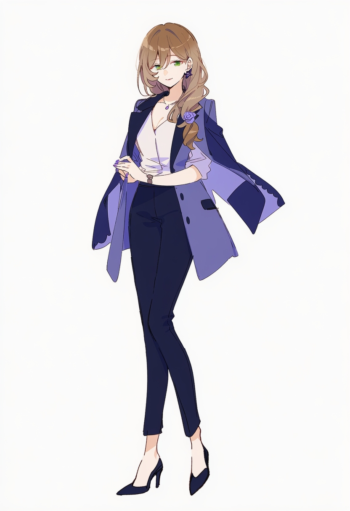

[在线例图](https://assets.quicktagcloud.com/images/raven_composition/raven_composition-1382.jpg?v=4222a97e69992955)

<a id="raven_composition-1383"></a>

## 萝莉

ID：`raven_composition-1383`；分类：二次元属性；来源标记：`safe`。

来源说明：

> 外观看起来年龄很小、幼龄感很强的女性角色。Danbooru 对这个标签的浏览有权限限制。

正向提示词：

```text
loli
```

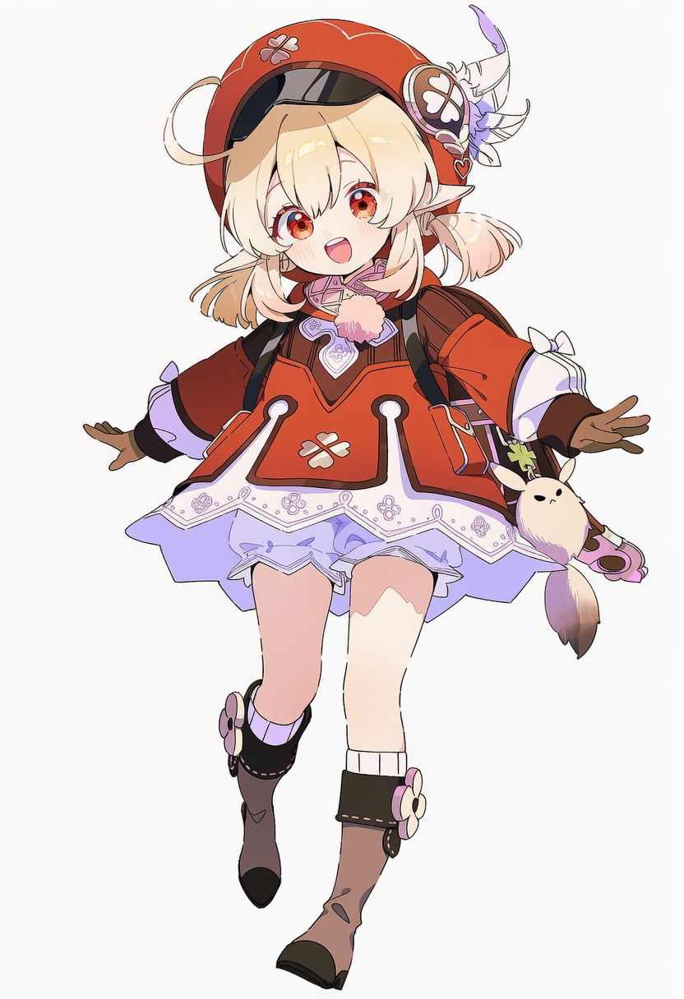

[在线例图](https://assets.quicktagcloud.com/images/raven_composition/raven_composition-1383.jpg?v=c435e347cd74e26b)

<a id="raven_composition-1384"></a>

## 辣妹 / Gyaru

ID：`raven_composition-1384`；分类：二次元属性；来源标记：`safe`。

来源说明：

> 日系辣妹风，通常会有明显妆容、染发、时髦穿搭或晒黑等视觉特征。

正向提示词：

```text
gyaru
```

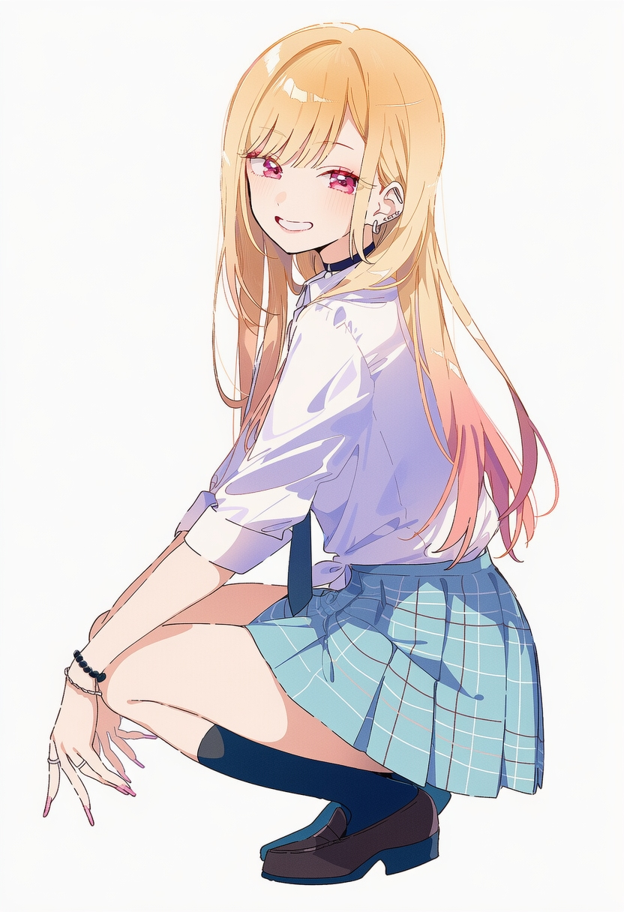

[在线例图](https://assets.quicktagcloud.com/images/raven_composition/raven_composition-1384.jpg?v=d2509384a9f06902)

<a id="raven_composition-1385"></a>

## 大姐姐辣妹

ID：`raven_composition-1385`；分类：二次元属性；来源标记：`safe`。

来源说明：

> 比普通辣妹更成熟、稳重、偏大姐姐风的 gyaru。

正向提示词：

```text
onee_gyaru
```

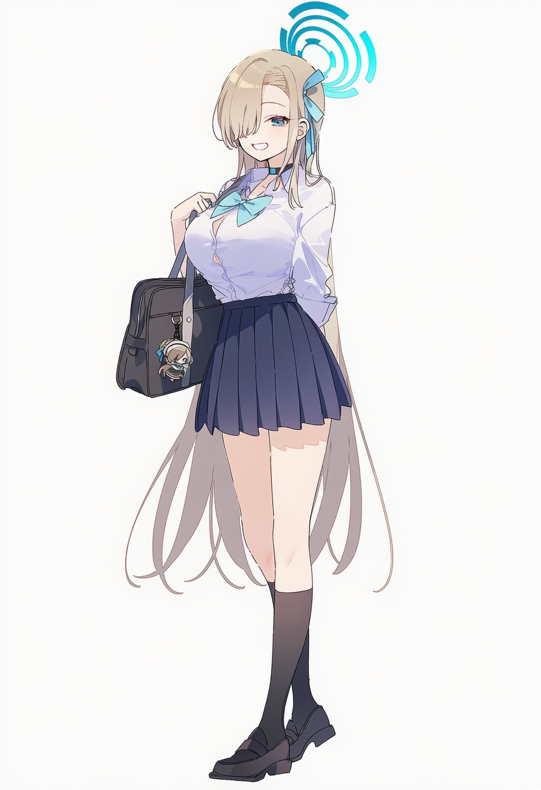

[在线例图](https://assets.quicktagcloud.com/images/raven_composition/raven_composition-1385.jpg?v=a3c8cd062a22fa2b)

<a id="raven_composition-1386"></a>

## 假小子

ID：`raven_composition-1386`；分类：二次元属性；来源标记：`safe`。

来源说明：

> 女生但整体打扮、动作或气质比较男孩子气。

正向提示词：

```text
tomboy
```

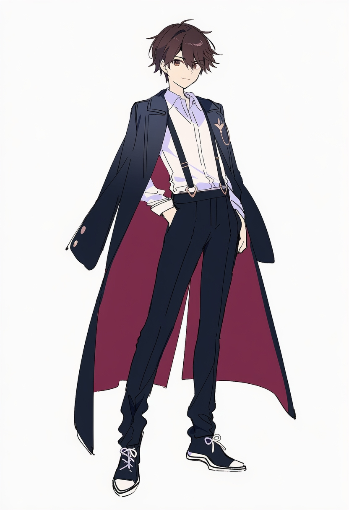

[在线例图](https://assets.quicktagcloud.com/images/raven_composition/raven_composition-1386.jpg?v=97921ec6bd0919f7)

<a id="raven_composition-1387"></a>

## 傲娇

ID：`raven_composition-1387`；分类：二次元属性；来源标记：`safe`。

来源说明：

> 嘴上很冲或很冷，实际上很在意别人，典型“才、才不是为了你”的感觉。

正向提示词：

```text
tsundere
```

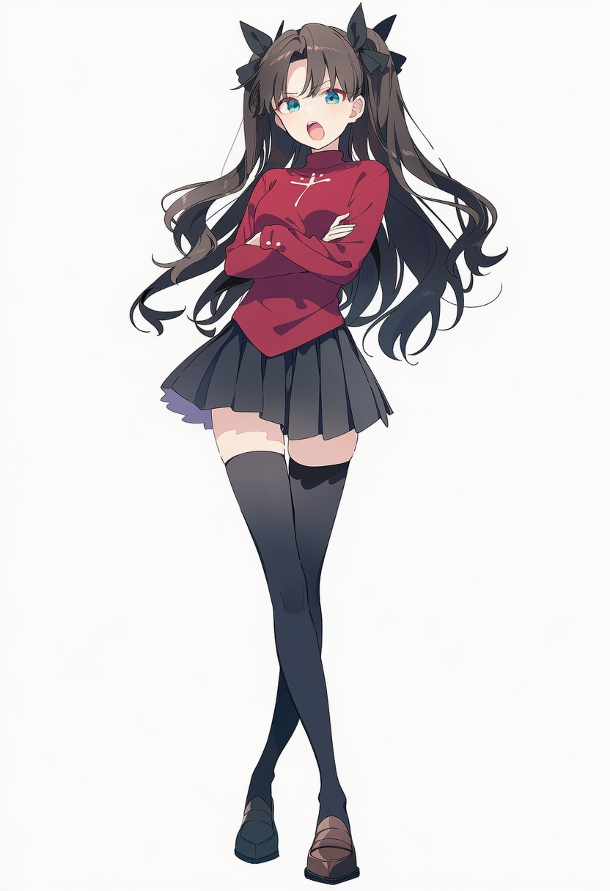

[在线例图](https://assets.quicktagcloud.com/images/raven_composition/raven_composition-1387.jpg?v=5c4a5a5c198a55d6)

<a id="raven_composition-1388"></a>

## 病娇

ID：`raven_composition-1388`；分类：二次元属性；来源标记：`safe`。

来源说明：

> 喜欢一个人喜欢到有点危险、偏执，常带压迫感或不正常的笑容。

正向提示词：

```text
yandere
```

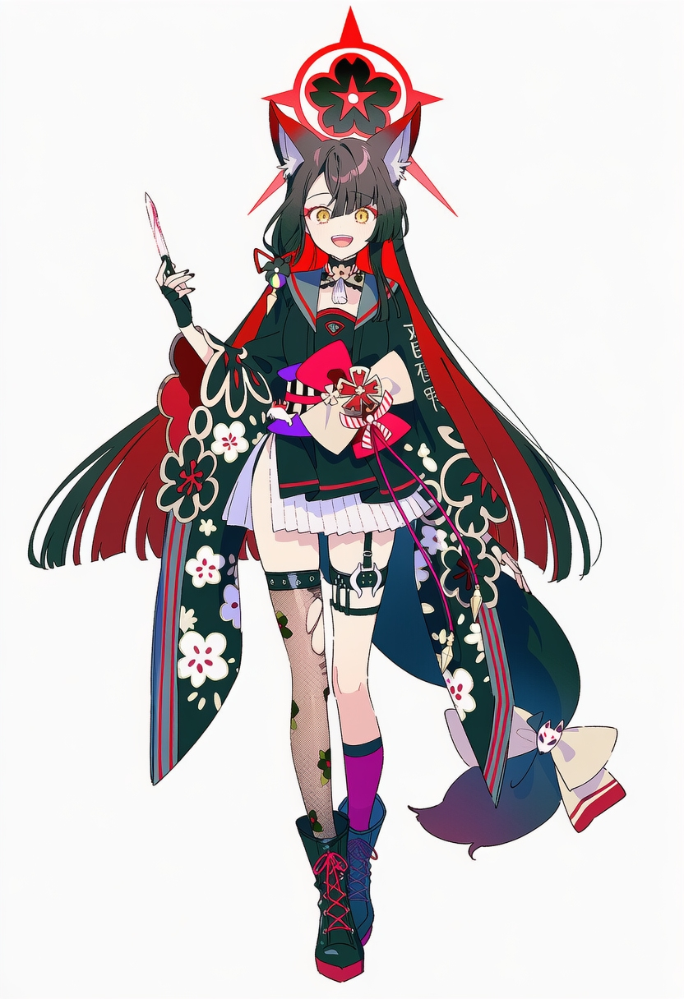

[在线例图](https://assets.quicktagcloud.com/images/raven_composition/raven_composition-1388.jpg?v=15ef4847405c7d05)

<a id="raven_composition-1389"></a>

## 高冷

ID：`raven_composition-1389`；分类：二次元属性；来源标记：`safe`。

来源说明：

> 脸上没什么表情，眼神也比较淡，给人很冷静、不好接近的感觉。

正向提示词：

```text
expressionless, half-closed_eyes
```

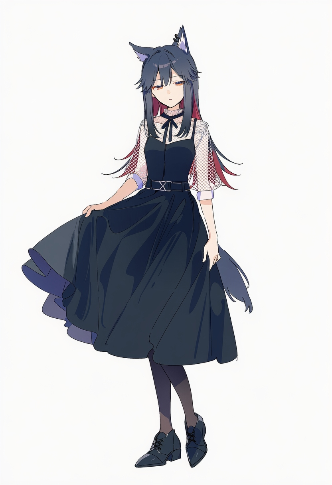

[在线例图](https://assets.quicktagcloud.com/images/raven_composition/raven_composition-1389.jpg?v=eff83340834387d4)

<a id="raven_composition-1390"></a>

## 冷脸萌

ID：`raven_composition-1390`；分类：二次元属性；来源标记：`safe`。

来源说明：

> 脸还是冷冷的，但又带一点脸红之类的可爱反差。

正向提示词：

```text
expressionless, blush
```

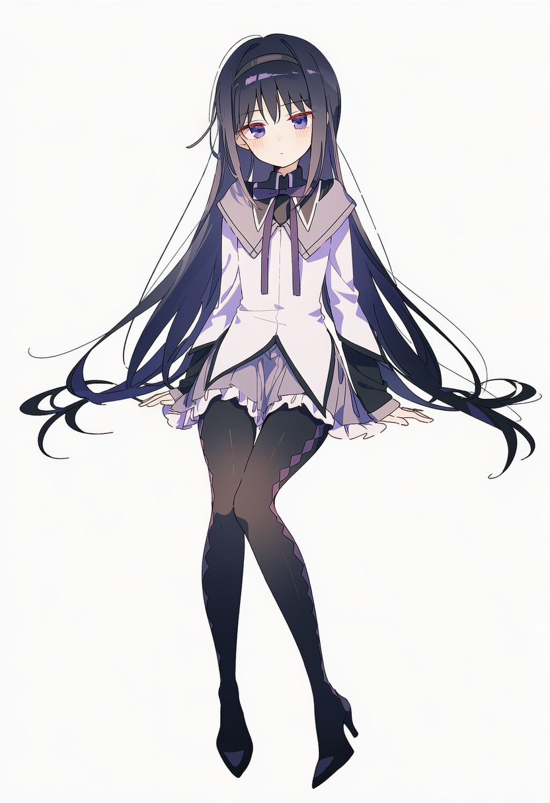

[在线例图](https://assets.quicktagcloud.com/images/raven_composition/raven_composition-1390.jpg?v=ab3e9f8e241eb18c)

<a id="raven_composition-1391"></a>

## 害羞系

ID：`raven_composition-1391`；分类：二次元属性；来源标记：`safe`。

来源说明：

> 脸红又不太敢直视别人，一看就是害羞了。

正向提示词：

```text
blush, looking_away
```

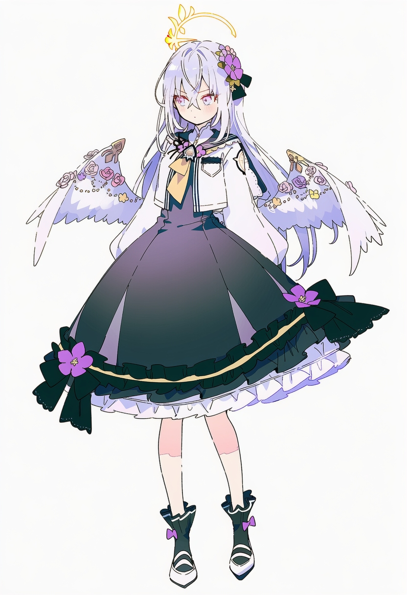

[在线例图](https://assets.quicktagcloud.com/images/raven_composition/raven_composition-1391.jpg?v=ec7eb5f9046d8ebf)

<a id="raven_composition-1392"></a>

## 得意脸

ID：`raven_composition-1392`；分类：二次元属性；来源标记：`safe`。

来源说明：

> 一副“我早就知道”“怎么样，我厉害吧”的得意表情。

正向提示词：

```text
smug
```

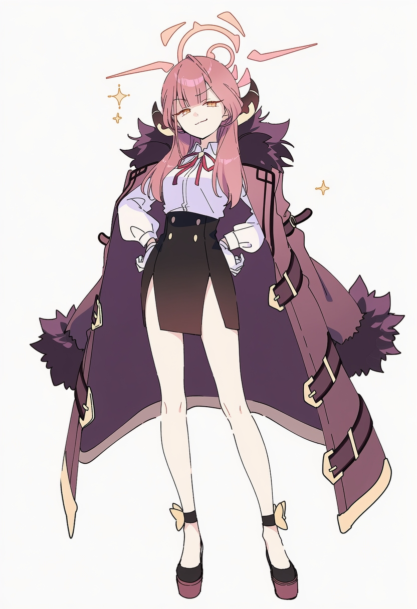

[在线例图](https://assets.quicktagcloud.com/images/raven_composition/raven_composition-1392.jpg?v=529e25ac7a451135)

<a id="raven_composition-1393"></a>

## 坏笑

ID：`raven_composition-1393`；分类：二次元属性；来源标记：`safe`。

来源说明：

> 嘴角带一点歪笑，看起来像在打坏主意或者故意逗人。

正向提示词：

```text
smirk
```

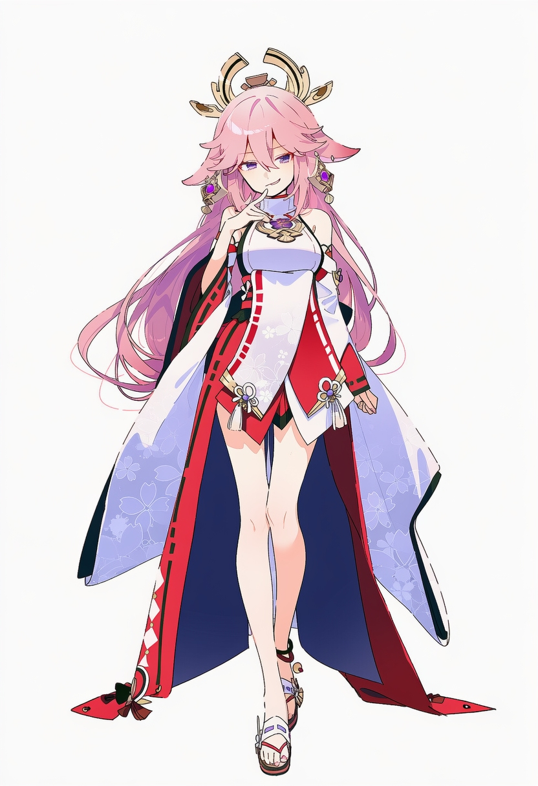

[在线例图](https://assets.quicktagcloud.com/images/raven_composition/raven_composition-1393.jpg?v=2e8c7bfd96d0572d)

<a id="raven_composition-1394"></a>

## 鼓腮 / 闹别扭

ID：`raven_composition-1394`；分类：二次元属性；来源标记：`safe`。

来源说明：

> 嘴巴撅起来、脸颊鼓鼓的，像在生气、撒娇或者闹小脾气。

正向提示词：

```text
pout
```

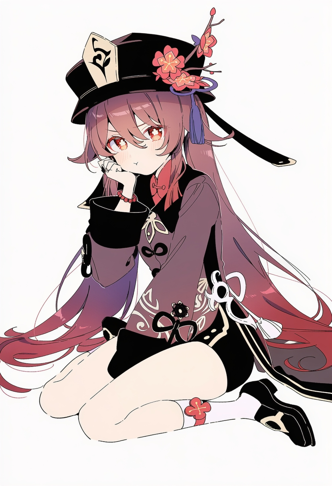

[在线例图](https://assets.quicktagcloud.com/images/raven_composition/raven_composition-1394.jpg?v=26e55d566d04b8fe)

<a id="raven_composition-1395"></a>

## 脸红

ID：`raven_composition-1395`；分类：二次元属性；来源标记：`safe`。

来源说明：

> 脸颊明显泛红，可以是害羞、紧张、开心或心动。

正向提示词：

```text
blush
```

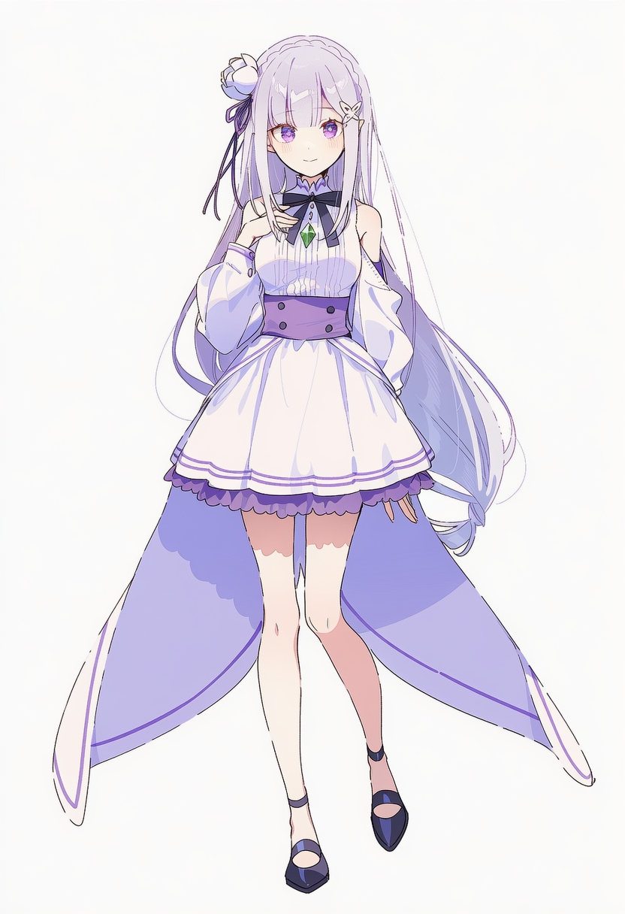

[在线例图](https://assets.quicktagcloud.com/images/raven_composition/raven_composition-1395.jpg?v=297e51c03fee2338)

<a id="raven_composition-1396"></a>

## 鼻尖泛红

ID：`raven_composition-1396`；分类：二次元属性；来源标记：`safe`。

来源说明：

> 不只是脸颊，鼻子附近也红红的，常显得更害羞或更可爱。

正向提示词：

```text
nose_blush
```

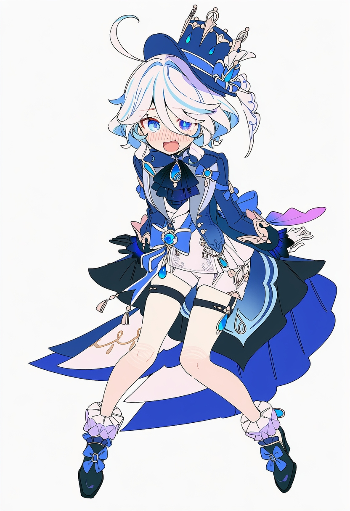

[在线例图](https://assets.quicktagcloud.com/images/raven_composition/raven_composition-1396.jpg?v=40f83b847d840d33)

<a id="raven_composition-1397"></a>

## 半睁眼

ID：`raven_composition-1397`；分类：二次元属性；来源标记：`safe`。

来源说明：

> 眼睛懒懒地只睁一半，看起来困、淡定或者有点嫌弃。

正向提示词：

```text
half-closed_eyes
```

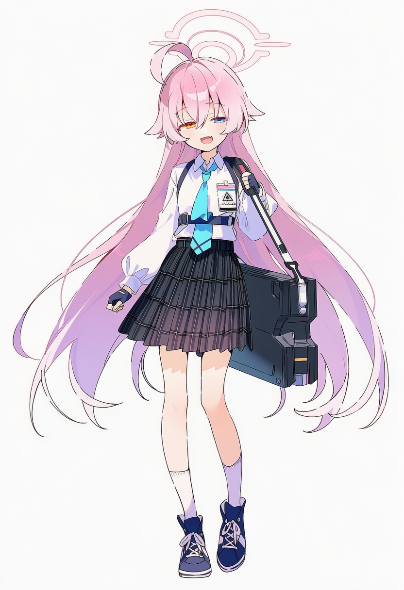

[在线例图](https://assets.quicktagcloud.com/images/raven_composition/raven_composition-1397.jpg?v=394cfb3d2ada9df8)

<a id="raven_composition-1398"></a>

## 眨眼

ID：`raven_composition-1398`；分类：二次元属性；来源标记：`safe`。

来源说明：

> 一只眼睛闭着，常用来卖萌、打招呼或摆可爱表情。

正向提示词：

```text
one_eye_closed
```

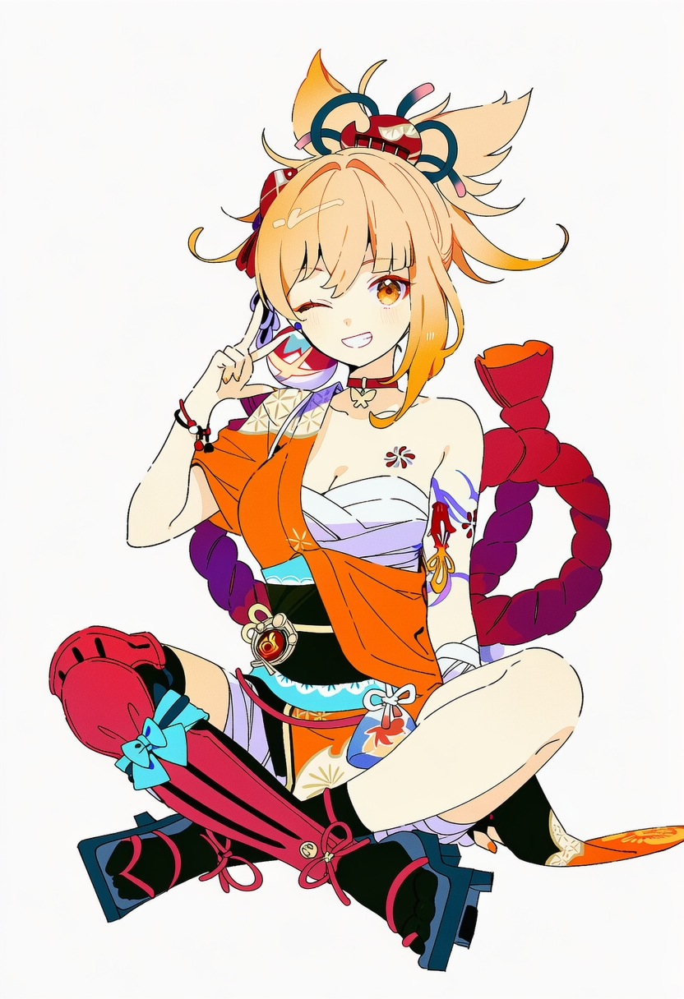

[在线例图](https://assets.quicktagcloud.com/images/raven_composition/raven_composition-1398.jpg?v=14538f5247006a2c)

<a id="raven_composition-1399"></a>

## 猫嘴

ID：`raven_composition-1399`；分类：二次元属性；来源标记：`safe`。

来源说明：

> 嘴巴画成像猫咪一样的“3”形，看起来特别俏皮。

正向提示词：

```text
:3
```

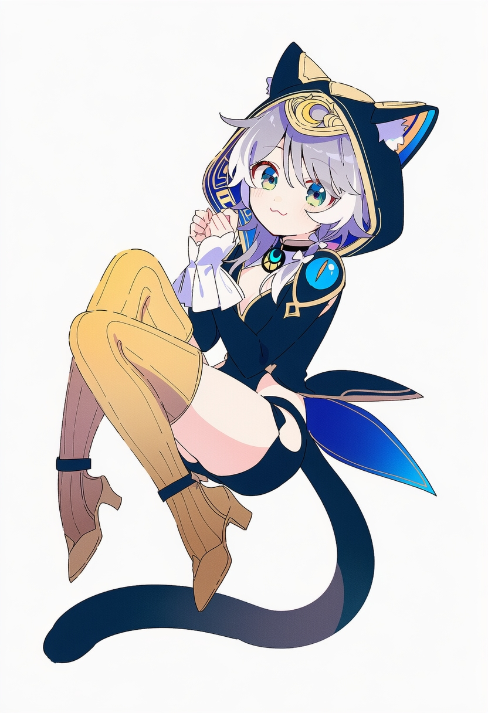

[在线例图](https://assets.quicktagcloud.com/images/raven_composition/raven_composition-1399.jpg?v=a541657c84e4c506)

<a id="raven_composition-1400"></a>

## 吐舌

ID：`raven_composition-1400`；分类：二次元属性；来源标记：`safe`。

来源说明：

> 把舌头伸出来，常见于调皮、恶作剧、卖萌的表情。

正向提示词：

```text
tongue_out
```

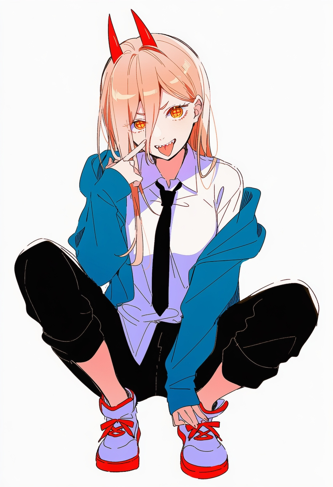

[在线例图](https://assets.quicktagcloud.com/images/raven_composition/raven_composition-1400.jpg?v=41fb16ec3e23d1c7)

<a id="raven_composition-1401"></a>

## 虎牙

ID：`raven_composition-1401`；分类：二次元属性；来源标记：`safe`。

来源说明：

> 嘴里露出一颗尖尖的小犬齿，是很常见的可爱或淘气萌点。

正向提示词：

```text
fang
```

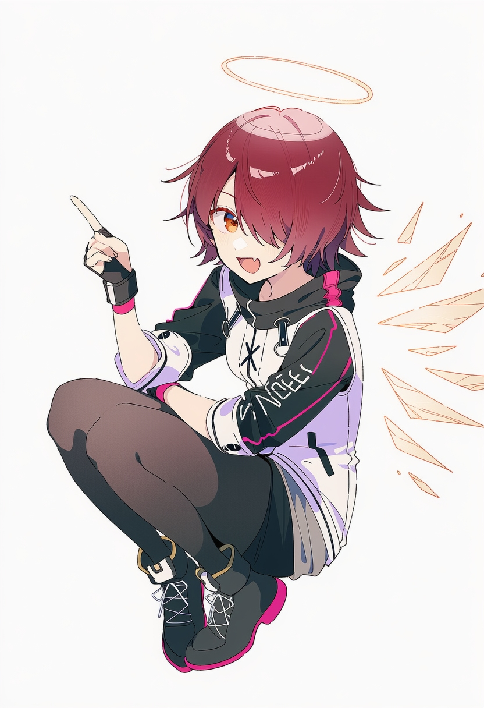

[在线例图](https://assets.quicktagcloud.com/images/raven_composition/raven_composition-1401.jpg?v=8b9293205468119a)

<a id="raven_composition-1402"></a>

## 尖牙

ID：`raven_composition-1402`；分类：二次元属性；来源标记：`safe`。

来源说明：

> 不是只有一颗虎牙，而是能明显看到多颗尖锐牙齿。

正向提示词：

```text
sharp_teeth
```

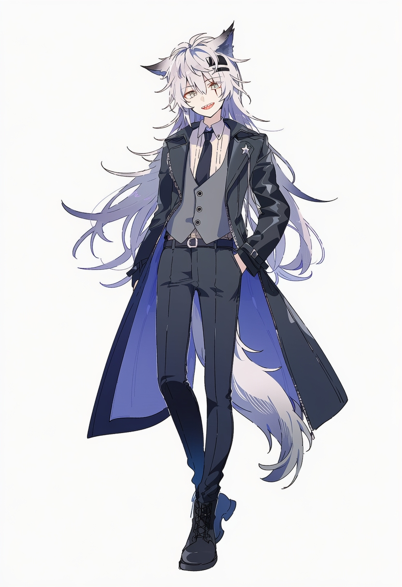

[在线例图](https://assets.quicktagcloud.com/images/raven_composition/raven_composition-1402.jpg?v=5912c39df9426b52)

<a id="raven_composition-1403"></a>

## 泪痣

ID：`raven_composition-1403`；分类：二次元属性；来源标记：`safe`。

来源说明：

> 眼睛下方有一颗小痣，常给角色增加成熟、妩媚或辨识度。

正向提示词：

```text
mole_under_eye
```

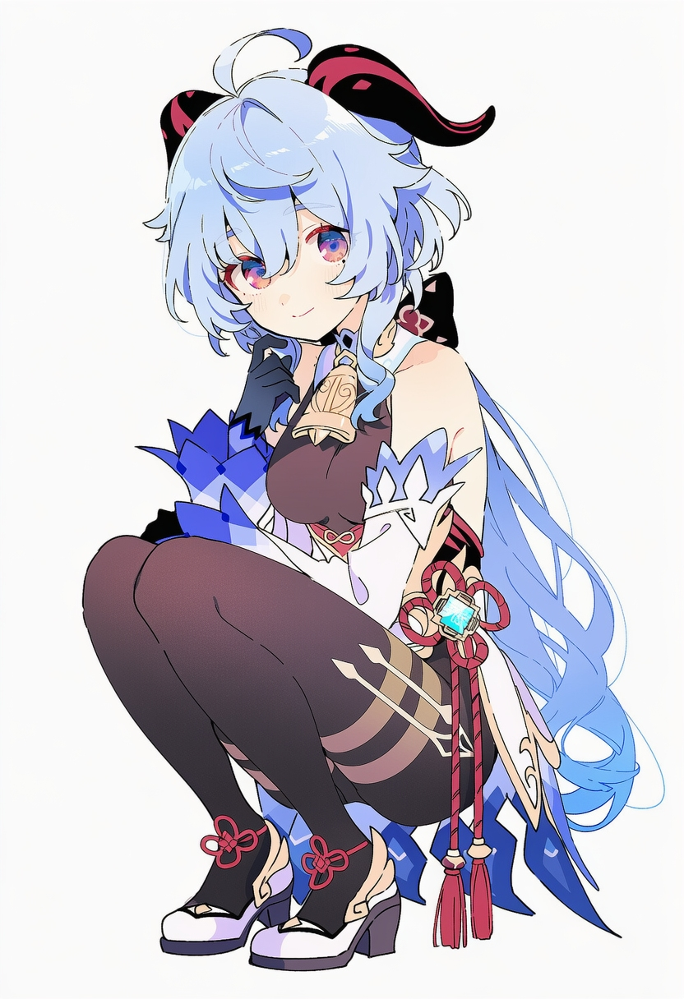

[在线例图](https://assets.quicktagcloud.com/images/raven_composition/raven_composition-1403.jpg?v=6a5616628675660b)

<a id="raven_composition-1404"></a>

## 雀斑

ID：`raven_composition-1404`；分类：二次元属性；来源标记：`safe`。

来源说明：

> 脸上分布着一些小雀斑，显得自然、有生活感。

正向提示词：

```text
freckles
```

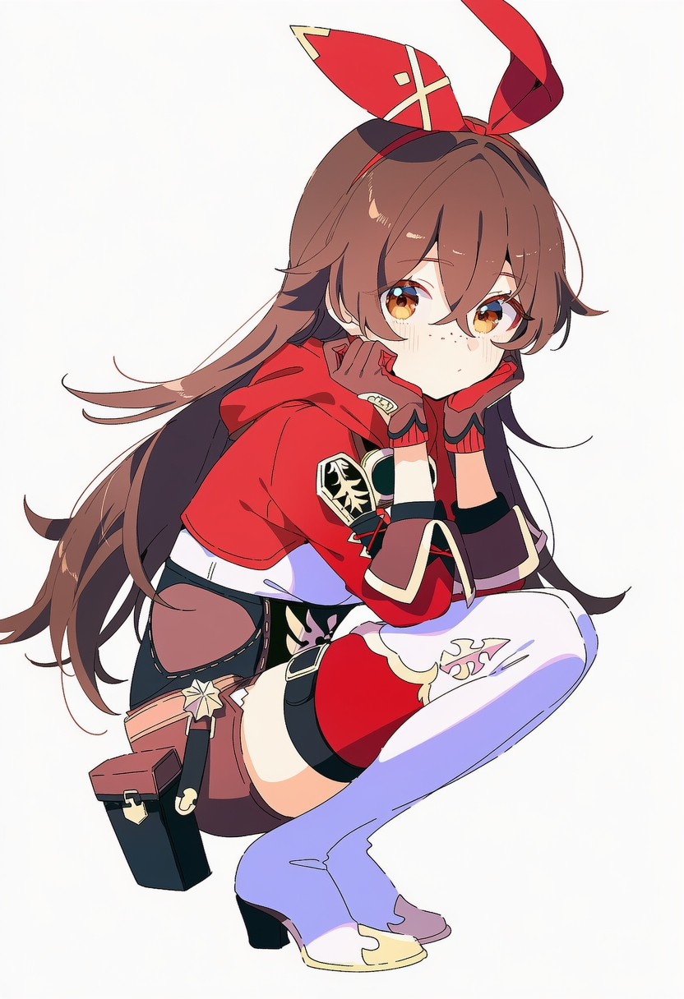

[在线例图](https://assets.quicktagcloud.com/images/raven_composition/raven_composition-1404.jpg?v=28d2723199a2c5ea)

<a id="raven_composition-1405"></a>

## 呆毛

ID：`raven_composition-1405`；分类：二次元属性；来源标记：`safe`。

来源说明：

> 头顶有一撮不听话地翘起来的头发，是二次元非常经典的萌点。

正向提示词：

```text
ahoge
```

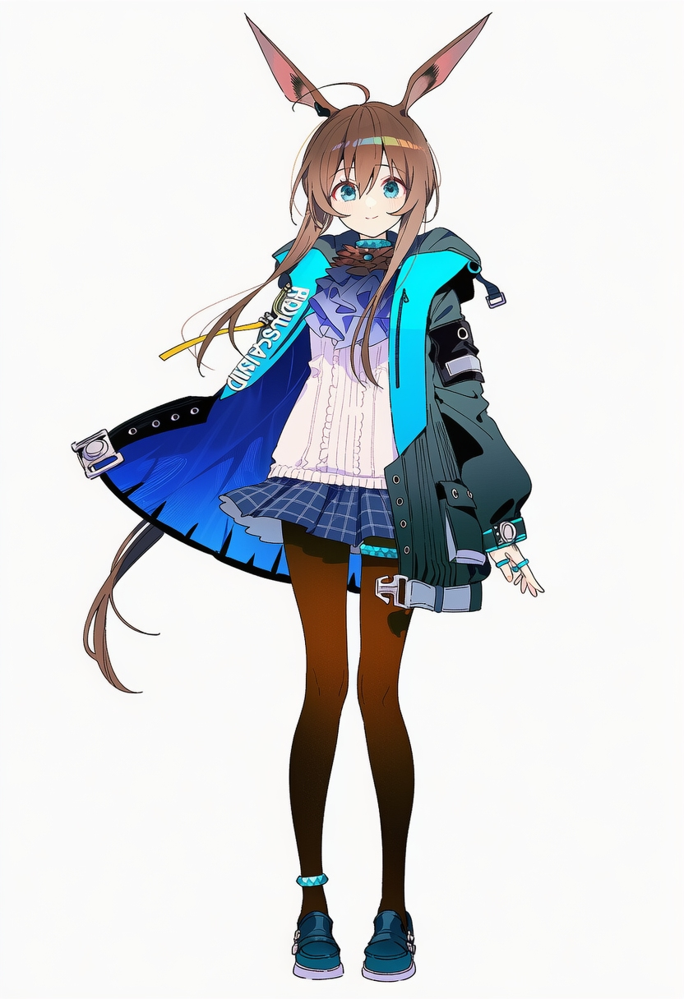

[在线例图](https://assets.quicktagcloud.com/images/raven_composition/raven_composition-1405.jpg?v=2ee6371fd20f5dd9)

<a id="raven_composition-1406"></a>

## 进气口刘海

ID：`raven_composition-1406`；分类：二次元属性；来源标记：`safe`。

来源说明：

> 额头两侧的头发形成像进气口一样向内凹的特殊刘海形状。

正向提示词：

```text
hair_intakes
```

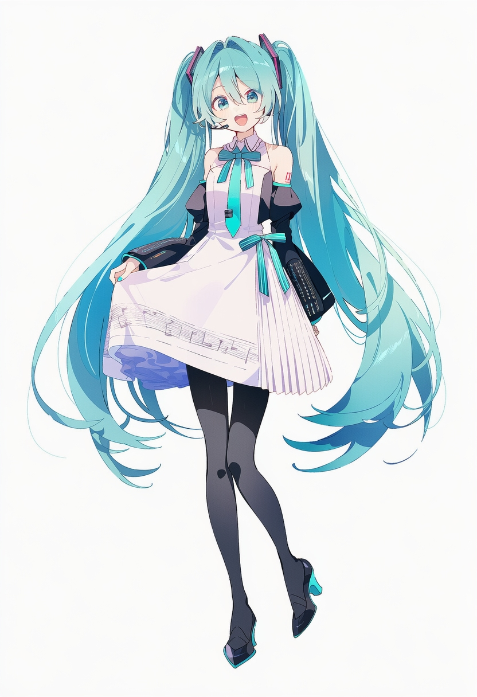

[在线例图](https://assets.quicktagcloud.com/images/raven_composition/raven_composition-1406.jpg?v=f8c58c393b8452f9)

<a id="raven_composition-1407"></a>

## 眼间发

ID：`raven_composition-1407`；分类：二次元属性；来源标记：`safe`。

来源说明：

> 有一缕头发从两眼之间垂下来，是很常见的脸部发型细节。

正向提示词：

```text
hair_between_eyes
```

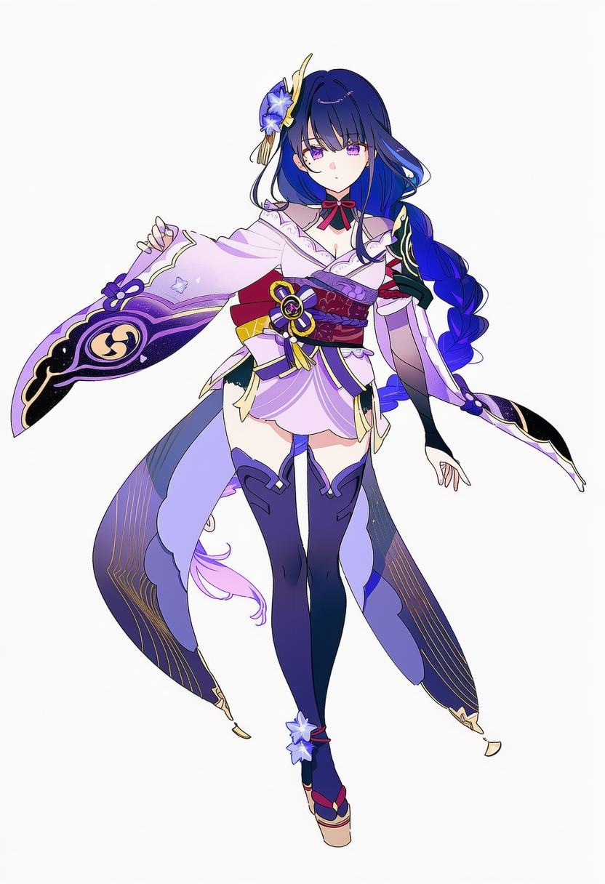

[在线例图](https://assets.quicktagcloud.com/images/raven_composition/raven_composition-1407.jpg?v=c1882b748941c285)

<a id="raven_composition-1408"></a>

## 齐刘海

ID：`raven_composition-1408`；分类：二次元属性；来源标记：`safe`。

来源说明：

> 刘海下缘剪得很整齐，像一条比较平直的线。

正向提示词：

```text
blunt_bangs
```

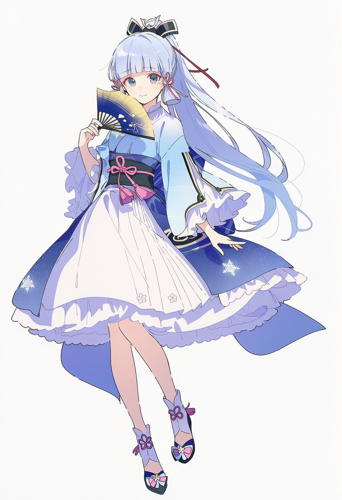

[在线例图](https://assets.quicktagcloud.com/images/raven_composition/raven_composition-1408.jpg?v=4bf57a07f5b184c6)

<a id="raven_composition-1409"></a>

## 姬发式

ID：`raven_composition-1409`；分类：二次元属性；来源标记：`safe`。

来源说明：

> 两侧脸颊旁是整齐的短发，后面通常保留长发，经典公主切。

正向提示词：

```text
hime_cut
```

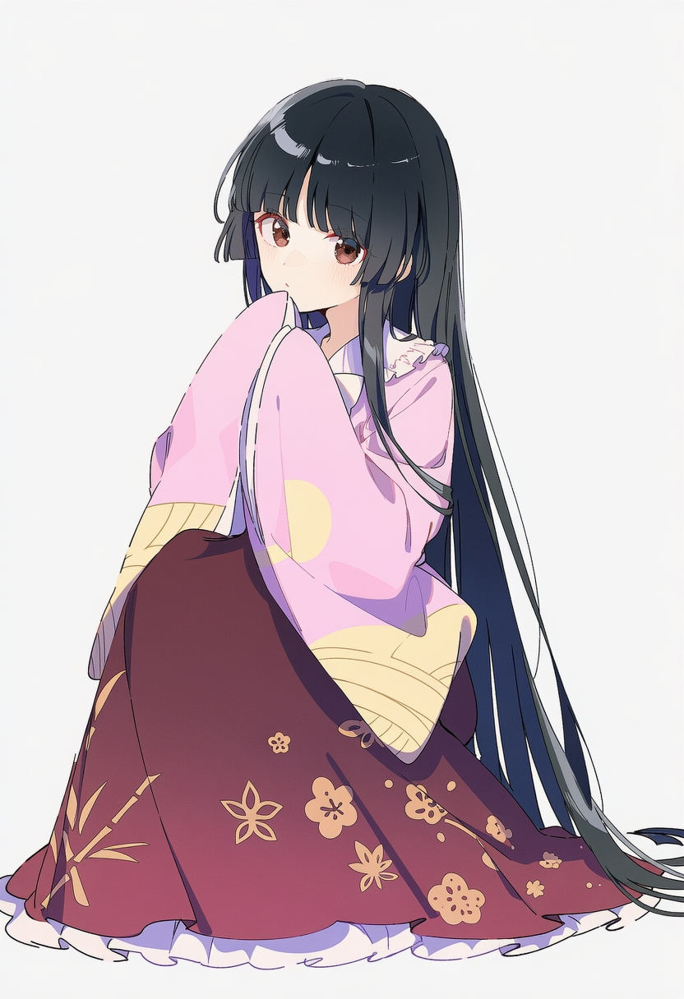

[在线例图](https://assets.quicktagcloud.com/images/raven_composition/raven_composition-1409.jpg?v=da6b799a8847832f)

<a id="raven_composition-1410"></a>

## 钻头卷

ID：`raven_composition-1410`；分类：二次元属性；来源标记：`safe`。

来源说明：

> 头发卷成明显的螺旋钻头形，是大小姐系角色常见的夸张发型。

正向提示词：

```text
drill_hair
```

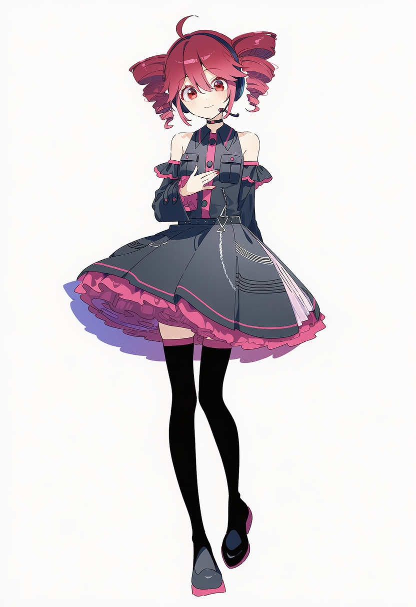

[在线例图](https://assets.quicktagcloud.com/images/raven_composition/raven_composition-1410.jpg?v=2390031db9d138b0)

<a id="raven_composition-1411"></a>

## 侧发

ID：`raven_composition-1411`；分类：二次元属性；来源标记：`safe`。

来源说明：

> 脸两侧单独垂下来的长发束，和后面的头发分得比较明显。

正向提示词：

```text
sidelocks
```

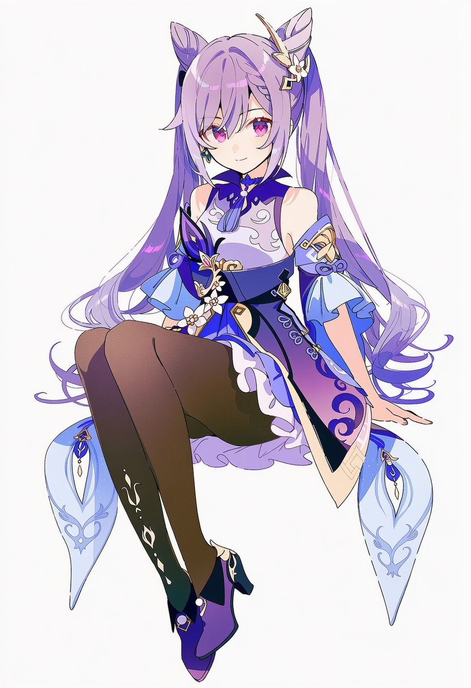

[在线例图](https://assets.quicktagcloud.com/images/raven_composition/raven_composition-1411.jpg?v=07c539060a951759)

<a id="raven_composition-1412"></a>

## 凌乱发

ID：`raven_composition-1412`；分类：二次元属性；来源标记：`safe`。

来源说明：

> 头发没有梳得很规整，有点乱翘、睡醒或随性的感觉。

正向提示词：

```text
messy_hair
```

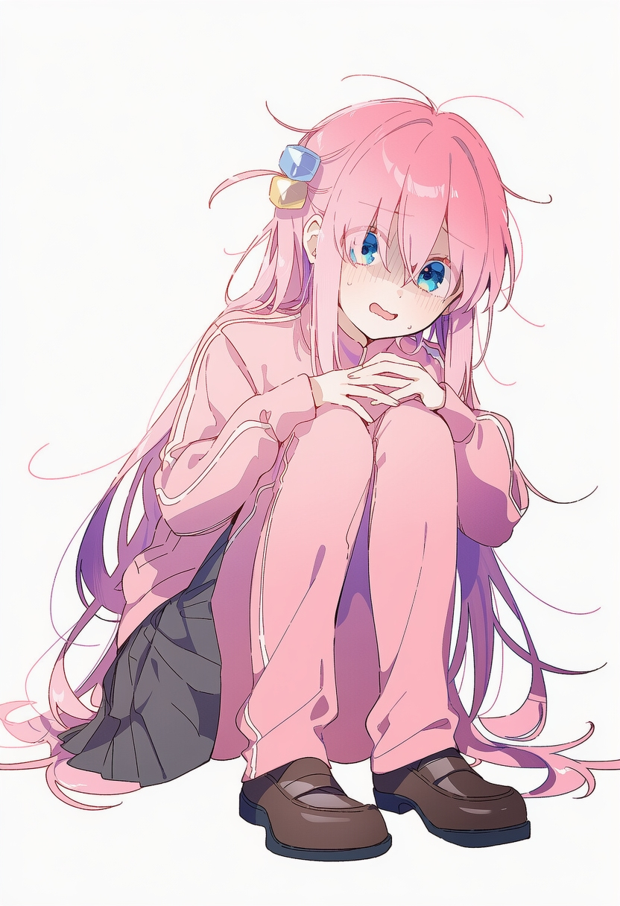

[在线例图](https://assets.quicktagcloud.com/images/raven_composition/raven_composition-1412.jpg?v=fd59f1a4e85b4626)

<a id="raven_composition-1413"></a>

## 超长发

ID：`raven_composition-1413`；分类：二次元属性；来源标记：`safe`。

来源说明：

> 头发长度远超普通长发，通常到腰以下甚至更长。

正向提示词：

```text
very_long_hair
```

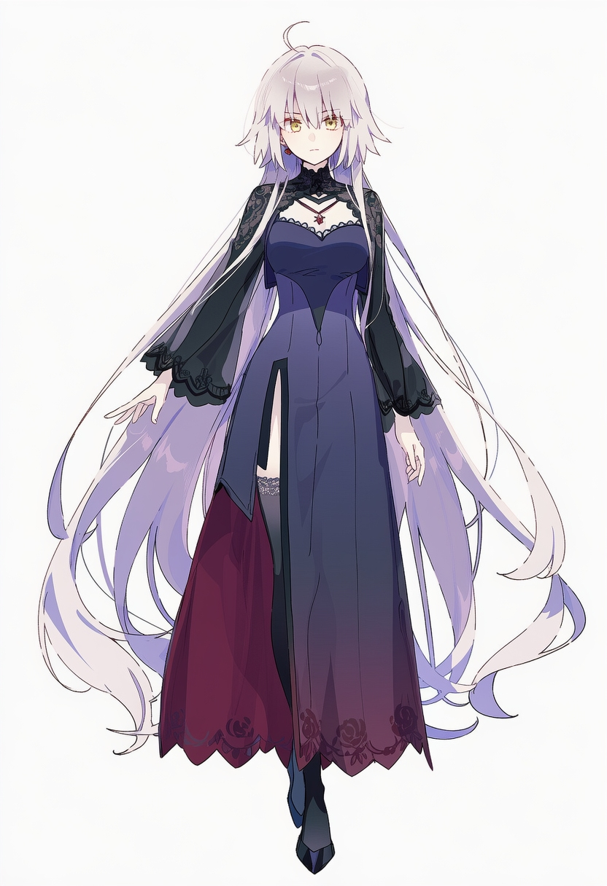

[在线例图](https://assets.quicktagcloud.com/images/raven_composition/raven_composition-1413.jpg?v=b07003c2e20a94cf)

<a id="raven_composition-1414"></a>

## 双马尾

ID：`raven_composition-1414`；分类：二次元属性；来源标记：`safe`。

来源说明：

> 左右两边各扎一束马尾，是最经典的二次元发型之一。

正向提示词：

```text
twintails
```

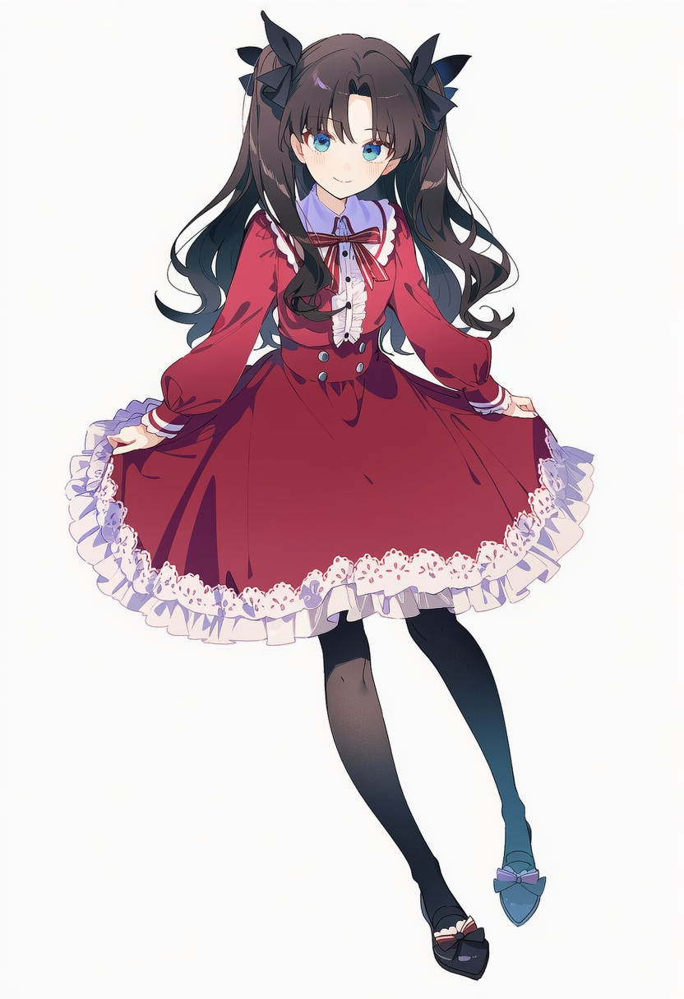

[在线例图](https://assets.quicktagcloud.com/images/raven_composition/raven_composition-1414.jpg?v=043ea6b3ba526790)

<a id="raven_composition-1415"></a>

## 侧马尾

ID：`raven_composition-1415`；分类：二次元属性；来源标记：`safe`。

来源说明：

> 马尾不是扎在脑后正中，而是偏到头的一侧。

正向提示词：

```text
side_ponytail
```

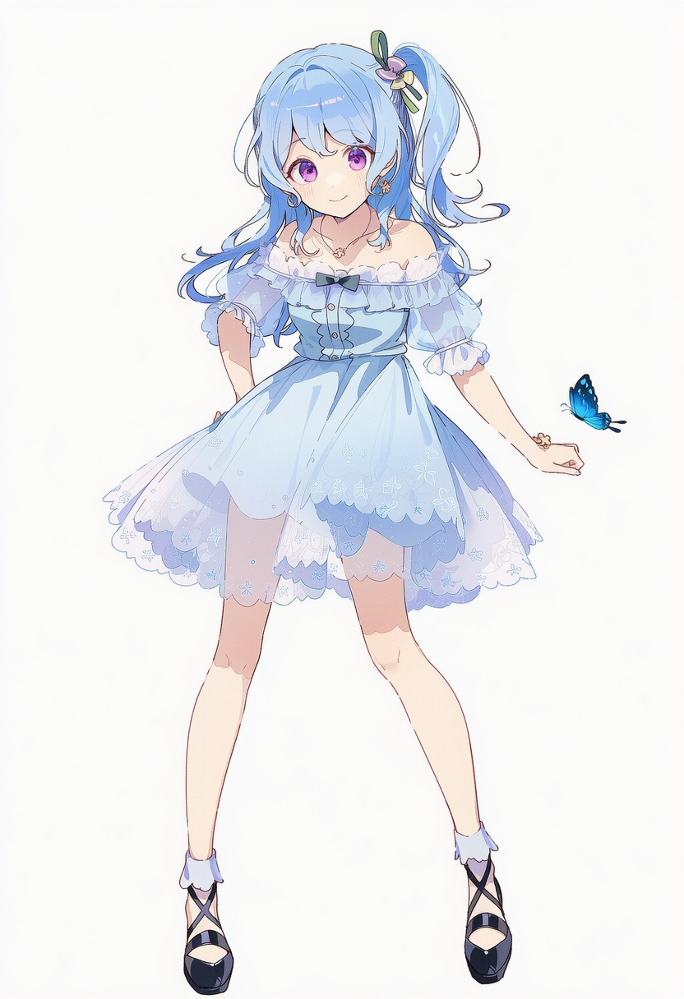

[在线例图](https://assets.quicktagcloud.com/images/raven_composition/raven_composition-1415.jpg?v=4961afd8d6ecd7ba)

<a id="raven_composition-1416"></a>

## 高马尾

ID：`raven_composition-1416`；分类：二次元属性；来源标记：`safe`。

来源说明：

> 马尾扎得比较高，整体看起来更利落、更有精神。

正向提示词：

```text
high_ponytail
```

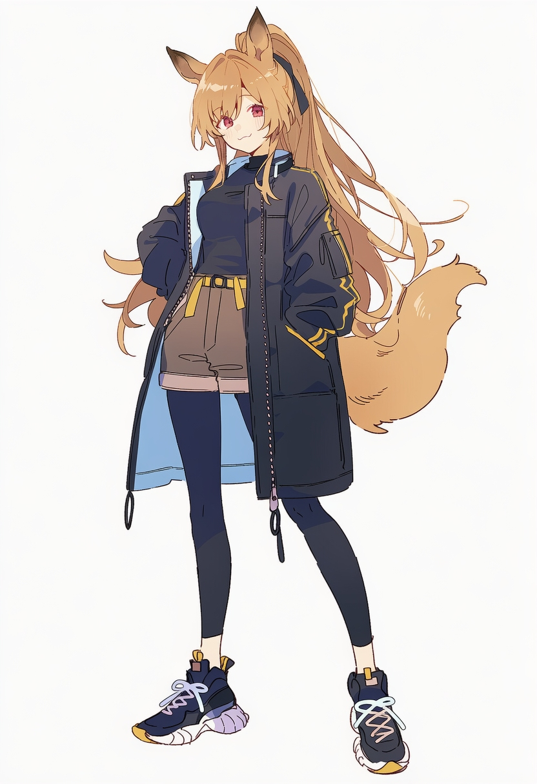

[在线例图](https://assets.quicktagcloud.com/images/raven_composition/raven_composition-1416.jpg?v=aee3d18ca968b9d9)

<a id="raven_composition-1417"></a>

## 异色瞳

ID：`raven_composition-1417`；分类：二次元属性；来源标记：`safe`。

来源说明：

> 左右两只眼睛颜色不一样。

正向提示词：

```text
heterochromia
```

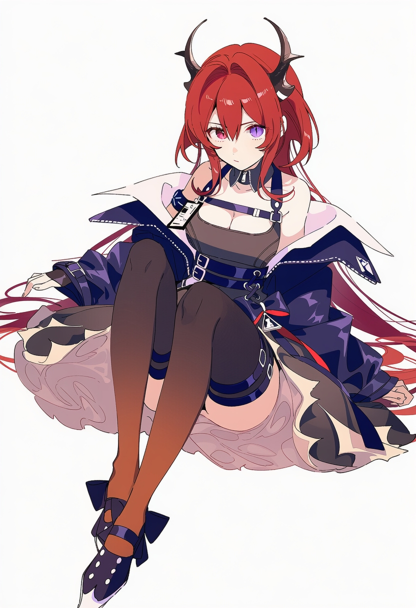

[在线例图](https://assets.quicktagcloud.com/images/raven_composition/raven_composition-1417.jpg?v=f95c034f075d1268)

<a id="raven_composition-1418"></a>

## 下垂眼

ID：`raven_composition-1418`；分类：二次元属性；来源标记：`safe`。

来源说明：

> 眼角视觉上比较往下垂，容易显得温柔、软、无攻击性。

正向提示词：

```text
tareme
```

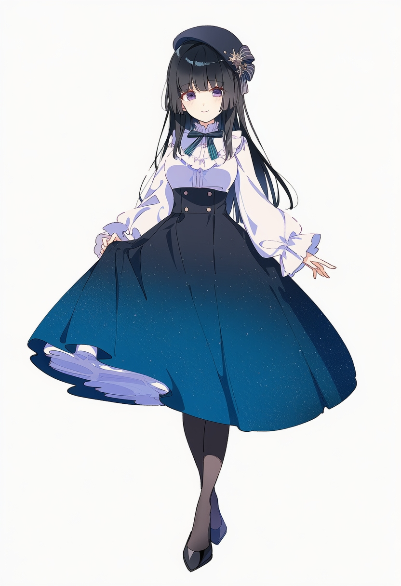

[在线例图](https://assets.quicktagcloud.com/images/raven_composition/raven_composition-1418.jpg?v=48712cd16162822b)

<a id="raven_composition-1419"></a>

## 吊眼

ID：`raven_composition-1419`；分类：二次元属性；来源标记：`safe`。

来源说明：

> 外眼角往上挑，看起来更强势、锐利或自信。

正向提示词：

```text
tsurime
```

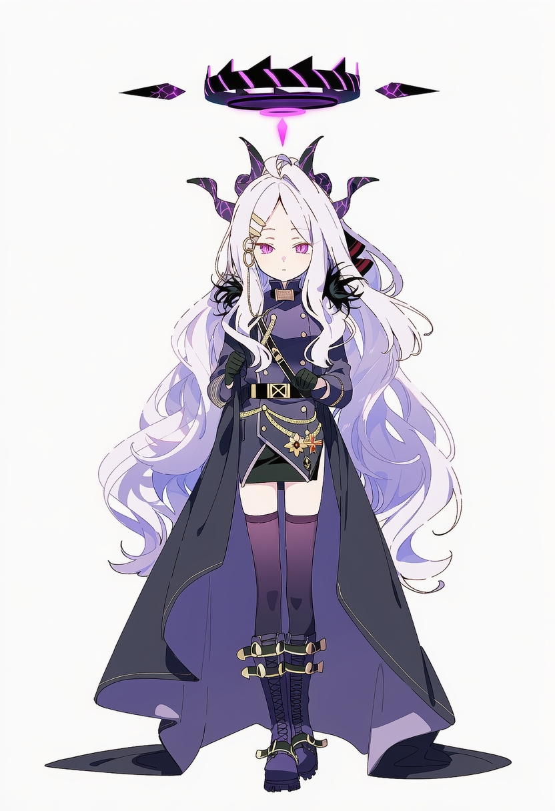

[在线例图](https://assets.quicktagcloud.com/images/raven_composition/raven_composition-1419.jpg?v=6eac0859008fbf1f)

<a id="raven_composition-1420"></a>

## 三白眼

ID：`raven_composition-1420`；分类：二次元属性；来源标记：`safe`。

来源说明：

> 眼白在瞳孔周围露得比较明显，常显得凶、冷或很有压迫感。

正向提示词：

```text
sanpaku
```

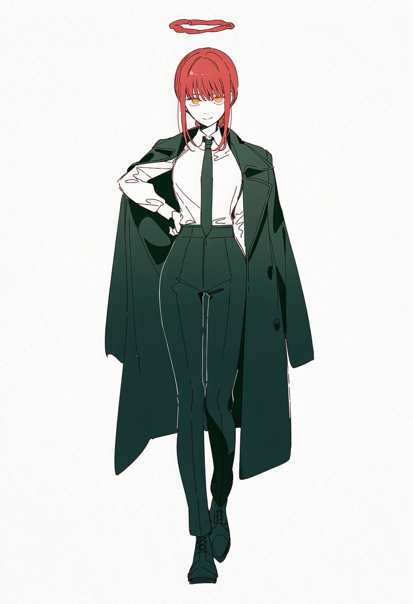

[在线例图](https://assets.quicktagcloud.com/images/raven_composition/raven_composition-1420.jpg?v=2cebf7fd8b2cf8a4)

<a id="raven_composition-1421"></a>

## 爱心瞳

ID：`raven_composition-1421`；分类：二次元属性；来源标记：`safe`。

来源说明：

> 瞳孔直接变成爱心形状，通常用来表现喜欢、兴奋或强烈迷恋。

正向提示词：

```text
heart-shaped_pupils
```

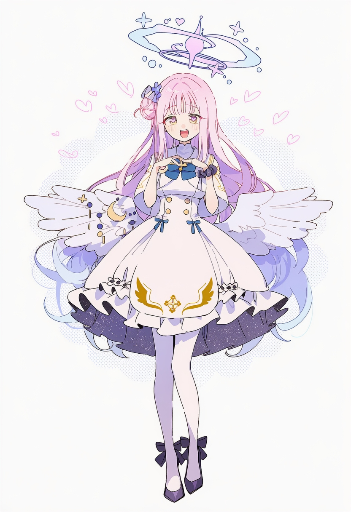

[在线例图](https://assets.quicktagcloud.com/images/raven_composition/raven_composition-1421.jpg?v=197c91955a97408c)

<a id="raven_composition-1422"></a>

## 竖瞳 / 猫瞳

ID：`raven_composition-1422`；分类：二次元属性；来源标记：`safe`。

来源说明：

> 瞳孔是细长竖线，像猫、蛇或龙的眼睛。

正向提示词：

```text
slit_pupils
```

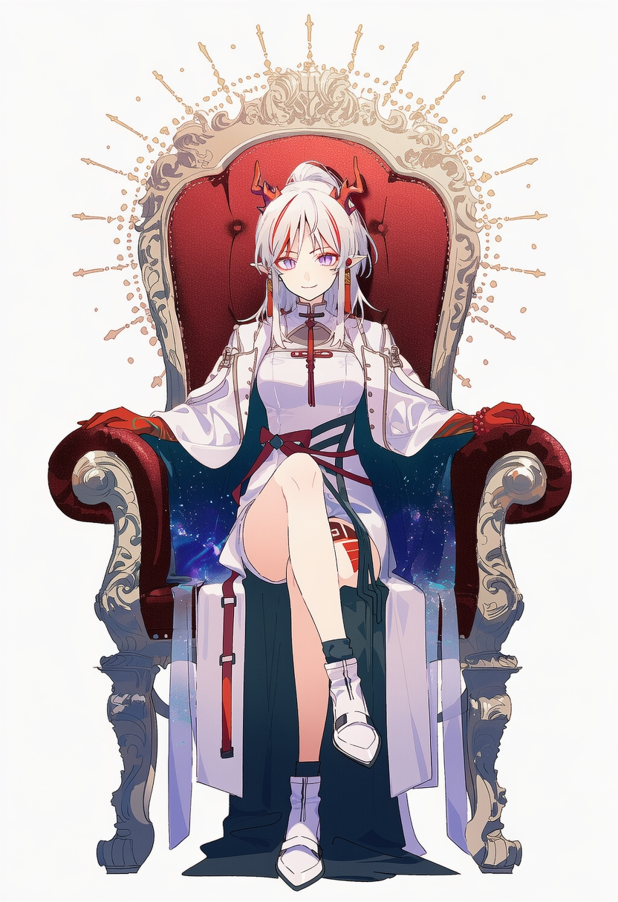

[在线例图](https://assets.quicktagcloud.com/images/raven_composition/raven_composition-1422.jpg?v=57c25297a7b0f5eb)

<a id="raven_composition-1423"></a>

## 黑眼圈

ID：`raven_composition-1423`；分类：二次元属性；来源标记：`safe`。

来源说明：

> 眼睛下面有明显疲惫的阴影或眼袋，看起来熬夜、虚弱或阴沉。

正向提示词：

```text
bags_under_eyes
```

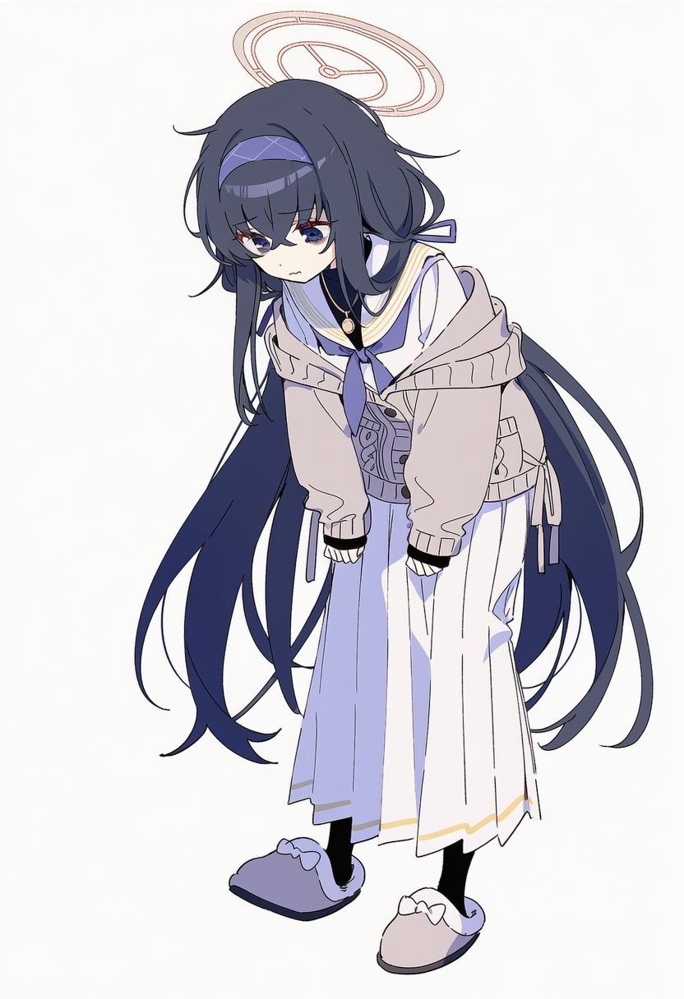

[在线例图](https://assets.quicktagcloud.com/images/raven_composition/raven_composition-1423.jpg?v=52374305d6ac7dd7)

<a id="raven_composition-1424"></a>

## 歪头

ID：`raven_composition-1424`；分类：二次元属性；来源标记：`safe`。

来源说明：

> 把脑袋向一边轻轻歪，是非常典型的可爱或疑惑动作。

正向提示词：

```text
head_tilt
```

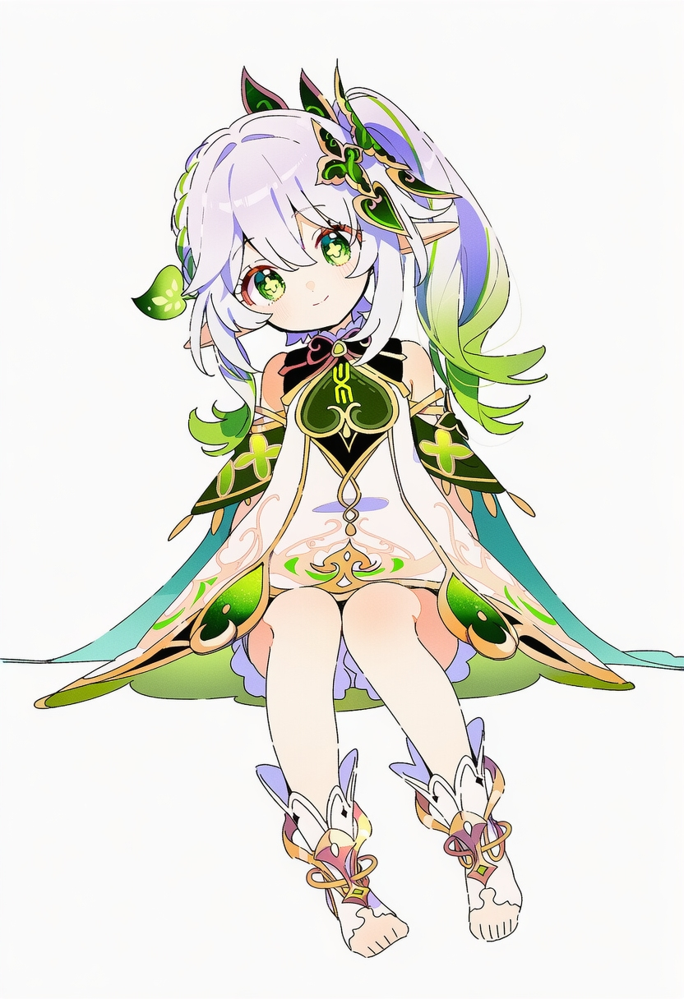

[在线例图](https://assets.quicktagcloud.com/images/raven_composition/raven_composition-1424.jpg?v=bde06a99c3b36b51)

<a id="raven_composition-1425"></a>

## 鸭子坐 / W坐

ID：`raven_composition-1425`；分类：二次元属性；来源标记：`safe`。

来源说明：

> 坐下时膝盖在前，小腿分别向身体两侧折开。

正向提示词：

```text
wariza
```

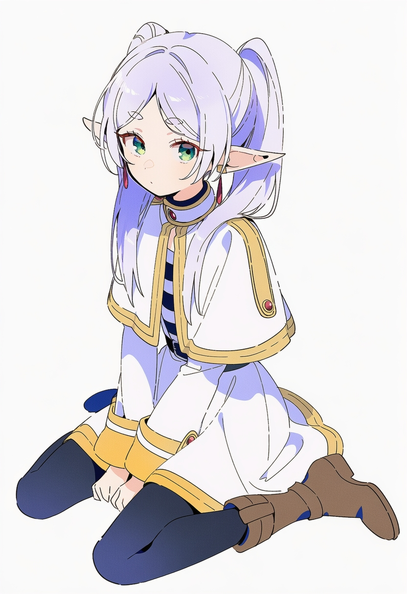

[在线例图](https://assets.quicktagcloud.com/images/raven_composition/raven_composition-1425.jpg?v=8a36e8a524bdf699)

<a id="raven_composition-1426"></a>

## 侧坐

ID：`raven_composition-1426`；分类：二次元属性；来源标记：`safe`。

来源说明：

> 双腿一起偏向身体一侧坐着，看起来比较柔和、端庄。

正向提示词：

```text
yokozuwari
```

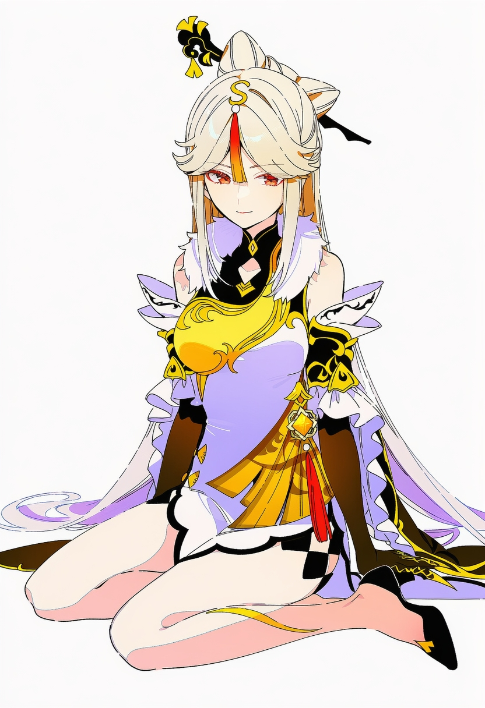

[在线例图](https://assets.quicktagcloud.com/images/raven_composition/raven_composition-1426.jpg?v=e44d1d3652bbe96e)

<a id="raven_composition-1427"></a>

## 抱膝

ID：`raven_composition-1427`；分类：二次元属性；来源标记：`safe`。

来源说明：

> 坐着把自己的腿或膝盖抱在怀里，常显得孤单、拘谨或软萌。

正向提示词：

```text
hugging_own_legs
```

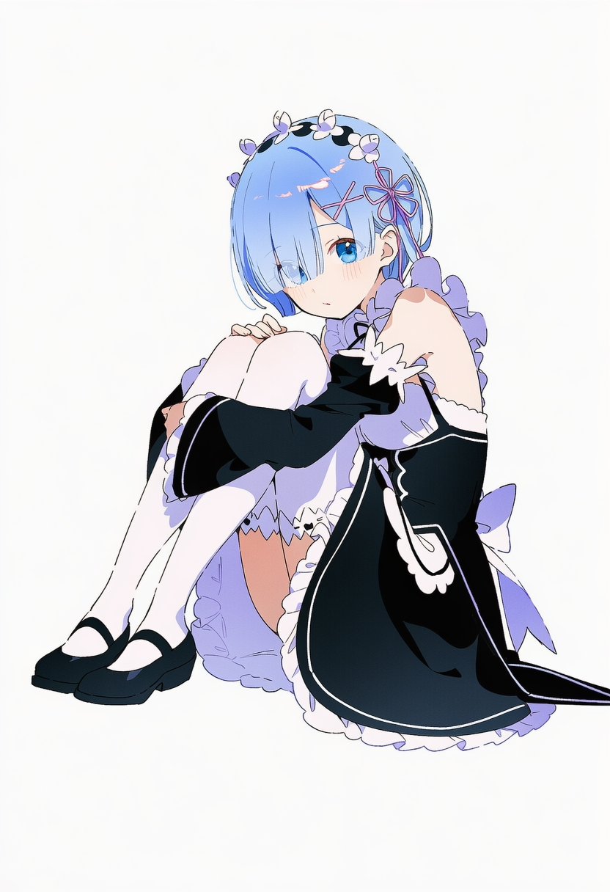

[在线例图](https://assets.quicktagcloud.com/images/raven_composition/raven_composition-1427.jpg?v=7c580c2f332c1f4f)

<a id="raven_composition-1428"></a>

## 双手背后

ID：`raven_composition-1428`；分类：二次元属性；来源标记：`safe`。

来源说明：

> 两只手放在背后，常见于轻松、俏皮或者略带羞涩的站姿。

正向提示词：

```text
arms_behind_back
```

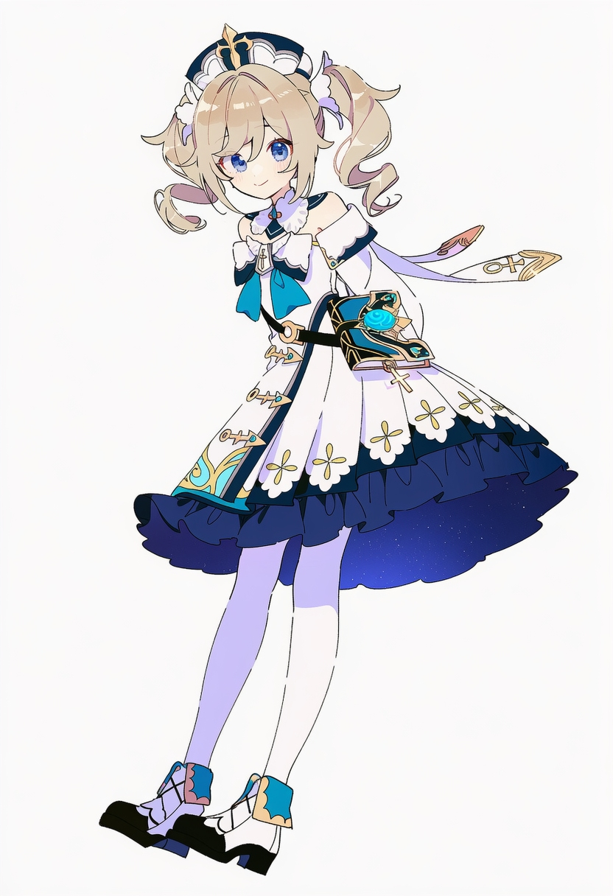

[在线例图](https://assets.quicktagcloud.com/images/raven_composition/raven_composition-1428.jpg?v=95f867d33c325a4b)

<a id="raven_composition-1429"></a>

## 猫爪手

ID：`raven_composition-1429`；分类：二次元属性；来源标记：`safe`。

来源说明：

> 双手抬起来弯成像猫爪一样的姿势，典型卖萌动作。

正向提示词：

```text
paw_pose
```

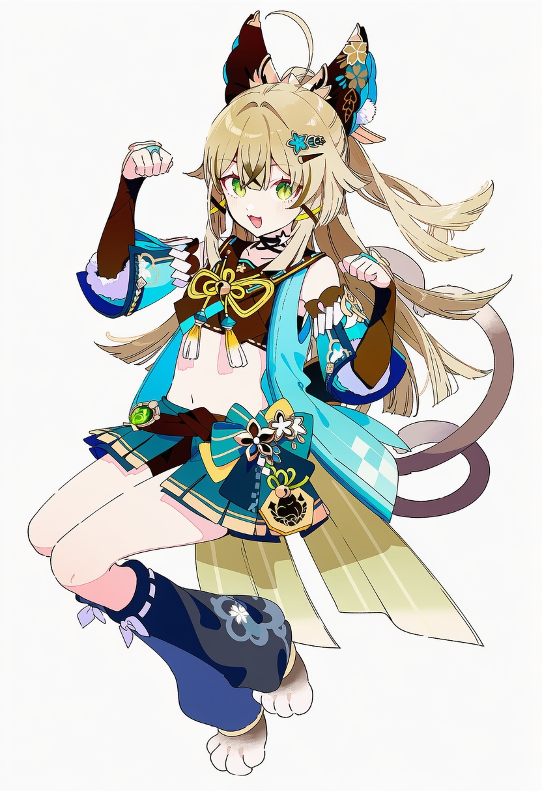

[在线例图](https://assets.quicktagcloud.com/images/raven_composition/raven_composition-1429.jpg?v=83f06992fb0e5add)

<a id="raven_composition-1430"></a>

## 剪刀手

ID：`raven_composition-1430`；分类：二次元属性；来源标记：`safe`。

来源说明：

> 用手指比出 V 字，拍照和卖萌最常见的动作之一。

正向提示词：

```text
v
```

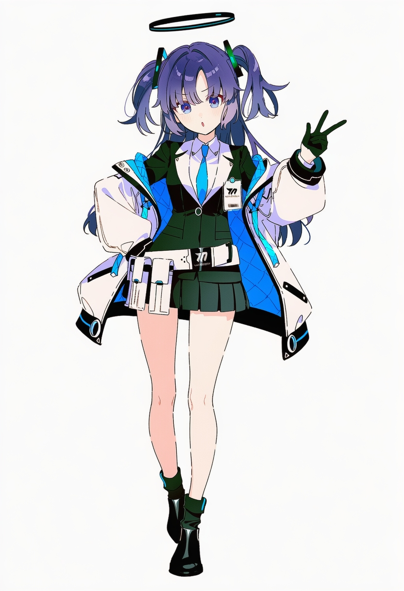

[在线例图](https://assets.quicktagcloud.com/images/raven_composition/raven_composition-1430.jpg?v=dd7881a6a23bd56a)

<a id="raven_composition-1431"></a>

## 手指比心

ID：`raven_composition-1431`；分类：二次元属性；来源标记：`safe`。

来源说明：

> 用拇指和食指捏出一个小爱心。

正向提示词：

```text
finger_heart
```

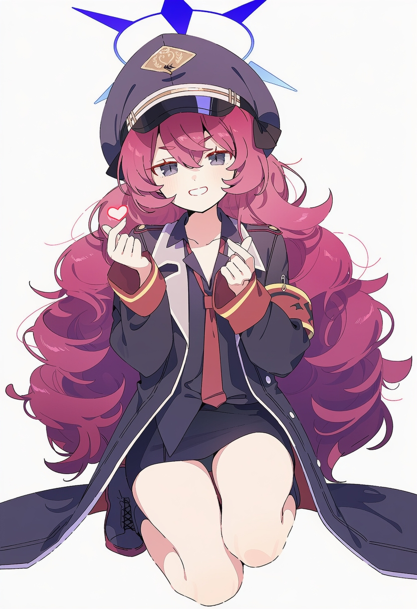

[在线例图](https://assets.quicktagcloud.com/images/raven_composition/raven_composition-1431.jpg?v=068fb4ff18ff9dc4)

<a id="raven_composition-1432"></a>

## 双手比心

ID：`raven_composition-1432`；分类：二次元属性；来源标记：`safe`。

来源说明：

> 两只手合起来组成一个大爱心形状。

正向提示词：

```text
heart_hands
```


[在线例图](https://assets.quicktagcloud.com/images/raven_composition/raven_composition-1432.jpg?v=e8e3666f82d91b40)

<a id="raven_composition-1433"></a>

## 捂嘴

ID：`raven_composition-1433`；分类：二次元属性；来源标记：`safe`。

来源说明：

> 用手遮住嘴，可能是在偷笑、惊讶、害羞或者忍住不说话。

正向提示词：

```text
covering_mouth
```


[在线例图](https://assets.quicktagcloud.com/images/raven_composition/raven_composition-1433.jpg?v=003510a5e67dc8a3)

<a id="raven_composition-1434"></a>

## 萌袖

ID：`raven_composition-1434`；分类：二次元属性；来源标记：`safe`。

来源说明：

> 袖子长到超过手腕，遮住一部分手掌，是最典型的“萌袖”效果。

正向提示词：

```text
sleeves_past_wrists
```


[在线例图](https://assets.quicktagcloud.com/images/raven_composition/raven_composition-1434.jpg?v=208c7b3edef1ba91)

<a id="raven_composition-1435"></a>

## 超长萌袖

ID：`raven_composition-1435`；分类：二次元属性；来源标记：`safe`。

来源说明：

> 袖子长到连手指都遮住，比普通萌袖更夸张。

正向提示词：

```text
sleeves_past_fingers
```


[在线例图](https://assets.quicktagcloud.com/images/raven_composition/raven_composition-1435.jpg?v=e192175739c9fee2)

<a id="raven_composition-1436"></a>

## 宽大衣服

ID：`raven_composition-1436`；分类：二次元属性；来源标记：`safe`。

来源说明：

> 衣服明显比角色身材大一号或几号，看起来松松垮垮。

正向提示词：

```text
oversized_clothes
```


[在线例图](https://assets.quicktagcloud.com/images/raven_composition/raven_composition-1436.jpg?v=cccb43405a59c63c)

<a id="raven_composition-1437"></a>

## 露肩

ID：`raven_composition-1437`；分类：二次元属性；来源标记：`safe`。

来源说明：

> 上衣或外套从肩头滑下来，露出肩膀。

正向提示词：

```text
off_shoulder
```


[在线例图](https://assets.quicktagcloud.com/images/raven_composition/raven_composition-1437.jpg?v=e42b11e6307029a2)

<a id="raven_composition-1438"></a>

## 绝对领域

ID：`raven_composition-1438`；分类：二次元属性；来源标记：`safe`。

来源说明：

> 短裙或短裤和过膝袜之间露出的一小段大腿区域。

正向提示词：

```text
zettai_ryouiki
```


[在线例图](https://assets.quicktagcloud.com/images/raven_composition/raven_composition-1438.jpg?v=80ec065d025fa010)

<a id="raven_composition-1439"></a>

## 猫耳

ID：`raven_composition-1439`；分类：二次元属性；来源标记：`safe`。

来源说明：

> 头上有猫一样的耳朵，可以是真耳朵也可以是明显的猫耳特征。

正向提示词：

```text
cat_ears
```


[在线例图](https://assets.quicktagcloud.com/images/raven_composition/raven_composition-1439.jpg?v=9514272a829427b0)

<a id="raven_composition-1440"></a>

## 尖耳 / 精灵耳

ID：`raven_composition-1440`；分类：二次元属性；来源标记：`safe`。

来源说明：

> 耳朵尖尖的，常见于精灵、妖精等角色。

正向提示词：

```text
pointy_ears
```


[在线例图](https://assets.quicktagcloud.com/images/raven_composition/raven_composition-1440.jpg?v=ad606082f263f1ed)
