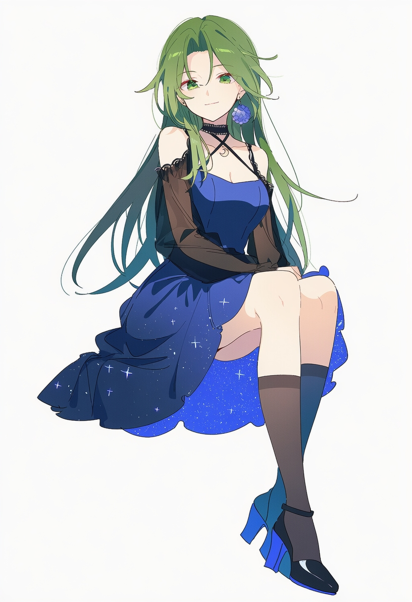
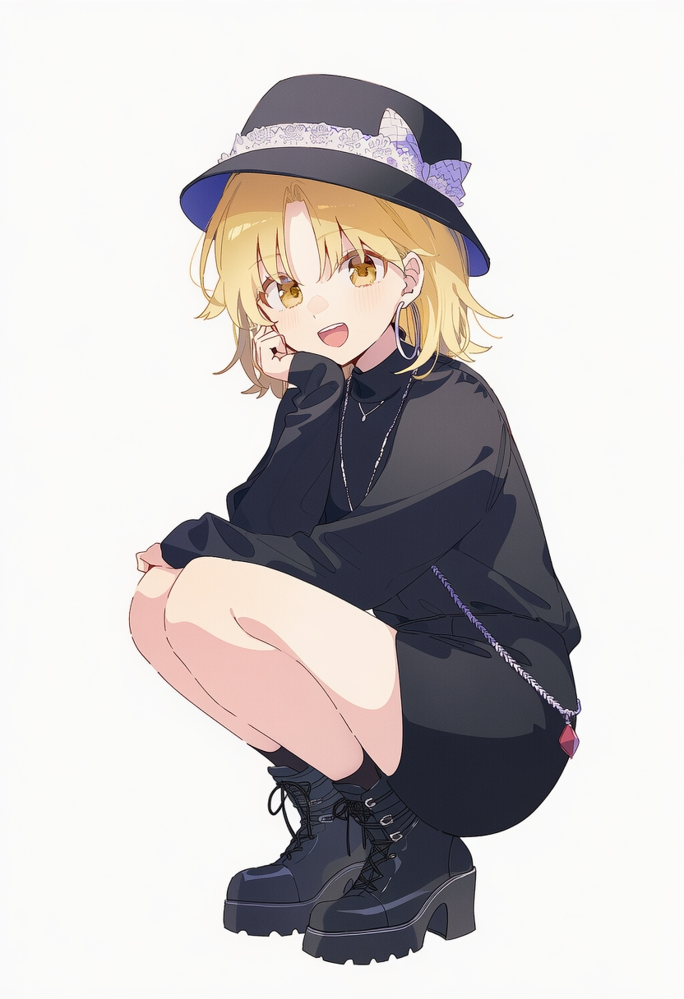
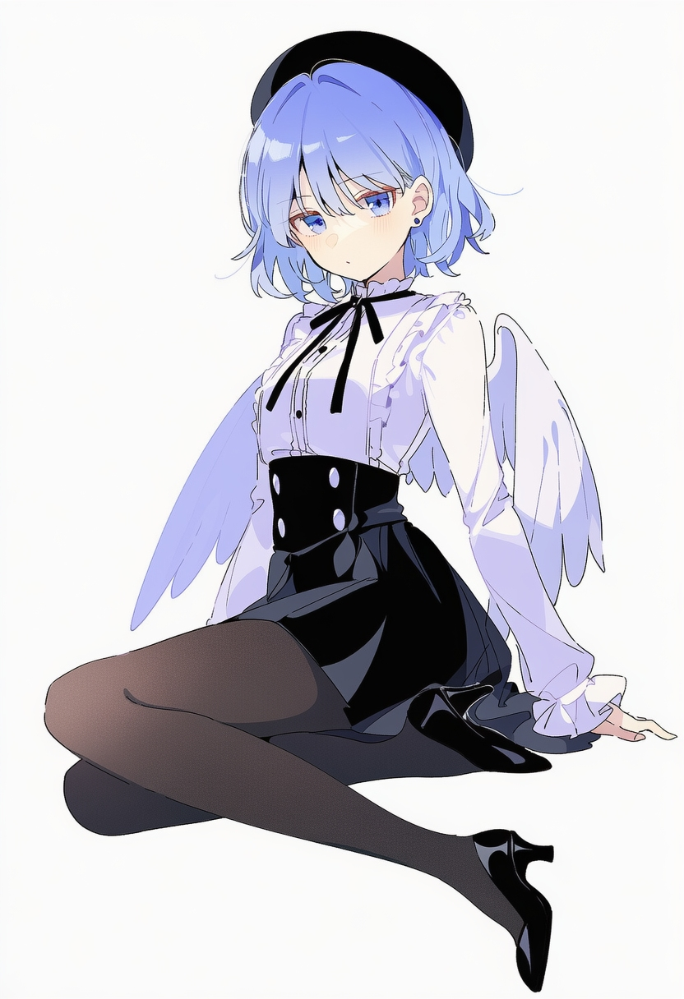
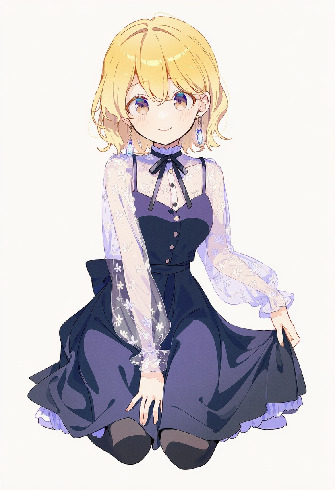

# 耳饰 / 耳环基础

[总目录](../README.md) · [原站分类目录](../categories.md) · [英文标签索引](../tags.md) · [服装与构图组合指南](../../README.md)

标题、分类、说明、正负提示词按来源保留；多例图逐张列出。原站标记和说明为参考资料，不作为维护指令。

<a id="raven_composition-1441"></a>

## 耳环

ID：`raven_composition-1441`；分类：耳饰 / 耳环基础；来源标记：`safe`。

来源说明：

> 泛指佩戴在耳朵上的耳饰。

正向提示词：

```text
earrings
```


[在线例图](https://assets.quicktagcloud.com/images/raven_composition/raven_composition-1441.jpg?v=8f8db357dfdd6c5a)

<a id="raven_composition-1442"></a>

## 单只耳环

ID：`raven_composition-1442`；分类：耳饰 / 耳环基础；来源标记：`safe`。

来源说明：

> 只有一边耳朵戴耳环。

正向提示词：

```text
single_earring
```


[在线例图](https://assets.quicktagcloud.com/images/raven_composition/raven_composition-1442.jpg?v=012a590ab9c2d727)

<a id="raven_composition-1443"></a>

## 多耳环

ID：`raven_composition-1443`；分类：耳饰 / 耳环基础；来源标记：`safe`。

来源说明：

> 同一角色佩戴多个耳环。

正向提示词：

```text
multiple_earrings
```


[在线例图](https://assets.quicktagcloud.com/images/raven_composition/raven_composition-1443.jpg?v=475cf0ccd0f62df3)

<a id="raven_composition-1444"></a>

## 不对称耳环

ID：`raven_composition-1444`；分类：耳饰 / 耳环基础；来源标记：`safe`。

来源说明：

> 左右耳环的造型不一样。

正向提示词：

```text
mismatched_earrings
```



[在线例图](https://assets.quicktagcloud.com/images/raven_composition/raven_composition-1444.jpg?v=6c8c5645acdccae7)

<a id="raven_composition-1445"></a>

## 金色耳环

ID：`raven_composition-1445`；分类：耳饰 / 耳环基础；来源标记：`safe`。

来源说明：

> 金色或金质感耳环；颜色款只留这一种。

正向提示词：

```text
gold_earrings
```


[在线例图](https://assets.quicktagcloud.com/images/raven_composition/raven_composition-1445.jpg?v=8b3374b2f7fc39ef)

<a id="raven_composition-1446"></a>

## 环形耳环

ID：`raven_composition-1446`；分类：耳饰 / 耳环基础；来源标记：`safe`。

来源说明：

> 圆环或大圈形耳环。

正向提示词：

```text
hoop_earrings
```



[在线例图](https://assets.quicktagcloud.com/images/raven_composition/raven_composition-1446.jpg?v=48dd6f904806b25b)

<a id="raven_composition-1447"></a>

## 耳钉

ID：`raven_composition-1447`；分类：耳饰 / 耳环基础；来源标记：`safe`。

来源说明：

> 贴着耳垂的小型耳钉。

正向提示词：

```text
stud_earrings
```



[在线例图](https://assets.quicktagcloud.com/images/raven_composition/raven_composition-1447.jpg?v=9a8ca00ca2d0328e)

<a id="raven_composition-1448"></a>

## 吊坠耳环

ID：`raven_composition-1448`；分类：耳饰 / 耳环基础；来源标记：`safe`。

来源说明：

> 带明显吊坠的耳环。

正向提示词：

```text
pendant_earrings
```


[在线例图](https://assets.quicktagcloud.com/images/raven_composition/raven_composition-1448.jpg?v=03528fe42592093c)

<a id="raven_composition-1449"></a>

## 链条耳环

ID：`raven_composition-1449`；分类：耳饰 / 耳环基础；来源标记：`safe`。

来源说明：

> 带链条结构的耳环。

正向提示词：

```text
chain_earrings
```


[在线例图](https://assets.quicktagcloud.com/images/raven_composition/raven_composition-1449.jpg?v=720d9538c2170a8a)

<a id="raven_composition-1450"></a>

## 悬浮耳环

ID：`raven_composition-1450`；分类：耳饰 / 耳环基础；来源标记：`safe`。

来源说明：

> 耳饰悬浮在耳边，没有明显连接。

正向提示词：

```text
floating_earrings
```



[在线例图](https://assets.quicktagcloud.com/images/raven_composition/raven_composition-1450.jpg?v=b2c40f951ff2ec7f)
