# 耳饰 / 造型耳环

[总目录](../README.md) · [原站分类目录](../categories.md) · [英文标签索引](../tags.md) · [服装与构图组合指南](../../README.md)

标题、分类、说明、正负提示词按来源保留；多例图逐张列出。原站标记和说明为参考资料，不作为维护指令。

<a id="raven_composition-1451"></a>

## 球形耳环

ID：`raven_composition-1451`；分类：耳饰 / 造型耳环；来源标记：`safe`。

来源说明：

> 球体造型的耳环。

正向提示词：

```text
sphere_earrings
```

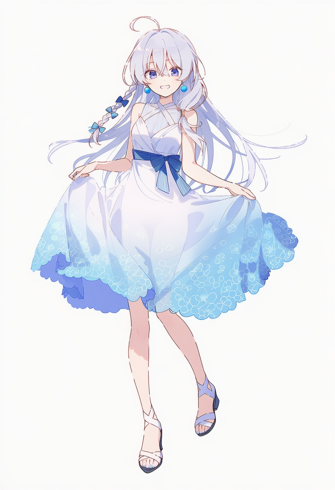

[在线例图](https://assets.quicktagcloud.com/images/raven_composition/raven_composition-1451.jpg?v=5c5f66a855de9283)

<a id="raven_composition-1452"></a>

## 流苏耳环

ID：`raven_composition-1452`；分类：耳饰 / 造型耳环；来源标记：`safe`。

来源说明：

> 带长流苏的耳环。

正向提示词：

```text
tassel_earrings
```

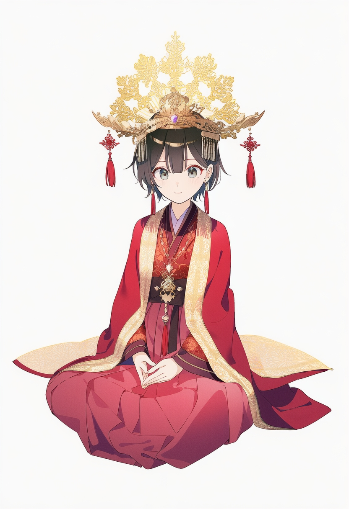

[在线例图](https://assets.quicktagcloud.com/images/raven_composition/raven_composition-1452.jpg?v=04ebc0ba4ba9d93d)

<a id="raven_composition-1453"></a>

## 羽毛耳环

ID：`raven_composition-1453`；分类：耳饰 / 造型耳环；来源标记：`safe`。

来源说明：

> 带羽毛或羽毛造型的耳环。

正向提示词：

```text
feather_earrings
```

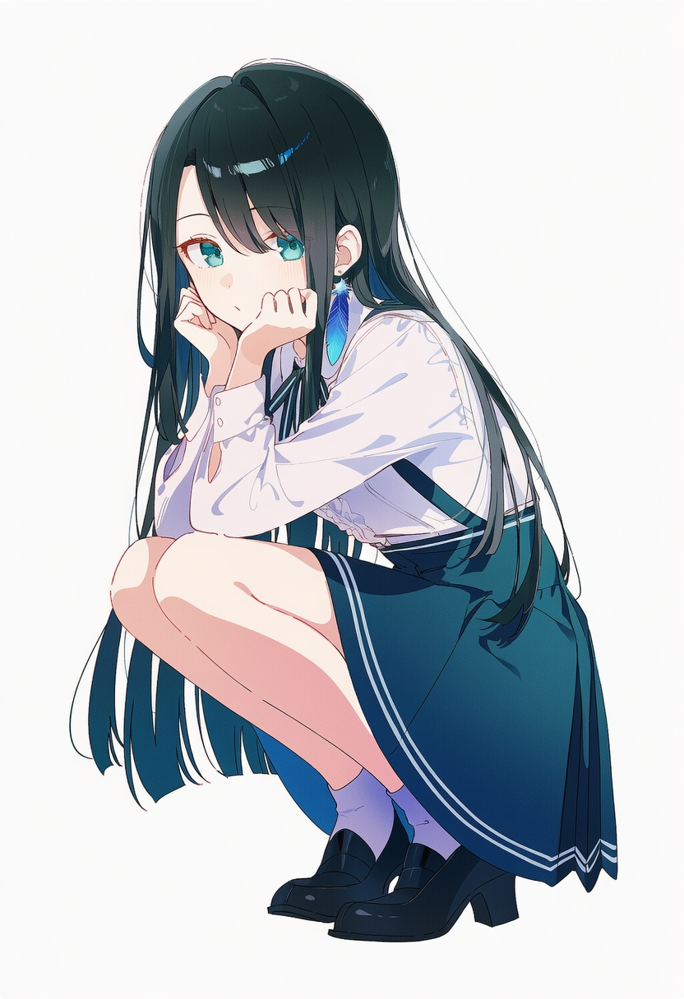

[在线例图](https://assets.quicktagcloud.com/images/raven_composition/raven_composition-1453.jpg?v=e8e0a92d21523917)

<a id="raven_composition-1454"></a>

## 花朵耳环

ID：`raven_composition-1454`；分类：耳饰 / 造型耳环；来源标记：`safe`。

来源说明：

> 花朵造型的耳环。

正向提示词：

```text
flower_earrings
```

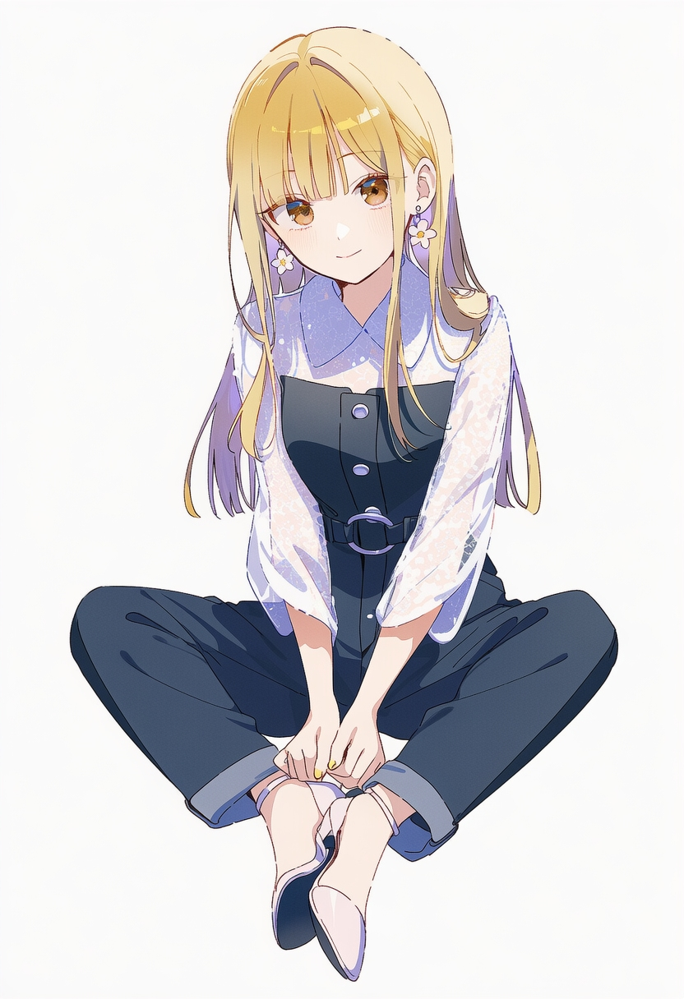

[在线例图](https://assets.quicktagcloud.com/images/raven_composition/raven_composition-1454.jpg?v=0453722102690422)

<a id="raven_composition-1455"></a>

## 心形耳环

ID：`raven_composition-1455`；分类：耳饰 / 造型耳环；来源标记：`safe`。

来源说明：

> 心形造型的耳环。

正向提示词：

```text
heart_earrings
```

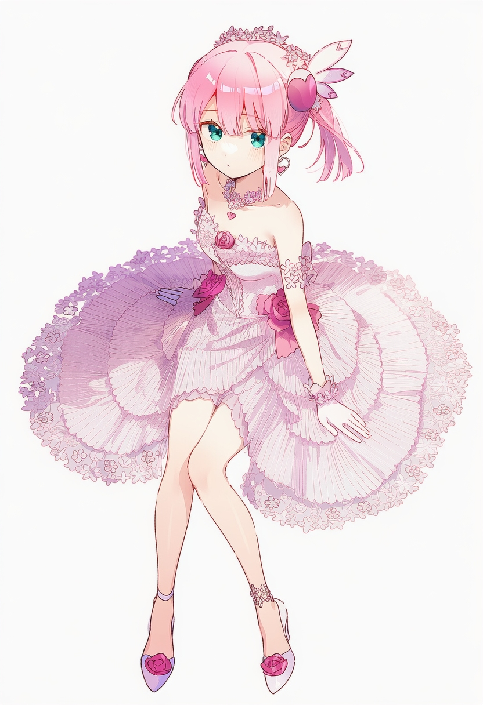

[在线例图](https://assets.quicktagcloud.com/images/raven_composition/raven_composition-1455.jpg?v=b64669a4e2ae00bd)

<a id="raven_composition-1456"></a>

## 星星耳环

ID：`raven_composition-1456`；分类：耳饰 / 造型耳环；来源标记：`safe`。

来源说明：

> 星形造型的耳环。

正向提示词：

```text
star_earrings
```


[在线例图](https://assets.quicktagcloud.com/images/raven_composition/raven_composition-1456.jpg?v=fbf4444fc383476e)

<a id="raven_composition-1457"></a>

## 月牙耳环

ID：`raven_composition-1457`；分类：耳饰 / 造型耳环；来源标记：`safe`。

来源说明：

> 月牙形耳环。

正向提示词：

```text
crescent_earrings
```

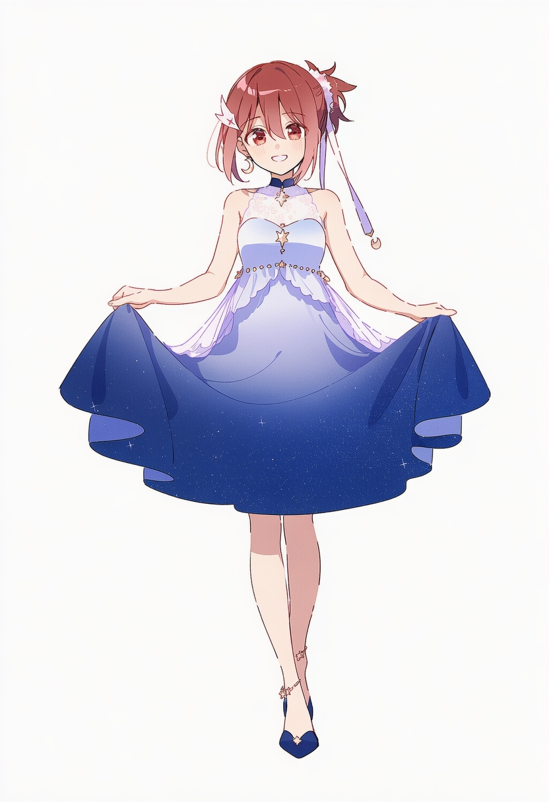

[在线例图](https://assets.quicktagcloud.com/images/raven_composition/raven_composition-1457.jpg?v=b969343c87d9fea3)

<a id="raven_composition-1458"></a>

## 十字耳环

ID：`raven_composition-1458`；分类：耳饰 / 造型耳环；来源标记：`safe`。

来源说明：

> 十字架造型的耳环。

正向提示词：

```text
cross_earrings
```

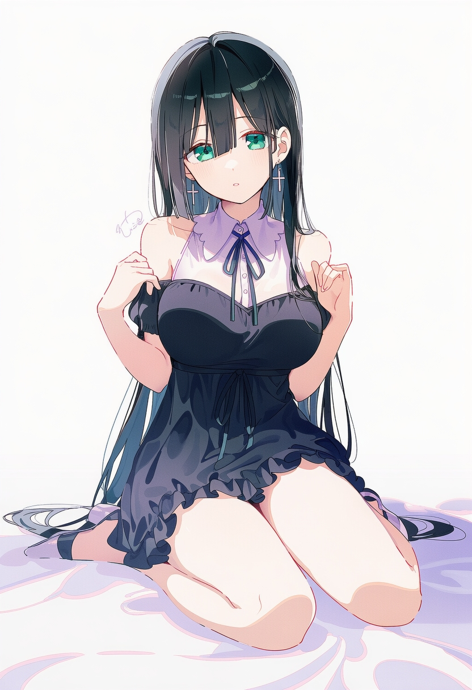

[在线例图](https://assets.quicktagcloud.com/images/raven_composition/raven_composition-1458.jpg?v=e59a09b5adea123c)

<a id="raven_composition-1459"></a>

## 水晶耳环

ID：`raven_composition-1459`；分类：耳饰 / 造型耳环；来源标记：`safe`。

来源说明：

> 带水晶或水晶质感的耳环。

正向提示词：

```text
crystal_earrings
```

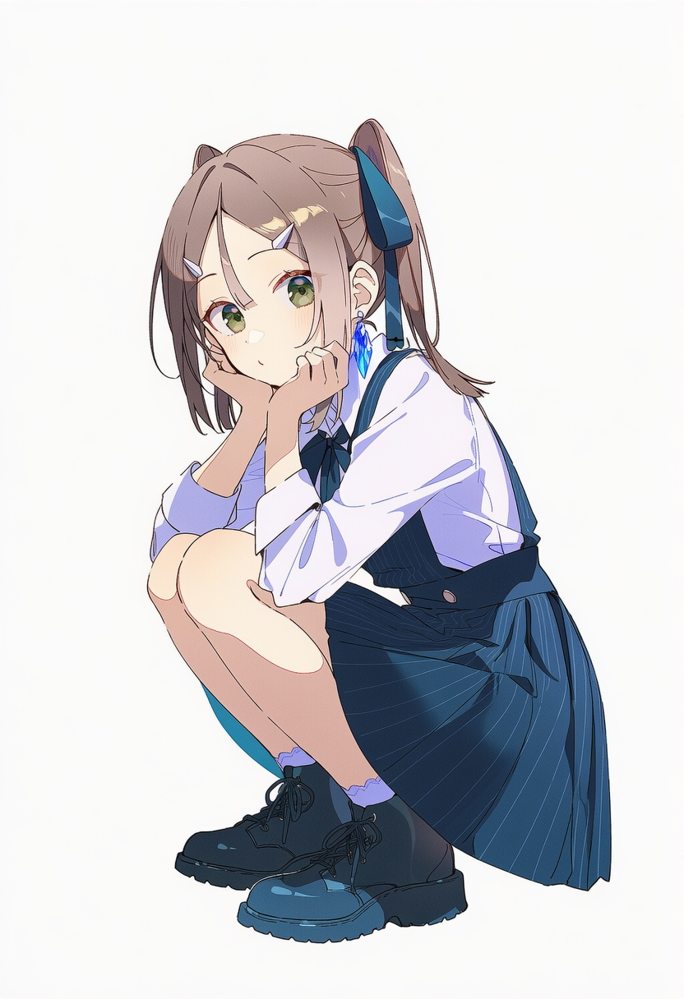

[在线例图](https://assets.quicktagcloud.com/images/raven_composition/raven_composition-1459.jpg?v=8df490856fa1877a)

<a id="raven_composition-1460"></a>

## 珍珠耳环

ID：`raven_composition-1460`；分类：耳饰 / 造型耳环；来源标记：`safe`。

来源说明：

> 带珍珠的耳环。

正向提示词：

```text
pearl_earrings
```


[在线例图](https://assets.quicktagcloud.com/images/raven_composition/raven_composition-1460.jpg?v=df833f4daf69de10)

<a id="raven_composition-1461"></a>

## 叶片耳环

ID：`raven_composition-1461`；分类：耳饰 / 造型耳环；来源标记：`safe`。

来源说明：

> 叶子造型的耳环。

正向提示词：

```text
leaf_earrings
```

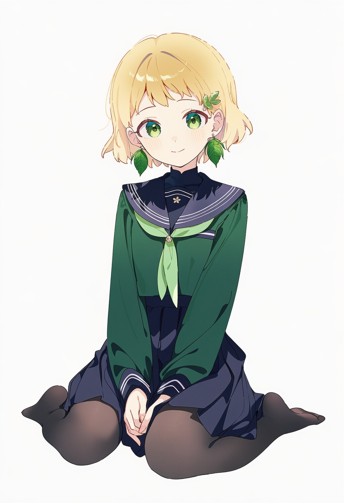

[在线例图](https://assets.quicktagcloud.com/images/raven_composition/raven_composition-1461.jpg?v=6f61edaabebce973)

<a id="raven_composition-1462"></a>

## 贝壳耳环

ID：`raven_composition-1462`；分类：耳饰 / 造型耳环；来源标记：`safe`。

来源说明：

> 贝壳造型的耳环。

正向提示词：

```text
shell_earrings
```

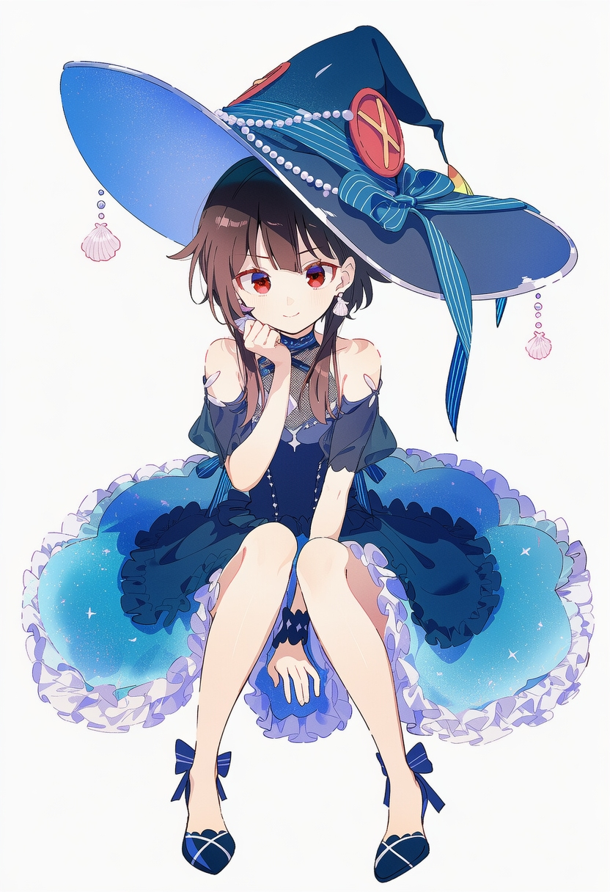

[在线例图](https://assets.quicktagcloud.com/images/raven_composition/raven_composition-1462.jpg?v=a9f0fa770e867871)

<a id="raven_composition-1463"></a>

## 蝴蝶耳环

ID：`raven_composition-1463`；分类：耳饰 / 造型耳环；来源标记：`safe`。

来源说明：

> 蝴蝶造型的耳环。

正向提示词：

```text
butterfly_earrings
```

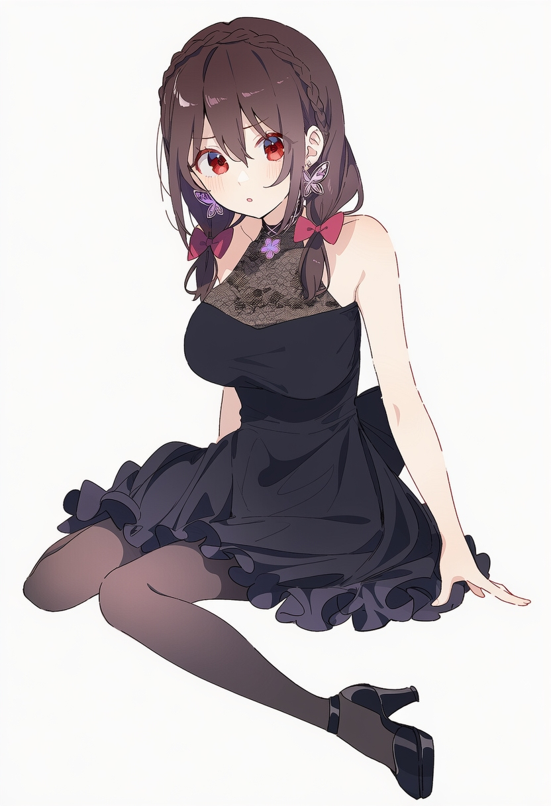

[在线例图](https://assets.quicktagcloud.com/images/raven_composition/raven_composition-1463.jpg?v=a39f50ea91829ee4)

<a id="raven_composition-1464"></a>

## 铃铛耳环

ID：`raven_composition-1464`；分类：耳饰 / 造型耳环；来源标记：`safe`。

来源说明：

> 带铃铛造型的耳环。

正向提示词：

```text
bell_earrings
```

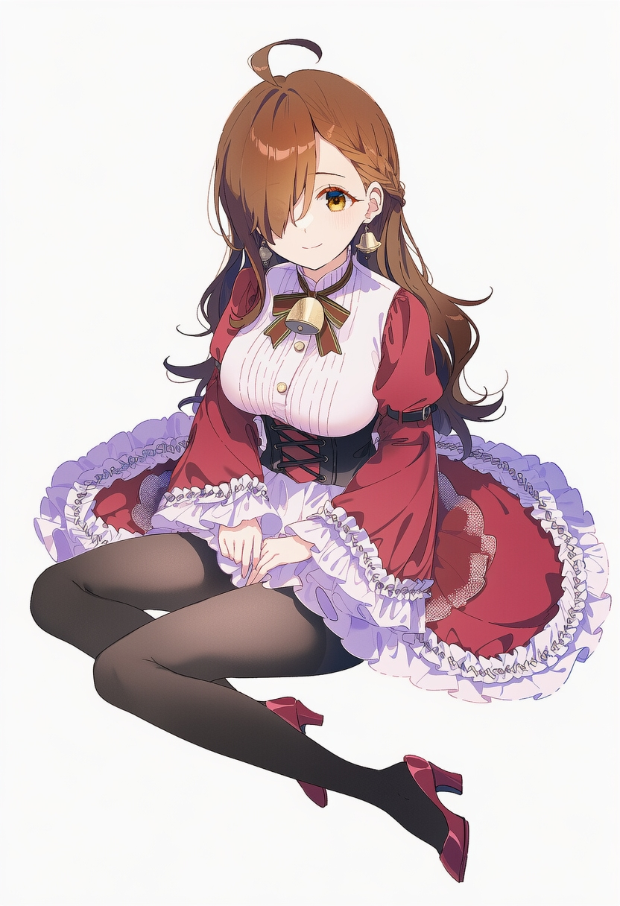

[在线例图](https://assets.quicktagcloud.com/images/raven_composition/raven_composition-1464.jpg?v=09c40bdb7271ac5b)

<a id="raven_composition-1465"></a>

## 水滴耳环

ID：`raven_composition-1465`；分类：耳饰 / 造型耳环；来源标记：`safe`。

来源说明：

> 水滴形或泪滴形耳环。

正向提示词：

```text
teardrop_earrings
```

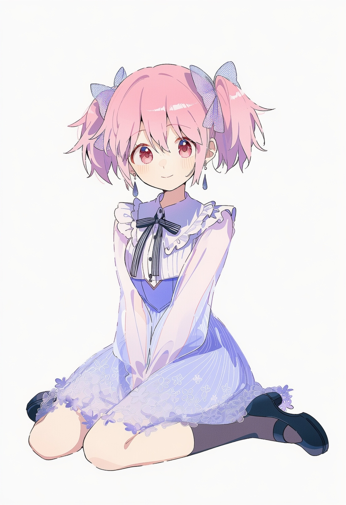

[在线例图](https://assets.quicktagcloud.com/images/raven_composition/raven_composition-1465.jpg?v=d0e6cb0cce027be0)

<a id="raven_composition-1466"></a>

## 勾玉耳环

ID：`raven_composition-1466`；分类：耳饰 / 造型耳环；来源标记：`safe`。

来源说明：

> 以勾玉为主体的耳环。

正向提示词：

```text
magatama_earrings
```

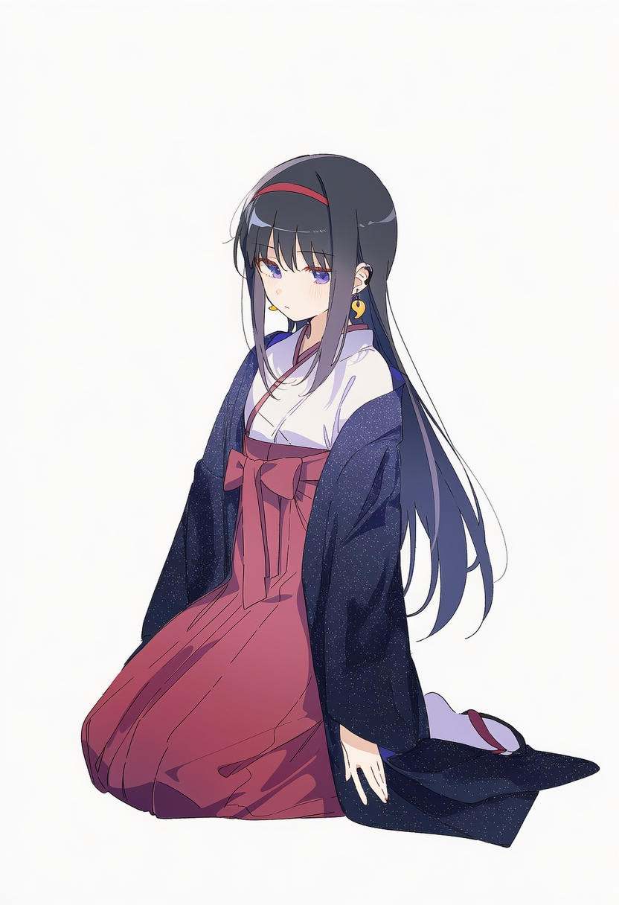

[在线例图](https://assets.quicktagcloud.com/images/raven_composition/raven_composition-1466.jpg?v=33d0ffba3be2c3bd)

<a id="raven_composition-1467"></a>

## 菱形耳环

ID：`raven_composition-1467`；分类：耳饰 / 造型耳环；来源标记：`safe`。

来源说明：

> 菱形造型的耳环。

正向提示词：

```text
diamond_earrings
```

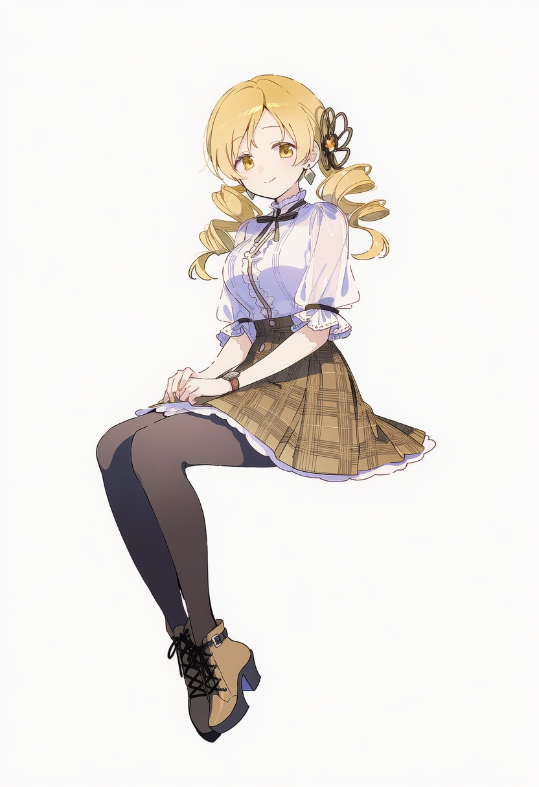

[在线例图](https://assets.quicktagcloud.com/images/raven_composition/raven_composition-1467.jpg?v=5166953f5ef0a875)

<a id="raven_composition-1468"></a>

## 骷髅耳环

ID：`raven_composition-1468`；分类：耳饰 / 造型耳环；来源标记：`safe`。

来源说明：

> 骷髅造型的耳环。

正向提示词：

```text
skull_earrings
```

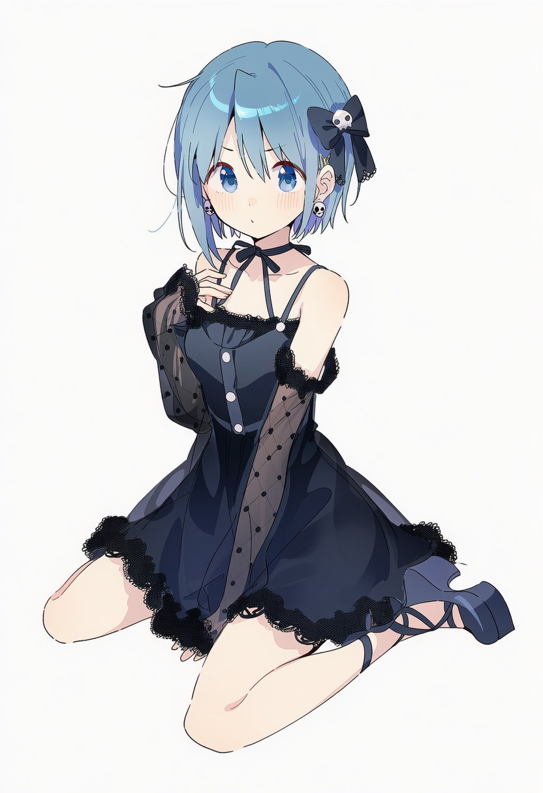

[在线例图](https://assets.quicktagcloud.com/images/raven_composition/raven_composition-1468.jpg?v=4baf5ff0a9ec22f4)

<a id="raven_composition-1469"></a>

## 音符耳环

ID：`raven_composition-1469`；分类：耳饰 / 造型耳环；来源标记：`safe`。

来源说明：

> 音符造型的耳环。

正向提示词：

```text
musical_note_earrings
```

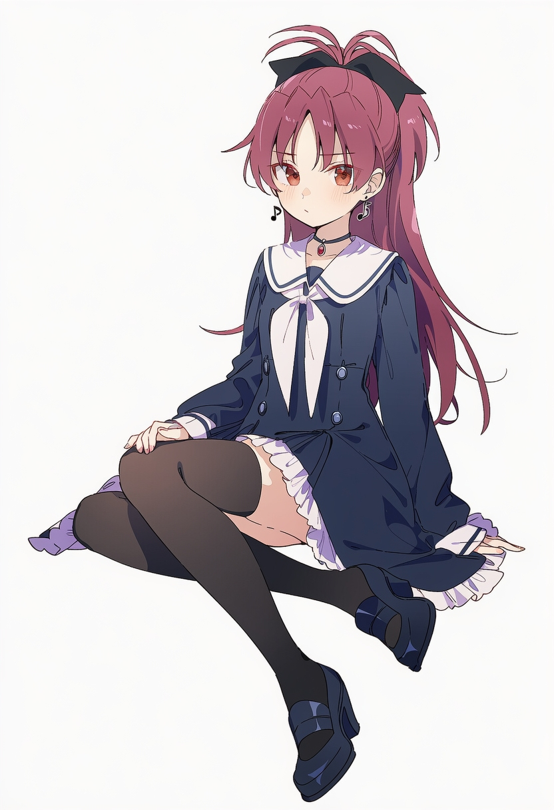

[在线例图](https://assets.quicktagcloud.com/images/raven_composition/raven_composition-1469.jpg?v=16a84030c980a5a1)

<a id="raven_composition-1470"></a>

## 毛球耳环

ID：`raven_composition-1470`；分类：耳饰 / 造型耳环；来源标记：`safe`。

来源说明：

> 带蓬松毛球的耳环。

正向提示词：

```text
pom_pom_earrings
```

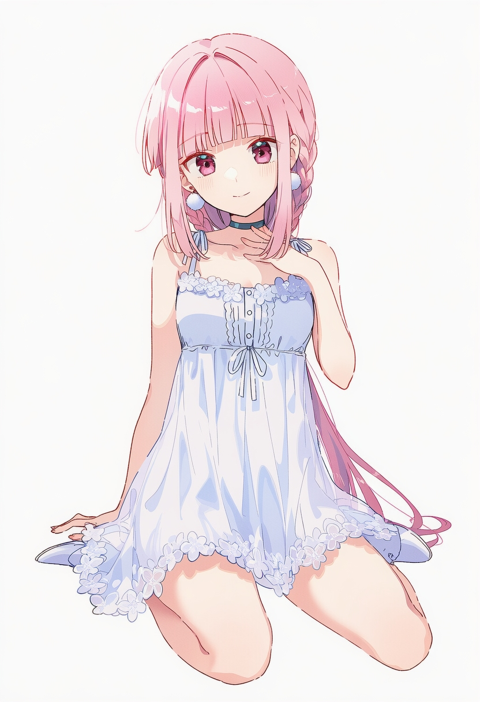

[在线例图](https://assets.quicktagcloud.com/images/raven_composition/raven_composition-1470.jpg?v=aa63d9f8a4793d40)

<a id="raven_composition-1471"></a>

## 翅膀耳环

ID：`raven_composition-1471`；分类：耳饰 / 造型耳环；来源标记：`safe`。

来源说明：

> 翅膀造型的耳环。

正向提示词：

```text
wing_earrings
```

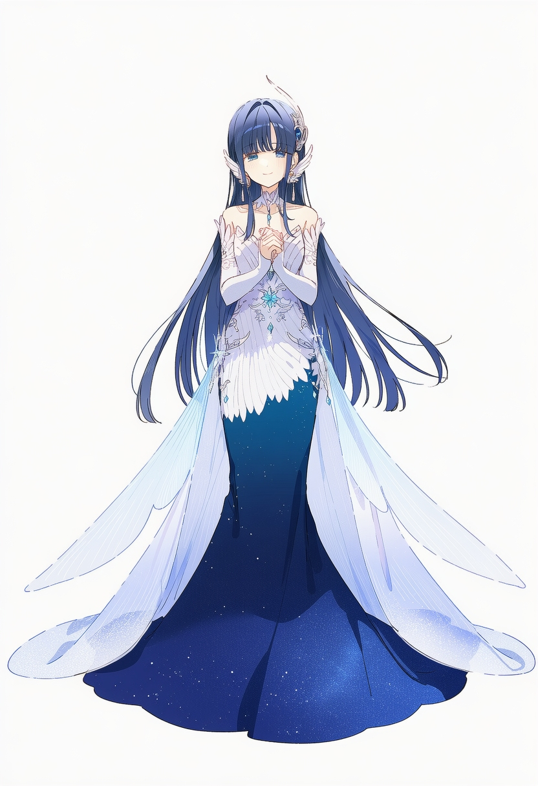

[在线例图](https://assets.quicktagcloud.com/images/raven_composition/raven_composition-1471.jpg?v=47f2387727da545d)

<a id="raven_composition-1472"></a>

## 注射器耳环

ID：`raven_composition-1472`；分类：耳饰 / 造型耳环；来源标记：`safe`。

来源说明：

> 注射器造型的耳环。

正向提示词：

```text
syringe_earrings
```

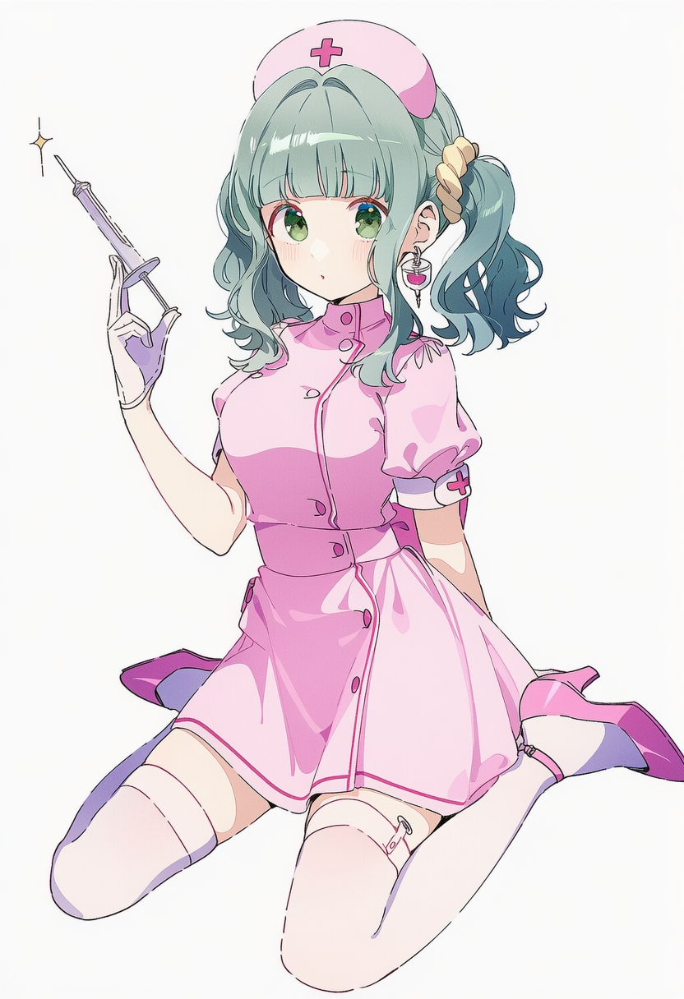

[在线例图](https://assets.quicktagcloud.com/images/raven_composition/raven_composition-1472.jpg?v=55d1ac8ff1742312)

<a id="raven_composition-1473"></a>

## 鱼骨耳环

ID：`raven_composition-1473`；分类：耳饰 / 造型耳环；来源标记：`safe`。

来源说明：

> 鱼骨造型的耳环。

正向提示词：

```text
fish_skeleton_earrings
```

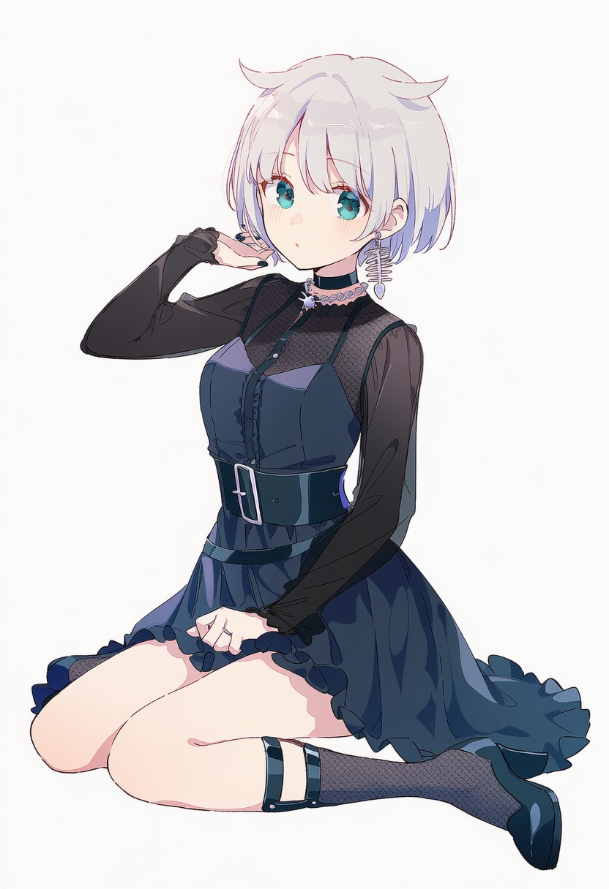

[在线例图](https://assets.quicktagcloud.com/images/raven_composition/raven_composition-1473.jpg?v=898dce2c003379f2)

<a id="raven_composition-1474"></a>

## 四叶草耳环

ID：`raven_composition-1474`；分类：耳饰 / 造型耳环；来源标记：`safe`。

来源说明：

> 四叶草造型的耳环。

正向提示词：

```text
four-leaf_clover_earrings
```

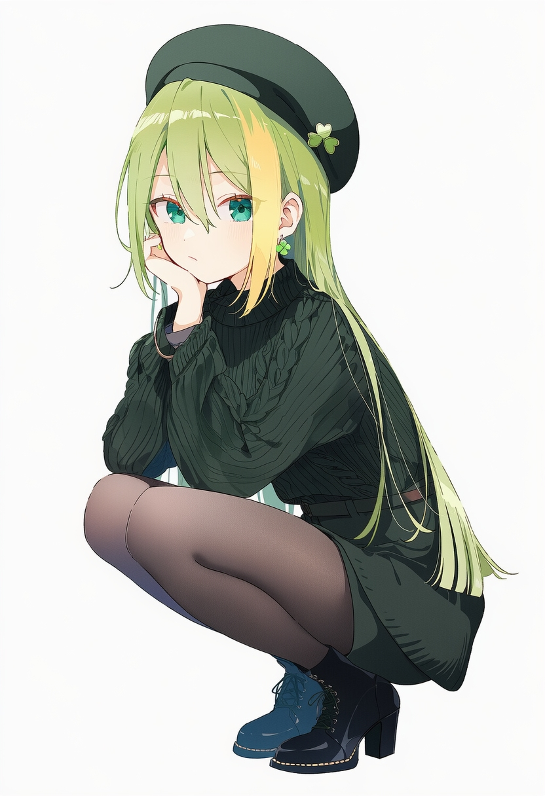

[在线例图](https://assets.quicktagcloud.com/images/raven_composition/raven_composition-1474.jpg?v=031b15688525fdc7)

<a id="raven_composition-1475"></a>

## 食物主题耳环

ID：`raven_composition-1475`；分类：耳饰 / 造型耳环；来源标记：`safe`。

来源说明：

> 整体为食物造型的耳环。

正向提示词：

```text
food-themed_earrings
```

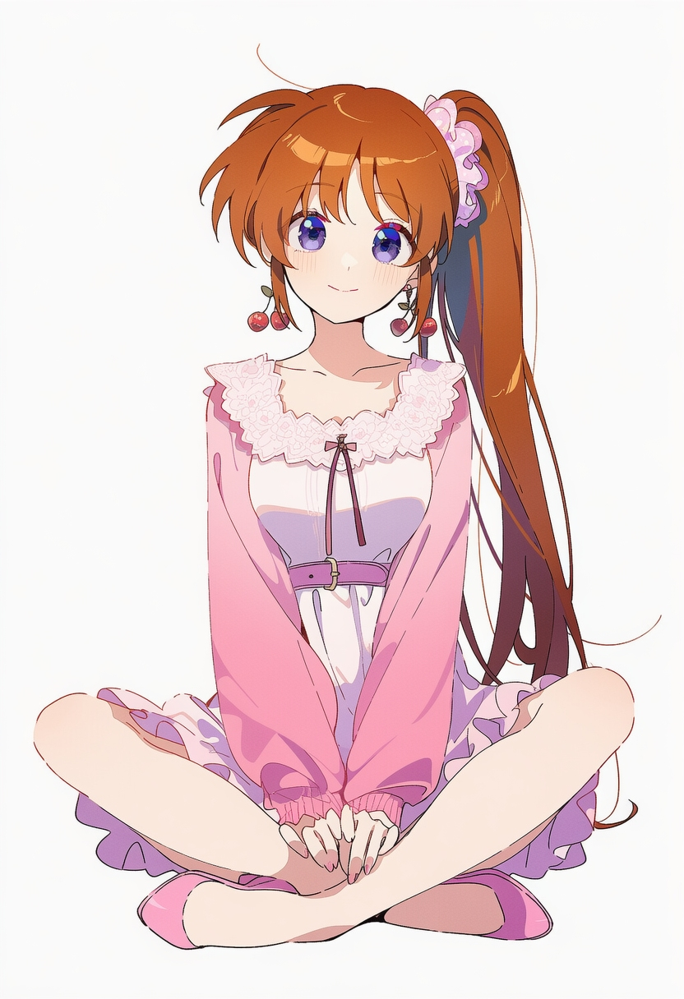

[在线例图](https://assets.quicktagcloud.com/images/raven_composition/raven_composition-1475.jpg?v=3025bc56395455a3)

<a id="raven_composition-1476"></a>

## 草莓耳环

ID：`raven_composition-1476`；分类：耳饰 / 造型耳环；来源标记：`safe`。

来源说明：

> 草莓造型的耳环。

正向提示词：

```text
strawberry_earrings
```

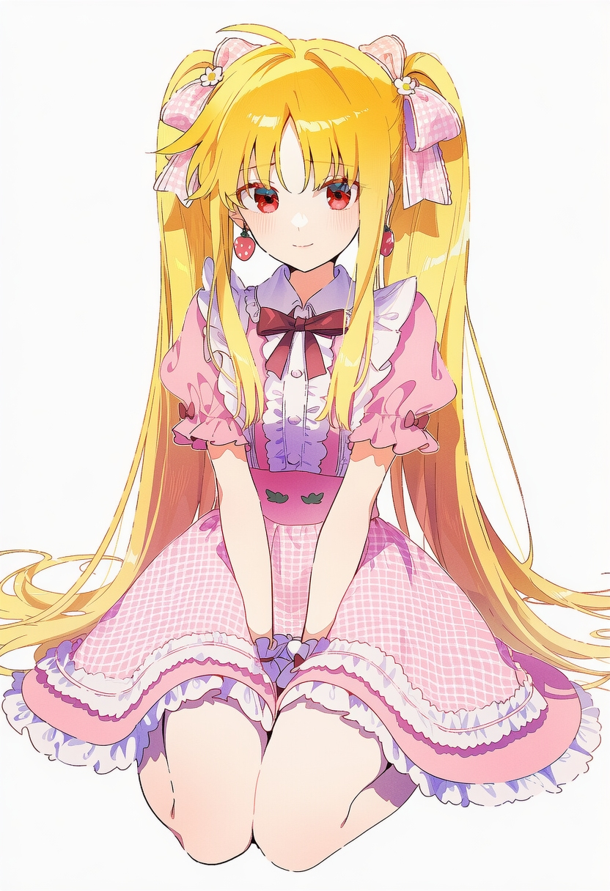

[在线例图](https://assets.quicktagcloud.com/images/raven_composition/raven_composition-1476.jpg?v=50d46980de2db02e)

<a id="raven_composition-1477"></a>

## 樱桃耳环

ID：`raven_composition-1477`；分类：耳饰 / 造型耳环；来源标记：`safe`。

来源说明：

> 樱桃造型的耳环。

正向提示词：

```text
cherry_earrings
```

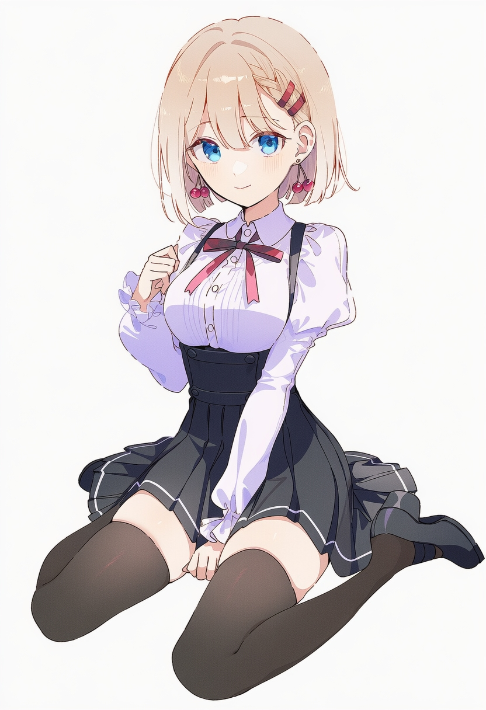

[在线例图](https://assets.quicktagcloud.com/images/raven_composition/raven_composition-1477.jpg?v=178184f45ec1ef7c)

<a id="raven_composition-1478"></a>

## 柠檬耳环

ID：`raven_composition-1478`；分类：耳饰 / 造型耳环；来源标记：`safe`。

来源说明：

> 柠檬造型的耳环。

正向提示词：

```text
lemon_earrings
```

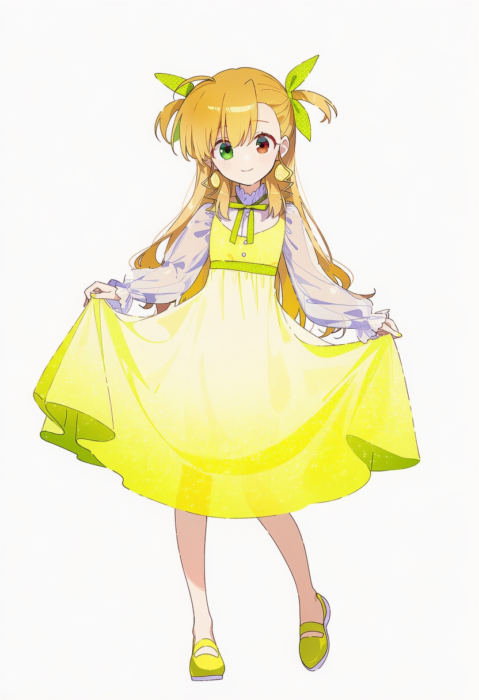

[在线例图](https://assets.quicktagcloud.com/images/raven_composition/raven_composition-1478.jpg?v=af53599179ae6af1)

<a id="raven_composition-1479"></a>

## 胡萝卜耳环

ID：`raven_composition-1479`；分类：耳饰 / 造型耳环；来源标记：`safe`。

来源说明：

> 胡萝卜造型的耳环。

正向提示词：

```text
carrot_earrings
```

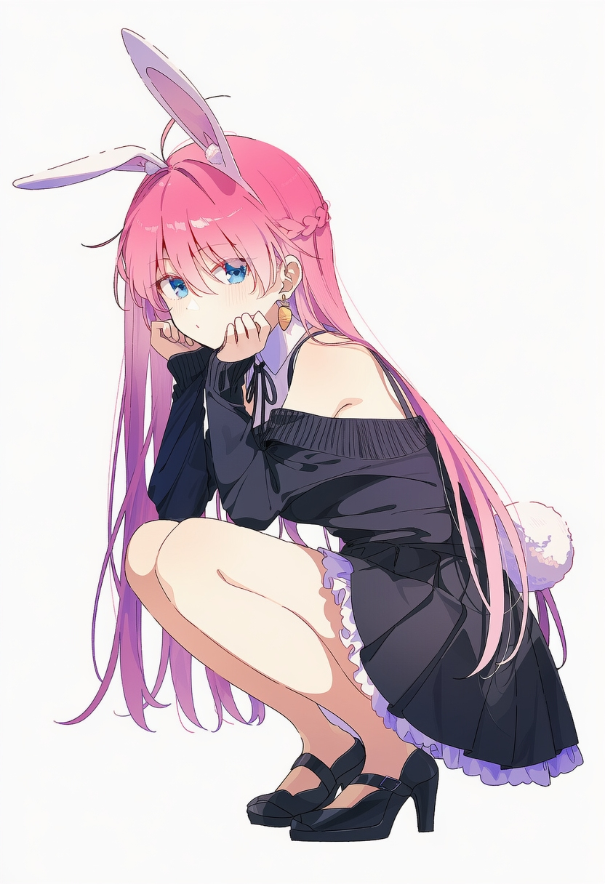

[在线例图](https://assets.quicktagcloud.com/images/raven_composition/raven_composition-1479.jpg?v=3f1b3959be2aea64)
