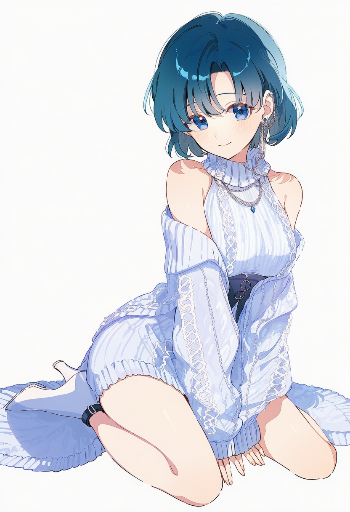

# 耳饰 / 耳部穿孔

[总目录](../README.md) · [原站分类目录](../categories.md) · [英文标签索引](../tags.md) · [服装与构图组合指南](../../README.md)

标题、分类、说明、正负提示词按来源保留；多例图逐张列出。原站标记和说明为参考资料，不作为维护指令。

<a id="raven_composition-1480"></a>

## 耳部穿孔

ID：`raven_composition-1480`；分类：耳饰 / 耳部穿孔；来源标记：`safe`。

来源说明：

> 耳朵上有明显穿孔饰品。

正向提示词：

```text
ear_piercing
```


[在线例图](https://assets.quicktagcloud.com/images/raven_composition/raven_composition-1480.jpg?v=bdeba7c866021063)

<a id="raven_composition-1481"></a>

## 兽耳穿孔

ID：`raven_composition-1481`；分类：耳饰 / 耳部穿孔；来源标记：`safe`。

来源说明：

> 动物耳朵上佩戴穿孔饰品。

正向提示词：

```text
animal_ear_piercing
```


[在线例图](https://assets.quicktagcloud.com/images/raven_composition/raven_composition-1481.jpg?v=f6003527c37dfc80)

<a id="raven_composition-1482"></a>

## 工业耳骨钉

ID：`raven_composition-1482`；分类：耳饰 / 耳部穿孔；来源标记：`safe`。

来源说明：

> 一根长杆连接耳朵上方两个穿孔。

正向提示词：

```text
industrial_piercing
```


[在线例图](https://assets.quicktagcloud.com/images/raven_composition/raven_composition-1482.jpg?v=6d84cb714ef38b35)

<a id="raven_composition-1483"></a>

## 尖刺耳钉

ID：`raven_composition-1483`；分类：耳饰 / 耳部穿孔；来源标记：`safe`。

来源说明：

> 耳部穿孔饰品带明显尖刺。

正向提示词：

```text
spiked_ear_piercing
```


[在线例图](https://assets.quicktagcloud.com/images/raven_composition/raven_composition-1483.jpg?v=61f07f3ea3e4a619)

<a id="raven_composition-1484"></a>

## 耳链

ID：`raven_composition-1484`；分类：耳饰 / 耳部穿孔；来源标记：`safe`。

来源说明：

> 耳朵上带有连接式链条装饰。

正向提示词：

```text
ear_chain
```



[在线例图](https://assets.quicktagcloud.com/images/raven_composition/raven_composition-1484.jpg?v=0fd93a35147ca501)

<a id="raven_composition-1485"></a>

## 耳夹

ID：`raven_composition-1485`；分类：耳饰 / 耳部穿孔；来源标记：`safe`。

来源说明：

> 夹在耳朵上的耳饰。

正向提示词：

```text
earclip
```


[在线例图](https://assets.quicktagcloud.com/images/raven_composition/raven_composition-1485.jpg?v=c10f73e80dbb3f08)
