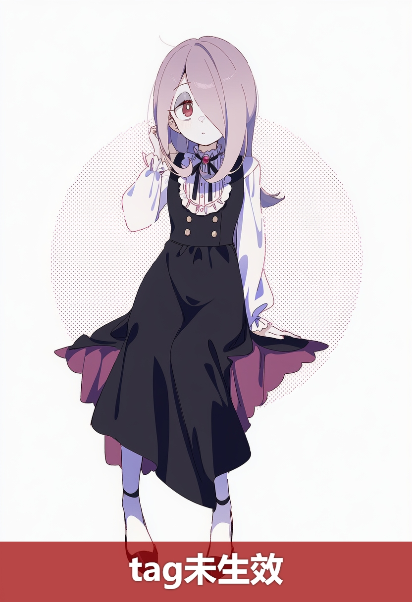
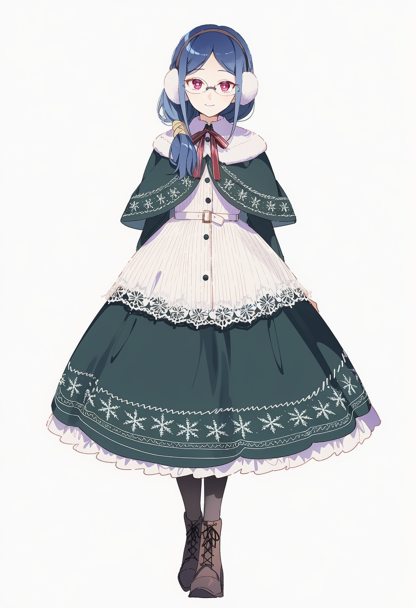

# 耳饰 / 耳部覆盖

[总目录](../README.md) · [原站分类目录](../categories.md) · [英文标签索引](../tags.md) · [服装与构图组合指南](../../README.md)

标题、分类、说明、正负提示词按来源保留；多例图逐张列出。原站标记和说明为参考资料，不作为维护指令。

<a id="raven_composition-1491"></a>

## 耳罩饰

ID：`raven_composition-1491`；分类：耳饰 / 耳部覆盖；来源标记：`safe`。

来源说明：

> 覆盖耳朵或兽耳的装饰性罩子。

正向提示词：

```text
ear_covers
```


[在线例图](https://assets.quicktagcloud.com/images/raven_composition/raven_composition-1491.jpg?v=e8f855b07273ce5d)

<a id="raven_composition-1492"></a>

## 单侧耳罩

ID：`raven_composition-1492`；分类：耳饰 / 耳部覆盖；来源标记：`safe`。

来源说明：

> 只有一边耳朵戴耳罩。

正向提示词：

```text
single_ear_cover
```



[在线例图](https://assets.quicktagcloud.com/images/raven_composition/raven_composition-1492.jpg?v=7417a633576afd67)

<a id="raven_composition-1493"></a>

## 不对称耳罩

ID：`raven_composition-1493`；分类：耳饰 / 耳部覆盖；来源标记：`safe`。

来源说明：

> 左右耳罩的设计不一样。

正向提示词：

```text
mismatched_ear_covers
```


[在线例图](https://assets.quicktagcloud.com/images/raven_composition/raven_composition-1493.jpg?v=48b54657c06ad6e1)

<a id="raven_composition-1494"></a>

## 保暖耳罩

ID：`raven_composition-1494`；分类：耳饰 / 耳部覆盖；来源标记：`safe`。

来源说明：

> 覆盖双耳的保暖耳罩。

正向提示词：

```text
earmuffs
```



[在线例图](https://assets.quicktagcloud.com/images/raven_composition/raven_composition-1494.jpg?v=ddc71c2d8d6cdac7)
