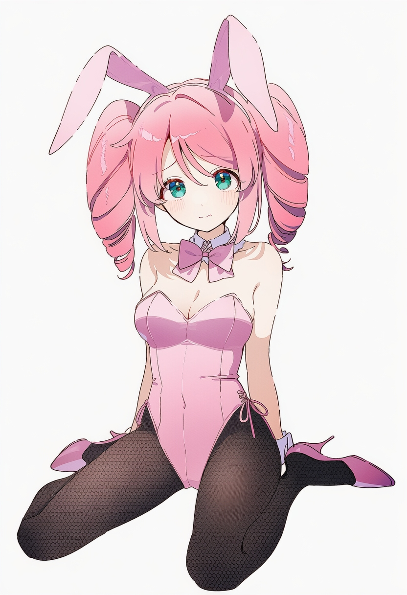
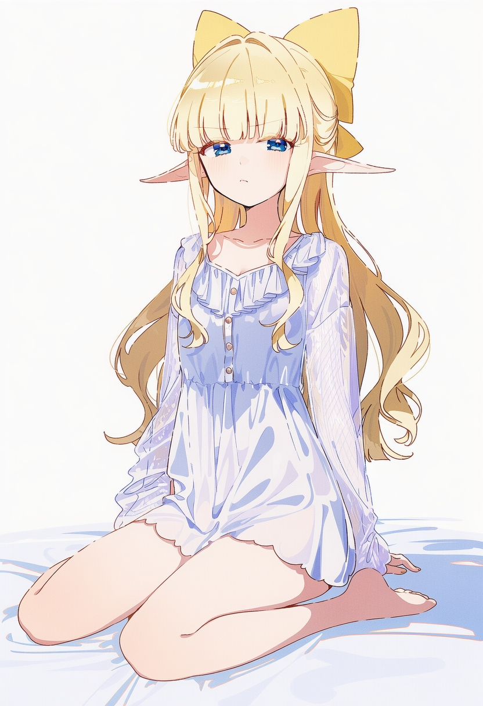
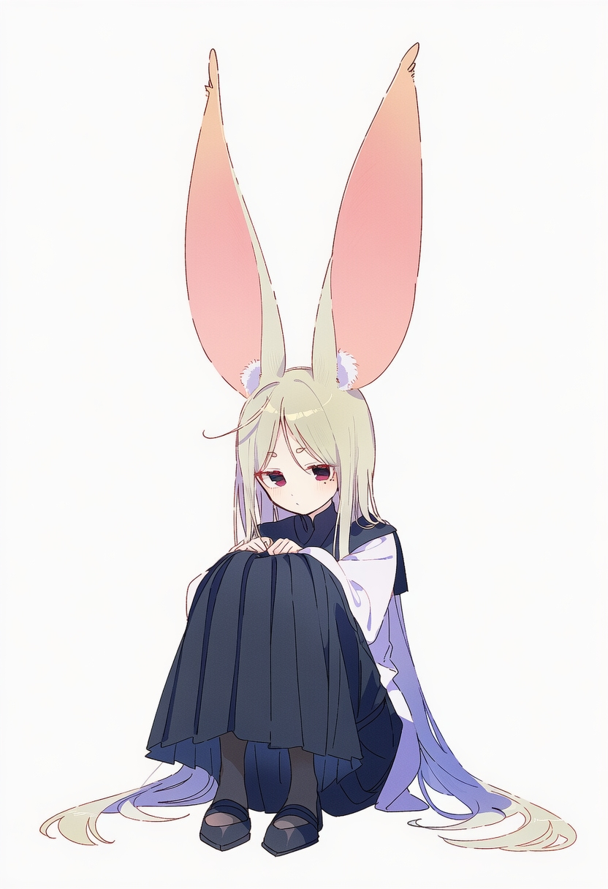
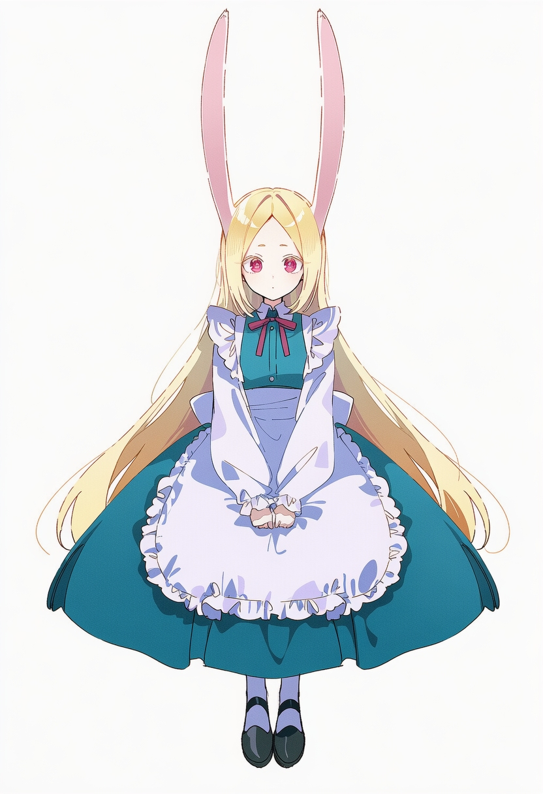
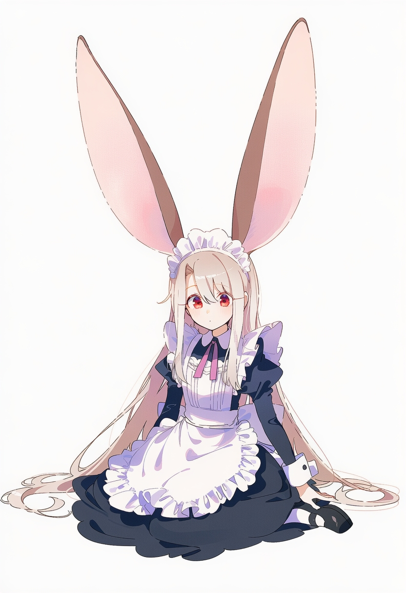
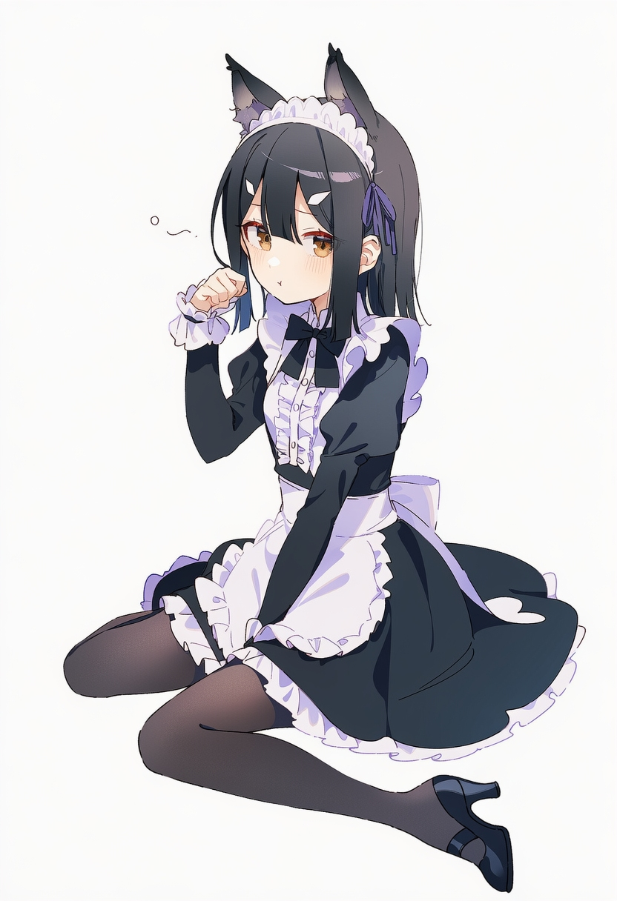
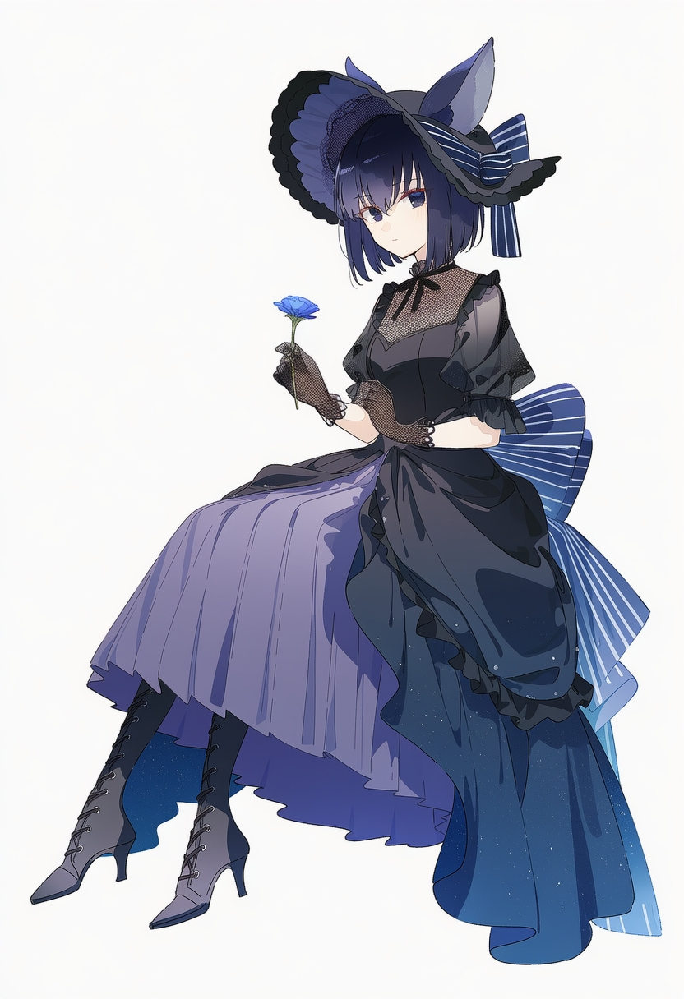
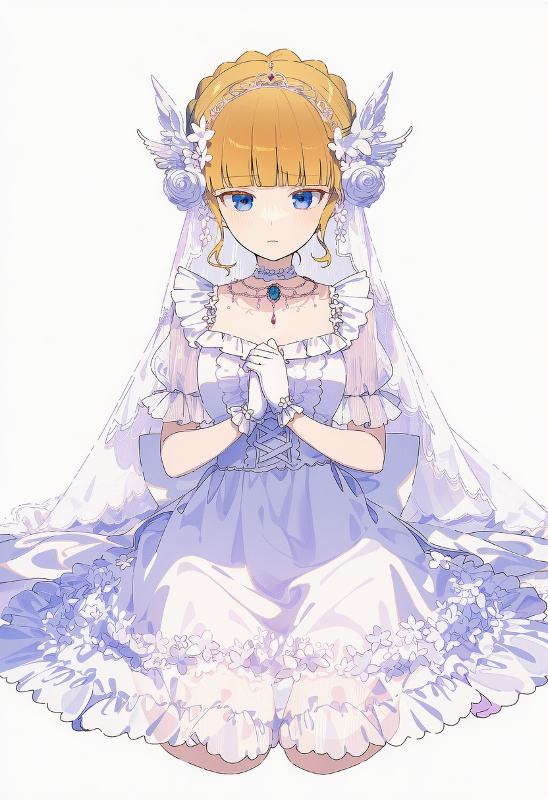

# 耳饰 / 耳朵形态

[总目录](../README.md) · [原站分类目录](../categories.md) · [英文标签索引](../tags.md) · [服装与构图组合指南](../../README.md)

标题、分类、说明、正负提示词按来源保留；多例图逐张列出。原站标记和说明为参考资料，不作为维护指令。

<a id="raven_composition-1495"></a>

## 兽耳 / 动物耳

ID：`raven_composition-1495`；分类：耳饰 / 耳朵形态；来源标记：`safe`。

来源说明：

> 泛指人形角色长有动物耳朵。

正向提示词：

```text
animal_ears
```


[在线例图](https://assets.quicktagcloud.com/images/raven_composition/raven_composition-1495.jpg?v=f5e579b43974cd69)

<a id="raven_composition-1496"></a>

## 假兽耳

ID：`raven_composition-1496`；分类：耳饰 / 耳朵形态；来源标记：`safe`。

来源说明：

> 发箍、帽子等做出来的假动物耳朵。

正向提示词：

```text
fake_animal_ears
```



[在线例图](https://assets.quicktagcloud.com/images/raven_composition/raven_composition-1496.jpg?v=2b838a88fd913303)

<a id="raven_composition-1497"></a>

## 尖耳 / 精灵耳

ID：`raven_composition-1497`；分类：耳饰 / 耳朵形态；来源标记：`safe`。

来源说明：

> 耳朵明显尖长，常见于精灵角色。

正向提示词：

```text
pointy_ears
```


[在线例图](https://assets.quicktagcloud.com/images/raven_composition/raven_composition-1497.jpg?v=93965a8dc2f33a07)

<a id="raven_composition-1498"></a>

## 长精灵耳

ID：`raven_composition-1498`；分类：耳饰 / 耳朵形态；来源标记：`safe`。

来源说明：

> 比普通尖耳更细长、更夸张。

正向提示词：

```text
long_pointy_ears
```



[在线例图](https://assets.quicktagcloud.com/images/raven_composition/raven_composition-1498.jpg?v=d4f04df2633a31a2)

<a id="raven_composition-1499"></a>

## 大耳朵

ID：`raven_composition-1499`；分类：耳饰 / 耳朵形态；来源标记：`safe`。

来源说明：

> 耳朵尺寸明显比正常更大。

正向提示词：

```text
large_ears
```



[在线例图](https://assets.quicktagcloud.com/images/raven_composition/raven_composition-1499.jpg?v=f04fe7467382ad1b)

<a id="raven_composition-1500"></a>

## 超长耳朵

ID：`raven_composition-1500`；分类：耳饰 / 耳朵形态；来源标记：`safe`。

来源说明：

> 耳朵长度非常夸张，接近或超过头部长度。

正向提示词：

```text
very_long_ears
```



[在线例图](https://assets.quicktagcloud.com/images/raven_composition/raven_composition-1500.jpg?v=f4137767cb533629)

<a id="raven_composition-1501"></a>

## 夸张大耳朵

ID：`raven_composition-1501`；分类：耳饰 / 耳朵形态；来源标记：`safe`。

来源说明：

> 耳朵大得带有明显夸张或搞笑效果。

正向提示词：

```text
comically_large_ears
```



[在线例图](https://assets.quicktagcloud.com/images/raven_composition/raven_composition-1501.jpg?v=5559137da3373122)

<a id="raven_composition-1502"></a>

## 额外耳朵

ID：`raven_composition-1502`；分类：耳饰 / 耳朵形态；来源标记：`safe`。

来源说明：

> 除了正常耳朵外还有额外的一对或多对耳朵。

正向提示词：

```text
extra_ears
```



[在线例图](https://assets.quicktagcloud.com/images/raven_composition/raven_composition-1502.jpg?v=508618bf85a763d2)

<a id="raven_composition-1503"></a>

## 兽耳绒毛

ID：`raven_composition-1503`；分类：耳饰 / 耳朵形态；来源标记：`safe`。

来源说明：

> 动物耳朵内侧有明显蓬松绒毛。

正向提示词：

```text
animal_ear_fluff
```


[在线例图](https://assets.quicktagcloud.com/images/raven_composition/raven_composition-1503.jpg?v=c81a3f4807674c80)

<a id="raven_composition-1504"></a>

## 软垂耳

ID：`raven_composition-1504`；分类：耳饰 / 耳朵形态；来源标记：`safe`。

来源说明：

> 耳朵柔软下垂，无法自然竖起。

正向提示词：

```text
floppy_ears
```


[在线例图](https://assets.quicktagcloud.com/images/raven_composition/raven_composition-1504.jpg?v=0b6da06b297b1337)

<a id="raven_composition-1505"></a>

## 自然垂耳

ID：`raven_composition-1505`；分类：耳饰 / 耳朵形态；来源标记：`safe`。

来源说明：

> 耳朵天生朝下或下垂。

正向提示词：

```text
droopy_ears
```


[在线例图](https://assets.quicktagcloud.com/images/raven_composition/raven_composition-1505.jpg?v=91e02369b453deb0)

<a id="raven_composition-1506"></a>

## 耳朵垂下

ID：`raven_composition-1506`；分类：耳饰 / 耳朵形态；来源标记：`safe`。

来源说明：

> 原本能竖起的耳朵主动垂下来。

正向提示词：

```text
ears_down
```


[在线例图](https://assets.quicktagcloud.com/images/raven_composition/raven_composition-1506.jpg?v=7e8950c91df65554)

<a id="raven_composition-1507"></a>

## 缺口耳

ID：`raven_composition-1507`；分类：耳饰 / 耳朵形态；来源标记：`safe`。

来源说明：

> 耳缘有明显缺口或豁口。

正向提示词：

```text
notched_ear
```


[在线例图](https://assets.quicktagcloud.com/images/raven_composition/raven_composition-1507.jpg?v=297cfb41335b483a)

<a id="raven_composition-1508"></a>

## 耳朵穿出帽子

ID：`raven_composition-1508`；分类：耳饰 / 耳朵形态；来源标记：`safe`。

来源说明：

> 耳朵从帽子或其他头饰中穿出来。

正向提示词：

```text
ears_through_headwear
```



[在线例图](https://assets.quicktagcloud.com/images/raven_composition/raven_composition-1508.jpg?v=5aeed715e88f9524)

<a id="raven_composition-1509"></a>

## 翅膀耳朵

ID：`raven_composition-1509`；分类：耳饰 / 耳朵形态；来源标记：`safe`。

来源说明：

> 耳朵位置长着或呈现翅膀状结构。

正向提示词：

```text
wing_ears
```



[在线例图](https://assets.quicktagcloud.com/images/raven_composition/raven_composition-1509.jpg?v=cde7547c6f49fb77)
