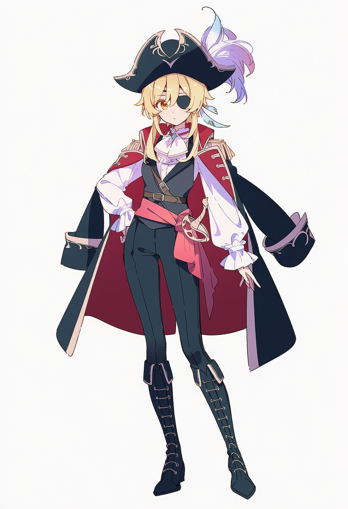
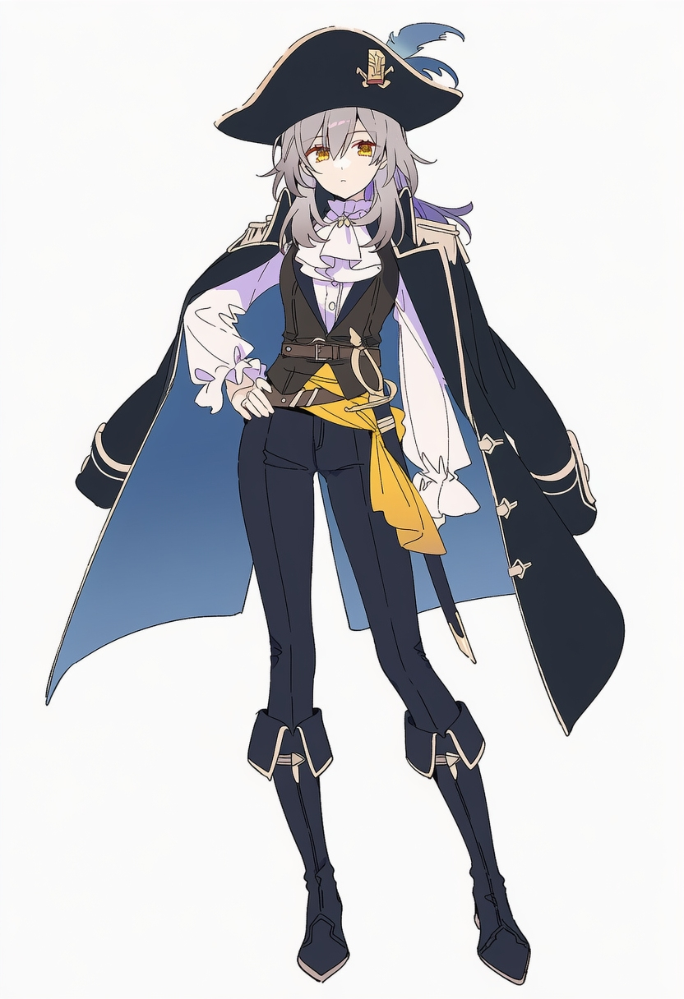

# 身份设定 / 大航海 / 海盗时代

[总目录](../README.md) · [原站分类目录](../categories.md) · [英文标签索引](../tags.md) · [服装与构图组合指南](../../README.md)

标题、分类、说明、正负提示词按来源保留；多例图逐张列出。原站标记和说明为参考资料，不作为维护指令。

<a id="raven_composition-1510"></a>

## 海盗

ID：`raven_composition-1510`；分类：身份设定 / 大航海 / 海盗时代；来源标记：`safe`。

来源说明：

> 海盗帽、长外套、腰带/腰封、长靴和弯刀，再加眼罩做经典形象。

正向提示词：

```text
1.35::pirate::, 1.28::pirate_hat::, 1.22::coat::, 1.16::vest::, 1.12::sash::, 1.10::boots::, 1.08::eyepatch::, 1.06::cutlass::, 1.04::belt_pouch::
```



[在线例图](https://assets.quicktagcloud.com/images/raven_composition/raven_composition-1510.jpg?v=5fd8a343c77f306f)

<a id="raven_composition-1511"></a>

## 海盗船长

ID：`raven_composition-1511`；分类：身份设定 / 大航海 / 海盗时代；来源标记：`safe`。

来源说明：

> 三角帽、长外套、马甲、腰带和弯刀/燧发枪组合成经典海盗船长。

正向提示词：

```text
1.35::pirate::, 1.28::tricorn::, 1.22::long_coat::, 1.16::vest::, 1.12::boots::, 1.10::belt::, 1.08::sash::, 1.06::sword::, 1.04::flintlock::
```



[在线例图](https://assets.quicktagcloud.com/images/raven_composition/raven_composition-1511.jpg?v=8e1387a62802efc1)
