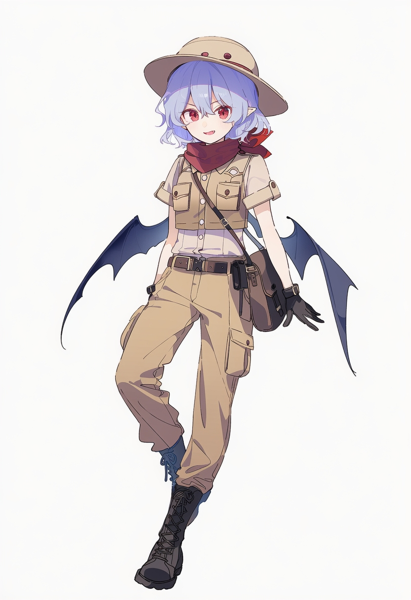
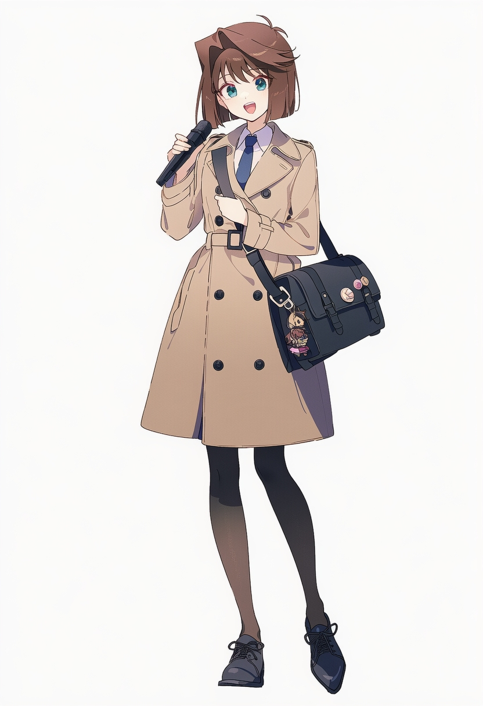

# 身份设定 / 都市白领 / 专业职业

[总目录](../README.md) · [原站分类目录](../categories.md) · [英文标签索引](../tags.md) · [服装与构图组合指南](../../README.md)

标题、分类、说明、正负提示词按来源保留；多例图逐张列出。原站标记和说明为参考资料，不作为维护指令。

<a id="raven_composition-1512"></a>

## 考古学家

ID：`raven_composition-1512`；分类：身份设定 / 都市白领 / 专业职业；来源标记：`safe`。

来源说明：

> 宽檐帽、功能马甲、围巾、靴子和挎包，整体偏野外遗址工作而不是办公室学者。

正向提示词：

```text
1.35::wide-brimmed_hat::, 1.28::vest::, 1.22::scarf::, 1.16::boots::, 1.12::satchel::, 1.10::gloves::, 1.08::safari_hat::, 1.06::button_up_shirt::, 1.04::cargo_pants::, 1.02::belt_pouch::
```



[在线例图](https://assets.quicktagcloud.com/images/raven_composition/raven_composition-1512.jpg?v=99c2491b898674f6)

<a id="raven_composition-1513"></a>

## 记者

ID：`raven_composition-1513`；分类：身份设定 / 都市白领 / 专业职业；来源标记：`safe`。

来源说明：

> 风衣、衬衫、斜挎包、相机和本子做出奔走采访的职业感。

正向提示词：

```text
1.35::trench_coat::, 1.28::collared_shirt::, 1.22::necktie::, 1.16::messenger_bag::, 1.12::camera::, 1.10::notebook::, 1.08::shoulder_bag::, 1.06::holding_microphone::, 1.04::press_badge::
```



[在线例图](https://assets.quicktagcloud.com/images/raven_composition/raven_composition-1513.jpg?v=18392cd572d751cf)
