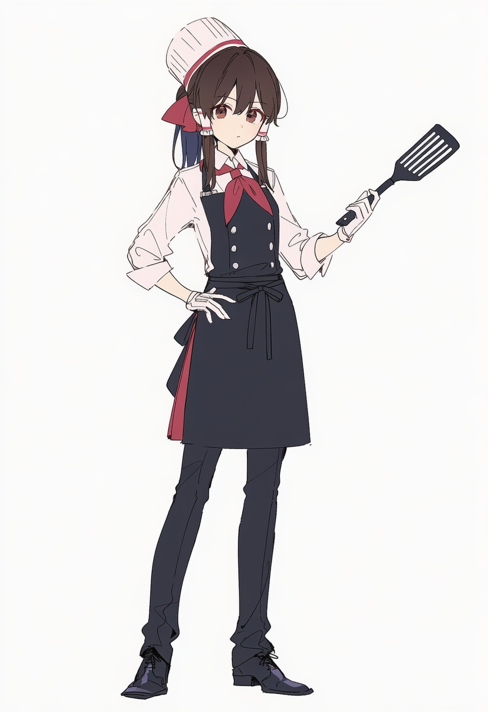
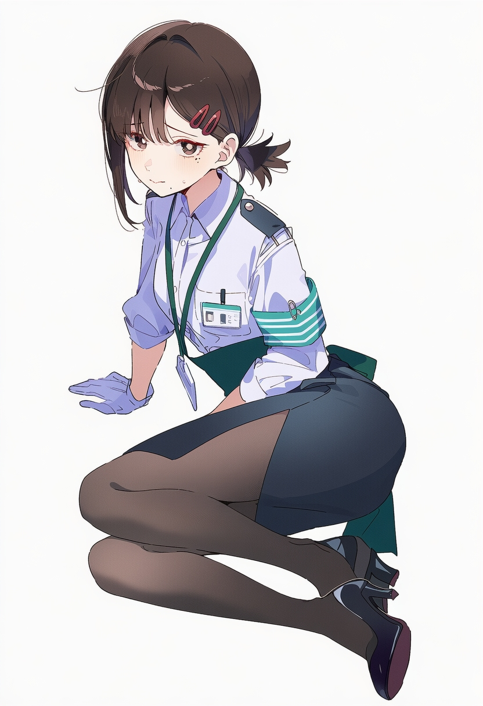
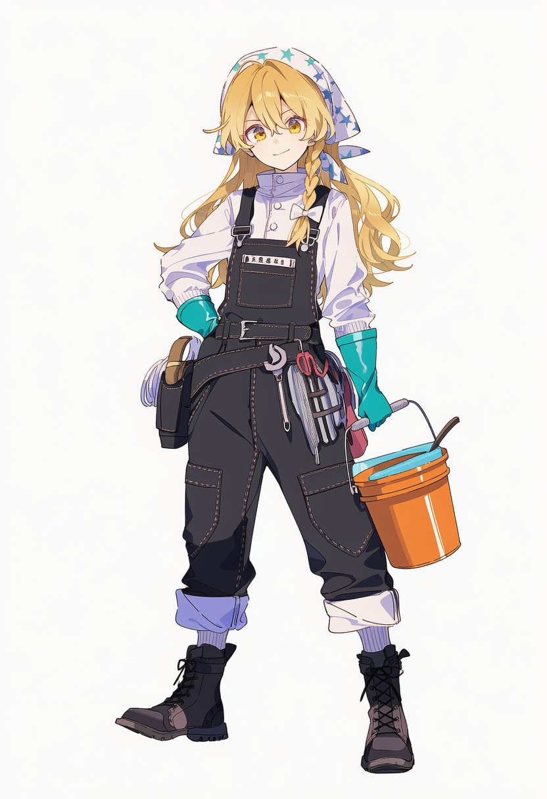
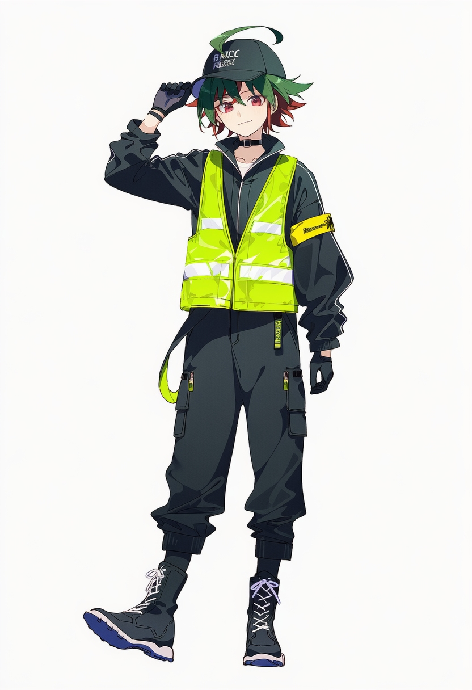

# 身份设定 / 服务业 / 餐饮 / 酒店

[总目录](../README.md) · [原站分类目录](../categories.md) · [英文标签索引](../tags.md) · [服装与构图组合指南](../../README.md)

标题、分类、说明、正负提示词按来源保留；多例图逐张列出。原站标记和说明为参考资料，不作为维护指令。

<a id="raven_composition-1516"></a>

## 厨师

ID：`raven_composition-1516`；分类：身份设定 / 服务业 / 餐饮 / 酒店；来源标记：`safe`。

来源说明：

> 高厨师帽和围裙直接建立厨房职业感，领巾、手套和厨刀补充工作细节。

正向提示词：

```text
1.35::chef_hat::, 1.28::apron::, 1.22::neckerchief::, 1.16::gloves::, 1.12::kitchen_knife::, 1.10::chef::, 1.08::collared_shirt::, 1.06::holding_spatula::, 1.04::double-breasted::, 1.02::slacks::
```



[在线例图](https://assets.quicktagcloud.com/images/raven_composition/raven_composition-1516.jpg?v=2f1740daec64043c)

<a id="raven_composition-1517"></a>

## 咖啡师

ID：`raven_composition-1517`；分类：身份设定 / 服务业 / 餐饮 / 酒店；来源标记：`safe`。

来源说明：

> 围裙放第一位，卷袖和衬衫让角色像在吧台持续操作，而不是正式餐厅侍者。

正向提示词：

```text
1.35::apron::, 1.28::collared_shirt::, 1.22::rolled_up_sleeves::, 1.16::neckerchief::, 1.12::gloves::, 1.10::barista::, 1.08::name_tag::, 1.06::holding_cup::, 1.04::waist_apron::
```


[在线例图](https://assets.quicktagcloud.com/images/raven_composition/raven_composition-1517.jpg?v=589c99cd277189fb)

<a id="raven_composition-1518"></a>

## 女仆

ID：`raven_composition-1518`；分类：身份设定 / 服务业 / 餐饮 / 酒店；来源标记：`safe`。

来源说明：

> 经典女仆就让头饰和 maid_apron 做主角，再叠荷叶边、泡泡袖和蝴蝶结。

正向提示词：

```text
1.35::maid::, 1.28::maid_headdress::, 1.22::maid_apron::, 1.16::frilled_dress::, 1.12::puffy_sleeves::, 1.10::frills::, 1.08::bow::, 1.06::frilled_cuffs::, 1.04::mary_janes::, 1.02::thighhighs::
```


[在线例图](https://assets.quicktagcloud.com/images/raven_composition/raven_composition-1518.jpg?v=6a9065c0aa9d5b54)

<a id="raven_composition-1519"></a>

## 客房服务员

ID：`raven_composition-1519`；分类：身份设定 / 服务业 / 餐饮 / 酒店；来源标记：`safe`。

来源说明：

> 统一工作服、围裙、手套和工牌，以干净、方便劳动为主。

正向提示词：

```text
1.35::uniform::, 1.28::apron::, 1.22::gloves::, 1.16::id_card::, 1.12::hairnet::
```



[在线例图](https://assets.quicktagcloud.com/images/raven_composition/raven_composition-1519.jpg?v=3f7997ce0f6cc9fb)

<a id="raven_composition-1520"></a>

## 清洁工

ID：`raven_composition-1520`；分类：身份设定 / 服务业 / 餐饮 / 酒店；来源标记：`safe`。

来源说明：

> 耐脏工作服、橡胶手套和靴子是核心，再用头巾与水桶强化清洁岗位。

正向提示词：

```text
1.35::coveralls::, 1.28::apron::, 1.22::rubber_gloves::, 1.16::boots::, 1.12::headscarf::, 1.10::bucket::
```



[在线例图](https://assets.quicktagcloud.com/images/raven_composition/raven_composition-1520.jpg?v=0be8271734c16a57)

<a id="raven_composition-1521"></a>

## 环卫工人

ID：`raven_composition-1521`；分类：身份设定 / 服务业 / 餐饮 / 酒店；来源标记：`safe`。

来源说明：

> 连体工作服、手套、工作靴、棒球帽与高可视背心，直接强化市政环卫的高可视作业感。

正向提示词：

```text
1.35::coveralls::, 1.28::gloves::, 1.22::boots::, 1.16::baseball_cap::, 1.12::high-visibility_vest::
```



[在线例图](https://assets.quicktagcloud.com/images/raven_composition/raven_composition-1521.jpg?v=dc6d341e95e55b00)
