# 身份设定 / 高幻想种族 / 魔兽风

[总目录](../README.md) · [原站分类目录](../categories.md) · [英文标签索引](../tags.md) · [服装与构图组合指南](../../README.md)

标题、分类、说明、正负提示词按来源保留；多例图逐张列出。原站标记和说明为参考资料，不作为维护指令。

<a id="raven_composition-1522"></a>

## 人鱼祭司

ID：`raven_composition-1522`；分类：身份设定 / 高幻想种族 / 魔兽风；来源标记：`safe`。

来源说明：

> 人鱼身份配短披肩、珍珠项链、额环、手镯和法杖，走水下神殿祭司路线。

正向提示词：

```text
1.35::mermaid::, 1.28::capelet::, 1.22::pearl_necklace::, 1.16::circlet::, 1.12::bracelet::, 1.10::jewelry::, 1.08::staff::
```

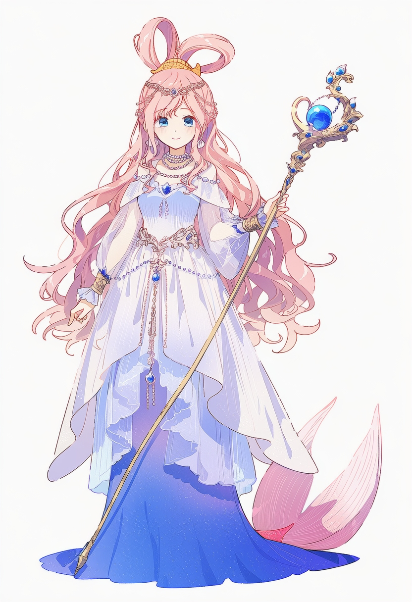

[在线例图](https://assets.quicktagcloud.com/images/raven_composition/raven_composition-1522.jpg?v=f51115ce765a9cbb)

<a id="raven_composition-1523"></a>

## 兽人族猎手

ID：`raven_composition-1523`；分类：身份设定 / 高幻想种族 / 魔兽风；来源标记：`safe`。

来源说明：

> 兽耳和毛皮负责种族感，皮甲、披风、弓箭负责猎手职业。

正向提示词：

```text
1.35::animal_ears::, 1.28::fur_trim::, 1.22::leather_armor::, 1.16::cloak::, 1.12::bow_(weapon)::, 1.10::quiver::, 1.08::boots::
```

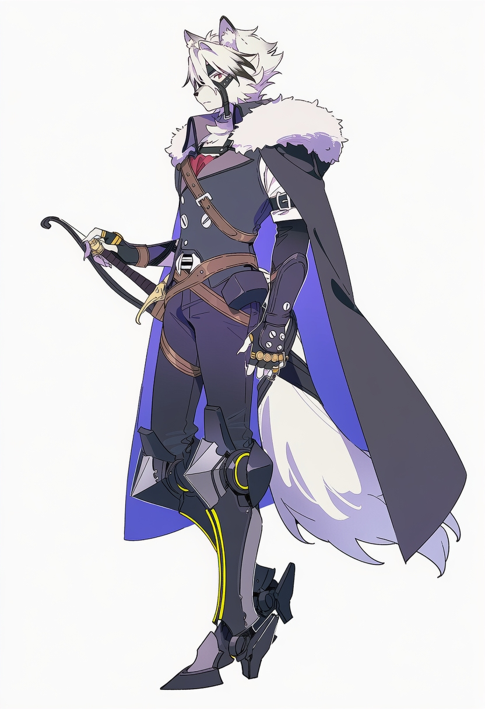

[在线例图](https://assets.quicktagcloud.com/images/raven_composition/raven_composition-1523.jpg?v=21bb38dda42e36e5)

<a id="raven_composition-1524"></a>

## 哥布林技师

ID：`raven_composition-1524`；分类：身份设定 / 高幻想种族 / 魔兽风；来源标记：`safe`。

来源说明：

> 护目镜、围裙、工具腰带、扳手和背包，做成忙碌、杂乱但能干的机械技师。

正向提示词：

```text
1.35::goblin::, 1.28::goggles::, 1.22::apron::, 1.16::gloves::, 1.12::tool_belt::, 1.10::wrench::, 1.08::backpack::
```

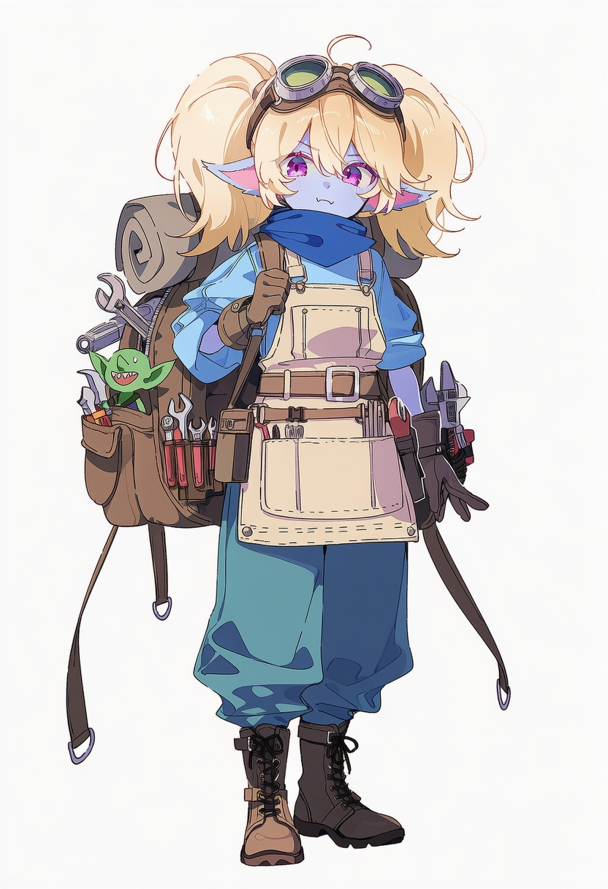

[在线例图](https://assets.quicktagcloud.com/images/raven_composition/raven_composition-1524.jpg?v=13a1ff1eab8e19ba)

<a id="raven_composition-1525"></a>

## 堕天使骑士

ID：`raven_composition-1525`；分类：身份设定 / 高幻想种族 / 魔兽风；来源标记：`safe`。

来源说明：

> 黑翼是身份层，黑色板甲、肩甲、手甲、披风和剑负责骑士职业。

正向提示词：

```text
1.35::black_wings::, 1.28::black_armor::, 1.22::plate_armor::, 1.16::pauldrons::, 1.12::gauntlets::, 1.10::cape::, 1.08::sword::
```

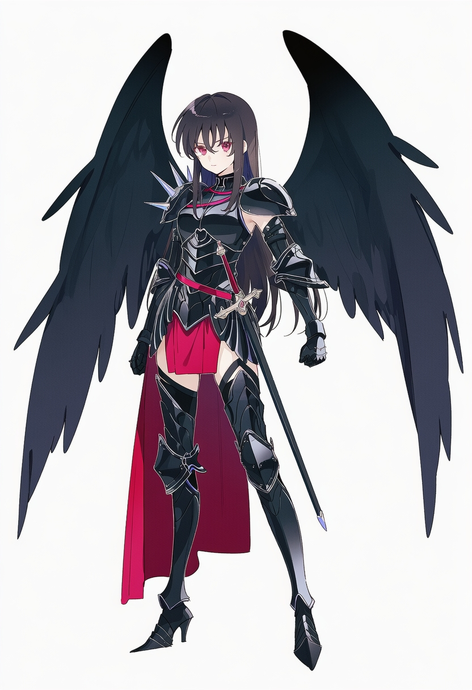

[在线例图](https://assets.quicktagcloud.com/images/raven_composition/raven_composition-1525.jpg?v=1e897195367b9e43)

<a id="raven_composition-1526"></a>

## 天使圣女

ID：`raven_composition-1526`；分类：身份设定 / 高幻想种族 / 魔兽风；来源标记：`safe`。

来源说明：

> 白裙、面纱、短披肩、念珠和小冠饰是圣女服饰，光环只作为身份增强。

正向提示词：

```text
1.35::halo::, 1.28::white_dress::, 1.22::veil::, 1.16::capelet::, 1.12::gloves::, 1.10::rosary::, 1.08::tiara::
```

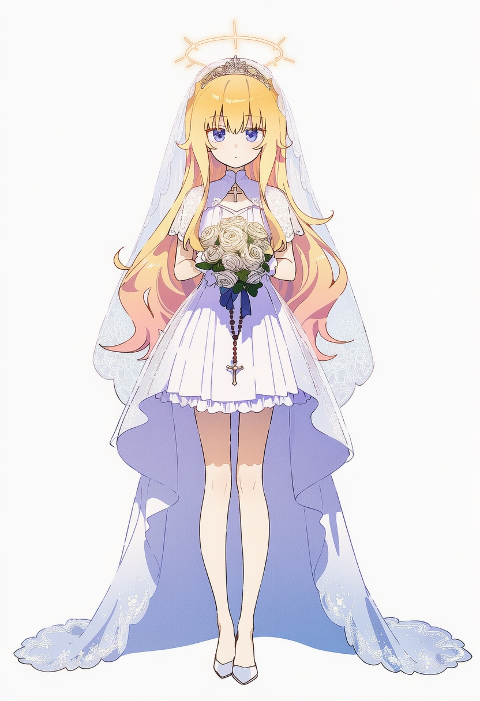

[在线例图](https://assets.quicktagcloud.com/images/raven_composition/raven_composition-1526.jpg?v=99f25d7d0b779981)

<a id="raven_composition-1527"></a>

## 恶魔贵族

ID：`raven_composition-1527`；分类：身份设定 / 高幻想种族 / 魔兽风；来源标记：`safe`。

来源说明：

> 角是种族标识，贵族服、披风、手套、领巾和胸针负责建立上层阶级。

正向提示词：

```text
1.35::horns::, 1.28::aristocratic_clothes::, 1.22::cape::, 1.16::gloves::, 1.12::cravat::, 1.10::brooch::, 1.08::boots::
```

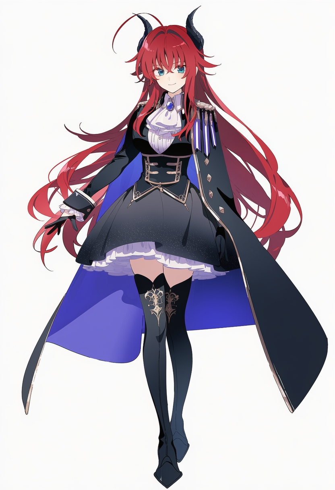

[在线例图](https://assets.quicktagcloud.com/images/raven_composition/raven_composition-1527.jpg?v=5d9b9805fe6720b0)

<a id="raven_composition-1528"></a>

## 猫族商人

ID：`raven_composition-1528`；分类：身份设定 / 高幻想种族 / 魔兽风；来源标记：`safe`。

来源说明：

> 猫耳只是身份提示，真正的商人感来自大量钱袋/挎包、马甲和珠宝。

正向提示词：

```text
1.35::cat_ears::, 1.28::cloak::, 1.22::pouch::, 1.16::satchel::, 1.12::jewelry::, 1.10::boots::, 1.08::vest::
```

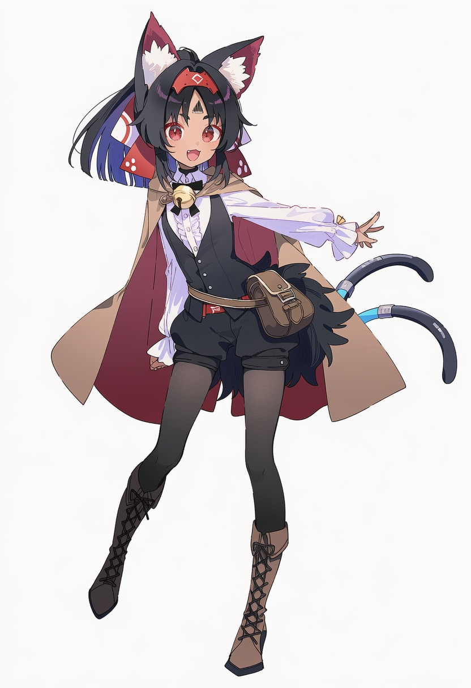

[在线例图](https://assets.quicktagcloud.com/images/raven_composition/raven_composition-1528.jpg?v=78484975b58609b3)

<a id="raven_composition-1529"></a>

## 矮人战士

ID：`raven_composition-1529`；分类：身份设定 / 高幻想种族 / 魔兽风；来源标记：`safe`。

来源说明：

> 短壮种族外形配厚甲、角盔、圆盾和战斧，形成经典矮人重战士。

正向提示词：

```text
1.35::dwarf::, 1.28::full_armor::, 1.22::horned_helmet::, 1.16::round_shield::, 1.12::axe::, 1.10::boots::, 1.08::gauntlets::
```

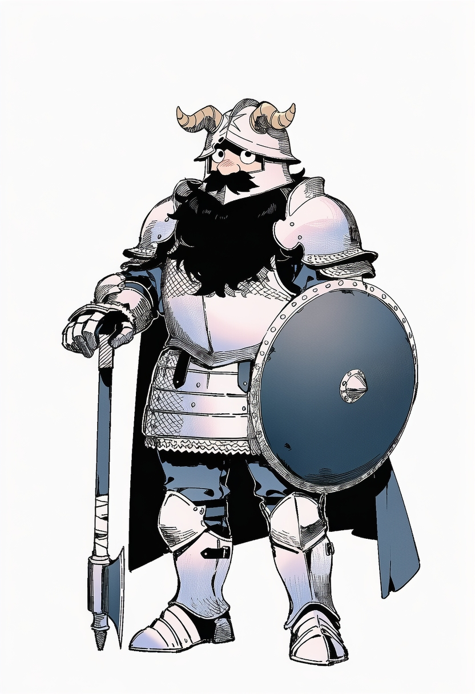

[在线例图](https://assets.quicktagcloud.com/images/raven_composition/raven_composition-1529.jpg?v=b2a18c5f15726624)

<a id="raven_composition-1530"></a>

## 高等精灵游侠

ID：`raven_composition-1530`；分类：身份设定 / 高幻想种族 / 魔兽风；来源标记：`safe`。

来源说明：

> 尖耳、皮甲、披风、长靴和弓箭，做成轻装高机动精灵游侠。

正向提示词：

```text
1.35::elf::, 1.28::pointy_ears::, 1.22::leather_armor::, 1.16::cape::, 1.12::boots::, 1.10::gloves::, 1.08::bow_(weapon)::, 1.06::quiver::
```

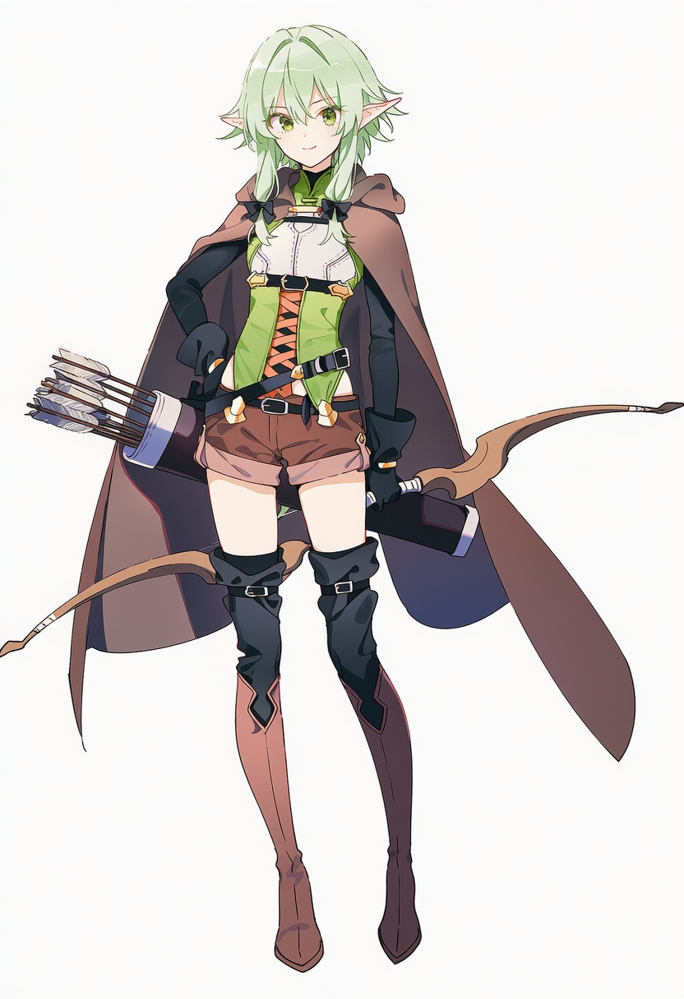

[在线例图](https://assets.quicktagcloud.com/images/raven_composition/raven_composition-1530.jpg?v=8458d02db3084fc7)

<a id="raven_composition-1531"></a>

## 黑暗精灵刺客

ID：`raven_composition-1531`；分类：身份设定 / 高幻想种族 / 魔兽风；来源标记：`safe`。

来源说明：

> 尖耳只是种族底层，真正职业靠黑衣、兜帽、面罩、皮甲和短刃来读。

正向提示词：

```text
1.35::elf::, 1.28::pointy_ears::, 1.22::black_clothes::, 1.16::hood::, 1.12::mask::, 1.10::leather_armor::, 1.08::dagger::, 1.06::boots::
```

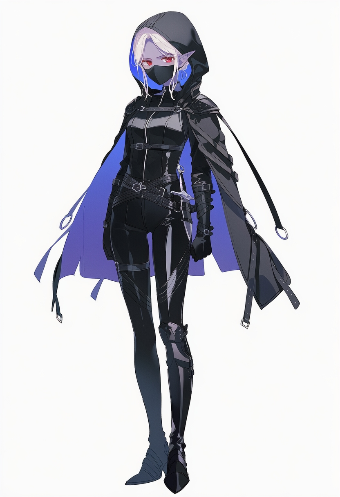

[在线例图](https://assets.quicktagcloud.com/images/raven_composition/raven_composition-1531.jpg?v=fd82eaf0ab1ebc95)

<a id="raven_composition-1532"></a>

## 龙人战士

ID：`raven_composition-1532`；分类：身份设定 / 高幻想种族 / 魔兽风；来源标记：`safe`。

来源说明：

> 角与鳞甲负责龙人身份，大肩甲、手甲、胫甲和长枪负责战士职业。

正向提示词：

```text
1.35::horns::, 1.28::scale_armor::, 1.22::pauldrons::, 1.16::gauntlets::, 1.12::greaves::, 1.10::cape::, 1.08::spear::
```

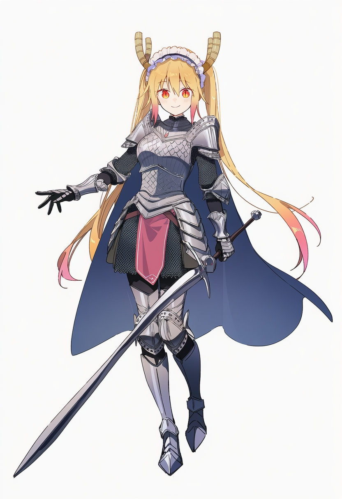

[在线例图](https://assets.quicktagcloud.com/images/raven_composition/raven_composition-1532.jpg?v=ba77b011a716c39f)
