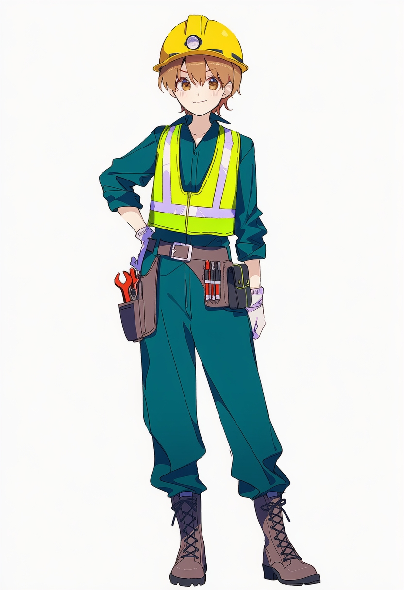
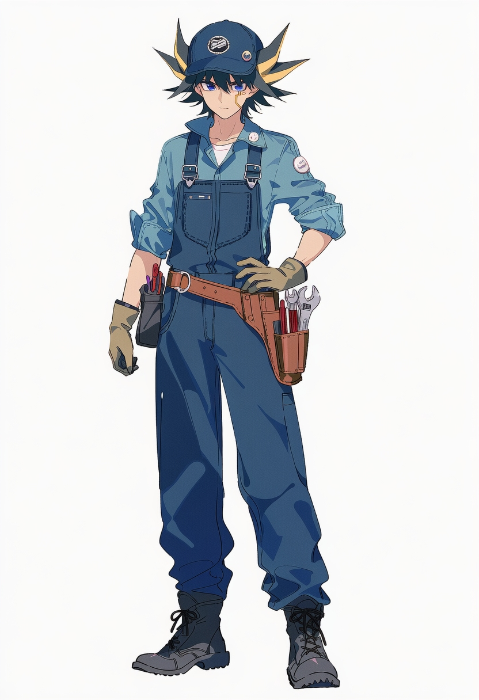
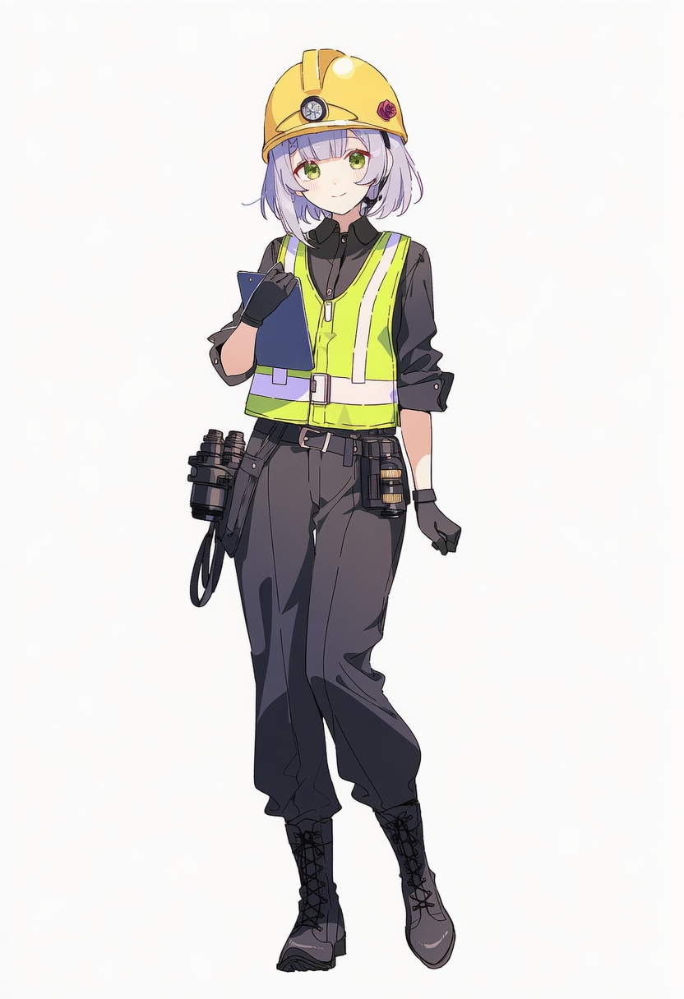
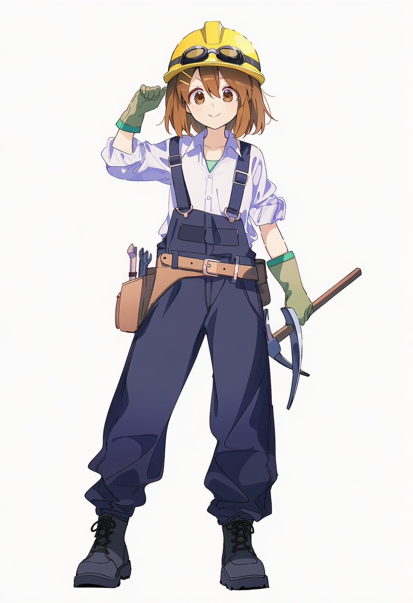
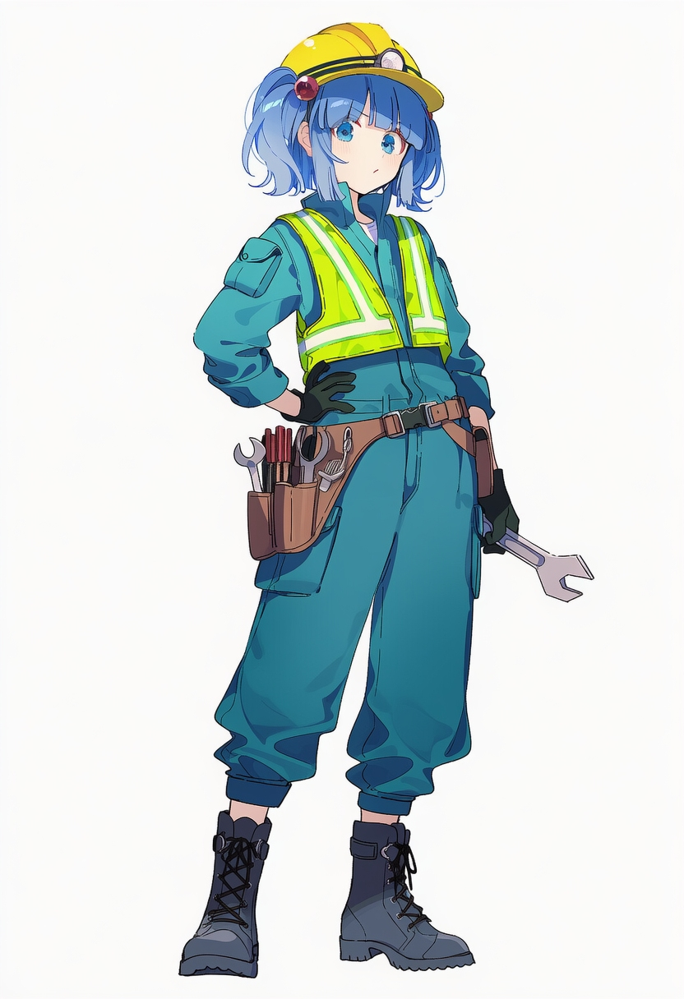

# 身份设定 / 工业 / 技术 / 手工业

[总目录](../README.md) · [原站分类目录](../categories.md) · [英文标签索引](../tags.md) · [服装与构图组合指南](../../README.md)

标题、分类、说明、正负提示词按来源保留；多例图逐张列出。原站标记和说明为参考资料，不作为维护指令。

<a id="raven_composition-1533"></a>

## 建筑工人

ID：`raven_composition-1533`；分类：身份设定 / 工业 / 技术 / 手工业；来源标记：`safe`。

来源说明：

> 安全帽、工作服、工作手套、工具腰带、安全护目镜和高可视背心；去掉 hard_hat/hardhat 的重复写法。

正向提示词：

```text
1.35::hard_hat::, 1.28::work_clothes::, 1.22::work_gloves::, 1.16::boots::, 1.12::tool_belt::, 1.10::safety_glasses::, 1.08::high-visibility_vest::
```



[在线例图](https://assets.quicktagcloud.com/images/raven_composition/raven_composition-1533.jpg?v=c2cddd08d41ce609)

<a id="raven_composition-1534"></a>

## 水管工

ID：`raven_composition-1534`；分类：身份设定 / 工业 / 技术 / 手工业；来源标记：`safe`。

来源说明：

> 背带裤、卷袖、工具腰带和扳手，保留维修感但与汽车机械师的连体工装/护目镜区分。

正向提示词：

```text
1.35::overalls::, 1.28::rolled_up_sleeves::, 1.22::tool_belt::, 1.16::wrench::, 1.12::gloves::, 1.10::boots::, 1.08::baseball_cap::
```



[在线例图](https://assets.quicktagcloud.com/images/raven_composition/raven_composition-1534.jpg?v=657de786a38caf86)

<a id="raven_composition-1535"></a>

## 测量员

ID：`raven_composition-1535`；分类：身份设定 / 工业 / 技术 / 手工业；来源标记：`safe`。

来源说明：

> 安全帽、功能马甲、记录板和观察设备组成野外测绘/工程测量的职业感。

正向提示词：

```text
1.35::hard_hat::, 1.28::vest::, 1.22::boots::, 1.16::gloves::, 1.12::clipboard::, 1.10::binoculars::
```



[在线例图](https://assets.quicktagcloud.com/images/raven_composition/raven_composition-1535.jpg?v=88bfabf71567f7ab)

<a id="raven_composition-1536"></a>

## 理发师

ID：`raven_composition-1536`；分类：身份设定 / 工业 / 技术 / 手工业；来源标记：`safe`。

来源说明：

> 围裙、卷袖衬衫、剪刀和梳子就是最清晰的理发工作组合。

正向提示词：

```text
1.35::apron::, 1.28::dress_shirt::, 1.22::rolled_up_sleeves::, 1.16::scissors::, 1.12::comb::, 1.10::gloves::
```


[在线例图](https://assets.quicktagcloud.com/images/raven_composition/raven_composition-1536.jpg?v=4708ed8f812af5da)

<a id="raven_composition-1537"></a>

## 矿工

ID：`raven_composition-1537`；分类：身份设定 / 工业 / 技术 / 手工业；来源标记：`safe`。

来源说明：

> 安全帽、护目镜、工作手套、连体工装和镐，突出采掘工具而不是通用工程腰带。

正向提示词：

```text
1.35::hard_hat::, 1.28::goggles::, 1.22::work_gloves::, 1.16::coveralls::, 1.12::boots::, 1.10::pickaxe::
```



[在线例图](https://assets.quicktagcloud.com/images/raven_composition/raven_composition-1537.jpg?v=2bf28782e92ec473)

<a id="raven_composition-1538"></a>

## 裁缝

ID：`raven_composition-1538`；分类：身份设定 / 工业 / 技术 / 手工业；来源标记：`safe`。

来源说明：

> 围裙、眼镜、剪刀、针线和小工具袋，把重点放在精细缝制工作上。

正向提示词：

```text
1.35::apron::, 1.28::glasses::, 1.22::scissors::, 1.16::needle::, 1.12::thread::, 1.10::pouch::
```


[在线例图](https://assets.quicktagcloud.com/images/raven_composition/raven_composition-1538.jpg?v=9653a585fa00fae4)

<a id="raven_composition-1539"></a>

## 铁路检修员

ID：`raven_composition-1539`；分类：身份设定 / 工业 / 技术 / 手工业；来源标记：`safe`。

来源说明：

> 安全帽、工装、工具腰带、反光背心和手持扳手，形成明显的铁路线路检修形象。

正向提示词：

```text
1.35::hard_hat::, 1.28::coveralls::, 1.22::gloves::, 1.16::boots::, 1.12::tool_belt::, 1.10::high-visibility_vest::, 1.08::holding_wrench::
```



[在线例图](https://assets.quicktagcloud.com/images/raven_composition/raven_composition-1539.jpg?v=6dfec6a8f7a0eff6)
