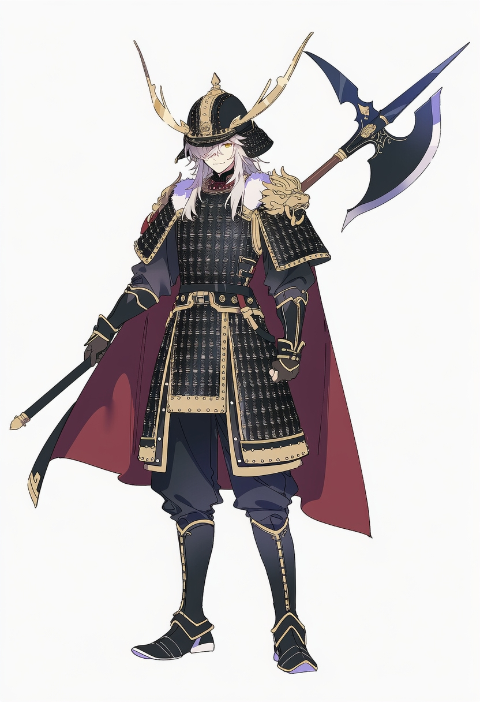
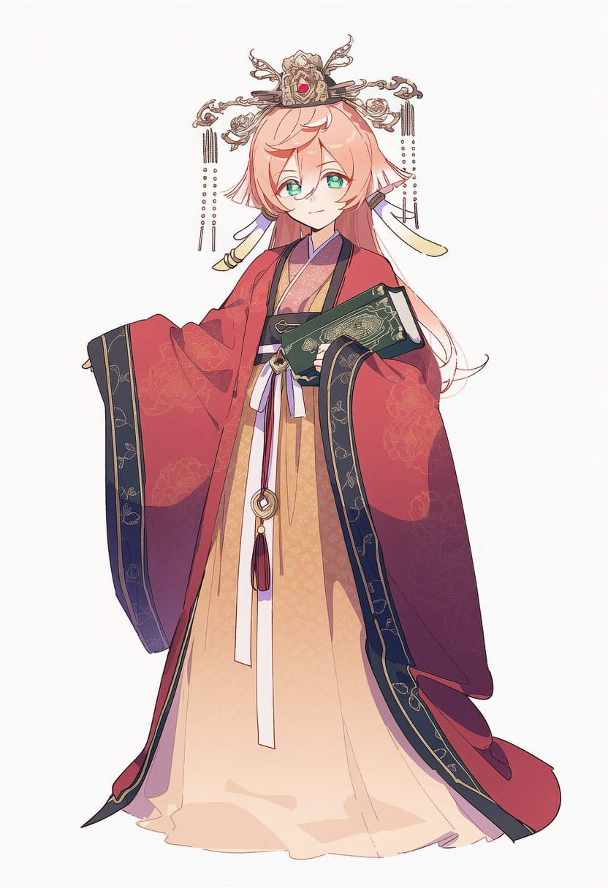
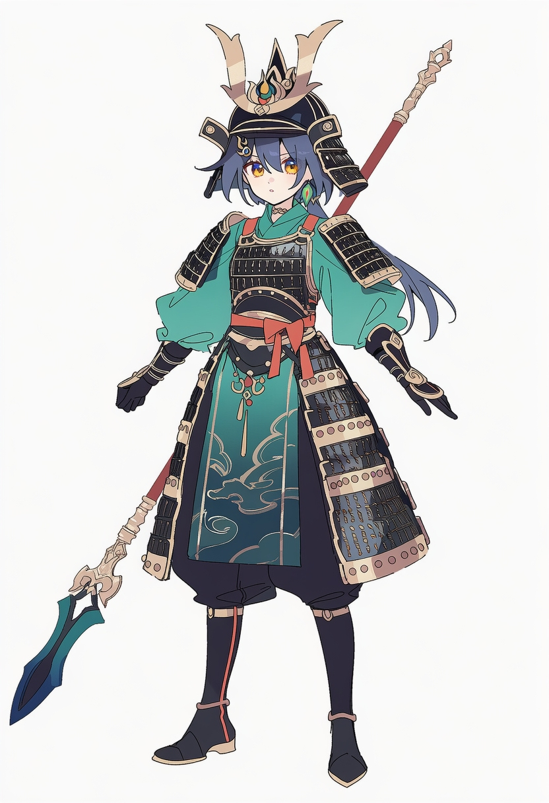
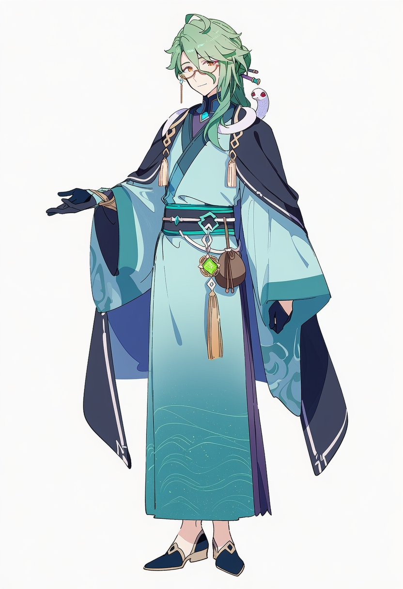

# 身份设定 / 古代中国 / 东亚

[总目录](../README.md) · [原站分类目录](../categories.md) · [英文标签索引](../tags.md) · [服装与构图组合指南](../../README.md)

标题、分类、说明、正负提示词按来源保留；多例图逐张列出。原站标记和说明为参考资料，不作为维护指令。

<a id="raven_composition-1540"></a>

## 古代中国武将

ID：`raven_composition-1540`；分类：身份设定 / 古代中国 / 东亚；来源标记：`safe`。

来源说明：

> 中式札甲、头盔、披风与戟，强调统兵武将的大型长兵器轮廓。

正向提示词：

```text
1.35::chinese_armor::, 1.28::lamellar_armor::, 1.22::helmet::, 1.16::cape::, 1.12::halberd::, 1.10::gauntlets::, 1.08::boots::
```



[在线例图](https://assets.quicktagcloud.com/images/raven_composition/raven_composition-1540.jpg?v=bedd6e7f2d5577e1)

<a id="raven_composition-1541"></a>

## 古代厨师

ID：`raven_composition-1541`；分类：身份设定 / 古代中国 / 东亚；来源标记：`safe`。

来源说明：

> 中式工作服叠围裙、头巾、卷袖和厨刀，做成古代酒楼后厨人员。

正向提示词：

```text
1.35::chinese_clothes::, 1.28::apron::, 1.22::headscarf::, 1.16::rolled_up_sleeves::, 1.12::kitchen_knife::, 1.10::boots::
```


[在线例图](https://assets.quicktagcloud.com/images/raven_composition/raven_composition-1541.jpg?v=0310436c3c606c9d)

<a id="raven_composition-1542"></a>

## 古代文官

ID：`raven_composition-1542`；分类：身份设定 / 古代中国 / 东亚；来源标记：`safe`。

来源说明：

> 大袖官服感的长袍配书本、折扇与整齐发饰，重点是文职、礼仪和克制。

正向提示词：

```text
1.35::hanfu::, 1.28::robe::, 1.22::wide_sleeves::, 1.16::sash::, 1.12::book::, 1.10::folding_fan::, 1.08::hair_stick::, 1.06::yuanlingpao::, 1.04::chinese_clothes::, 1.02::guan_hat::
```



[在线例图](https://assets.quicktagcloud.com/images/raven_composition/raven_composition-1542.jpg?v=f849d2d21e010cc6)

<a id="raven_composition-1543"></a>

## 宫廷禁军

ID：`raven_composition-1543`；分类：身份设定 / 古代中国 / 东亚；来源标记：`safe`。

来源说明：

> 中式札甲、头盔、罩袍与长枪，强调宫廷守卫的制式制服感，与武将披风/戟区分。

正向提示词：

```text
1.35::chinese_armor::, 1.28::lamellar_armor::, 1.22::helmet::, 1.16::tabard::, 1.12::spear::, 1.10::gauntlets::, 1.08::boots::
```



[在线例图](https://assets.quicktagcloud.com/images/raven_composition/raven_composition-1543.jpg?v=243fd00eb3bfe933)

<a id="raven_composition-1544"></a>

## 御医

ID：`raven_composition-1544`；分类：身份设定 / 古代中国 / 东亚；来源标记：`safe`。

来源说明：

> 宫廷长袍结构里加入药袋、药瓶和手套，表现古代医官身份。

正向提示词：

```text
1.35::hanfu::, 1.28::robe::, 1.22::wide_sleeves::, 1.16::sash::, 1.12::pouch::, 1.10::bottle::, 1.08::gloves::
```



[在线例图](https://assets.quicktagcloud.com/images/raven_composition/raven_composition-1544.jpg?v=71f9158c61ebfb0f)
