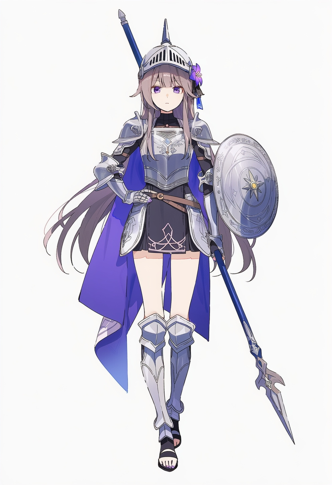
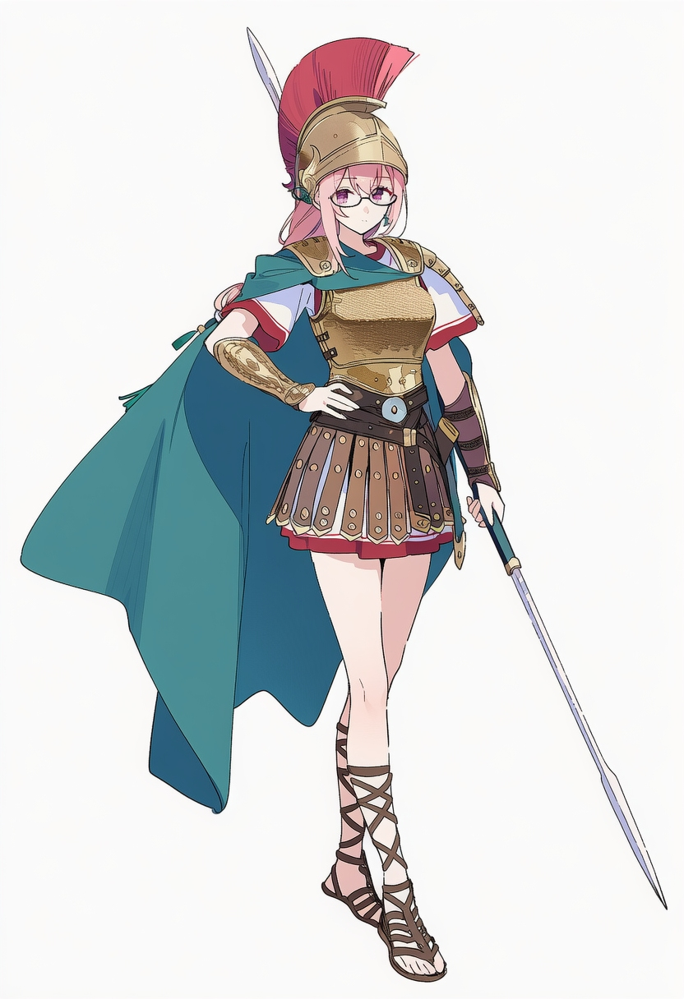

# 身份设定 / 古典文明 / 地中海

[总目录](../README.md) · [原站分类目录](../categories.md) · [英文标签索引](../tags.md) · [服装与构图组合指南](../../README.md)

标题、分类、说明、正负提示词按来源保留；多例图逐张列出。原站标记和说明为参考资料，不作为维护指令。

<a id="raven_composition-1545"></a>

## 古希腊重装步兵

ID：`raven_composition-1545`；分类：身份设定 / 古典文明 / 地中海；来源标记：`safe`。

来源说明：

> 头盔、胸甲、胫甲、圆盾和长矛构成经典重装步兵几何轮廓。

正向提示词：

```text
1.35::helmet::, 1.28::breastplate::, 1.22::greaves::, 1.16::cape::, 1.12::round_shield::, 1.10::spear::, 1.08::sandals::
```



[在线例图](https://assets.quicktagcloud.com/images/raven_composition/raven_composition-1545.jpg?v=1838883412d40b5c)

<a id="raven_composition-1546"></a>

## 罗马军团士兵

ID：`raven_composition-1546`；分类：身份设定 / 古典文明 / 地中海；来源标记：`safe`。

来源说明：

> 罗马甲、头盔、披风、凉鞋、盾和短兵器，形成典型军团步兵形象。

正向提示词：

```text
1.35::roman_armor::, 1.28::helmet::, 1.22::cape::, 1.16::sandals::, 1.12::shield::, 1.10::spear::, 1.08::sword::, 1.06::roman_clothes::
```



[在线例图](https://assets.quicktagcloud.com/images/raven_composition/raven_composition-1546.jpg?v=ce2a00daaeb2afa7)
