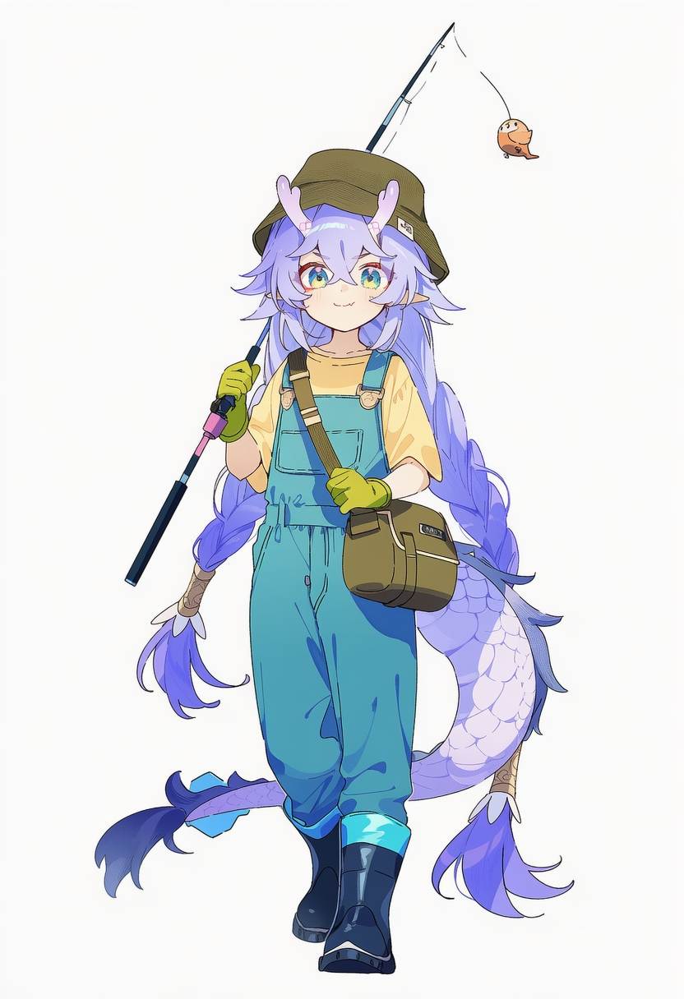
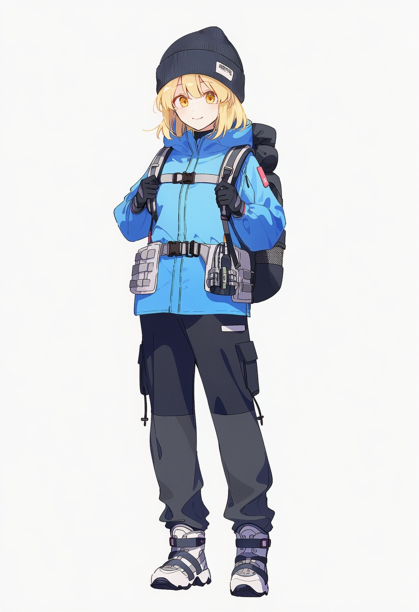

# 身份设定 / 户外 / 农林渔业

[总目录](../README.md) · [原站分类目录](../categories.md) · [英文标签索引](../tags.md) · [服装与构图组合指南](../../README.md)

标题、分类、说明、正负提示词按来源保留；多例图逐张列出。原站标记和说明为参考资料，不作为维护指令。

<a id="raven_composition-1551"></a>

## 园丁

ID：`raven_composition-1551`；分类：身份设定 / 户外 / 农林渔业；来源标记：`safe`。

来源说明：

> 遮阳帽、围裙、手套、靴子是园艺工作的视觉重点，篮子增加采摘/维护感。

正向提示词：

```text
1.35::sun_hat::, 1.28::apron::, 1.22::gloves::, 1.16::boots::, 1.12::overalls::, 1.10::basket::, 1.08::straw_hat::, 1.06::work_gloves::, 1.04::holding_watering_can::, 1.02::holding_shovel::
```


[在线例图](https://assets.quicktagcloud.com/images/raven_composition/raven_composition-1551.jpg?v=eb4c8e9bf6efe81d)

<a id="raven_composition-1552"></a>

## 救生员

ID：`raven_composition-1552`；分类：身份设定 / 户外 / 农林渔业；来源标记：`safe`。

来源说明：

> 泳装、口哨、遮阳帽与太阳镜形成泳池/海滩救生员的典型轮廓。

正向提示词：

```text
1.35::swimsuit::, 1.28::whistle::, 1.22::sun_hat::, 1.16::sunglasses::, 1.12::sandals::, 1.10::fanny_pack::
```


[在线例图](https://assets.quicktagcloud.com/images/raven_composition/raven_composition-1552.jpg?v=059dbc18b6e4f2b0)

<a id="raven_composition-1553"></a>

## 渔夫

ID：`raven_composition-1553`；分类：身份设定 / 户外 / 农林渔业；来源标记：`safe`。

来源说明：

> 雨衣、胶靴、针织帽和背带裤，做出海边湿冷、耐脏耐水的工作服。

正向提示词：

```text
1.35::raincoat::, 1.28::rubber_boots::, 1.22::beanie::, 1.16::gloves::, 1.12::overalls::, 1.10::shoulder_bag::, 1.08::fishing_vest::, 1.06::bucket_hat::, 1.04::work_gloves::, 1.02::holding_fishing_rod::
```



[在线例图](https://assets.quicktagcloud.com/images/raven_composition/raven_composition-1553.jpg?v=eb64ad1117edff0c)

<a id="raven_composition-1554"></a>

## 生态穹顶园丁

ID：`raven_composition-1554`；分类：身份设定 / 户外 / 农林渔业；来源标记：`safe`。

来源说明：

> 园艺围裙和手套仍是核心，工作服与工牌让它更像封闭殖民地里的专业维护岗位。

正向提示词：

```text
1.35::coveralls::, 1.28::apron::, 1.22::gloves::, 1.16::boots::, 1.12::sun_hat::, 1.10::basket::, 1.08::id_card::
```


[在线例图](https://assets.quicktagcloud.com/images/raven_composition/raven_composition-1554.jpg?v=18392daf1eaedf9b)

<a id="raven_composition-1555"></a>

## 登山向导

ID：`raven_composition-1555`；分类：身份设定 / 户外 / 农林渔业；来源标记：`safe`。

来源说明：

> 户外层叠服、登山靴、背包、手套和保暖帽，重视耐候性。

正向提示词：

```text
1.35::outdoor_clothes::, 1.28::hiking_boots::, 1.22::backpack::, 1.16::gloves::, 1.12::beanie::, 1.10::utility_belt::
```



[在线例图](https://assets.quicktagcloud.com/images/raven_composition/raven_composition-1555.jpg?v=56758b85d1546d2e)
