# 身份设定 / 剑与魔法 / 冒险者世界

[总目录](../README.md) · [原站分类目录](../categories.md) · [英文标签索引](../tags.md) · [服装与构图组合指南](../../README.md)

标题、分类、说明、正负提示词按来源保留；多例图逐张列出。原站标记和说明为参考资料，不作为维护指令。

<a id="raven_composition-1556"></a>

## 神官

ID：`raven_composition-1556`；分类：身份设定 / 剑与魔法 / 冒险者世界；来源标记：`safe`。

来源说明：

> 用长袍、圣带、十字饰品和法杖，做 RPG 里的治疗/圣职角色。

正向提示词：

```text
1.35::robe::, 1.28::stole::, 1.22::cross_necklace::, 1.16::long_sleeves::, 1.12::holding_staff::, 1.10::boots::, 1.08::priest::, 1.06::crosier::, 1.04::cape::
```

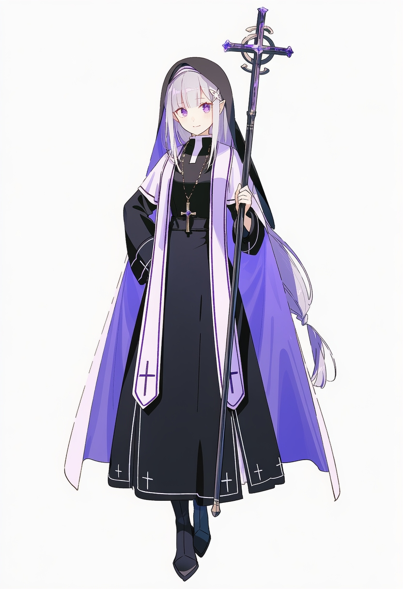

[在线例图](https://assets.quicktagcloud.com/images/raven_composition/raven_composition-1556.jpg?v=a59a8421e82d6d09)

<a id="raven_composition-1557"></a>

## 马戏团驯兽师

ID：`raven_composition-1557`；分类：身份设定 / 剑与魔法 / 冒险者世界；来源标记：`safe`。

来源说明：

> 用夸张燕尾服、高礼帽、长靴和鞭子做马戏团领班/驯兽师。

正向提示词：

```text
1.35::tailcoat::, 1.28::top_hat::, 1.22::boots::, 1.16::white_gloves::, 1.12::whip::
```

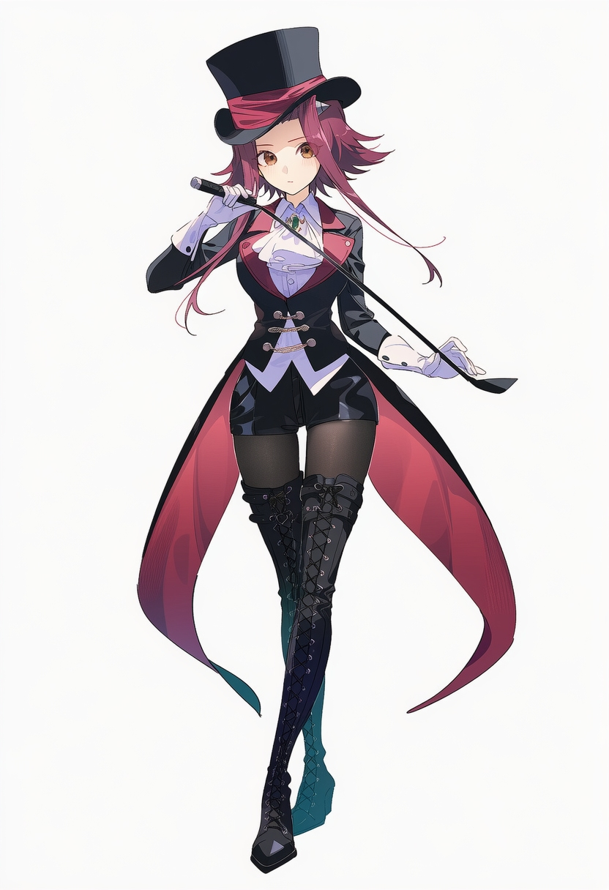

[在线例图](https://assets.quicktagcloud.com/images/raven_composition/raven_composition-1557.jpg?v=4fab25c45ce72c18)

<a id="raven_composition-1558"></a>

## 乡野女巫

ID：`raven_composition-1558`；分类：身份设定 / 剑与魔法 / 冒险者世界；来源标记：`safe`。

来源说明：

> 用围裙、长裙、旧披风和扫帚做出乡野生活感，减少贵族和学院风。

正向提示词：

```text
1.35::witch_hat::, 1.28::cloak::, 1.22::apron::, 1.16::long_skirt::, 1.12::boots::, 1.10::broom::, 1.08::pouch::
```

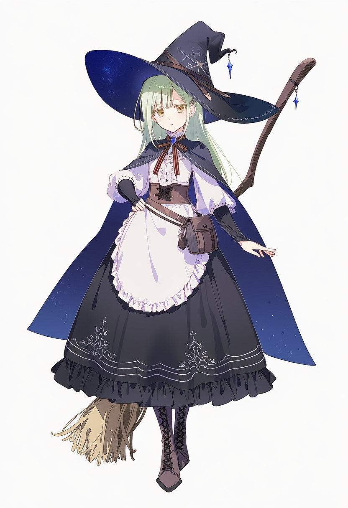

[在线例图](https://assets.quicktagcloud.com/images/raven_composition/raven_composition-1558.jpg?v=8475668e00fe8556)

<a id="raven_composition-1559"></a>

## 占卜师

ID：`raven_composition-1559`；分类：身份设定 / 剑与魔法 / 冒险者世界；来源标记：`safe`。

来源说明：

> 面纱、披肩和大量珠宝构成神秘感，水晶球是职业最直接的道具提示。

正向提示词：

```text
1.35::veil::, 1.28::shawl::, 1.22::jewelry::, 1.16::bangle::, 1.12::necklace::, 1.10::head_chain::, 1.08::crystal_ball::
```

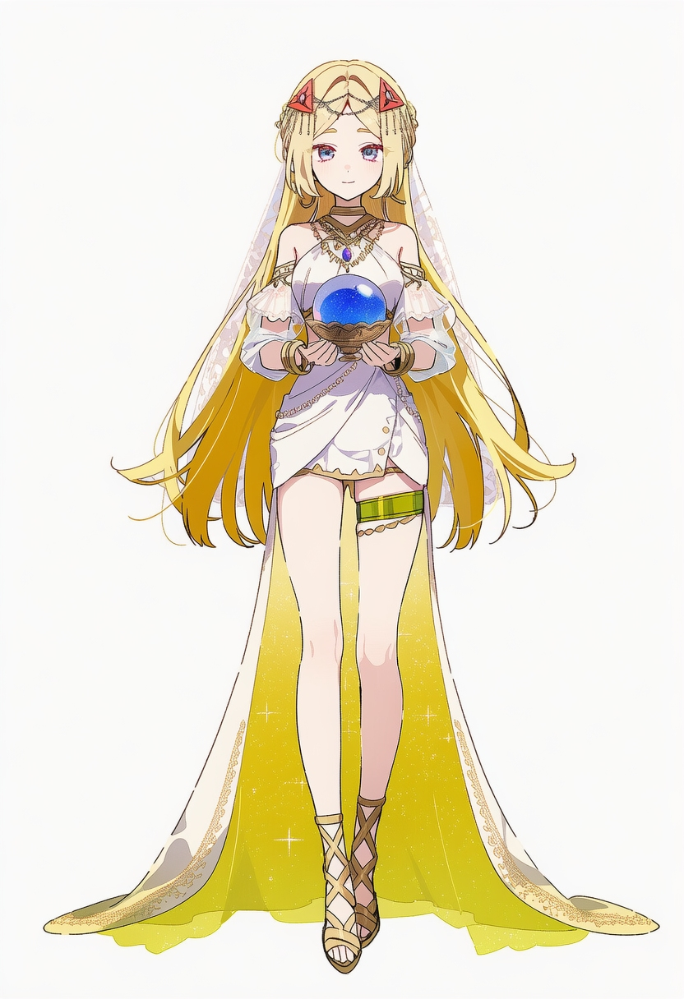

[在线例图](https://assets.quicktagcloud.com/images/raven_composition/raven_composition-1559.jpg?v=5b21b098b907fd01)

<a id="raven_composition-1560"></a>

## 吟游诗人

ID：`raven_composition-1560`；分类：身份设定 / 剑与魔法 / 冒险者世界；来源标记：`safe`。

来源说明：

> 羽饰帽、披风、束腰上衣和长靴，最后用鲁特琴把职业钉死。

正向提示词：

```text
1.35::feathered_hat::, 1.28::cape::, 1.22::tunic::, 1.16::belt::, 1.12::boots::, 1.10::lute::, 1.08::feather::, 1.06::vest::, 1.04::bard::, 1.02::capelet::
```


[在线例图](https://assets.quicktagcloud.com/images/raven_composition/raven_composition-1560.jpg?v=af3de01f1af3570d)

<a id="raven_composition-1561"></a>

## 地城测绘师

ID：`raven_composition-1561`；分类：身份设定 / 剑与魔法 / 冒险者世界；来源标记：`safe`。

来源说明：

> 兜帽披风、挎包、罗盘和记录本，突出在迷宫里画地图而不是正面战斗。

正向提示词：

```text
1.35::hood::, 1.28::cloak::, 1.22::boots::, 1.16::satchel::, 1.12::compass::, 1.10::book::, 1.08::gloves::
```

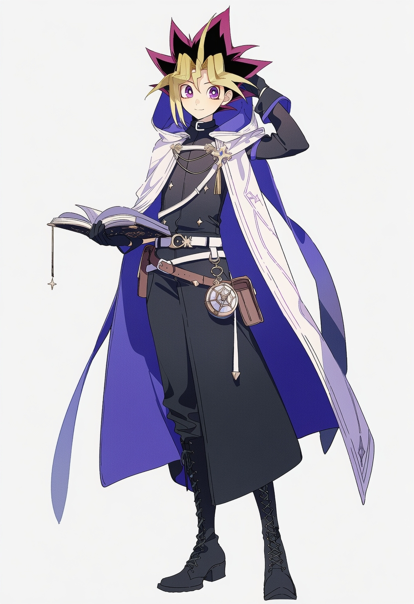

[在线例图](https://assets.quicktagcloud.com/images/raven_composition/raven_composition-1561.jpg?v=1e5948d8386913c9)

<a id="raven_composition-1562"></a>

## 学院女巫

ID：`raven_composition-1562`；分类：身份设定 / 剑与魔法 / 冒险者世界；来源标记：`safe`。

来源说明：

> 把女巫帽和魔杖保留，但服装改成学院制服结构，适合魔法学校设定。

正向提示词：

```text
1.35::witch_hat::, 1.28::robe::, 1.22::collared_shirt::, 1.16::pleated_skirt::, 1.12::neck_ribbon::, 1.10::knee_boots::, 1.08::holding_wand::
```

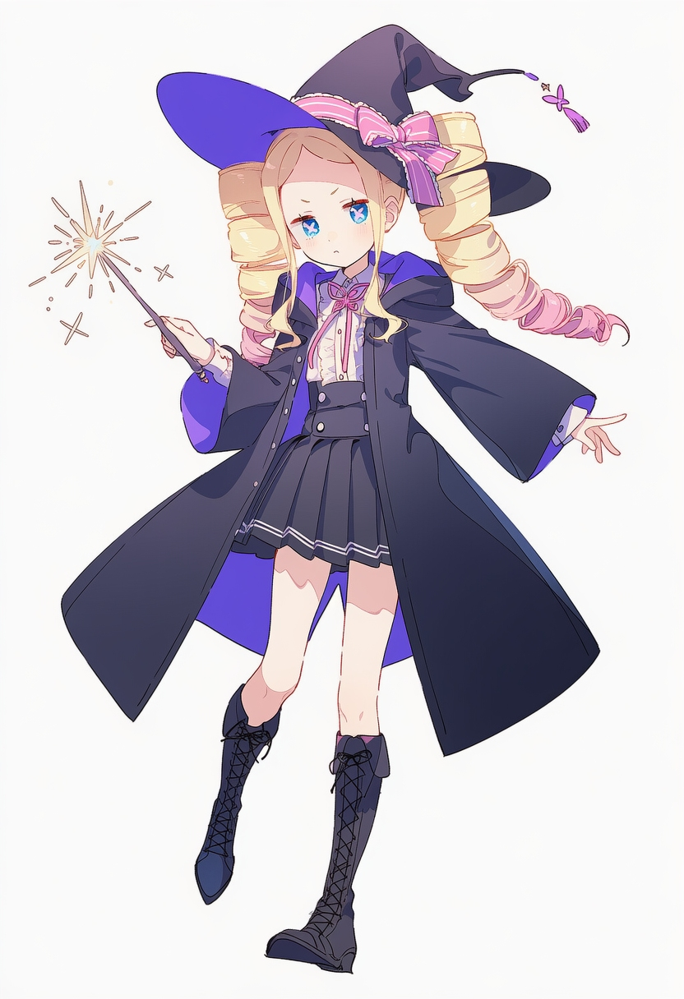

[在线例图](https://assets.quicktagcloud.com/images/raven_composition/raven_composition-1562.jpg?v=c0119830e954b6f9)

<a id="raven_composition-1563"></a>

## 宫廷女巫

ID：`raven_composition-1563`；分类：身份设定 / 剑与魔法 / 冒险者世界；来源标记：`safe`。

来源说明：

> 保留女巫帽，但把粗糙旅行装换成贵族长裙、束腰、短披肩和胸针。

正向提示词：

```text
1.35::witch_hat::, 1.28::aristocratic_clothes::, 1.22::long_dress::, 1.16::corset::, 1.12::capelet::, 1.10::brooch::, 1.08::wand::
```

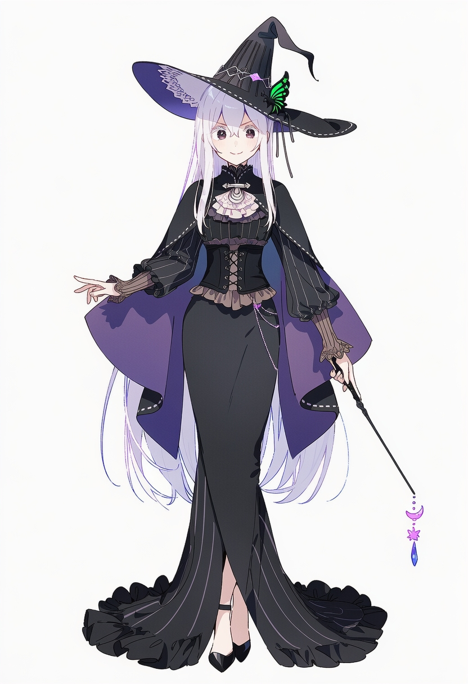

[在线例图](https://assets.quicktagcloud.com/images/raven_composition/raven_composition-1563.jpg?v=e8cfcbf273da8705)

<a id="raven_composition-1564"></a>

## 宫廷预言师

ID：`raven_composition-1564`；分类：身份设定 / 剑与魔法 / 冒险者世界；来源标记：`safe`。

来源说明：

> 面纱、头链与水晶球形成神秘预言视觉，披肩和珠宝抬高宫廷身份。

正向提示词：

```text
1.35::veil::, 1.28::robe::, 1.22::capelet::, 1.16::jewelry::, 1.12::head_chain::, 1.10::crystal_ball::, 1.08::staff::
```

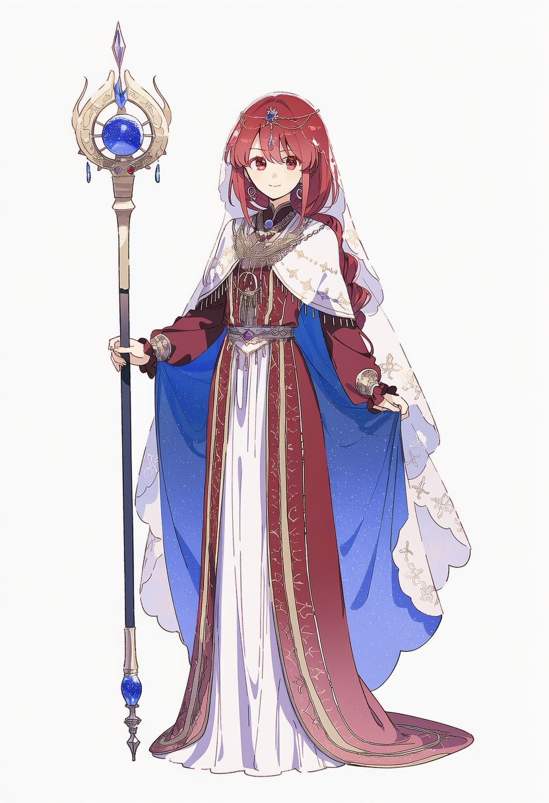

[在线例图](https://assets.quicktagcloud.com/images/raven_composition/raven_composition-1564.jpg?v=ee8ea7d95dc17a5c)

<a id="raven_composition-1565"></a>

## 异世界女巫

ID：`raven_composition-1565`；分类：身份设定 / 剑与魔法 / 冒险者世界；来源标记：`safe`。

来源说明：

> 宽大的尖顶女巫帽放最高权重，再叠披风、长裙、束腰、靴子、魔杖和药剂袋。

正向提示词：

```text
1.35::witch_hat::, 1.28::cloak::, 1.22::long_dress::, 1.16::corset::, 1.12::boots::, 1.10::wand::, 1.08::pouch::, 1.06::potion::, 1.04::robe::, 1.02::wide_sleeves::
```

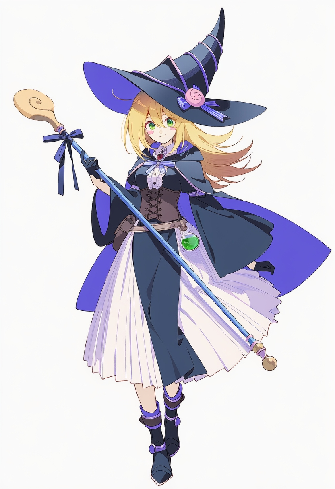

[在线例图](https://assets.quicktagcloud.com/images/raven_composition/raven_composition-1565.jpg?v=1419e5af95832405)

<a id="raven_composition-1566"></a>

## 德鲁伊

ID：`raven_composition-1566`；分类：身份设定 / 剑与魔法 / 冒险者世界；来源标记：`safe`。

来源说明：

> 披风、毛皮、鹿角、木杖和小袋，把自然祭司/荒野施法者视觉做出来。

正向提示词：

```text
1.35::cloak::, 1.28::fur_trim::, 1.22::antlers::, 1.16::staff::, 1.12::prayer_beads::, 1.10::pouch::, 1.08::boots::, 1.06::leaf::, 1.04::druid::, 1.02::hooded_cloak::
```

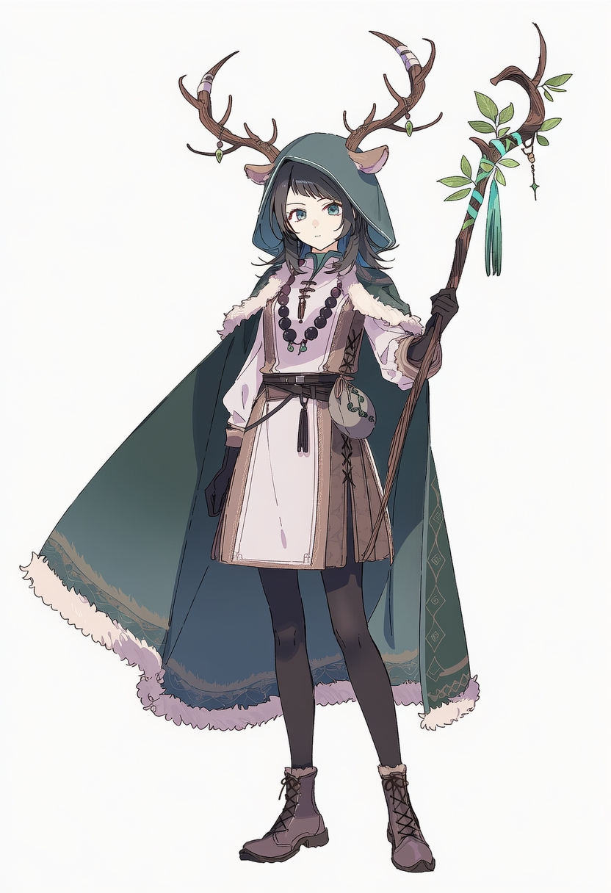

[在线例图](https://assets.quicktagcloud.com/images/raven_composition/raven_composition-1566.jpg?v=a02231c7595e776e)

<a id="raven_composition-1567"></a>

## 战斗法师

ID：`raven_composition-1567`；分类：身份设定 / 剑与魔法 / 冒险者世界；来源标记：`safe`。

来源说明：

> 把法袍穿进护甲体系：肩甲、手甲、靴子和法杖同时存在，视觉上就是“披甲法师”。

正向提示词：

```text
1.35::armor::, 1.28::robe::, 1.22::pauldrons::, 1.16::gauntlets::, 1.12::staff::, 1.10::boots::, 1.08::cape::, 1.06::light_armor::, 1.04::shoulder_armor::, 1.02::bracer::
```

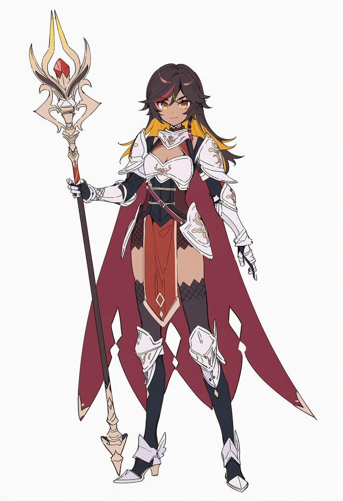

[在线例图](https://assets.quicktagcloud.com/images/raven_composition/raven_composition-1567.jpg?v=f960187abd5edece)

<a id="raven_composition-1568"></a>

## 森林游侠

ID：`raven_composition-1568`；分类：身份设定 / 剑与魔法 / 冒险者世界；来源标记：`safe`。

来源说明：

> 兜帽斗篷、皮甲、护臂、弓箭与叶片元素，突出森林游侠的自然系轮廓。

正向提示词：

```text
1.35::hooded_cloak::, 1.28::leather_armor::, 1.22::bracer::, 1.16::quiver::, 1.12::bow_(weapon)::, 1.10::boots::, 1.08::belt_pouch::, 1.06::leaf::
```

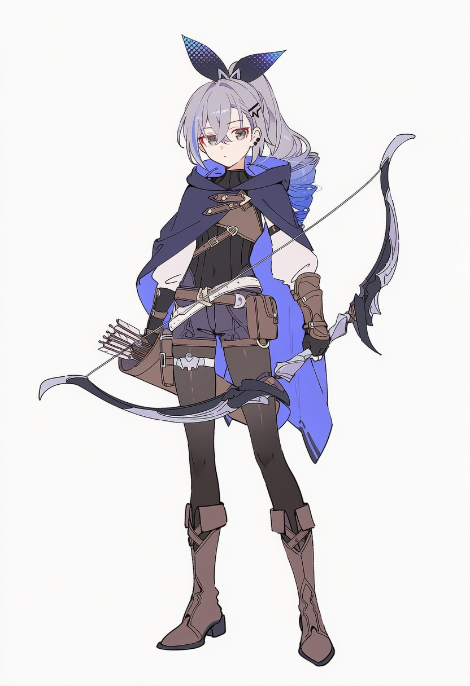

[在线例图](https://assets.quicktagcloud.com/images/raven_composition/raven_composition-1568.jpg?v=d93af3dcc5717f9e)

<a id="raven_composition-1569"></a>

## 炼金术士

ID：`raven_composition-1569`；分类：身份设定 / 剑与魔法 / 冒险者世界；来源标记：`safe`。

来源说明：

> 围裙、护目镜、手套、药瓶和大量小包最重要，长外套增加实验旅行者的感觉。

正向提示词：

```text
1.35::apron::, 1.28::gloves::, 1.22::goggles::, 1.16::belt_pouch::, 1.12::bottle::, 1.10::satchel::, 1.08::long_coat::, 1.06::boots::, 1.04::alchemist::, 1.02::leather_gloves::
```

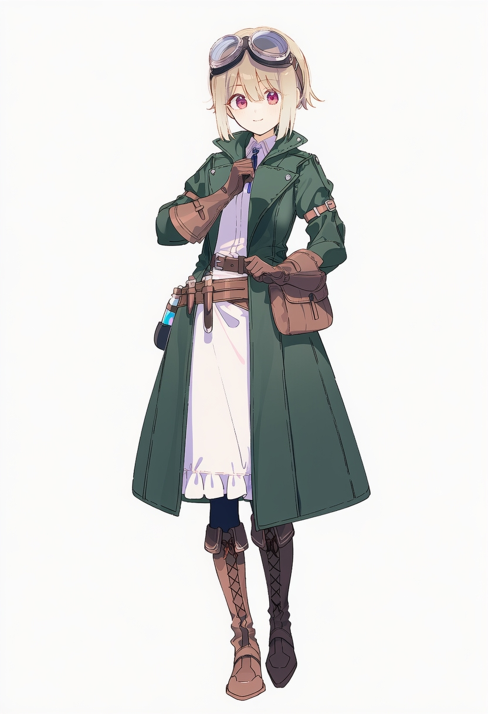

[在线例图](https://assets.quicktagcloud.com/images/raven_composition/raven_composition-1569.jpg?v=dfb1ca02f899fb8c)

<a id="raven_composition-1570"></a>

## 狮鹫骑士

ID：`raven_composition-1570`；分类：身份设定 / 剑与魔法 / 冒险者世界；来源标记：`safe`。

来源说明：

> 板甲、翼形头盔、披风、长枪和盾牌，让空中骑士的仪仗感更强。

正向提示词：

```text
1.35::plate_armor::, 1.28::winged_helmet::, 1.22::cape::, 1.16::gauntlets::, 1.12::boots::, 1.10::lance::, 1.08::shield::
```

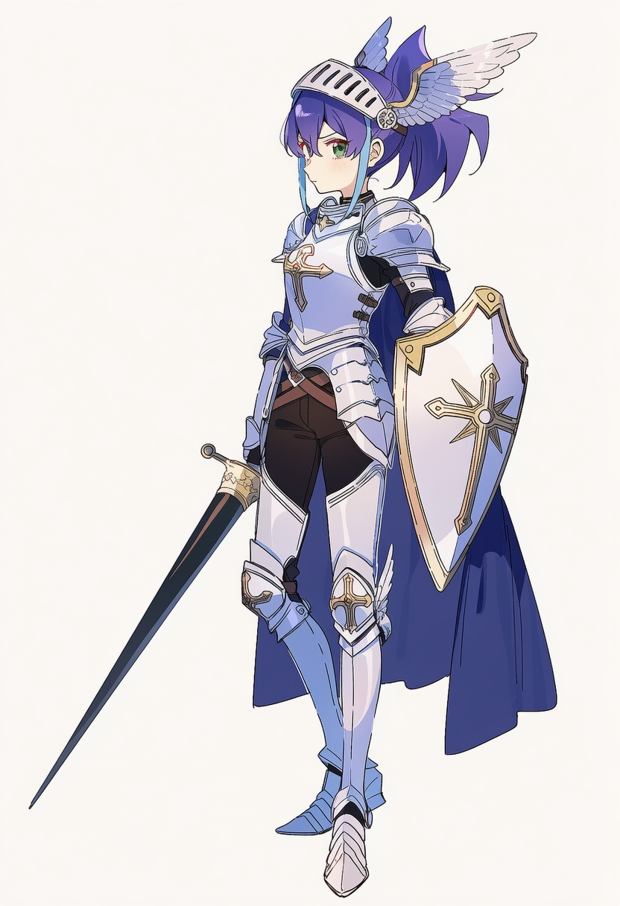

[在线例图](https://assets.quicktagcloud.com/images/raven_composition/raven_composition-1570.jpg?v=80ed11abdb840cdb)

<a id="raven_composition-1571"></a>

## 萨满

ID：`raven_composition-1571`；分类：身份设定 / 剑与魔法 / 冒险者世界；来源标记：`safe`。

来源说明：

> 毛皮、羽毛、骨饰、面具和珠串，做成部族祭祀/灵媒式视觉。

正向提示词：

```text
1.35::fur_trim::, 1.28::feather::, 1.22::necklace::, 1.16::bone::, 1.12::staff::, 1.10::mask::, 1.08::beads::
```

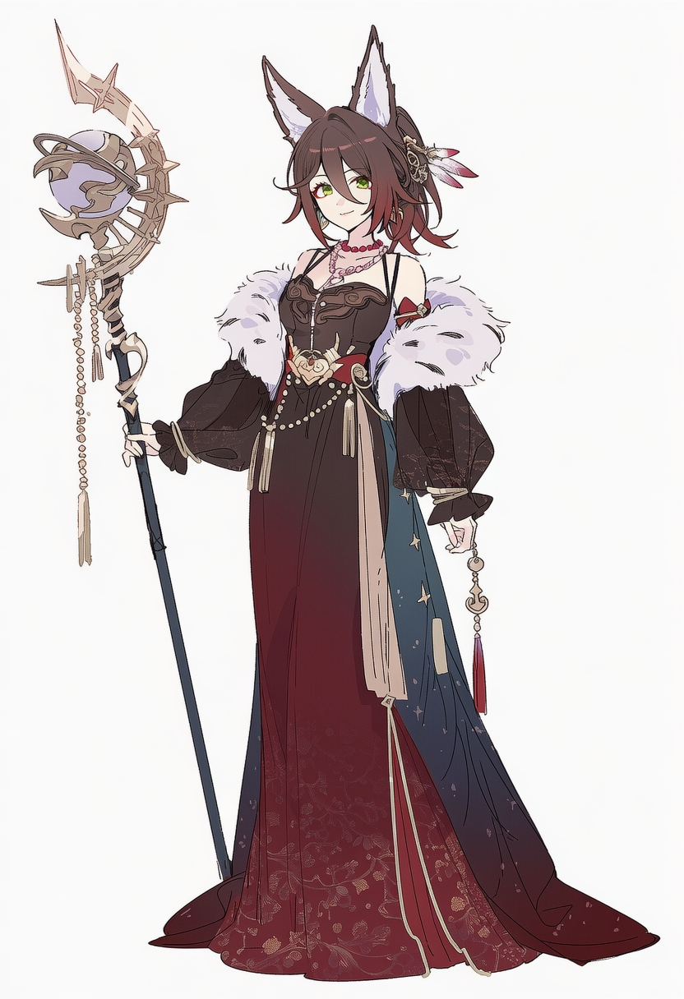

[在线例图](https://assets.quicktagcloud.com/images/raven_composition/raven_composition-1571.jpg?v=184099175189157d)

<a id="raven_composition-1572"></a>

## 驯兽师

ID：`raven_composition-1572`；分类：身份设定 / 剑与魔法 / 冒险者世界；来源标记：`safe`。

来源说明：

> 皮甲、毛皮、手套、鞭子和工具包，强调野外驯养而不是纯战士。

正向提示词：

```text
1.35::leather_armor::, 1.28::fur_trim::, 1.22::gloves::, 1.16::boots::, 1.12::whip::, 1.10::belt_pouch::, 1.08::cloak::, 1.06::leash::, 1.04::animal::
```

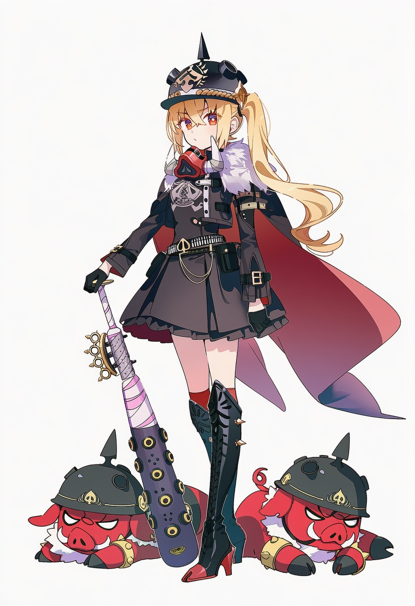

[在线例图](https://assets.quicktagcloud.com/images/raven_composition/raven_composition-1572.jpg?v=0b24b2d1a2200635)

<a id="raven_composition-1573"></a>

## 魔剑士

ID：`raven_composition-1573`；分类：身份设定 / 剑与魔法 / 冒险者世界；来源标记：`safe`。

来源说明：

> 用带甲礼服/轻甲而不是全身重甲，再加剑与护符，兼顾施法和近战。

正向提示词：

```text
1.35::armored_dress::, 1.28::gauntlets::, 1.22::boots::, 1.16::cape::, 1.12::sword::, 1.10::amulet::, 1.08::magic::, 1.06::light_armor::, 1.04::armor::
```

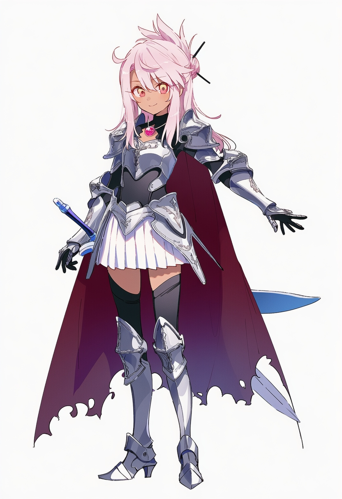

[在线例图](https://assets.quicktagcloud.com/images/raven_composition/raven_composition-1573.jpg?v=791ca211eb9c8366)

<a id="raven_composition-1574"></a>

## 魔法学院学生

ID：`raven_composition-1574`；分类：身份设定 / 剑与魔法 / 冒险者世界；来源标记：`safe`。

来源说明：

> 校服作为底层，外加短法袍、披肩、魔杖、课本和书包，直接体现学院生活。

正向提示词：

```text
1.35::school_uniform::, 1.28::robe::, 1.22::capelet::, 1.16::necktie::, 1.12::wand::, 1.10::book::, 1.08::satchel::
```

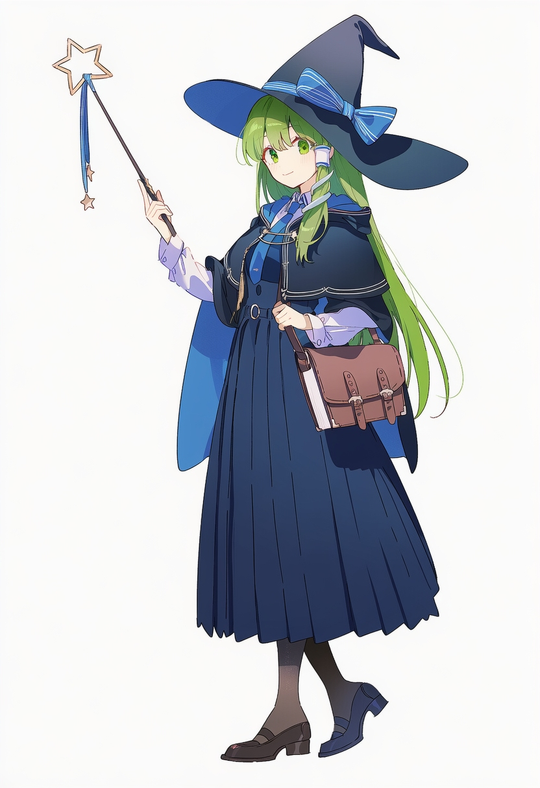

[在线例图](https://assets.quicktagcloud.com/images/raven_composition/raven_composition-1574.jpg?v=e3177c72c7c3ae03)

<a id="raven_composition-1575"></a>

## 魔法药草师

ID：`raven_composition-1575`；分类：身份设定 / 剑与魔法 / 冒险者世界；来源标记：`safe`。

来源说明：

> 药草师的篮子、药瓶、围裙与法袍混合，像会用魔法处理植物与药剂的职业。

正向提示词：

```text
1.35::hood::, 1.28::apron::, 1.22::robe::, 1.16::basket::, 1.12::pouch::, 1.10::bottle::, 1.08::gloves::
```

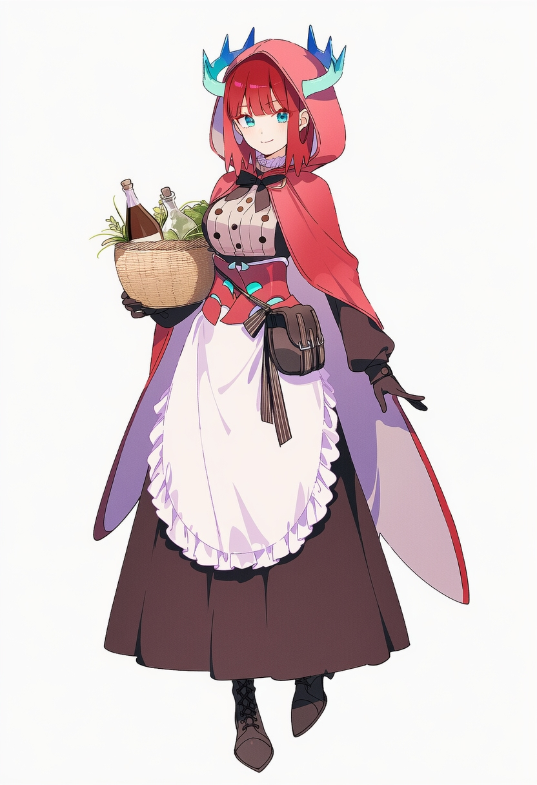

[在线例图](https://assets.quicktagcloud.com/images/raven_composition/raven_composition-1575.jpg?v=9d102c05a3f6bbdb)

<a id="raven_composition-1576"></a>

## 灵能术士

ID：`raven_composition-1576`；分类：身份设定 / 剑与魔法 / 冒险者世界；来源标记：`safe`。

来源说明：

> 把法袍与紧身科技内层混搭，额环和珠宝让它更像科幻宇宙里的灵能阶层。

正向提示词：

```text
1.35::bodysuit::, 1.28::robe::, 1.22::cape::, 1.16::gloves::, 1.12::circlet::, 1.10::jewelry::
```

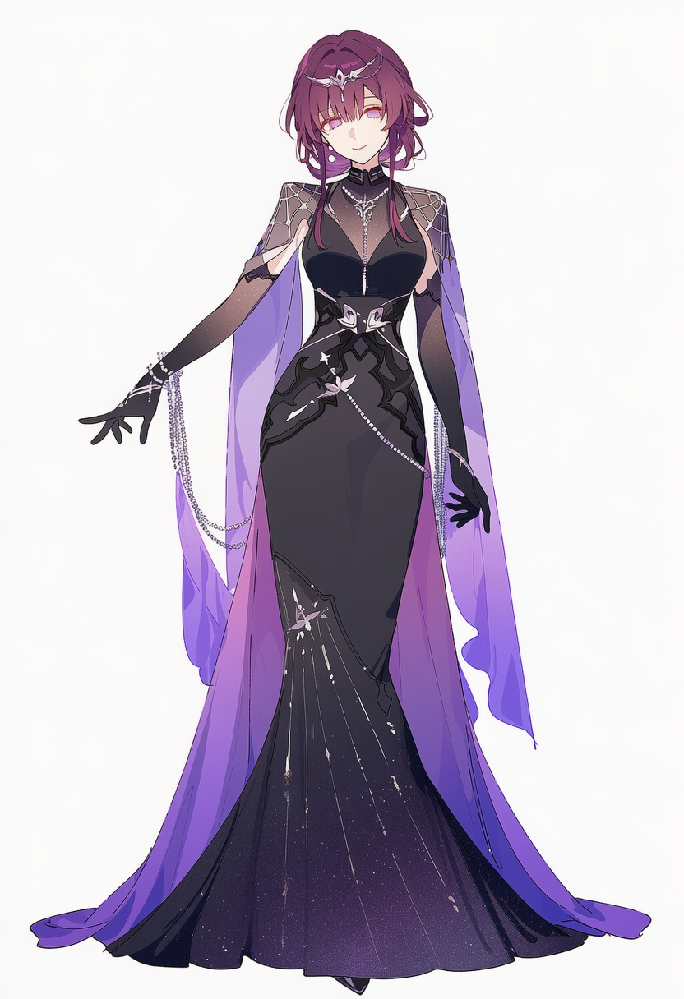

[在线例图](https://assets.quicktagcloud.com/images/raven_composition/raven_composition-1576.jpg?v=9505a7ec5798cb5c)
