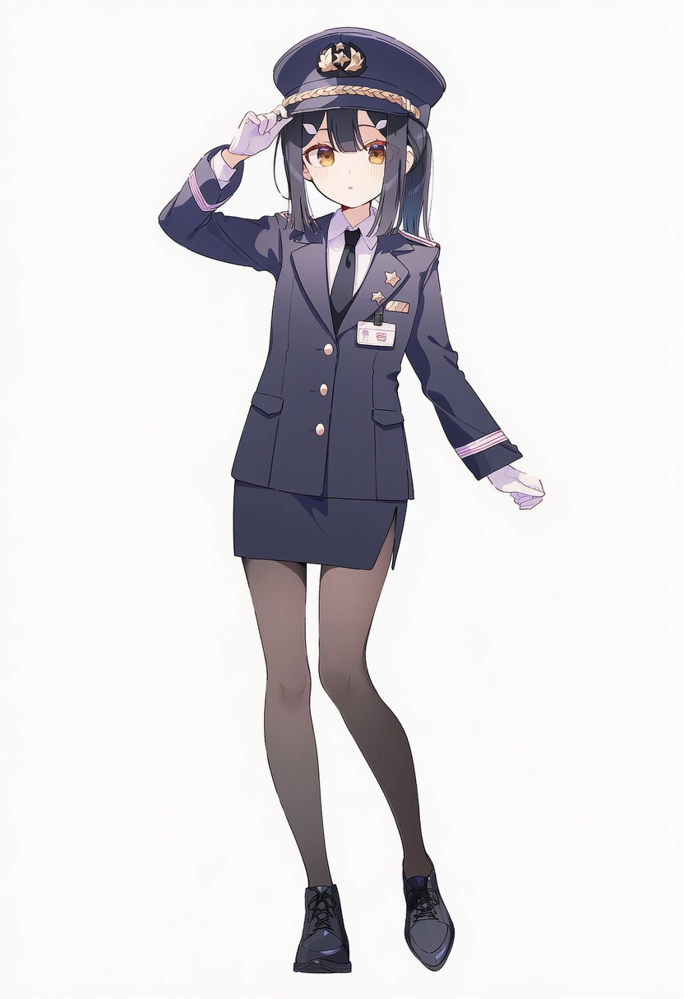
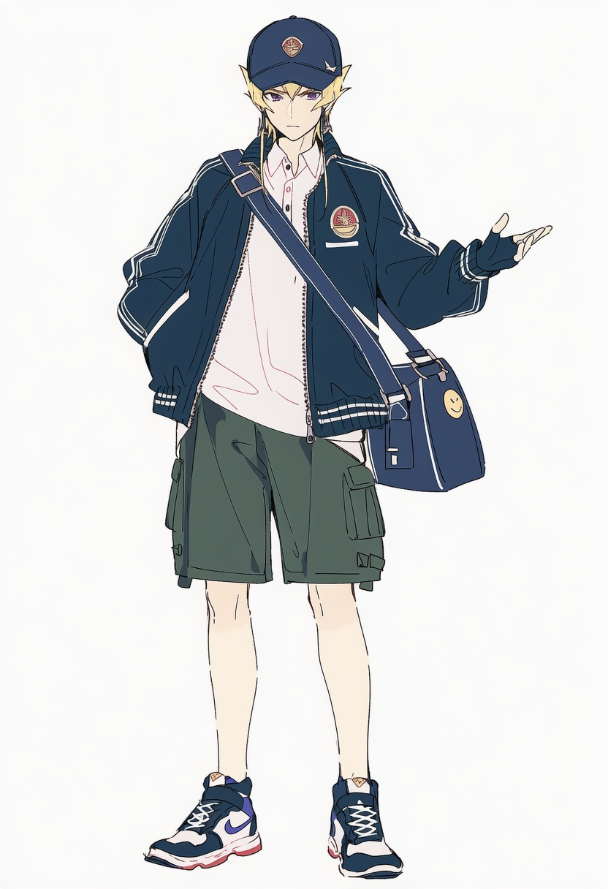
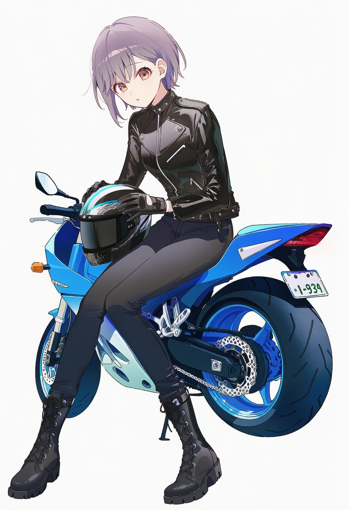
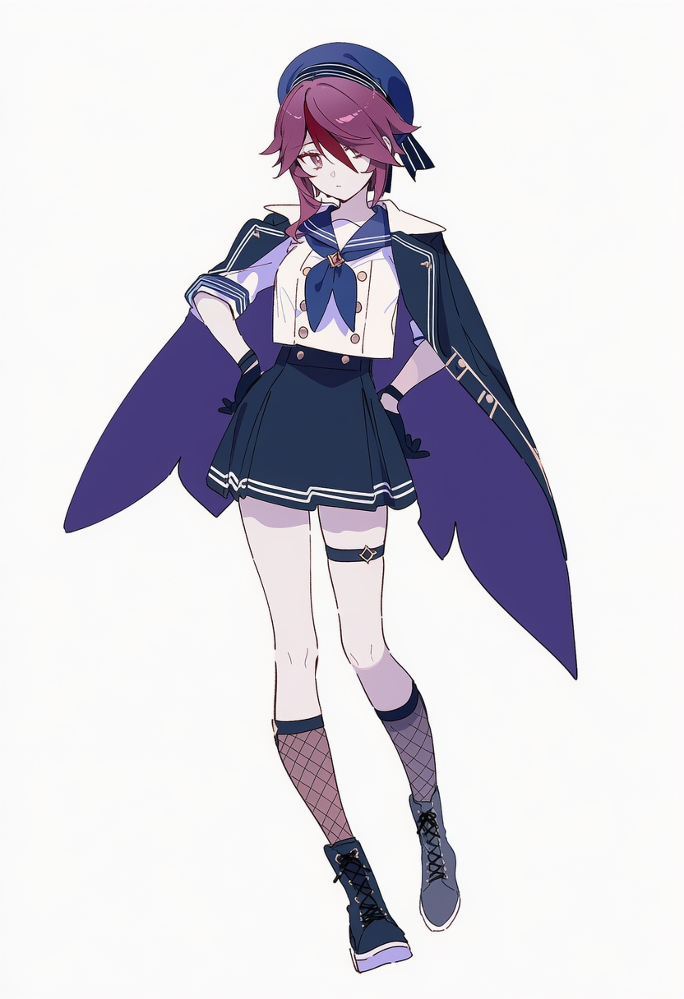
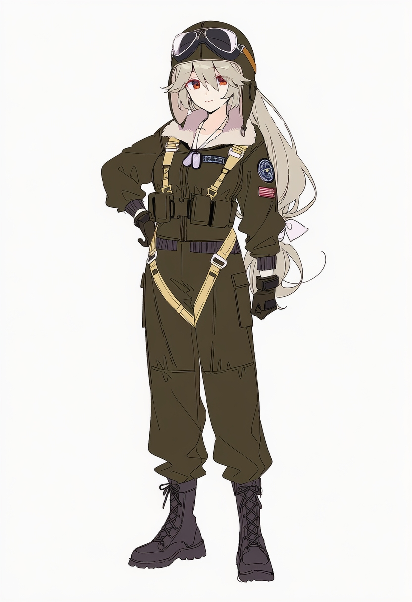
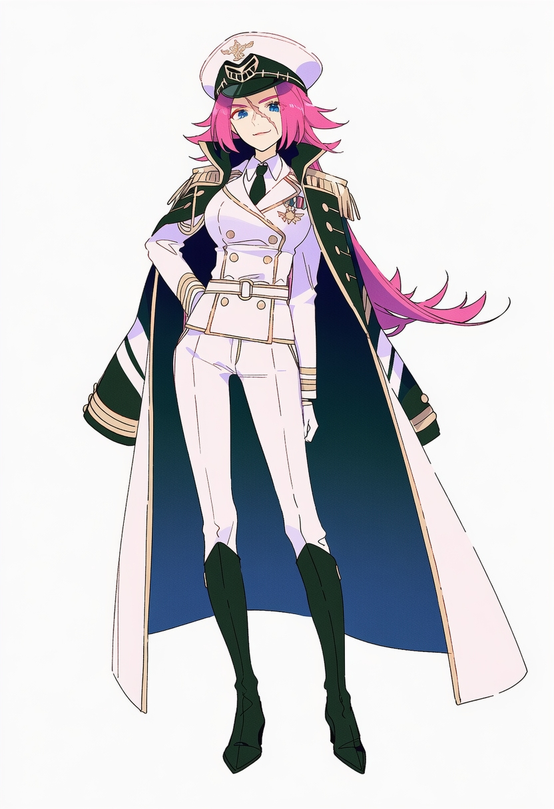

# 身份设定 / 交通 / 运输

[总目录](../README.md) · [原站分类目录](../categories.md) · [英文标签索引](../tags.md) · [服装与构图组合指南](../../README.md)

标题、分类、说明、正负提示词按来源保留；多例图逐张列出。原站标记和说明为参考资料，不作为维护指令。

<a id="raven_composition-1577"></a>

## 列车乘务员

ID：`raven_composition-1577`；分类：身份设定 / 交通 / 运输；来源标记：`safe`。

来源说明：

> 铁路制服强调帽子、短外套、领带、白手套和工牌。

正向提示词：

```text
1.35::uniform::, 1.28::peaked_cap::, 1.22::blazer::, 1.16::collared_shirt::, 1.12::necktie::, 1.10::white_gloves::, 1.08::name_tag::
```



[在线例图](https://assets.quicktagcloud.com/images/raven_composition/raven_composition-1577.jpg?v=aef36ff60526598f)

<a id="raven_composition-1578"></a>

## 快递员

ID：`raven_composition-1578`；分类：身份设定 / 交通 / 运输；来源标记：`safe`。

来源说明：

> 轻便夹克、工装裤、运动鞋和斜挎包，突出城市配送时的机动性。

正向提示词：

```text
1.35::baseball_cap::, 1.28::jacket::, 1.22::cargo_pants::, 1.16::sneakers::, 1.12::messenger_bag::, 1.10::fingerless_gloves::, 1.08::employee_uniform::, 1.06::cap::, 1.04::polo_shirt::, 1.02::cargo_shorts::
```



[在线例图](https://assets.quicktagcloud.com/images/raven_composition/raven_composition-1578.jpg?v=ab0748724efdbb20)

<a id="raven_composition-1579"></a>

## 摩托车手

ID：`raven_composition-1579`；分类：身份设定 / 交通 / 运输；来源标记：`safe`。

来源说明：

> 去掉与自行车运动员重复的 bodysuit，改成全盔+皮夹克+长裤+厚靴的重型骑行剪影。

正向提示词：

```text
1.35::motorcycle_helmet::, 1.28::leather_jacket::, 1.22::leather_gloves::, 1.16::boots::, 1.12::pants::, 1.10::belt::
```



[在线例图](https://assets.quicktagcloud.com/images/raven_composition/raven_composition-1579.jpg?v=50f1e978b286af75)

<a id="raven_composition-1580"></a>

## 水手

ID：`raven_composition-1580`；分类：身份设定 / 交通 / 运输；来源标记：`safe`。

来源说明：

> 水手帽、领巾和双排扣上装形成海军水手感，避免和日式水手校服混淆。

正向提示词：

```text
1.35::sailor_hat::, 1.28::neckerchief::, 1.22::double-breasted::, 1.16::gloves::, 1.12::boots::, 1.10::sailor::, 1.08::sailor_shirt::, 1.06::sailor_cap::, 1.04::sailor_collar::, 1.02::shirt::
```



[在线例图](https://assets.quicktagcloud.com/images/raven_composition/raven_composition-1580.jpg?v=6d6afad39d4c16c5)

<a id="raven_composition-1581"></a>

## 空军飞行员

ID：`raven_composition-1581`；分类：身份设定 / 交通 / 运输；来源标记：`safe`。

来源说明：

> 飞行服配飞行员墨镜、手套和军靴，整体更接近军机驾驶员。

正向提示词：

```text
1.35::pilot::, 1.28::flight_suit::, 1.22::aviator_sunglasses::, 1.16::aviator_cap::, 1.12::gloves::, 1.10::combat_boots::, 1.08::dog_tags::
```



[在线例图](https://assets.quicktagcloud.com/images/raven_composition/raven_composition-1581.jpg?v=62c56ba0e68df349)

<a id="raven_composition-1582"></a>

## 船长

ID：`raven_composition-1582`；分类：身份设定 / 交通 / 运输；来源标记：`safe`。

来源说明：

> 船长比普通水手更正式，用大檐帽、双排扣、肩章和徽章强化指挥岗位。

正向提示词：

```text
1.35::peaked_cap::, 1.28::double-breasted::, 1.22::epaulettes::, 1.16::gloves::, 1.12::necktie::, 1.10::badge::, 1.08::captain_hat::, 1.06::naval_uniform::, 1.04::long_coat::, 1.02::boots::
```



[在线例图](https://assets.quicktagcloud.com/images/raven_composition/raven_composition-1582.jpg?v=dfdc8e5092fc63ad)
