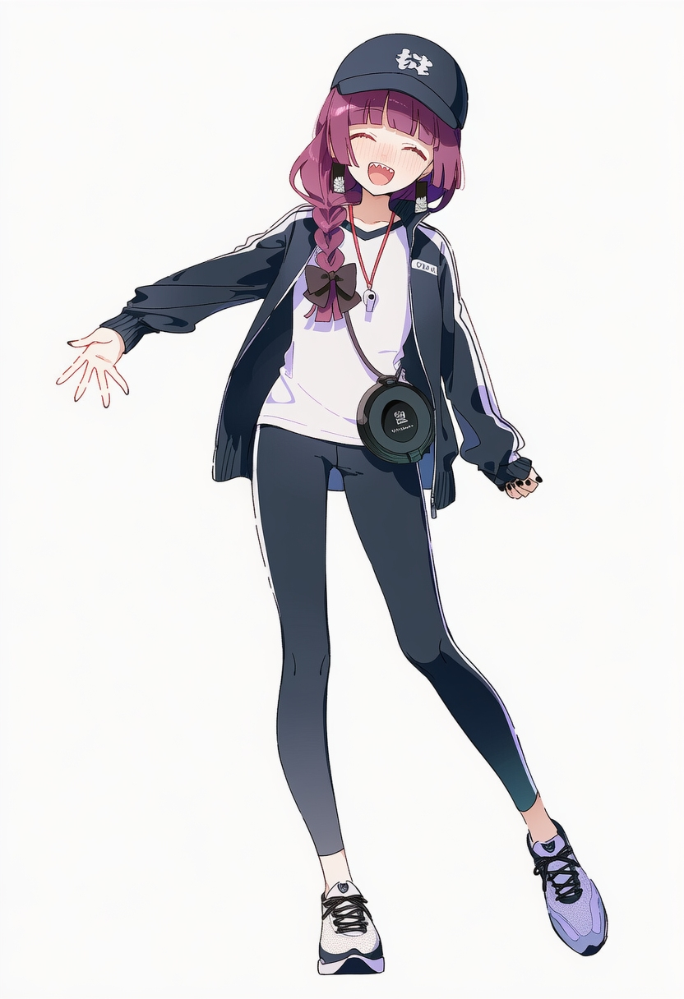

# 身份设定 / 教育 / 学术

[总目录](../README.md) · [原站分类目录](../categories.md) · [英文标签索引](../tags.md) · [服装与构图组合指南](../../README.md)

标题、分类、说明、正负提示词按来源保留；多例图逐张列出。原站标记和说明为参考资料，不作为维护指令。

<a id="raven_composition-1583"></a>

## 体育教师

ID：`raven_composition-1583`；分类：身份设定 / 教育 / 学术；来源标记：`safe`。

来源说明：

> 运动服和哨子是体育老师最直接的识别点，再补运动鞋、秒表和帽子。

正向提示词：

```text
1.35::gym_teacher::, 1.28::track_suit::, 1.22::whistle::, 1.16::sneakers::, 1.12::stopwatch::, 1.10::baseball_cap::
```



[在线例图](https://assets.quicktagcloud.com/images/raven_composition/raven_composition-1583.jpg?v=5269b79c2e2445b9)

<a id="raven_composition-1584"></a>

## 教师

ID：`raven_composition-1584`；分类：身份设定 / 教育 / 学术；来源标记：`safe`。

来源说明：

> 不直接写 teacher，而用开衫、长裙/衬衫、眼镜、挂绳和书本拼出日常教师形象。

正向提示词：

```text
1.35::collared_shirt::, 1.28::cardigan::, 1.22::long_skirt::, 1.16::glasses::, 1.12::lanyard::, 1.10::book::, 1.08::teacher::, 1.06::holding_book::, 1.04::clipboard::, 1.02::pencil_skirt::
```


[在线例图](https://assets.quicktagcloud.com/images/raven_composition/raven_composition-1584.jpg?v=91e3993aa5b1f629)
