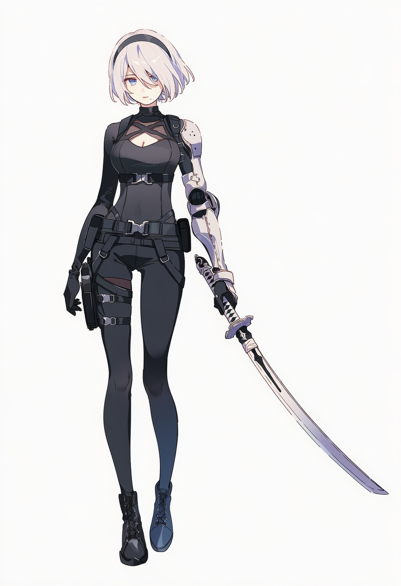
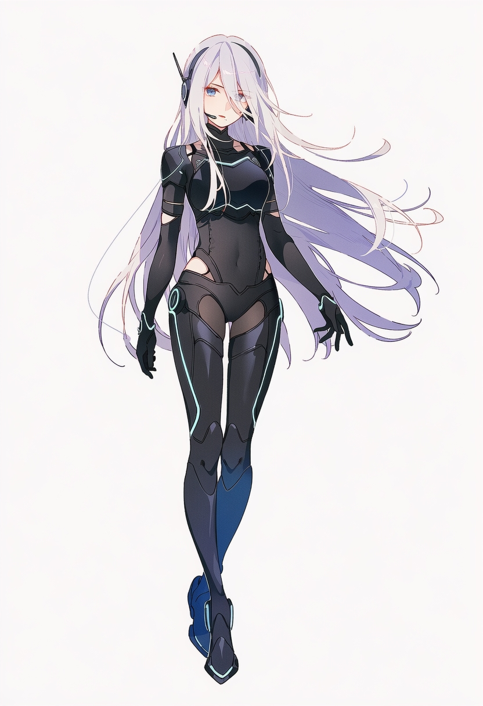
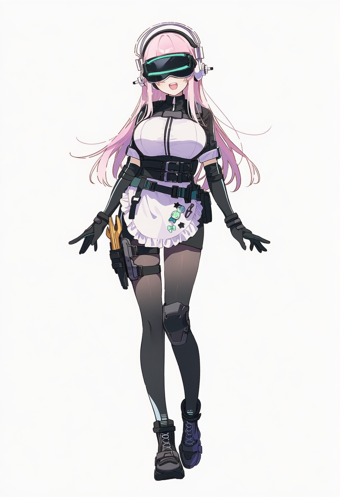
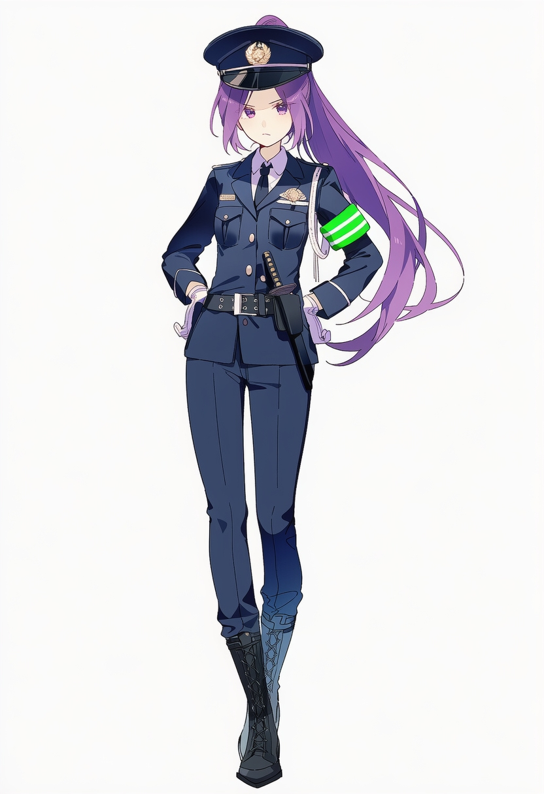
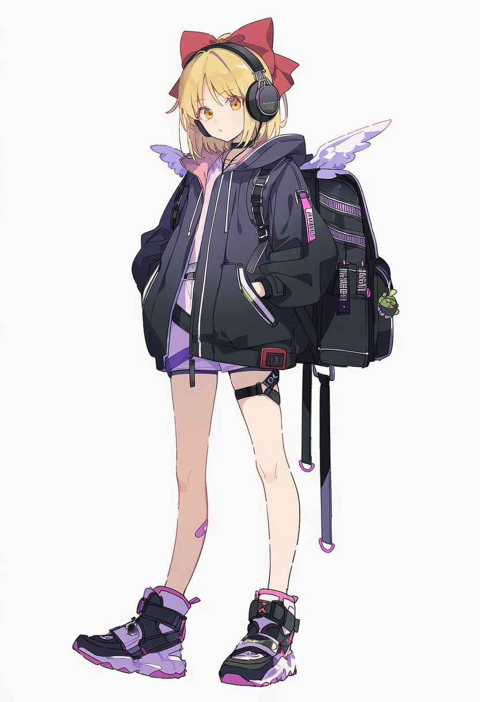
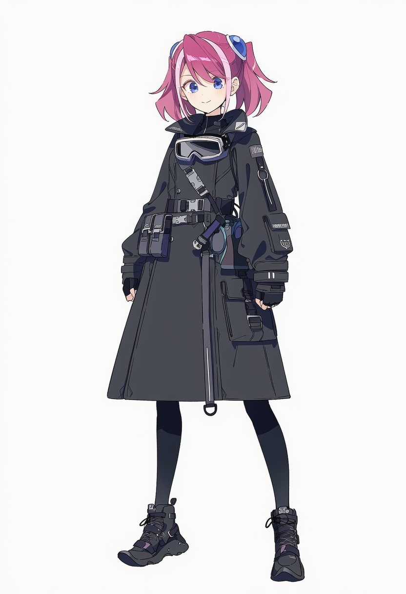
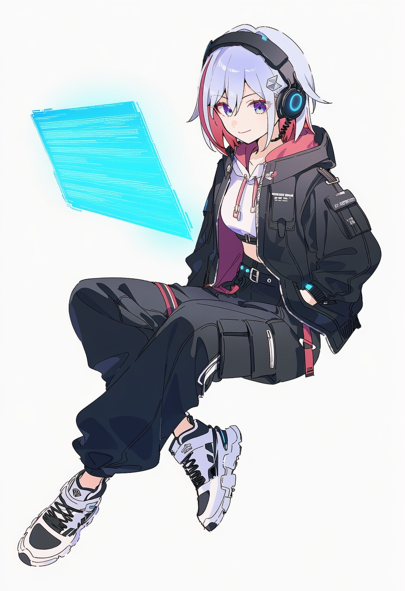
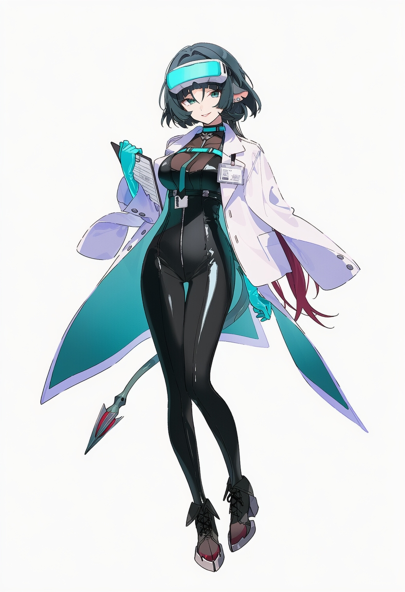

# 身份设定 / 近未来 / 赛博朋克

[总目录](../README.md) · [原站分类目录](../categories.md) · [英文标签索引](../tags.md) · [服装与构图组合指南](../../README.md)

标题、分类、说明、正负提示词按来源保留；多例图逐张列出。原站标记和说明为参考资料，不作为维护指令。

<a id="raven_composition-1585"></a>

## 义体特工

ID：`raven_composition-1585`；分类：身份设定 / 近未来 / 赛博朋克；来源标记：`safe`。

来源说明：

> 紧身机能服配明显机械义肢和战术腰带，做潜入/执行任务型赛博特工。

正向提示词：

```text
1.35::cyborg::, 1.28::techwear::, 1.22::bodysuit::, 1.16::single_mechanical_arm::, 1.12::goggles::, 1.10::utility_belt::, 1.08::handgun::
```



[在线例图](https://assets.quicktagcloud.com/images/raven_composition/raven_composition-1585.jpg?v=a3fbcf966dd9f272)

<a id="raven_composition-1586"></a>

## 仿生人战士

ID：`raven_composition-1586`；分类：身份设定 / 近未来 / 赛博朋克；来源标记：`safe`。

来源说明：

> 紧身服和轻甲为底，机械肢体与霓虹细节负责表现仿生/人造人身份。

正向提示词：

```text
1.35::bodysuit::, 1.28::body_armor::, 1.22::mechanical_limbs::, 1.16::gloves::, 1.12::armored_boots::, 1.10::headset::, 1.08::neon_trim::, 1.06::android::, 1.04::robot_joints::
```



[在线例图](https://assets.quicktagcloud.com/images/raven_composition/raven_composition-1586.jpg?v=efd79cf19a970959)

<a id="raven_composition-1587"></a>

## 仿生人维修师

ID：`raven_composition-1587`；分类：身份设定 / 近未来 / 赛博朋克；来源标记：`safe`。

来源说明：

> 科技服装、工作围裙、护目镜、工具腰带和头戴显示器，强调精密维护。

正向提示词：

```text
1.35::techwear::, 1.28::apron::, 1.22::gloves::, 1.16::goggles::, 1.12::tool_belt::, 1.10::head-mounted_display::
```



[在线例图](https://assets.quicktagcloud.com/images/raven_composition/raven_composition-1587.jpg?v=9f7389b00b76ffd3)

<a id="raven_composition-1588"></a>

## 反乌托邦警察

ID：`raven_composition-1588`；分类：身份设定 / 近未来 / 赛博朋克；来源标记：`safe`。

来源说明：

> 标准警服结构叠加护甲和更冷硬的企业制服提示，形成近未来治安部队。

正向提示词：

```text
1.35::police_uniform::, 1.28::peaked_cap::, 1.22::badge::, 1.16::body_armor::, 1.12::belt::, 1.10::gloves::, 1.08::boots::
```



[在线例图](https://assets.quicktagcloud.com/images/raven_composition/raven_composition-1588.jpg?v=34dc69379bd4e7bc)

<a id="raven_composition-1589"></a>

## 网络潜行者

ID：`raven_composition-1589`；分类：身份设定 / 近未来 / 赛博朋克；来源标记：`safe`。

来源说明：

> 兜帽机能夹克、耳机、护目镜、手套和腿带，做出夜间潜入网络节点的街头黑客感。

正向提示词：

```text
1.35::techwear::, 1.28::hooded_jacket::, 1.22::fingerless_gloves::, 1.16::headphones::, 1.12::goggles::, 1.10::thigh_strap::, 1.08::backpack::
```



[在线例图](https://assets.quicktagcloud.com/images/raven_composition/raven_composition-1589.jpg?v=b74b9434e971c562)

<a id="raven_composition-1590"></a>

## 赛博侦探

ID：`raven_composition-1590`；分类：身份设定 / 近未来 / 赛博朋克；来源标记：`safe`。

来源说明：

> 风衣保留侦探剪影，机能服、护目镜、头显和工具包把它推向赛博都市。

正向提示词：

```text
1.35::techwear::, 1.28::trench_coat::, 1.22::gloves::, 1.16::goggles::, 1.12::head-mounted_display::, 1.10::belt_pouch::, 1.08::boots::
```



[在线例图](https://assets.quicktagcloud.com/images/raven_composition/raven_composition-1590.jpg?v=675cf067c8a7e3be)

<a id="raven_composition-1591"></a>

## 赛博黑客

ID：`raven_composition-1591`；分类：身份设定 / 近未来 / 赛博朋克；来源标记：`safe`。

来源说明：

> 黑客不需要重甲，重点是机能服、兜帽、露指手套、头显和耳机。

正向提示词：

```text
1.35::techwear::, 1.28::hoodie::, 1.22::fingerless_gloves::, 1.16::head-mounted_display::, 1.12::headphones::, 1.10::cargo_pants::, 1.08::sneakers::, 1.06::cyberpunk::, 1.04::holographic_interface::
```



[在线例图](https://assets.quicktagcloud.com/images/raven_composition/raven_composition-1591.jpg?v=96fe2a7447b69110)

<a id="raven_composition-1592"></a>

## 量子实验员

ID：`raven_composition-1592`；分类：身份设定 / 近未来 / 赛博朋克；来源标记：`safe`。

来源说明：

> 实验服、手套、护目镜和头显，让传统实验室科学家更接近高科技研究设施。

正向提示词：

```text
1.35::labcoat::, 1.28::latex_gloves::, 1.22::goggles::, 1.16::id_card::, 1.12::head-mounted_display::, 1.10::clipboard::, 1.08::bodysuit::
```



[在线例图](https://assets.quicktagcloud.com/images/raven_composition/raven_composition-1592.jpg?v=3713ce961529ad95)
