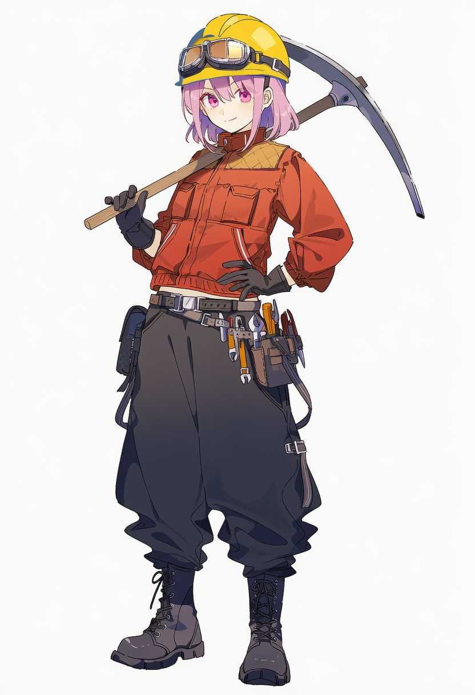

# 身份设定 / 魔导科技 / 幻想工业

[总目录](../README.md) · [原站分类目录](../categories.md) · [英文标签索引](../tags.md) · [服装与构图组合指南](../../README.md)

标题、分类、说明、正负提示词按来源保留；多例图逐张列出。原站标记和说明为参考资料，不作为维护指令。

<a id="raven_composition-1593"></a>

## 大魔导师

ID：`raven_composition-1593`；分类：身份设定 / 魔导科技 / 幻想工业；来源标记：`safe`。

来源说明：

> 高权重法师帽与华丽服饰，再用法杖、珠宝和额环抬高阶级感。

正向提示词：

```text
1.35::wizard_hat::, 1.28::ornate_clothes::, 1.22::robe::, 1.16::cape::, 1.12::staff::, 1.10::jewelry::, 1.08::circlet::
```


[在线例图](https://assets.quicktagcloud.com/images/raven_composition/raven_composition-1593.jpg?v=78ec225c4c954633)

<a id="raven_composition-1594"></a>

## 秘银矿工

ID：`raven_composition-1594`；分类：身份设定 / 魔导科技 / 幻想工业；来源标记：`safe`。

来源说明：

> 矿工安全装备叠一层轻皮甲，以鹤嘴锄和金属采掘感表现幻想矿山劳动者。

正向提示词：

```text
1.35::hard_hat::, 1.28::goggles::, 1.22::gloves::, 1.16::boots::, 1.12::tool_belt::, 1.10::pickaxe::, 1.08::leather_armor::
```



[在线例图](https://assets.quicktagcloud.com/images/raven_composition/raven_composition-1594.jpg?v=7beede1f53a39e01)

<a id="raven_composition-1595"></a>

## 魔法工匠

ID：`raven_composition-1595`；分类：身份设定 / 魔导科技 / 幻想工业；来源标记：`safe`。

来源说明：

> 工匠围裙与工具装备叠在法袍上，用护符暗示制作的是魔法器具。

正向提示词：

```text
1.35::apron::, 1.28::goggles::, 1.22::gloves::, 1.16::tool_belt::, 1.12::amulet::, 1.10::hammer::, 1.08::robe::
```


[在线例图](https://assets.quicktagcloud.com/images/raven_composition/raven_composition-1595.jpg?v=919a858dae94bd02)
