# 身份设定 / 欧洲中世纪 / 近代历史

[总目录](../README.md) · [原站分类目录](../categories.md) · [英文标签索引](../tags.md) · [服装与构图组合指南](../../README.md)

标题、分类、说明、正负提示词按来源保留；多例图逐张列出。原站标记和说明为参考资料，不作为维护指令。

<a id="raven_composition-1596"></a>

## 中世纪修士

ID：`raven_composition-1596`；分类：身份设定 / 欧洲中世纪 / 近代历史；来源标记：`safe`。

来源说明：

> 宽松长袍、兜帽、绳腰带和经书，整体朴素、无甲、无华丽饰品。

正向提示词：

```text
1.35::monk::, 1.28::robe::, 1.22::hood::, 1.16::rope_belt::, 1.12::sandals::, 1.10::book::, 1.08::prayer_beads::
```

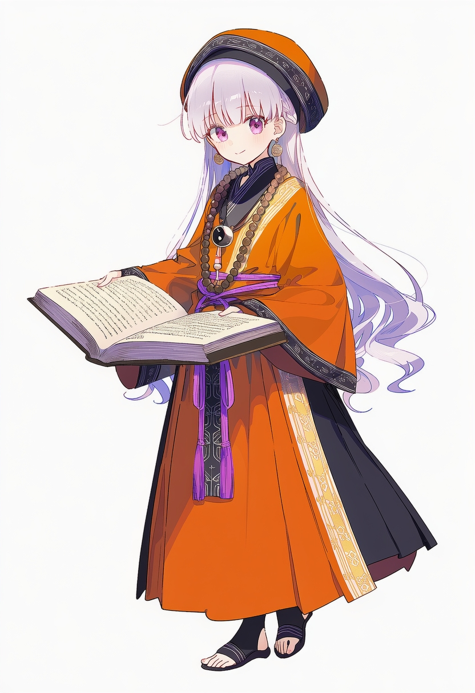

[在线例图](https://assets.quicktagcloud.com/images/raven_composition/raven_composition-1596.jpg?v=a3b9ddde92ab6936)

<a id="raven_composition-1597"></a>

## 中世纪修女

ID：`raven_composition-1597`；分类：身份设定 / 欧洲中世纪 / 近代历史；来源标记：`safe`。

来源说明：

> 按传统修女服走：黑色长裙/长袍、头巾、面纱和十字架。

正向提示词：

```text
1.35::traditional_nun::, 1.28::nun_headdress::, 1.22::black_dress::, 1.16::veil::, 1.12::cross_necklace::, 1.10::long_sleeves::, 1.08::robe::
```

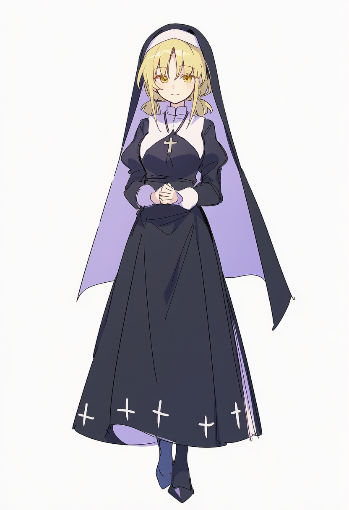

[在线例图](https://assets.quicktagcloud.com/images/raven_composition/raven_composition-1597.jpg?v=66de6df073fd791b)

<a id="raven_composition-1598"></a>

## 中世纪剑骑士

ID：`raven_composition-1598`；分类：身份设定 / 欧洲中世纪 / 近代历史；来源标记：`safe`。

来源说明：

> 板甲、胸甲、肩甲、臂甲和胫甲构成完整骑士轮廓，剑作为主武器放在最后确认职业。

正向提示词：

```text
1.35::plate_armor::, 1.28::breastplate::, 1.22::pauldrons::, 1.16::gauntlets::, 1.12::greaves::, 1.10::cape::, 1.08::sword::, 1.06::knight::, 1.04::holding_sword::, 1.02::shoulder_armor::
```

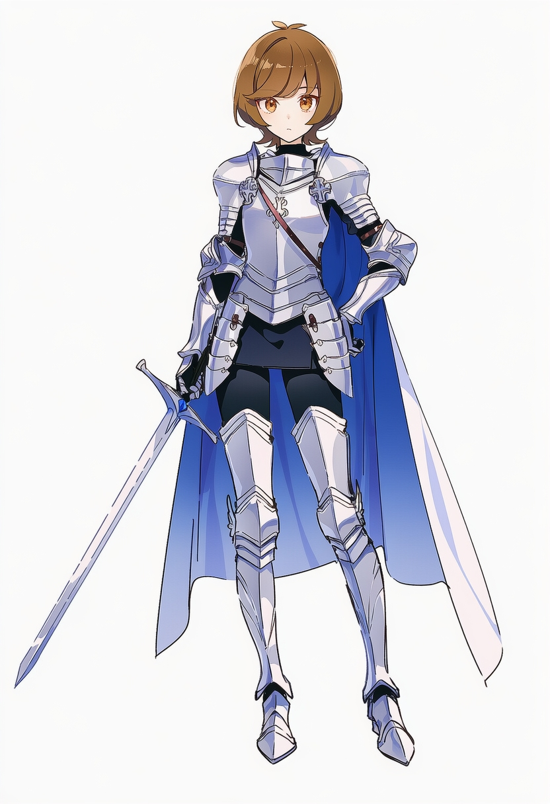

[在线例图](https://assets.quicktagcloud.com/images/raven_composition/raven_composition-1598.jpg?v=1793304f570621a3)

<a id="raven_composition-1599"></a>

## 中世纪商人

ID：`raven_composition-1599`；分类：身份设定 / 欧洲中世纪 / 近代历史；来源标记：`safe`。

来源说明：

> 不靠武器，重点是束腰外衣、斗篷、钱袋和货包，像旅行商贩。

正向提示词：

```text
1.35::medieval::, 1.28::tunic::, 1.22::cloak::, 1.16::belt_pouch::, 1.12::boots::, 1.10::bag::, 1.08::hat::
```

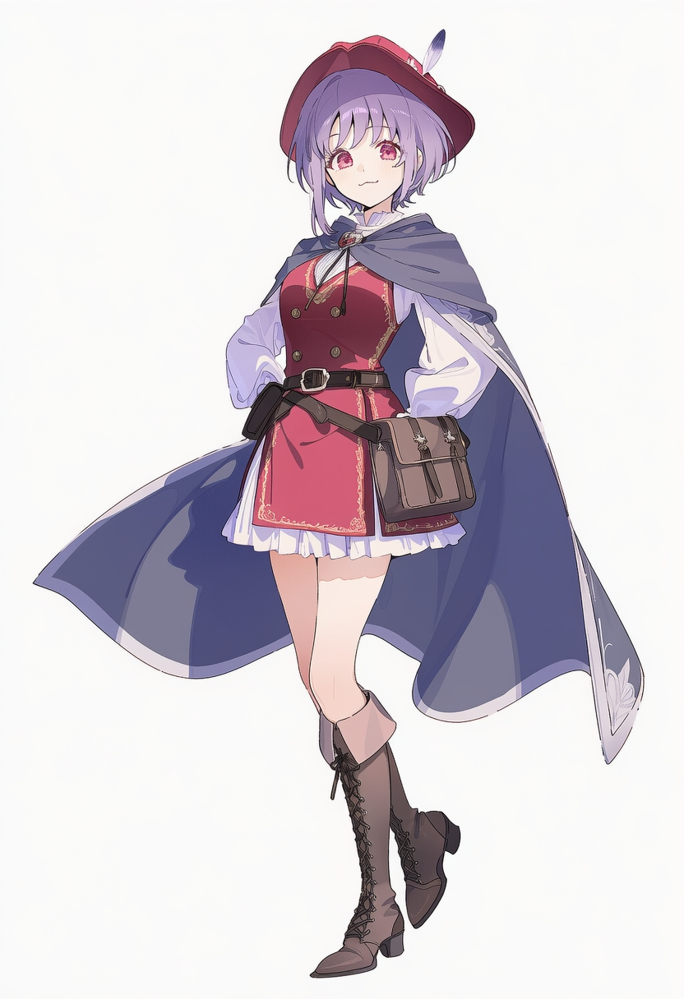

[在线例图](https://assets.quicktagcloud.com/images/raven_composition/raven_composition-1599.jpg?v=2d8e6a3b3ccc0b83)

<a id="raven_composition-1600"></a>

## 中世纪弓箭手

ID：`raven_composition-1600`；分类：身份设定 / 欧洲中世纪 / 近代历史；来源标记：`safe`。

来源说明：

> 轻便兜帽、束腰上衣、护臂、箭袋和靴子，明显区别于重甲近战。

正向提示词：

```text
1.35::hood::, 1.28::tunic::, 1.22::bracer::, 1.16::boots::, 1.12::quiver::, 1.10::bow_(weapon)::, 1.08::belt_pouch::, 1.06::archer::, 1.04::leather_armor::, 1.02::medieval::
```

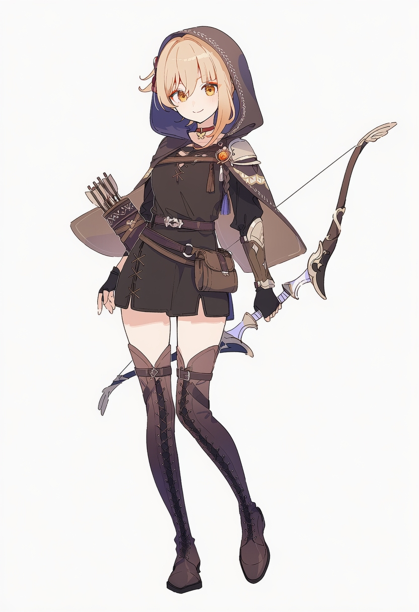

[在线例图](https://assets.quicktagcloud.com/images/raven_composition/raven_composition-1600.jpg?v=4139b05f0de0e96d)

<a id="raven_composition-1601"></a>

## 中世纪弩手

ID：`raven_composition-1601`；分类：身份设定 / 欧洲中世纪 / 近代历史；来源标记：`safe`。

来源说明：

> 壶形盔、锁子甲和弩形成普通城防/佣兵弩手的实用装备感。

正向提示词：

```text
1.35::kettle_helm::, 1.28::chainmail::, 1.22::tunic::, 1.16::boots::, 1.12::crossbow::, 1.10::belt_pouch::, 1.08::gloves::
```

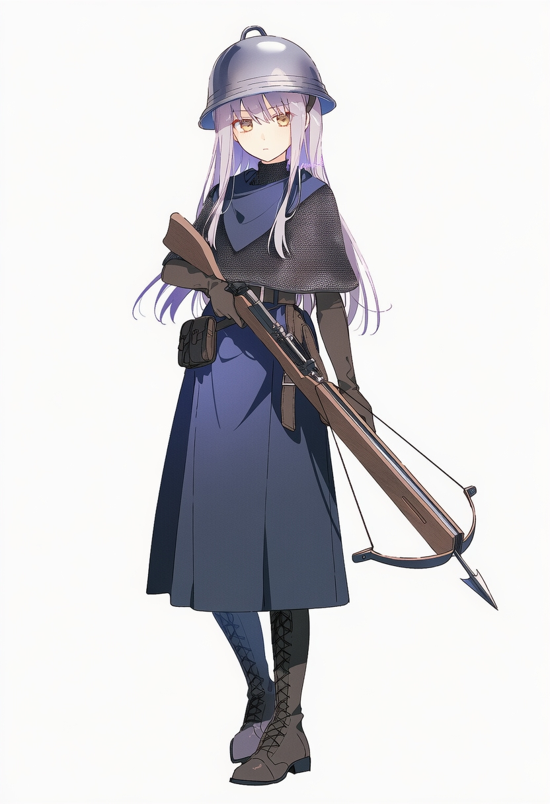

[在线例图](https://assets.quicktagcloud.com/images/raven_composition/raven_composition-1601.jpg?v=71def93410db2d5f)

<a id="raven_composition-1602"></a>

## 中世纪戟兵

ID：`raven_composition-1602`；分类：身份设定 / 欧洲中世纪 / 近代历史；来源标记：`safe`。

来源说明：

> 胸甲和少量肩甲配长柄戟，适合城堡卫队或重装步兵。

正向提示词：

```text
1.35::breastplate::, 1.28::pauldrons::, 1.22::gloves::, 1.16::boots::, 1.12::halberd::, 1.10::cape::
```

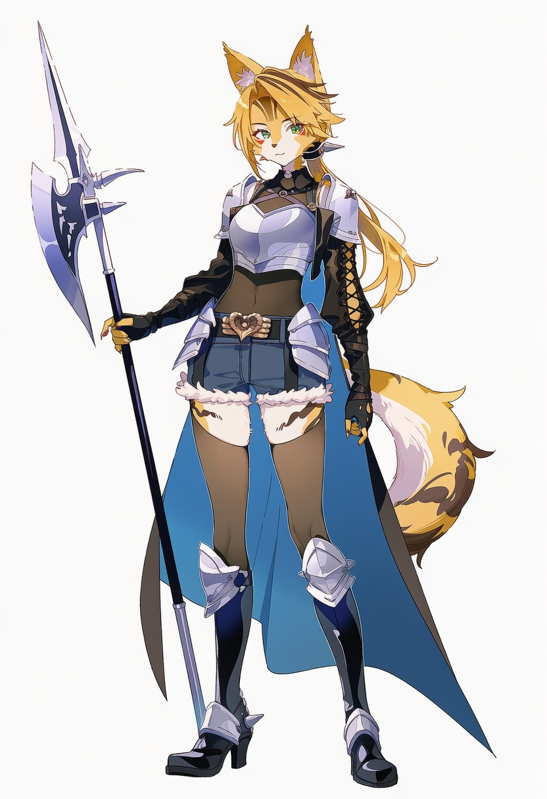

[在线例图](https://assets.quicktagcloud.com/images/raven_composition/raven_composition-1602.jpg?v=78fb05d65525968d)

<a id="raven_composition-1603"></a>

## 中世纪猎人

ID：`raven_composition-1603`；分类：身份设定 / 欧洲中世纪 / 近代历史；来源标记：`safe`。

来源说明：

> 猎装、毛皮边、宽檐帽、皮甲、弓箭和匕首，做更粗犷的中世纪猎人，与森林游侠区分。

正向提示词：

```text
1.35::fur_trim::, 1.28::leather_armor::, 1.22::wide-brimmed_hat::, 1.16::gloves::, 1.12::boots::, 1.10::bow_(weapon)::, 1.08::quiver::, 1.06::dagger::
```

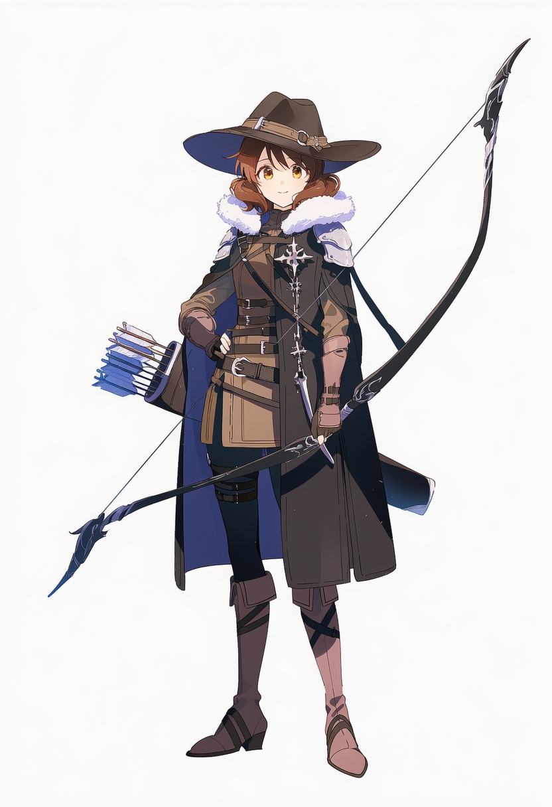

[在线例图](https://assets.quicktagcloud.com/images/raven_composition/raven_composition-1603.jpg?v=9896b67f22bb1e31)

<a id="raven_composition-1604"></a>

## 中世纪重盾骑士

ID：`raven_composition-1604`；分类：身份设定 / 欧洲中世纪 / 近代历史；来源标记：`safe`。

来源说明：

> 比普通骑士更重：全身甲、大盔、塔盾，整体追求厚重防御感。

正向提示词：

```text
1.35::full_armor::, 1.28::plate_armor::, 1.22::great_helm::, 1.16::gauntlets::, 1.12::greaves::, 1.10::tower_shield::, 1.08::sword::, 1.06::shield::, 1.04::knight::, 1.02::pauldrons::
```

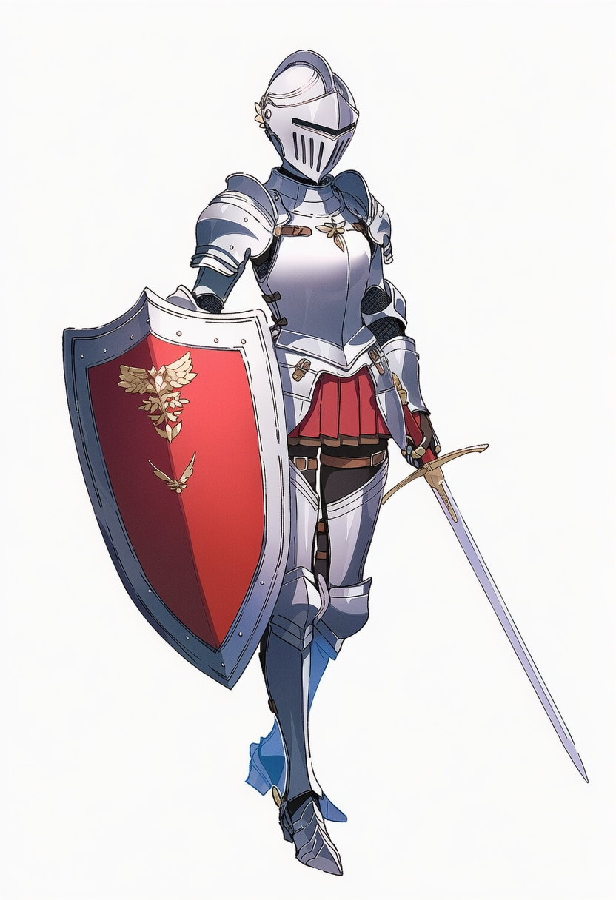

[在线例图](https://assets.quicktagcloud.com/images/raven_composition/raven_composition-1604.jpg?v=207b20c731a48b4e)

<a id="raven_composition-1605"></a>

## 圣殿骑士

ID：`raven_composition-1605`；分类：身份设定 / 欧洲中世纪 / 近代历史；来源标记：`safe`。

来源说明：

> 大盔、全身甲、罩袍和十字配饰，把宗教骑士身份与重装战士结合。

正向提示词：

```text
1.35::full_armor::, 1.28::great_helm::, 1.22::tabard::, 1.16::cape::, 1.12::shield::, 1.10::sword::, 1.08::cross_necklace::
```

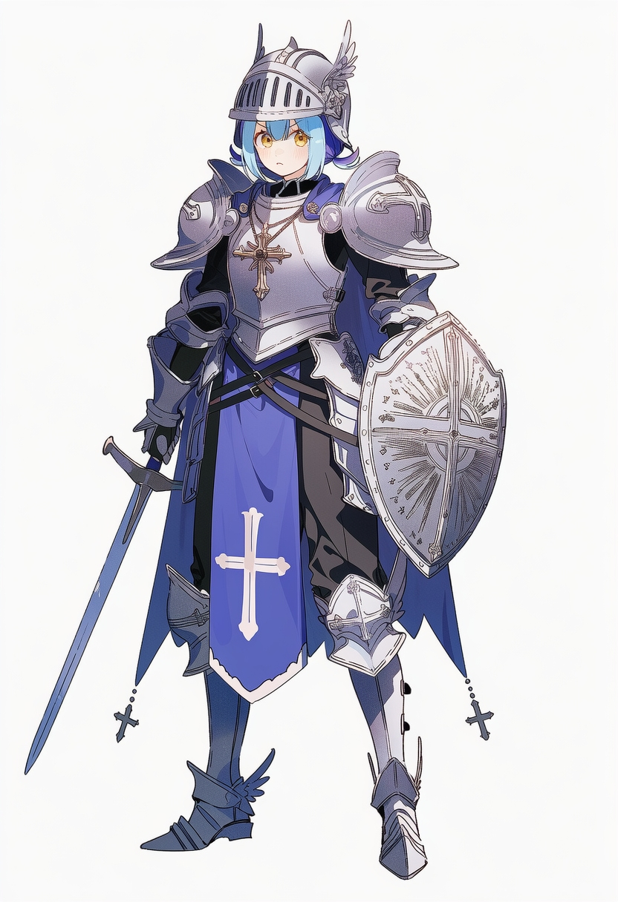

[在线例图](https://assets.quicktagcloud.com/images/raven_composition/raven_composition-1605.jpg?v=6c2869b83b9db7ff)

<a id="raven_composition-1606"></a>

## 文艺复兴贵族

ID：`raven_composition-1606`；分类：身份设定 / 欧洲中世纪 / 近代历史；来源标记：`safe`。

来源说明：

> 用文艺复兴服装、轮状皱领、珠宝和羽饰帽，突出上层阶级。

正向提示词：

```text
1.35::renaissance_clothes::, 1.28::aristocratic_clothes::, 1.22::cape::, 1.16::ruff::, 1.12::jewelry::, 1.10::gloves::, 1.08::feathered_hat::
```

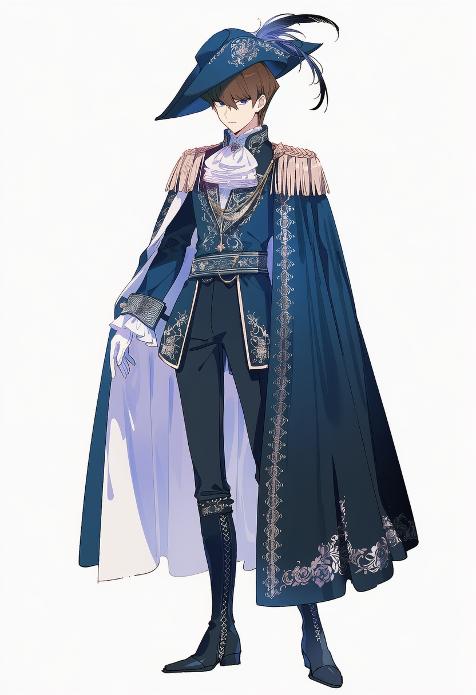

[在线例图](https://assets.quicktagcloud.com/images/raven_composition/raven_composition-1606.jpg?v=f22ad9042ed9a096)

<a id="raven_composition-1607"></a>

## 火枪手

ID：`raven_composition-1607`；分类：身份设定 / 欧洲中世纪 / 近代历史；来源标记：`safe`。

来源说明：

> 羽饰帽、披风、长靴、火枪和细剑，直接走近代早期火枪手形象。

正向提示词：

```text
1.35::feathered_hat::, 1.28::cape::, 1.22::boots::, 1.16::gloves::, 1.12::bandolier::, 1.10::musket::, 1.08::rapier::
```

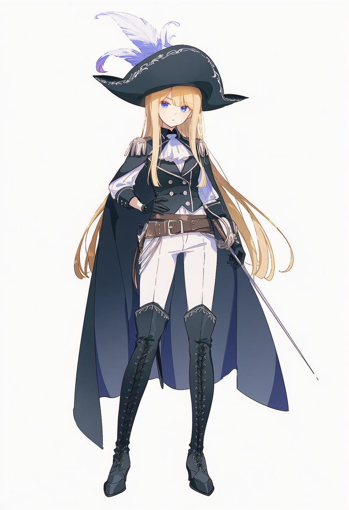

[在线例图](https://assets.quicktagcloud.com/images/raven_composition/raven_composition-1607.jpg?v=3e1d29d99654d2ea)

<a id="raven_composition-1608"></a>

## 瘟疫医生

ID：`raven_composition-1608`；分类：身份设定 / 欧洲中世纪 / 近代历史；来源标记：`safe`。

来源说明：

> 鸟嘴面具是绝对核心，再用长外套、宽檐帽、手套、靴子和手杖补完整历史造型。

正向提示词：

```text
1.35::plague_doctor_mask::, 1.28::long_coat::, 1.22::gloves::, 1.16::wide-brimmed_hat::, 1.12::boots::, 1.10::cane::, 1.08::plague_doctor::, 1.06::belt_pouch::, 1.04::hooded_cloak::, 1.02::hood::
```

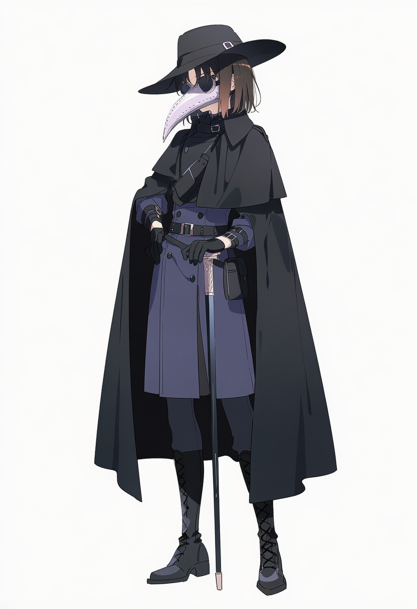

[在线例图](https://assets.quicktagcloud.com/images/raven_composition/raven_composition-1608.jpg?v=287583493445334d)

<a id="raven_composition-1609"></a>

## 维京战士

ID：`raven_composition-1609`；分类：身份设定 / 欧洲中世纪 / 近代历史；来源标记：`safe`。

来源说明：

> 皮甲、锁子甲、毛皮边饰、圆盾和战斧，重点是北方战士的粗犷实用感。

正向提示词：

```text
1.35::fur_trim::, 1.28::leather_armor::, 1.22::chainmail::, 1.16::round_shield::, 1.12::axe::, 1.10::boots::, 1.08::bracer::
```

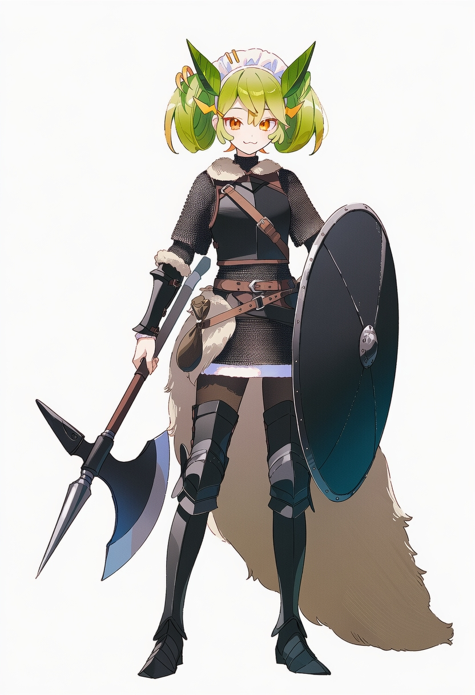

[在线例图](https://assets.quicktagcloud.com/images/raven_composition/raven_composition-1609.jpg?v=9d678dc1cfc3a817)

<a id="raven_composition-1610"></a>

## 维多利亚侦探

ID：`raven_composition-1610`；分类：身份设定 / 欧洲中世纪 / 近代历史；来源标记：`safe`。

来源说明：

> 风衣/西装、手套、怀表、手杖和猎鹿帽，偏古典推理小说视觉。

正向提示词：

```text
1.35::trench_coat::, 1.28::suit::, 1.22::gloves::, 1.16::boots::, 1.12::pocket_watch::, 1.10::cane::, 1.08::deerstalker::
```

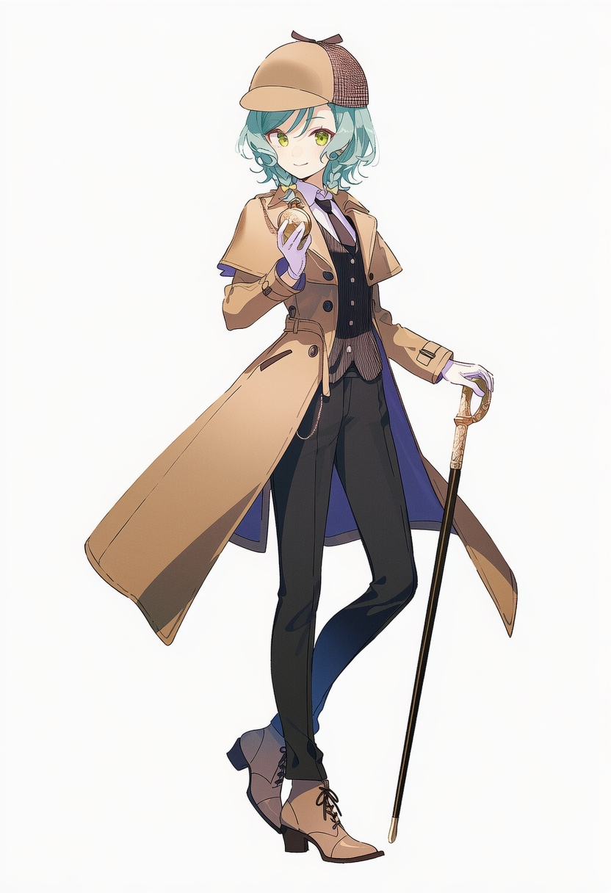

[在线例图](https://assets.quicktagcloud.com/images/raven_composition/raven_composition-1610.jpg?v=669a6576e4a2de20)

<a id="raven_composition-1611"></a>

## 维多利亚绅士

ID：`raven_composition-1611`；分类：身份设定 / 欧洲中世纪 / 近代历史；来源标记：`safe`。

来源说明：

> 礼帽、马甲、领巾、手杖和长外套组合成19世纪绅士。

正向提示词：

```text
1.35::victorian::, 1.28::suit::, 1.22::top_hat::, 1.16::vest::, 1.12::cravat::, 1.10::gloves::, 1.08::cane::, 1.06::long_coat::
```

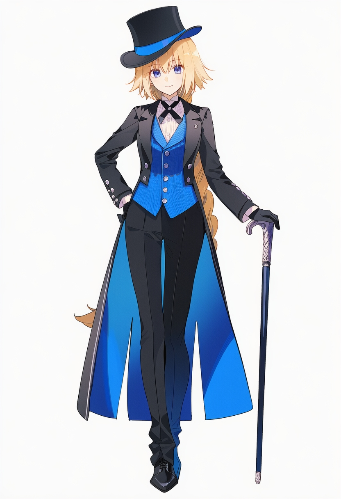

[在线例图](https://assets.quicktagcloud.com/images/raven_composition/raven_composition-1611.jpg?v=4e07e62eb15b2b51)

<a id="raven_composition-1612"></a>

## 西部牛仔

ID：`raven_composition-1612`；分类：身份设定 / 欧洲中世纪 / 近代历史；来源标记：`safe`。

来源说明：

> 牛仔帽、马甲、衬衫、枪套腰带、牛仔靴和方巾，一眼西部。

正向提示词：

```text
1.35::cowboy_hat::, 1.28::western::, 1.22::vest::, 1.16::button_up_shirt::, 1.12::belt::, 1.10::holster::, 1.08::cowboy_boots::, 1.06::bandana::, 1.04::cowboy_western::, 1.02::neckerchief::
```

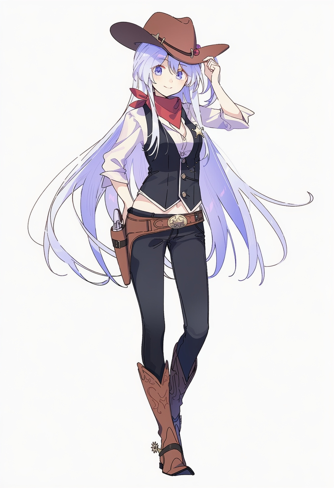

[在线例图](https://assets.quicktagcloud.com/images/raven_composition/raven_composition-1612.jpg?v=6bc038946cf937b4)
