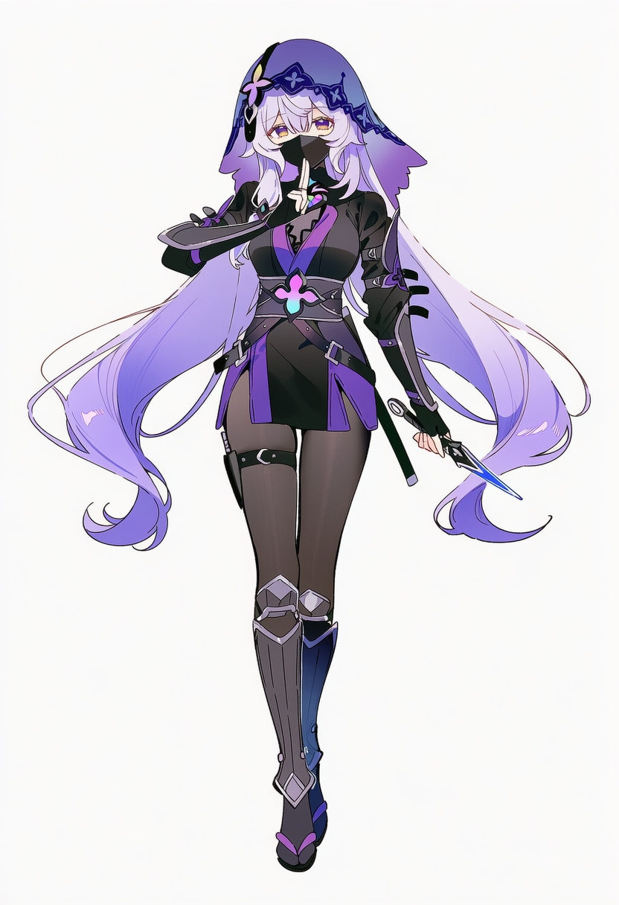
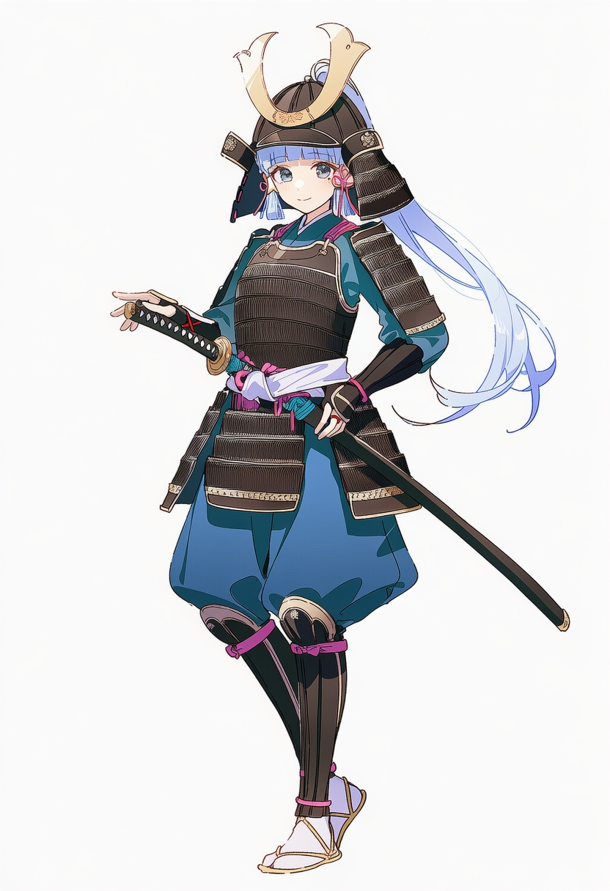

# 身份设定 / 日本古典 / 武家时代

[总目录](../README.md) · [原站分类目录](../categories.md) · [英文标签索引](../tags.md) · [服装与构图组合指南](../../README.md)

标题、分类、说明、正负提示词按来源保留；多例图逐张列出。原站标记和说明为参考资料，不作为维护指令。

<a id="raven_composition-1613"></a>

## 忍者

ID：`raven_composition-1613`；分类：身份设定 / 日本古典 / 武家时代；来源标记：`safe`。

来源说明：

> 黑衣、兜帽、面罩、护臂护胫和短刃，尽量做成轻装潜行者。

正向提示词：

```text
1.35::hood::, 1.28::mask::, 1.22::black_clothes::, 1.16::arm_guards::, 1.12::shin_guards::, 1.10::fingerless_gloves::, 1.08::dagger::, 1.06::ninja::, 1.04::tabi::, 1.02::kunai::
```



[在线例图](https://assets.quicktagcloud.com/images/raven_composition/raven_composition-1613.jpg?v=c05626f1260cea25)

<a id="raven_composition-1614"></a>

## 武士

ID：`raven_composition-1614`；分类：身份设定 / 日本古典 / 武家时代；来源标记：`safe`。

来源说明：

> 直接使用日式甲胄细分标签：兜、袖甲、笼手、草摺、胫当，再配刀。

正向提示词：

```text
1.35::japanese_armor::, 1.28::kabuto_(helmet)::, 1.22::sode::, 1.16::kote::, 1.12::kusazuri::, 1.10::suneate::, 1.08::katana::, 1.06::samurai::, 1.04::kabuto::, 1.02::waraji::
```



[在线例图](https://assets.quicktagcloud.com/images/raven_composition/raven_composition-1614.jpg?v=575bc9e0c94388b9)
