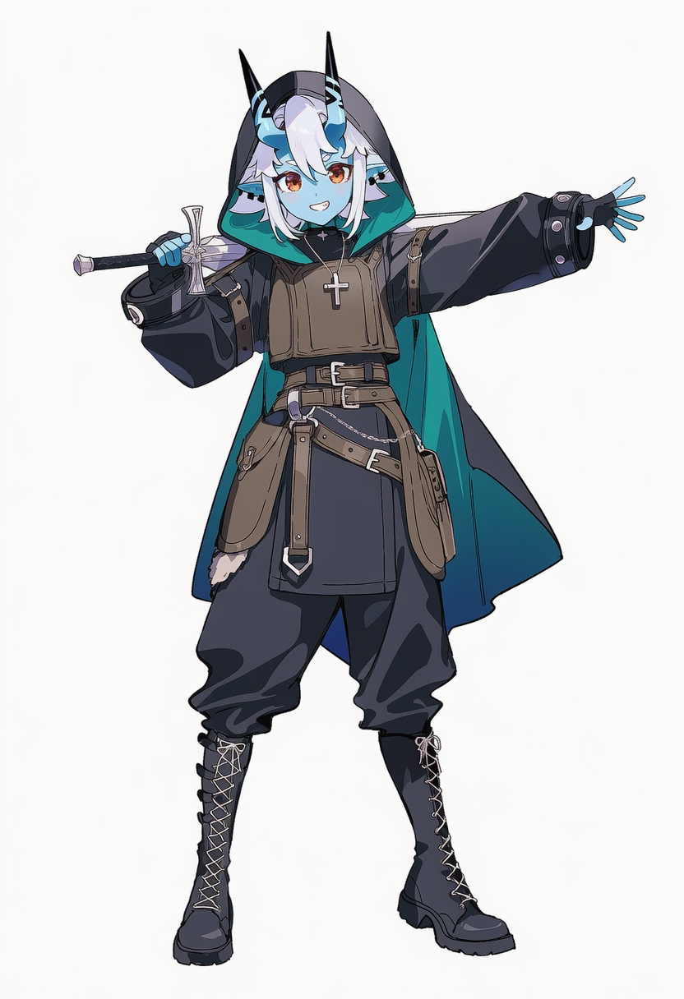

# 身份设定 / 神圣幻想 / 教会体系

[总目录](../README.md) · [原站分类目录](../categories.md) · [英文标签索引](../tags.md) · [服装与构图组合指南](../../README.md)

标题、分类、说明、正负提示词按来源保留；多例图逐张列出。原站标记和说明为参考资料，不作为维护指令。

<a id="raven_composition-1617"></a>

## 圣物猎人

ID：`raven_composition-1617`；分类：身份设定 / 神圣幻想 / 教会体系；来源标记：`safe`。

来源说明：

> 轻甲、披风和挎包适合遗迹探索，十字/护符类配饰强调专门搜寻圣物。

正向提示词：

```text
1.35::hood::, 1.28::cloak::, 1.22::leather_armor::, 1.16::gloves::, 1.12::boots::, 1.10::cross_necklace::, 1.08::satchel::
```



[在线例图](https://assets.quicktagcloud.com/images/raven_composition/raven_composition-1617.jpg?v=8e7337bf69adeffd)

<a id="raven_composition-1618"></a>

## 圣骑士

ID：`raven_composition-1618`；分类：身份设定 / 神圣幻想 / 教会体系；来源标记：`safe`。

来源说明：

> 白色板甲、大肩甲、披风、盾剑组合，把“神圣”和“骑士”同时写进轮廓。

正向提示词：

```text
1.35::white_armor::, 1.28::plate_armor::, 1.22::breastplate::, 1.16::pauldrons::, 1.12::gauntlets::, 1.10::cape::, 1.08::shield::, 1.06::sword::, 1.04::greaves::, 1.02::paladin::
```


[在线例图](https://assets.quicktagcloud.com/images/raven_composition/raven_composition-1618.jpg?v=b5c69f7acb035ae8)

<a id="raven_composition-1619"></a>

## 魔门圣女

ID：`raven_composition-1619`；分类：身份设定 / 神圣幻想 / 教会体系；来源标记：`safe`。

来源说明：

> 黑色华服配红色珠宝和薄纱，既有宗门高位身份，又保留邪道危险感。

正向提示词：

```text
1.35::black_hanfu::, 1.28::ornate_clothes::, 1.22::wide_sleeves::, 1.16::red_jewelry::, 1.12::sash::, 1.10::veil::, 1.08::dark_aura::
```


[在线例图](https://assets.quicktagcloud.com/images/raven_composition/raven_composition-1619.jpg?v=fda5b85bae29b68c)

<a id="raven_composition-1620"></a>

## 龙语祭司

ID：`raven_composition-1620`；分类：身份设定 / 神圣幻想 / 教会体系；来源标记：`safe`。

来源说明：

> 法袍与鳞甲并存，角、法杖和护符让角色像侍奉龙族或龙神的祭司。

正向提示词：

```text
1.35::robe::, 1.28::scale_armor::, 1.22::cape::, 1.16::horns::, 1.12::staff::, 1.10::amulet::, 1.08::jewelry::
```


[在线例图](https://assets.quicktagcloud.com/images/raven_composition/raven_composition-1620.jpg?v=ce08421c016bfb4d)
