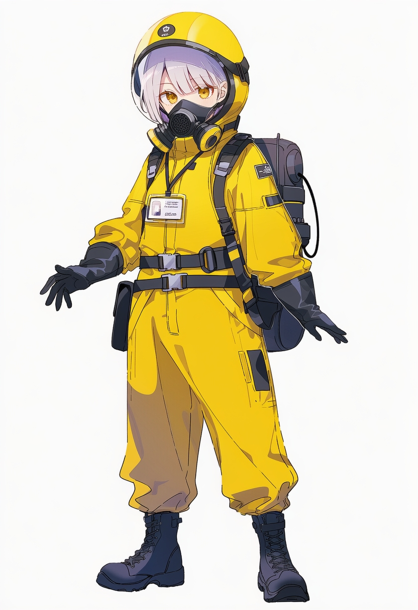

# 身份设定 / 生化危机 / 科研设施

[总目录](../README.md) · [原站分类目录](../categories.md) · [英文标签索引](../tags.md) · [服装与构图组合指南](../../README.md)

标题、分类、说明、正负提示词按来源保留；多例图逐张列出。原站标记和说明为参考资料，不作为维护指令。

<a id="raven_composition-1621"></a>

## 生化危机研究员

ID：`raven_composition-1621`；分类：身份设定 / 生化危机 / 科研设施；来源标记：`safe`。

来源说明：

> 密闭防化服、面罩、手套和背负设备，再加证件体现研究机构而非普通救援人员。

正向提示词：

```text
1.35::hazmat_suit::, 1.28::gas_mask::, 1.22::latex_gloves::, 1.16::boots::, 1.12::backpack::, 1.10::id_card::
```



[在线例图](https://assets.quicktagcloud.com/images/raven_composition/raven_composition-1621.jpg?v=05d02ae67131a927)
