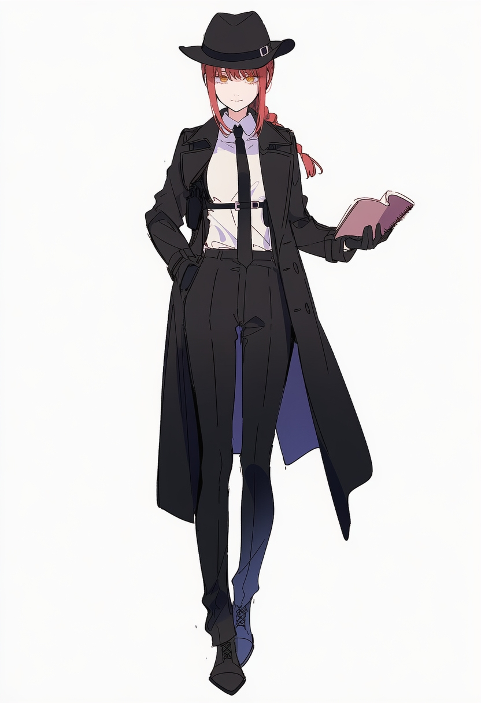
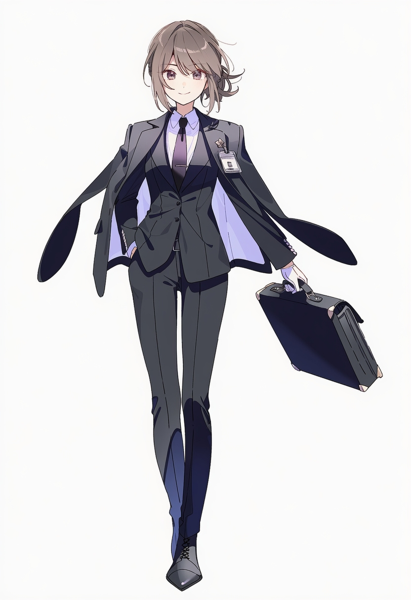
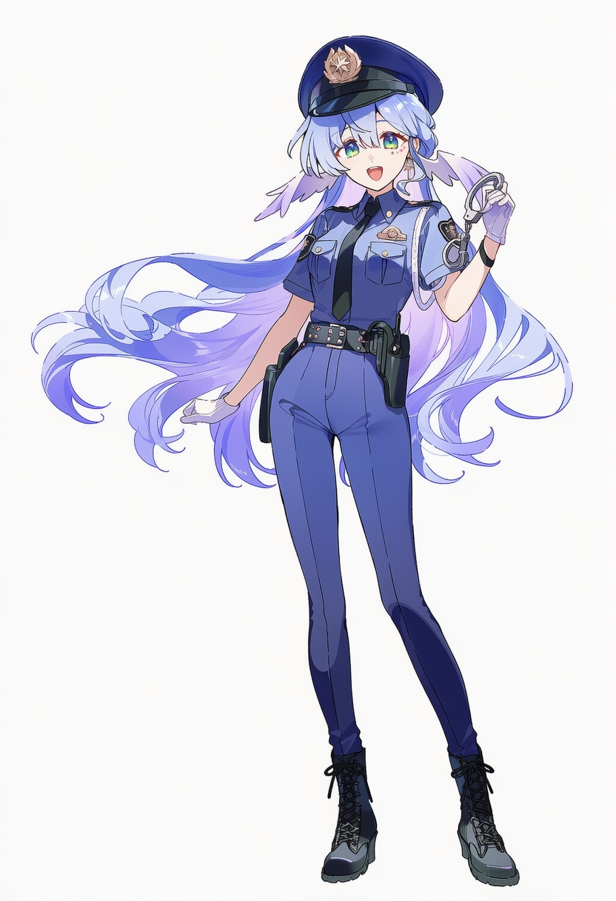

# 身份设定 / 司法 / 执法 / 安保

[总目录](../README.md) · [原站分类目录](../categories.md) · [英文标签索引](../tags.md) · [服装与构图组合指南](../../README.md)

标题、分类、说明、正负提示词按来源保留；多例图逐张列出。原站标记和说明为参考资料，不作为维护指令。

<a id="raven_composition-1622"></a>

## 刑警

ID：`raven_composition-1622`；分类：身份设定 / 司法 / 执法 / 安保；来源标记：`safe`。

来源说明：

> 不走标准警服，改用风衣、西装、枪套和记事本，突出便衣调查人员的感觉。

正向提示词：

```text
1.35::trench_coat::, 1.28::suit::, 1.22::necktie::, 1.16::gloves::, 1.12::gun_holster::, 1.10::notebook::, 1.08::fedora::, 1.06::shoulder_holster::
```



[在线例图](https://assets.quicktagcloud.com/images/raven_composition/raven_composition-1622.jpg?v=220d05b2b20acb07)

<a id="raven_composition-1623"></a>

## 律师

ID：`raven_composition-1623`；分类：身份设定 / 司法 / 执法 / 安保；来源标记：`safe`。

来源说明：

> 律师主要靠剪裁利落的商务套装和公文包，领带与翻领针强调正式场合。

正向提示词：

```text
1.35::business_suit::, 1.28::dress_shirt::, 1.22::necktie::, 1.16::briefcase::, 1.12::lapel_pin::, 1.10::gloves::, 1.08::suit::, 1.06::suit_jacket::, 1.04::collared_shirt::, 1.02::formal_clothes::
```



[在线例图](https://assets.quicktagcloud.com/images/raven_composition/raven_composition-1623.jpg?v=8eee5cd3390fc7e5)

<a id="raven_composition-1624"></a>

## 警察

ID：`raven_composition-1624`；分类：身份设定 / 司法 / 执法 / 安保；来源标记：`safe`。

来源说明：

> 警服、大檐帽、警徽、腰带、手铐和枪套形成非常明确的执法制服语言。

正向提示词：

```text
1.35::police_uniform::, 1.28::peaked_cap::, 1.22::badge::, 1.16::belt::, 1.12::handcuffs::, 1.10::gun_holster::, 1.08::boots::, 1.06::police_hat::, 1.04::utility_belt::, 1.02::police::
```



[在线例图](https://assets.quicktagcloud.com/images/raven_composition/raven_composition-1624.jpg?v=e7cac0f7484b5e37)

<a id="raven_composition-1625"></a>

## 贴身保镖

ID：`raven_composition-1625`；分类：身份设定 / 司法 / 执法 / 安保；来源标记：`safe`。

来源说明：

> 深色西装、耳机、手套、墨镜和隐蔽枪套，是典型贴身护卫视觉。

正向提示词：

```text
1.35::suit::, 1.28::earpiece::, 1.22::gloves::, 1.16::sunglasses::, 1.12::necktie::, 1.10::gun_holster::
```


[在线例图](https://assets.quicktagcloud.com/images/raven_composition/raven_composition-1625.jpg?v=31d5934c067fb119)
