# 身份设定 / 体育 / 演艺 / 艺术

[总目录](../README.md) · [原站分类目录](../categories.md) · [英文标签索引](../tags.md) · [服装与构图组合指南](../../README.md)

标题、分类、说明、正负提示词按来源保留；多例图逐张列出。原站标记和说明为参考资料，不作为维护指令。

<a id="raven_composition-1626"></a>

## 乐团指挥

ID：`raven_composition-1626`；分类：身份设定 / 体育 / 演艺 / 艺术；来源标记：`safe`。

来源说明：

> 燕尾服、白手套、领结和指挥棒直接给出古典乐团指挥的舞台形象。

正向提示词：

```text
1.35::tailcoat::, 1.28::white_gloves::, 1.22::bowtie::, 1.16::vest::, 1.12::baton::
```

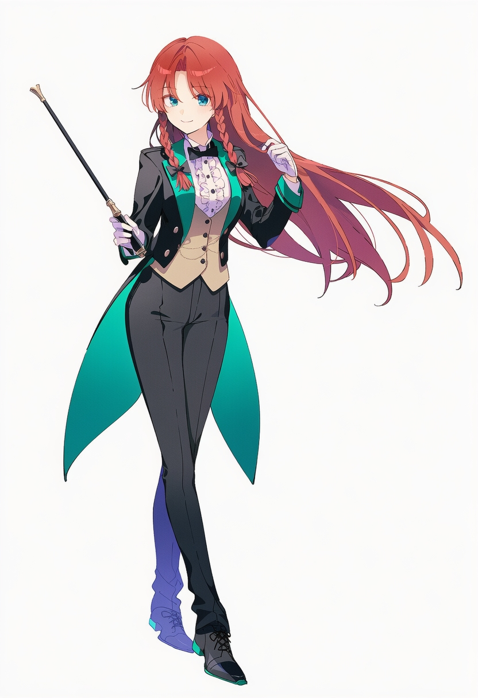

[在线例图](https://assets.quicktagcloud.com/images/raven_composition/raven_composition-1626.jpg?v=f63ceb2252b72780)

<a id="raven_composition-1627"></a>

## 健身教练

ID：`raven_composition-1627`；分类：身份设定 / 体育 / 演艺 / 艺术；来源标记：`safe`。

来源说明：

> 贴身运动装、运动鞋和吸汗配件，偏现代健身房风格。

正向提示词：

```text
1.35::sportswear::, 1.28::sports_bra::, 1.22::leggings::, 1.16::sneakers::, 1.12::wristband::, 1.10::headband::
```

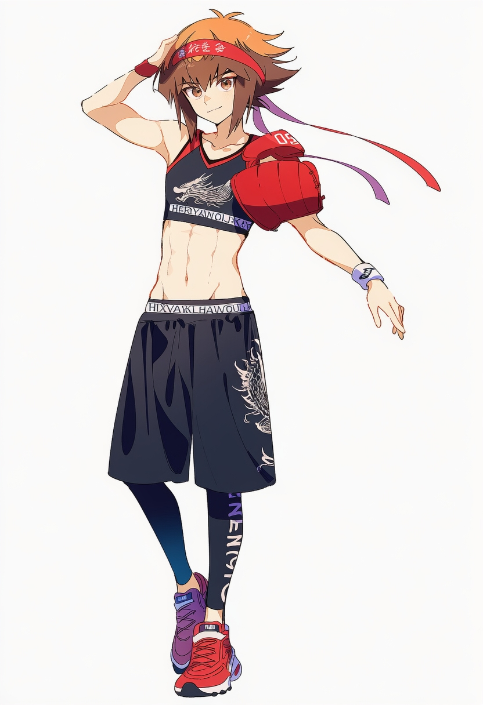

[在线例图](https://assets.quicktagcloud.com/images/raven_composition/raven_composition-1627.jpg?v=4d3eaf96fe203d45)

<a id="raven_composition-1628"></a>

## 偶像

ID：`raven_composition-1628`；分类：身份设定 / 体育 / 演艺 / 艺术；来源标记：`safe`。

来源说明：

> 偶像装重点是舞台感：荷叶边、蝴蝶结、丝带、长靴和耳麦。

正向提示词：

```text
1.35::idol::, 1.28::frilled_dress::, 1.22::frilled_skirt::, 1.16::bow::, 1.12::ribbon::, 1.10::thigh_boots::, 1.08::headset::
```

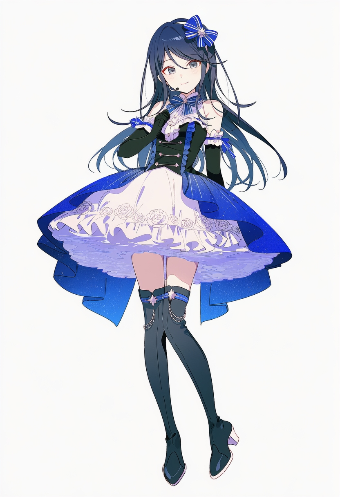

[在线例图](https://assets.quicktagcloud.com/images/raven_composition/raven_composition-1628.jpg?v=fc25bcafb3d90366)

<a id="raven_composition-1629"></a>

## 大提琴家

ID：`raven_composition-1629`；分类：身份设定 / 体育 / 演艺 / 艺术；来源标记：`safe`。

来源说明：

> 正式演出服配大提琴，整体保持古典音乐舞台的端庄感。

正向提示词：

```text
1.35::formal_clothes::, 1.28::long_dress::, 1.22::cello::, 1.16::gloves::, 1.12::jewelry::, 1.10::hair_ornament::
```

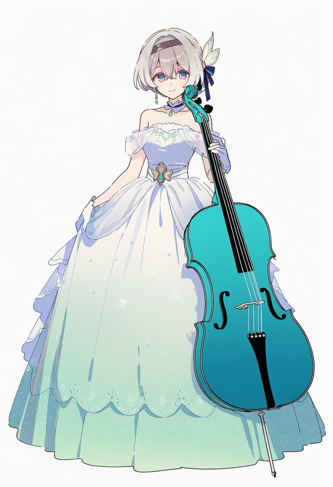

[在线例图](https://assets.quicktagcloud.com/images/raven_composition/raven_composition-1629.jpg?v=1e3eb02424cd7ff2)

<a id="raven_composition-1630"></a>

## 拳击手

ID：`raven_composition-1630`；分类：身份设定 / 体育 / 演艺 / 艺术；来源标记：`safe`。

来源说明：

> 拳击手套、短裤、拳击靴和入场长袍，再加手部绷带强化擂台职业感。

正向提示词：

```text
1.35::boxing_gloves::, 1.28::shorts::, 1.22::boots::, 1.16::robe::, 1.12::bandages::, 1.10::mouthguard::
```

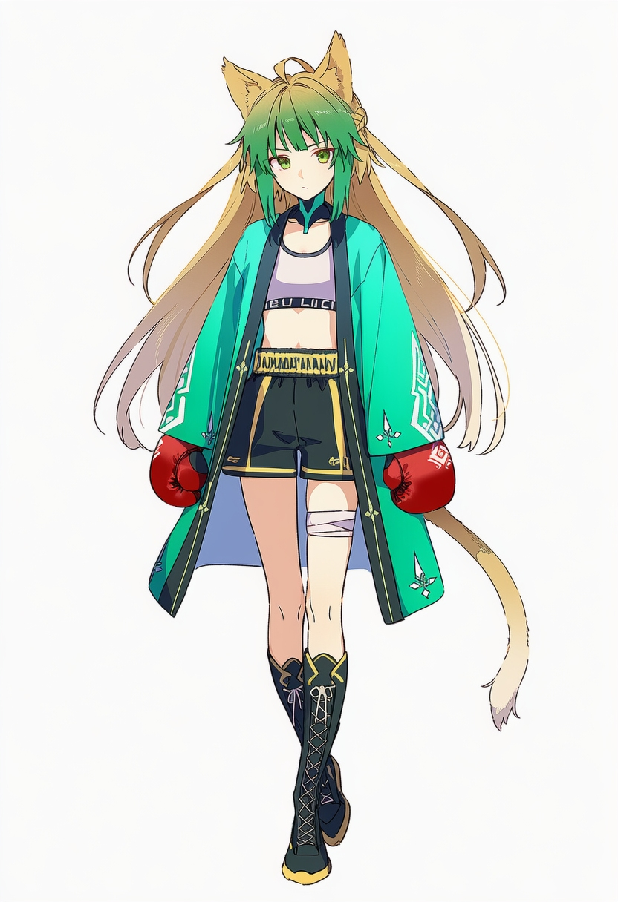

[在线例图](https://assets.quicktagcloud.com/images/raven_composition/raven_composition-1630.jpg?v=cd79da3f3664dd8b)

<a id="raven_composition-1631"></a>

## 摄影师

ID：`raven_composition-1631`；分类：身份设定 / 体育 / 演艺 / 艺术；来源标记：`safe`。

来源说明：

> 摄影师不需要统一制服，靠相机、功能马甲、肩包和轻便手套体现职业。

正向提示词：

```text
1.35::jacket::, 1.28::vest::, 1.22::camera::, 1.16::shoulder_bag::, 1.12::fingerless_gloves::, 1.10::baseball_cap::, 1.08::cargo_pants::, 1.06::camera_strap::, 1.04::camera_around_neck::
```

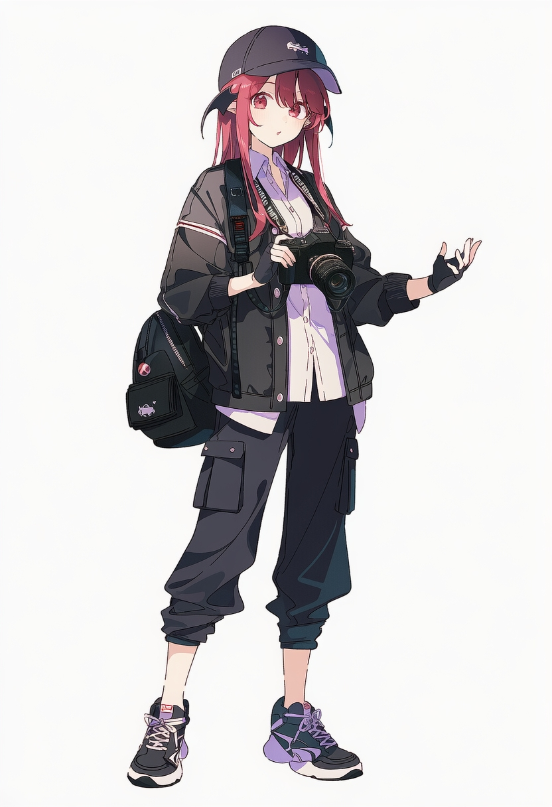

[在线例图](https://assets.quicktagcloud.com/images/raven_composition/raven_composition-1631.jpg?v=eed609a18b65410b)

<a id="raven_composition-1632"></a>

## 棒球运动员

ID：`raven_composition-1632`；分类：身份设定 / 体育 / 演艺 / 艺术；来源标记：`safe`。

来源说明：

> 棒球制服、大檐棒球帽、球套、腰带和球裤。

正向提示词：

```text
1.35::baseball_uniform::, 1.28::baseball_cap::, 1.22::baseball_glove::, 1.16::belt::, 1.12::pants::, 1.10::cleats::
```

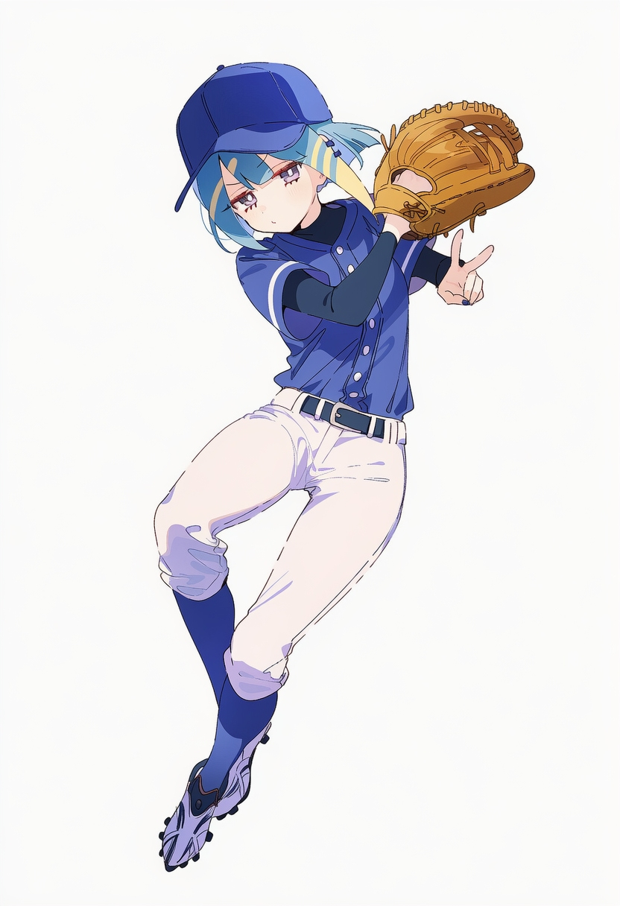

[在线例图](https://assets.quicktagcloud.com/images/raven_composition/raven_composition-1632.jpg?v=abbf82d4f6fcb268)

<a id="raven_composition-1633"></a>

## 游泳运动员

ID：`raven_composition-1633`；分类：身份设定 / 体育 / 演艺 / 艺术；来源标记：`safe`。

来源说明：

> 竞赛泳装、泳帽、泳镜和毛巾即可稳定表达专业游泳运动员。

正向提示词：

```text
1.35::competition_swimsuit::, 1.28::swim_cap::, 1.22::goggles::, 1.16::towel::, 1.12::sandals::
```

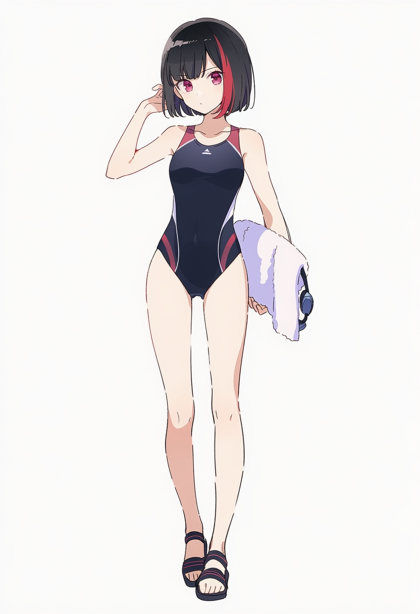

[在线例图](https://assets.quicktagcloud.com/images/raven_composition/raven_composition-1633.jpg?v=5e82767a99094ca8)

<a id="raven_composition-1634"></a>

## 画家

ID：`raven_composition-1634`；分类：身份设定 / 体育 / 演艺 / 艺术；来源标记：`safe`。

来源说明：

> 围裙和卷袖防颜料，贝雷帽做经典艺术家符号，再加画笔和颜料痕迹。

正向提示词：

```text
1.35::artist::, 1.28::apron::, 1.22::rolled_up_sleeves::, 1.16::beret::, 1.12::holding_paintbrush::, 1.10::paint_splatter::
```

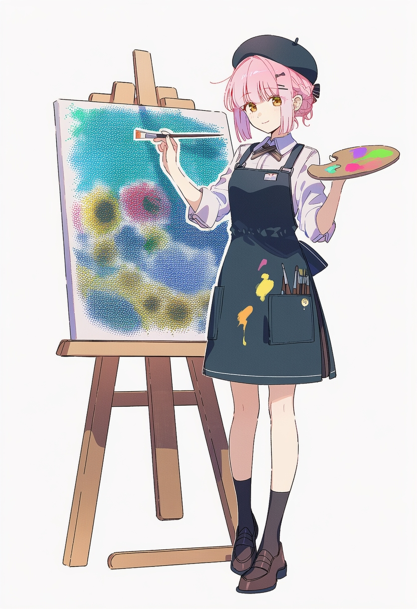

[在线例图](https://assets.quicktagcloud.com/images/raven_composition/raven_composition-1634.jpg?v=3b7dfcf67f388ab5)

<a id="raven_composition-1635"></a>

## 网球运动员

ID：`raven_composition-1635`；分类：身份设定 / 体育 / 演艺 / 艺术；来源标记：`safe`。

来源说明：

> 网球服、网球裙、遮阳帽、腕带和球拍，直接做运动项目识别。

正向提示词：

```text
1.35::tennis_uniform::, 1.28::tennis_skirt::, 1.22::visor_cap::, 1.16::sportswear::, 1.12::sneakers::, 1.10::wristband::, 1.08::holding_tennis_racket::
```

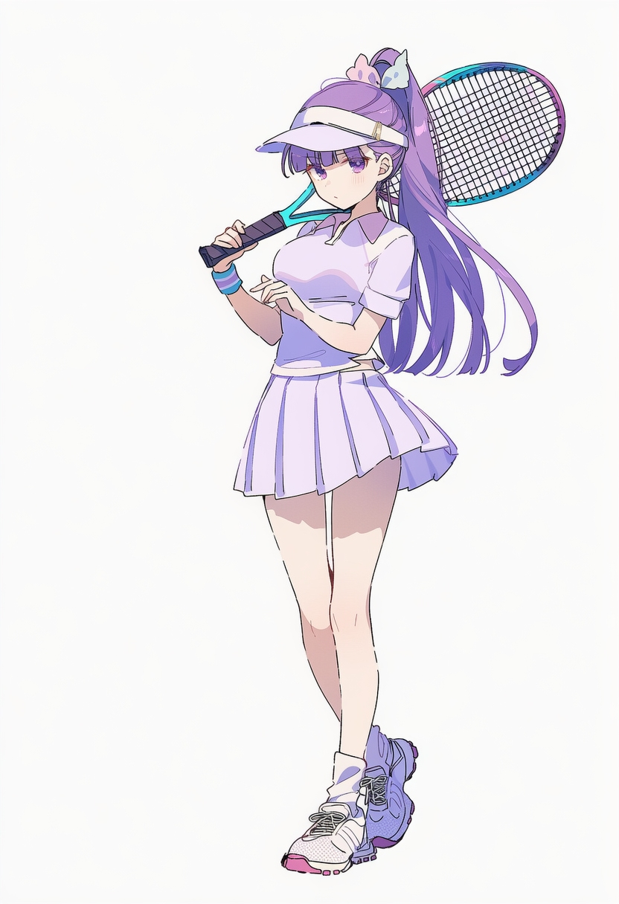

[在线例图](https://assets.quicktagcloud.com/images/raven_composition/raven_composition-1635.jpg?v=e46d47dcf457bfec)

<a id="raven_composition-1636"></a>

## 自行车运动员

ID：`raven_composition-1636`；分类：身份设定 / 体育 / 演艺 / 艺术；来源标记：`safe`。

来源说明：

> 贴身骑行服、骑行头盔、手套和运动墨镜，强调速度与空气动力学轮廓。

正向提示词：

```text
1.35::bodysuit::, 1.28::bicycle_helmet::, 1.22::gloves::, 1.16::sunglasses::, 1.12::sneakers::, 1.10::knee_pads::
```

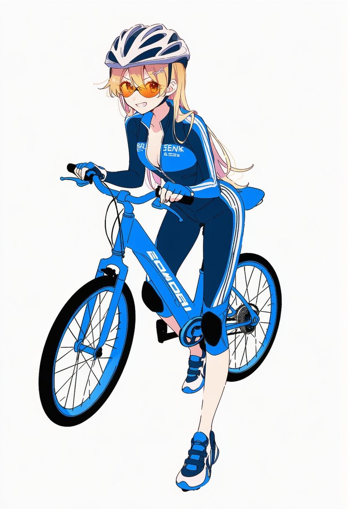

[在线例图](https://assets.quicktagcloud.com/images/raven_composition/raven_composition-1636.jpg?v=4ad3f311183fb481)

<a id="raven_composition-1637"></a>

## 舞台魔术师

ID：`raven_composition-1637`；分类：身份设定 / 体育 / 演艺 / 艺术；来源标记：`safe`。

来源说明：

> 高礼帽、燕尾服、白手套、披风和魔杖是古典舞台魔术师的完整剪影。

正向提示词：

```text
1.35::top_hat::, 1.28::tailcoat::, 1.22::white_gloves::, 1.16::bowtie::, 1.12::cape::, 1.10::wand::
```

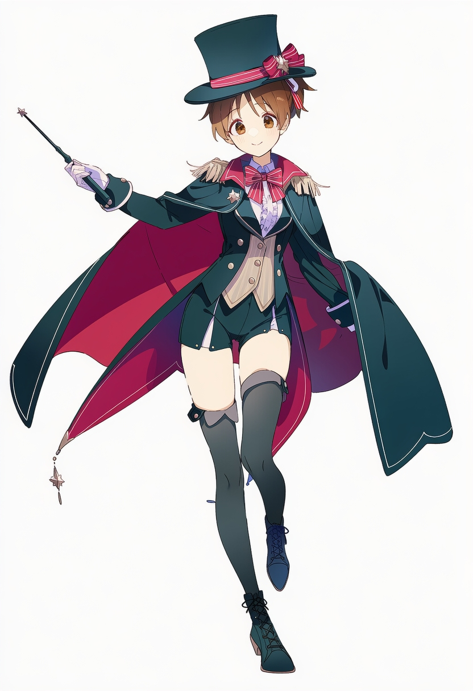

[在线例图](https://assets.quicktagcloud.com/images/raven_composition/raven_composition-1637.jpg?v=3a9728eea3b8327b)

<a id="raven_composition-1638"></a>

## 裁判员

ID：`raven_composition-1638`；分类：身份设定 / 体育 / 演艺 / 艺术；来源标记：`safe`。

来源说明：

> 条纹上衣、口哨、运动鞋和腕表是最简洁的体育裁判视觉。

正向提示词：

```text
1.35::striped_shirt::, 1.28::whistle::, 1.22::slacks::, 1.16::sneakers::, 1.12::wristwatch::, 1.10::cap::
```

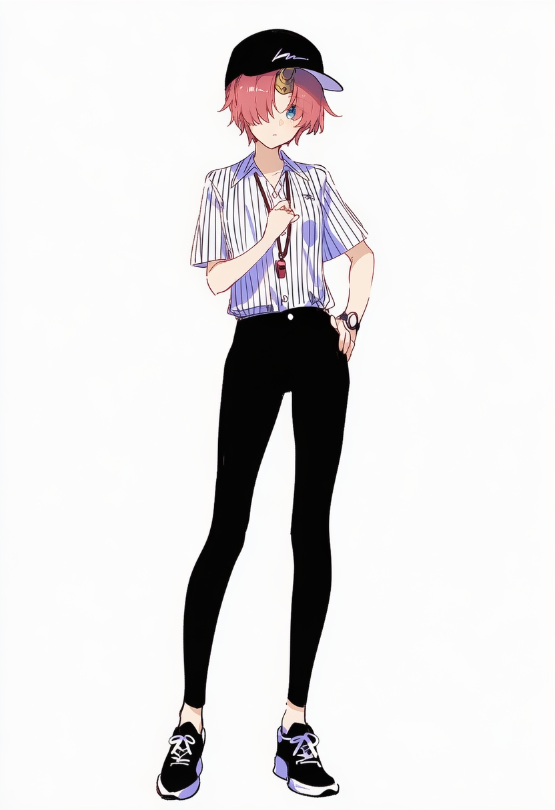

[在线例图](https://assets.quicktagcloud.com/images/raven_composition/raven_composition-1638.jpg?v=d68f0f511238249a)

<a id="raven_composition-1639"></a>

## 音乐家

ID：`raven_composition-1639`；分类：身份设定 / 体育 / 演艺 / 艺术；来源标记：`safe`。

来源说明：

> 没有限定乐器时用演奏会正装，让乐器本身成为职业锚点。

正向提示词：

```text
1.35::formal_clothes::, 1.28::dress_shirt::, 1.22::vest::, 1.16::bowtie::, 1.12::holding_instrument::
```

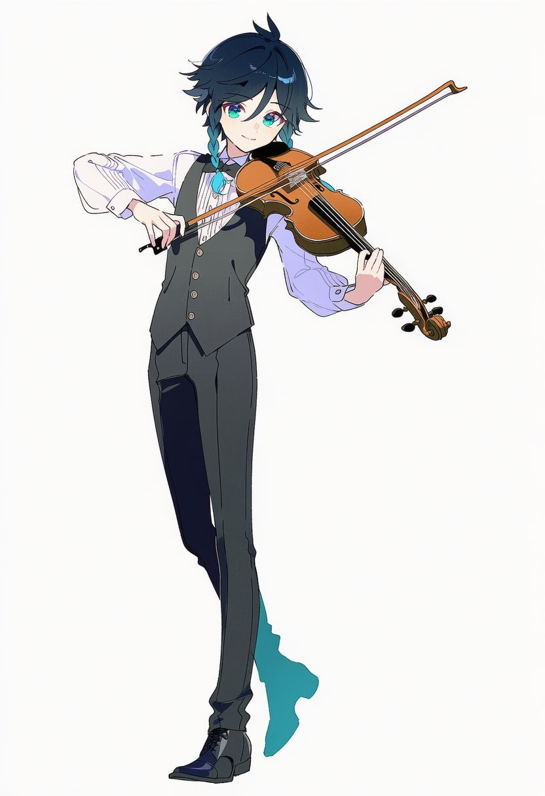

[在线例图](https://assets.quicktagcloud.com/images/raven_composition/raven_composition-1639.jpg?v=c33dad5841dbd41b)
