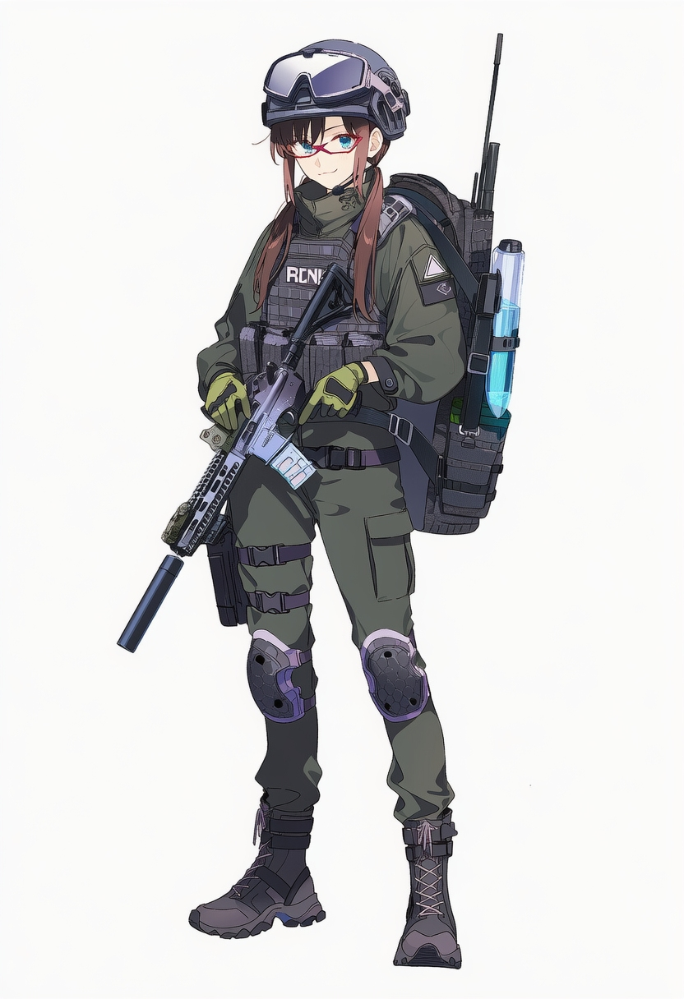
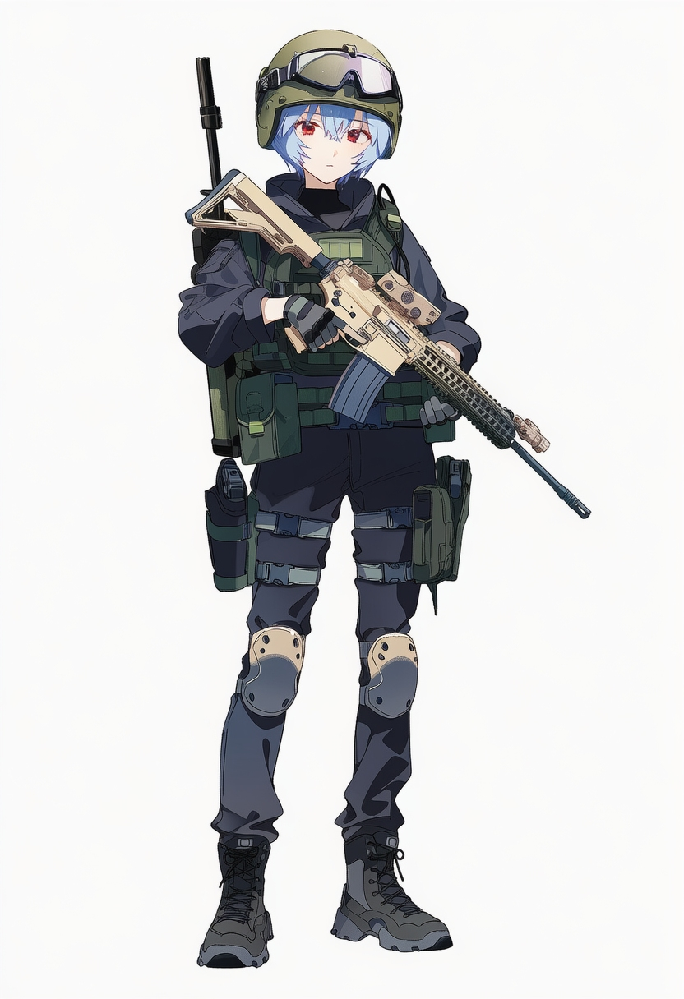
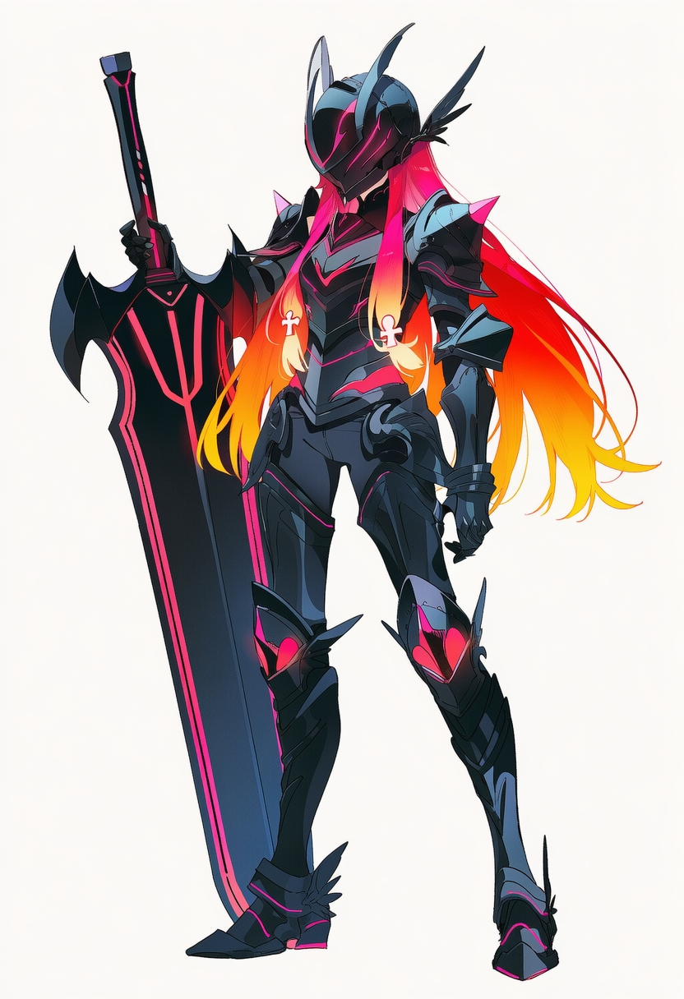
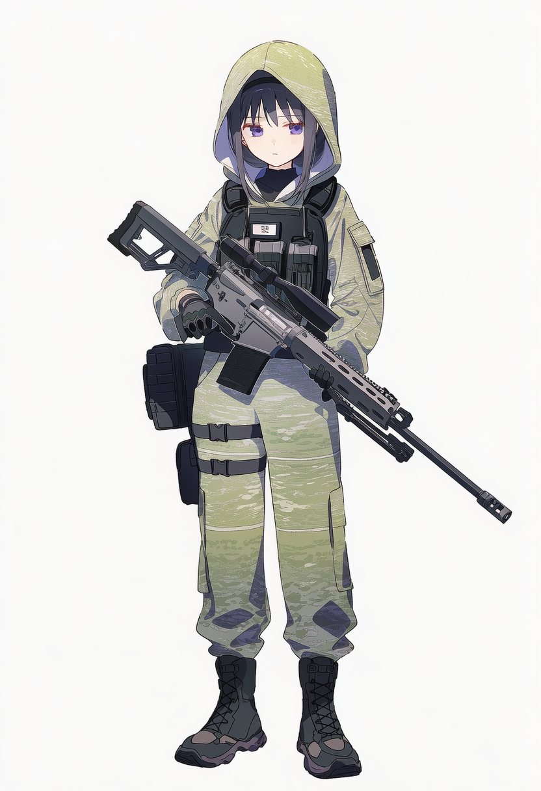
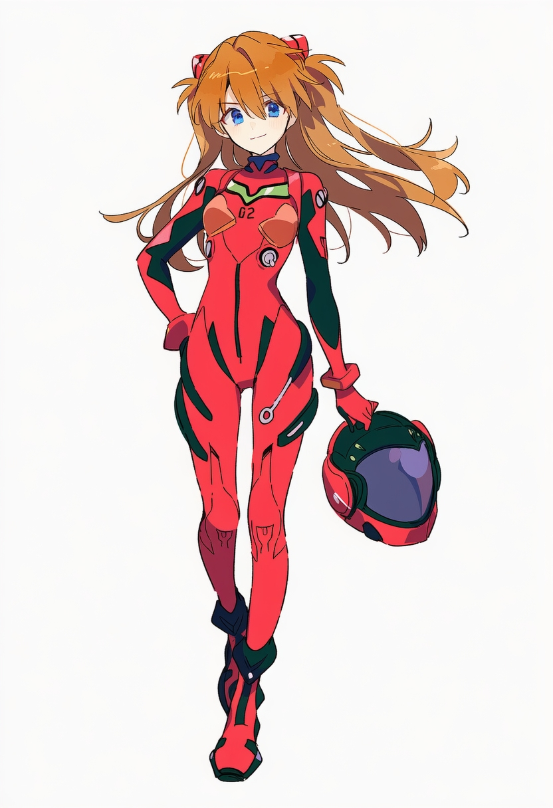
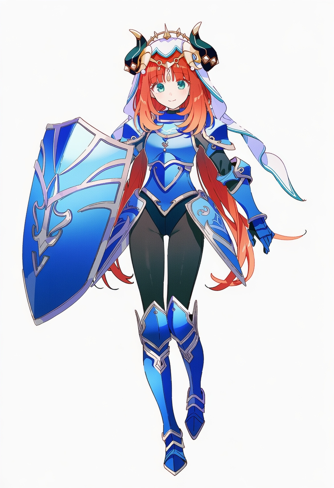

# 身份设定 / 未来战争 / 高科技装备

[总目录](../README.md) · [原站分类目录](../categories.md) · [英文标签索引](../tags.md) · [服装与构图组合指南](../../README.md)

标题、分类、说明、正负提示词按来源保留；多例图逐张列出。原站标记和说明为参考资料，不作为维护指令。

<a id="raven_composition-1640"></a>

## 喷气背包侦察兵

ID：`raven_composition-1640`；分类：身份设定 / 未来战争 / 高科技装备；来源标记：`safe`。

来源说明：

> 喷气背包是绝对核心，配轻战术服、护目镜和步枪做高速空中侦察兵。

正向提示词：

```text
1.35::jetpack::, 1.28::tactical_clothes::, 1.22::helmet::, 1.16::goggles::, 1.12::utility_belt::, 1.10::combat_boots::, 1.08::rifle::
```



[在线例图](https://assets.quicktagcloud.com/images/raven_composition/raven_composition-1640.jpg?v=4f0f79deeb98342a)

<a id="raven_composition-1641"></a>

## 外骨骼突击兵

ID：`raven_composition-1641`；分类：身份设定 / 未来战争 / 高科技装备；来源标记：`safe`。

来源说明：

> 战术服外面叠机械外骨骼，保留现代军警装备，让科技升级感更可信。

正向提示词：

```text
1.35::exoskeleton::, 1.28::tactical_clothes::, 1.22::bulletproof_vest::, 1.16::helmet::, 1.12::goggles::, 1.10::utility_belt::, 1.08::combat_boots::, 1.06::rifle::
```



[在线例图](https://assets.quicktagcloud.com/images/raven_composition/raven_composition-1641.jpg?v=38cac9b66d1f6a74)

<a id="raven_composition-1642"></a>

## 动力甲重装兵

ID：`raven_composition-1642`；分类：身份设定 / 未来战争 / 高科技装备；来源标记：`safe`。

来源说明：

> 直接让 power_armor 成为绝对主体，再堆大肩甲、重护手和发光装甲。

正向提示词：

```text
1.35::power_armor::, 1.28::helmet::, 1.22::gauntlets::, 1.16::armored_boots::, 1.12::shoulder_armor::, 1.10::glowing_armor::, 1.08::full_armor::, 1.06::greaves::, 1.04::large_weapon::
```



[在线例图](https://assets.quicktagcloud.com/images/raven_composition/raven_composition-1642.jpg?v=6f3a493ad09b80b5)

<a id="raven_composition-1643"></a>

## 未来军医

ID：`raven_composition-1643`；分类：身份设定 / 未来战争 / 高科技装备；来源标记：`safe`。

来源说明：

> 医疗服上叠轻型防护和多口袋背心，像战地/星际军医。

正向提示词：

```text
1.35::scrubs::, 1.28::body_armor::, 1.22::utility_vest::, 1.16::disposable_gloves::, 1.12::medical_mask::, 1.10::id_card::, 1.08::labcoat::, 1.06::holographic_interface::, 1.04::rubber_gloves::
```


[在线例图](https://assets.quicktagcloud.com/images/raven_composition/raven_composition-1643.jpg?v=99d82cf6ce42da25)

<a id="raven_composition-1644"></a>

## 未来狙击手

ID：`raven_composition-1644`；分类：身份设定 / 未来战争 / 高科技装备；来源标记：`safe`。

来源说明：

> 保留隐蔽服/兜帽和轻甲，狙击枪只是辅助职业识别，服装仍是重点。

正向提示词：

```text
1.35::tactical_clothes::, 1.28::ghillie_suit::, 1.22::hood::, 1.16::body_armor::, 1.12::gloves::, 1.10::combat_boots::, 1.08::sniper_rifle::
```



[在线例图](https://assets.quicktagcloud.com/images/raven_composition/raven_composition-1644.jpg?v=9723fbcdb4523ee6)

<a id="raven_composition-1645"></a>

## 机甲驾驶员

ID：`raven_composition-1645`；分类：身份设定 / 未来战争 / 高科技装备；来源标记：`safe`。

来源说明：

> 紧身驾驶服、头盔、耳机、安全带和手套，像进入驾驶舱前的专业装备。

正向提示词：

```text
1.35::bodysuit::, 1.28::helmet::, 1.22::gloves::, 1.16::boots::, 1.12::headset::, 1.10::harness::, 1.08::mecha_pilot_suit::, 1.06::pilot::, 1.04::mecha::
```



[在线例图](https://assets.quicktagcloud.com/images/raven_composition/raven_composition-1645.jpg?v=594a19a38a74e9dd)

<a id="raven_composition-1646"></a>

## 能量盾重装兵

ID：`raven_composition-1646`；分类：身份设定 / 未来战争 / 高科技装备；来源标记：`safe`。

来源说明：

> 重动力甲配实体/能量盾的视觉逻辑，重点是防御型科幻步兵。

正向提示词：

```text
1.35::power_armor::, 1.28::helmet::, 1.22::gauntlets::, 1.16::greaves::, 1.12::shield::, 1.10::boots::
```



[在线例图](https://assets.quicktagcloud.com/images/raven_composition/raven_composition-1646.jpg?v=a5255a6282ceacaa)
