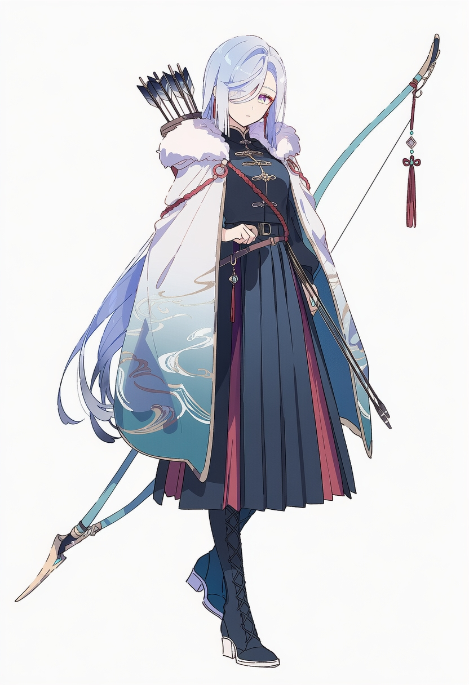
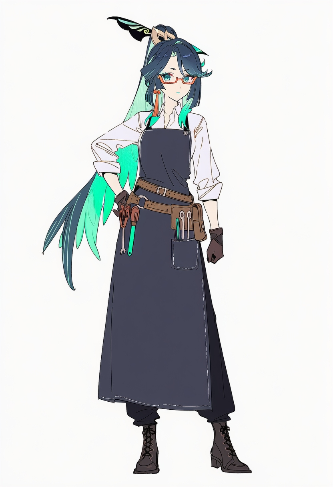
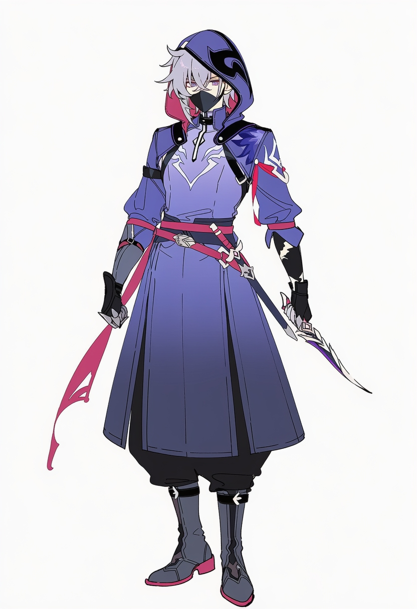
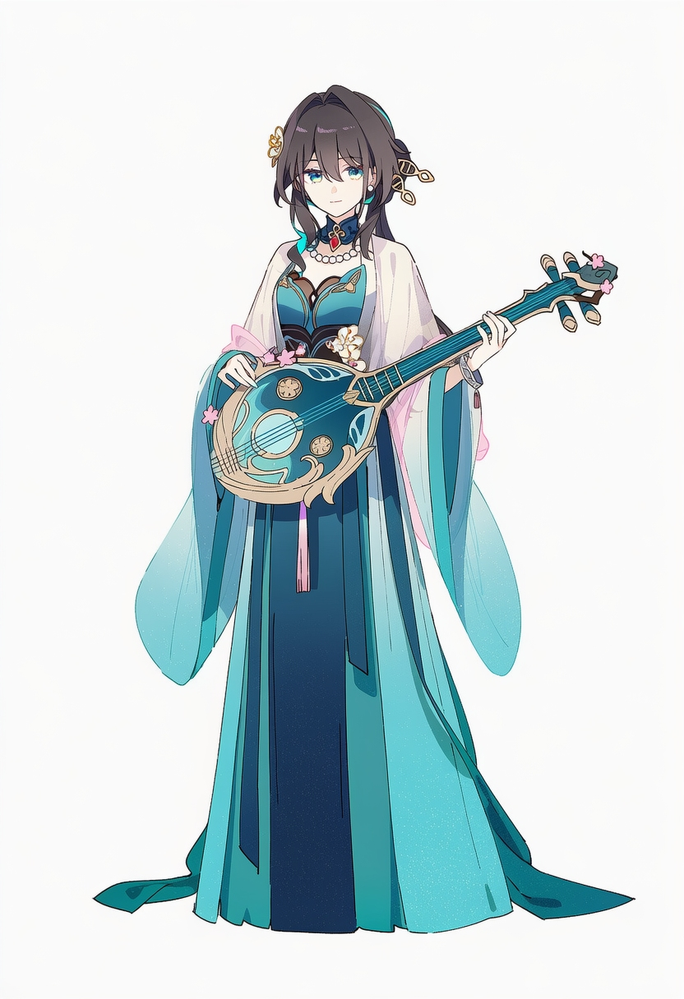
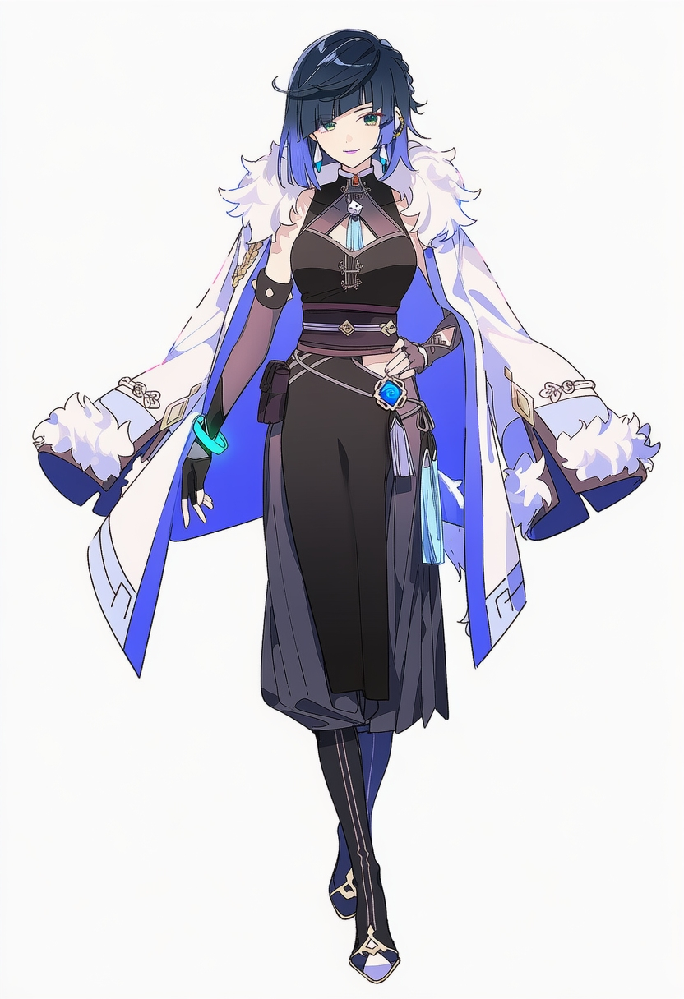
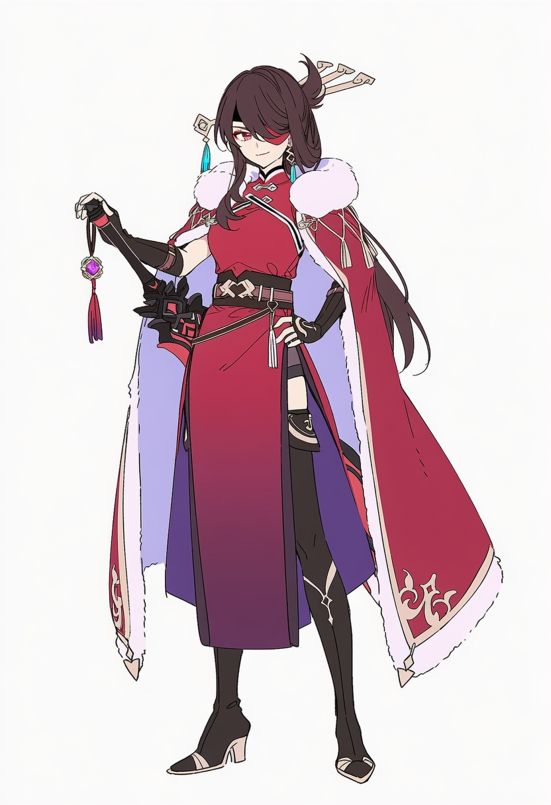

# 身份设定 / 武侠 / 江湖 / 东方奇术

[总目录](../README.md) · [原站分类目录](../categories.md) · [英文标签索引](../tags.md) · [服装与构图组合指南](../../README.md)

标题、分类、说明、正负提示词按来源保留；多例图逐张列出。原站标记和说明为参考资料，不作为维护指令。

<a id="raven_composition-1647"></a>

## 山林猎户

ID：`raven_composition-1647`；分类：身份设定 / 武侠 / 江湖 / 东方奇术；来源标记：`safe`。

来源说明：

> 古风短装与披风配弓箭、篮筐和毛皮，像长期出入山林的猎户。

正向提示词：

```text
1.35::chinese_clothes::, 1.28::cloak::, 1.22::boots::, 1.16::bow_(weapon)::, 1.12::quiver::, 1.10::basket::, 1.08::fur_trim::
```



[在线例图](https://assets.quicktagcloud.com/images/raven_composition/raven_composition-1647.jpg?v=23445c54875ed24b)

<a id="raven_composition-1648"></a>

## 机关师

ID：`raven_composition-1648`；分类：身份设定 / 武侠 / 江湖 / 东方奇术；来源标记：`safe`。

来源说明：

> 古风衣着里混入护目镜、工具腰带和扳手，表达擅长机关与机械装置。

正向提示词：

```text
1.35::hanfu::, 1.28::apron::, 1.22::goggles::, 1.16::gloves::, 1.12::tool_belt::, 1.10::wrench::, 1.08::pouch::
```



[在线例图](https://assets.quicktagcloud.com/images/raven_composition/raven_composition-1648.jpg?v=016d3b6e27731785)

<a id="raven_composition-1649"></a>

## 江湖刺客

ID：`raven_composition-1649`；分类：身份设定 / 武侠 / 江湖 / 东方奇术；来源标记：`safe`。

来源说明：

> 把古风衣着和刺客结构结合：黑衣、兜帽、面罩、束腰、短靴和短刃。

正向提示词：

```text
1.35::chinese_clothes::, 1.28::hood::, 1.22::mask::, 1.16::black_clothes::, 1.12::sash::, 1.10::boots::, 1.08::dagger::
```



[在线例图](https://assets.quicktagcloud.com/images/raven_composition/raven_composition-1649.jpg?v=6a8bc0fc02053d9d)

<a id="raven_composition-1650"></a>

## 琴师

ID：`raven_composition-1650`；分类：身份设定 / 武侠 / 江湖 / 东方奇术；来源标记：`safe`。

来源说明：

> 宽袖汉服与发簪保持古典气质，古琴作为核心职业道具。

正向提示词：

```text
1.35::hanfu::, 1.28::wide_sleeves::, 1.22::sash::, 1.16::hair_stick::, 1.12::jewelry::, 1.10::guqin::
```



[在线例图](https://assets.quicktagcloud.com/images/raven_composition/raven_composition-1650.jpg?v=2285d54901a20c96)

<a id="raven_composition-1651"></a>

## 轻功飞贼

ID：`raven_composition-1651`；分类：身份设定 / 武侠 / 江湖 / 东方奇术；来源标记：`safe`。

来源说明：

> 比刺客更轻更灵活，用兜帽、短披风、手套和小袋表现潜入与盗取工具。

正向提示词：

```text
1.35::chinese_clothes::, 1.28::hood::, 1.22::cloak::, 1.16::fingerless_gloves::, 1.12::sash::, 1.10::boots::, 1.08::belt_pouch::
```



[在线例图](https://assets.quicktagcloud.com/images/raven_composition/raven_composition-1651.jpg?v=10e1caf681f96ce7)

<a id="raven_composition-1652"></a>

## 镖师

ID：`raven_composition-1652`；分类：身份设定 / 武侠 / 江湖 / 东方奇术；来源标记：`safe`。

来源说明：

> 耐行走的古风长袍、护臂、靴子和佩剑，突出长途护送与江湖武人属性。

正向提示词：

```text
1.35::chinese_clothes::, 1.28::robe::, 1.22::sash::, 1.16::boots::, 1.12::bracer::, 1.10::sword::, 1.08::cloak::
```



[在线例图](https://assets.quicktagcloud.com/images/raven_composition/raven_composition-1652.jpg?v=6b8d4f03cdc01bb9)

<a id="raven_composition-1653"></a>

## 风水师

ID：`raven_composition-1653`；分类：身份设定 / 武侠 / 江湖 / 东方奇术；来源标记：`safe`。

来源说明：

> 中式法袍、罗盘、书册和念珠，做成擅长堪舆与方位测算的术士。

正向提示词：

```text
1.35::chinese_clothes::, 1.28::robe::, 1.22::wide_sleeves::, 1.16::compass::, 1.12::book::, 1.10::sash::, 1.08::prayer_beads::
```


[在线例图](https://assets.quicktagcloud.com/images/raven_composition/raven_composition-1653.jpg?v=28f1af5eae71b6f4)
