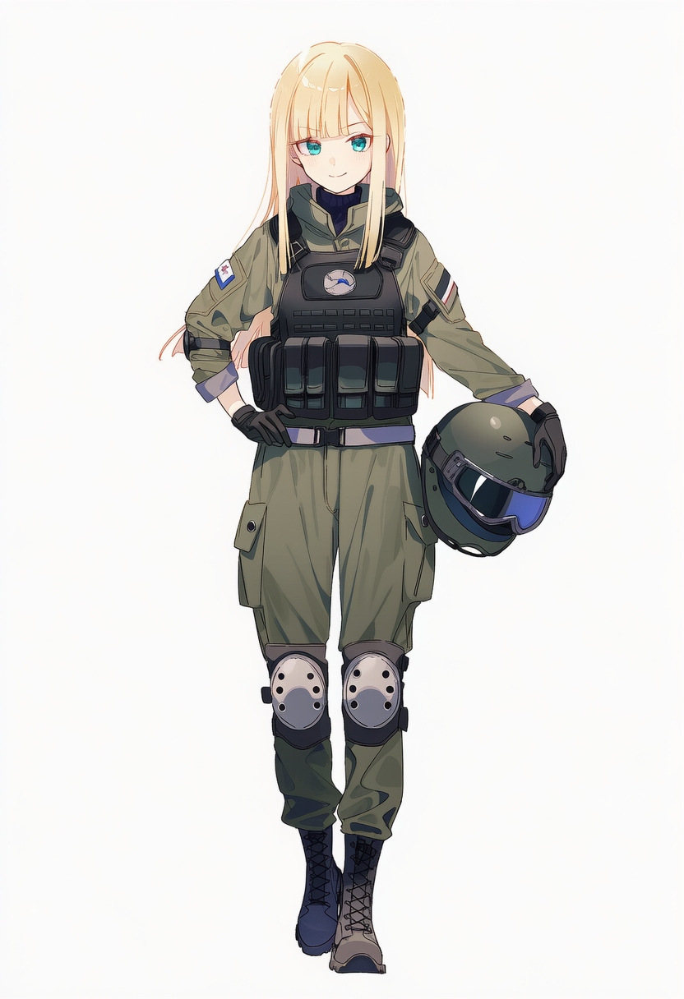
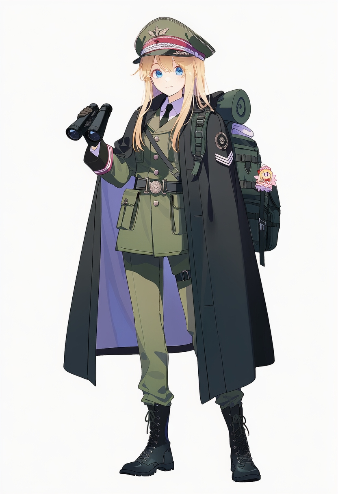
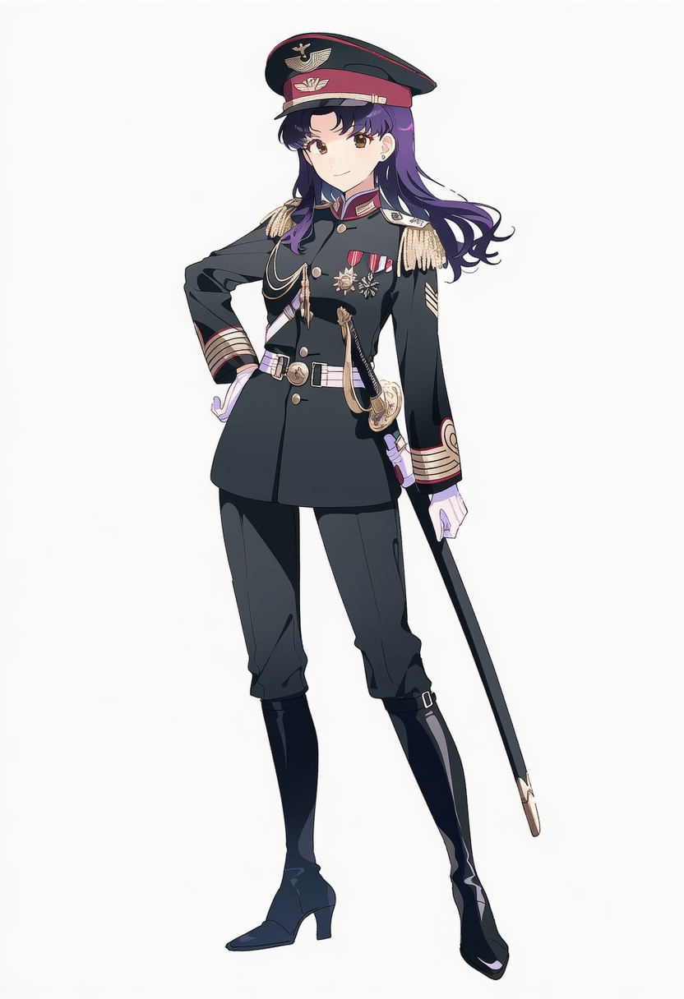
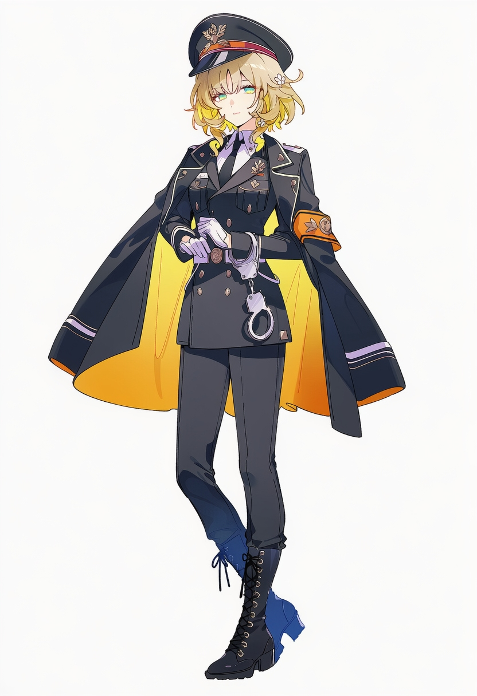
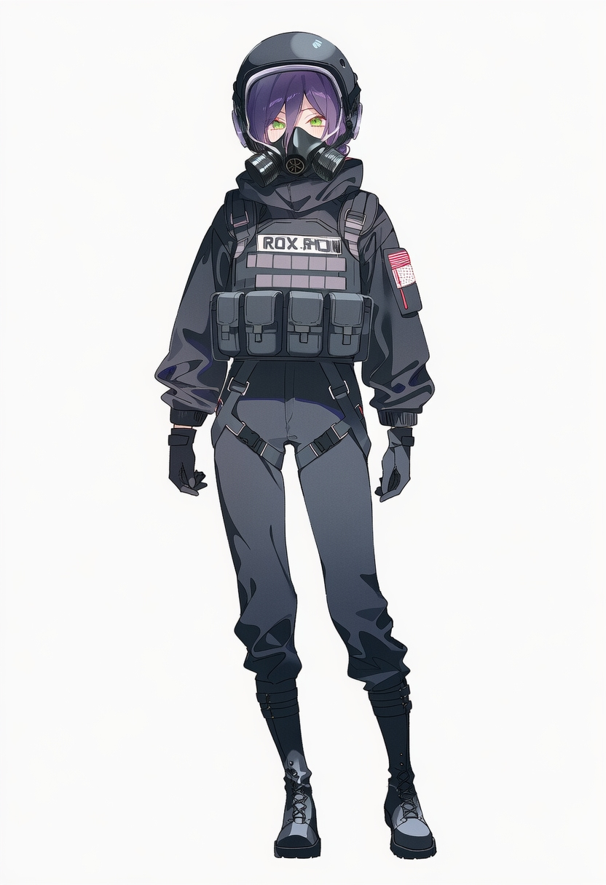
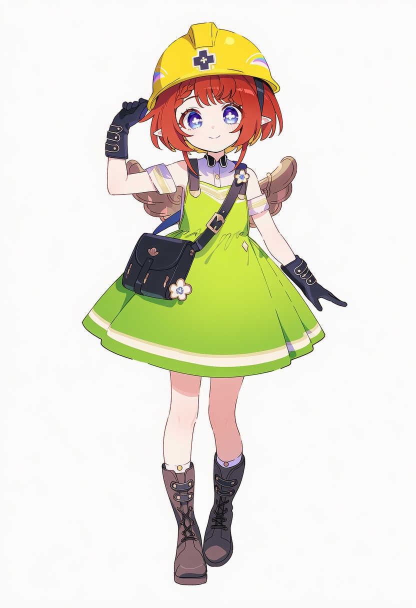
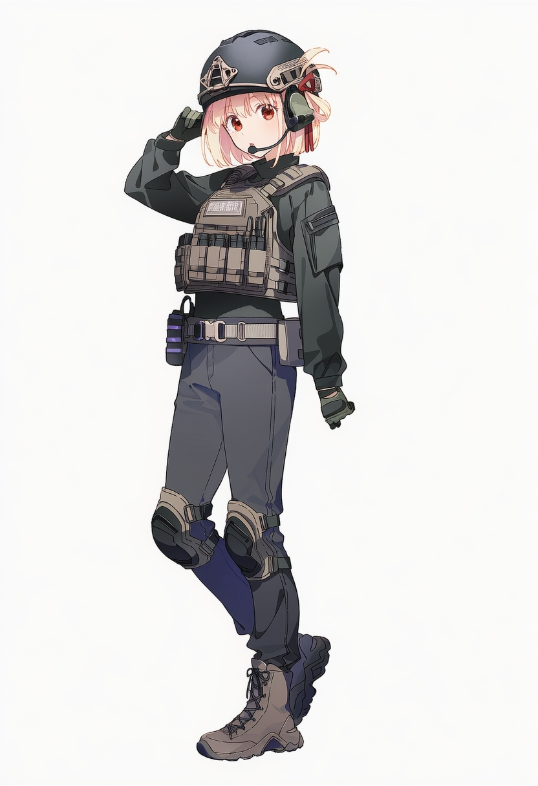
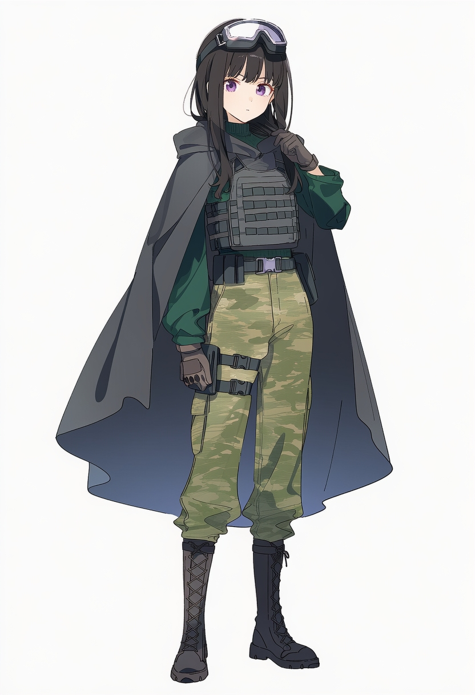
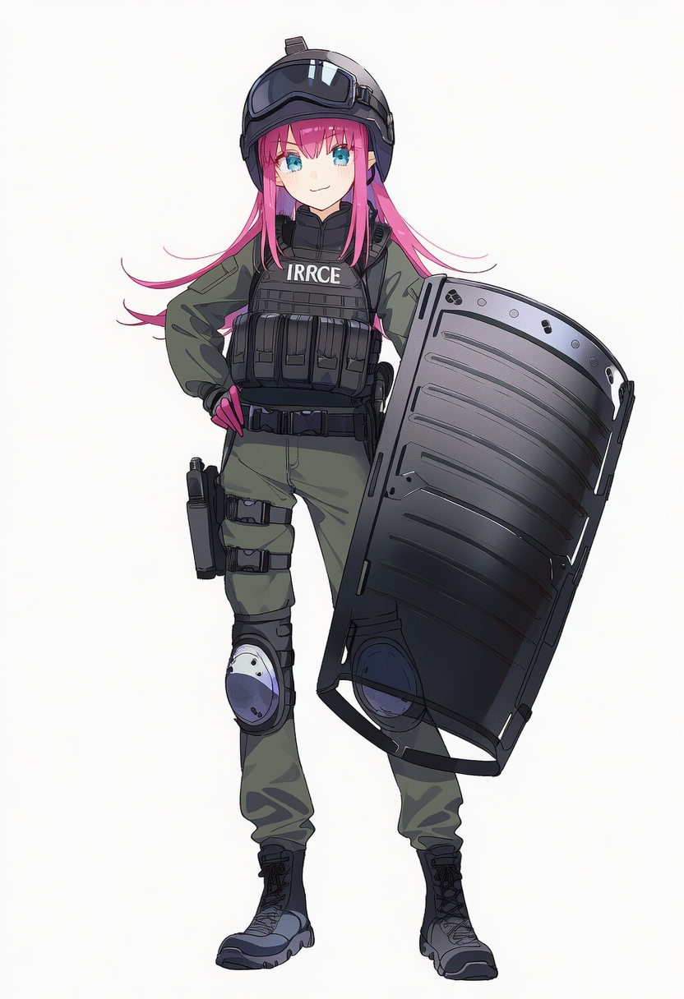

# 身份设定 / 现代军警 / 战术 / 应急

[总目录](../README.md) · [原站分类目录](../categories.md) · [英文标签索引](../tags.md) · [服装与构图组合指南](../../README.md)

标题、分类、说明、正负提示词按来源保留；多例图逐张列出。原站标记和说明为参考资料，不作为维护指令。

<a id="raven_composition-1654"></a>

## 伞兵

ID：`raven_composition-1654`；分类：身份设定 / 现代军警 / 战术 / 应急；来源标记：`safe`。

来源说明：

> 战斗装具之外，把降落伞放高权重，直接建立空降兵特征。

正向提示词：

```text
1.35::military_uniform::, 1.28::combat_helmet::, 1.22::body_armor::, 1.16::parachute::, 1.12::gloves::, 1.10::combat_boots::
```



[在线例图](https://assets.quicktagcloud.com/images/raven_composition/raven_composition-1654.jpg?v=a27aeade3e33312b)

<a id="raven_composition-1655"></a>

## 侦察兵

ID：`raven_composition-1655`；分类：身份设定 / 现代军警 / 战术 / 应急；来源标记：`safe`。

来源说明：

> 轻装军服、披风、望远镜、背包和军靴，强调长距离观察与机动。

正向提示词：

```text
1.35::military_uniform::, 1.28::cloak::, 1.22::binoculars::, 1.16::combat_boots::, 1.12::gloves::, 1.10::backpack::
```



[在线例图](https://assets.quicktagcloud.com/images/raven_composition/raven_composition-1655.jpg?v=a1fc9a9d6683ce71)

<a id="raven_composition-1656"></a>

## 军官

ID：`raven_composition-1656`；分类：身份设定 / 现代军警 / 战术 / 应急；来源标记：`safe`。

来源说明：

> 大檐帽、肩章、饰带、礼仪腰带与勋章，重点表现“指挥与礼服感”。

正向提示词：

```text
1.35::military_uniform::, 1.28::peaked_cap::, 1.22::epaulettes::, 1.16::aiguillette::, 1.12::gloves::, 1.10::sam_browne_belt::, 1.08::medal::, 1.06::military_dress_uniform::, 1.04::insignia::, 1.02::shoulder_boards::
```



[在线例图](https://assets.quicktagcloud.com/images/raven_composition/raven_composition-1656.jpg?v=1a0828914a8cc1e0)

<a id="raven_composition-1657"></a>

## 宪兵

ID：`raven_composition-1657`；分类：身份设定 / 现代军警 / 战术 / 应急；来源标记：`safe`。

来源说明：

> 军服底子上加入执法臂章、徽章和手铐，视觉上介于军人和警察之间。

正向提示词：

```text
1.35::military_uniform::, 1.28::peaked_cap::, 1.22::armband::, 1.16::badge::, 1.12::belt::, 1.10::handcuffs::, 1.08::combat_boots::
```



[在线例图](https://assets.quicktagcloud.com/images/raven_composition/raven_composition-1657.jpg?v=b108e65e681f2c2c)

<a id="raven_composition-1658"></a>

## 排爆人员

ID：`raven_composition-1658`；分类：身份设定 / 现代军警 / 战术 / 应急；来源标记：`safe`。

来源说明：

> 排爆服本身就是最强职业标识，再加密闭头盔、手套和厚靴。

正向提示词：

```text
1.35::bomb_suit::, 1.28::helmet::, 1.22::gloves::, 1.16::boots::, 1.12::gas_mask::
```



[在线例图](https://assets.quicktagcloud.com/images/raven_composition/raven_composition-1658.jpg?v=719787b361403418)

<a id="raven_composition-1659"></a>

## 灾害救援队员

ID：`raven_composition-1659`；分类：身份设定 / 现代军警 / 战术 / 应急；来源标记：`safe`。

来源说明：

> 安全帽、厚手套、靴子与高可视背心，整体更像地震、坍塌等灾害救援人员。

正向提示词：

```text
1.35::hard_hat::, 1.28::gloves::, 1.22::boots::, 1.16::belt::, 1.12::shoulder_bag::
```



[在线例图](https://assets.quicktagcloud.com/images/raven_composition/raven_composition-1659.jpg?v=a3e81f2c3b17bd3e)

<a id="raven_composition-1660"></a>

## 特警

ID：`raven_composition-1660`；分类：身份设定 / 现代军警 / 战术 / 应急；来源标记：`safe`。

来源说明：

> 战术服、防弹装备、头盔、战术背心和护膝一起上，和普通警察明显区分。

正向提示词：

```text
1.35::tactical_clothes::, 1.28::body_armor::, 1.22::ballistic_helmet::, 1.16::tactical_vest::, 1.12::utility_belt::, 1.10::knee_pads::, 1.08::combat_boots::, 1.06::headset::, 1.04::bulletproof_vest::, 1.02::helmet::
```



[在线例图](https://assets.quicktagcloud.com/images/raven_composition/raven_composition-1660.jpg?v=9ef5597cc92b6102)

<a id="raven_composition-1661"></a>

## 狙击手

ID：`raven_composition-1661`；分类：身份设定 / 现代军警 / 战术 / 应急；来源标记：`safe`。

来源说明：

> 优先隐藏轮廓：迷彩、披风、面罩和护目镜，再补吉利伪装服的自然语言提示。

正向提示词：

```text
1.35::camouflage::, 1.28::cloak::, 1.22::gloves::, 1.16::combat_boots::, 1.12::balaclava::, 1.10::goggles::
```



[在线例图](https://assets.quicktagcloud.com/images/raven_composition/raven_composition-1661.jpg?v=75d13cf26edd8771)

<a id="raven_composition-1662"></a>

## 防暴警察

ID：`raven_composition-1662`；分类：身份设定 / 现代军警 / 战术 / 应急；来源标记：`safe`。

来源说明：

> 防暴盾、全罩头盔、防毒面具、护膝和护甲组成厚重的街头防暴装备。

正向提示词：

```text
1.35::body_armor::, 1.28::combat_helmet::, 1.22::riot_shield::, 1.16::gas_mask::, 1.12::gloves::, 1.10::knee_pads::, 1.08::combat_boots::
```



[在线例图](https://assets.quicktagcloud.com/images/raven_composition/raven_composition-1662.jpg?v=6923b07d2e3b62d6)
