# 身份设定 / 现代通用职业

[总目录](../README.md) · [原站分类目录](../categories.md) · [英文标签索引](../tags.md) · [服装与构图组合指南](../../README.md)

标题、分类、说明、正负提示词按来源保留；多例图逐张列出。原站标记和说明为参考资料，不作为维护指令。

<a id="raven_composition-1663"></a>

## 佣兵

ID：`raven_composition-1663`；分类：身份设定 / 现代通用职业；来源标记：`safe`。

来源说明：

> 混搭金属甲和皮甲，装备实用但不统一，突出长期战斗的雇佣兵感。

正向提示词：

```text
1.35::armor::, 1.28::leather_armor::, 1.22::pauldrons::, 1.16::bracer::, 1.12::belt_pouch::, 1.10::boots::, 1.08::sword::, 1.06::breastplate::, 1.04::cloak::
```

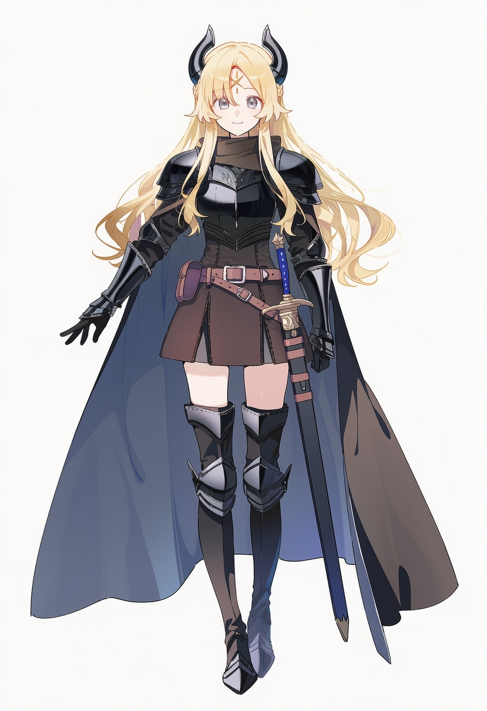

[在线例图](https://assets.quicktagcloud.com/images/raven_composition/raven_composition-1663.jpg?v=cd0e15f05d5e1905)

<a id="raven_composition-1664"></a>

## 危险环境作业员

ID：`raven_composition-1664`；分类：身份设定 / 现代通用职业；来源标记：`safe`。

来源说明：

> 完整防化服、呼吸器和氧气罐直接塑造污染区/危险环境作业人员。

正向提示词：

```text
1.35::hazmat_suit::, 1.28::respirator::, 1.22::goggles::, 1.16::gloves::, 1.12::boots::, 1.10::oxygen_tank::, 1.08::utility_belt::
```

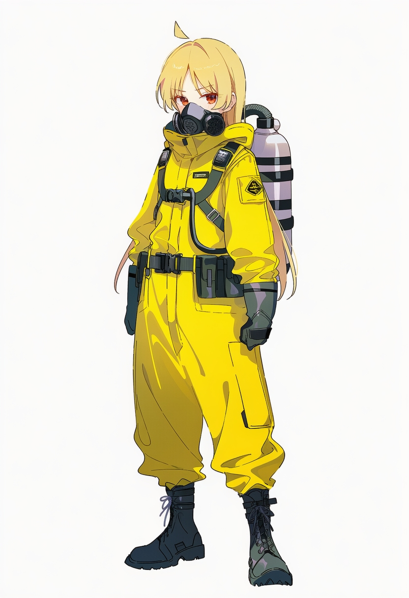

[在线例图](https://assets.quicktagcloud.com/images/raven_composition/raven_composition-1664.jpg?v=ddea7e32983a01f0)

<a id="raven_composition-1665"></a>

## 宫廷侍女

ID：`raven_composition-1665`；分类：身份设定 / 现代通用职业；来源标记：`safe`。

来源说明：

> 长裙、围裙、短披肩和发饰，介于女仆与宫廷礼服之间。

正向提示词：

```text
1.35::long_dress::, 1.28::apron::, 1.22::capelet::, 1.16::gloves::, 1.12::hair_ornament::, 1.10::brooch::
```

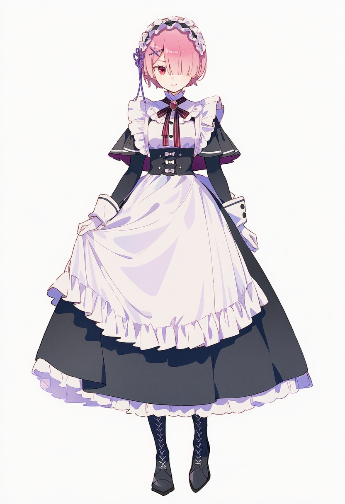

[在线例图](https://assets.quicktagcloud.com/images/raven_composition/raven_composition-1665.jpg?v=22eaa45f3d6fec3f)

<a id="raven_composition-1666"></a>

## 宫廷贵族

ID：`raven_composition-1666`；分类：身份设定 / 现代通用职业；来源标记：`safe`。

来源说明：

> 贵族不靠职业工具，而靠繁复衬衫、领巾、胸针、披风和手套表现身份。

正向提示词：

```text
1.35::aristocratic_clothes::, 1.28::frilled_shirt::, 1.22::cravat::, 1.16::brooch::, 1.12::cape::, 1.10::gloves::, 1.08::boots::
```

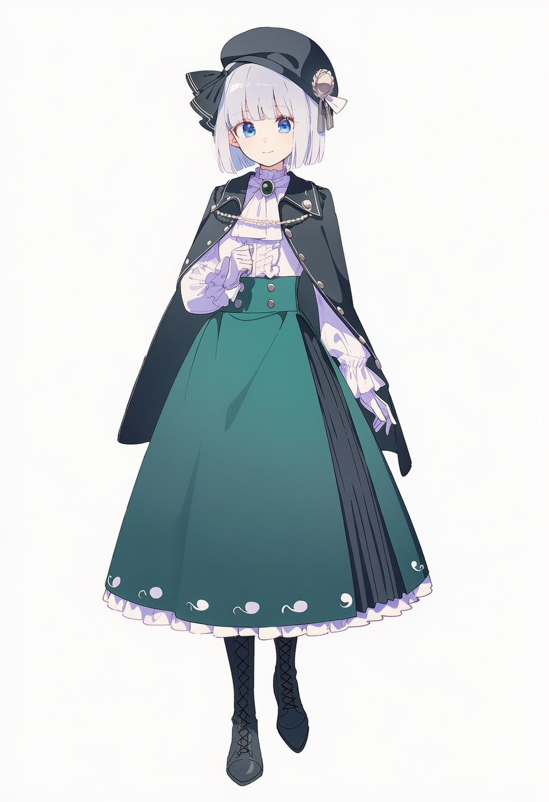

[在线例图](https://assets.quicktagcloud.com/images/raven_composition/raven_composition-1666.jpg?v=a3f5323ae237815f)

<a id="raven_composition-1667"></a>

## 急救员

ID：`raven_composition-1667`；分类：身份设定 / 现代通用职业；来源标记：`safe`。

来源说明：

> 用制服、手套、绷带和急救包感的肩包表现现场救援，再用高可视背心把“院前急救”拉出来。

正向提示词：

```text
1.35::uniform::, 1.28::gloves::, 1.22::surgical_mask::, 1.16::bandages::, 1.12::shoulder_bag::, 1.10::paramedic::, 1.08::scrubs::, 1.06::utility_vest::, 1.04::disposable_gloves::
```

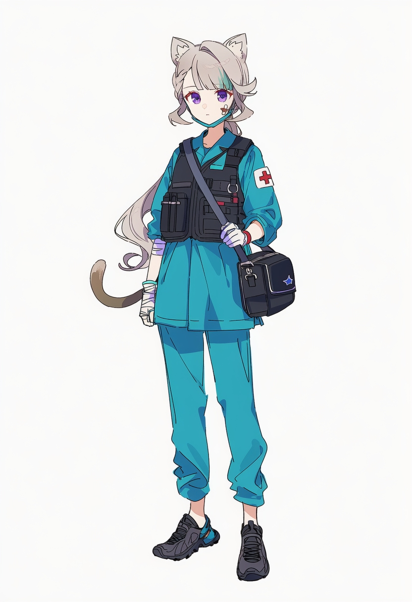

[在线例图](https://assets.quicktagcloud.com/images/raven_composition/raven_composition-1667.jpg?v=39b246d0df052487)

<a id="raven_composition-1668"></a>

## 探险家

ID：`raven_composition-1668`；分类：身份设定 / 现代通用职业；来源标记：`safe`。

来源说明：

> 软木探险帽、马甲、围巾、靴子、背包是经典野外探险轮廓。

正向提示词：

```text
1.35::pith_helmet::, 1.28::vest::, 1.22::scarf::, 1.16::boots::, 1.12::backpack::, 1.10::belt::, 1.08::safari_hat::, 1.06::utility_vest::, 1.04::cargo_pants::, 1.02::gloves::
```

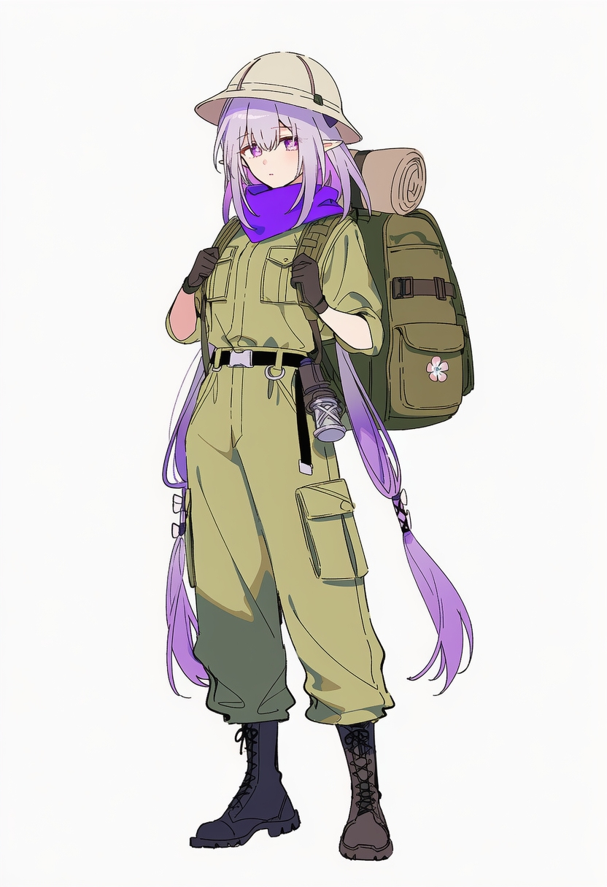

[在线例图](https://assets.quicktagcloud.com/images/raven_composition/raven_composition-1668.jpg?v=dd0207738a9ba40f)

<a id="raven_composition-1669"></a>

## 歌手

ID：`raven_composition-1669`；分类：身份设定 / 现代通用职业；来源标记：`safe`。

来源说明：

> 歌手没有固定制服，所以让麦克风和舞台服装主导。

正向提示词：

```text
1.35::holding_microphone::, 1.28::stage_clothes::, 1.22::jacket::, 1.16::boots::, 1.12::jewelry::
```

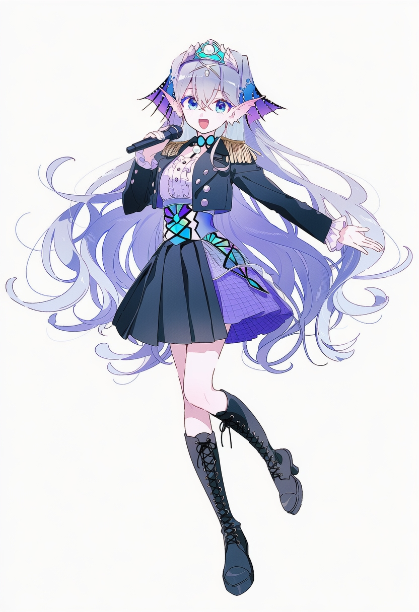

[在线例图](https://assets.quicktagcloud.com/images/raven_composition/raven_composition-1669.jpg?v=f5f39e56d8bc3d1e)

<a id="raven_composition-1670"></a>

## 浪人

ID：`raven_composition-1670`；分类：身份设定 / 现代通用职业；来源标记：`safe`。

来源说明：

> 比武士少完整甲胄，改成和服、袴、羽织、斗笠和刀，更像漂泊剑客。

正向提示词：

```text
1.35::hakama::, 1.28::kimono::, 1.22::haori::, 1.16::straw_hat::, 1.12::katana::, 1.10::sandals::, 1.08::ronin::
```

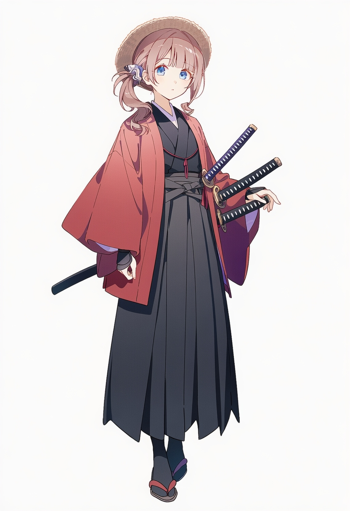

[在线例图](https://assets.quicktagcloud.com/images/raven_composition/raven_composition-1670.jpg?v=4db2c3496c29bde1)

<a id="raven_composition-1671"></a>

## 消防员

ID：`raven_composition-1671`；分类：身份设定 / 现代通用职业；来源标记：`safe`。

来源说明：

> 头盔、厚手套、靴子、呼吸面罩加耐火防护服，做出厚重的消防救援轮廓。

正向提示词：

```text
1.35::helmet::, 1.28::gloves::, 1.22::boots::, 1.16::gas_mask::, 1.12::belt::, 1.10::firefighter::, 1.08::firefighter_jacket::, 1.06::firefighter_helmet::, 1.04::oxygen_tank::
```

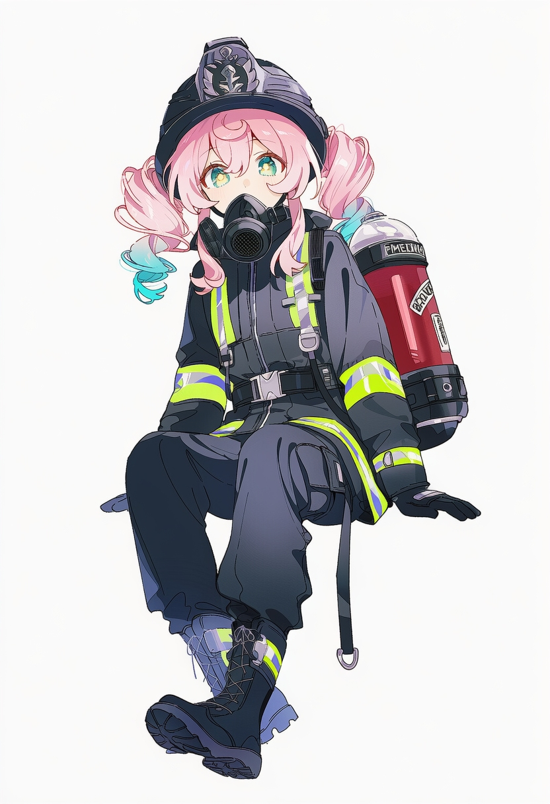

[在线例图](https://assets.quicktagcloud.com/images/raven_composition/raven_composition-1671.jpg?v=9a6ddf57a083a79e)

<a id="raven_composition-1672"></a>

## 灵医

ID：`raven_composition-1672`；分类：身份设定 / 现代通用职业；来源标记：`safe`。

来源说明：

> 白色汉服和草药、药瓶组合，整体干净柔和，表现修仙世界里的治疗职业。

正向提示词：

```text
1.35::white_hanfu::, 1.28::wide_sleeves::, 1.22::herb::, 1.16::robe::, 1.12::sash::, 1.10::vial::, 1.08::rubber_gloves::
```

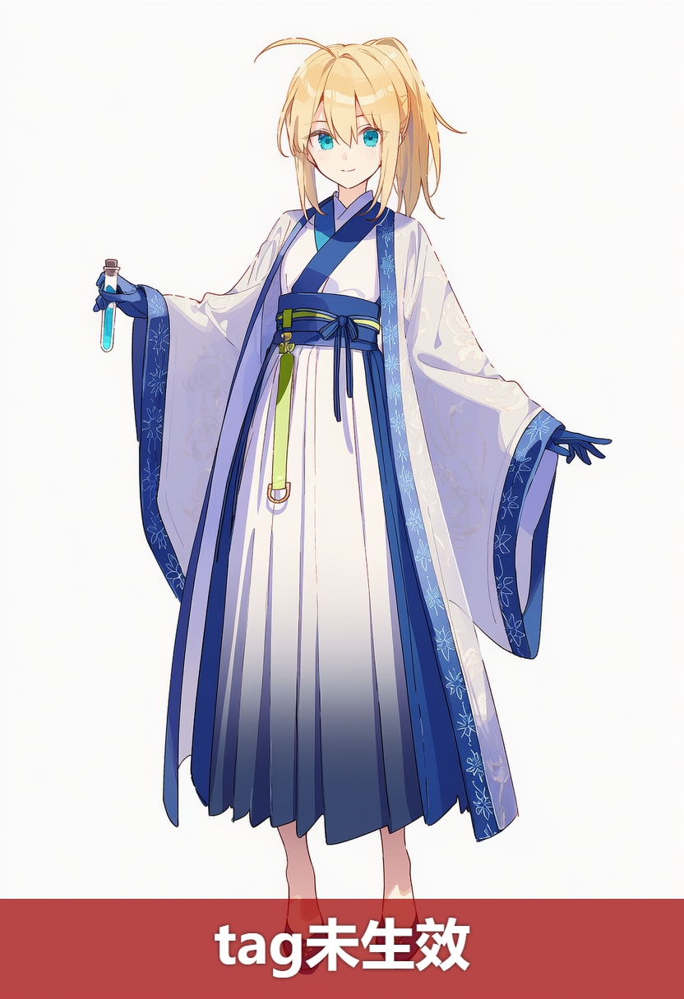

[在线例图](https://assets.quicktagcloud.com/images/raven_composition/raven_composition-1672.jpg?v=9c412113c4c5c3b3)

<a id="raven_composition-1673"></a>

## 炼器师

ID：`raven_composition-1673`；分类：身份设定 / 现代通用职业；来源标记：`safe`。

来源说明：

> 把仙门汉服和工匠围裙、手套、锤钳混在一起，表现专门打造法器的修士。

正向提示词：

```text
1.35::hanfu::, 1.28::apron::, 1.22::work_gloves::, 1.16::hammer::, 1.12::tongs::, 1.10::metal::, 1.08::sash::
```

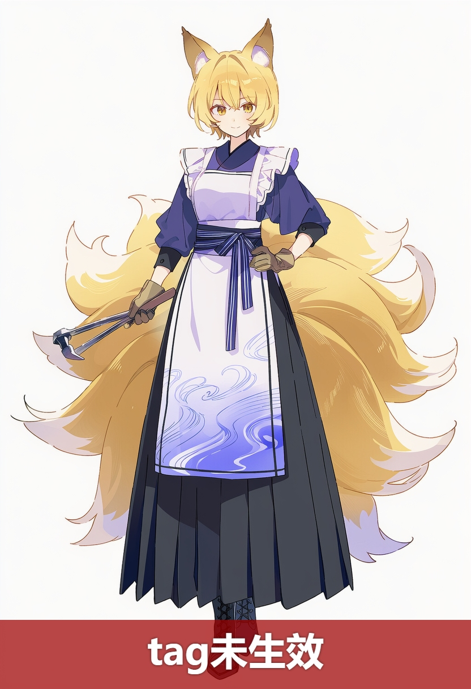

[在线例图](https://assets.quicktagcloud.com/images/raven_composition/raven_composition-1673.jpg?v=d073b67996002428)

<a id="raven_composition-1674"></a>

## 狂战士

ID：`raven_composition-1674`；分类：身份设定 / 现代通用职业；来源标记：`safe`。

来源说明：

> 狂战士比野蛮人更重、更凶，尖刺甲、毛皮、重护手和大剑一起堆。

正向提示词：

```text
1.35::berserker_armor::, 1.28::spiked_armor::, 1.22::fur_trim::, 1.16::gauntlets::, 1.12::greaves::, 1.10::greatsword::
```

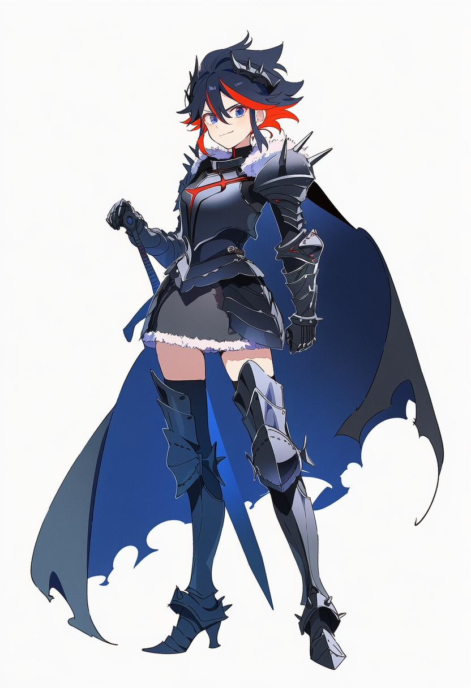

[在线例图](https://assets.quicktagcloud.com/images/raven_composition/raven_composition-1674.jpg?v=b9b881546f7a7c64)

<a id="raven_composition-1675"></a>

## 盾卫

ID：`raven_composition-1675`；分类：身份设定 / 现代通用职业；来源标记：`safe`。

来源说明：

> 职业核心就是防御，所以把盾、头盔、护手和胫甲放在最前面。

正向提示词：

```text
1.35::body_armor::, 1.28::shield::, 1.22::gauntlets::, 1.16::greaves::, 1.12::helmet::, 1.10::cape::
```

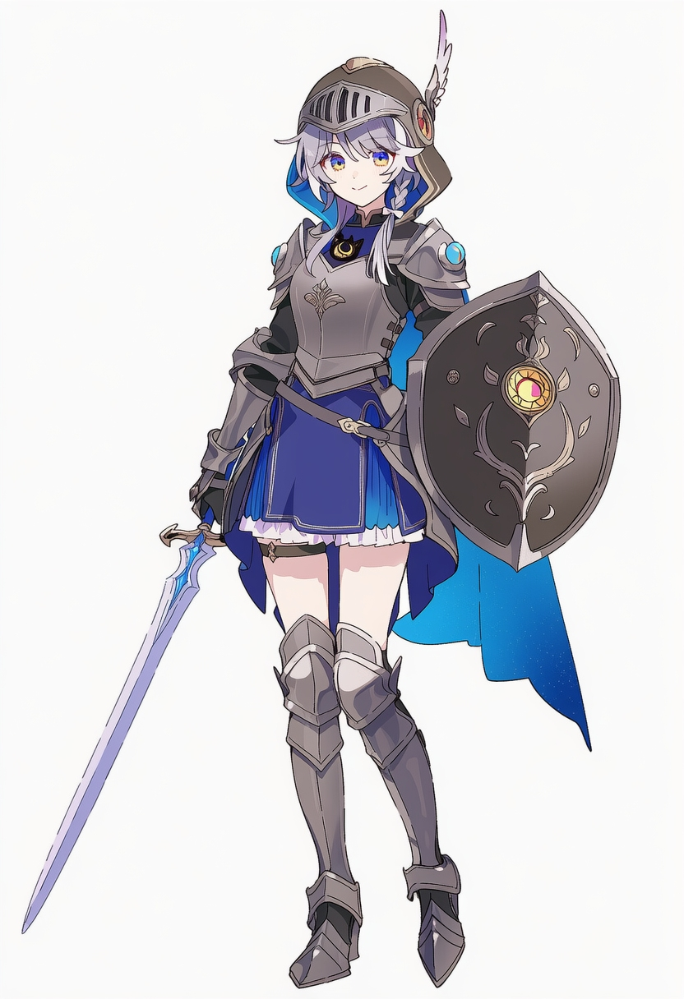

[在线例图](https://assets.quicktagcloud.com/images/raven_composition/raven_composition-1675.jpg?v=9bf7b825237256c4)

<a id="raven_composition-1676"></a>

## 神父

ID：`raven_composition-1676`；分类：身份设定 / 现代通用职业；来源标记：`safe`。

来源说明：

> 黑色长袍和白色牧师领是最稳定的神父视觉，再加十字项链。

正向提示词：

```text
1.35::cassock::, 1.28::clerical_collar::, 1.22::cross_necklace::, 1.16::long_sleeves::, 1.12::formal_clothes::
```

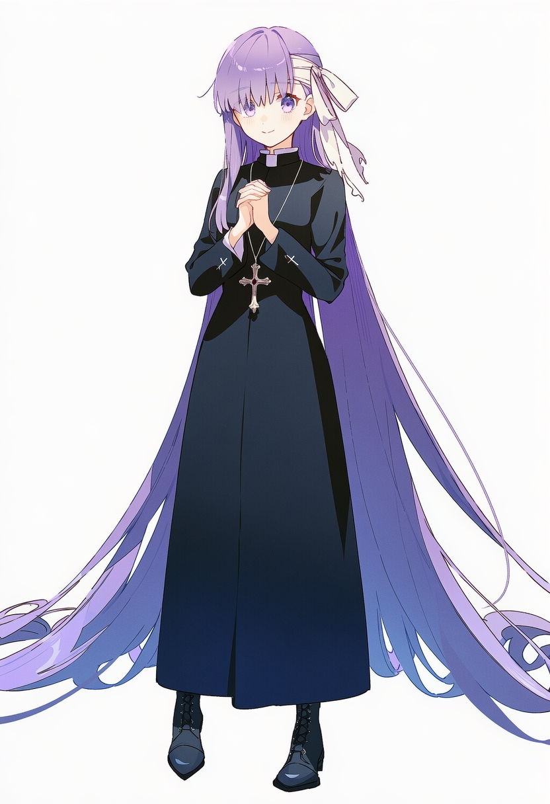

[在线例图](https://assets.quicktagcloud.com/images/raven_composition/raven_composition-1676.jpg?v=2e610dd728ae2f98)

<a id="raven_composition-1677"></a>

## 科学家

ID：`raven_composition-1677`；分类：身份设定 / 现代通用职业；来源标记：`safe`。

来源说明：

> 白大褂是主轴，护目镜、实验手套和记录板让它更像实验室科研人员。

正向提示词：

```text
1.35::scientist::, 1.28::labcoat::, 1.22::protective_eyewear::, 1.16::rubber_gloves::, 1.12::clipboard::, 1.10::pen::, 1.08::safety_glasses::, 1.06::test_tube::, 1.04::lanyard::
```


[在线例图](https://assets.quicktagcloud.com/images/raven_composition/raven_composition-1677.jpg?v=2d33f99c2df2d186)

<a id="raven_composition-1678"></a>

## 赌场荷官

ID：`raven_composition-1678`；分类：身份设定 / 现代通用职业；来源标记：`safe`。

来源说明：

> 赌场荷官主要靠正式马甲、衬衫、领结和干净白手套。

正向提示词：

```text
1.35::vest::, 1.28::dress_shirt::, 1.22::bowtie::, 1.16::white_gloves::, 1.12::waistcoat::
```

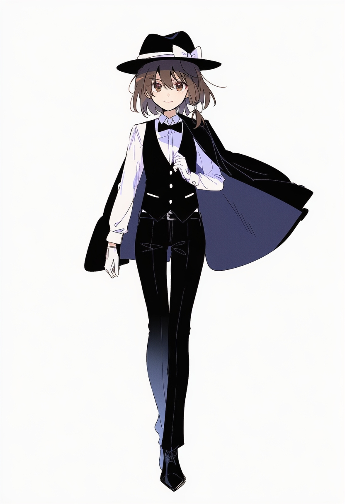

[在线例图](https://assets.quicktagcloud.com/images/raven_composition/raven_composition-1678.jpg?v=1de8c242ad2a225f)

<a id="raven_composition-1679"></a>

## 鬼修

ID：`raven_composition-1679`；分类：身份设定 / 现代通用职业；来源标记：`safe`。

来源说明：

> 黑袍和符箓做修士底色，再用鬼魂、头骨等阴属性元素强调鬼修。

正向提示词：

```text
1.35::black_robe::, 1.28::hood::, 1.22::wide_sleeves::, 1.16::ofuda::, 1.12::skull::, 1.10::ghost::, 1.08::sash::
```

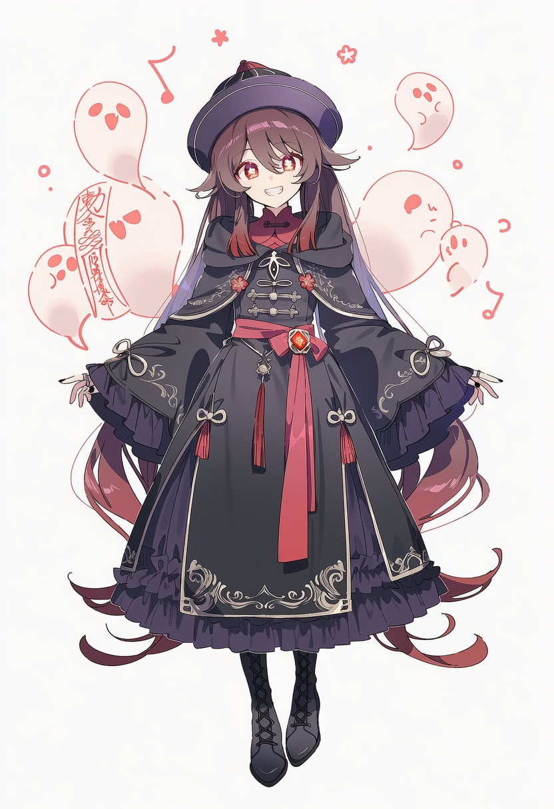

[在线例图](https://assets.quicktagcloud.com/images/raven_composition/raven_composition-1679.jpg?v=d74ab62e43297ab6)

<a id="raven_composition-1680"></a>

## 魔修

ID：`raven_composition-1680`；分类：身份设定 / 现代通用职业；来源标记：`safe`。

来源说明：

> 黑色汉服、宽袖、深色气场和红色饰品一起做危险的邪道修士。

正向提示词：

```text
1.35::black_hanfu::, 1.28::black_robe::, 1.22::wide_sleeves::, 1.16::sash::, 1.12::jian_(weapon)::, 1.10::dark_aura::, 1.08::red_jewelry::
```

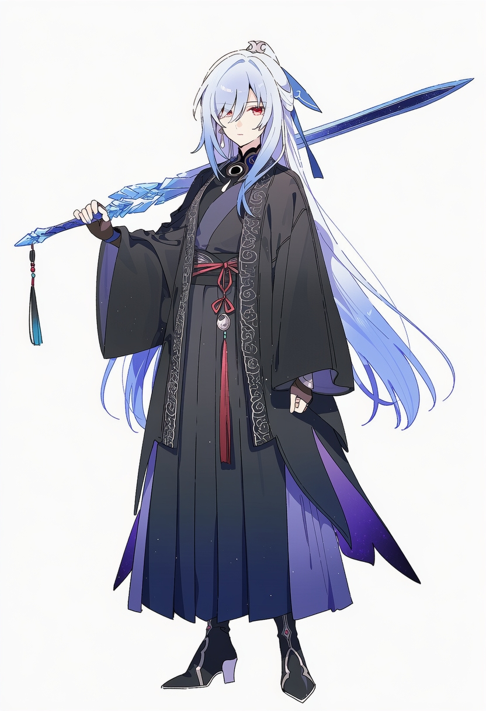

[在线例图](https://assets.quicktagcloud.com/images/raven_composition/raven_composition-1680.jpg?v=61318cc8f4e197ee)

<a id="raven_composition-1681"></a>

## 皇城司密探

ID：`raven_composition-1681`；分类：身份设定 / 现代通用职业；来源标记：`safe`。

来源说明：

> 古风长外套、束腰、手套和隐蔽短刃，配身份腰牌感徽章，像官方秘密侦缉人员。

正向提示词：

```text
1.35::chinese_clothes::, 1.28::long_coat::, 1.22::sash::, 1.16::boots::, 1.12::gloves::, 1.10::dagger::, 1.08::badge::
```

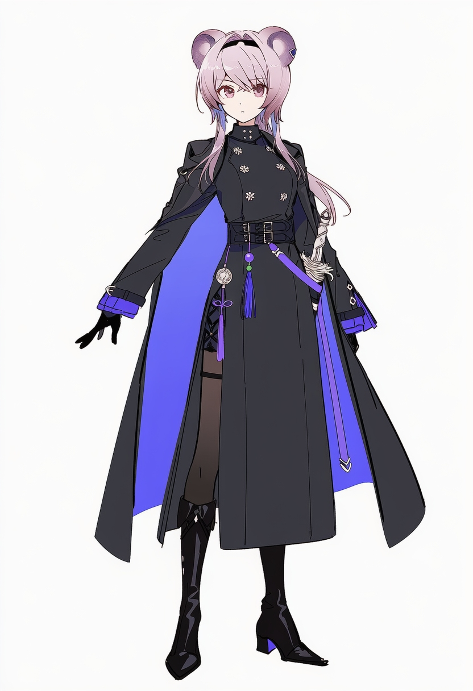

[在线例图](https://assets.quicktagcloud.com/images/raven_composition/raven_composition-1681.jpg?v=d8f9abedf2ee018a)

<a id="raven_composition-1682"></a>

## 未来执法机器人

ID：`raven_composition-1682`；分类：身份设定 / 现代通用职业；来源标记：`safe`。

来源说明：

> 让装甲、机械肢体和执法徽章组合起来，像重型机器人警员。

正向提示词：

```text
1.35::power_armor::, 1.28::helmet::, 1.22::body_armor::, 1.16::mechanical_limbs::, 1.12::utility_belt::, 1.10::badge::
```

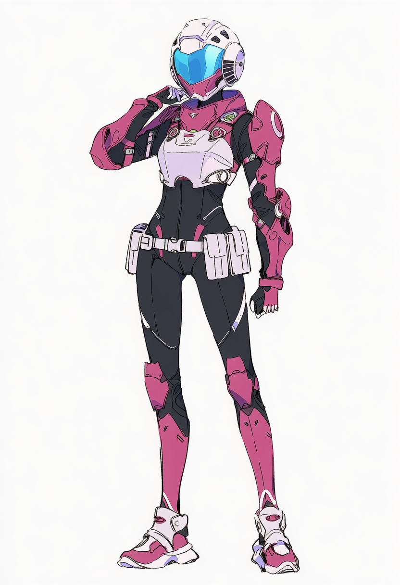

[在线例图](https://assets.quicktagcloud.com/images/raven_composition/raven_composition-1682.jpg?v=f3198a5f92e5db73)

<a id="raven_composition-1683"></a>

## 赏金猎人

ID：`raven_composition-1683`；分类：身份设定 / 现代通用职业；来源标记：`safe`。

来源说明：

> 混搭护甲、头盔、披风和枪套，做成不属于正规军、但装备精良的自由猎手。

正向提示词：

```text
1.35::armor::, 1.28::helmet::, 1.22::cape::, 1.16::belt::, 1.12::gun_holster::, 1.10::boots::, 1.08::gloves::, 1.06::body_armor::, 1.04::hooded_cloak::, 1.02::leather_armor::
```

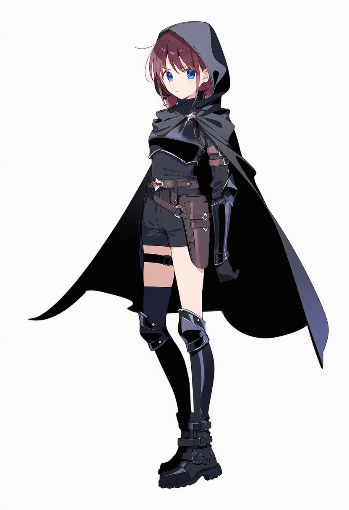

[在线例图](https://assets.quicktagcloud.com/images/raven_composition/raven_composition-1683.jpg?v=3cf68cbb7e67b361)
