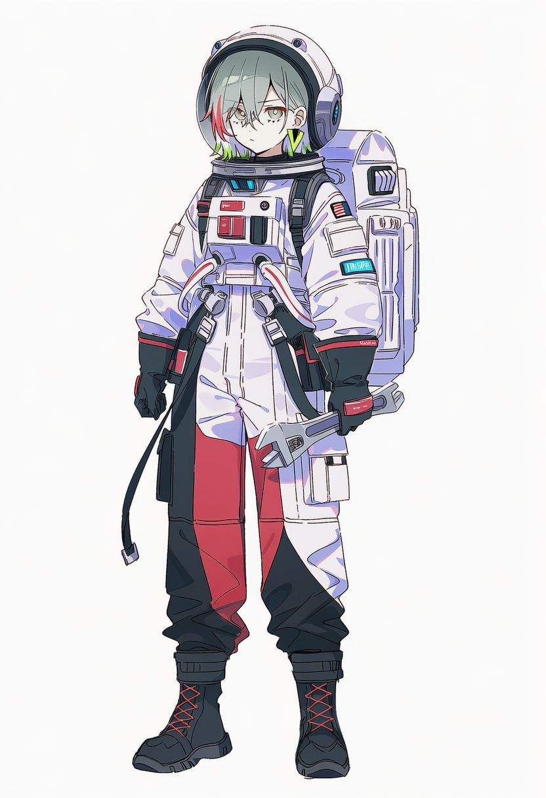
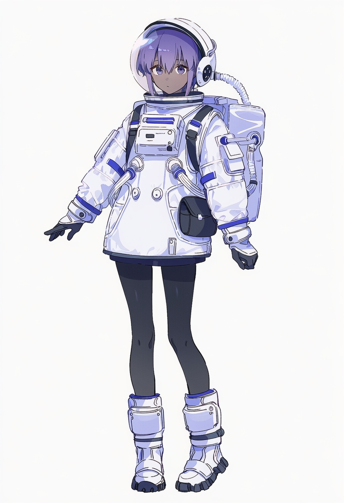
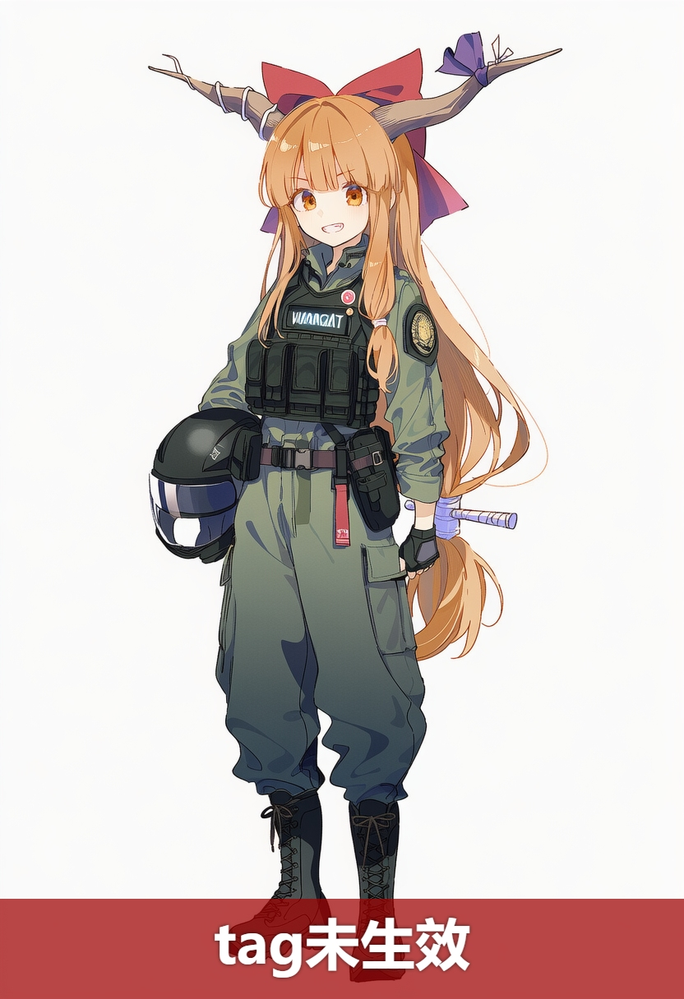
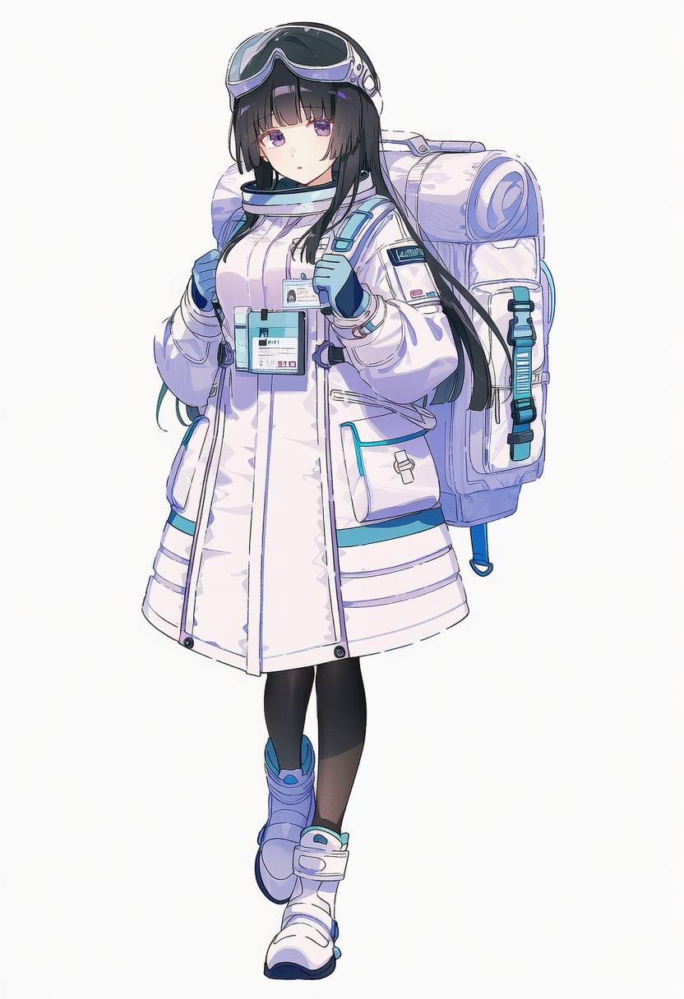
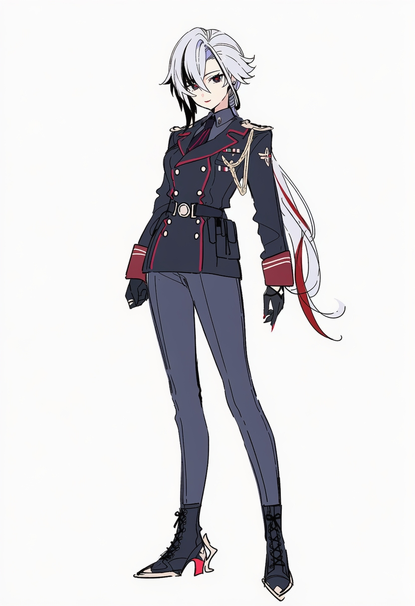
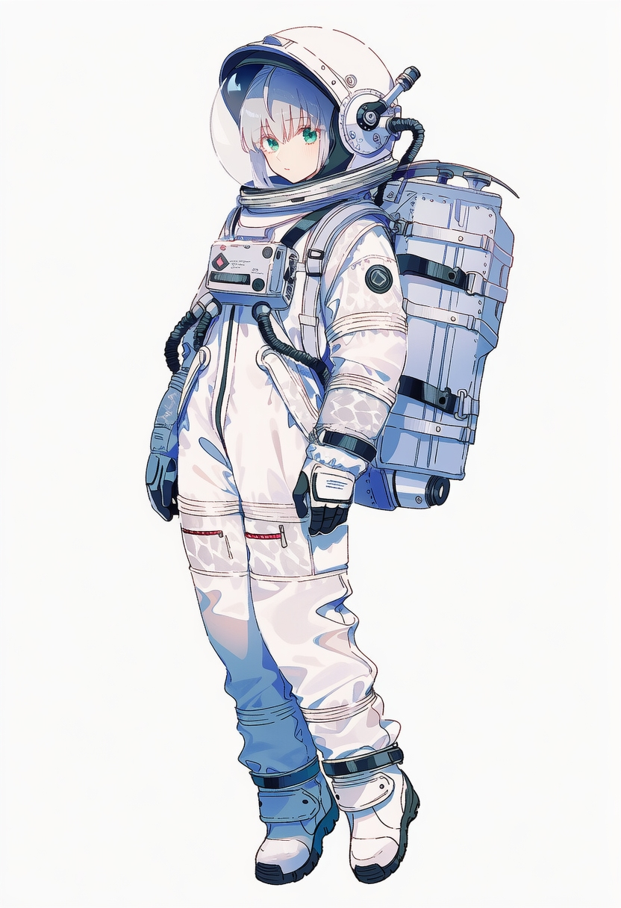
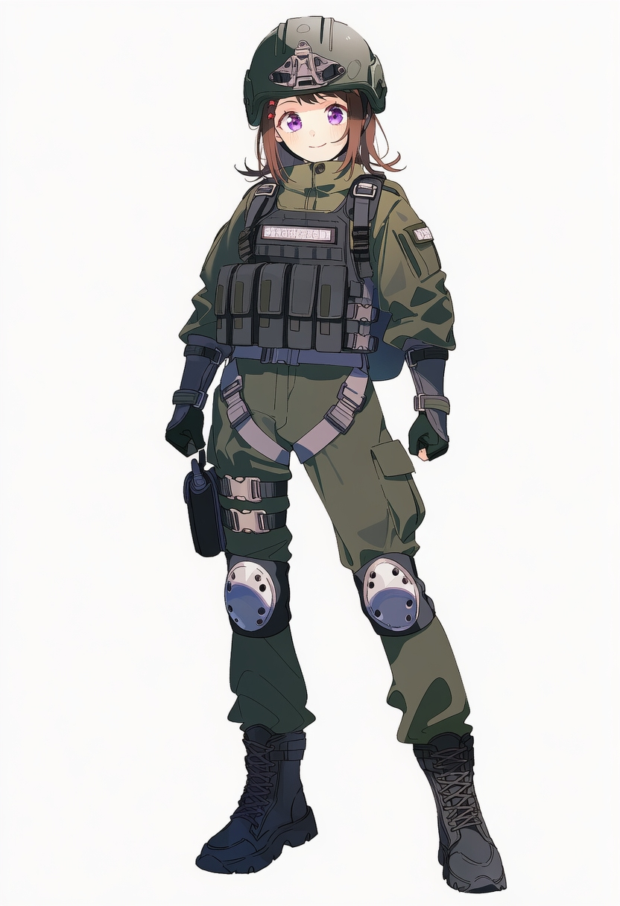
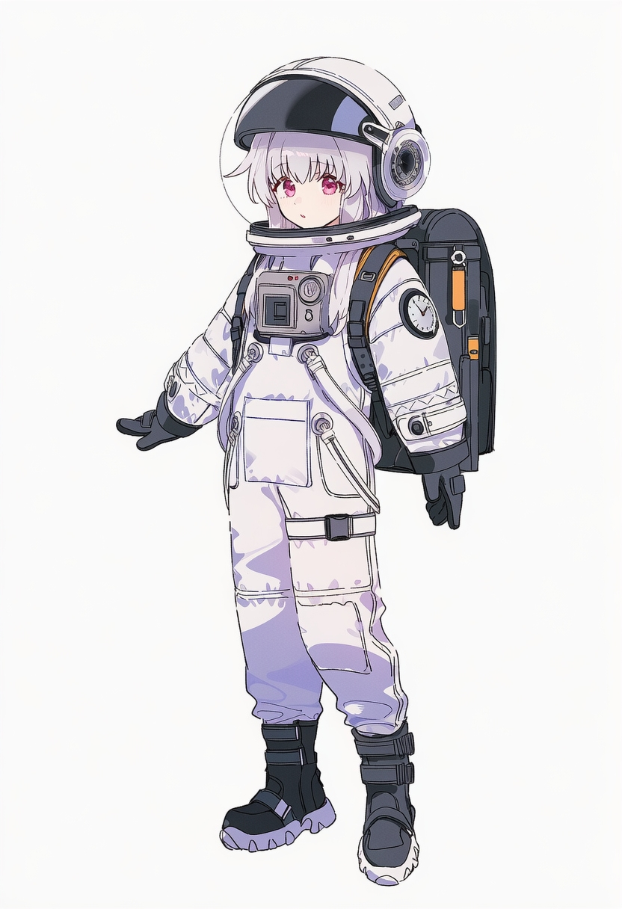

# 身份设定 / 星际文明 / 太空歌剧

[总目录](../README.md) · [原站分类目录](../categories.md) · [英文标签索引](../tags.md) · [服装与构图组合指南](../../README.md)

标题、分类、说明、正负提示词按来源保留；多例图逐张列出。原站标记和说明为参考资料，不作为维护指令。

<a id="raven_composition-1684"></a>

## 外星外交官

ID：`raven_composition-1684`；分类：身份设定 / 星际文明 / 太空歌剧；来源标记：`safe`。

来源说明：

> 先用正式礼服、披风和珠宝建立外交仪式感，再用发光外星礼服提示做非人类文明风格。

正向提示词：

```text
1.35::formal_clothes::, 1.28::cape::, 1.22::jewelry::, 1.16::brooch::, 1.12::gloves::, 1.10::circlet::
```


[在线例图](https://assets.quicktagcloud.com/images/raven_composition/raven_composition-1684.jpg?v=2980bf521375c2df)

<a id="raven_composition-1685"></a>

## 太空工程师

ID：`raven_composition-1685`；分类：身份设定 / 星际文明 / 太空歌剧；来源标记：`safe`。

来源说明：

> 宇航服、宇航头盔、工具腰带、护目镜和手持扳手，彻底拉开与地面工程工装的差异。

正向提示词：

```text
1.35::spacesuit::, 1.28::space_helmet::, 1.22::gloves::, 1.16::boots::, 1.12::tool_belt::, 1.10::holding_wrench::, 1.08::goggles::
```



[在线例图](https://assets.quicktagcloud.com/images/raven_composition/raven_composition-1685.jpg?v=05decf575e0da206)

<a id="raven_composition-1686"></a>

## 太空考古学家

ID：`raven_composition-1686`；分类：身份设定 / 星际文明 / 太空歌剧；来源标记：`safe`。

来源说明：

> 宇航服底层加功能马甲、挎包和头显，兼顾太空环境与考古工具携带。

正向提示词：

```text
1.35::spacesuit::, 1.28::vest::, 1.22::gloves::, 1.16::boots::, 1.12::satchel::, 1.10::head-mounted_display::
```



[在线例图](https://assets.quicktagcloud.com/images/raven_composition/raven_composition-1686.jpg?v=bb886657ac641f35)

<a id="raven_composition-1687"></a>

## 太空警察

ID：`raven_composition-1687`；分类：身份设定 / 星际文明 / 太空歌剧；来源标记：`safe`。

来源说明：

> 警察徽章和勤务腰带保留，但制服、头盔和防护改成科幻化。

正向提示词：

```text
1.35::uniform::, 1.28::body_armor::, 1.22::badge::, 1.16::utility_belt::, 1.12::holster::, 1.10::helmet::, 1.08::headset::
```



[在线例图](https://assets.quicktagcloud.com/images/raven_composition/raven_composition-1687.jpg?v=c8838d0194e31ad0)

<a id="raven_composition-1688"></a>

## 异星生物学家

ID：`raven_composition-1688`；分类：身份设定 / 星际文明 / 太空歌剧；来源标记：`safe`。

来源说明：

> 实验白大褂与太空防护层混搭，像在外星基地研究陌生生物的科学家。

正向提示词：

```text
1.35::labcoat::, 1.28::gloves::, 1.22::goggles::, 1.16::id_card::, 1.12::clipboard::, 1.10::spacesuit::, 1.08::backpack::
```



[在线例图](https://assets.quicktagcloud.com/images/raven_composition/raven_composition-1688.jpg?v=c95c368c780cc0a6)

<a id="raven_composition-1689"></a>

## 星舰军官

ID：`raven_composition-1689`；分类：身份设定 / 星际文明 / 太空歌剧；来源标记：`safe`。

来源说明：

> 比舰长低调，保留制式太空军服、肩章和徽记，减少夸张披风。

正向提示词：

```text
1.35::space_uniform::, 1.28::military_uniform::, 1.22::insignia::, 1.16::shoulder_boards::, 1.12::utility_belt::, 1.10::boots::, 1.08::gloves::
```



[在线例图](https://assets.quicktagcloud.com/images/raven_composition/raven_composition-1689.jpg?v=527f0b75d83809b7)

<a id="raven_composition-1690"></a>

## 星舰科学官

ID：`raven_composition-1690`；分类：身份设定 / 星际文明 / 太空歌剧；来源标记：`safe`。

来源说明：

> 舰船制服叠白大褂和记录板，比普通研究员多一层正式舰员身份。

正向提示词：

```text
1.35::uniform::, 1.28::labcoat::, 1.22::gloves::, 1.16::id_card::, 1.12::headset::, 1.10::clipboard::, 1.08::boots::
```


[在线例图](https://assets.quicktagcloud.com/images/raven_composition/raven_composition-1690.jpg?v=0132b7b72ce4f397)

<a id="raven_composition-1691"></a>

## 星舰通讯官

ID：`raven_composition-1691`；分类：身份设定 / 星际文明 / 太空歌剧；来源标记：`safe`。

来源说明：

> 制服和通讯耳机放在最高优先级，徽章和证件补军衔/岗位信息。

正向提示词：

```text
1.35::military_uniform::, 1.28::headset::, 1.22::gloves::, 1.16::badge::, 1.12::id_card::, 1.10::boots::, 1.08::vest::
```


[在线例图](https://assets.quicktagcloud.com/images/raven_composition/raven_composition-1691.jpg?v=ace8dc2de1878137)

<a id="raven_composition-1692"></a>

## 星际矿工

ID：`raven_composition-1692`；分类：身份设定 / 星际文明 / 太空歌剧；来源标记：`safe`。

来源说明：

> 宇航服、宇航头盔、氧气罐、背包与镐，保留采矿工具同时强化星际环境。

正向提示词：

```text
1.35::spacesuit::, 1.28::space_helmet::, 1.22::work_gloves::, 1.16::boots::, 1.12::pickaxe::, 1.10::oxygen_tank::, 1.08::backpack::
```



[在线例图](https://assets.quicktagcloud.com/images/raven_composition/raven_composition-1692.jpg?v=1b2aa1ddc240f6b4)

<a id="raven_composition-1693"></a>

## 星际赏金猎人

ID：`raven_composition-1693`；分类：身份设定 / 星际文明 / 太空歌剧；来源标记：`safe`。

来源说明：

> 太空服饰和护甲混搭披风、枪械和工具腰带，做独立行动的星际猎人。

正向提示词：

```text
1.35::space_uniform::, 1.28::body_armor::, 1.22::helmet::, 1.16::cape::, 1.12::utility_belt::, 1.10::boots::, 1.08::handgun::, 1.06::rifle::
```


[在线例图](https://assets.quicktagcloud.com/images/raven_composition/raven_composition-1693.jpg?v=667c67b3734a3c2b)

<a id="raven_composition-1694"></a>

## 星际陆战队

ID：`raven_composition-1694`；分类：身份设定 / 星际文明 / 太空歌剧；来源标记：`safe`。

来源说明：

> 比动力甲更像“未来版现代步兵”，保留护甲、头盔、弹带和背负系统。

正向提示词：

```text
1.35::body_armor::, 1.28::combat_helmet::, 1.22::gauntlets::, 1.16::combat_boots::, 1.12::backpack::, 1.10::bandolier::, 1.08::power_armor::, 1.06::military_combat_uniform::, 1.04::helmet::
```



[在线例图](https://assets.quicktagcloud.com/images/raven_composition/raven_composition-1694.jpg?v=5aad9d0277e44ec2)

<a id="raven_composition-1695"></a>

## 火星殖民地农夫

ID：`raven_composition-1695`；分类：身份设定 / 星际文明 / 太空歌剧；来源标记：`safe`。

来源说明：

> 背带裤/工装、手套、护目镜和背负设备，把传统农业劳动改造成殖民地版本。

正向提示词：

```text
1.35::coveralls::, 1.28::overalls::, 1.22::gloves::, 1.16::boots::, 1.12::goggles::, 1.10::sun_hat::, 1.08::backpack::
```


[在线例图](https://assets.quicktagcloud.com/images/raven_composition/raven_composition-1695.jpg?v=3bb972f4831534de)

<a id="raven_composition-1696"></a>

## 行星测绘员

ID：`raven_composition-1696`；分类：身份设定 / 星际文明 / 太空歌剧；来源标记：`safe`。

来源说明：

> 完整行星表面装备配罗盘和头显，重点是远程地形测绘与勘察。

正向提示词：

```text
1.35::spacesuit::, 1.28::helmet::, 1.22::gloves::, 1.16::boots::, 1.12::backpack::, 1.10::compass::, 1.08::head-mounted_display::
```



[在线例图](https://assets.quicktagcloud.com/images/raven_composition/raven_composition-1696.jpg?v=0d8faccde6673552)
