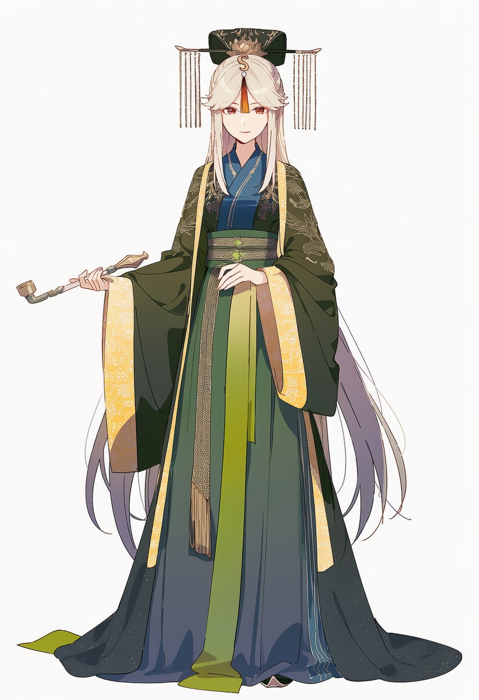
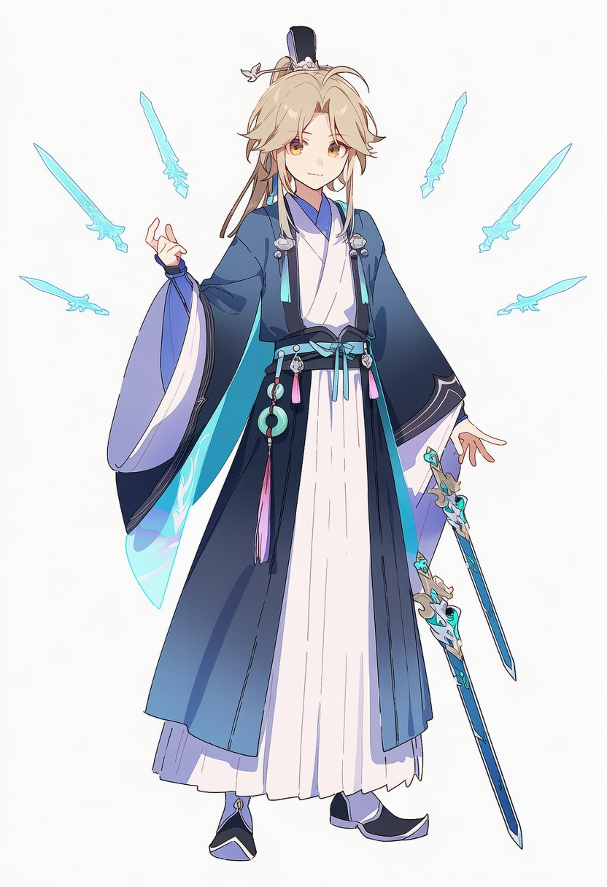
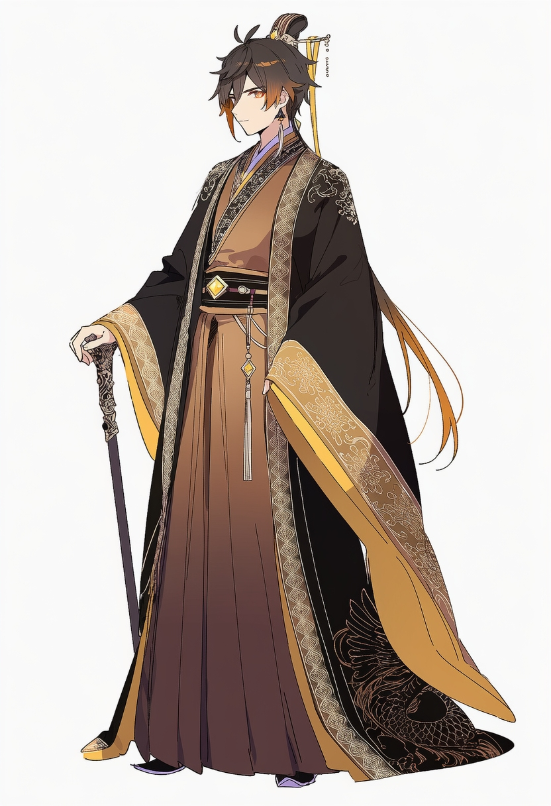
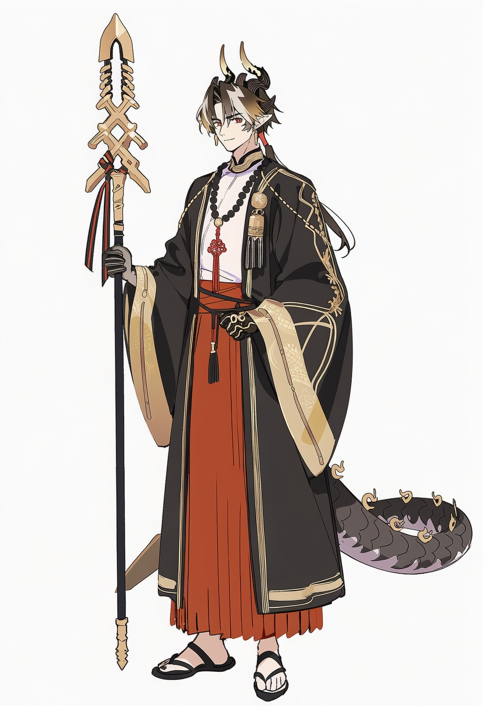
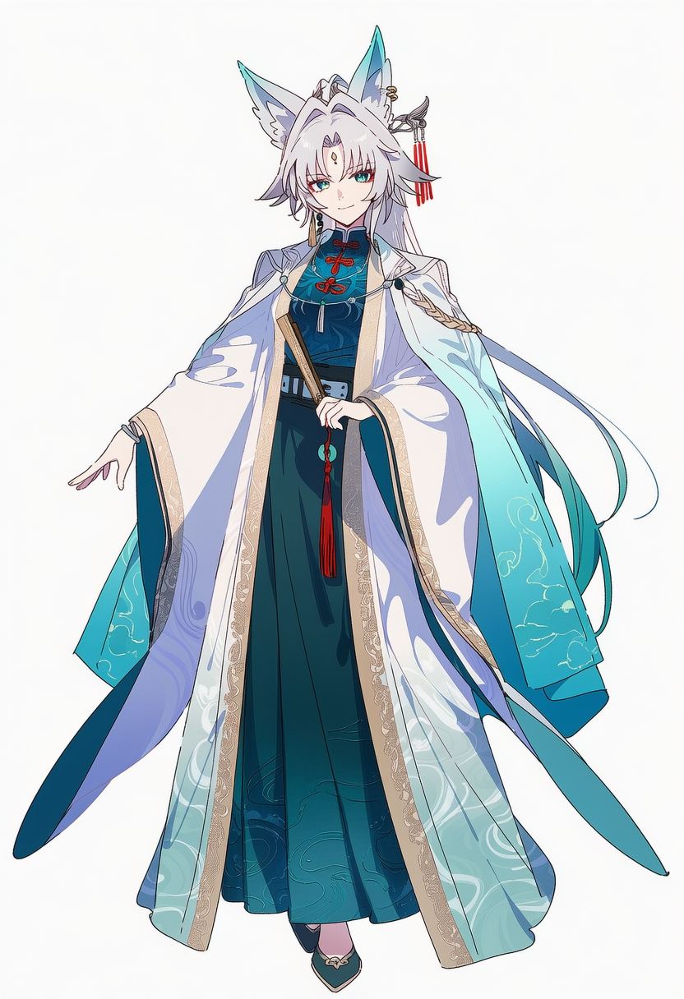
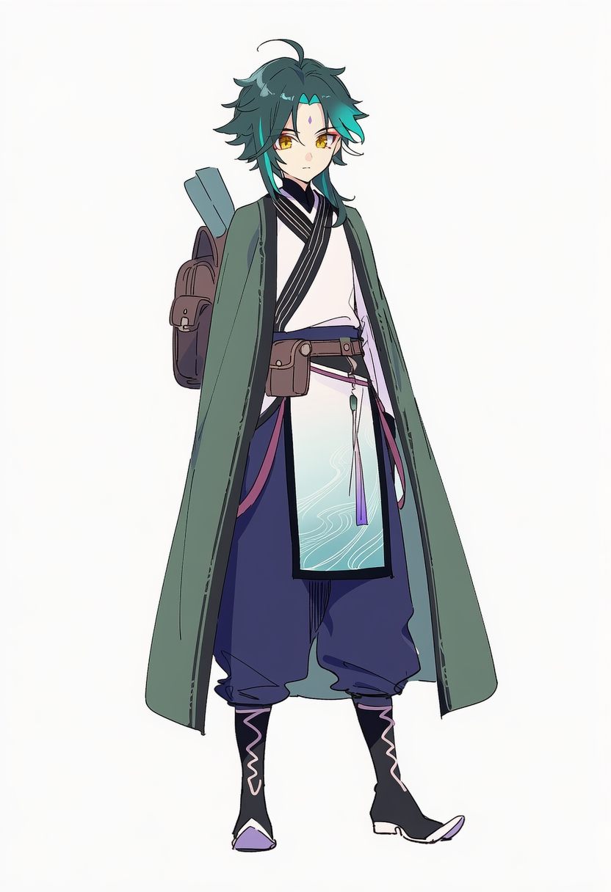
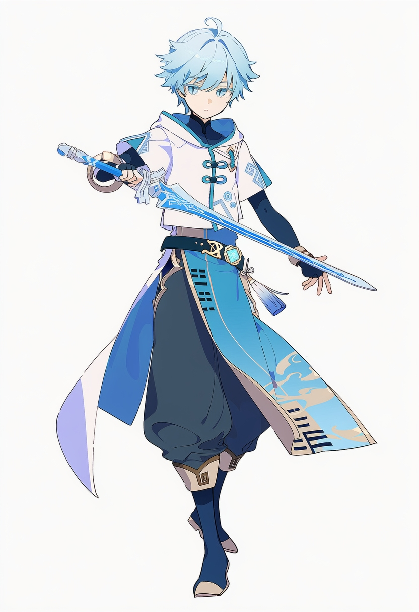
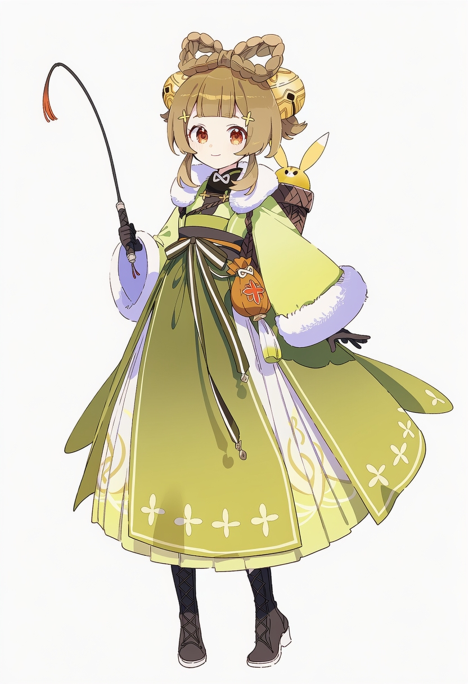
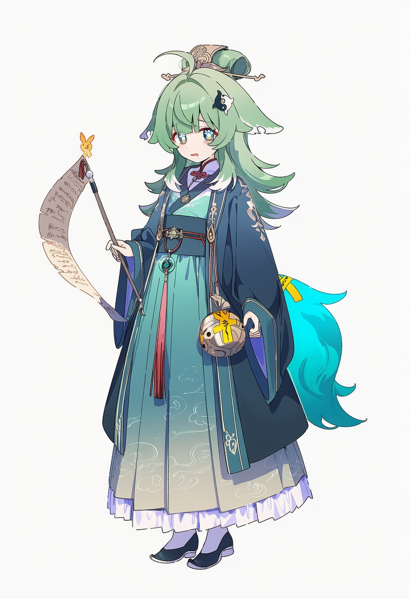
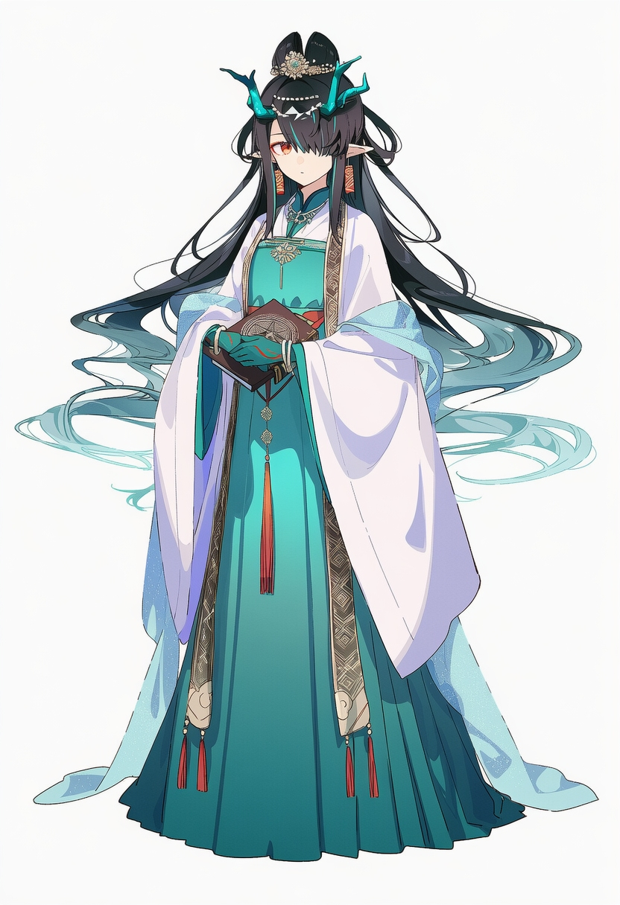

# 身份设定 / 修仙 / 仙侠 / 玄幻

[总目录](../README.md) · [原站分类目录](../categories.md) · [英文标签索引](../tags.md) · [服装与构图组合指南](../../README.md)

标题、分类、说明、正负提示词按来源保留；多例图逐张列出。原站标记和说明为参考资料，不作为维护指令。

<a id="raven_composition-1697"></a>

## 仙朝文官

ID：`raven_composition-1697`；分类：身份设定 / 修仙 / 仙侠 / 玄幻；来源标记：`safe`。

来源说明：

> 圆领袍、冠帽、玉饰和卷轴做古代文官，再用更飘逸的仙侠材质感提升玄幻味。

正向提示词：

```text
1.35::hanfu::, 1.28::yuanlingpao::, 1.22::wide_sleeves::, 1.16::sash::, 1.12::guan_hat::, 1.10::jade::, 1.08::scroll::
```



[在线例图](https://assets.quicktagcloud.com/images/raven_composition/raven_composition-1697.jpg?v=12dcc06969da1485)

<a id="raven_composition-1698"></a>

## 剑仙

ID：`raven_composition-1698`；分类：身份设定 / 修仙 / 仙侠 / 玄幻；来源标记：`safe`。

来源说明：

> 比剑修更飘逸：白汉服、宽袖、小冠和悬浮飞剑，减少厚重护甲。

正向提示词：

```text
1.35::white_hanfu::, 1.28::jian_(weapon)::, 1.22::wide_sleeves::, 1.16::robe::, 1.12::sash::, 1.10::long_hair::, 1.08::xiao_guan_(headdress)::, 1.06::floating_weapon::
```



[在线例图](https://assets.quicktagcloud.com/images/raven_composition/raven_composition-1698.jpg?v=9afd227f98659507)

<a id="raven_composition-1699"></a>

## 仙门长老

ID：`raven_composition-1699`；分类：身份设定 / 修仙 / 仙侠 / 玄幻；来源标记：`safe`。

来源说明：

> 比普通弟子更宽大、端庄，用礼仪袍、法杖和发簪提升资历与权威感。

正向提示词：

```text
1.35::hanfu::, 1.28::robe::, 1.22::wide_sleeves::, 1.16::sash::, 1.12::staff::, 1.10::hair_stick::, 1.08::ornate_clothes::, 1.06::xiao_guan_(headdress)::
```



[在线例图](https://assets.quicktagcloud.com/images/raven_composition/raven_composition-1699.jpg?v=b97fc7b155fbfdf5)

<a id="raven_composition-1700"></a>

## 佛修

ID：`raven_composition-1700`；分类：身份设定 / 修仙 / 仙侠 / 玄幻；来源标记：`safe`。

来源说明：

> 僧袍、念珠和禅杖式长杖是核心，整体减少华丽饰品。

正向提示词：

```text
1.35::monk::, 1.28::robe::, 1.22::prayer_beads::, 1.16::wide_sleeves::, 1.12::staff::, 1.10::sandals::
```



[在线例图](https://assets.quicktagcloud.com/images/raven_composition/raven_composition-1700.jpg?v=6b7cb36597e3d8e0)

<a id="raven_composition-1701"></a>

## 宗主 / 掌门

ID：`raven_composition-1701`；分类：身份设定 / 修仙 / 仙侠 / 玄幻；来源标记：`safe`。

来源说明：

> 不再与剑仙共用“小冠+佩剑”，改为华服披风、发簪和折扇，强调统御者而不是剑修。

正向提示词：

```text
1.35::ornate_clothes::, 1.28::hanfu::, 1.22::cape::, 1.16::wide_sleeves::, 1.12::sash::, 1.10::hair_stick::, 1.08::folding_fan::
```



[在线例图](https://assets.quicktagcloud.com/images/raven_composition/raven_composition-1701.jpg?v=51aff6883b416998)

<a id="raven_composition-1702"></a>

## 散修

ID：`raven_composition-1702`；分类：身份设定 / 修仙 / 仙侠 / 玄幻；来源标记：`safe`。

来源说明：

> 不做整齐宗门制服，改用斗篷、背包、腰包和实用佩剑，像长期独自行走江湖。

正向提示词：

```text
1.35::hanfu::, 1.28::robe::, 1.22::cloak::, 1.16::boots::, 1.12::belt_pouch::, 1.10::jian_(weapon)::, 1.08::backpack::
```



[在线例图](https://assets.quicktagcloud.com/images/raven_composition/raven_composition-1702.jpg?v=dfe8d022008428e7)

<a id="raven_composition-1703"></a>

## 武修

ID：`raven_composition-1703`；分类：身份设定 / 修仙 / 仙侠 / 玄幻；来源标记：`safe`。

来源说明：

> 更接近武侠：中式短装、护腕、腰带和轻便鞋靴，武器只是辅助。

正向提示词：

```text
1.35::martial_arts::, 1.28::chinese_clothes::, 1.22::bracers::, 1.16::sash::, 1.12::boots::, 1.10::fingerless_gloves::, 1.08::jian_(weapon)::
```



[在线例图](https://assets.quicktagcloud.com/images/raven_composition/raven_composition-1703.jpg?v=94c98c95f0afffee)

<a id="raven_composition-1704"></a>

## 灵兽师

ID：`raven_composition-1704`；分类：身份设定 / 修仙 / 仙侠 / 玄幻；来源标记：`safe`。

来源说明：

> 增加头带并保留毛皮、鞭子、兽类和小袋，让头部与手持工具都区别于御医/普通仙门长袍。

正向提示词：

```text
1.35::hanfu::, 1.28::fur_trim::, 1.22::headband::, 1.16::pouch::, 1.12::whip::, 1.10::gloves::, 1.08::boots::, 1.06::sash::, 1.04::animal::, 1.02::robe::
```



[在线例图](https://assets.quicktagcloud.com/images/raven_composition/raven_composition-1704.jpg?v=6567490b01777b8b)

<a id="raven_composition-1705"></a>

## 符箓师

ID：`raven_composition-1705`；分类：身份设定 / 修仙 / 仙侠 / 玄幻；来源标记：`safe`。

来源说明：

> 法袍大袖加符纸、毛笔和小袋，突出随身画符与施术的工具结构。

正向提示词：

```text
1.35::chinese_clothes::, 1.28::robe::, 1.22::wide_sleeves::, 1.16::ofuda::, 1.12::brush::, 1.10::sash::, 1.08::pouch::, 1.06::hanfu::, 1.04::xiao_guan_(headdress)::, 1.02::paper::
```



[在线例图](https://assets.quicktagcloud.com/images/raven_composition/raven_composition-1705.jpg?v=67aaab35450752bf)

<a id="raven_composition-1706"></a>

## 阵法师

ID：`raven_composition-1706`；分类：身份设定 / 修仙 / 仙侠 / 玄幻；来源标记：`safe`。

来源说明：

> 把头部锚点改成额环，工具固定为罗盘、书册、符物和阵图；不再只是“长袍术士”，与御医/风水师明显拉开。

正向提示词：

```text
1.35::hanfu::, 1.28::robe::, 1.22::wide_sleeves::, 1.16::circlet::, 1.12::compass::, 1.10::book::, 1.08::talisman::, 1.06::magic_circle::, 1.04::jewelry::
```



[在线例图](https://assets.quicktagcloud.com/images/raven_composition/raven_composition-1706.jpg?v=c02af2437ce6e1a1)
