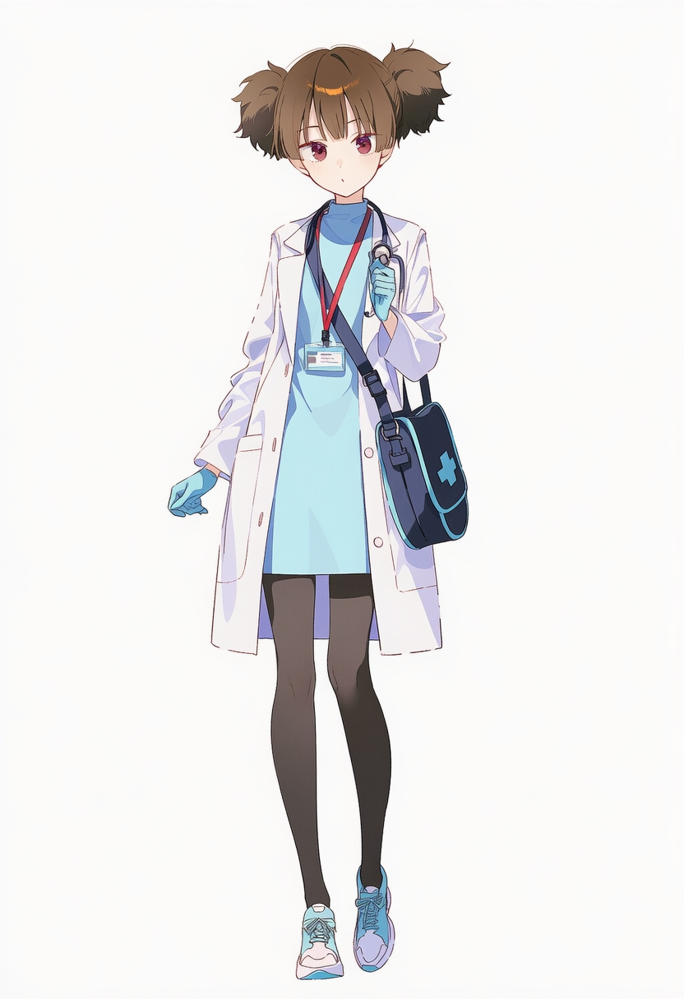
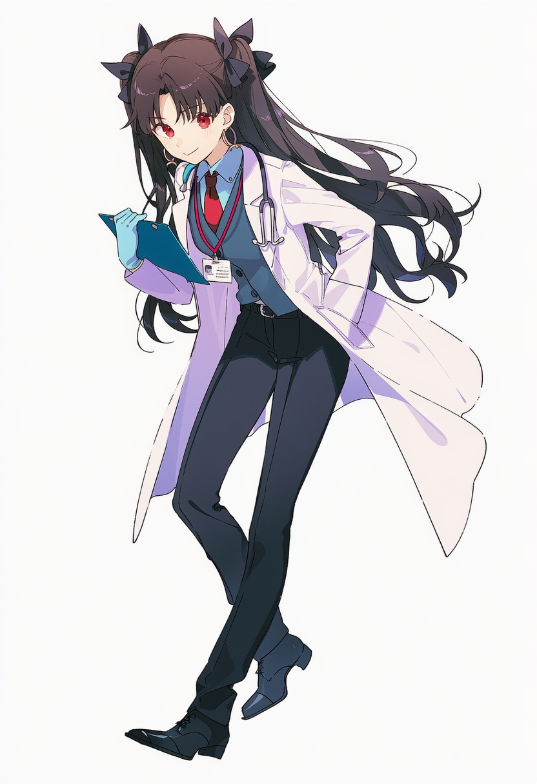
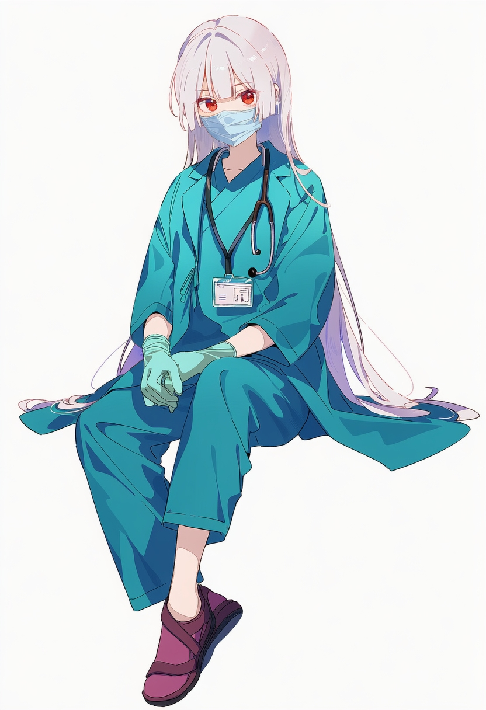
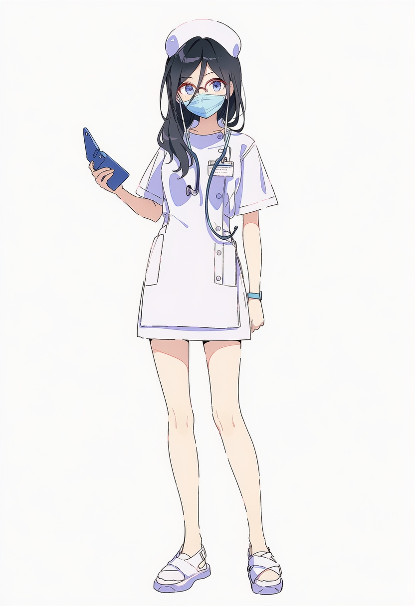
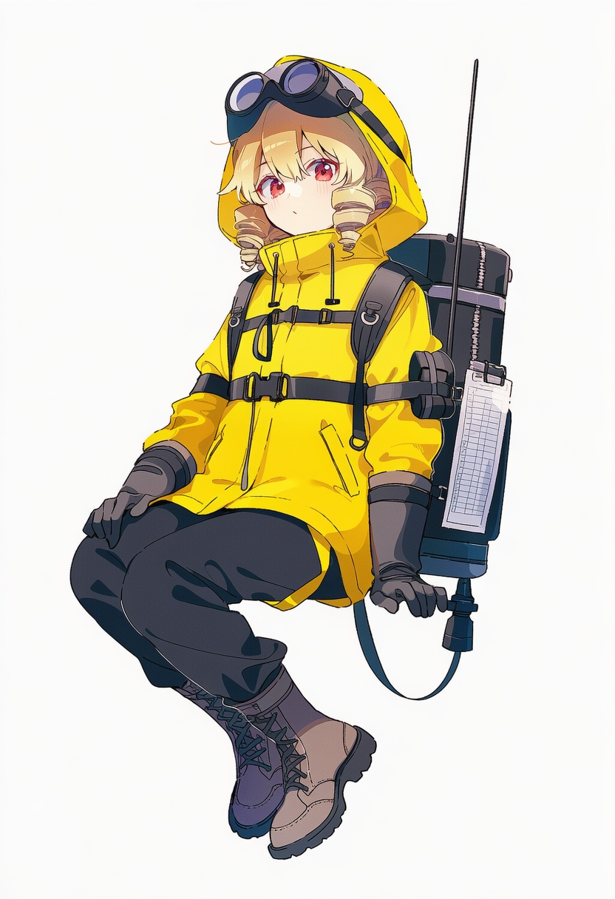
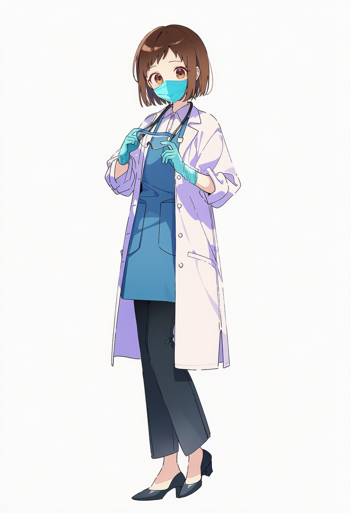
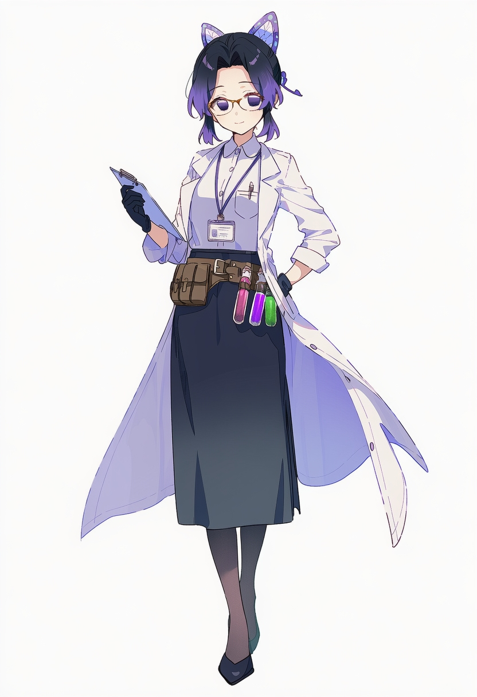

# 身份设定 / 医疗 / 科研

[总目录](../README.md) · [原站分类目录](../categories.md) · [英文标签索引](../tags.md) · [服装与构图组合指南](../../README.md)

标题、分类、说明、正负提示词按来源保留；多例图逐张列出。原站标记和说明为参考资料，不作为维护指令。

<a id="raven_composition-1707"></a>

## 兽医

ID：`raven_composition-1707`；分类：身份设定 / 医疗 / 科研；来源标记：`safe`。

来源说明：

> 整体沿用医生结构，但减少正式领带，增加手套和随身包，显得更偏动物诊疗现场。

正向提示词：

```text
1.35::labcoat::, 1.28::stethoscope::, 1.22::gloves::, 1.16::id_card::, 1.12::shoulder_bag::
```



[在线例图](https://assets.quicktagcloud.com/images/raven_composition/raven_composition-1707.jpg?v=b4d4a68615922dc1)

<a id="raven_composition-1708"></a>

## 医生

ID：`raven_composition-1708`；分类：身份设定 / 医疗 / 科研；来源标记：`safe`。

来源说明：

> 白大褂和听诊器先把“医生”钉死，再用衬衫、领带、证件和手套补出医院里的专业感。

正向提示词：

```text
1.35::labcoat::, 1.28::stethoscope::, 1.22::dress_shirt::, 1.16::necktie::, 1.12::clipboard::, 1.10::id_card::, 1.08::gloves::, 1.06::doctor::, 1.04::collared_shirt::, 1.02::slacks::
```



[在线例图](https://assets.quicktagcloud.com/images/raven_composition/raven_composition-1708.jpg?v=4c0b95723bddc185)

<a id="raven_composition-1709"></a>

## 外科医生

ID：`raven_composition-1709`；分类：身份设定 / 医疗 / 科研；来源标记：`safe`。

来源说明：

> 手术服、口罩和乳胶手套是最强识别点，护目镜和证件让它更像手术室人员而不是普通医生。

正向提示词：

```text
1.35::scrubs::, 1.28::surgical_mask::, 1.22::latex_gloves::, 1.16::id_card::, 1.12::safety_glasses::, 1.10::rubber_gloves::, 1.08::stethoscope::, 1.06::surgeon::, 1.04::surgical_cap::, 1.02::cap::
```



[在线例图](https://assets.quicktagcloud.com/images/raven_composition/raven_composition-1709.jpg?v=d35df528b02c126f)

<a id="raven_composition-1710"></a>

## 护士

ID：`raven_composition-1710`；分类：身份设定 / 医疗 / 科研；来源标记：`safe`。

来源说明：

> 护士帽、白裙和围裙是传统视觉锚点，再加听诊器、徽章和口罩强化医疗岗位。

正向提示词：

```text
1.35::nurse_cap::, 1.28::white_dress::, 1.22::apron::, 1.16::stethoscope::, 1.12::badge::, 1.10::surgical_mask::, 1.08::nurse::, 1.06::scrubs::, 1.04::dress::, 1.02::name_tag::
```



[在线例图](https://assets.quicktagcloud.com/images/raven_composition/raven_composition-1710.jpg?v=b9450940614aa877)

<a id="raven_composition-1711"></a>

## 海洋研究员

ID：`raven_composition-1711`；分类：身份设定 / 医疗 / 科研；来源标记：`safe`。

来源说明：

> 雨衣、救生衣、胶靴与记录板，像在科考船甲板做观察记录。

正向提示词：

```text
1.35::raincoat::, 1.28::life_jacket::, 1.22::gloves::, 1.16::boots::, 1.12::binoculars::, 1.10::clipboard::
```



[在线例图](https://assets.quicktagcloud.com/images/raven_composition/raven_composition-1711.jpg?v=6bd2da6708db389c)

<a id="raven_composition-1712"></a>

## 牙医

ID：`raven_composition-1712`；分类：身份设定 / 医疗 / 科研；来源标记：`safe`。

来源说明：

> 牙医最明显的是白大褂、口罩、手套和护目镜，围裙让近距离操作感更强。

正向提示词：

```text
1.35::labcoat::, 1.28::surgical_mask::, 1.22::latex_gloves::, 1.16::safety_glasses::, 1.12::apron::, 1.10::dentist::, 1.08::rubber_gloves::, 1.06::protective_eyewear::, 1.04::collared_shirt::, 1.02::eyewear::
```



[在线例图](https://assets.quicktagcloud.com/images/raven_composition/raven_composition-1712.jpg?v=980ea32f0f99975f)

<a id="raven_composition-1713"></a>

## 药剂师

ID：`raven_composition-1713`；分类：身份设定 / 医疗 / 科研；来源标记：`safe`。

来源说明：

> 仍然保留白大褂，但把听诊器换成药瓶、记录板和眼镜，视觉上更接近配药与药房工作。

正向提示词：

```text
1.35::labcoat::, 1.28::glasses::, 1.22::id_card::, 1.16::gloves::, 1.12::bottle::, 1.10::clipboard::, 1.08::vial::, 1.06::apron::, 1.04::belt_pouch::, 1.02::collared_shirt::
```



[在线例图](https://assets.quicktagcloud.com/images/raven_composition/raven_composition-1713.jpg?v=57cc37fccd92f15b)
