# 手臂姿势 / 手臂整体位置

[总目录](../README.md) · [原站分类目录](../categories.md) · [英文标签索引](../tags.md) · [服装与构图组合指南](../../README.md)

标题、分类、说明、正负提示词按来源保留；多例图逐张列出。原站标记和说明为参考资料，不作为维护指令。

<a id="raven_composition-1714"></a>

## 单臂举起

ID：`raven_composition-1714`；分类：手臂姿势 / 手臂整体位置；来源标记：`safe`。

来源说明：

> 一只手臂向上抬起。

正向提示词：

```text
arm_up
```


[在线例图](https://assets.quicktagcloud.com/images/raven_composition/raven_composition-1714.jpg?v=ab2979c4ed6ed748)

<a id="raven_composition-1715"></a>

## 双臂高举

ID：`raven_composition-1715`；分类：手臂姿势 / 手臂整体位置；来源标记：`safe`。

来源说明：

> 双臂举到眼睛以上或头顶附近。

正向提示词：

```text
arms_up
```

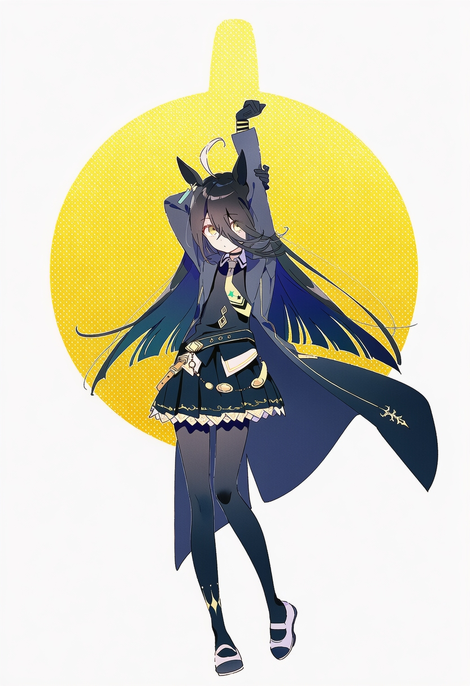

[在线例图](https://assets.quicktagcloud.com/images/raven_composition/raven_composition-1715.jpg?v=28453d7b08b9ebe3)

<a id="raven_composition-1716"></a>

## 单手举起

ID：`raven_composition-1716`；分类：手臂姿势 / 手臂整体位置；来源标记：`safe`。

来源说明：

> 一只手抬到上半身附近或更高。

正向提示词：

```text
hand_up
```

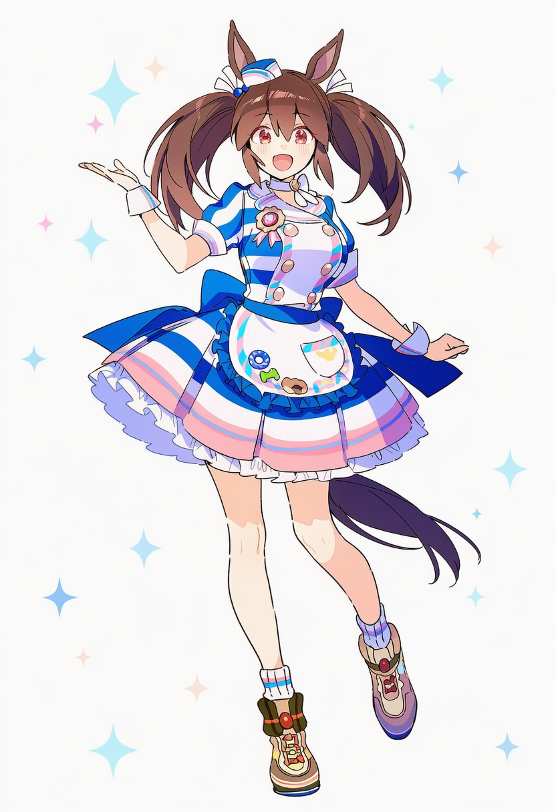

[在线例图](https://assets.quicktagcloud.com/images/raven_composition/raven_composition-1716.jpg?v=8c1ca468b89dea01)

<a id="raven_composition-1717"></a>

## 双手举起

ID：`raven_composition-1717`；分类：手臂姿势 / 手臂整体位置；来源标记：`safe`。

来源说明：

> 双手抬到上半身附近或更高。

正向提示词：

```text
hands_up
```

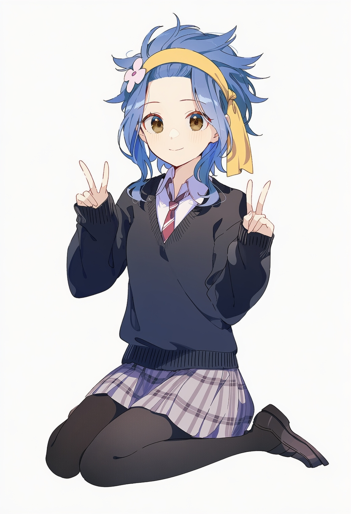

[在线例图](https://assets.quicktagcloud.com/images/raven_composition/raven_composition-1717.jpg?v=7f17ddad55cc309e)

<a id="raven_composition-1718"></a>

## 单臂垂在身侧

ID：`raven_composition-1718`；分类：手臂姿势 / 手臂整体位置；来源标记：`safe`。

来源说明：

> 一只手臂自然垂在身体侧面。

正向提示词：

```text
arm_at_side
```

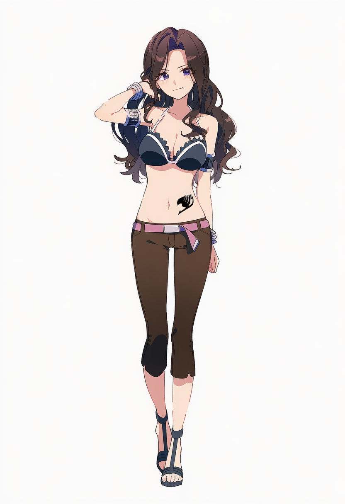

[在线例图](https://assets.quicktagcloud.com/images/raven_composition/raven_composition-1718.jpg?v=b472616bb9d4f1a0)

<a id="raven_composition-1719"></a>

## 双臂垂在身侧

ID：`raven_composition-1719`；分类：手臂姿势 / 手臂整体位置；来源标记：`safe`。

来源说明：

> 双臂自然垂在身体两侧。

正向提示词：

```text
arms_at_sides
```

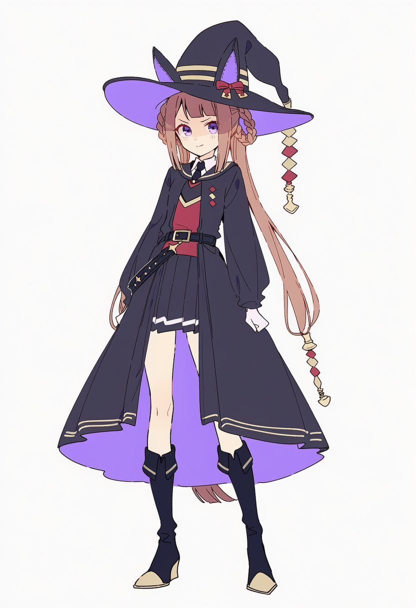

[在线例图](https://assets.quicktagcloud.com/images/raven_composition/raven_composition-1719.jpg?v=75c0d89c5a0dabe1)

<a id="raven_composition-1720"></a>

## 单臂置于脑后

ID：`raven_composition-1720`；分类：手臂姿势 / 手臂整体位置；来源标记：`safe`。

来源说明：

> 一只手臂弯曲放到头后方。

正向提示词：

```text
arm_behind_head
```

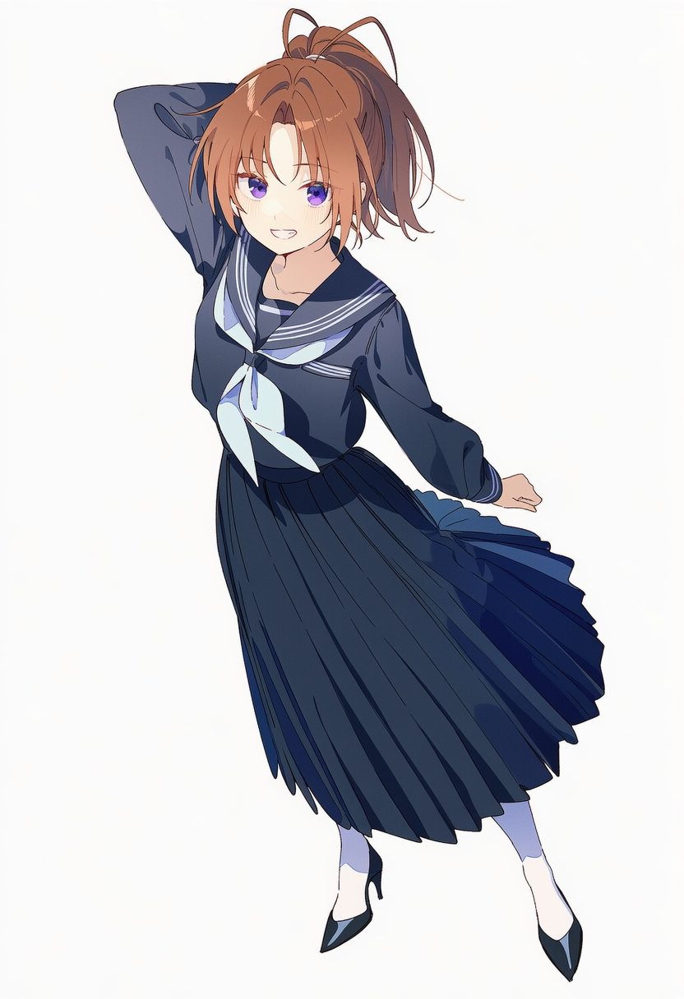

[在线例图](https://assets.quicktagcloud.com/images/raven_composition/raven_composition-1720.jpg?v=64172301a39c04a9)

<a id="raven_composition-1721"></a>

## 双臂置于脑后

ID：`raven_composition-1721`；分类：手臂姿势 / 手臂整体位置；来源标记：`safe`。

来源说明：

> 双臂弯曲放在头后方。

正向提示词：

```text
arms_behind_head
```

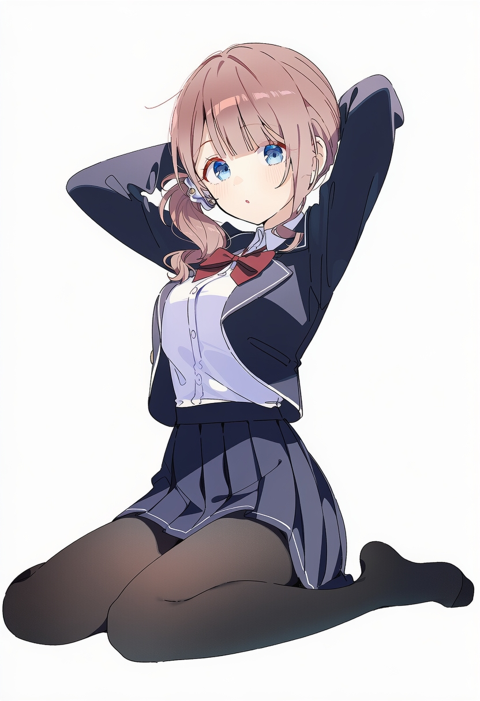

[在线例图](https://assets.quicktagcloud.com/images/raven_composition/raven_composition-1721.jpg?v=4595f37ec0cb0392)

<a id="raven_composition-1722"></a>

## 单臂背后

ID：`raven_composition-1722`；分类：手臂姿势 / 手臂整体位置；来源标记：`safe`。

来源说明：

> 一只手臂放在背后。

正向提示词：

```text
arm_behind_back
```

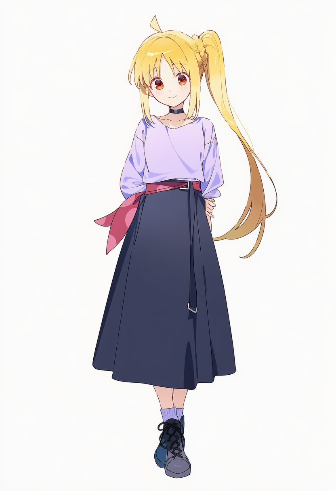

[在线例图](https://assets.quicktagcloud.com/images/raven_composition/raven_composition-1722.jpg?v=b8368ea92b95a5f3)

<a id="raven_composition-1723"></a>

## 双臂背后

ID：`raven_composition-1723`；分类：手臂姿势 / 手臂整体位置；来源标记：`safe`。

来源说明：

> 双臂都放在背后。

正向提示词：

```text
arms_behind_back
```

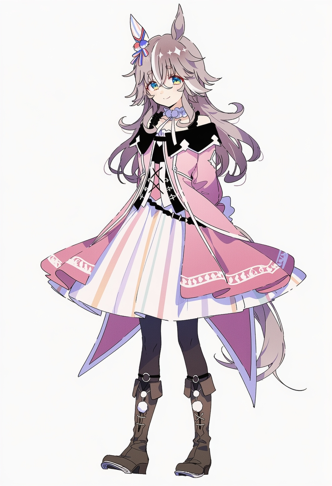

[在线例图](https://assets.quicktagcloud.com/images/raven_composition/raven_composition-1723.jpg?v=32bbc51e4b85a31e)

<a id="raven_composition-1724"></a>

## 双臂交叉

ID：`raven_composition-1724`；分类：手臂姿势 / 手臂整体位置；来源标记：`safe`。

来源说明：

> 双臂在胸前交叉。

正向提示词：

```text
crossed_arms
```


[在线例图](https://assets.quicktagcloud.com/images/raven_composition/raven_composition-1724.jpg?v=379bd33058e0ea63)

<a id="raven_composition-1725"></a>

## 单臂伸出

ID：`raven_composition-1725`；分类：手臂姿势 / 手臂整体位置；来源标记：`safe`。

来源说明：

> 一只手臂向外伸展。

正向提示词：

```text
outstretched_arm
```

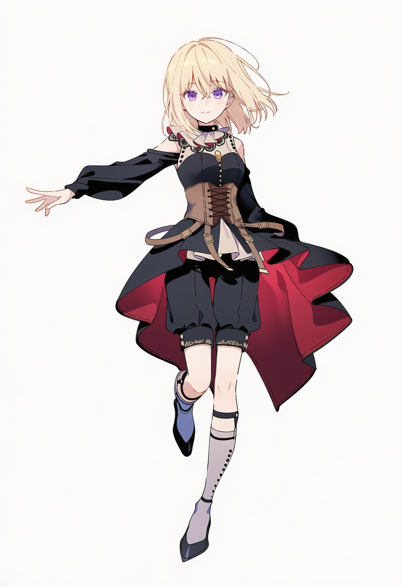

[在线例图](https://assets.quicktagcloud.com/images/raven_composition/raven_composition-1725.jpg?v=18a35ef82fed06f4)

<a id="raven_composition-1726"></a>

## 双臂伸出

ID：`raven_composition-1726`；分类：手臂姿势 / 手臂整体位置；来源标记：`safe`。

来源说明：

> 双臂向外或向前伸展。

正向提示词：

```text
outstretched_arms
```

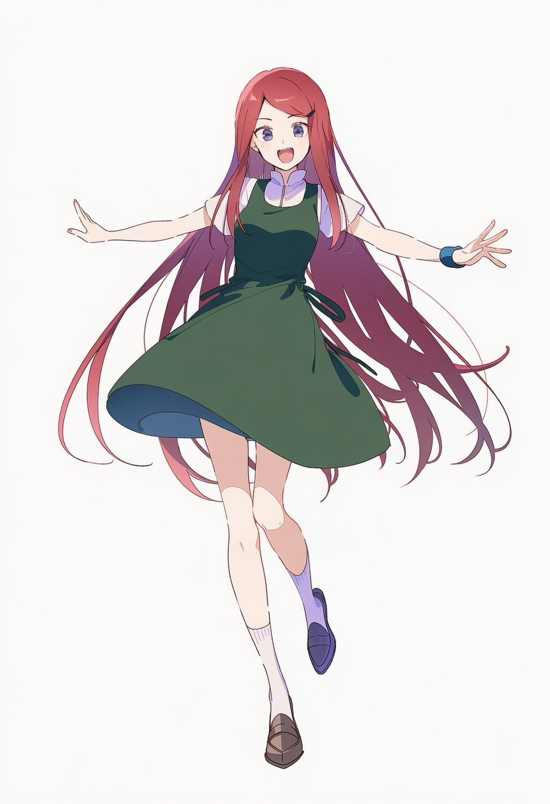

[在线例图](https://assets.quicktagcloud.com/images/raven_composition/raven_composition-1726.jpg?v=f701f0d08f87bfbe)

<a id="raven_composition-1727"></a>

## 张开双臂

ID：`raven_composition-1727`；分类：手臂姿势 / 手臂整体位置；来源标记：`safe`。

来源说明：

> 双臂向身体两侧大幅展开。

正向提示词：

```text
spread_arms
```

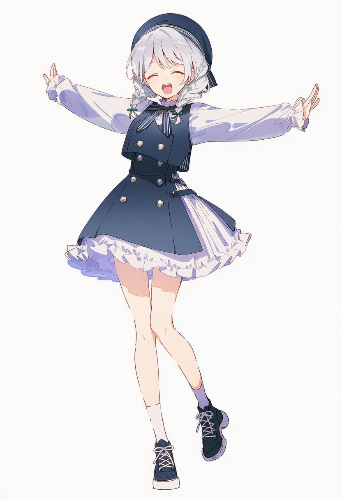

[在线例图](https://assets.quicktagcloud.com/images/raven_composition/raven_composition-1727.jpg?v=a4be8e8f9713d8f2)

<a id="raven_composition-1728"></a>

## 双臂横过身体

ID：`raven_composition-1728`；分类：手臂姿势 / 手臂整体位置；来源标记：`safe`。

来源说明：

> 双臂横向挡在身体前方。

正向提示词：

```text
arms_across_body
```

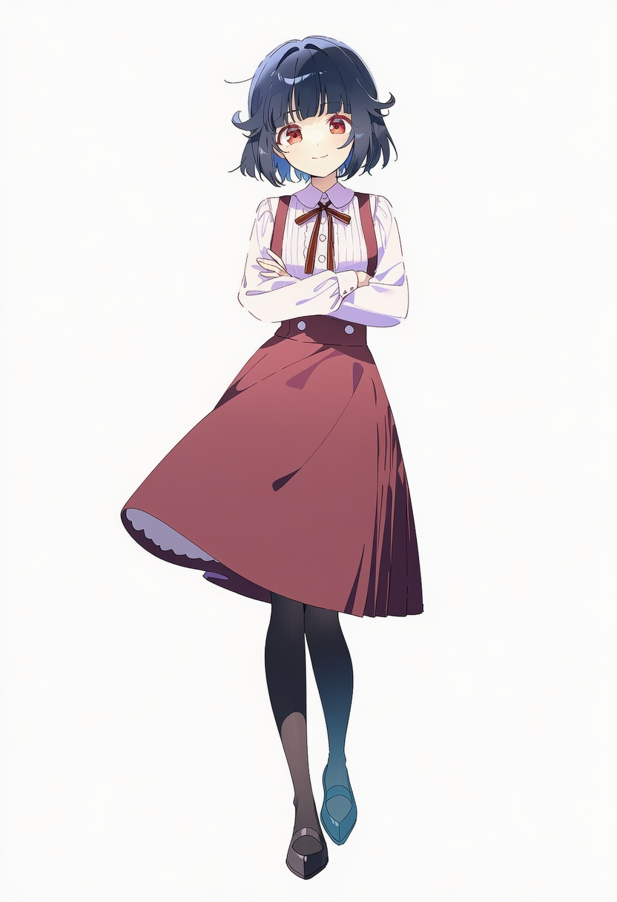

[在线例图](https://assets.quicktagcloud.com/images/raven_composition/raven_composition-1728.jpg?v=2864a107dff6d3fd)

<a id="raven_composition-1729"></a>

## 手臂横过腰部

ID：`raven_composition-1729`；分类：手臂姿势 / 手臂整体位置；来源标记：`safe`。

来源说明：

> 一只手臂横放在自己的腰前。

正向提示词：

```text
arm_across_waist
```

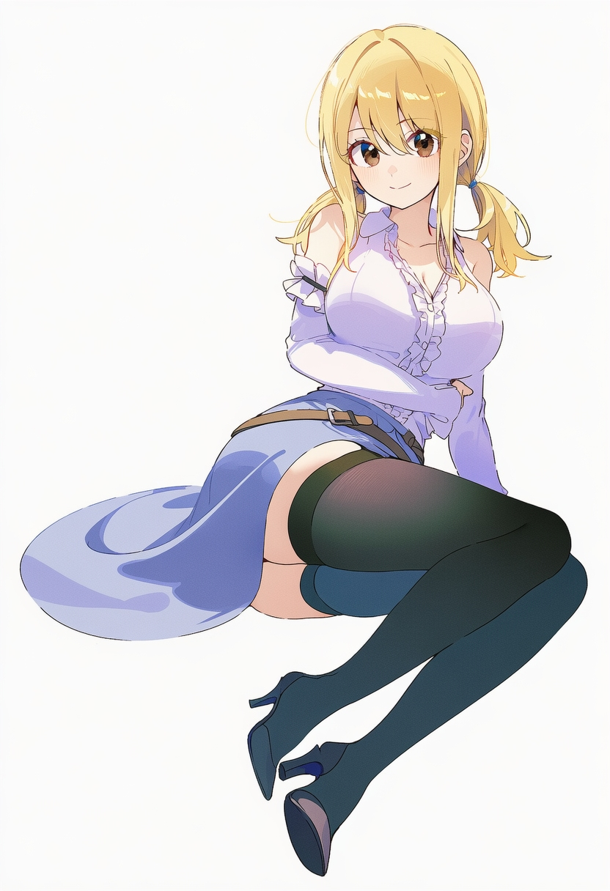

[在线例图](https://assets.quicktagcloud.com/images/raven_composition/raven_composition-1729.jpg?v=a076aa9f73684ee5)

<a id="raven_composition-1730"></a>

## 单臂托在胸下

ID：`raven_composition-1730`；分类：手臂姿势 / 手臂整体位置；来源标记：`safe`。

来源说明：

> 一只上臂位于胸部下方。

正向提示词：

```text
arm_under_breasts
```

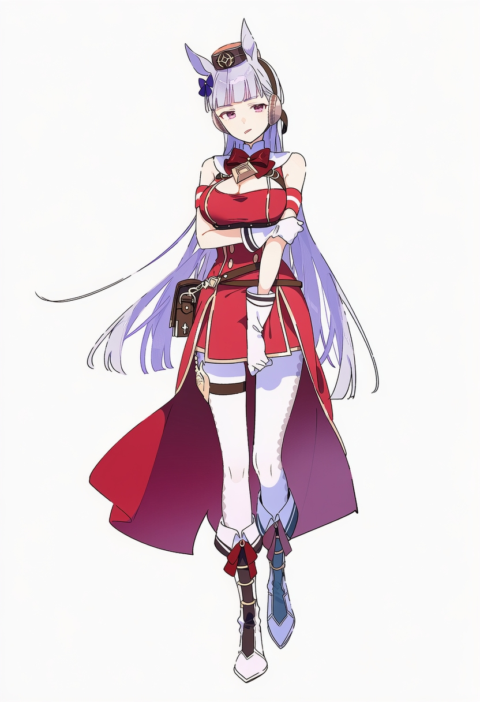

[在线例图](https://assets.quicktagcloud.com/images/raven_composition/raven_composition-1730.jpg?v=eafc9b90f61bb5bd)

<a id="raven_composition-1731"></a>

## 双臂托在胸下

ID：`raven_composition-1731`；分类：手臂姿势 / 手臂整体位置；来源标记：`safe`。

来源说明：

> 双臂位于胸部下方，常与抱臂同时出现。

正向提示词：

```text
arms_under_breasts
```

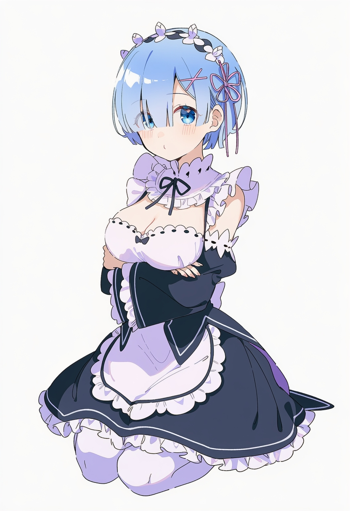

[在线例图](https://assets.quicktagcloud.com/images/raven_composition/raven_composition-1731.jpg?v=065674c2966df677)
