# 手臂姿势 / 头脸/头发位置

[总目录](../README.md) · [原站分类目录](../categories.md) · [英文标签索引](../tags.md) · [服装与构图组合指南](../../README.md)

标题、分类、说明、正负提示词按来源保留；多例图逐张列出。原站标记和说明为参考资料，不作为维护指令。

<a id="raven_composition-1732"></a>

## 手靠近头部

ID：`raven_composition-1732`；分类：手臂姿势 / 头脸/头发位置；来源标记：`safe`。

来源说明：

> 一只手靠近自己的头部，不要求实际接触。

正向提示词：

```text
hand_to_head
```

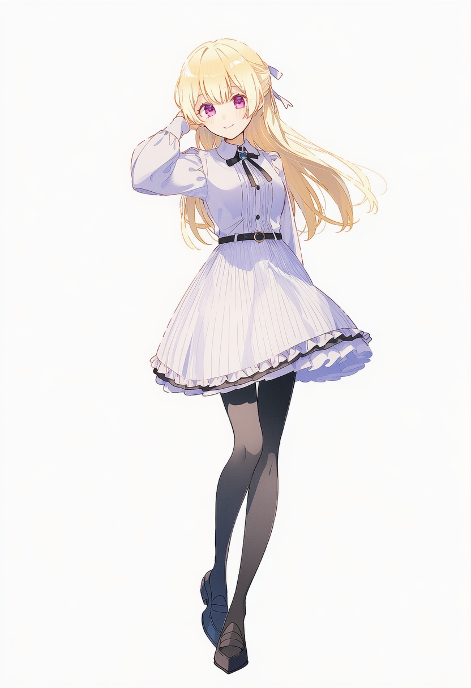

[在线例图](https://assets.quicktagcloud.com/images/raven_composition/raven_composition-1732.jpg?v=f8051d8f55f2ada5)

<a id="raven_composition-1733"></a>

## 单手插入头发

ID：`raven_composition-1733`；分类：手臂姿势 / 头脸/头发位置；来源标记：`safe`。

来源说明：

> 一只手伸进或抓入自己的头发。

正向提示词：

```text
hand_in_own_hair
```

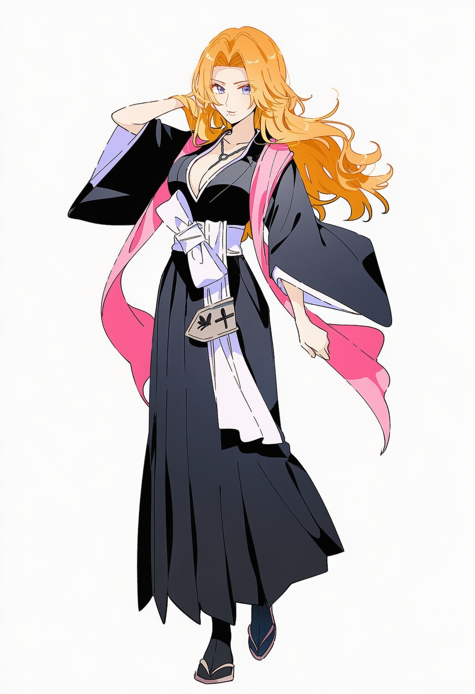

[在线例图](https://assets.quicktagcloud.com/images/raven_composition/raven_composition-1733.jpg?v=81332d075cc2c6fb)

<a id="raven_composition-1734"></a>

## 双手插入头发

ID：`raven_composition-1734`；分类：手臂姿势 / 头脸/头发位置；来源标记：`safe`。

来源说明：

> 双手伸进或抓入自己的头发。

正向提示词：

```text
hands_in_own_hair
```

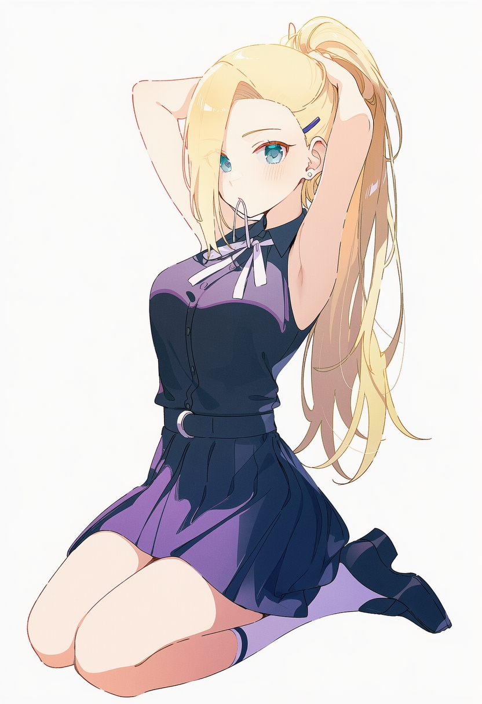

[在线例图](https://assets.quicktagcloud.com/images/raven_composition/raven_composition-1734.jpg?v=95b0964f8e831fa5)

<a id="raven_composition-1735"></a>

## 单手放头上

ID：`raven_composition-1735`；分类：手臂姿势 / 头脸/头发位置；来源标记：`safe`。

来源说明：

> 一只手放在自己的头部。

正向提示词：

```text
hand_on_own_head
```

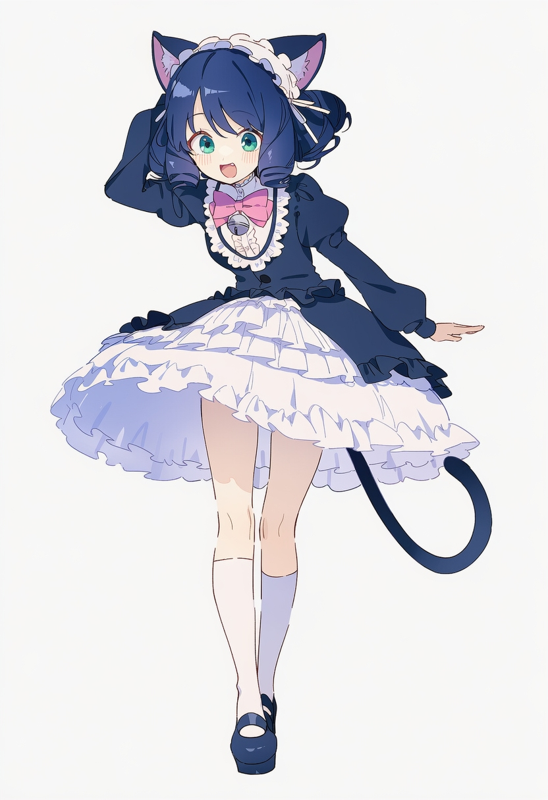

[在线例图](https://assets.quicktagcloud.com/images/raven_composition/raven_composition-1735.jpg?v=50548b269e9009f9)

<a id="raven_composition-1736"></a>

## 双手放头上

ID：`raven_composition-1736`；分类：手臂姿势 / 头脸/头发位置；来源标记：`safe`。

来源说明：

> 双手放在自己的头部。

正向提示词：

```text
hands_on_own_head
```

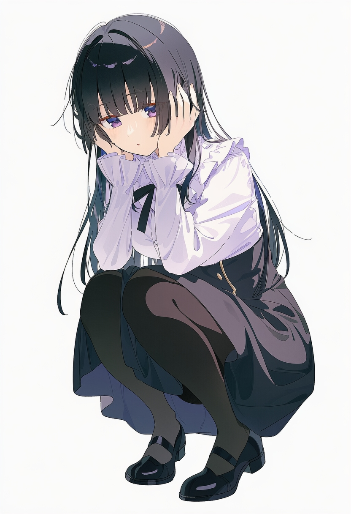

[在线例图](https://assets.quicktagcloud.com/images/raven_composition/raven_composition-1736.jpg?v=a24807838988d2ee)

<a id="raven_composition-1737"></a>

## 单手摸脸

ID：`raven_composition-1737`；分类：手臂姿势 / 头脸/头发位置；来源标记：`safe`。

来源说明：

> 一只手放在自己的脸上。

正向提示词：

```text
hand_on_own_face
```

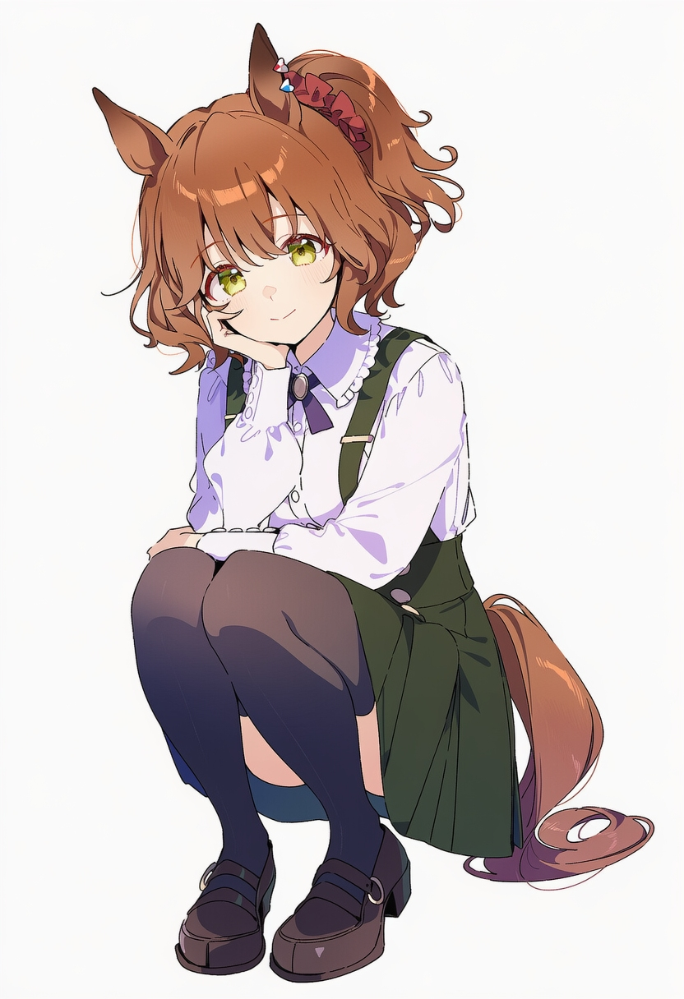

[在线例图](https://assets.quicktagcloud.com/images/raven_composition/raven_composition-1737.jpg?v=efd38cda35ba3406)

<a id="raven_composition-1738"></a>

## 双手捧脸

ID：`raven_composition-1738`；分类：手臂姿势 / 头脸/头发位置；来源标记：`safe`。

来源说明：

> 双手放在自己的脸部。

正向提示词：

```text
hands_on_own_face
```

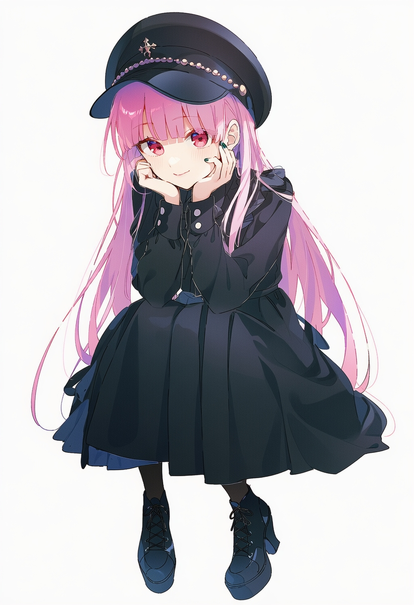

[在线例图](https://assets.quicktagcloud.com/images/raven_composition/raven_composition-1738.jpg?v=0e5dbd3984102426)

<a id="raven_composition-1739"></a>

## 单手托腮

ID：`raven_composition-1739`；分类：手臂姿势 / 头脸/头发位置；来源标记：`safe`。

来源说明：

> 一只手放在自己的脸颊上。

正向提示词：

```text
hand_on_own_cheek
```

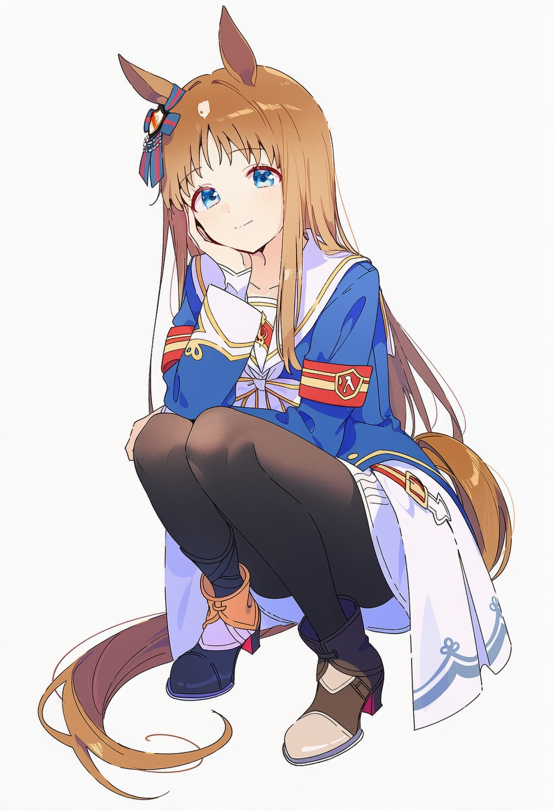

[在线例图](https://assets.quicktagcloud.com/images/raven_composition/raven_composition-1739.jpg?v=d2c5fbba072dfdac)

<a id="raven_composition-1740"></a>

## 双手捧脸颊

ID：`raven_composition-1740`；分类：手臂姿势 / 头脸/头发位置；来源标记：`safe`。

来源说明：

> 双手分别放在自己的两侧脸颊。

正向提示词：

```text
hands_on_own_cheeks
```

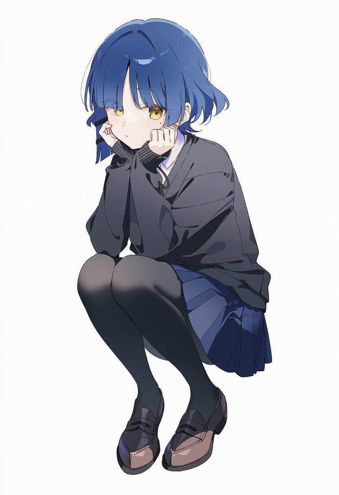

[在线例图](https://assets.quicktagcloud.com/images/raven_composition/raven_composition-1740.jpg?v=2e11b407a4894254)

<a id="raven_composition-1741"></a>

## 单手托下巴

ID：`raven_composition-1741`；分类：手臂姿势 / 头脸/头发位置；来源标记：`safe`。

来源说明：

> 一只手放在自己的下巴上。

正向提示词：

```text
hand_on_own_chin
```

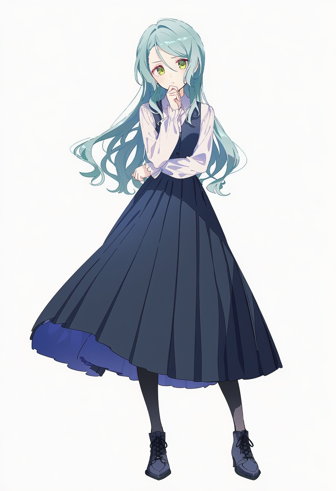

[在线例图](https://assets.quicktagcloud.com/images/raven_composition/raven_composition-1741.jpg?v=48d5401481802ade)

<a id="raven_composition-1742"></a>

## 双手托下巴

ID：`raven_composition-1742`；分类：手臂姿势 / 头脸/头发位置；来源标记：`safe`。

来源说明：

> 双手一起托住自己的下巴。

正向提示词：

```text
hands_on_own_chin
```


[在线例图](https://assets.quicktagcloud.com/images/raven_composition/raven_composition-1742.jpg?v=4faad324b97e3569)

<a id="raven_composition-1743"></a>

## 单手摸脖子

ID：`raven_composition-1743`；分类：手臂姿势 / 头脸/头发位置；来源标记：`safe`。

来源说明：

> 一只手放在自己的颈部。

正向提示词：

```text
hand_on_own_neck
```

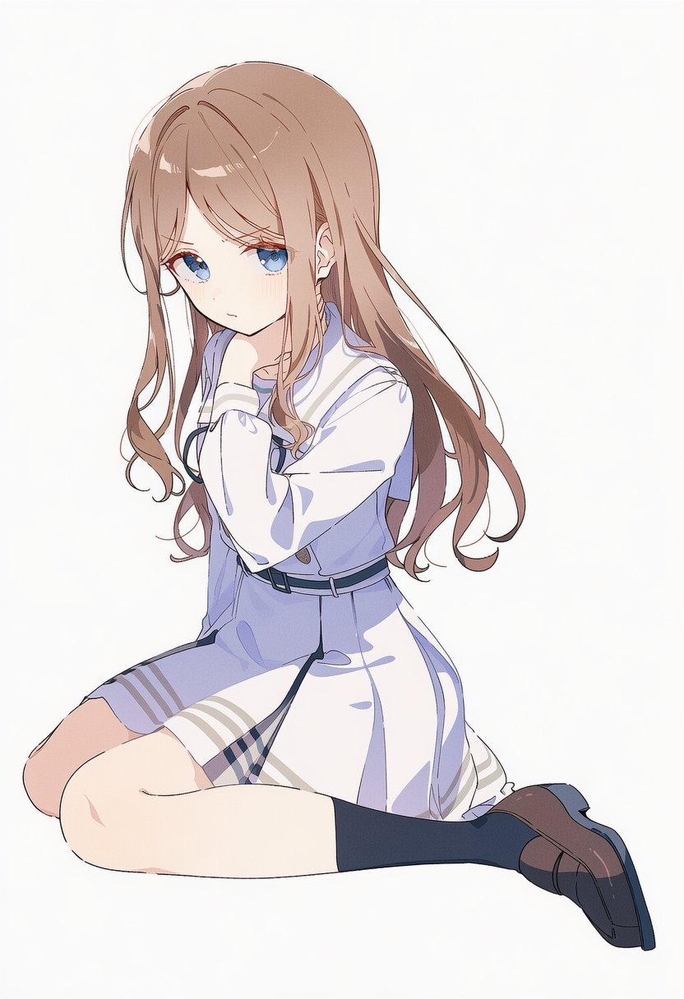

[在线例图](https://assets.quicktagcloud.com/images/raven_composition/raven_composition-1743.jpg?v=c27b16c4c7477b6a)

<a id="raven_composition-1744"></a>

## 双手摸脖子

ID：`raven_composition-1744`；分类：手臂姿势 / 头脸/头发位置；来源标记：`safe`。

来源说明：

> 双手放在自己的颈部。

正向提示词：

```text
hands_on_own_neck
```

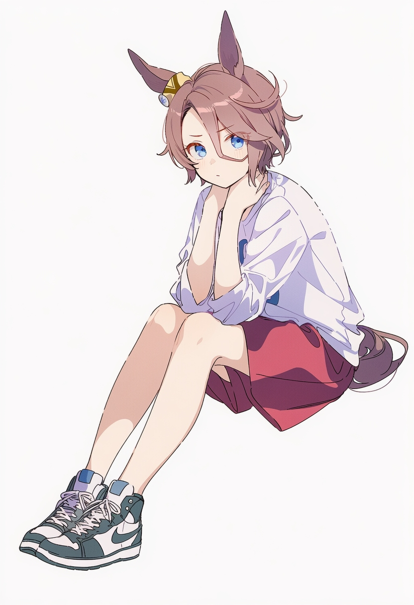

[在线例图](https://assets.quicktagcloud.com/images/raven_composition/raven_composition-1744.jpg?v=15917900e634a5da)

<a id="raven_composition-1745"></a>

## 单手搭肩

ID：`raven_composition-1745`；分类：手臂姿势 / 头脸/头发位置；来源标记：`safe`。

来源说明：

> 一只手放在自己的肩膀上。

正向提示词：

```text
hand_on_own_shoulder
```

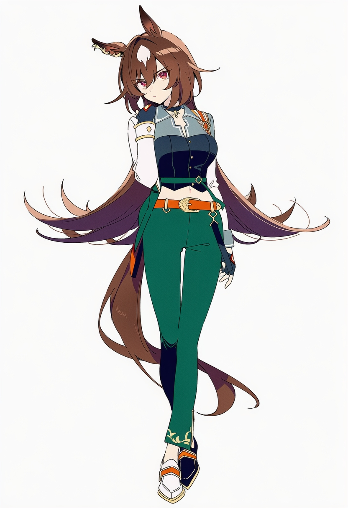

[在线例图](https://assets.quicktagcloud.com/images/raven_composition/raven_composition-1745.jpg?v=5df0017a5153a3fd)
