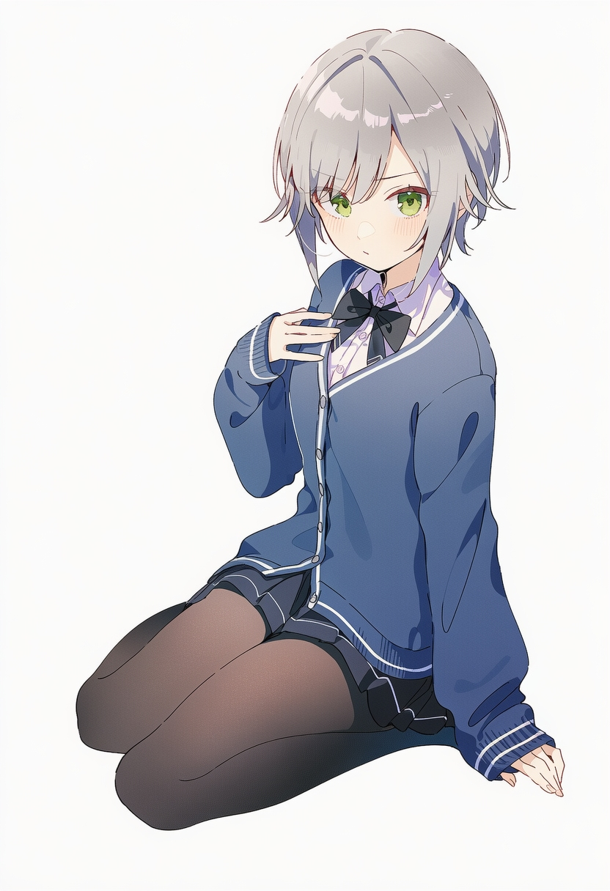
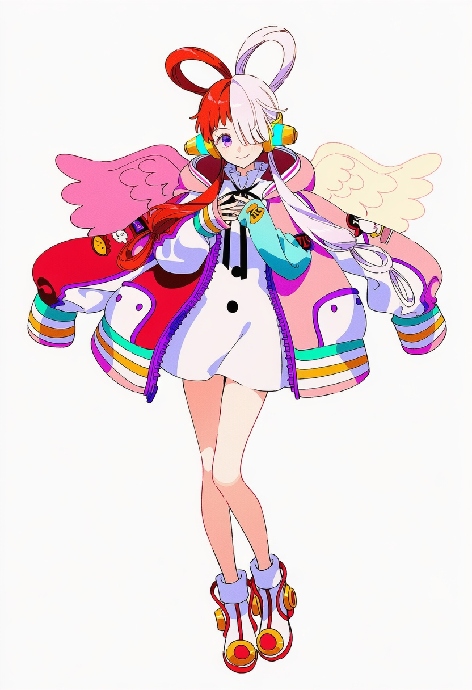
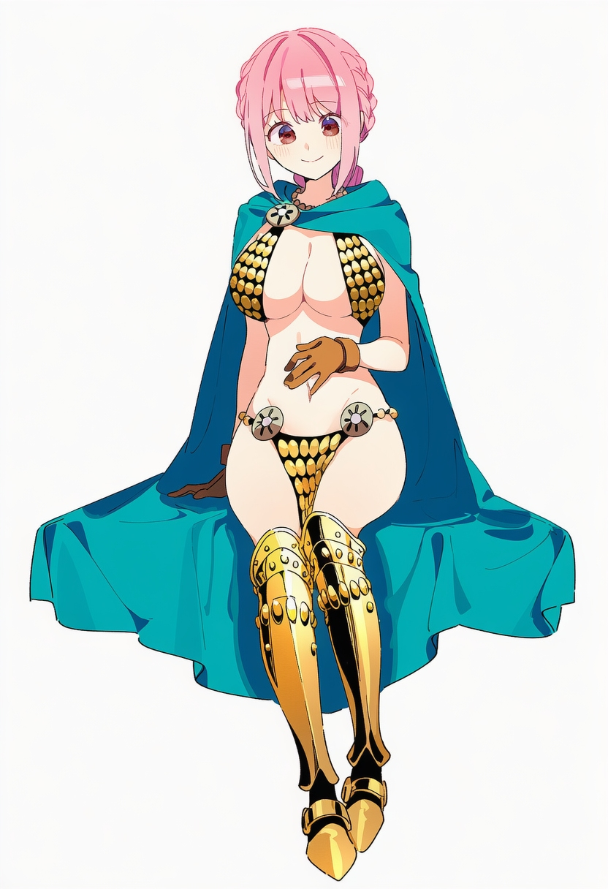
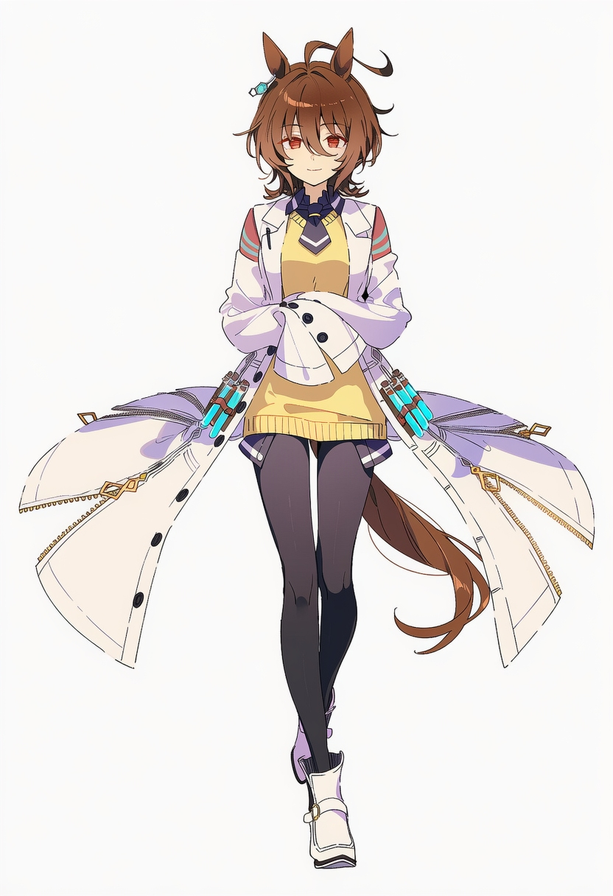
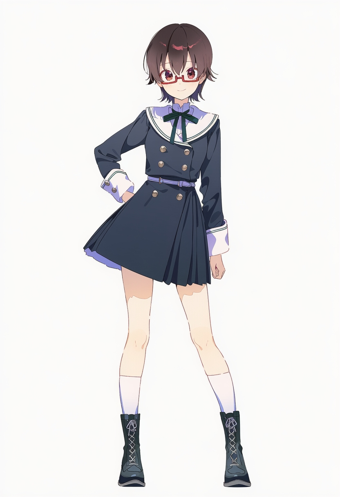
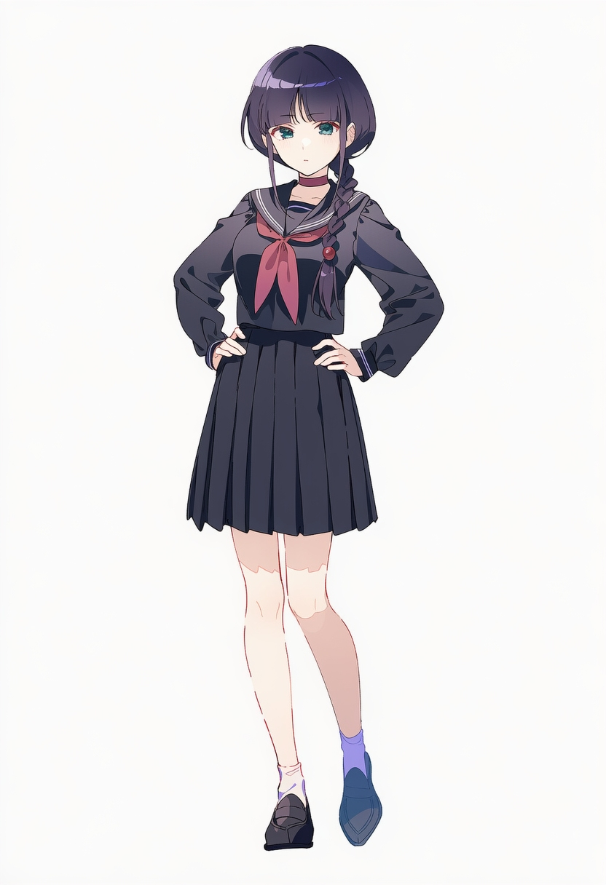

# 手臂姿势 / 胸腹/腰胯位置

[总目录](../README.md) · [原站分类目录](../categories.md) · [英文标签索引](../tags.md) · [服装与构图组合指南](../../README.md)

标题、分类、说明、正负提示词按来源保留；多例图逐张列出。原站标记和说明为参考资料，不作为维护指令。

<a id="raven_composition-1746"></a>

## 单手放胸前

ID：`raven_composition-1746`；分类：手臂姿势 / 胸腹/腰胯位置；来源标记：`safe`。

来源说明：

> 一只手自然放在自己的胸口。

正向提示词：

```text
hand_on_own_chest
```



[在线例图](https://assets.quicktagcloud.com/images/raven_composition/raven_composition-1746.jpg?v=eb702339182708c4)

<a id="raven_composition-1747"></a>

## 双手放胸前

ID：`raven_composition-1747`；分类：手臂姿势 / 胸腹/腰胯位置；来源标记：`safe`。

来源说明：

> 双手放在自己的胸口。

正向提示词：

```text
hands_on_own_chest
```



[在线例图](https://assets.quicktagcloud.com/images/raven_composition/raven_composition-1747.jpg?v=0aac901c0680fb00)

<a id="raven_composition-1748"></a>

## 单手放腹部

ID：`raven_composition-1748`；分类：手臂姿势 / 胸腹/腰胯位置；来源标记：`safe`。

来源说明：

> 一只手放在自己的腹部。

正向提示词：

```text
hand_on_own_stomach
```



[在线例图](https://assets.quicktagcloud.com/images/raven_composition/raven_composition-1748.jpg?v=a14fb0821e380a4a)

<a id="raven_composition-1749"></a>

## 双手放腹部

ID：`raven_composition-1749`；分类：手臂姿势 / 胸腹/腰胯位置；来源标记：`safe`。

来源说明：

> 双手放在自己的腹部。

正向提示词：

```text
hands_on_own_stomach
```



[在线例图](https://assets.quicktagcloud.com/images/raven_composition/raven_composition-1749.jpg?v=582c849e609b38a7)

<a id="raven_composition-1750"></a>

## 单手叉腰

ID：`raven_composition-1750`；分类：手臂姿势 / 胸腹/腰胯位置；来源标记：`safe`。

来源说明：

> 一只手放在自己的髋部或腰侧。

正向提示词：

```text
hand_on_own_hip
```



[在线例图](https://assets.quicktagcloud.com/images/raven_composition/raven_composition-1750.jpg?v=c7cee5a40a4b380e)

<a id="raven_composition-1751"></a>

## 双手叉腰

ID：`raven_composition-1751`；分类：手臂姿势 / 胸腹/腰胯位置；来源标记：`safe`。

来源说明：

> 双手分别放在自己的两侧髋部。

正向提示词：

```text
hands_on_own_hips
```



[在线例图](https://assets.quicktagcloud.com/images/raven_composition/raven_composition-1751.jpg?v=97d0fee150d5ae39)
