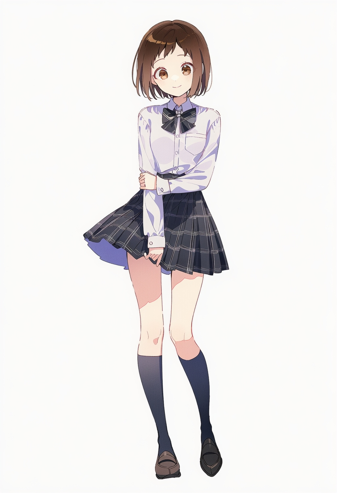
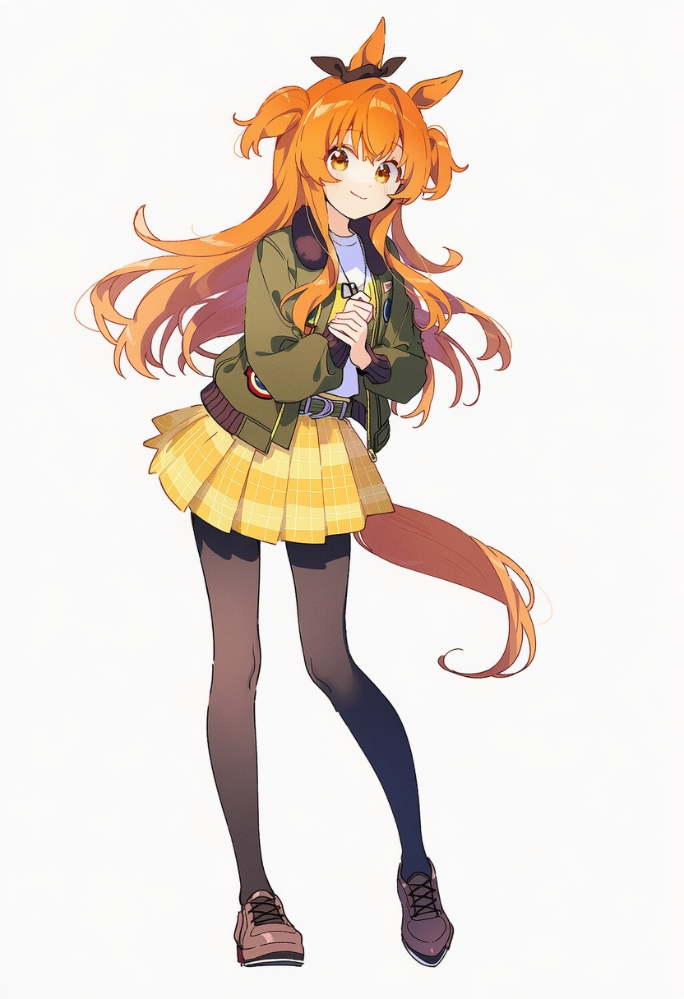
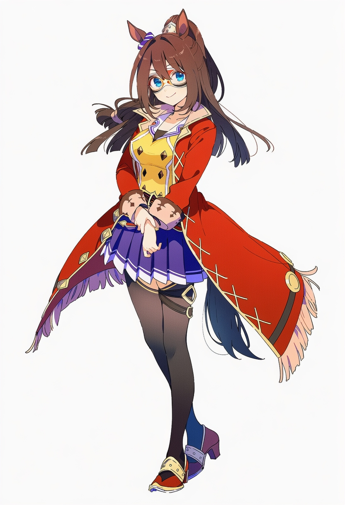
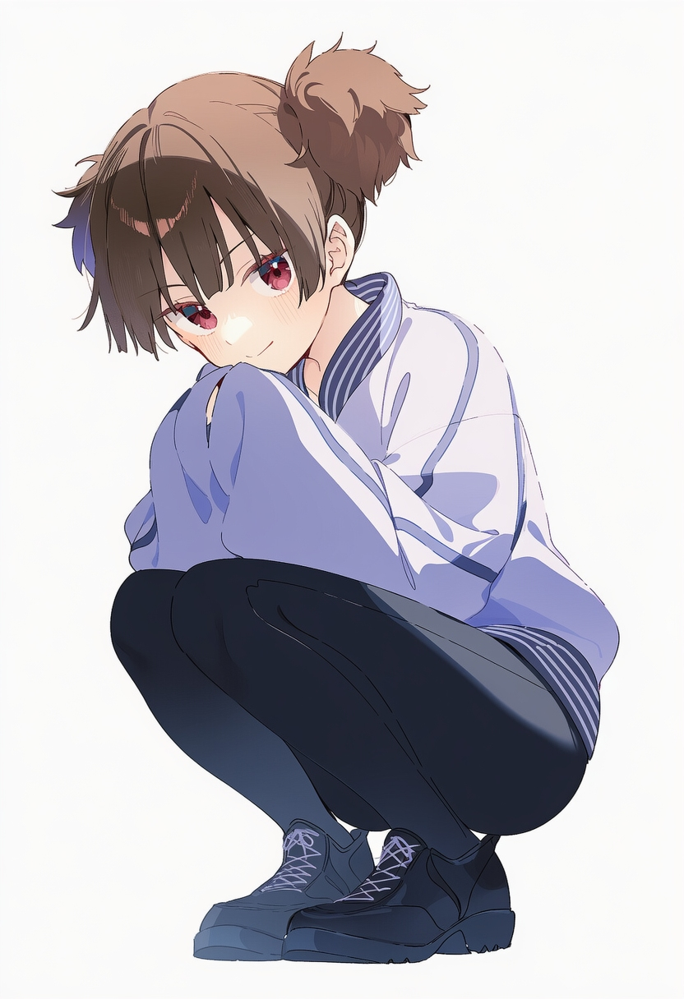
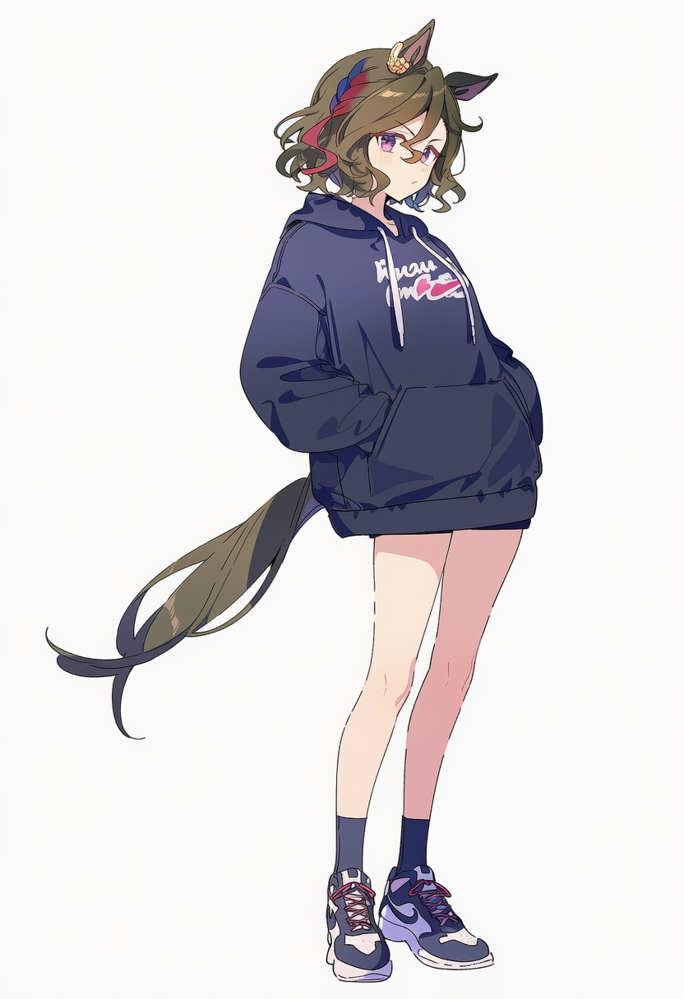
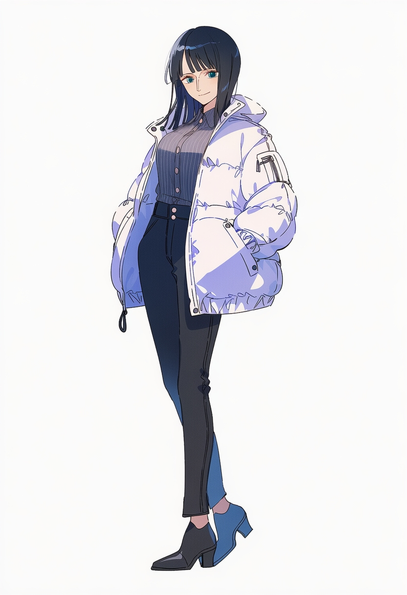

# 手臂姿势 / 自身手臂/口袋

[总目录](../README.md) · [原站分类目录](../categories.md) · [英文标签索引](../tags.md) · [服装与构图组合指南](../../README.md)

标题、分类、说明、正负提示词按来源保留；多例图逐张列出。原站标记和说明为参考资料，不作为维护指令。

<a id="raven_composition-1752"></a>

## 手搭自己手臂

ID：`raven_composition-1752`；分类：手臂姿势 / 自身手臂/口袋；来源标记：`safe`。

来源说明：

> 一只手放在自己的另一条手臂上。

正向提示词：

```text
hand_on_own_arm
```



[在线例图](https://assets.quicktagcloud.com/images/raven_composition/raven_composition-1752.jpg?v=ae5514c134312347)

<a id="raven_composition-1753"></a>

## 双手搭自己双臂

ID：`raven_composition-1753`；分类：手臂姿势 / 自身手臂/口袋；来源标记：`safe`。

来源说明：

> 双手分别接触自己的手臂。

正向提示词：

```text
hands_on_own_arms
```


[在线例图](https://assets.quicktagcloud.com/images/raven_composition/raven_composition-1753.jpg?v=1dc7c8d89b128b9e)

<a id="raven_composition-1754"></a>

## 手扶自己手肘

ID：`raven_composition-1754`；分类：手臂姿势 / 自身手臂/口袋；来源标记：`safe`。

来源说明：

> 一只手放在自己的另一侧手肘。

正向提示词：

```text
hand_on_own_elbow
```


[在线例图](https://assets.quicktagcloud.com/images/raven_composition/raven_composition-1754.jpg?v=247a36694d593c08)

<a id="raven_composition-1755"></a>

## 手搭自己手腕

ID：`raven_composition-1755`；分类：手臂姿势 / 自身手臂/口袋；来源标记：`safe`。

来源说明：

> 一只手放在自己的另一侧手腕。

正向提示词：

```text
hand_on_own_wrist
```



[在线例图](https://assets.quicktagcloud.com/images/raven_composition/raven_composition-1755.jpg?v=efe302071c720e91)

<a id="raven_composition-1756"></a>

## 握住自己手腕

ID：`raven_composition-1756`；分类：手臂姿势 / 自身手臂/口袋；来源标记：`safe`。

来源说明：

> 一只手握住自己的另一侧手腕或前臂。

正向提示词：

```text
holding_own_wrist
```



[在线例图](https://assets.quicktagcloud.com/images/raven_composition/raven_composition-1756.jpg?v=909d3575fbb2c613)

<a id="raven_composition-1757"></a>

## 双手藏进对侧袖子

ID：`raven_composition-1757`；分类：手臂姿势 / 自身手臂/口袋；来源标记：`safe`。

来源说明：

> 双手分别伸进相对一侧的袖子里。

正向提示词：

```text
hands_in_opposite_sleeves
```



[在线例图](https://assets.quicktagcloud.com/images/raven_composition/raven_composition-1757.jpg?v=7f9b9033f88eb48a)

<a id="raven_composition-1758"></a>

## 单手插兜

ID：`raven_composition-1758`；分类：手臂姿势 / 自身手臂/口袋；来源标记：`safe`。

来源说明：

> 一只手插进一个口袋。

正向提示词：

```text
hand_in_pocket
```


[在线例图](https://assets.quicktagcloud.com/images/raven_composition/raven_composition-1758.jpg?v=f5c911885ff47043)

<a id="raven_composition-1759"></a>

## 双手同兜

ID：`raven_composition-1759`；分类：手臂姿势 / 自身手臂/口袋；来源标记：`safe`。

来源说明：

> 双手插进同一个口袋，常见于连帽衫袋。

正向提示词：

```text
hands_in_pocket
```



[在线例图](https://assets.quicktagcloud.com/images/raven_composition/raven_composition-1759.jpg?v=84c226fbfec3f94e)

<a id="raven_composition-1760"></a>

## 双手插兜

ID：`raven_composition-1760`；分类：手臂姿势 / 自身手臂/口袋；来源标记：`safe`。

来源说明：

> 双手分别插进两个口袋。

正向提示词：

```text
hands_in_pockets
```



[在线例图](https://assets.quicktagcloud.com/images/raven_composition/raven_composition-1760.jpg?v=c9893bd19d04a1e6)
