# 手臂姿势 / 腿部/坐姿手位

[总目录](../README.md) · [原站分类目录](../categories.md) · [英文标签索引](../tags.md) · [服装与构图组合指南](../../README.md)

标题、分类、说明、正负提示词按来源保留；多例图逐张列出。原站标记和说明为参考资料，不作为维护指令。

<a id="raven_composition-1761"></a>

## 单手放大腿

ID：`raven_composition-1761`；分类：手臂姿势 / 腿部/坐姿手位；来源标记：`safe`。

来源说明：

> 一只手放在自己的大腿上。

正向提示词：

```text
hand_on_own_thigh
```

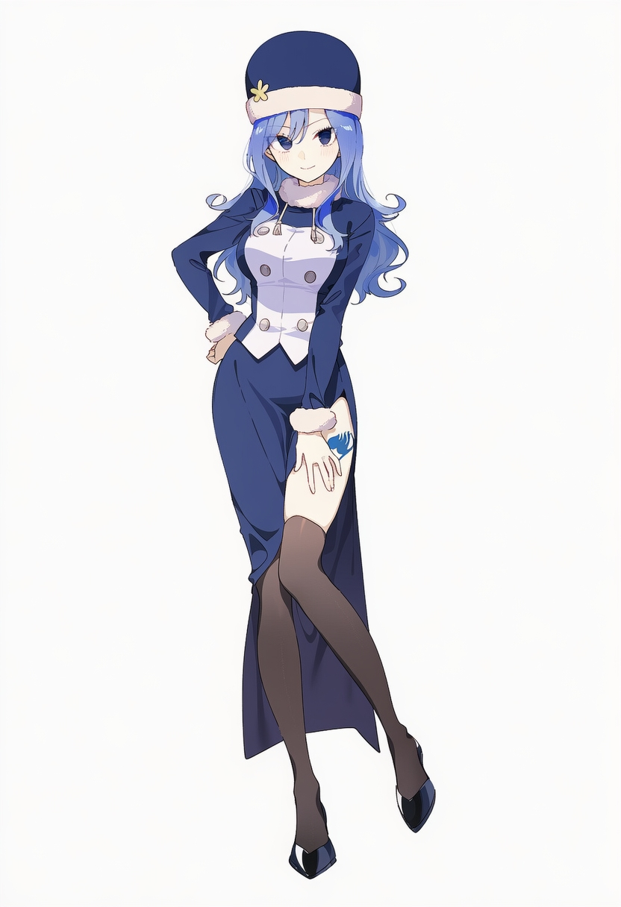

[在线例图](https://assets.quicktagcloud.com/images/raven_composition/raven_composition-1761.jpg?v=44a8fabdfcda3afe)

<a id="raven_composition-1762"></a>

## 双手放双腿

ID：`raven_composition-1762`；分类：手臂姿势 / 腿部/坐姿手位；来源标记：`safe`。

来源说明：

> 双手分别放在自己的两侧大腿上。

正向提示词：

```text
hands_on_own_thighs
```

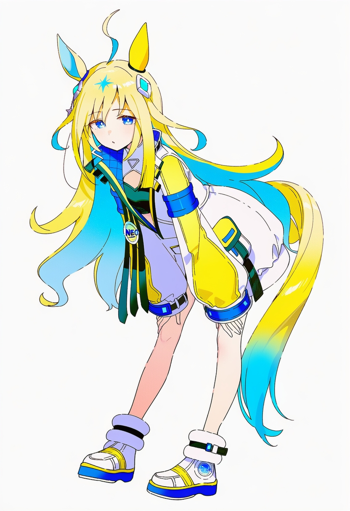

[在线例图](https://assets.quicktagcloud.com/images/raven_composition/raven_composition-1762.jpg?v=b9bdce8cbc3e7bc7)

<a id="raven_composition-1763"></a>

## 单手放膝盖

ID：`raven_composition-1763`；分类：手臂姿势 / 腿部/坐姿手位；来源标记：`safe`。

来源说明：

> 一只手放在自己的膝盖上。

正向提示词：

```text
hand_on_own_knee
```


[在线例图](https://assets.quicktagcloud.com/images/raven_composition/raven_composition-1763.jpg?v=23c67e29d88dfe83)

<a id="raven_composition-1764"></a>

## 双手放膝盖

ID：`raven_composition-1764`；分类：手臂姿势 / 腿部/坐姿手位；来源标记：`safe`。

来源说明：

> 双手放在自己的膝盖上。

正向提示词：

```text
hands_on_own_knees
```

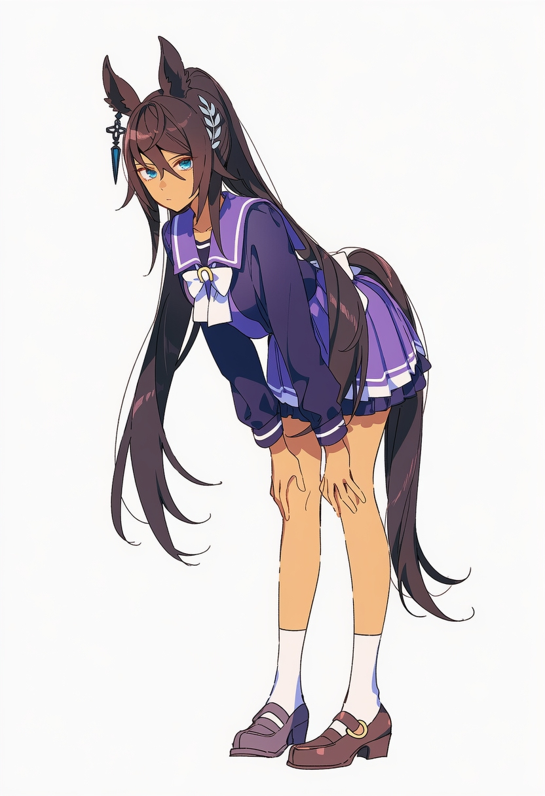

[在线例图](https://assets.quicktagcloud.com/images/raven_composition/raven_composition-1764.jpg?v=f33a85fc4ffbf73c)

<a id="raven_composition-1765"></a>

## 单手搭腿

ID：`raven_composition-1765`；分类：手臂姿势 / 腿部/坐姿手位；来源标记：`safe`。

来源说明：

> 一只手放在自己的腿上。

正向提示词：

```text
hand_on_own_leg
```

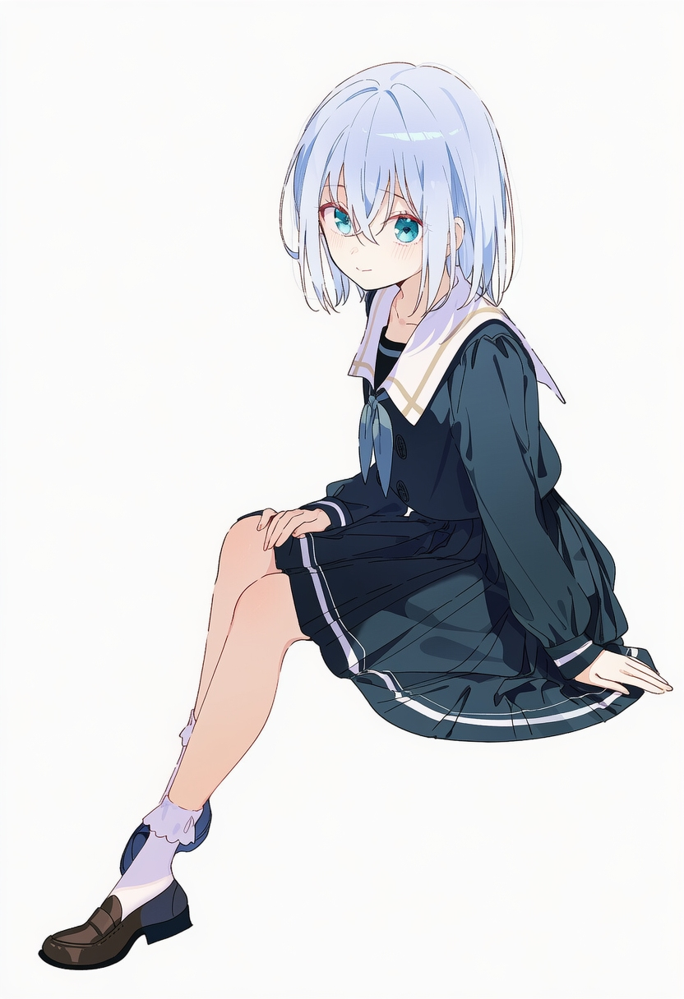

[在线例图](https://assets.quicktagcloud.com/images/raven_composition/raven_composition-1765.jpg?v=8fe9de3321fe7e4c)

<a id="raven_composition-1766"></a>

## 双手搭单腿

ID：`raven_composition-1766`；分类：手臂姿势 / 腿部/坐姿手位；来源标记：`safe`。

来源说明：

> 双手一起放在自己的同一条腿上。

正向提示词：

```text
hands_on_own_leg
```

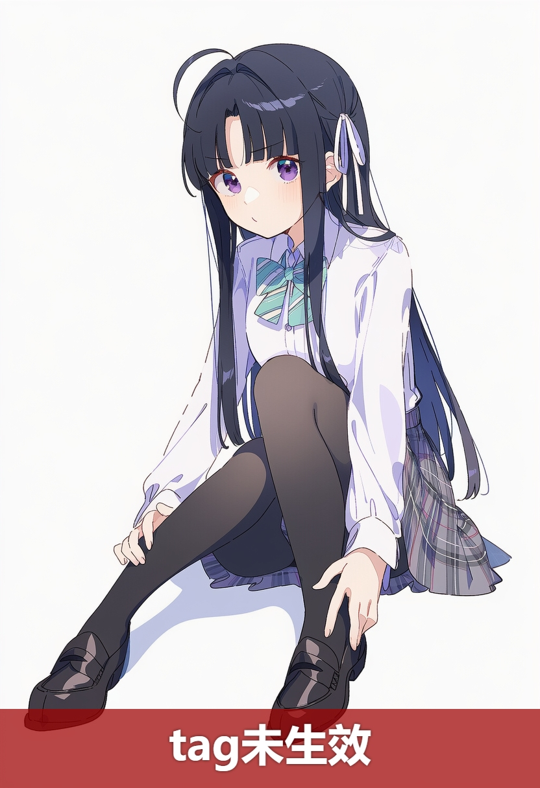

[在线例图](https://assets.quicktagcloud.com/images/raven_composition/raven_composition-1766.jpg?v=3f202534db30369f)

<a id="raven_composition-1767"></a>

## 双手搭双腿

ID：`raven_composition-1767`；分类：手臂姿势 / 腿部/坐姿手位；来源标记：`safe`。

来源说明：

> 双手分别或同时放在自己的双腿上。

正向提示词：

```text
hands_on_own_legs
```

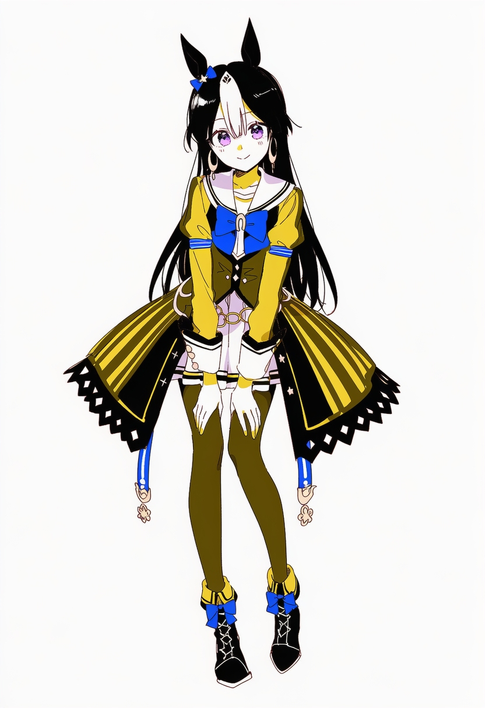

[在线例图](https://assets.quicktagcloud.com/images/raven_composition/raven_composition-1767.jpg?v=bba8f8f76472cc7a)

<a id="raven_composition-1768"></a>

## 单手扶脚踝

ID：`raven_composition-1768`；分类：手臂姿势 / 腿部/坐姿手位；来源标记：`safe`。

来源说明：

> 一只手放在自己的脚踝上。

正向提示词：

```text
hand_on_own_ankle
```

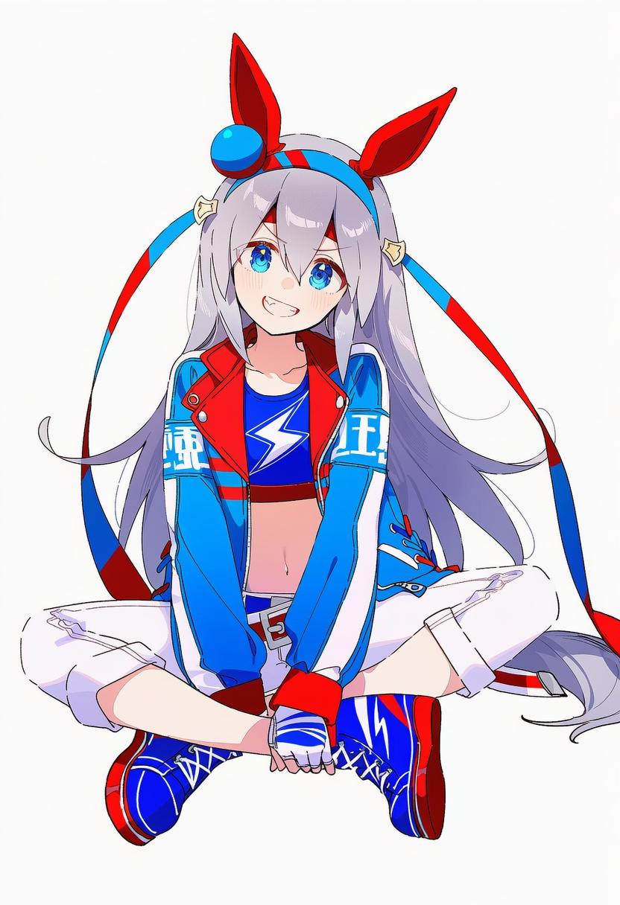

[在线例图](https://assets.quicktagcloud.com/images/raven_composition/raven_composition-1768.jpg?v=d945b5ab0efa448a)

<a id="raven_composition-1769"></a>

## 单手扶小腿

ID：`raven_composition-1769`；分类：手臂姿势 / 腿部/坐姿手位；来源标记：`safe`。

来源说明：

> 一只手放在自己的小腿上。

正向提示词：

```text
hand_on_own_calf
```

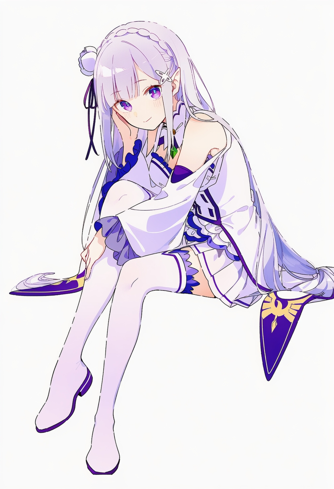

[在线例图](https://assets.quicktagcloud.com/images/raven_composition/raven_composition-1769.jpg?v=cc0008c0f8fb6330)

<a id="raven_composition-1770"></a>

## 手搭对侧大腿

ID：`raven_composition-1770`；分类：手臂姿势 / 腿部/坐姿手位；来源标记：`safe`。

来源说明：

> 一只手跨过身体放在对侧大腿上。

正向提示词：

```text
hand_on_own_opposite_thigh
```

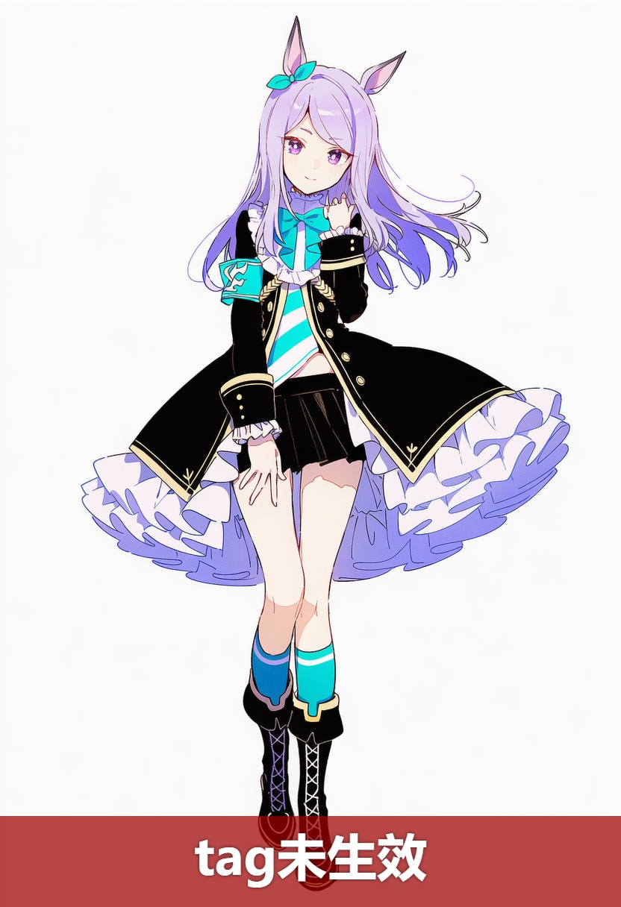

[在线例图](https://assets.quicktagcloud.com/images/raven_composition/raven_composition-1770.jpg?v=f2f48f26a8228554)

<a id="raven_composition-1771"></a>

## 手放双腿之间

ID：`raven_composition-1771`；分类：手臂姿势 / 腿部/坐姿手位；来源标记：`safe`。

来源说明：

> 一只手位于自己的两腿之间。

正向提示词：

```text
hand_between_own_legs
```

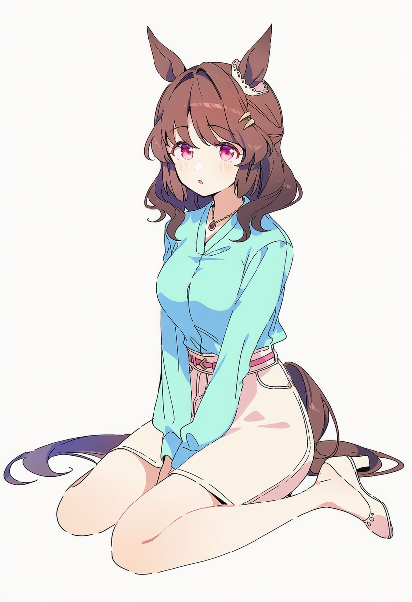

[在线例图](https://assets.quicktagcloud.com/images/raven_composition/raven_composition-1771.jpg?v=f0679717caeb2c86)

<a id="raven_composition-1772"></a>

## 单手放腿面

ID：`raven_composition-1772`；分类：手臂姿势 / 腿部/坐姿手位；来源标记：`safe`。

来源说明：

> 一只手放在坐姿时的大腿上表面。

正向提示词：

```text
hand_on_lap
```

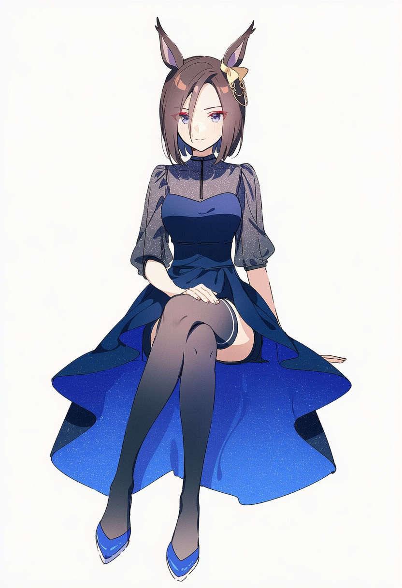

[在线例图](https://assets.quicktagcloud.com/images/raven_composition/raven_composition-1772.jpg?v=1cc2052e67039076)

<a id="raven_composition-1773"></a>

## 双手放腿面

ID：`raven_composition-1773`；分类：手臂姿势 / 腿部/坐姿手位；来源标记：`safe`。

来源说明：

> 坐着或跪着时，双手放在腿面上。

正向提示词：

```text
hands_on_lap
```


[在线例图](https://assets.quicktagcloud.com/images/raven_composition/raven_composition-1773.jpg?v=b89c296bae6b2e3c)

<a id="raven_composition-1774"></a>

## 抱住自己一条腿

ID：`raven_composition-1774`；分类：手臂姿势 / 腿部/坐姿手位；来源标记：`safe`。

来源说明：

> 用手抓住或抱住自己的一条腿。

正向提示词：

```text
holding_own_leg
```

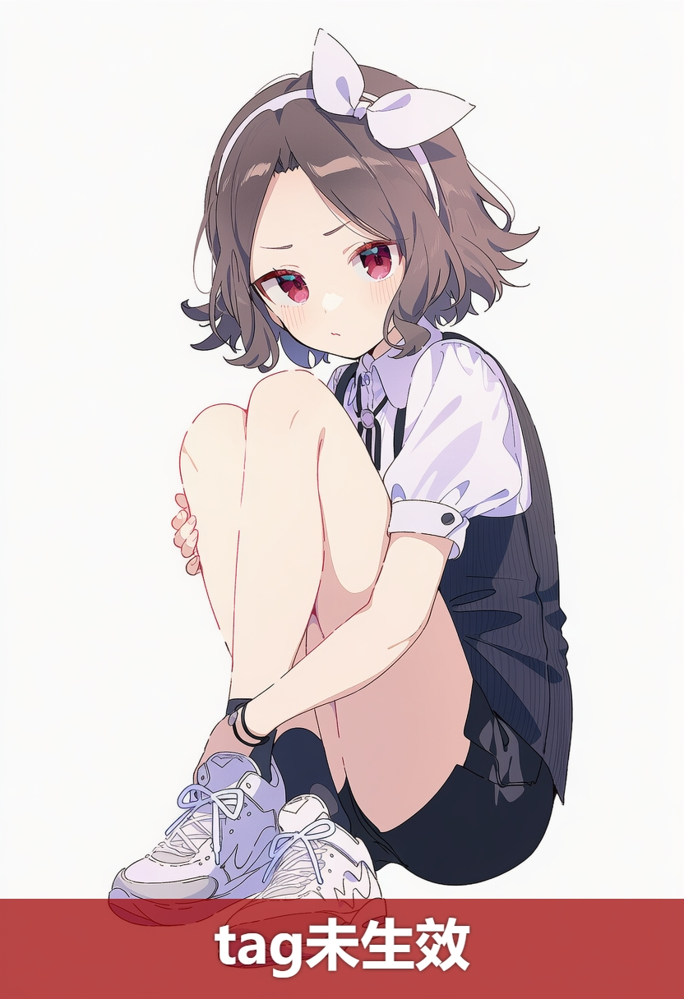

[在线例图](https://assets.quicktagcloud.com/images/raven_composition/raven_composition-1774.jpg?v=192211ed869a20d1)

<a id="raven_composition-1775"></a>

## 握住自己脚踝

ID：`raven_composition-1775`；分类：手臂姿势 / 腿部/坐姿手位；来源标记：`safe`。

来源说明：

> 用手握住自己的一个脚踝。

正向提示词：

```text
holding_own_ankle
```

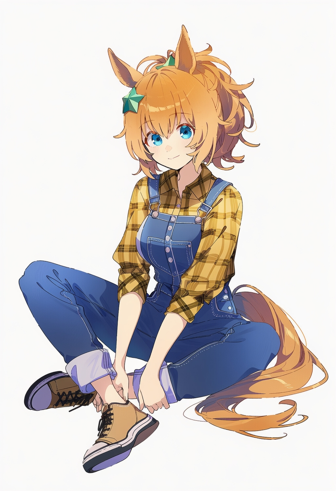

[在线例图](https://assets.quicktagcloud.com/images/raven_composition/raven_composition-1775.jpg?v=64a525c780247ac4)

<a id="raven_composition-1776"></a>

## 握住双脚踝

ID：`raven_composition-1776`；分类：手臂姿势 / 腿部/坐姿手位；来源标记：`safe`。

来源说明：

> 双手握住自己的两个脚踝。

正向提示词：

```text
holding_own_ankles
```

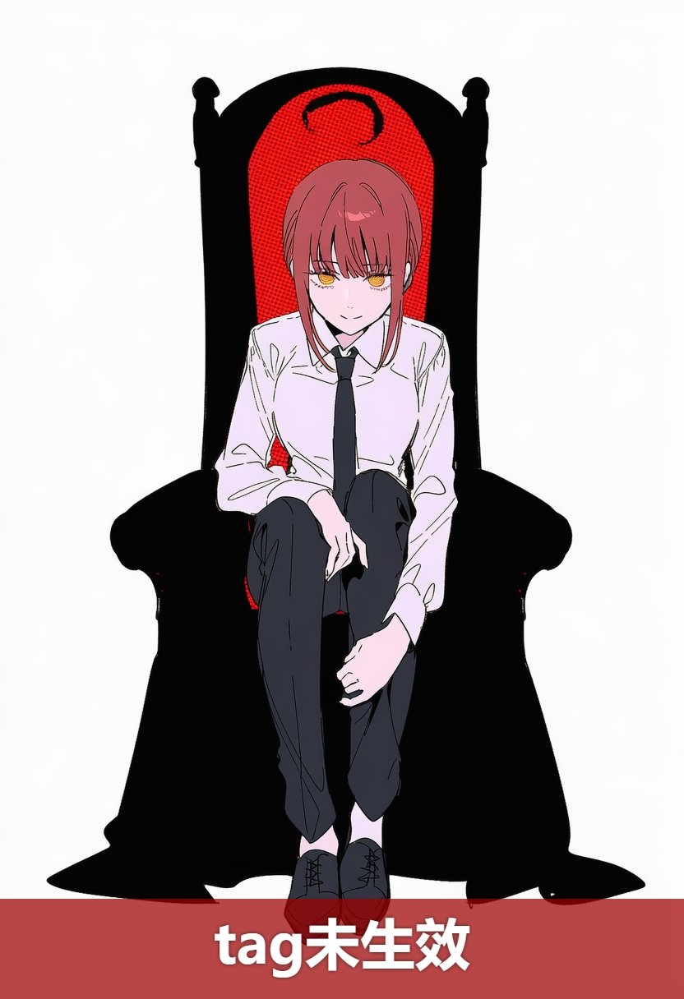

[在线例图](https://assets.quicktagcloud.com/images/raven_composition/raven_composition-1776.jpg?v=fa6a9ca3a6ceab65)

<a id="raven_composition-1777"></a>

## 抱住自己单腿

ID：`raven_composition-1777`；分类：手臂姿势 / 腿部/坐姿手位；来源标记：`safe`。

来源说明：

> 用双臂环抱自己的一条腿。

正向提示词：

```text
hugging_own_leg
```

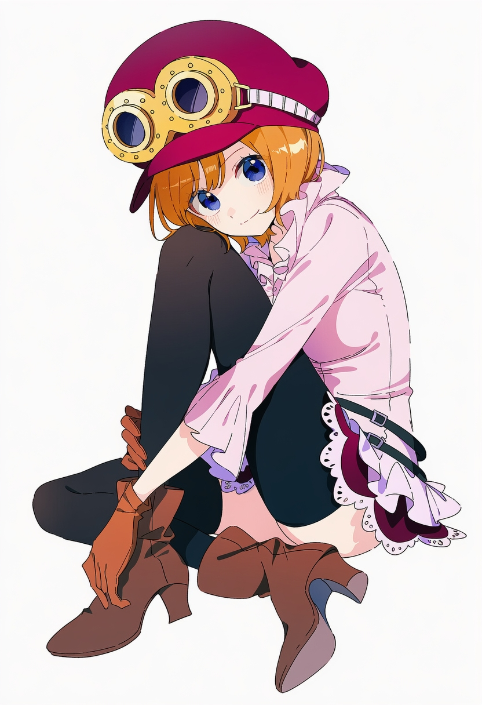

[在线例图](https://assets.quicktagcloud.com/images/raven_composition/raven_composition-1777.jpg?v=82c9e70072187df1)

<a id="raven_composition-1778"></a>

## 抱住自己双腿

ID：`raven_composition-1778`；分类：手臂姿势 / 腿部/坐姿手位；来源标记：`safe`。

来源说明：

> 用双臂环抱自己的双腿或膝盖。

正向提示词：

```text
hugging_own_legs
```


[在线例图](https://assets.quicktagcloud.com/images/raven_composition/raven_composition-1778.jpg?v=88dff3672f43697e)
