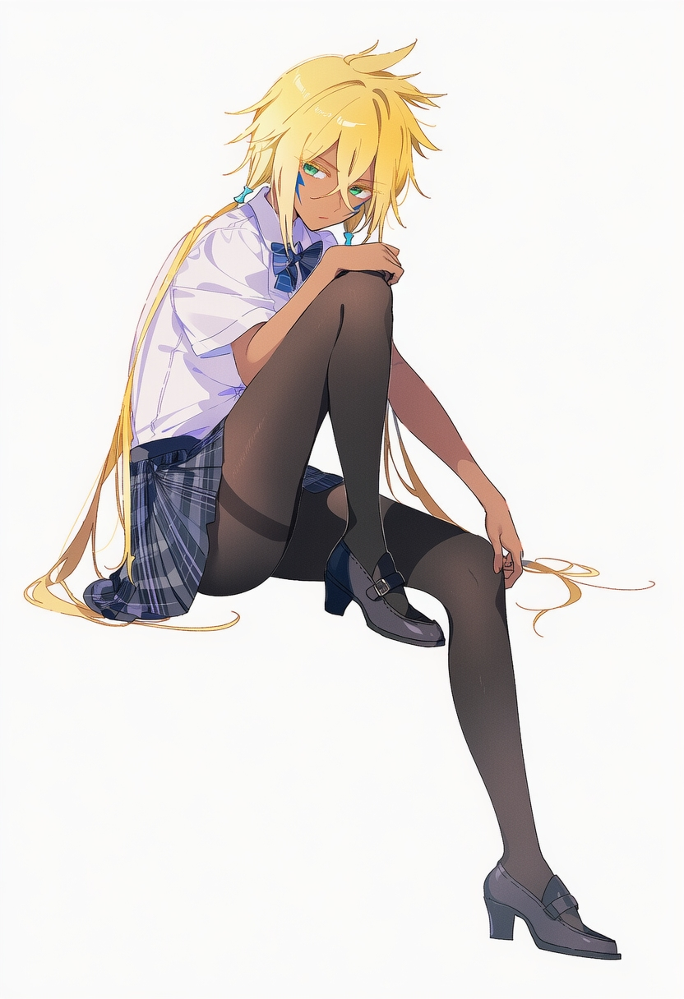
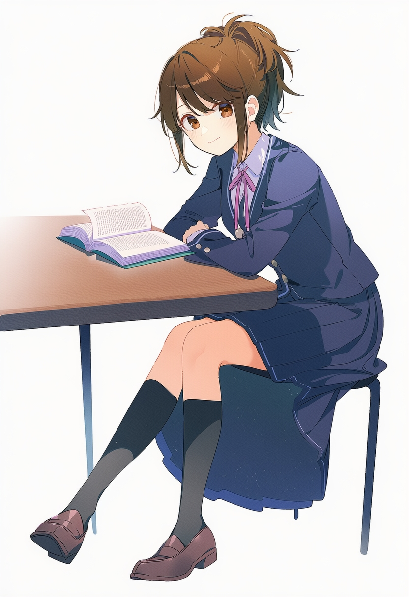

# 手臂姿势 / 支撑/接触表面

[总目录](../README.md) · [原站分类目录](../categories.md) · [英文标签索引](../tags.md) · [服装与构图组合指南](../../README.md)

标题、分类、说明、正负提示词按来源保留；多例图逐张列出。原站标记和说明为参考资料，不作为维护指令。

<a id="raven_composition-1779"></a>

## 手臂支靠

ID：`raven_composition-1779`；分类：手臂姿势 / 支撑/接触表面；来源标记：`safe`。

来源说明：

> 手臂靠在物体或身体部位上休息。

正向提示词：

```text
arm_rest
```


[在线例图](https://assets.quicktagcloud.com/images/raven_composition/raven_composition-1779.jpg?v=ece07aa4d7ae0e45)

<a id="raven_composition-1780"></a>

## 双臂搭膝

ID：`raven_composition-1780`；分类：手臂姿势 / 支撑/接触表面；来源标记：`safe`。

来源说明：

> 双臂放在膝盖上。

正向提示词：

```text
arms_on_knees
```


[在线例图](https://assets.quicktagcloud.com/images/raven_composition/raven_composition-1780.jpg?v=95e4cce629db9f85)

<a id="raven_composition-1781"></a>

## 单肘撑膝

ID：`raven_composition-1781`；分类：手臂姿势 / 支撑/接触表面；来源标记：`safe`。

来源说明：

> 一只手肘支在膝盖上。

正向提示词：

```text
elbow_on_knee
```


[在线例图](https://assets.quicktagcloud.com/images/raven_composition/raven_composition-1781.jpg?v=99f1e586c6148c5f)

<a id="raven_composition-1782"></a>

## 双肘撑膝

ID：`raven_composition-1782`；分类：手臂姿势 / 支撑/接触表面；来源标记：`safe`。

来源说明：

> 双肘分别支在膝盖上。

正向提示词：

```text
elbows_on_knees
```


[在线例图](https://assets.quicktagcloud.com/images/raven_composition/raven_composition-1782.jpg?v=b8d9d050e43e2134)

<a id="raven_composition-1783"></a>

## 单肘撑大腿

ID：`raven_composition-1783`；分类：手臂姿势 / 支撑/接触表面；来源标记：`safe`。

来源说明：

> 一只手肘支在大腿上。

正向提示词：

```text
elbow_on_thigh
```


[在线例图](https://assets.quicktagcloud.com/images/raven_composition/raven_composition-1783.jpg?v=2be02d06581dbef0)

<a id="raven_composition-1784"></a>

## 双肘撑大腿

ID：`raven_composition-1784`；分类：手臂姿势 / 支撑/接触表面；来源标记：`safe`。

来源说明：

> 双肘分别支在大腿上。

正向提示词：

```text
elbows_on_thighs
```


[在线例图](https://assets.quicktagcloud.com/images/raven_composition/raven_composition-1784.jpg?v=909dd88f457e11cc)

<a id="raven_composition-1785"></a>

## 手臂搭膝

ID：`raven_composition-1785`；分类：手臂姿势 / 支撑/接触表面；来源标记：`safe`。

来源说明：

> 一条手臂放在膝盖上。

正向提示词：

```text
arm_on_knee
```



[在线例图](https://assets.quicktagcloud.com/images/raven_composition/raven_composition-1785.jpg?v=f465f0ac5c74cc57)

<a id="raven_composition-1786"></a>

## 手臂搭大腿

ID：`raven_composition-1786`；分类：手臂姿势 / 支撑/接触表面；来源标记：`safe`。

来源说明：

> 一条手臂放在大腿上。

正向提示词：

```text
arm_on_thigh
```


[在线例图](https://assets.quicktagcloud.com/images/raven_composition/raven_composition-1786.jpg?v=b4d10b7717f0dfb3)

<a id="raven_composition-1787"></a>

## 手肘支靠

ID：`raven_composition-1787`；分类：手臂姿势 / 支撑/接触表面；来源标记：`safe`。

来源说明：

> 用手肘靠在物体或身体部位上。

正向提示词：

```text
elbow_rest
```


[在线例图](https://assets.quicktagcloud.com/images/raven_composition/raven_composition-1787.jpg?v=838bc2911b340f5f)

<a id="raven_composition-1788"></a>

## 手放桌面

ID：`raven_composition-1788`；分类：手臂姿势 / 支撑/接触表面；来源标记：`safe`。

来源说明：

> 一只手放在桌面上。

正向提示词：

```text
hand_on_table
```


[在线例图](https://assets.quicktagcloud.com/images/raven_composition/raven_composition-1788.jpg?v=7030e0dbe49fa90c)

<a id="raven_composition-1789"></a>

## 双前臂放桌面

ID：`raven_composition-1789`；分类：手臂姿势 / 支撑/接触表面；来源标记：`safe`。

来源说明：

> 两条前臂平放在桌面上。

正向提示词：

```text
arms_on_table
```



[在线例图](https://assets.quicktagcloud.com/images/raven_composition/raven_composition-1789.jpg?v=90b894f9aae1bcac)

<a id="raven_composition-1790"></a>

## 单前臂放桌面

ID：`raven_composition-1790`；分类：手臂姿势 / 支撑/接触表面；来源标记：`safe`。

来源说明：

> 一条前臂平放在桌面上。

正向提示词：

```text
arm_on_table
```


[在线例图](https://assets.quicktagcloud.com/images/raven_composition/raven_composition-1790.jpg?v=be327a4ec5b36ea4)

<a id="raven_composition-1791"></a>

## 头靠手

ID：`raven_composition-1791`；分类：手臂姿势 / 支撑/接触表面；来源标记：`safe`。

来源说明：

> 头部靠在自己的手上。

正向提示词：

```text
head_on_hand
```


[在线例图](https://assets.quicktagcloud.com/images/raven_composition/raven_composition-1791.jpg?v=dcf8e6025b4b4339)
